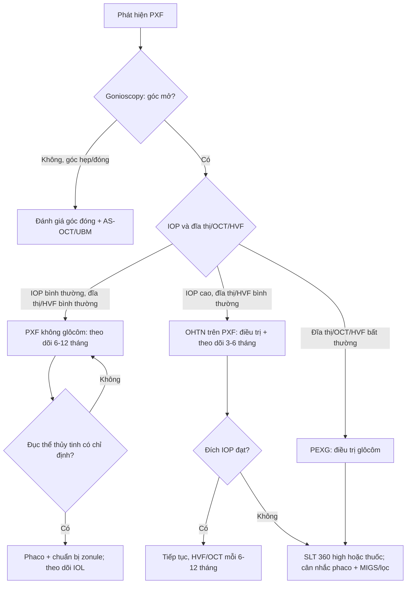
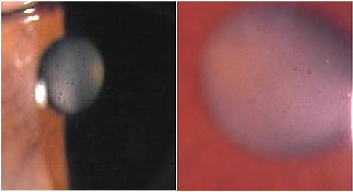
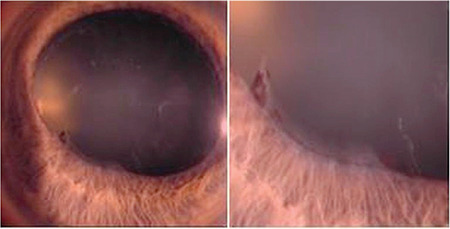
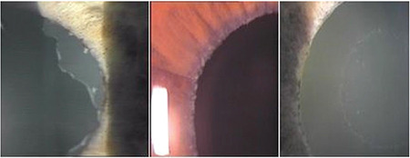
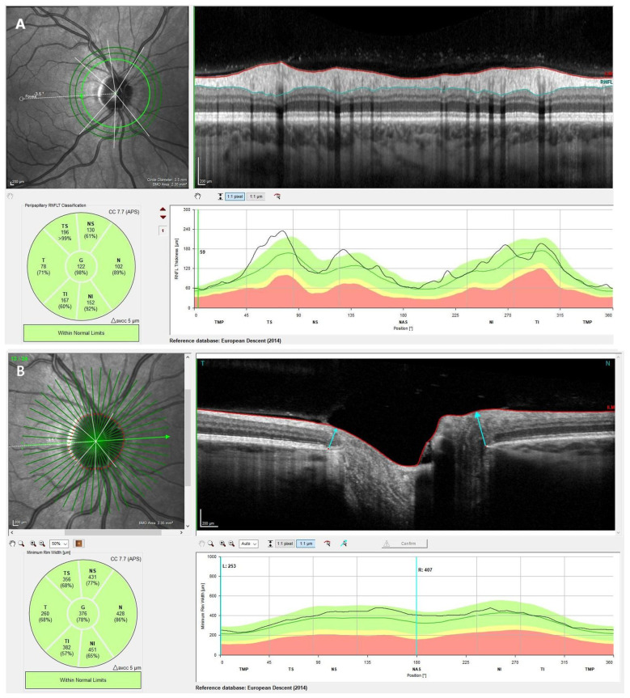

# 3234 — Bong vảy bao thể thủy tinh KHÔNG có glôcôm: theo dõi thế nào, khi nào SLT, khi nào phaco sớm / Pseudoexfoliation without glaucoma: surveillance, SLT, early lens extraction

**Tags:** `pattern:bong-vay-bao-truoc` `pattern:tang-sac-to-goc` `pattern:teo-sac-to` `pattern:iop-binh-thuong` `vung:mat` `vung:goc-tien-phong` `vung:the-thuy-tinh` `vung:dia-thi` `protocol:gonioscopy` `protocol:AS-OCT` `protocol:OCT-RNFL` `protocol:thi-truong` `score:khong` `incidentaloma:khong`

**Mức chắc chắn (certainty):** tổng hợp y văn (literature synthesis) — dựng từ **đoàn hệ 485 mắt/369 bệnh nhân PXF** theo dõi bằng thuật toán đọc thị trường (*Ophthalmology* 2026, DOI 10.1016/j.ophtha.2026.04.010), **nghiên cứu Malmö 98 + 98 mắt OHTN có/không PXF** theo dõi **8,7 năm** (*Ophthalmology* 2005, DOI 10.1016/j.ophtha.2004.09.024), **đoàn hệ 35 mắt PXF một bên** (*J Glaucoma* 2004, DOI 10.1097/00061198-200406000-00001), **nghiên cứu OCT phân lớp 65 mắt PXF + 80 chứng** (*BMC Ophthalmol* 2026, **PMC12983886**), **43 mắt PEXG điều trị SLT** (*Korean J Ophthalmol* 2021, DOI 10.3341/kjo.2021.0086), **phân tích hậu kiểm OSLT 512 mắt** (*Ophthalmol Glaucoma* 2026, DOI 10.1016/j.ogla.2025.08.008), **thử nghiệm pilot 12 bệnh nhân** về lấy thể thủy tinh sớm (*Eye* 2023, DOI 10.1038/s41433-022-02271-4), **nghiên cứu phaco 61 mắt** (*BMC Ophthalmol* 2021, DOI 10.1186/s12886-021-01970-y) và **tổng quan PXF** (*Turk J Ophthalmol* 2023, **PMC10442753**, CC BY-NC-ND). Nhóm **không có bệnh nhân của mình**; chỗ chưa đủ chắc ghi **"chưa rõ"**. **Không ghi tên tác giả** — attribution dùng **tạp chí + năm + PMCID/DOI**.

> **Câu chốt:** PXF **không phải "một phát hiện tình cờ ở người già"** — đây là **bệnh tiến triển của bè củng mạc**, và câu hỏi thật là **ai sẽ chuyển glôcôm trong 4 năm tới**. Bốn nhóm số phải thuộc: **(1)** trên **485 mắt PXF**, **glôcôm thị trường 4 năm là 26,5%** (95% CI 20,7–32,0) khi **không** tăng nhãn áp và **37,5%** (24,3–48,4) khi **có** tăng nhãn áp; **87,3%** mắt về sau có glôcôm **chưa từng được ghi nhận tăng nhãn áp** ở bất kỳ lần khám nào (DOI 10.1016/j.ophtha.2026.04.010); **(2)** yếu tố nguy cơ độc lập: **tuổi HR 1,39 mỗi 5 năm**, **OHTN HR 2,18**, **CDR HR 1,17 mỗi 0,1**, **còn thể thủy tinh (phakia) HR 1,94**; **14,6%** mắt PXF không OHTN sẽ **mắc OHTN mới** trong theo dõi (cùng nguồn); **(3)** trên nền OHTN, PXF làm **tốc độ chuyển glôcôm gấp đôi**: **55,1% so với 27,6%** sau **8,7 năm**, **RR 2,0** (DOI 10.1016/j.ophtha.2004.09.024); **(4)** **SLT 360° ở PEXG chỉ thành công 41,9% sau 12 tháng** (18/43 mắt), nhóm thành công giảm **10,3 mmHg** (25,6 → 15,2; **39,3%**), **14/25 mắt thất bại phải mổ lọc** (DOI 10.3341/kjo.2021.0086), và trong **OSLT 512 mắt**, **PXF là yếu tố dự báo giảm hiệu quả SLT** (CE **−0,69**; p = 0,02) (DOI 10.1016/j.ogla.2025.08.008). Bẫy chết người: **xuất viện với "IOP 16 mmHg, hẹn 1 năm"** — vì **IOP một lần bình thường không loại trừ** glôcôm đang tiến triển.

## 1. Tổng quan bệnh học – cơ chế hình ảnh (TẠI SAO)

### 1.1 PXF là bệnh lắng đọng vật liệu ngoại bào — và vì sao nó làm hỏng bè củng mạc

- PXF (pseudoexfoliation syndrome, hội chứng bong vảy bao thể thủy tinh) là bệnh **toàn thân, tuổi già**, đặc trưng bởi **vật liệu ngoại bào dạng sợi (fibrillar)** lắng đọng ở **bao thể thủy tinh, dây chằng Zinn, mống mắt, thể mi, bè củng mạc**, và cả **tim – mạch – màng não** (PMC10442753).
- Thành phần vật liệu: **fibrillin-1**, glycoconjugate, clusterin, vitronectin, apolipoprotein E, yếu tố bổ thể; biến thể **LOXL1** gây **liên kết chéo bất thường** khiến sợi **kháng phân giải protease**, không được dọn sạch và tích tụ dần (PMC10442753; PMC13466095).
- Tại bè củng mạc có **hai tầng tổn thương**: **(a) tắc cơ học** khe bè bởi vật liệu và sắc tố; **(b) loạn dưỡng chất nền ngoại bào** làm bè xơ hóa, mất đàn hồi, kèm **stress oxy hóa và thiếu máu vi mô** (PMC10442753). Vì vậy PXF **không chỉ làm tăng IOP** mà còn làm **đĩa thị dễ tổn thương hơn ở cùng mức IOP** so với glôcôm góc mở nguyên phát (POAG).
- Dịch tễ: gặp ở **10–20% người trên 60 tuổi** ở nhiều quần thể, ước tính **70 triệu người** toàn cầu; hay gặp ở **Phần Lan, Scandinavia, Hy Lạp, Thổ Nhĩ Kỳ**; nguy cơ phát triển glôcôm **cao gấp khoảng 10 lần** dân số chung (PMC10442753).

### 1.2 Vì sao "IOP bình thường" vẫn có glôcôm — bài học từ 87,3%

- PXF có **IOP tối đa và trung bình cao hơn**, và **biên độ dao động IOP rộng hơn** POAG (PMC10442753). Đỉnh IOP có thể xảy ra **ngoài giờ khám**, nên một lần đo **16–18 mmHg** không đại diện cho cả ngày.
- Trong đoàn hệ 485 mắt, **87,3% mắt có glôcôm thị trường không hề có OHTN được ghi nhận** ở bất kỳ lần khám nào (DOI 10.1016/j.ophtha.2026.04.010). Nói cách khác: **dùng IOP làm xét nghiệm sàng lọc duy nhất sẽ bỏ sót phần lớn ca**.
- Cơ chế: ngoài yếu tố áp lực, PXF còn gây **thiếu máu vi mô đĩa thị**, **elastosis lamina cribrosa** và **giảm tưới máu hậu nhãn cầu** (PMC10442753) — nên tổn thương thần kinh thị có thể tiến triển **dù IOP trong "khoảng bình thường"**.
- Hệ quả thực hành: **chẩn đoán glôcôm ở PXF dựa trên đĩa thị + OCT RNFL/GCL + thị trường**, không dựa trên một con số IOP.

### 1.3 Vì sao nguy cơ chuyển glôcôm cao — và không đều

- **Đoàn hệ 485 mắt PXF** (2016–2023, bệnh viện tuyến ba, đọc thị trường bằng 2 mô hình NLP): **glôcôm thị trường tích lũy 4 năm 26,5%** khi không OHTN và **37,5%** khi có OHTN (p = 0,005); yếu tố nguy cơ **tuổi (HR 1,39/5 năm)**, **OHTN (HR 2,18)**, **CDR (HR 1,17/0,1)**, **phakia (HR 1,94)**; **14,6%** mắt không OHTN sẽ **mắc OHTN mới** (DOI 10.1016/j.ophtha.2026.04.010).
- **Nghiên cứu Malmö**: 98 người OHTN có PXF so với 98 người OHTN không PXF, theo dõi **8,7 năm** — **55,1% so với 27,6%** chuyển thành glôcôm thị trường, **RR 2,0** (p < 0,0001) (DOI 10.1016/j.ophtha.2004.09.024). Đây là bằng chứng mạnh nhất cho việc **PXF là yếu tố nguy cơ độc lập**, không chỉ là "dấu hiệu tuổi".
- **Tổng quan** ước tính **khoảng 1/3** người PXF phát triển glôcôm (PMC13466095; PMC10442753) — con số này là **trung bình dài hạn**, không dùng để tư vấn từng cá nhân; nguy cơ 4 năm **26,5–37,5%** thực tế cao hơn nhiều so với cảm giác "chờ xem".

### 1.4 Vì sao "một bên" không có nghĩa là chỉ một mắt

- PXF được chẩn đoán **một bên** trên lâm sàng rất hay gặp, nhưng mắt bên kia **không bình thường**: chuyển thành **hai bên** tích lũy **11% sau 5 năm**, **36% sau 10 năm**, **52% sau 15 năm** (35 mắt, DOI 10.1097/00061198-200406000-00001).
- Trên **OCT Spectralis GMPE** (65 mắt PXF một bên + 80 chứng), **cả mắt PXF và mắt bên kia** đều có **pRNFL, lớp hạch (GCL), màng đáy – MRW và hắc mạc dưới hoàng điểm mỏng hơn** chứng (p < 0,05); **không có khác biệt đáng kể giữa mắt PXF và mắt bên** (PMC12983886).
- Hệ quả: **mắt bên phải được khám và theo dõi như mắt PXF**, kể cả khi chưa thấy vảy; **OCT nền của mắt bên** là mốc để phát hiện mỏng đi về sau.

### 1.5 Con số phải nhớ (ngưỡng định lượng)

| Chỉ số | Giá trị | Nguồn |
|---|---|---|
| Tỷ lệ PXF ở người > 60 tuổi | **10–20%**; ~**70 triệu** người toàn cầu | PMC10442753 |
| Nguy cơ glôcôm so với dân số chung | **~10 lần** | PMC10442753 |
| Glôcôm thị trường 4 năm, PXF **không** OHTN | **26,5%** (95% CI 20,7–32,0) | DOI 10.1016/j.ophtha.2026.04.010 |
| Glôcôm thị trường 4 năm, PXF **có** OHTN | **37,5%** (95% CI 24,3–48,4) | DOI 10.1016/j.ophtha.2026.04.010 |
| OHTN mới xuất hiện trong theo dõi | **14,6%** mắt PXF không OHTN | DOI 10.1016/j.ophtha.2026.04.010 |
| Glôcôm mà **không từng** ghi nhận OHTN | **87,3%** | DOI 10.1016/j.ophtha.2026.04.010 |
| Tuổi | **HR 1,39** mỗi 5 năm | DOI 10.1016/j.ophtha.2026.04.010 |
| OHTN | **HR 2,18** | DOI 10.1016/j.ophtha.2026.04.010 |
| CDR | **HR 1,17** mỗi 0,1 | DOI 10.1016/j.ophtha.2026.04.010 |
| Phakia (còn thể thủy tinh) | **HR 1,94** | DOI 10.1016/j.ophtha.2026.04.010 |
| OHTN + PXF vs OHTN không PXF | **55,1% vs 27,6%** sau **8,7 năm**; **RR 2,0** | DOI 10.1016/j.ophtha.2004.09.024 |
| PXF một bên → hai bên | **11% / 36% / 52%** ở **5 / 10 / 15 năm** | DOI 10.1097/00061198-200406000-00001 |
| SLT 360° ở PEXG, thành công 12 tháng | **41,9%** (18/43); giảm **10,3 mmHg** (25,6 → 15,2; **39,3%**) | DOI 10.3341/kjo.2021.0086 |
| PXF là yếu tố giảm hiệu quả SLT (OSLT) | **CE −0,69** (p = 0,02) | DOI 10.1016/j.ogla.2025.08.008 |
| Phaco ở mắt PXF | **−4,50 mmHg** so với **−2,35 mmHg** ở chứng (3 tháng) | DOI 10.1186/s12886-021-01970-y |
| Lấy thể thủy tinh đơn thuần ở PXF | **15,8 ± 2,5 → 12,9 ± 2,7 mmHg** sau 1 năm; thuốc **0,40 → 0,28** | DOI 10.1016/j.ophtha.2026.04.010 |

## 2. Mẫu hình + chẩn đoán phân biệt theo vị trí (gamut)

### 2.1 Bộ dấu hiệu khám — thứ tự không được đảo

1. **Đèn khe trước giãn đồng tử:** tìm **vảy trắng xám ở bờ đồng tử** ("moth-eaten" margin), **mất sắc tố mống mắt**, **lắng đọng trên nội mô giác mạc**.
2. **Sau giãn đồng tử tối đa:** tìm **ba vùng kinh điển trên bao trước** — **đĩa trung tâm**, **vùng sạch trung gian**, **vòng ngoại vi**; ở mắt **giả thể thủy tinh** không còn ba vùng, phải tìm vảy trên **mặt trước IOL, dịch kính trước, bao sau**.
3. **Gonioscopy (bắt buộc, trước hoặc sau giãn tùy góc):** **tăng sắc tố bè củng mạc**, thường **dày hơn ở phía dưới**, **không đậm bằng glôcôm sắc tố**, có thể thấy **dòng sắc tố trên vạch Schwalbe (Sampaolesi line)** và **hạt trắng nhỏ** trong góc (PMC10442753).
4. **Đĩa thị + OCT:** chụp **ảnh đĩa thị lập thể**, **OCT pRNFL + GCL/MRW**, so với **chuẩn theo tuổi**; ghi **CDR, mất vành sợi thần kinh, xuất huyết đĩa thị**.
5. **Thị trường 24-2 (hoặc 10-2 nếu đã tiến triển):** làm **nền** ngay cả khi IOP bình thường, vì **87,3%** ca glôcôm không có OHTN (DOI 10.1016/j.ophtha.2026.04.010).

### 2.2 Gamut "vảy trắng ở bờ đồng tử"

- **PXF** — vảy **trắng xám, dạng bột**, bờ đồng tử **nham nhở**, kèm **ba vùng bao trước**, **giãn đồng tử kém**, **phacodonesis** muộn.
- **Bong vảy thật (true exfoliation)** — hiếm, ở **thợ thổi thủy tinh/tiền sử nhiệt**, mảnh **bao trước dày, cuộn mép**, không có lắng đọng bè củng mạc kiểu PXF.
- **IFIS (hội chứng mống mắt đàn hồi)** — do **α1-antagonist**, mống mắt **lượn sóng – co dần – sa ra vết mổ**, **không có vảy**; PXF và IFIS có thể **cùng tồn tại**.
- **Dính sau mống mắt – bao trước** — đồng tử **dính không đều**, thấy **dải dính**, không có vảy ba vùng.
- **Vảy PXF trên IOL/dịch kính sau phaco** — **không phải "tái phát"**; là vật liệu lắng trên bề mặt IOL/dịch kính trước, thường **không gây viêm**.

### 2.3 Gamut "tăng sắc tố góc tiền phòng"

- **PXF** — sắc tố **nâu xám, rải rác hoặc thành dòng**, **dày ở phía dưới**, kèm **vảy trắng** và **Sampaolesi line**; **không đậm bằng** glôcôm sắc tố (PMC10442753).
- **Hội chứng phân tán sắc tố (PDS) / glôcôm sắc tố (PG)** — **nam trẻ cận thị**, **Krukenberg spindle** trên nội mô, **sắc tố góc dày toàn chu vi**, **đồng tử giãn tốt**, **không có vảy bao trước**; IOP **tăng sau gắng sức/giãn đồng tử**.
- **Sắc tố sau chấn thương/mổ** — tiền sử **đụng dập, rách thể mi, góc rẽ (angle recession)**, sắc tố **một vùng**, kèm **iridodialysis** hoặc **lệch thể thủy tinh**.
- **Melanoma/melanocytosis góc** — sắc tố **khu trú, dày cục**, có thể **tăng sinh mạch**, **không đối xứng kiểu PXF**; cần **UBM/AS-OCT** và sinh thiết khi nghi.
- **Máu cũ trong góc** — **đỏ nâu**, tan dần, tiền sử **chấn thương/xuất huyết**, không có vảy.

### 2.4 Gamut "IOP bình thường mà đĩa thị đã lõm"

- **PEXG không tăng nhãn áp** — **87,3%** ca glôcôm PXF không từng ghi nhận OHTN; đĩa thị **lõm sâu, mất vành**, OCT **mỏng theo chuẩn tuổi**, thị trường **ám điểm cung**.
- **POAG/NTG** — không có vảy, góc **không tăng sắc tố**, **CDR lớn hai bên**, tiến triển chậm.
- **Thiếu máu thị thần kinh (NAION/AION)** — **mất thị lực đột ngột**, đĩa thị **phù giai đoạn cấp**, **khiếm khuyết thị trường ngang**, không tiến triển kiểu glôcôm.
- **Glôcôm do steroid** — tiền sử **nhỏ/thuốc steroid**, IOP **tăng muộn**, góc mở, không vảy.
- **Bệnh thần kinh thị khác** — **u chèn ép, viêm thị, bệnh Leber**; cần **MRI hốc mắt/thị giác** nếu lâm sàng không khớp.

### 2.5 Phân tầng nguy cơ tại phòng khám (khung thực hành, không phải thang điểm đã ngoại kiểm)

| Mức | Tiêu chí gợi ý | Theo dõi đề xuất |
|---|---|---|
| **Thấp** | PXF mới, **IOP < 21 mmHg**, **CDR < 0,5**, **không OHTN**, còn trẻ hơn, **giả thể thủy tinh** | **12 tháng/lần**: IOP, đĩa thị, OCT, thị trường; gonioscopy khi có thay đổi |
| **Trung bình** | **CDR 0,5–0,7**, **OHTN nhẹ**, **phakia**, **tuổi cao**, **mắt bên đã có PXF/glôcôm** | **6 tháng/lần**: IOP (có thể đo nhiều thời điểm), OCT, thị trường **6–12 tháng** |
| **Cao** | **OHTN đang điều trị**, **CDR ≥ 0,7**, **mất vành sợi**, **thị trường bắt đầu biến đổi**, **tiền sử glôcôm mắt bên** | **3–6 tháng/lần**; SLT/thuốc; **chuyển chuyên gia glôcôm** nếu tiến triển |

> Đây là **khung thực hành** dựa trên các yếu tố nguy cơ của DOI 10.1016/j.ophtha.2026.04.010; **chưa có thử nghiệm** xác định khoảng theo dõi tối ưu — xem mục 7.

## 3. Bảng so sánh phân biệt (ma trận đối chiếu)

| Thực thể (entity) | Hình ảnh/khám điển hình | Chốt vào (rule-in) | Chốt loại (rule-out) | Gợi ý xác nhận |
|---|---|---|---|---|
| **PXF không glôcôm** | Vảy bờ đồng tử + ba vùng bao trước; góc tăng sắc tố dưới; **IOP bình thường**; đĩa thị **chưa lõm** | **Vảy ba vùng + gonioscopy sắc tố dưới + OCT/HVF bình thường** | **Không có vảy, góc không sắc tố** → không phải PXF; **đĩa thị lõm + HVF bất thường** → đã là glôcôm | Đèn khe sau giãn, gonioscopy, OCT nền, HVF nền |
| **OHTN trên nền PXF** | PXF + **IOP cao** (thường ≥ 22–24 mmHg), đĩa thị **chưa tổn thương**, HVF **bình thường** | **PXF + IOP cao + OCT/HVF bình thường** | **HVF/OCT đã bất thường** → PEXG, không còn là OHTN; **IOP bình thường** → PXF đơn thuần | Đo IOP nhiều thời điểm, OCT, HVF; loại trừ nguyên nhân IOP khác |
| **PEXG** | PXF + **IOP cao hoặc dao động** + **CDR lớn/mất vành** + **HVF ám điểm cung**; có thể **IOP bình thường** | **Tổn thương đĩa thị/OCT + HVF tương ứng**, bất kể IOP | **Chỉ IOP cao, đĩa thị/HVF bình thường** → OHTN; **không vảy** → POAG/NTG | OCT pRNFL/GCL, HVF 24-2, ảnh đĩa thị |
| **PDS/glôcôm sắc tố** | **Nam trẻ cận thị**, Krukenberg spindle, **sắc tố góc dày toàn chu vi**, **không vảy**; IOP tăng sau gắng sức | **Krukenberg + sắc tố góc dày + không vảy bao trước** | **Có vảy ba vùng + tuổi cao** → PXF; **sắc tố khu trú** → melanoma/máu cũ | Đèn khe, gonioscopy, tiền sử gắng sức |
| **PXF + góc đóng** | PXF + **góc hẹp**, **đồng tử dày**, có thể **cơn tăng nhãn áp cấp**; AS-OCT/UBM thấy **góc đóng, mống mắt áp sát** | **PXF + góc hẹp/đóng trên gonioscopy hoặc AS-OCT** | **Góc mở rộng** → PXF đơn thuần; **không vảy** → góc đóng nguyên phát | Gonioscopy, AS-OCT/UBM, soi góc sau giãn |
| **Vảy trên IOL/dịch kính sau phaco** | Vảy trắng trên **mặt trước IOL**, **dịch kính trước**, bao sau; **không đau, không viêm** | **Tiền sử phaco + vảy trên IOL/dịch kính + không viêm** | **Mủ tiền phòng, đau, giảm thị lực** → viêm nội nhãn/TASS; **tăng sắc tố + IOP tăng** → UGH | Đèn khe, siêu âm, cấy dịch kính nếu nghi nhiễm |

## 4. Protocol chụp/đánh giá + hệ phân độ và ngưỡng xử trí

### 4.1 Bộ đánh giá nền (baseline) — làm một lần khi phát hiện PXF

| Bước | Việc làm | Ngưỡng/ghi chú |
|---|---|---|
| 1 | **BCVA, khúc xạ, sinh hiển vi** | Ghi **giãn đồng tử tối đa** (mm) và **thời gian giãn** |
| 2 | **IOP Goldmann** | Đo **2 lần**, ghi **thời điểm**; cân nhắc **đo nhiều thời điểm trong ngày** nếu nghi dao động |
| 3 | **Gonioscopy** | Ghi **độ mở góc**, **mức sắc tố (0–4)**, **Sampaolesi line**, **synechiae**, **mạch bất thường** |
| 4 | **Đèn khe sau giãn** | Ba vùng bao trước; vảy bờ đồng tử; **phacodonesis**; vảy trên IOL/dịch kính nếu giả thủy tinh |
| 5 | **Ảnh đĩa thị lập thể + OCT pRNFL/GCL/MRW** | So **chuẩn theo tuổi**; ghi **CDR**, **mất vành**, **xuất huyết** |
| 6 | **Thị trường 24-2** | Làm **nền** ngay cả khi IOP bình thường; **10-2** nếu tổn thương trung tâm |
| 7 | **CCT (độ dày giác mạc trung tâm)** | Giải thích sai lệch tonometry; **không dùng CCT để chẩn đoán glôcôm** |
| 8 | **AS-OCT/UBM** | Khi **góc hẹp**, **đục giác mạc**, hoặc cần **đo góc – mống mắt** trước phaco |

### 4.2 Lịch theo dõi — chia theo nguy cơ, không "hẹn 1 năm cho tất cả"

- **Nguy cơ thấp:** **12 tháng/lần** — IOP, đĩa thị, OCT, HVF; gonioscopy **khi có thay đổi** hoặc **2–3 năm/lần**.
- **Nguy cơ trung bình:** **6 tháng/lần** — IOP, OCT; HVF **6–12 tháng**; gonioscopy **mỗi lần** nếu góc hẹp.
- **Nguy cơ cao:** **3–6 tháng/lần** — IOP (cân nhắc **đo dao động ngày**), OCT, HVF; **SLT/thuốc**; chuyển **chuyên gia glôcôm** khi có tiến triển.
- **Mắt bên:** theo dõi **cùng lịch** với mắt PXF, kể cả khi **chưa thấy vảy** — vì **36%** chuyển hai bên sau 10 năm và **OCT mắt bên đã mỏng hơn chứng** (DOI 10.1097/00061198-200406000-00001; PMC12983886).
- **Sau phaco:** khám **1 ngày, 1 tuần, 1 tháng, 3 tháng**, sau đó **6–12 tháng**; theo dõi **IOP, vị trí IOL, vảy trên IOL**, và **đĩa thị** vì phakia là yếu tố nguy cơ (HR 1,94) nhưng **mổ không "chữa khỏi" PXF**.

### 4.3 Khi nào điều trị — và khi nào KHÔNG

- **PXF không OHTN, đĩa thị/OCT/HVF bình thường:** **không có bằng chứng** cho việc hạ IOP dự phòng; **theo dõi** là chính. Không kê thuốc chỉ vì "thấy vảy".
- **OHTN trên nền PXF:** **điều trị** vì nguy cơ chuyển glôcôm **gấp đôi** (55,1% vs 27,6% sau 8,7 năm; DOI 10.1016/j.ophtha.2004.09.024). Lựa chọn: **SLT 360°** hoặc **thuốc**; đích IOP **cá thể hóa** theo tuổi, CDR, tốc độ tiến triển, mắt bên.
- **PEXG:** điều trị theo glôcôm, **không chỉ theo IOP**; **SLT** có thể dùng nhưng **hiệu quả thấp hơn** (41,9% thành công 12 tháng; PXF CE −0,69); **phaco + MIGS/lọc** khi cần đích thấp (xem bài 3223).
- **Phaco:** chỉ định vì **đục thể thủy tinh ảnh hưởng thị lực**, **không** vì "phòng glôcôm". Phaco **hạ IOP 3–4,5 mmHg** nhưng **không thay thế theo dõi**; ở PXF **nguy cơ đứt dây chằng, rơi nhân, trật IOL muộn** cao hơn (bài 1512).

### 4.4 SLT trong PXF — kỳ vọng đúng, kỹ thuật đúng

- **Kỹ thuật:** **360°**, năng lượng **cao** (tần suất bọt khí 50–75%) là biến thể hiệu quả nhất trong **OSLT 512 mắt** (p < 0,001) (DOI 10.1016/j.ogla.2025.08.008).
- **Hiệu quả ở PEXG:** **41,9%** đạt tiêu chí thành công sau **12 tháng** (giảm ≥ 20% IOP và IOP ≤ 22 mmHg, không can thiệp thêm); nhóm thành công giảm **10,3 mmHg** (25,6 → 15,2; **39,3%**); **14/25** mắt thất bại phải **mổ lọc** (DOI 10.3341/kjo.2021.0086).
- **PXF làm giảm hiệu quả SLT** so với không PXF: **CE −0,69** (p = 0,02) trong OSLT (DOI 10.1016/j.ogla.2025.08.008) — **không hứa "SLT là xong"**.
- **LiGHT** chứng minh SLT first-line ở **POAG/OHTN**, nhưng **loại trừ glôcôm thứ phát** (bao gồm PXF) (DOI 10.3310/hta23310) — **không ngoại suy nguyên xi** sang PXF.

### 4.5 Phaco sớm — bằng chứng đến đâu?

- **Lấy thể thủy tinh đơn thuần** ở mắt PXF: **15,8 ± 2,5 → 12,9 ± 2,7 mmHg** sau 1 năm; số thuốc **0,40 → 0,28** (DOI 10.1016/j.ophtha.2026.04.010).
- **So sánh trực tiếp:** phaco ở PXF hạ **−4,50 mmHg** so với **−2,35 mmHg** ở chứng sau 3 tháng (61 mắt; DOI 10.1186/s12886-021-01970-y).
- **Pilot RCT** 12 bệnh nhân PXFG/OHTN + PXF: **cả hai nhánh** đều giảm IOP; **lấy thể thủy tinh sớm** tốt hơn về **BCVA, số điều trị, chất lượng sống**, không có biến chứng — nhưng **cỡ mẫu quá nhỏ** để kết luận (DOI 10.1038/s41433-022-02271-4).
- **Kết luận thực hành:** **không mổ phaco dự phòng chỉ để hạ IOP**; mổ khi **đục thể thủy tinh có chỉ định**, và **chuẩn bị tâm lý – kỹ thuật cho dây chằng yếu** (CTR, van, kỹ thuật mềm tay).

### 4.6 Sơ đồ quyết định

## 5. Biến thể bình thường và cạm bẫy

- **Sắc tố nội mô giác mạc ở PXF ≠ Krukenberg spindle.** PXF có thể lắng **sắc tố rải rác trên nội mô**, nhưng **không tạo spindle dày trung tâm** như PDS; bệnh nhân **lớn tuổi**, có **vảy bao trước**, góc **sắc tố dưới** (PMC10442753). Ảnh dưới cho thấy sắc tố nội mô lan tỏa — đừng gọi là "PDS" rồi bỏ qua vảy.

  
  *Nguồn: Turk J Ophthalmol 2023 (PMC10442753), Fig. 2 — CC BY-NC-ND 4.0, nguyên bản.*

- **"Một bên" là bẫy.** Mắt bên có thể **chưa thấy vảy** nhưng **OCT đã mỏng hơn chứng**; **36%** chuyển hai bên sau 10 năm. Luôn khám **cả hai mắt**, chụp **OCT nền cả hai** (PMC12983886; DOI 10.1097/00061198-200406000-00001).

- **IOP bình thường một lần ≠ không glôcôm.** **87,3%** ca glôcôm PXF **không từng** có OHTN; PXF có **dao động IOP rộng hơn** POAG. Đo **nhiều thời điểm**, đừng "hẹn 1 năm" chỉ vì IOP 16 mmHg (DOI 10.1016/j.ophtha.2026.04.010; PMC10442753).

- **Giãn đồng tử có thể làm tăng IOP thoáng qua** do **giải phóng sắc tố/vật liệu** ở PXF; ở **góc hẹp**, giãn đồng tử có thể **gây cơn góc đóng**. Khám **góc trước**, và **theo dõi IOP sau giãn** ở mắt nguy cơ.

- **CCT mỏng/dày làm lệch tonometry.** PXF **không** đồng nghĩa CCT bất thường; dùng CCT để **hiệu chỉnh**, không để **chẩn đoán**.

- **Sau phaco, vảy trên IOL không phải "viêm" và không phải "tái phát".** Đừng cho steroid kéo dài chỉ vì thấy vảy; nhưng **đau + mủ tiền phòng + giảm thị lực** là **viêm nội nhãn** — khác hoàn toàn.

- **Mắt giả thể thủy tinh giảm nguy cơ nhưng không về 0.** Phakia **HR 1,94** so với giả thủy tinh, nhưng PXF vẫn tiếp tục lắng và **IOL có thể trật muộn** (bài 1512).

  
  *Nguồn: Turk J Ophthalmol 2023 (PMC10442753), Fig. 4 — CC BY-NC-ND 4.0, nguyên bản.*

## 6. Tự lượng giá — Blind Quiz

**Ca 1 — Nam 72 tuổi, IOP 18 mmHg cả hai mắt, CDR 0,6/0,55. Nhìn bờ đồng tử trước khi đọc đáp án.**

- Gợi ý: không đau, thị lực 20/25, chưa từng dùng thuốc glôcôm.
- Câu hỏi: Dấu hiệu chính? Đây có phải glôcôm không? Bước tiếp theo gồm gì?

<b>Bấm để hiện đáp án (findings + chẩn đoán)</b>

- **Dấu hiệu:** vảy trắng xám, dạng bột ở **bờ đồng tử**, bờ **nham nhở** ("moth-eaten") — PXF. Cần giãn đồng tử tìm **ba vùng bao trước** và **gonioscopy** tìm sắc tố dưới.
- **Chẩn đoán:** **PXF không glôcôm** (IOP 18, đĩa thị chưa lõm) — nhưng **CDR 0,6** và **tuổi 72** làm nguy cơ cao hơn; **4 năm 26,5%** nếu không OHTN (DOI 10.1016/j.ophtha.2026.04.010).
- **Bước tiếp theo:** **OCT pRNFL/GCL + HVF 24-2 nền**, gonioscopy, ảnh đĩa thị; **theo dõi 6 tháng** (không phải 1 năm) vì CDR/tuổi; **không kê thuốc dự phòng** khi chưa có tổn thương.
- Nguồn ảnh: Turk J Ophthalmol 2023 (PMC10442753), Fig. 3 — CC BY-NC-ND 4.0.

**Ca 2 — Nữ 65 tuổi, IOP 17 mmHg, giác mạc có chấm sắc tố. Hỏi: có phải glôcôm sắc tố không?**

- Gợi ý: không cận thị, không gắng sức, chưa từng bị chấn thương mắt.
- Câu hỏi: Mô tả sắc tố? Cần khám thêm gì để phân biệt PXF với PDS? Dấu hiệu nào chốt?

<b>Bấm để hiện đáp án</b>

- **Dấu hiệu:** sắc tố **rải rác trên nội mô**, không tạo **spindle trung tâm dày**; kèm **vảy bờ đồng tử** và **ba vùng bao trước** khi giãn.
- **Phân biệt:** PDS thường **nam trẻ cận thị**, **Krukenberg spindle**, **sắc tố góc toàn chu vi**, **không vảy**; PXF **lớn tuổi**, **sắc tố góc dưới**, **có vảy** (PMC10442753).
- **Chốt:** **gonioscopy + đèn khe sau giãn**; nếu có **vảy ba vùng** → PXF, không phải PDS. **Không** chẩn đoán PDS chỉ vì thấy sắc tố nội mô.
- Nguồn ảnh: Turk J Ophthalmol 2023 (PMC10442753), Fig. 2 — CC BY-NC-ND 4.0.

**Ca 3 — Nam 70 tuổi PXF, IOP 16 mmHg, thị trường còn tốt. Đọc báo cáo OCT này trước khi xem đáp án.**

- Gợi ý: OCT làm lần đầu, chưa có phim cũ; mắt bên cũng có PXF.
- Câu hỏi: Báo cáo nói gì? Có được xuất viện không? Lần sau chụp gì, khi nào?

<b>Bấm để hiện đáp án</b>

- **Dấu hiệu:** pRNFL và **BMO-MRW** nằm trong **giới hạn bình thường** theo chuẩn tuổi (dải xanh); **không có vùng đỏ**.
- **Chẩn đoán:** **chưa có bằng chứng tổn thương thần kinh thị** — nhưng **PXF là bệnh tiến triển**, **IOP 16 không loại trừ** glôcôm (87,3% ca không từng OHTN). **Không xuất viện**: đây là **mốc nền**.
- **Theo dõi:** lặp **OCT + HVF sau 6–12 tháng**, so **cùng máy, cùng chuẩn**; khám **mắt bên**; nếu **mỏng đi ≥ 5–10 µm** hoặc **HVF đổi** → chuyển chuyên gia, cân nhắc điều trị.
- Nguồn ảnh: BMC Ophthalmol 2026 (PMC12983886), Fig. 3 — CC BY-NC-ND 4.0.

## 7. Câu hỏi nghiên cứu & điểm chưa đồng thuận (tính đến 11/2026)

1. **[Tranh cãi] Ở PXF không có OHTN và chưa có tổn thương đĩa thị, có nên hạ IOP dự phòng bằng SLT hoặc phaco sớm để giảm chuyển glôcôm không?**
   - **Đã biết:** **26,5%** mắt PXF không OHTN chuyển glôcôm thị trường trong **4 năm** (DOI 10.1016/j.ophtha.2026.04.010); **SLT 360°** thành công **41,9%** sau 12 tháng ở PEXG và **PXF làm giảm hiệu quả SLT** (CE −0,69) (DOI 10.3341/kjo.2021.0086; DOI 10.1016/j.ogla.2025.08.008); **LiGHT** loại trừ glôcôm thứ phát nên **không trả lời** được câu này (DOI 10.3310/hta23310).
   - **Chưa rõ:** **không có RCT** so **SLT/không điều trị** hoặc **phaco sớm/không mổ** ở PXF **chưa có glôcôm**; chưa biết **ngưỡng IOP nào** (nếu có) đáng để điều trị dự phòng; chưa rõ **tác hại** của điều trị sớm (chi phí, viêm, tăng IOP sau SLT).
   - **Hướng nghiên cứu:** RCT **đa trung tâm**, chọn PXF **không OHTN**, phân tầng theo **tuổi/CDR/phakia**, so **SLT 360° high** với **theo dõi**, outcome **chuyển glôcôm thị trường 4–5 năm**, **chi phí–hiệu quả**, **tác dụng phụ**.
   - **Nguồn:** DOI 10.1016/j.ophtha.2026.04.010 (2026); DOI 10.3341/kjo.2021.0086 (2021); DOI 10.1016/j.ogla.2025.08.008 (2026); DOI 10.3310/hta23310 (2019).

2. **[Khoảng trống] Khoảng theo dõi và bộ xét nghiệm nào phát hiện chuyển glôcôm sớm nhất ở PXF — IOP nhiều thời điểm, OCT GCL/MRW, hay HVF?**
   - **Đã biết:** **87,3%** ca glôcôm PXF **không từng** có OHTN; **14,6%** mắt không OHTN sẽ **mắc OHTN mới** (DOI 10.1016/j.ophtha.2026.04.010); **mắt bên** của PXF một bên đã có **pRNFL/GCL/MRW mỏng hơn chứng** (PMC12983886); mô hình dự báo 18 biến số chỉ đúng **71%** trong 3 năm (DOI 10.1016/j.ogla.2024.10.006).
   - **Chưa rõ:** **chưa có thử nghiệm** so các **khoảng theo dõi** (3, 6, 12 tháng) hay **thứ tự ưu tiên** OCT vs HVF; chưa rõ **ngưỡng mỏng đi có ý nghĩa** trên OCT ở PXF (khác POAG); **chưa có thang điểm nguy cơ** được ngoại kiểm.
   - **Hướng nghiên cứu:** đoàn hệ **tiền cứu**, chụp **OCT + HVF đồng thời** mỗi 6 tháng, phân tích **thời gian đến chuyển glôcôm**, **số lần khám cần thiết**, **chi phí–hiệu quả**; xây **mô hình tiên lượng** có **kiểm định ngoài**.
   - **Nguồn:** DOI 10.1016/j.ophtha.2026.04.010 (2026); PMC12983886 (2026); DOI 10.1016/j.ogla.2024.10.006 (2025).

3. **[Khác biệt thực hành] Có nên mổ phaco sớm ở mắt PXF còn thị lực tốt để "hạ IOP và phòng glôcôm" — hay chỉ mổ khi đục thể thủy tinh có chỉ định?**
   - **Đã biết:** phaco hạ **−4,50 mmHg** ở PXF so với **−2,35 mmHg** ở chứng sau 3 tháng (DOI 10.1186/s12886-021-01970-y); lấy thể thủy tinh đơn thuần hạ **3 mmHg** sau 1 năm trong đoàn hệ 485 mắt (DOI 10.1016/j.ophtha.2026.04.010); **pilot RCT 12 bệnh nhân** cho thấy khả thi và có lợi về BCVA/điều trị, nhưng **quá nhỏ** để kết luận (DOI 10.1038/s41433-022-02271-4); PXF có **nguy cơ dây chằng/IOL muộn** cao (bài 1512).
   - **Chưa rõ:** **chưa có RCT đủ lực** trả lời phaco sớm có **giảm tỷ lệ chuyển glôcôm** hay chỉ **hạ IOP tạm thời**; chưa rõ **thời điểm** và **ai được lợi nhất** (tuổi, CDR, phakia, mắt bên).
   - **Hướng nghiên cứu:** RCT **phaco sớm vs theo dõi** ở PXF **có đục nhẹ**, outcome **chuyển glôcôm, IOP, số thuốc, biến chứng zonule/IOL, chất lượng sống**, thời gian theo dõi **≥ 5 năm**.
   - **Nguồn:** DOI 10.1186/s12886-021-01970-y (2021); DOI 10.1016/j.ophtha.2026.04.010 (2026); DOI 10.1038/s41433-022-02271-4 (2023).

## Bài liên quan chéo

- [400 – Tổng quan Mắt & thị giác](../400-tong-quan-mat-thi-giac/lesson.md)
- [1512 – PEX trước phaco: vảy ba vùng, phacodonesis, đứt dây chằng Zinn](../1512-pseudoexfoliation-truoc-phaco/lesson.md) (nguy cơ mổ và trật IOL muộn)
- [3223 – Phaco ở mắt PEX có glôcôm: phaco đơn thuần, MIGS hay lọc](../3223-pex-glaucoma-phaco-migs-trab/lesson.md) (khi đã có glôcôm)
- [3225 – Hội chứng UGH sau IOL/vật liệu ngoại lai](../3225-hoi-chung-ugh-sau-dat-dai-ong-silicon/lesson.md) (tăng nhãn áp + viêm sau mổ — đừng nhầm PXF)
- [442 – Glaucoma: OCT RNFL/GCC + góc tiền phòng](../442-glaucoma-OCT/lesson.md) (đọc OCT và góc trong glôcôm)
- [1508 – IFIS: mống mắt đàn hồi khi phaco](../1508-hoi-chung-mong-mat-dan-hoi-ifis/lesson.md) (phân biệt với PXF)

## Ảnh

- Tên file: `3234_PXF-<mô tả>_<Modality>_PMCxxxxxxx-FigN.jpg`; nguồn + giấy phép từng ảnh trong `images/CREDITS.md`.
- **3 ảnh gốc** từ **PMC10442753** (*Turk J Ophthalmol* 2023, **CC BY-NC-ND 4.0** — dùng **nguyên bản**, không cắt/ghép) và **1 ảnh gốc** từ **PMC12983886** (*BMC Ophthalmol* 2026, **CC BY-NC-ND 4.0** — nguyên bản).
- **Không tạo ảnh ghép** vì cả hai nguồn đều **ND** (không cho tác phẩm phái sinh); không crop, không đổi màu.

> Không dùng để chẩn đoán độc lập khi chưa có người hướng dẫn.
