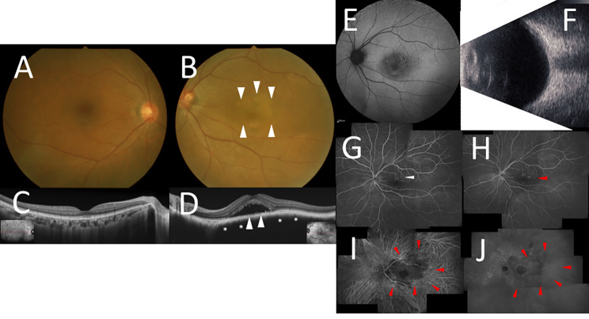
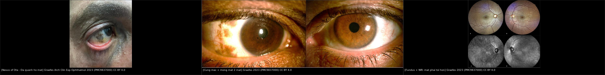
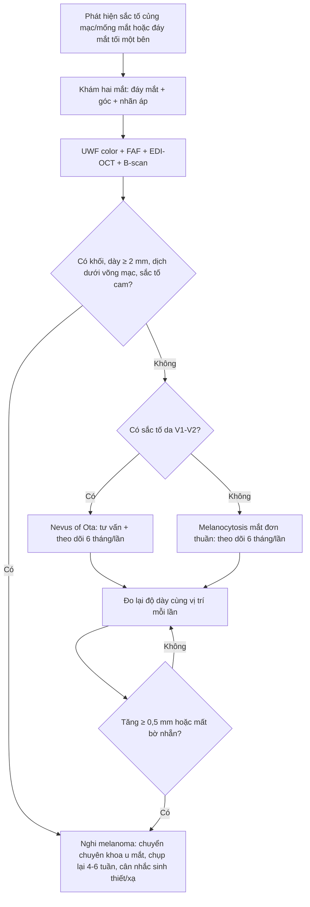
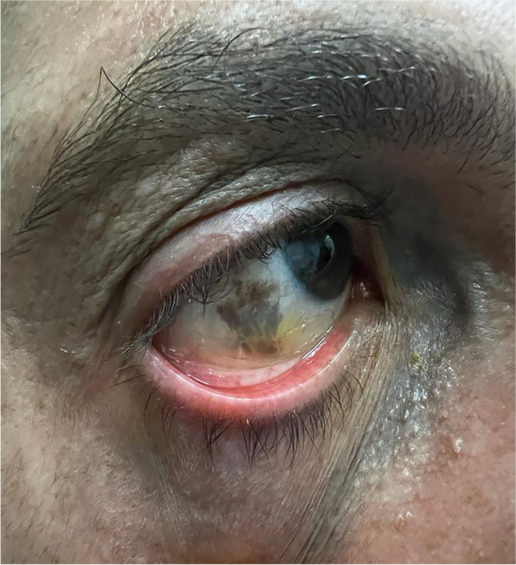
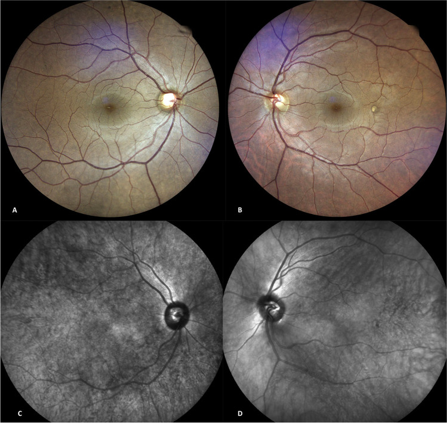
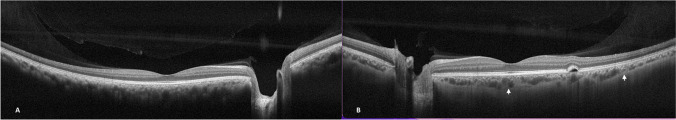
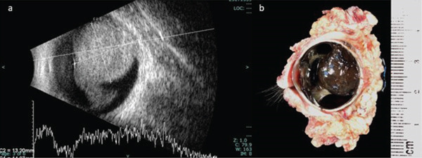

# 3235 — Melanocytosis mắt – hắc mạc & Nevus of Ota: "nền sắc tố" làm mờ melanoma / Oculodermal melanocytosis and the melanoma hidden by pigment

**Tags:** `pattern:sac-to-lan-toa` `pattern:hac-mac-day-lan-toa` `pattern:di-the-mau-mong-mat` `vung:mat` `vung:hac-mac` `vung:cung-mac` `vung:mong-mat` `protocol:EDI-OCT` `protocol:UBM-35-50MHz` `protocol:FAF` `protocol:MRI-hoc-mat` `incidentaloma:khong`

**Mức chắc chắn (certainty):** tổng hợp y văn (literature synthesis) — dựng từ tổng quan hình ảnh đa phương thức ODM (*Graefes Arch Clin Exp Ophthalmol* 2023, **PMC9837000**), đoàn hệ **213 ca ODM** người Ấn (*Indian J Ophthalmol* 2025, **PMC11834911**), **15 mắt melanocytosis hắc mạc trên EDI-OCT** (*Ophthalmology* 2014, **PMID 24139152**), **7.872 mắt melanoma hắc mạc** (*JAMA Ophthalmol* 2013, **PMID 23681424**), nghiên cứu ghép cặp **57 vs 114** (*Ophthalmology* 2013, **PMID 23522968**), ước tính **1/400** (*Ophthalmology* 1998, **PMID 9442799**) và 3 ca nguyên văn có ảnh (**PMC12747081**, **PMC10131401**, **PMC11520808**). Nhóm không có bệnh nhân của mình; chỗ chưa đủ chắc ghi "chưa rõ".

> **Vị trí trong thư viện:** [448](../448-u-hac-mac/lesson.md) phủ **gamut khối hắc mạc + điều trị theo kích thước**; [1486](../1486-khoi-hac-mac-sieu-am/lesson.md) phủ **siêu âm khối hắc mạc (MOLES)**; [1507](../1507-melanoma-hac-mac-lan-toa/lesson.md) phủ **melanoma thể lan tỏa**; [3231](../3231-u-mong-mat-melanoma-nevus-nang/lesson.md) phủ **tổn thương sắc tố mống mắt**. Bài này trả lời **một câu duy nhất**: *khi cả nền hắc mạc đã sẫm màu và dày sẵn, làm sao nhận ra melanoma mới mọc trên nền đó — và vì sao nó nguy hiểm hơn melanoma trên mắt bình thường?*
>
> **Câu chốt:** **(1)** Melanocytosis **không phải** "nốt ruồi lành" — ước tính **1/400** người có ODM sẽ phát triển melanoma hắc mạc trong suốt cuộc đời (PMID 9442799), trong khi melanoma hắc mạc vốn đã là u nội nhãn ác tính thường gặp nhất ở người lớn; **(2)** khi melanoma mọc trên nền melanocytosis, **di căn gấp đôi**: **27% vs 15%** lúc 5 năm, **48% vs 24%** lúc 10 năm (PMID 23681424); **(3)** hình ảnh dễ đánh lừa vì **không có khối vòm** — hắc mạc dày **+23%** so với mắt bên (**326,4 vs 264,4 µm**, PMID 24139152), nên phải đo **bất đối xứng giữa hai mắt**, không dựa vào một ngưỡng tuyệt đối.

## 1. Tổng quan bệnh học – cơ chế hình ảnh

### 1.1 Bản chất: tế bào hắc tố lạc chỗ bẩm sinh, không phải "tàn nhang"

Melanocytosis mắt (ocular melanocytosis, melanosis oculi) là **u mô thừa tế bào hắc tố bẩm sinh**: các tế bào hắc tố dạng gai (dendritic melanocytes) **dừng lại giữa đường di chuyển** từ mào thần kinh ra da, nằm trong **bì (dermis), củng mạc ngoài (episclera), củng mạc, mống mắt và hắc mạc**. Ba thể lâm sàng:

- **Melanocytosis mắt đơn thuần** — chỉ ở mắt.
- **Melanocytosis mắt – da (oculodermal melanocytosis, ODM) = Nevus of Ota** — thêm mảng sắc tố da vùng **V1 (mắt) ± V2 (hàm trên)**, cùng bên.
- **Nevus of Ito** — cùng tế bào, nhưng vùng **V2–V3** (cổ trên, vai); ít liên quan mắt hơn.

Sắc tố **thường có từ lúc sinh hoặc xuất hiện trong năm đầu**, rồi **đậm lên ở tuổi dậy thì và khi mang thai** (melanocyte nhạy hormon) — chính vì vậy nhiều người lớn mới đi khám vì "mảng xanh xám lan ra", và dễ bị chẩn đoán nhầm là **bầm máu, bớt café-au-lait hoặc khối u**. Tổng quan 2023 xếp **glôcôm** và **melanoma hắc mạc** là hai biến chứng mắt chính (PMC9837000).

Phân bố trong đoàn hệ 213 ca người Ấn: **một bên 87%**, **củng mạc 100%**, **mi 29%**, **mống mắt 23%**, **hắc mạc 20%**, **da V1–V2 53%** (PMC11834911). Nghĩa là **1/5 ca có thành phần hắc mạc** — đúng nhóm cần theo dõi bằng hình ảnh.

### 1.2 Vì sao "xanh xám" — và vì sao đáy mắt tối hơn mắt bên

- **Màu xanh xám (slate-grey/blue) của da và củng mạc** không phải màu của melanin mà là **hiệu ứng Tyndall**: sắc tố nằm **sâu trong bì/củng mạc**, ánh sáng xanh bước sóng ngắn bị tán xạ ngược ra nhiều hơn, ánh sáng đỏ xuyên sâu hơn và bị hấp thụ → mắt người đọc thành "xanh". Đây là lý do **mảng sắc tố không mất đi khi ấn kính** (khác giãn mạch) và **không sờ nổi** (khác u).
- **Đáy mắt tối hơn**: melanin hấp thụ ánh sáng ở mọi bước sóng → võng mạc trên vùng hắc mạc dày sắc tố phản xạ ít hơn, ảnh fundus color **sẫm màu kiểu "cà phê sữa"**; trên **near-infrared (NIR)** vùng đó cũng tối hơn (Hình mục 3). Vì vậy **so sánh hai mắt cùng lúc, cùng máy, cùng cài đặt** là bước đầu tiên, rẻ nhất và hay bị bỏ nhất.
- **FAF giảm (hypo-autofluorescence)**: lớp võng mạc sắc tố (RPE) bị **che bởi sắc tố hắc mạc phía dưới** và bởi mô kẽ dày lên → tín hiệu lipofuscin bị chặn; vùng tối trên FAF **không đồng nghĩa teo RPE**. Đây là cạm bẫy: đọc FAF tối là "teo" rồi kết luận bệnh thoái hóa.

### 1.3 Vì sao MRI hốc mắt cho tín hiệu đặc trưng (và vì sao không dùng để chẩn đoán)

Melanin là **chất thuận từ (paramagnetic)** nhờ điện tử không ghép đôi trong cấu trúc indole → **rút ngắn T1** và **rút ngắn T2**:

- **T1W: hắc mạc sẫm màu sinh lý vẫn sáng hơn cơ; vùng melanocytosis sáng hơn nữa** — "mắt tối" trên T1 là dấu của melanin, không phải mỡ.
- **T2W: giảm tín hiệu** — khác **hemangioma hắc mạc lan tỏa** (T2 **tăng** tín hiệu, ngấm thuốc mạnh và đồng nhất).
- **Giá trị thực dụng:** MRI **T1 fat-sat + T2 fat-sat ± cản quang** dùng khi **môi trường trong suốt kém** (đục dịch kính, xuất huyết) hoặc để **đánh giá xâm lấn ngoài củng mạc** trước khi cắt nhãn cầu; **không** dùng để phân biệt melanocytosis với melanoma thể dẹt, vì cả hai đều là melanin.

### 1.4 Vì sao hắc mạc "dày ra" trên OCT — và cái bẫy của con số

EDI-OCT/SS-OCT ở **15 mắt melanocytosis hắc mạc một bên** (PMID 24139152):

| Thông số | Mắt bệnh | Mắt bên | Ý nghĩa |
|---|---|---|---|
| Hắc mạc dưới hoàng điểm | **326,4 µm** (120–459) | **264,4 µm** (94–462) | **+23%**, nhưng **p = 0,15** — *không* có ý nghĩa thống kê với n = 15 |
| Mô kẽ quanh mạch | — | — | **+51%**, **p = 0,01** |
| Tỉ lệ mô kẽ / hắc mạc | **66%** | **54%** | **p = 0,0001** |
| Bờ trước hắc mạc | nhẵn, đều (15/15) | — | Không "lồi cục" như u |
| Võng mạc phía trên | bình thường (14/15) | — | Tổn thương **ở dưới**, không phải bệnh võng mạc |

Bài học kép: **(a)** cái dày lên là **mô kẽ quanh mạch** (melanocyte + stroma), không phải mạch máu — nên **không có "khối" để đo**; **(b)** chênh lệch tuyệt đối **chưa đủ mạnh về mặt thống kê** trong mẫu nhỏ, nên **chẩn đoán dựa vào bất đối xứng + bờ nhẵn + không dịch dưới võng mạc**, và **theo dõi thay đổi theo thời gian** mới là bằng chứng. Hệ quả hình ảnh: **ranh giới hắc mạc–củng mạc (choroidal-scleral junction) mất thấy** ở mắt bệnh (Hình mục 3-B) — dấu hiệu rất hữu ích khi so hai mắt.

### 1.5 Vì sao melanoma trên nền melanocytosis nguy hiểm hơn

- **Nhiều tế bào hắc tố hơn = nhiều "nguyên liệu" cho đột biến**: phân tích tiến hóa gen ở một ca cắt nhãn cầu cho thấy đột biến **Gq (PLCB4)** xuất hiện **sớm trong vùng melanocytosis**, còn **mất BAP1** xuất hiện **muộn, trong tế bào u** (PMC6672022) — melanocytosis là **"đất đã cày"**, không chỉ là dấu chỉ điểm.
- **Hệ quả lâm sàng (số liệu lớn):** trong **7.872 mắt melanoma**, ODM có ở **3%** (230 mắt); **RR di căn 1,6** (p < 0,001); Kaplan–Meier **27% vs 15%** (5 năm) và **48% vs 24%** (10 năm); phân tầng theo vị trí: **mống mắt 2,8×**, **hắc mạc 2,6×**, **củng mạc 1,9×** (PMID 23681424). Nghiên cứu ghép cặp theo tuổi/giới/vị trí/kích thước xác nhận **HR 1,99** (1,16–3,41), di căn **33% vs 16%** (PMID 23522968) — **không phải vì u to hơn**, mà vì bản chất sinh học.
- **Vì sao chẩn đoán muộn:** sắc tố nền **che** thay đổi sớm; u **không có vòm** nên không "nổi" trên ảnh; bệnh nhân **đã quen** với mắt sẫm màu nên bỏ qua mờ thị lực. Ca trong PMC12747081: **mờ dần 7 tháng**, cuối cùng là **bong võng mạc** + melanoma, rồi **glôcôm góc đóng thứ phát** — tức ba tầng biến chứng của cùng một bệnh.

## 2. Mẫu hình + chẩn đoán phân biệt theo vị trí (gamut)

**Mẫu hình trung tâm:** *tăng sắc tố lan tỏa, một bên, không có khối, không có bờ* — ở **củng mạc ngoài/mống mắt** (nhìn thấy) và/hoặc **hắc mạc** (chỉ thấy khi soi đáy mắt + hình ảnh).

**Theo vị trí:**

- **Đoạn trước (củng mạc ngoài, mống mắt, góc tiền phòng, thể mi):** melanocytosis củng mạc/mống mắt; **melanoma thể mi** (khối + mạch máu "sentinel vessel" quanh rìa); **u hắc tố mống mắt** (3231); **sắc tố góc do dùng thuốc/mống mắt phân tán**; **melanoma thể mi xâm lấn góc**.
- **Hắc mạc (đáy mắt):** melanocytosis hắc mạc; **melanoma hắc mạc thể dẹt/lan tỏa** (1507); **nevus hắc mạc**; **hemangioma hắc mạc lan tỏa** (Sturge–Weber); **CHRPE**; **melanocytoma đĩa thị**; **tăng sắc tố sau viêm** và **"pseudo-choroidal melanocytosis"** trong viêm hắc võng mạc birdshot.
- **Ngoài nhãn cầu:** sắc tố da V1/V2 (Nevus of Ota) — **không** phải khối u da; cần phân biệt **melanoma da**, **bầm máu**, **bớt sắc tố bẩm sinh**.

**Gamut của "đáy mắt tối + hắc mạc dày" (5 thực thể hay gặp nhất):**

1. **Melanocytosis hắc mạc** — bẩm sinh, **một bên**, có sắc tố củng mạc/mống mắt cùng bên, hắc mạc dày **đều, bờ nhẵn**, **không** dịch dưới võng mạc, **ổn định nhiều năm**.
2. **Melanoma hắc mạc thể lan tỏa** — dày **không đều**, **dịch dưới võng mạc**, sắc tố cam, **phát triển theo thời gian** (1507).
3. **Hemangioma hắc mạc lan tỏa** — đáy mắt **đỏ-cam** ("tomato ketchup"), **T2 tăng**, ngấm thuốc **mạnh và sớm**, thường kèm **bớt rượu vang mặt** cùng bên (Sturge–Weber).
4. **Nevus hắc mạc** — dẹt, **< 2 mm** dày, bờ rõ, có thể có drusen; **không** dày lan tỏa cả góc phần tư.
5. **Pseudo-choroidal melanocytosis (birdshot)** — **hai bên**, vùng tối **lan rộng dần**, kèm **viêm** (tế bào dịch kính, HLA-A29), hắc mạc dày **thay đổi** (1,0% trong 1.016 mắt, PMID 42412538).

**Ảnh minh họa melanocytosis hắc mạc "đơn thuần" (không melanoma, không sắc tố củng mạc nhìn thấy):**

*Mắt trái có vùng nâu nhạt quanh hoàng điểm (mũi tên trắng, B); SS-OCT dày hắc mạc không có khối (D, mũi tên); B-scan (F) không thấy khối vòm; FA/ICGA (G–J) chỉ thay đổi sắc tố mạch. Nguồn: BMC Ophthalmol 2023 (PMC10131401), CC BY 4.0.*

## 3. Bảng so sánh phân biệt (ma trận đối chiếu)

*Trái → phải: (1) mảng xanh xám da quanh hốc mắt phải; (2) củng mạc ngoài/củng mạc sẫm màu + mống mắt đậm hơn ở mắt bệnh (trái) so với mắt lành (phải); (3) fundus + NIR: đáy mắt phải tối hơn rõ rệt. Nguồn: Graefes Arch Clin Exp Ophthalmol 2023 (PMC9837000), CC BY 4.0; ảnh ghép letterbox.*

| Thực thể (entity) | Hình ảnh điển hình | Chốt vào (rule-in) | Chốt loại (rule-out) | Gợi ý xác nhận |
|---|---|---|---|---|
| **Melanocytosis mắt (đơn thuần)** | Sắc tố xanh xám **củng mạc ngoài**, mống mắt đậm hơn, đáy mắt tối; hắc mạc dày **đều, bờ nhẵn**, **không** dịch dưới võng mạc | **Một bên + sắc tố củng mạc ngoài + bất đối xứng hắc mạc + ổn định ≥ 1 năm** | **Có khối/bờ rõ, dịch dưới võng mạc, dày tăng khi theo dõi** → không phải melanocytosis đơn thuần | EDI/SS-OCT đo độ dày **cùng giờ, cùng vị trí**; B-scan đối chiếu; ảnh cũ |
| **Melanocytosis mắt – da (Nevus of Ota)** | Như trên **+ mảng da V1 ± V2** cùng bên, đậm lên ở dậy thì/thai | **Sắc tố da theo da thần kinh V1/V2 + sắc tố củng mạc cùng bên** | Sắc tố da **không theo da thần kinh**, bờ nham nhở, loét → nghĩ melanoma da | Khám da liễu; không cần sinh thiết da nếu điển hình |
| **Melanoma hắc mạc thể lan tỏa** | Hắc mạc dày **không đều**, **< 20% đường kính đáy**; sắc tố cam; **dịch dưới võng mạc** | **Dày ≥ 2 mm hoặc tăng theo thời gian + dịch dưới võng mạc + sắc tố cam** | Hắc mạc dày **đối xứng, bờ nhẵn, không dịch** → melanocytosis | EDI-OCT + B-scan 3 tháng; **chụp lại để chứng minh tăng** |
| **Hemangioma hắc mạc lan tỏa** | Đáy mắt **đỏ-cam**, hắc mạc dày lan tỏa; **T2 tăng**, ngấm thuốc mạnh | **MRI T2 tăng + ngấm mạnh + bớt rượu vang mặt cùng bên** | **T2 giảm + không ngấm mạnh** → melanin (melanocytosis/melanoma) | MRI hốc mắt T1/T2 fat-sat; ICGA |
| **Nevus hắc mạc** | Dẹt, **< 2 mm**, bờ rõ, drusen, có thể giảm sắc tố trung tâm | **Dẹt, ổn định, không dịch, không sắc tố cam** | Dày **> 2 mm** hoặc có dịch → nghi melanoma | Ảnh màu + EDI-OCT + FAF; theo dõi 6–12 tháng |
| **Pseudo-choroidal melanocytosis (birdshot)** | Vùng tối **hai bên**, lan rộng dần, kèm viêm dịch kính; hắc mạc dày **thay đổi** | **Hai bên + viêm mắt + HLA-A29 + vùng tối lan theo thời gian** | Một bên, không viêm, có sắc tố củng mạc → melanocytosis thật | Khám dịch kính, HLA-A29, ICGA (viêm mạch) |

### 3.1 Dấu hiệu "phải dừng lại" khi đang theo dõi melanocytosis

Theo dõi melanocytosis chỉ có giá trị nếu **mỗi lần khám đều trả lời 4 câu** (đây là "checklist melanoma trên nền sắc tố"):

1. **Độ dày có tăng không?** — đo **cùng kinh tuyến (clock hour), cùng khoảng cách từ hoàng điểm**, ghi mm; tăng **≥ 0,5 mm** giữa hai lần là bất thường.
2. **Có dịch dưới võng mạc (subretinal fluid) không?** — dấu **nhạy nhất** của melanoma có triệu chứng; melanocytosis **không** có.
3. **Có sắc tố cam (orange pigment) / drusen mới không?** — lipofuscin trên RPE = hoạt tính u.
4. **Bờ có mất tính "nhẵn" không?** — melanocytosis có **bờ trước hắc mạc nhẵn ở 15/15 mắt** (PMID 24139152); mất nhẵn = nghi u.

## 4. Protocol chụp + theo dõi

### 4.1 Bộ hình tối thiểu khi phát hiện melanocytosis (một lần)

| Bước | Việc làm | Ngưỡng/ghi chú |
|---|---|---|
| 1 | **Soi đáy mắt giãn đồng tử hai bên** + **gonioscopy** + **nhãn áp** | Ghi rõ có sắc tố góc, dính góc, nhãn áp mmHg |
| 2 | **UWF color + FAF** hai mắt | Cùng máy, cùng cài đặt; FAF tối **không** đồng nghĩa teo |
| 3 | **EDI-OCT hoặc SS-OCT** qua hoàng điểm + qua vùng dày nhất | Đo hắc mạc **dưới hoàng điểm** và **điểm dày nhất**, ghi µm; ghi rõ **ranh giới hắc mạc–củng mạc có thấy hay không** |
| 4 | **B-scan A/B 10–20 MHz** | Đo **độ dày lớn nhất (mm)**, mô tả hồi âm trong u, tìm **hollowing**, dịch dưới võng mạc |
| 5 | **UBM 35–50 MHz** hoặc **AS-OCT** nếu có sắc tố mống mắt/thể mi | Đo thể mi, tìm khối thể mi, hở góc |
| 6 | **MRI hốc mắt** (T1 fat-sat ± cản quang, T2 fat-sat) | Chỉ khi **môi trường trong suốt kém**, nghi **xâm lấn ngoài củng mạc**, hoặc cần phân biệt **hemangioma (T2 tăng)** |

### 4.2 Ngưỡng định lượng dùng trong quyết định

- **Nghi melanoma:** dày **≥ 2 mm**, hoặc **tăng ≥ 0,5 mm** so với lần trước, hoặc **có dịch dưới võng mạc**, hoặc **sắc tố cam**, hoặc **triệu chứng mới** (mờ, ám điểm, chớp sáng).
- **Theo dõi melanocytosis ổn định:** khám **2 lần/năm** (khuyến nghị của PMID 23681424) — xem mục 7 về mức độ chắc chắn của khoảng này.
- **Bất đối xứng hắc mạc:** chênh **> 20–25%** so với mắt bên là mốc tham chiếu hợp lý (dựa trên +23% trong PMID 24139152); **không** dùng một con số tuyệt đối vì hắc mạc bình thường dao động **94–462 µm** ngay trong cùng nghiên cứu.
- **Glôcôm:** nhãn áp **> 21 mmHg**, góc hẹp/dính, hoặc **sắc tố góc dày** → điều trị theo glôcôm; nhớ **melanoma thể mi** có thể gây **glôcôm góc đóng thứ phát** (PMC12747081).

### 4.3 Vì sao **không** có hệ phân độ (RADS) cho melanocytosis

Không tồn tại RADS hay score được hội đồng thống nhất cho melanocytosis — khác khối hắc mạc (MOLES/AJCC, xem [1486](../1486-khoi-hac-mac-sieu-am/lesson.md), [1507](../1507-melanoma-hac-mac-lan-toa/lesson.md)). Vì vậy trong thực hành phải **tự tạo mốc nội bộ**: một ảnh chuẩn (baseline) + một bảng đo (giờ, khoảng cách, µm) + **so sánh hai mắt**. Đây là lý do **hình ảnh lưu trữ quan trọng hơn "đọc lại từ trí nhớ"**.

## 5. Biến thể bình thường và cạm bẫy

- **Đáy mắt sẫm màu sinh lý ở người da sẫm (châu Á, châu Phi)** — **đối xứng hai bên**, không có sắc tố củng mạc ngoài, không đậm lên theo tuổi. Melanocytosis **bất đối xứng**; đây là khác biệt cốt lõi.
- **Melanocytosis hai bên (khoảng 13% trong PMC11834911)** — ca PMC11520808 có **melanoma hắc mạc hai bên**; khi thấy một mắt, **bắt buộc khám kỹ mắt bên** (bẫy *satisfaction of search*).
- **Melanocytosis hắc mạc "cô lập" (không sắc tố củng mạc)** — 20% trong đoàn hệ 213 ca; **chỉ có đáy mắt tối**, không có dấu hiệu ngoài → dễ bị bỏ qua hoàn toàn.
- **FAF tối bị đọc là teo RPE** — sắc tố hắc mạc che tín hiệu; đừng kết luận thoái hóa khi chưa có OCT.
- **"Đã đi laser da rồi thì hết nguy cơ"** — laser làm nhạt **da**, **không** thay đổi hắc mạc/củng mạc; nguy cơ melanoma **giữ nguyên**.
- **Mờ thị lực ở người có Nevus of Ota không được quy cho "sắc tố"** — ca PMC12747081 mờ **7 tháng** trước khi chẩn đoán, vì bong võng mạc do melanoma; bất kỳ **mờ mới, ám điểm, ruồi bay tăng** đều phải soi đáy mắt + B-scan **ngay**.
- **Tưởng melanocytosis nhưng là viêm** — pseudo-choroidal melanocytosis trong birdshot (1,0% các mắt) **hai bên + lan rộng + có viêm**; hỏi HLA-A29, khám dịch kính.
- **Glôcôm "không rõ nguyên nhân" ở mắt có sắc tố góc dày** — nghĩ **melanocytosis góc** hoặc **melanoma thể mi xâm lấn góc**; siêu âm sinh học (UBM) là bước tiếp theo, không phải tăng thuốc mù.

## 6. Tự lượng giá — Blind Quiz

**Ca 1 — Người 30 tuổi, mảng xanh xám quanh mắt phải từ nhỏ, đậm lên gần đây. Không đau, thị lực 10/10.**

- Gợi ý: tổn thương **phẳng**, không sờ nổi, **không mất khi ấn kính**.
- Câu hỏi: mô tả dấu hiệu? Đây là bệnh gì? **Bước khám bắt buộc tiếp theo** (3 việc) và **vì sao không được dừng ở "bớt sắc tố"?**

<b>Bấm để hiện đáp án (findings + chẩn đoán)</b>

- **Dấu hiệu:** mảng sắc tố **xanh xám** da quanh hốc mắt + **củng mạc ngoài sẫm màu** cùng bên; màu xanh do **hiệu ứng Tyndall** (sắc tố nằm sâu trong bì/củng mạc).
- **Chẩn đoán:** **melanocytosis mắt – da (Nevus of Ota)** — tế bào hắc tố bẩm sinh lạc chỗ theo da V1–V2, không phải khối u da.
- **Việc phải làm:** (1) **soi đáy mắt giãn đồng tử hai bên**; (2) **EDI-OCT + B-scan** đo hắc mạc, so hai mắt; (3) **gonioscopy + nhãn áp**. Vì nguy cơ melanoma suốt đời **1/400**, và khi có melanoma thì **di căn gấp đôi** (PMID 23681424).
- Nguồn ảnh: Graefes Arch Clin Exp Ophthalmol 2023 (PMC9837000), CC BY 4.0.

**Ca 2 — Cùng bệnh nhân, soi đáy mắt: mắt phải sẫm màu hơn, không thấy khối. OCT qua hoàng điểm hai mắt.**

- Câu hỏi: dấu hiệu chính trên 2 hình? Vì sao **không có khối** mà vẫn phải theo dõi? **Ba dấu hiệu** nào sẽ khiến bạn gọi đây là melanoma?

<b>Bấm để hiện đáp án</b>

- **Dấu hiệu:** (A) fundus/NIR mắt phải **tối hơn** rõ rệt, đối xứng theo vùng; (B) OCT: **ranh giới hắc mạc–củng mạc (choroidal-scleral junction) không thấy ở mắt bệnh**, thấy rõ ở mắt lành (mũi tên trắng) — do hắc mạc dày lên, mô kẽ quanh mạch **+51%** (PMID 24139152).
- **Vì sao vẫn theo dõi:** melanocytosis là **nền tăng nguy cơ**, và melanoma mọc trên nền này **không có vòm** nên phải dùng **bất đối xứng + thay đổi theo thời gian** làm chẩn đoán.
- **Ba dấu hiệu gọi melanoma:** **dày ≥ 2 mm** hoặc **tăng ≥ 0,5 mm**; **dịch dưới võng mạc**; **sắc tố cam/bờ mất nhẵn**. Thêm: **triệu chứng mới**.
- Nguồn ảnh: Graefes Arch Clin Exp Ophthalmol 2023 (PMC9837000), CC BY 4.0.

**Ca 3 — Bệnh nhân Nevus of Ota, mờ thị lực trái tăng dần 7 tháng, không đau. Siêu âm và tiêu bản sau cắt nhãn cầu:**

- Câu hỏi: mô tả 2 dấu hiệu trên siêu âm? Vì sao **"mờ dần, không đau"** là dấu hiệu báo động ở người có Nevus of Ota? Biến chứng muộn nào có thể xuất hiện nếu không điều trị?

<b>Bấm để hiện đáp án</b>

- **Dấu hiệu:** (a) **khối hắc mạc** lồi vào dịch kính + **bong võng mạc** (màng dày, di động); (b) tiêu bản đại thể: khối sẫm màu trong nhãn cầu, **hoại tử/xuất huyết** trong u.
- **Vì "mờ dần, không đau" là báo động:** melanoma hắc mạc **không đau**; ở người có nevus of Ota, mờ thị lực thường bị quy cho "sắc tố" → chẩn đoán muộn. Ở ca này u chỉ được phát hiện khi **bong võng mạc**.
- **Biến chứng muộn:** **glôcôm góc đóng thứ phát** do khối/xuất huyết đẩy, **glôcôm tan sắc tố (melanomalytic)** và di căn; ca này bỏ cắt nhãn cầu rồi quay lại với **glôcôm góc đóng**.
- Nguồn ảnh: Case Rep Ophthalmol Med 2025 (PMC12747081), CC BY 4.0.

## 7. Câu hỏi nghiên cứu & điểm chưa đồng thuận (tính đến 11/2026)

1. **[Tranh cãi] Ở người có melanocytosis mắt, khám 6 tháng/lần có phát hiện melanoma sớm hơn (giai đoạn nhỏ hơn, ít di căn hơn) so với 12 tháng/lần không?**
   - **Đã biết:** khuyến nghị **2 lần/năm** dựa trên nguy cơ 1/400 và di căn gấp đôi (PMID 23681424); đoàn hệ 213 ca chỉ nói "khám định kỳ" (PMC11834911).
   - **Chưa rõ:** chưa có nghiên cứu so sánh trực tiếp hai khoảng, chưa có số "số ca cần khám để phát hiện 1 melanoma".
   - **Hướng nghiên cứu:** đoàn hệ tiến cứu đa trung tâm, outcome là **độ dày u lúc chẩn đoán** và **tỉ lệ di căn**.
   - **Nguồn:** PMID 23681424 (DOI 10.1001/jamaophthalmol.2013.129); PMC11834911.

2. **[Khác biệt thực hành] Vì sao nguy cơ melanoma chênh nhau gần 40 lần giữa các nguồn — 0,25% (1/400) so với 9% trong đoàn hệ châu Á?**
   - **Đã biết:** 1/400 là ước tính **suốt đời** ở người da trắng (PMID 9442799); 9% (19/213) đến từ **trung tâm chuyên khoa mắt** (PMC11834911) — thiên lệch chọn mẫu.
   - **Chưa rõ:** nguy cơ thật ở người Á và người da sẫm; vai trò của **bilateral/V1–V2** và thể hắc mạc.
   - **Hướng nghiên cứu:** registry dân số (không phải bệnh viện) tính **tỉ lệ mới mắc** theo nhóm sắc tộc.
   - **Nguồn:** PMID 9442799 (DOI 10.1016/s0161-6420(98)92205-9); PMC11834911.

3. **[Khoảng trống] Tiêu chí hình ảnh nào phát hiện melanoma sớm nhất trên nền melanocytosis — độ dày tuyệt đối, bất đối xứng, hay thay đổi theo thời gian?**
   - **Đã biết:** hắc mạc dày **+23%** nhưng **p = 0,15**; chỉ **tỉ lệ mô kẽ** khác có ý nghĩa (PMID 24139152); EDI-OCT/FAF được đề xuất (PMC9837000).
   - **Chưa rõ:** chưa có ngưỡng được kiểm chứng tiền cứu; chưa rõ giá trị của **OCT-A** và **siêu âm đàn hồi**.
   - **Hướng nghiên cứu:** nghiên cứu độ chính xác chẩn đoán, đối chiếu mô bệnh học sau cắt nhãn cầu.
   - **Nguồn:** PMID 24139152 (DOI 10.1016/j.ophtha.2013.08.030); PMC9837000.

## Bài liên quan chéo
- [400 – Tổng quan Mắt & thị giác](../400-tong-quan-mat-thi-giac/lesson.md)
- [448 – Gamut khối hắc mạc](../448-u-hac-mac/lesson.md)
- [1486 – Khối hắc mạc trên siêu âm (MOLES)](../1486-khoi-hac-mac-sieu-am/lesson.md)
- [1507 – Melanoma hắc mạc thể lan tỏa](../1507-melanoma-hac-mac-lan-toa/lesson.md)
- [3231 – Tổn thương sắc tố mống mắt](../3231-u-mong-mat-melanoma-nevus-nang/lesson.md)

## Ảnh
- `images/3235_nevus-ota_Da-Mat_PMC9837000.jpg` — da quanh hốc mắt (PMC9837000, CC BY 4.0).
- `images/3235_nevus-ota_Cung-Mac-Mong-Mat_PMC9837000.jpg` — củng mạc ngoài + mống mắt hai bên (PMC9837000, CC BY 4.0).
- `images/3235_nevus-ota_Fundus-NIR_PMC9837000.jpg` — fundus + NIR (PMC9837000, CC BY 4.0).
- `images/3235_nevus-ota_OCT-EDI_PMC9837000.jpg` — SD-OCT mất ranh giới hắc mạc–củng mạc (PMC9837000, CC BY 4.0).
- `images/3235_nevus-ota_Bscan-Ascan_PMC12747081.jpg` — siêu âm khối + tiêu bản đại thể (PMC12747081, CC BY 4.0).
- `images/3235_nevus-ota_SSOCT-FAF-Bscan_PMC10131401.jpg` — melanocytosis hắc mạc đa phương thức (PMC10131401, CC BY 4.0).
- `images/composite_nevus-ota_mat.jpg` — ảnh ghép 3 mặt bệnh, tạo bằng `tools/make_composite.py`.
- Giấy phép + attribution từng file: `images/CREDITS.md`.

> Không dùng để chẩn đoán độc lập khi chưa có người hướng dẫn.
