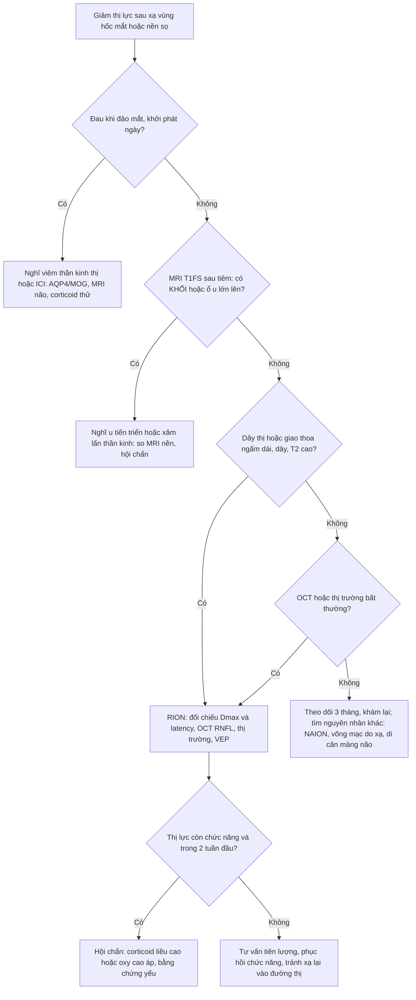
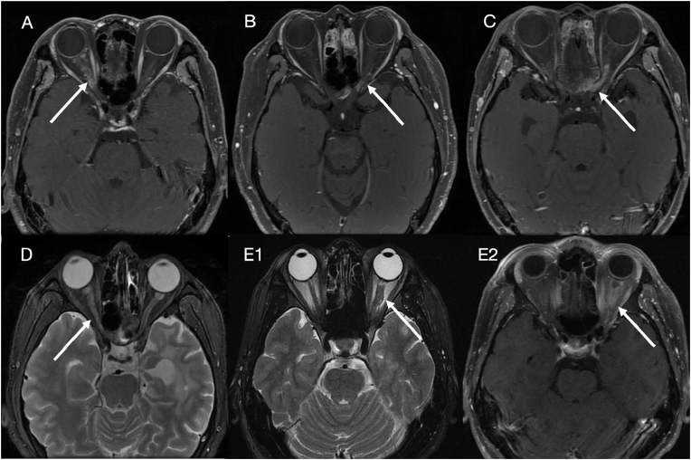
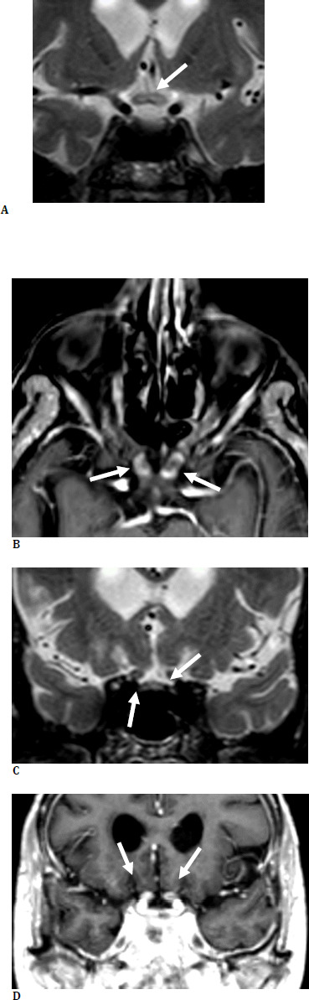
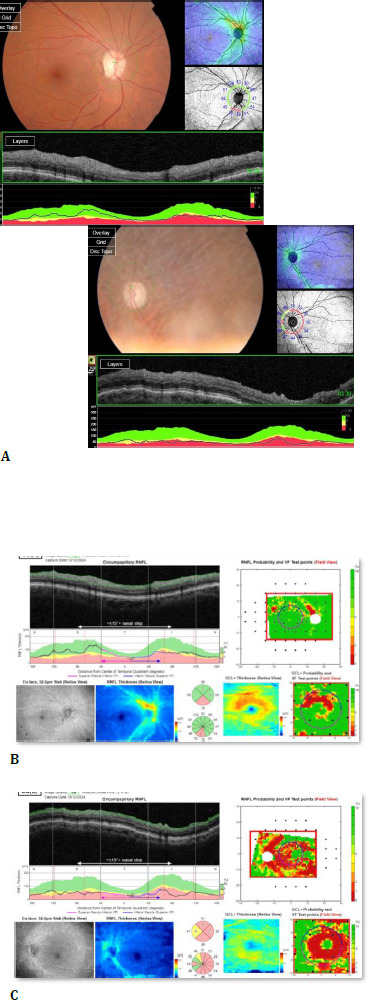

# 3236 — Bệnh thần kinh thị do xạ trị (RION): ngấm thuốc thị thần kinh KHÔNG khối, phân biệt tái phát u / Radiation-induced optic neuropathy

**Tags:** `pattern:ngam-thuoc-TK-thi` `pattern:day-TK-thi` `pattern:teo-TK-thi` `pattern:mat-thi-luc-khong-dau` `vung:mat` `vung:than-kinh-thi` `protocol:MRI-hoc-mat` `protocol:T1-fat-sat` `protocol:DWI-ADC` `protocol:OCT-RNFL` `protocol:thi-truong` `score:CTCAE` `incidentaloma:khong`

**Mức chắc chắn (certainty):** tổng hợp y văn (literature synthesis) — dựng từ **meta phân tích 1994–2025** về tỷ lệ RION theo kỹ thuật xạ (**PMC13742046**), **loạt 43 ca/69 mắt có MRI + OCT** (**PMC10577828**), **289 ca proton nền sọ** (**PMC8582447**), **30 u màng não cạnh thị sau SRS một lần** (**PMC12929000**), **đoàn hệ tiền cứu 89 bệnh nhân proton** (**PMC13583721**), **tổng quan độc tính mắt do xạ** (**PMC12384690**), **tổng quan liệu pháp anti-VEGF cho tổn thương do xạ** (**PMC10050069**) và **ca nguyên văn 73 tuổi** (**PMC13453118**). Nhóm **không có bệnh nhân của mình**; số nào chưa kiểm chứng ghi **"chưa rõ"**. **Không ghi tên tác giả** — attribution dùng tạp chí + năm + PMCID (đối chiếu Europe PMC ngày 2026-11-20).

> **Câu chốt:** sau xạ vùng hốc mắt/nền sọ, **giảm thị lực không đau mà MRI chỉ thấy thị thần kinh ngấm thuốc, không có khối, là RION cho tới khi chứng minh ngược lại** — và điều ngược lại cũng đúng: **RION KHÔNG có nghĩa là thất bại điều trị**. Năm con số phải thuộc: **(a) tỷ lệ** — u trong nhãn cầu **17,0%** (95%CI 12,1–23,5; brachytherapy là chủ yếu), u ngoài nhãn cầu xạ phân liều thường **4,7%**, xạ giảm phân liều **2,1%**, proton nền sọ **4,2%** (12/289) (PMC13742046, PMC8582447); **(b) liều** — nguy cơ tăng khi **> 50 Gy EQD2** tới thần kinh/giao thoa; QUANTEC: **Dmax < 55 Gy → < 3%**, **> 60 Gy → 7–20%**; SRS một lần **< 12 Gy → < 10%**, thực hành giữ **Dmax ≤ 8 Gy** (PMC12384690, PMC13742046, PMC12929000); **(c) thời gian** — khởi phát trung vị **16–30 tháng**, loạt 43 ca **36,3 ± 30,5 tháng (1–132)**, muộn nhất **11 năm** (PMC13742046, PMC10577828); **(d) MRI** — **82,5% (33/40 mắt) ngấm thuốc thị thần kinh**, đoạn **nội sọ 69,7%** > đoạn trong hốc mắt **33,3%** > ống thị giác **27,3%** > giao thoa **12,1%**, **T2 tăng tín hiệu 81,8%**, **dày/giãn 39,4%**, ngấm thuốc kéo dài **3 tuần–24 tháng** (PMC10577828); **(e) tiên lượng** — thị lực cuối **chỉ cải thiện 13,0%**, tỷ lệ mù tăng **65,2% → 72,2%**, corticoid liều cao và oxy cao áp **không khác chứng** trong loạt này (PMC10577828).

## 1. Tổng quan bệnh học – cơ chế hình ảnh (TẠI SAO)

### 1.1 RION là hoại tử xạ MUỘN của đường thị giác trước, không phải "viêm"

- **Định nghĩa thực hành:** RION là **tổn thương thần kinh thị do xạ** xuất hiện **hàng tháng đến hàng năm** sau xạ trị, biểu hiện bằng **giảm thị lực không đau, tiến triển, thường không hồi phục**, sau khi đã loại trừ **u tiến triển/chèn ép, viêm thần kinh thị, thiếu máu thị, nhiễm trùng và di căn màng não**.
- **Ba tầng tổn thương (giải thích mọi dấu hiệu hình ảnh):**
  1. **Nội mô vi mạch** là mô phân bào → xạ gây **chết tế bào nội mô, huyết khối vi mạch, thiếu máu cục bộ mạn** của dây thị và giao thoa;
  2. **Myelin và sợi trục** thoái hóa thứ phát → **dẫn truyền chậm (VEP P100 kéo dài)** rồi **mất sợi trục**;
  3. **Tế bào hạch võng mạc (RGC)** chết → **RNFL/GCL mỏng dần trên OCT**, teo đĩa thị về sau.
- **Vì sao MUỘN:** hiệu ứng chính là lên **mạch máu và mô đệm**, không lên tế bào thần kinh đang yên lặng; tổn thương mạch tiến triển **nhiều tháng** trước khi đủ mất sợi trục để mất thị lực. Vì vậy **chụp MRI ngay sau xạ hầu như luôn "sạch"** — đây là lý do lâm sàng của cả bài.
- **Yếu tố nguy cơ đã được định lượng:** **liều tối đa (Dmax) tới thần kinh/giao thoa > 50–55 Gy EQD2**, **khoảng cách u tới thị thần kinh**, **thể tích u**, **tuổi cao** (p = 0,008), **tăng huyết áp** (p < 0,001), u **xâm lấn/chèn ép** thần kinh, và số lần mổ (PMC8582447, PMC13742046).
- **Bẫy dịch tễ:** RION **xảy ra cả dưới 50 Gy** — 3/43 ca trong PMC10577828 sau **16 Gy, 40 Gy và 41,4 Gy**, và cả 3 đều ngấm thuốc **đoạn nội sọ**. Nghĩa là **"liều thấp" không loại trừ**, chỉ làm giảm xác suất.

### 1.2 Vì sao "ngấm thuốc – dày – T2 sáng – không khối" — vật lý và mô bệnh

| Dấu hiệu | Vì sao (cơ chế) | Hệ quả đọc phim |
|---|---|---|
| **Ngấm gadolinium** | Xạ phá **tight junction** nội mô mạch thần kinh → hàng rào máu–thần kinh hở → gadolinium vào khoang ngoại bào → **T1 ngắn lại, tín hiệu tăng** | Chỉ thấy khi có **T1 fat-sat sau tiêm**: mỡ hốc mắt sáng trên T1 thường **che mất** dây thị ngấm thuốc |
| **Kéo dài nhiều tháng** | Hàng rào hở **từng đợt** trong quá trình hoại tử/xơ hóa, không phải một lần | Loạt 43 ca: ngấm **3 tuần–24 tháng** (trung bình ~13,5 tuần ở nhóm kết quả); "còn ngấm" **không** đồng nghĩa "còn u" |
| **Dày/giãn (expansion)** | **Phù nội bào + ngoại bào** của dây thị trong ống xương kín | 39,4% mắt; dày **kèm ngấm** mới là mẫu hình RION, dày đơn thuần đối xứng có thể là biến thể |
| **T2/T2FS tăng tín hiệu** | **Nước ngoại bào (phù)** và **gliosis** làm T2 dài | 81,8% mắt; T2FS bắt buộc — T2 thường bị mỡ quanh dây che |
| **Không có khối** | Mô **hoại tử – xơ** không tạo khối choán chỗ; không có tế bào u | **Khối + ngấm + đẩy lệch = u**, không phải RION |
| **Teo muộn** | Mất sợi trục → dây thị nhỏ, **RNFL mỏng** | OCT mỏng **rõ sau 1–2 năm**; MRI teo là dấu hiệu **muộn**, không dùng để chẩn đoán sớm |

- **ADC/DWI:** RION **không phải nhồi máu tế bào cấp** nên **ADC không giảm mạnh**; vùng viêm có thể giảm nhẹ. **Chưa có ngưỡng ADC riêng cho RION** (xem mục 7) — đừng áp ngưỡng 887 × 10⁻⁶ mm²/s của ung thư đầu–cổ (PMC12041163 dẫn trong bài 3233) như một chốt.
- **Tại sao RNFL mỏng trước khi đĩa thị nhợt:** sợi trục mất dần ở đoạn sau nhãn cầu; **OCT đo được mỏng** trước khi **soi đáy mắt** thấy nhợt. Trong 2 tháng đầu, **64,9% (24/37) mắt vẫn có đĩa thị bình thường** (PMC10577828) — **đĩa bình thường không loại trừ RION**.

### 1.3 Ngưỡng định lượng nằm lòng

| Chỉ số | Giá trị | Nguồn |
|---|---|---|
| RION sau xạ u **trong nhãn cầu** | **17,0%** (95%CI 12,1–23,5; 0,0–81,7; theo dõi 1,3–11,0 năm; 33 nghiên cứu brachytherapy) | PMC13742046 |
| RION sau xạ **ngoài nhãn cầu**, phân liều thường | **4,7%** (39 nghiên cứu, theo dõi 5,1 năm) | PMC13742046 |
| RION sau xạ **giảm phân liều** ngoài nhãn cầu | **2,1%** (28 nghiên cứu, theo dõi 3,4 năm) | PMC13742046 |
| U **đầu–cổ** so với u khác | Tỷ lệ RION **cao hơn** (hệ số 0,7185; p = 0,0076) | PMC13742046 |
| Proton nền sọ, **Dmax ≥ 45 GyRBE** | **4,2%** (12/289); Dmax thần kinh **59,6 GyRBE (45–76)**; liều u **71,2 GyRBE (67–76)**; theo dõi **73,8 tháng (5–197)** | PMC8582447 |
| Ngưỡng liều xạ phân liều thường (QUANTEC) | **Dmax < 55 Gy → < 3%**; **> 60 Gy → 7–20%**; Bhandare: **< 50 Gy** | PMC12384690 |
| Ngưỡng liều SRS một lần (QUANTEC) | **Dmax < 12 Gy → < 10%**; thực hành u cạnh thị: giữ **Dmax ≤ 8 Gy** | PMC12384690, PMC12929000 |
| SRS u màng não cạnh thị (30 ca) | Liều u **12,7 ± 3,1 Gy** (7–20); **Dmax thần kinh 9,3 ± 5,6 Gy** (4–25,9); mắt còn chức năng: **7,2 ± 1,6 Gy** (4,8–12,9) | PMC12929000 |
| Tiên lượng thị lực sau SRS (438 u đa trung tâm) | Suy giảm thị lực **10%** (theo dõi 51 tháng), **9% ở 5 năm, 21% ở 10 năm**; **42% do u tiến triển**, phần còn lại do RION; **Dmax ≥ 10 Gy** là yếu tố dự báo | PMC12929000 (dẫn nghiên cứu đa trung tâm) |
| Khởi phát (latency) | Trung vị **16–30 tháng**; loạt 43 ca **36,33 ± 30,48 tháng (1–132)** | PMC13742046, PMC10577828 |
| Thời gian ngấm thuốc trên MRI | **3 tuần – 24 tháng** (một ca ≥ 2 năm) | PMC10577828 |
| Phân bố đoạn tổn thương | Nội sọ **69,7%**, trong hốc mắt **33,3%**, ống thị giác **27,3%**, giao thoa **12,1%**, dày **39,4%**, T2 cao **81,8%** (33/40 mắt) | PMC10577828 |
| Tỷ lệ ngấm thuốc | **82,5%** (33/40 mắt) | PMC10577828 |
| Hai mắt | **60,1%** (26/43) hai mắt; ở nhóm này tổn thương **nối tiếp** hai mắt, cách **2 tuần–23 tháng** | PMC10577828 |
| Kết cục thị lực | Cải thiện ngắn hạn **24,6%** (17/69), cuối cùng **13,0%** (9/69); mù **65,2% → 72,2%** | PMC10577828 |
| OCT RNFL trung bình | **91,50 ± 6,36 µm** (< 1 tháng) → **56,00 ± 7,91 µm** (> 6 tháng), p = 0,009; góc trên **133,5 → 58,6 µm** (p < 0,001) | PMC10577828 |
| Thời điểm RNFL mỏng rõ | **1–2 năm** sau xạ; bất thường **thị trường/VEP** nổi bật **trong năm đầu** | PMC13583721 |
| Tỷ lệ chung (gộp retinopathy + optic neuropathy) | **3,8%**; **không có bệnh võng mạc < 50 Gy**; bệnh thần kinh thị **gặp nhiều hơn khi > 50 Gy**; võng mạc **6,0%** vs thần kinh thị **2,0%** | PMC10093581 |

## 2. Mẫu hình + chẩn đoán phân biệt theo vị trí (Gamut)

Bài toán không phải "dây thị có ngấm không" mà là **"ngấm ở ĐOẠN NÀO, xuất hiện LÚC NÀO, có KHỐI không, và thị lực có hồi phục không"**.

### 2.1 Trục vị trí — đoạn nào hay bị và vì sao

- **Đoạn nội sọ trước giao thoa (69,7%)** — hay nhất: gần **xoang hang, rãnh thị, nền sọ**, nơi liều cao nhất khi xạ u tuyến yên, u màng não, ung thư vòm/xoang; dây thị ở đây **mảnh, ít mô đệm bảo vệ** và **cấp máu từ nhánh màng não/động mạch mắt dễ bị tổn thương**.
- **Đoạn trong hốc mắt (33,3%)** — dù có mỡ và cơ bảo vệ (một số tác giả cho rằng **hiếm gặp**), loạt 43 ca vẫn thấy **12 mắt** ngấm đoạn hốc mắt sau xạ vòm/xoang hàm (PMC10577828).
- **Đoạn trong ống thị giác (27,3%)** — ống xương hẹp: **phù là tăng áp lực trong ống** → dày + thiếu máu, giải thích vì sao đoạn này **mau teo** và tiên lượng kém.
- **Giao thoa (12,1%)** — thường kèm **u tuyến yên/u sọ hầu** hoặc xạ toàn não; biểu hiện **bán manh hai bên**, dễ bị gọi là **u tiến triển**.
- **Đoạn sau giao thoa/đường thị** — hiếm sau xạ; nếu có, phải nghĩ **di căn màng não, bệnh thần kinh do xạ lan rộng** hơn là RION đơn thuần.

### 2.2 Trục thời gian — "đồng hồ" RION

| Mốc sau xạ | Điều kỳ vọng | Việc **không** được làm |
|---|---|---|
| **0–6 tháng** | Hiếm RION; có thể có phù nhẹ thoáng qua; **đa số MRI bình thường** | Không gọi RION khi chưa có triệu chứng; không sinh thiết |
| **6–18 tháng** | **Cửa sổ RION điển hình** (trung vị 16–30 tháng); bắt đầu **ngấm thuốc + dày** | Không quy mọi ngấm thuốc cho tái phát u |
| **18 tháng–3 năm** | RION muộn; **RNFL mỏng rõ sau 1–2 năm**; ngấm có thể còn | Không dừng theo dõi vì "đã qua 2 năm" |
| **3–11 năm** | Vẫn có ca mới (tới **132 tháng**); teo thị tiến triển; bệnh võng mạc do xạ xuất hiện | Không bỏ OCT/thị trường ở mốc 5 năm |

- **Ngấm thuốc có thể tồn tại tới 2 năm** — đây là lý do **một lần MRI "còn ngấm" không đủ để xạ lại hay sinh thiết**.
- **Hai mắt nối tiếp**: 60,1% (26/43) ca hai mắt, và ở nhóm này mắt thứ hai **nối tiếp** mắt đầu, cách **2 tuần–23 tháng** → khi mắt thứ hai mờ, **đừng mặc định là "u đã lan"**; khám lại cả đường thị.

### 2.3 Trục hình thái — mnemonic **"DÀI – KHÔNG – NGẤM – MUỘN"**

- **DÀI:** ngấm **một đoạn dài** dây thị/giao thoa (không phải ổ ngắn vài mm như viêm thần kinh thị điển hình).
- **KHÔNG khối:** không có khối choán chỗ, không đẩy lệch giao thoa; nếu có khối → nghĩ u.
- **NGẤM:** **T1FS sau tiêm** dương tính, có thể kèm **dày** (39,4%) và **T2 cao** (81,8%).
- **MUỘN:** xuất hiện **sau nhiều tháng–năm**, kèm **giảm thị lực không đau, không hồi phục**.

### 2.4 Gamut "thị thần kinh/giao thoa ngấm thuốc sau xạ"

- **RION** — mẫu hình trung tâm của bài: dài, không khối, muộn, không đau, không hồi phục.
- **U tiến triển/xâm lấn thần kinh (tumor progression/perineural spread)** — **khối tại ổ u**, lớn dần trên 2 lần chụp, ngấm **không theo trục dây thị**, có thể **hủy xương/xâm lấn cơ**; **42% suy giảm thị lực sau SRS u cạnh thị là do u tiến triển**, không phải RION (PMC12929000) — nên **luôn so ổ u trước khi gọi RION**.
- **Viêm thần kinh thị tự miễn (optic neuritis: MS/MOG/AQP4)** — **đau khi đảo mắt**, khởi phát **ngày**, ngấm **đoạn ngắn** hoặc **dài ≥ 1/2 dây** (AQP4/MOG), **ADC giảm**, **đáp ứng corticoid**, có thể **tái phát**; **không có tiền sử xạ đúng liều/vị trí**.
- **Viêm thần kinh thị do thuốc miễn dịch (ICI-related optic neuritis)** — bệnh nhân **anti-PD1/PD-L1**: ngấm thị thần kinh, giảm thị lực **hai bên**, có thể **hồi phục một phần** khi ngừng thuốc + corticoid; ca PMC13453118 vừa xạ **66 Gy** vừa **anti-PD1** nên **hai nguyên nhân cùng tồn tại** — đây là bẫy thực hành lớn.
- **Thiếu máu thị trước (NAION)** — **không đau**, **mất thị trường từng phần (altitudinal)**, **đĩa phù** giai đoạn đầu, **ngấm nhẹ/không ngấm**, đĩa **crowded**, yếu tố **ĐTĐ/tăng huyết áp**.
- **Di căn màng não/thâm nhiễm thần kinh** — **ngấm màng não dạng nốt**, dày không đều, **tế bào học dịch não tủy**, tiến triển; thường kèm **đau đầu, liệt dây sọ khác**.
- **Nhiễm trùng (giang mai, lao, nấm)** — hiếm, có **hội chứng nhiễm**, dịch não tủy; ngấm dài nhưng **đáp ứng kháng sinh**.
- **Thay đổi hậu phẫu** — **mỡ ghép/vật liệu cầm máu** T1 sáng, **mất tín hiệu trên fat-sat**, không ngấm hoặc viền mỏng; **ổn định** qua các lần chụp.
- **Bệnh võng mạc do xạ** — **phù hoàng điểm, xuất tiết, giãn mao mạch**, **thị thần kinh có thể bình thường**; thường **đi kèm** RION nhưng **không giải thích được ngấm dây thị**.

## 3. Bảng so sánh phân biệt (ma trận đối chiếu)

| Thực thể (entity) | Hình ảnh điển hình (MRI ± CT/OCT) | Chốt vào (rule-in) | Chốt loại (rule-out) | Gợi ý xác nhận |
|---|---|---|---|---|
| **RION** | Ngấm **dài** thị thần kinh/giao thoa, **T1FS+C**, **T2 cao 81,8%**, **dày 39,4%**, **không khối**, teo muộn | **Tiền sử xạ > 50 Gy + giảm thị lực không đau sau 16–30 tháng + ngấm dài không khối** | **Có khối đẩy lệch/lớn dần** → không phải RION; **đau khi đảo mắt + ADC thấp** → nghĩ viêm | Đối chiếu **liều Dmax**, so MRI trước xạ, OCT/VEP, thị trường |
| **U tiến triển/xâm lấn thần kinh** | **Khối tại ổ u** lớn dần, ngấm không theo trục dây, hủy xương/xâm lấn cơ, đẩy lệch giao thoa | **Khối mới/lớn lên trên 2 lần chụp + xâm lấn ngoài bao thần kinh** | **Dây thị ngấm đều, không khối, ổ u ổn định ≥ 6 tháng** → không phải u | So từng lát với MRI nền; **42% suy giảm thị lực sau SRS là do u** (PMC12929000) |
| **Viêm thần kinh thị (MS/MOG/AQP4)** | Ngấm **đoạn ngắn** (MS) hay **≥ 1/2 dây/giao thoa** (AQP4/MOG), **ADC thấp**, có thể **phù đĩa** | **Đau khi đảo mắt + khởi phát ngày + đáp ứng corticoid + huyết thanh AQP4/MOG** | **Không đau, khởi phát tuần–tháng, không hồi phục, có tiền sử xạ tại chỗ** → nghĩ RION | Huyết thanh AQP4/MOG, MRI não, dịch não tủy |
| **ICI-related optic neuritis** | Ngấm thị thần kinh ± giao thoa, thường **hai bên**, không khối | **Đang dùng anti-PD1/PD-L1/CTLA-4 + giảm thị lực hai bên + cải thiện khi ngừng thuốc/corticoid** | **Bệnh nặng dần, không đáp ứng, liều xạ đúng ngưỡng** → nghĩ RION trội | Ngừng ICI thử, hội chẩn ung thư–mắt; **không loại trừ được bằng MRI** |
| **NAION** | Đĩa phù giai đoạn đầu, **ngấm nhẹ/không**, dây thị bình thường hoặc dày nhẹ | **Mất thị trường altitudinal + đĩa crowded + ĐTĐ/THA + không đau** | **Ngấm dài mạnh + T2 cao + tiền sử xạ** → nghĩ RION | Soi đáy mắt, OCT RNFL, thị trường 24–2 |
| **Di căn màng não/thâm nhiễm** | **Ngấm màng não dạng nốt**, dày không đều, có thể lan khe ổ mắt trên | **Nốt màng não + tế bào học dịch não tủy dương + đau đầu/liệt dây sọ** | **Ngấm theo trục dây, màng não mỏng đều, không nốt** → không nghĩ di căn | MRI toàn trục + tế bào học dịch não tủy |
| **Thay đổi hậu phẫu** | **Mỡ/vật liệu T1 sáng**, mất tín hiệu trên fat-sat, viền ngấm mỏng, bờ theo giải phẫu | **Bờ khớp vị trí mổ + mất tín hiệu trên T1FS + ổn định** | **Ngấm mới trong dây thị, ngoài vùng mổ, lớn dần** → không phải hậu phẫu | So MRI hậu phẫu nền; CT cửa sổ xương |
| **Bệnh võng mạc do xạ** | **Phù hoàng điểm, xuất tiết, giãn mao mạch**, dây thị có thể bình thường | **OCT/FA có phù hoàng điểm + liều võng mạc > 50 Gy** | **Ngấm dây thị/giao thoa** → có thành phần RION | OCT hoàng điểm, FA; khám đáy mắt |

### Ba dấu hiệu hay bị đọc sai

- **"Ngấm thuốc = u"** — sai: **82,5% RION ngấm thuốc**. Ngấm chỉ có nghĩa khi đọc kèm **hình thái (dài/khối), thời điểm (muộn) và diễn tiến**.
- **"Không ngấm = không RION"** — sai: **17,5%** mắt RION **không ngấm** trong loạt 43 ca; MRI âm không loại trừ nếu lâm sàng và liều phù hợp.
- **"Đĩa thị bình thường = không RION"** — sai: **64,9%** mắt còn đĩa bình thường **trong 2 tháng đầu**; OCT RNFL và thị trường mới là cửa sổ sớm.

## 4. Protocol chụp + phân tầng nguy cơ + theo dõi

### 4.1 Bộ chuỗi xung tối thiểu (mỗi lần chụp)

1. **MRI 1,5T hoặc 3T, hốc mắt + nội sọ**, lát **2–3 mm** cho hốc mắt và **1 mm** cho **ống thị giác/giao thoa** (không cắt lớp dày 5 mm — dây thị đường kính chỉ **3–4 mm**):
   - **T1 axial** không tiêm (mỡ, máu, vật liệu);
   - **T2FS axial + coronal** (phân biệt phù/T2 cao với mỡ);
   - **DWI b = 0/1000 + ADC** (loại trừ nhồi máu/viêm có hạn chế khuếch tán thật);
   - **T1FS sau gadolinium axial + coronal + sagittal**, phủ **từ nhãn cầu tới giao thoa và đường thị**;
   - **DTI/tractography** nếu có: **FA giảm** sớm hơn teo thấy được — **chưa có ngưỡng chuẩn** cho RION.
2. **CT hốc mắt/nền sọ lát ≤ 1 mm, cửa sổ xương** khi cần: **dị vật, vôi hóa, hủy xương, vật liệu cản quang, mốc giải phẫu ống thị giác**.
3. **Khám mắt định lượng mỗi lần:** **BCVA logMAR**, **thị trường 30-2 (MD/PSD)**, **OCT RNFL + GCL**, **VEP P100 (ẩn và biên độ)**. Trong đoàn hệ proton, **thị trường (MD/PSD) là chỉ số mạnh nhất** (chính xác 75–79%), **RNFL mỏng rõ sau 1–2 năm**, còn **BCVA kém nhạy** (PMC13583721).
4. **Rà soát liều (dosimetry) là một phần của "protocol"**: ghi **Dmax và D0,03 cc** tới **thần kinh thị hai bên + giao thoa**, quy đổi **EQD2 với α/β = 2 Gy** cho hiệu ứng muộn; **liều kê ≠ liều dây thị**.

### 4.2 Phân tầng nguy cơ — bảng dùng trong hội chẩn

| Nhóm | Tiêu chí | Hành động |
|---|---|---|
| **Nguy cơ thấp** | Dmax thần kinh **< 50 Gy EQD2** (hoặc SRS **< 8 Gy**) và không có yếu tố nguy cơ | Khám mắt + MRI **theo triệu chứng**; tư vấn dấu hiệu |
| **Nguy cơ trung bình** | Dmax **50–55 Gy** hoặc u **sát/chèn** thần kinh | **MRI + OCT + thị trường ở 6 và 12 tháng**, sau đó hằng năm |
| **Nguy cơ cao** | Dmax **> 55–60 Gy**, SRS **Dmax ≥ 10 Gy**, proton **≥ 45 GyRBE** vào thần kinh, **tuổi cao/tăng huyết áp**, u xâm lấn | **Theo dõi 3–6 tháng/lần trong 2 năm**, sau đó 6–12 tháng; **hội chẩn xạ trị–mắt trước khi xạ lại** |
| **Đã có triệu chứng** | Giảm thị lực/thị trường mới | **MRI khẩn trong 2 tuần** + OCT/VEP; **không chờ đủ lịch** |

- **Thang phân độ:** CTCAE (phiên bản hiện hành) xếp độ theo **thị lực**, nên **bỏ sót giai đoạn sớm** khi thị lực còn tốt nhưng **thị trường/OCT đã bất thường** (PMC13583721). Vì vậy trong thực hành nên báo cáo **kèm MD/PSD và RNFL** bên cạnh độ CTCAE.

- **Lịch theo dõi (đề xuất của bài, chưa có thử nghiệm):** MRI + khám mắt **trước xạ (nền)**, **6 tháng**, **12 tháng**, sau đó **hằng năm tới ≥ 5 năm** — vì **latency tới 132 tháng (11 năm)** và ca muộn vẫn xuất hiện sau 5 năm (PMC10577828). Ghi rõ đây là **khung tham khảo**, không phải khuyến cáo cấp A.

### 4.3 Điều trị — nói đúng mức bằng chứng

- **Corticoid liều cao:** dùng phổ biến nhưng trong loạt 43 ca **không khác nhóm chứng** về thị lực ngắn hạn và cuối cùng (p > 0,05) (PMC10577828).
- **Oxy cao áp (HBOT):** nhóm HBOT có **tỷ lệ cải thiện cao nhất (57,1%)** nhưng **khác biệt không có ý nghĩa** so với chứng; hiệu quả chỉ được báo cáo khi bắt đầu **trong 72 giờ** (PMC10577828 dẫn y văn). **Sau 2 tuần, lợi ích không rõ.**
- **Anti-VEGF nội nhãn:** dữ liệu chủ yếu từ **RION sau brachytherapy u hắc mạc** (khác sinh học với xạ ngoài): **14 mắt**, trung vị **13 mũi** mỗi **6–8 tuần**, **100% giảm dấu hiệu đĩa (xuất huyết/phù)**, **64% thị lực ổn định/cải thiện** qua trung vị **29 tháng** — nhưng đây là **loạt ca tiến cứu nhỏ**, không phải thử nghiệm (PMC10050069). **Không có dữ liệu cho RION sau xạ phân liều nền sọ.**
- **Điều trị gốc vẫn là phòng ngừa:** giữ **Dmax** dưới ngưỡng, **giảm liều vào đường thị**, và **không xạ lại** một dây thị đã có RION nếu không có chỉ định sống còn.

## 5. Biến thể bình thường và cạm bẫy

- **"Không thấy ngấm vì chụp T1 thường"** — mỡ hốc mắt sáng trên T1 **che dây thị**; **không có fat-sat là không đọc được RION**. Đây là lỗi kỹ thuật hay gặp nhất.
- **Lát cắt dày 5 mm** — dây thị **3–4 mm**, cắt 5 mm có thể **nằm giữa hai lát**; luôn dùng **1 mm** qua ống thị/giao thoa.
- **Ngấm thuốc màng não quanh dây thị** — có thể là **phản ứng sau mổ/xạ lành tính**, mỏng, đều, giảm dần; **nốt dày không đều** mới đáng lo.
- **Mỡ ghép/vật liệu cầm máu** — **T1 sáng, mất tín hiệu khi fat-sat**, không ngấm; nếu **vẫn sáng trên T1FS** thì đó là **máu/mô**, không phải mỡ.
- **Biến thể giải phẫu:** **giao thoa nằm thấp trong hố tuyến yên**, dây thị **lượn sóng**, **ống thị giác hẹp bẩm sinh** — dễ đọc nhầm là "dày"; so **hai bên** và **MRI nền**.
- **"Đã quá 2 năm nên không thể RION"** — sai: latency tới **11 năm**; ca muộn vẫn xảy ra.
- **"Đã xạ 16 Gy thì loại trừ"** — sai: có ca RION sau **16 Gy, 40 Gy, 41,4 Gy**; liều thấp **giảm** chứ không **loại** nguy cơ.
- **"Thị lực giảm là do bệnh võng mạc do xạ"** — có thể **cả hai**; RION **không loại trừ** retinopathy và ngược lại. Luôn khám **đáy mắt + OCT hoàng điểm**.
- **Bẫy ICI:** bệnh nhân vừa xạ vừa **anti-PD1** — **viêm thần kinh thị do ICI** có thể **hồi phục** và cần **ngừng thuốc**, trong khi RION **không hồi phục**; MRI giống nhau, **diễn tiến và xử trí khác**.
- **Satisfaction of search:** thấy ngấm dây thị rồi dừng — **phải so ổ u, màng não, đĩa thị, hoàng điểm** và **mắt đối diện** (60,1% hai mắt).
- **Chẩn đoán bằng một lần chụp:** RION là **bệnh theo thời gian**; một MRI "ngấm" không đủ, cần **chuỗi 2–3 lần** để thấy **dày ra rồi teo** thay vì **khối lớn dần**.

## 6. Tự lượng giá — Blind Quiz ngay trên trang tĩnh

**Ca 1 — nữ 52 tuổi, 20 tháng sau xạ u tuyến yên; mờ mắt trái không đau, đĩa thị bình thường**

- Gợi ý lâm sàng (giả định cho bài tập): **không đau**, thị lực **1,0 logMAR**, đĩa thị **hồng bình thường**, không có khối trên MRI.
- Câu hỏi: (a) Mô tả dấu hiệu ở A–C và D? (b) Ba chẩn đoán phân biệt? (c) Dấu hiệu nào **chốt** và dấu hiệu nào **loại** u tiến triển?

<b>Bấm để hiện đáp án (findings + chẩn đoán)</b>

- (a) **A** đoạn trong hốc mắt, **B** đoạn trong ống thị giác, **C** đoạn nội sọ: **dây thị ngấm thuốc sau gadolinium**; **D** **T2 tăng tín hiệu** cùng đoạn; **E1–E2** dây thị **dày kèm ngấm**.
- (b) **RION**, **u tiến triển/xâm lấn thần kinh**, **viêm thần kinh thị (kể cả do ICI)** — loại trừ thêm **di căn màng não** và **NAION**.
- (c) **Chốt RION:** ngấm **dài theo trục dây**, **không khối**, **T2 cao**, xuất hiện **20 tháng** sau xạ, **không đau**. **Loại u:** ổ u **không lớn**, **không đẩy lệch giao thoa**, không xâm lấn cơ/xương; nếu ổ u lớn dần thì **u là chẩn đoán đầu**.
- **Bài học:** đĩa thị bình thường **không loại trừ** (64,9% trong 2 tháng đầu); chẩn đoán dựa vào **liều + thời gian + hình thái không khối**.
- Nguồn ảnh: *Adv Ophthalmol Pract Res* 2023, Fig. 1 (PMC10577828), CC BY-NC-ND 4.0 — nguyên bản.

**Ca 2 — nữ 73 tuổi, u hắc tố niêm mạc mũi, xạ hậu phẫu 66 Gy + anti-PD1; mờ mắt hai bên tăng dần**

- Gợi ý lâm sàng: **không đau**, **đồng tử giãn**, **đĩa thị nhợt**, thị lực giảm **hai bên** trong nhiều tháng.
- Câu hỏi: (a) Mô tả A–D? (b) Vì sao **không thể chỉ quy cho u**? (c) Hai nguyên nhân **cùng lúc** trên bệnh nhân này là gì, và điều gì giúp phân biệt?

<b>Bấm để hiện đáp án (findings + chẩn đoán)</b>

- (a) **A, C:** giao thoa và đoạn trước giao thoa **dày, tăng tín hiệu STIR/T2**; **B, D:** **ngấm thuốc sau gadolinium** hai bên, **không có khối** chèn ép.
- (b) Không có **khối u tại giao thoa**, ổ u nguyên phát **ổn định**, và tổn thương **đối xứng theo trục thị** — mẫu hình của **tổn thương do xạ**, không phải xâm lấn u.
- (c) **RION sau 66 Gy** và **viêm thần kinh thị do anti-PD1** — cả hai đều cho **ngấm thị thần kinh**. Phân biệt bằng **diễn tiến**: RION **không hồi phục** dù điều trị; ICI-ON có thể **cải thiện khi ngừng thuốc + corticoid**. Ca này **tiến triển tới mù hai bên** dù điều trị tích cực → phù hợp **RION trội**.
- **Bài học:** bệnh nhân ung thư hiện đại thường **xạ + miễn dịch cùng lúc**; đừng gán một nguyên nhân khi hai nguyên nhân **chồng lấp trên MRI**.
- Nguồn ảnh: *Rom J Ophthalmol* 2026, Fig. 2 (PMC13453118), CC BY 4.0 — nguyên bản.

**Ca 3 — cùng bệnh nhân Ca 2: OCT theo dõi — vì sao RNFL mỏng KHÔNG đi song hành với thị lực?**

- Gợi ý: OCT được chụp **nhiều lần** trong quá trình thị lực **xấu dần**; một mắt còn thị lực tốt hơn mắt kia.
- Câu hỏi: (a) Dấu hiệu chính trên OCT? (b) Vì sao RNFL mỏng **muộn hơn** triệu chứng? (c) Khi nào **không** được dùng OCT bình thường để loại trừ RION?

<b>Bấm để hiện đáp án (findings + chẩn đoán)</b>

- (a) **RNFL mỏng**, ưu thế **góc dưới** ở mắt phải, **mỏng lan tỏa** ở mắt trái; kèm **teo lớp tế bào hạch (GCL)** — phù hợp **mất sợi trục sau tổn thương đoạn sau nhãn cầu**.
- (b) Sợi trục chết ở đoạn sau nhãn cầu; **thoái hóa Waller** cần **hàng tuần–tháng** mới làm mỏng RNFL. Trong đoàn hệ proton, **bất thường thị trường/VEP xuất hiện trong năm đầu**, còn **RNFL mỏng rõ ở năm 1–2** (PMC13583721). Số liệu loạt 43 ca: RNFL trung bình **91,5 µm → 56,0 µm** sau **> 6 tháng** (PMC10577828).
- (c) **Không** dùng OCT bình thường để loại trừ khi **mới khởi phát** (< 1–2 tháng) hoặc khi **đĩa thị còn phù** (phù che mất mỏng); lúc đó dựa vào **thị trường, VEP, MRI và liều xạ**.
- **Bài học:** **thị lực là thước đo thô** — báo cáo **MD/PSD + RNFL/GCL**, không chỉ BCVA.
- Nguồn ảnh: *Rom J Ophthalmol* 2026, Fig. 1 (PMC13453118), CC BY 4.0 — nguyên bản.

## 7. Câu hỏi nghiên cứu & điểm chưa đồng thuận (tính đến 11/2026)

1. **[Tranh cãi] Ngưỡng liều nào là "an toàn" cho đường thị: Dmax tuyệt đối, EQD2, hay mô hình NTCP?**
   - **Đã biết:** QUANTEC nêu **Dmax < 55 Gy → < 3%**, **> 60 Gy → 7–20%**; SRS **< 12 Gy → < 10%** (PMC12384690); meta 2026 xác nhận nguy cơ tăng khi **> 50 Gy EQD2** và **không** thấy phân liều ảnh hưởng độc lập ở u thần kinh trung ương (PMC13742046); đoàn hệ proton 289 ca **không tìm được ngưỡng liều đơn lẻ** ngoài tiêu chí **≥ 45 GyRBE** (PMC8582447).
   - **Chưa rõ:** **ngưỡng theo từng đoạn** (ống thị giác vs nội sọ vs giao thoa), ảnh hưởng **liều/fraction**, **thể tích nhận liều** (D0,03 cc vs Dmax), và **khác biệt RBE proton**; các nghiên cứu dùng định nghĩa RION khác nhau.
   - **Hướng nghiên cứu:** **đoàn hệ tiền cứu** ghi **Dmax + D0,03 cc + Dmean từng đoạn**, phân tầng theo **kỹ thuật (IMRT/proton/SRS)**, outcome **thị lực + thị trường + OCT**, và **kiểm định ngoài** mô hình NTCP trước khi dùng để quyết định liều.
   - **Nguồn:** PMC13742046 (2026); PMC8582447 (2021); PMC12384690 (2026).

2. **[Khoảng trống] Chưa có tiêu chuẩn hình ảnh/định lượng để chẩn đoán RION mà không cần theo dõi dài.**
   - **Đã biết:** **82,5%** mắt ngấm thuốc, **T2 cao 81,8%**, ngấm kéo dài **3 tuần–24 tháng** (PMC10577828); **thị trường là chỉ số mạnh nhất** (chính xác 75–79%) nhưng mô hình đa phương thức **chỉ đạt AUC cross-validated 0,64** (PMC13583721).
   - **Chưa rõ:** **ngưỡng ADC/FA** cho dây thị; giá trị của **DTI, OCT-A, VEP** trong phát hiện **tiền lâm sàng**; **không có tiêu chuẩn chẩn đoán hình ảnh** được đồng thuận, và **không phân biệt được trên MRI** RION với **viêm thần kinh thị do ICI** ở bệnh nhân vừa xạ vừa miễn dịch (PMC13453118).
   - **Hướng nghiên cứu:** nghiên cứu **chẩn đoán tiền cứu** với **MRI 3T + DTI + OCT-A** ở bệnh nhân nguy cơ cao, ROI chuẩn hóa, báo cáo **Se/Sp theo từng đoạn**, và **so sánh trực tiếp** RION với ICI-ON.
   - **Nguồn:** PMC10577828 (2023); PMC13583721 (2026); PMC13453118 (2026).

3. **[Khác biệt thực hành] Có nên điều trị RION bằng corticoid/oxy cao áp/anti-VEGF, và theo dõi bao lâu?**
   - **Đã biết:** trong loạt 43 ca, **corticoid liều cao và HBOT không khác chứng**; HBOT chỉ có tín hiệu khi **< 72 giờ** (PMC10577828); anti-VEGF cho RION sau **brachytherapy** đạt **64% thị lực ổn định/cải thiện** trong **14 mắt** (PMC10050069), **không có dữ liệu** cho RION sau xạ phân liều.
   - **Chưa rõ:** **cửa sổ điều trị**, **liều và thời gian corticoid**, **ai được hưởng lợi từ anti-VEGF**, và **lịch theo dõi tối ưu** (bao lâu, có chụp MRI định kỳ hay chỉ khám mắt) — hiện **không có thử nghiệm ngẫu nhiên**.
   - **Hướng nghiên cứu:** thử nghiệm **pha II** phân tầng theo **thời điểm can thiệp (< 72 giờ vs muộn)**, outcome **BCVA logMAR + MD/PSD + RNFL**, và **registry** ghi **phương thức phát hiện (triệu chứng vs sàng lọc)** để đánh giá giá trị của theo dõi chủ động.
   - **Nguồn:** PMC10577828 (2023); PMC10050069 (2023); PMC13742046 (2026).

## Bài liên quan chéo

- [400 – Tổng quan Mắt & thị giác](../400-tong-quan-mat-thi-giac/lesson.md)
- [3233 – Theo dõi ACC tuyến lệ sau xạ: tái phát vs thay đổi do xạ](../3233-theo-doi-acc-tuyen-le-sau-xa-va-tai-phat/lesson.md) (RION là một hàng trong ma trận "mô mới sau xạ")
- [3229 – Hội chứng hốc mắt sau múc nhãn cầu](../3229-hoi-chung-hoc-mat-sau-muc-nhan-cau/lesson.md) (khối/dịch hốc mắt sau xạ — đừng nhầm RION)
- [430 – Đường thị giác: viêm vs thiếu máu vs chèn ép](../430-duong-thi-giac/lesson.md) (đau khi đảo mắt, AQP4/MOG, NAION)
- [431 – U thần kinh thị](../431-u-than-kinh-thi/lesson.md) (khối dây thị — chốt loại RION)
- [432 – Vùng yên](../432-vung-yen/lesson.md) (u tuyến yên, bán manh, xạ hậu phẫu)
- [434 – Teo thị thần kinh thị độc và LHON](../434-teo-thi-than-kinh-thi-doc-va-LHON/lesson.md) (teo thị không do xạ)
- [464 – Viêm thần kinh thị tái phát (CRION)](../464-viem-than-kinh-thi-tai-phat-CRION/lesson.md) (ngấm dài + tái phát khi giảm steroid)
- [1441 – Bong võng mạc sau xạ trị u nội nhãn](../1441-bong-vong-mac-xa-sau-xa-tri-u-noi-nhan/lesson.md) (cùng trường xạ, khác mô đích)
- [1501 – Chấn thương thị thần kinh](../1501-chan-thuong-thi-than-kinh-ton/lesson.md) (ngấm thuốc sau chấn thương — bối cảnh khác)

## Ảnh

- Tên file: `3236_benh-than-kinh-thi-do-xa-rion_<Modality>_<mô tả>_<PMCID>.jpg`; nguồn + giấy phép từng ảnh trong `images/CREDITS.md`.
- **4 ảnh gốc**: **3 ảnh CC BY 4.0** (PMC13453118: MRI giao thoa + OCT; PMC10093581: biểu đồ liều) và **1 ảnh CC BY-NC-ND 4.0** (PMC10577828: MRI 4 đoạn — dùng **nguyên bản, không crop/ghép**).
- **Không dùng ảnh** từ các bài chỉ trích số liệu (PMC13742046, PMC8582447, PMC12929000, PMC13583721, PMC12384690, PMC10050069) — chỉ lấy số.
- **Không ghi tên tác giả**: attribution dùng **tạp chí + năm + PMCID**, đối chiếu Europe PMC ngày **2026-11-20**.

> Không dùng để chẩn đoán độc lập khi chưa có người hướng dẫn.
