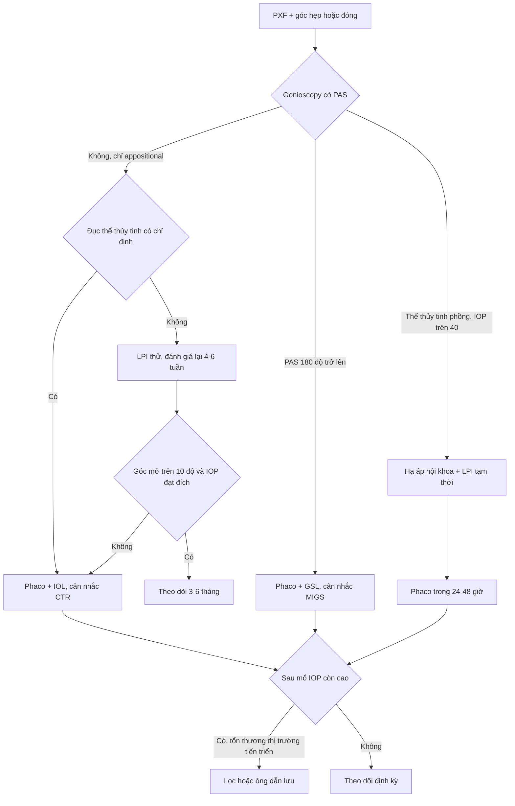
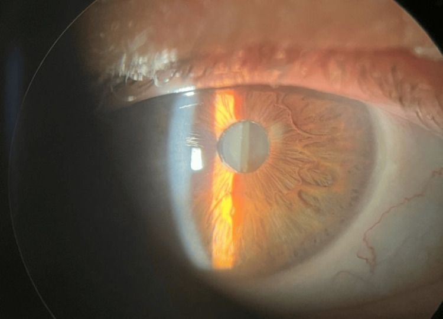
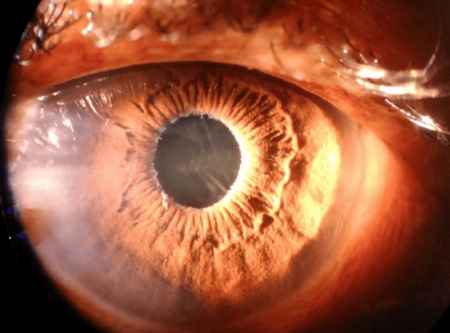
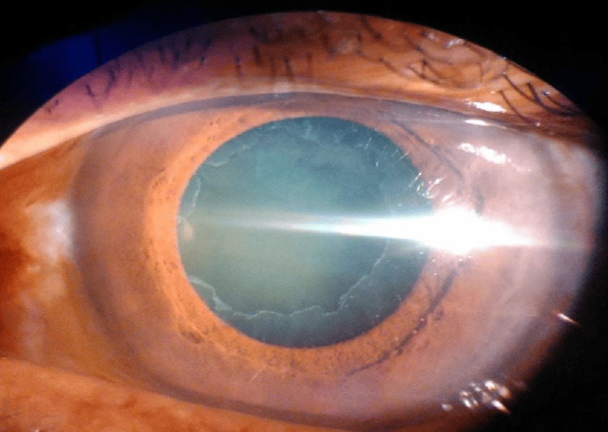
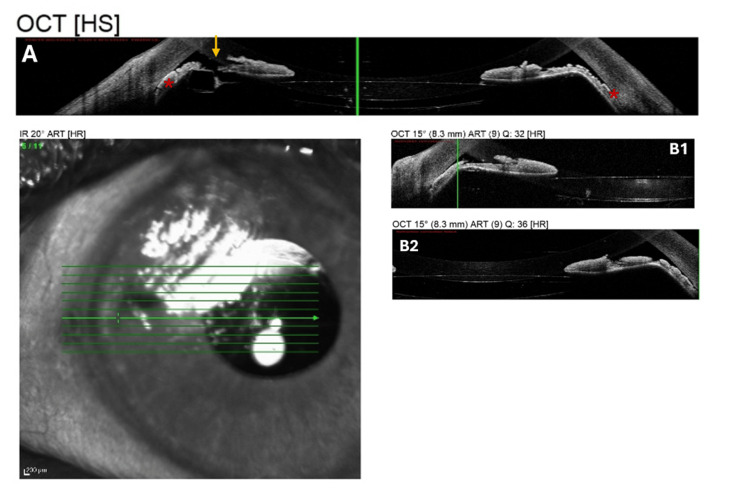
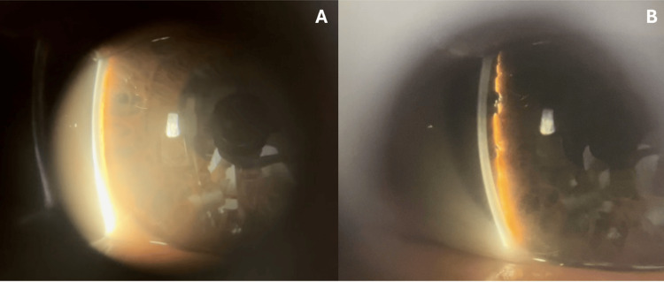
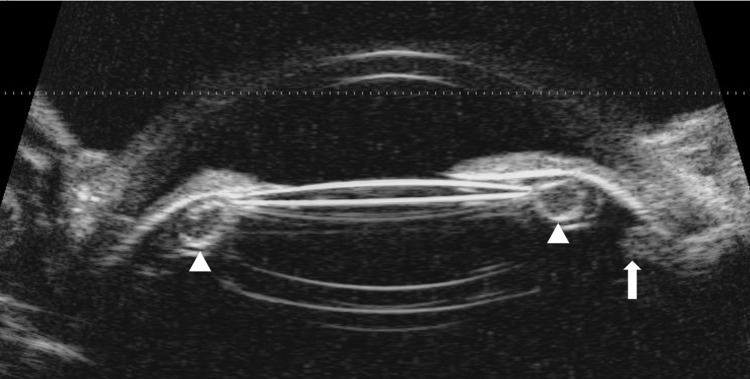

# 3237 — PXF kèm góc đóng: LPI có đủ hay phải lấy thể thủy tinh? / Pseudoexfoliation with angle closure: iridotomy or lens extraction?

**Tags:** `pattern:bong-vay-bao-truoc` `pattern:goc-dong` `pattern:tien-phong-nong` `pattern:the-thuy-tinh-day` `pattern:zonule-yeu` `vung:mat` `vung:goc-tien-phong` `vung:tien-phong` `vung:the-thuy-tinh` `protocol:gonioscopy` `protocol:AS-OCT` `protocol:UBM` `protocol:LPI` `protocol:phaco` `score:khong` `incidentaloma:khong`

**Mức chắc chắn (certainty):** tổng hợp y văn (literature synthesis) — dựng từ **đoàn hệ tiền cứu đa trung tâm 350 người** (118 PXF, 127 PACG, 105 thể phối hợp; 36 tháng) về đặc điểm và kết cục điều trị của PXF + góc đóng (*Sci Rep* 2025, DOI 10.1038/s41598-025-04489-0), **nghiên cứu sinh trắc 72 mắt** so sánh PXF có góc đóng được — PXF góc mở — POAG (*Can J Ophthalmol* 2009, DOI 10.3129/i08-181), **AS-OCT 34 PEXG + 33 PEX + 31 chứng** (*Am J Ophthalmol* 2022, DOI 10.1016/j.ajo.2021.07.025), **AS-OCT tiền cứu 36 PEX + 16 PEXG + 46 chứng sau phaco** (*Sci Rep* 2024, **PMC11004152**, CC BY 4.0), **gonioscopy 54 bệnh nhân PXF** (*Am J Ophthalmol* 1994, DOI 10.1016/s0002-9394(14)73141-1), **139 ca PXF biểu hiện cấp** (*Aust N Z J Ophthalmol* 1988, DOI 10.1111/j.1442-9071.1988.tb01257.x), **806 mắt góc đóng có phẫu thuật** (*Clin Exp Ophthalmol* 2021, **PMC9293109**), **172.008 mắt phaco** (*Front Ophthalmol* 2026, **PMC12935656**, CC BY 4.0), **40 ca glôcôm ác tính** (*Indian J Ophthalmol* 2025, **PMC12013297**, CC BY-NC-SA 4.0), **RCT EAGLE 419 người** (DOI 10.1016/s0140-6736(16)30956-4), **Cochrane góc đóng mạn 8 RCT/914 mắt** (**PMC8094223**), **RCT 10 năm ở góc đóng cấp 62 người** (DOI 10.1097/ijg.0000000000001799) và **2 ca lâm sàng có ảnh** (**PMC12967798**, **PMC13355278**, đều CC BY 4.0). Nhóm **không có bệnh nhân của mình**; chỗ chưa đủ chắc ghi **"chưa rõ"**. **Không ghi tên tác giả** — attribution = **tạp chí + năm + PMCID/DOI**.

> **Câu chốt:** PXF + góc đóng **không phải "PACG có thêm vảy"** — ở đây **thể thủy tinh là động cơ**: tiền phòng trước **1,88 mm** và thể thủy tinh dày **5,28 mm** (so với **2,64 / 4,84 mm** ở POAG) (DOI 10.3129/i08-181). Vì vậy **LPI chỉ tháo van một chiều của pupillary block**, không lấy đi khối đang đẩy ra trước: sau LPI, góc chỉ mở **7,4 ± 2,8°** ở thể phối hợp so với **12,7 ± 3,6°** ở PACG, và **kiểm soát IOP bền chỉ 38,1% so với 72,4%** (DOI 10.1038/s41598-025-04489-0). Ngược lại, **lấy thể thủy tinh là điều trị đúng cơ chế** — nhưng ở mắt PXF **đứt dây chằng Zinn RR 6,7**, **rách bao sau RR 2,3**, **trật IOL muộn RR 7,3** (**PMC12935656**), nên "phaco cho mọi ca" cũng sai. Ba số phải thuộc trước khi quyết định: **góc đóng được 9,3%** ở bệnh nhân PXF (DOI 10.1016/s0002-9394(14)73141-1); **18/139 ca PXF biểu hiện cấp là góc đóng thật, tiền phòng ≤ 2,2 mm ở 100%** (DOI 10.1111/j.1442-9071.1988.tb01257.x); **PAS ≥ 180° là yếu tố nguy cơ glôcôm ác tính OR 10,1** sau mổ (PMC12013297).

## 1. Tổng quan bệnh học – cơ chế hình ảnh (TẠI SAO)

### 1.1 Ba tầng cơ chế: vật liệu PXF làm hẹp góc bằng cách nào

- **Tầng 1 — thể thủy tinh to và ra trước.** Vật liệu PXF lắng trên **dây chằng Zinn** làm zonule **yếu, giãn, lỏng lẻo**; thể thủy tinh mất neo sẽ **dịch ra trước**, đồng thời **dày lên** do đục nhân sớm hơn. Trên 72 mắt, nhóm **PXF + góc đóng được** có **ACD 1,88 ± 0,07 mm**, **thể thủy tinh 5,28 ± 0,09 mm**, **tỷ lệ thể thủy tinh/trục nhãn 2,34 ± 0,05** — cao hơn hẳn PXF góc mở (**2,37 mm / 5,03 mm / 2,12**) và POAG (**2,64 mm / 4,84 mm / 2,02**) (DOI 10.3129/i08-181). Đây là **cơ chế "đẩy từ sau"**: không phải mống mắt tự phình ra trước, mà bị **khối thể thủy tinh đội lên**.
- **Tầng 2 — bè củng mạc đã hỏng sẵn.** Cùng một mắt vừa **hẹp góc** vừa có **vật liệu PXF + sắc tố bít khe bè** (xem bài 3234); vì vậy **mở góc không đồng nghĩa hạ được IOP**. Trên AS-OCT, góc hẹp nhất ở **PEXG**, rộng dần về **PEX** rồi **chứng** — tức hẹp góc là một **dấu hiệu tiến triển** của bệnh PXF, không phải biến cố ngẫu nhiên (DOI 10.1016/j.ajo.2021.07.025).
- **Tầng 3 — dính thật (PAS) hình thành theo thời gian.** Khi mống mắt áp sát giác mạc lâu, **dính góc trước ngoại vi (peripheral anterior synechiae)** tổ chức hóa; lúc đó **LPI không thể mở** vì góc đã bị "hàn". Trong **806 mắt góc đóng** được phẫu thuật, **zonulopathy 7,3%** — cao hơn nhiều so với **0,46–2,6%** dân số chung, cho thấy **yếu zonule là nguyên nhân bị bỏ sót của góc đóng** (PMC9293109).

### 1.2 Vì sao LPI thất bại ở PXF — bằng chứng định lượng

- **LPI chỉ tháo chênh áp qua lỗ đồng tử.** Khi góc đóng do **khối thể thủy tinh đẩy ra trước**, lỗ thông sẽ **giảm chênh áp nhưng không kéo thể thủy tinh về sau**; mống mắt vẫn bị đội.
- Trong **105 ca PXF + PACG** so với **127 ca PACG**, sau LPI: **góc mở 7,4 ± 2,8° so với 12,7 ± 3,6°** (p < 0,001), **kiểm soát IOP bền 38,1% so với 72,4%** (p < 0,001), **tái điều trị 38,1% so với 10,2%** (p < 0,001), **cần thuốc bổ trợ 17,1% so với 8,7%** (p = 0,012) (DOI 10.1038/s41598-025-04489-0). Nói cách khác: **lỗ thông có thể thông mà góc vẫn đóng**.
- **Dấu hiệu "LPI patent nhưng thất bại"** còn gặp ở mắt **giả thể thủy tinh**: ca 70 tuổi PXF, **2 lỗ LPI thông**, IOP vẫn **35 mmHg**, AS-OCT cho thấy **mống mắt vồng ra trước KHÔNG do pupillary block**, UBM phát hiện **vòng Soemmering 360°** đẩy mống mắt — cơ chế **không phải pupillary block**, nên LPI vô hiệu về nguyên tắc (**PMC12967798**).

### 1.3 Vì sao lấy thể thủy tinh đúng cơ chế — và đúng bằng bao nhiêu

- **Loại bỏ khối choán chỗ:** lấy thể thủy tinh làm **ACD sâu thêm, AOD/TISA tăng, lens vault giảm**; ở mắt PEX **mức tăng tương đối lớn hơn chứng** sau phaco (p < 0,05) — tức mắt PEX **được lợi nhiều hơn** về giải phẫu góc (**PMC11004152**).
- **Bằng chứng mức độ can thiệp:** **EAGLE** (419 người, PACG nguyên phát) cho thấy lấy thể thủy tinh trong **IOP 16,6 mmHg**, thấp hơn **1,18 mmHg** (95% CI −1,99 đến −0,38) và **chất lượng sống tốt hơn** so với LPI + thuốc; **ICER 14.284 £/QALY** (DOI 10.1016/s0140-6736(16)30956-4). Ở **góc đóng cấp**, RCT 10 năm: nhóm LPI có **71,4%** phải lấy thể thủy tinh về sau, còn nhóm phaco sớm **dùng ít thuốc hơn** (0,16 so với 0,76 lọ/mắt), **PAS ít hơn** (120,0 ± 116,1° so với 244,3 ± 139,8°) (DOI 10.1097/ijg.0000000000001799). **LPI làm chậm, không thay thế được phaco.**
- **Nhưng phaco ở mắt PXF không "nhẹ nhàng":** trên **172.008 mắt**, PXF làm tăng **rách bao sau RR 2,3 (1,7–3,0)**, **đứt zonule RR 6,7 (4,9–9,0)**, **rơi nhân RR 2,5 (1,2–5,4)**, **chuyển sang lấy ngoài bao RR 2,6**, **IOP ≥ 22 mmHg sau mổ RR 1,6** và **trật IOL phải mổ lại RR 7,3 (4,4–12,2)** (**PMC12935656**). Vì vậy chỉ định phaco phải đi kèm **kế hoạch zonule** (CTR, móc mống mắt, giảm lưu lượng).
- **Kết cục ở thể phối hợp:** trong đoàn hệ 350 người, nhóm PXF + PACG **mất thị trường nhanh hơn**: **−2,9 ± 0,8 dB/năm** so với **−1,7 ± 0,6** (PXF) và **−1,4 ± 0,5** (PACG); **62,9%** có ≥ 1 biến chứng nặng sau 36 tháng so với **38,1%** và **31,5%** (DOI 10.1038/s41598-025-04489-0). Đây là lý do **không được "chờ xem"** ở thể phối hợp.

### 1.4 Dịch tễ — PXF là nhóm nguy cơ góc đóng, không phải "trùng hợp"

- **54 bệnh nhân PXF:** **5 người (9,3%)** có góc đóng được trên gonioscopy; phân tích gộp các nghiên cứu lớn cho thấy **tăng tỉ lệ góc đóng cấp** ở nhóm PXF (DOI 10.1016/s0002-9394(14)73141-1).
- **139 ca PXF biểu hiện cấp:** **18 ca (12,9%)** là **góc đóng thật** (86 ca glôcôm góc mở cấp, 21 ca tân mạch, 14 ca tuyệt đối); **ACD ≤ 2,2 mm ở 100% ca góc đóng**, khác biệt **p < 0,001** so với góc mở cấp; **đáp ứng nội khoa kém**, **mổ hạ được IOP ở đa số** (DOI 10.1111/j.1442-9071.1988.tb01257.x).
- Hệ quả thực hành: bệnh nhân **PXF > 60 tuổi, tiền phòng nông, thể thủy tinh dày** phải được **gonioscopy cả hai mắt** — kể cả khi IOP bình thường và mắt chưa có triệu chứng.

### 1.5 Bảng số phải nhớ

| Chỉ số | Giá trị | Nguồn |
|---|---|---|
| ACD ở PXF có góc đóng được | **1,88 ± 0,07 mm** | DOI 10.3129/i08-181 |
| ACD ở PXF góc mở / POAG | **2,37 / 2,64 mm** | DOI 10.3129/i08-181 |
| Độ dày thể thủy tinh PXF-góc đóng / PXF-mở / POAG | **5,28 / 5,03 / 4,84 mm** | DOI 10.3129/i08-181 |
| Tỷ lệ thể thủy tinh/trục nhãn | **2,34 / 2,12 / 2,02** | DOI 10.3129/i08-181 |
| Tỉ lệ góc đóng được ở bệnh nhân PXF | **9,3%** (5/54) | DOI 10.1016/s0002-9394(14)73141-1 |
| Góc đóng thật trong 139 ca PXF biểu hiện cấp | **18 ca (12,9%)**; ACD ≤ **2,2 mm** ở **100%** | DOI 10.1111/j.1442-9071.1988.tb01257.x |
| Zonulopathy ở 806 mắt góc đóng được mổ | **7,3%** (59/806) so với **0,46–2,6%** dân số chung | PMC9293109 |
| Góc mở sau LPI: PXF + PACG so với PACG | **7,4 ± 2,8°** so với **12,7 ± 3,6°** | DOI 10.1038/s41598-025-04489-0 |
| Kiểm soát IOP bền sau LPI | **38,1%** so với **72,4%** | DOI 10.1038/s41598-025-04489-0 |
| Tái điều trị sau LPI | **38,1%** so với **10,2%** | DOI 10.1038/s41598-025-04489-0 |
| Mất thị trường/năm ở thể phối hợp | **−2,9 ± 0,8 dB/năm** so với **−1,7 / −1,4** | DOI 10.1038/s41598-025-04489-0 |
| Phaco + MIGS so với trabeculectomy ở thể phối hợp | thành công hoàn toàn **72,4%** so với **53,3%** | DOI 10.1038/s41598-025-04489-0 |
| Phaco-MIGS mổ sớm so với trab sớm | **81,0%** so với **43,8%** | DOI 10.1038/s41598-025-04489-0 |
| EAGLE: lấy thể thủy tinh so với LPI + thuốc | IOP **−1,18 mmHg**, ICER **14.284 £/QALY** | DOI 10.1016/s0140-6736(16)30956-4 |
| Góc đóng cấp: LPI về sau phải phaco | **71,4%** trong 10 năm | DOI 10.1097/ijg.0000000000001799 |
| Phaco ở mắt PXF: rách bao sau / đứt zonule / trật IOL | **RR 2,3 / 6,7 / 7,3** | PMC12935656 |
| Glôcôm ác tính sau mổ: PAS ≥ 180° / IOP > 22 / trab | **OR 10,1 / 5,32 / 4,09** | PMC12013297 |

## 2. Mẫu hình + chẩn đoán phân biệt theo vị trí (gamut)

### 2.1 Bốn kiểu hình "PXF + góc đóng" — điều trị khác nhau

1. **PXF + góc đóng appositional, chưa có PAS, thể thủy tinh còn trong:** cơ chế **chủ yếu do thể thủy tinh đẩy ra trước**. LPI có thể mở tạm, nhưng **góc mở ít** và **tái hẹp**; **phaco sớm** là điều trị gốc nếu đã có đục hoặc góc hẹp ≥ 2 góc phần tư.
2. **PXF + góc đóng có PAS (thường ≥ 180°):** phần góc đã **dính thật**; LPI **không mở được** phần dính. Cần **phaco + goniosynechialysis (GSL)** ± MIGS; nếu thị trường đã tổn thương nặng, cân nhắc **lọc/ống dẫn lưu**.
3. **PXF + phacomorphic (thể thủy tinh phồng, IOP rất cao):** thể thủy tinh **to nhanh** đẩy mống mắt ra trước, **không nhất thiết có PXF** nhưng PXF làm zonule yếu → dễ **lệch thể thủy tinh**. Đây là **cấp cứu**: hạ áp nội khoa + LPI **tạm thời**, **phaco trong 24–48 giờ**.
4. **PXF + góc đóng sau phaco (giả thể thủy tinh):** **vòng Soemmering** to ra, **capsular block** muộn, hoặc **IOL–bao bị đẩy ra trước** do zonule lỏng; LPI **thất bại** vì **không phải pupillary block**. Chẩn đoán bằng **UBM** (vòng tăng âm 360° áp mặt sau mống mắt) (**PMC12967798**).

### 2.2 Gamut "góc hẹp/đóng MỘT MẮT ở người > 60 tuổi"

- **PXF + góc đóng** — vảy bờ đồng tử, ba vùng bao trước, **thể thủy tinh dày**, **đồng tử giãn kém**, **phacodonesis**.
- **Phacomorphic** — thể thủy tinh **phồng, trắng đục**, tiền phòng **rất nông**, IOP **40–60 mmHg**, **không cần có PXF**.
- **Plateau iris** — góc hẹp **do thể mi ra trước**, **bề dày mống mắt ngoại vi lớn**, **LPI không mở góc** dù lỗ thông; UBM thấy **mống mắt hình cao nguyên**.
- **Góc đóng sau phaco** — **Soemmering**, **capsular block**, **IOL lệch**, **khối dịch sau IOL**; AS-OCT thấy **mống mắt vồng không do chênh áp đồng tử**.
- **Glôcôm ác tính (aqueous misdirection)** — **tiền phòng nông sau mổ**, **IOP cao**, **không có pupillary block**, **siêu âm không thấy khối dịch**; **PAS ≥ 180° và IOP > 22 mmHg** là yếu tố nguy cơ (PMC12013297).
- **Nguyên nhân hiếm:** **khối u thể mi/hắc mạc** đẩy ra trước, **tràn dịch hắc mạc**, **khối máu sau mổ**, **tân mạch góc**; cần **UBM/MRI** khi bệnh cảnh không điển hình.

### 2.3 Gamut "vảy trắng ở bờ đồng tử + góc hẹp"

- **PXF** — vảy **trắng xám dạng bột**, **bờ đồng tử nham nhở**, ba vùng bao trước, **sắc tố góc dưới**, **đồng tử giãn kém**.
- **True exfoliation** — tiền sử **thợ thổi thủy tinh/phơi nhiệt**, mảnh **bao trước dày, cuộn mép**, **không có lắng đọng bè**.
- **IFIS** — **α1-antagonist**, mống mắt **lượn sóng – co dần – sa ra vết mổ**, **không có vảy**; có thể **cùng tồn tại** với PXF.
- **Vảy trên IOL/dịch kính sau phaco** — **không phải tái phát**, không gây viêm; đừng nhầm với **viêm nội nhãn** khi có **đau + mủ tiền phòng**.

## 3. Bảng so sánh phân biệt (ma trận đối chiếu)

| Thực thể (entity) | Hình ảnh/khám điển hình | Chốt vào (rule-in) | Chốt loại (rule-out) | Gợi ý xác nhận |
|---|---|---|---|---|
| **PXF + góc đóng appositional** | Vảy bờ đồng tử + ba vùng bao trước; **ACD ≤ 2,2 mm**, thể thủy tinh **≥ 5,2 mm**; góc hẹp nhưng **chưa có dải dính** | **Vảy PXF + ACD nông + góc hẹp không PAS + lens vault cao** | **Không có vảy, thể thủy tinh mỏng, góc hẹp do plateau** → không phải PXF; **PAS rõ** → thể dính | Gonioscopy, AS-OCT (ACD, LV, AOD500), sinh trắc |
| **PXF + góc đóng có PAS** | Góc dính **từng cung/clock-hour**, **không mở sau LPI**; IOP cao kéo dài; **góc mở sau LPI < 10°** | **PAS ≥ 180° + LPI thông nhưng góc không mở** | **Góc mở hoàn toàn sau LPI** → chỉ appositional; **không vảy** → PACG dính nguyên phát | Gonioscopy trước/sau LPI, AS-OCT, chụp ảnh góc |
| **Phacomorphic** | Thể thủy tinh **phồng, trắng**, tiền phòng **rất nông**, IOP **40–60 mmHg**, mắt đau | **Thể thủy tinh phồng + tiền phòng nông một bên + IOP rất cao** | **Thể thủy tinh mỏng, ACD bình thường** → không phải; **có vảy + zonule lỏng** → PXF phối hợp | Đèn khe, siêu âm A/B, AS-OCT; hỏi diễn tiến vài ngày |
| **Plateau iris** | Góc hẹp **toàn chu vi**, **mống mắt ngoại vi dày**, **tiền phòng trung tâm sâu hơn**; **LPI không mở góc** | **UBM: thể mi ra trước + mống mắt cao nguyên**, góc vẫn hẹp sau LPI | **Thể thủy tinh dày, ACD nông toàn bộ** → nghi PXF/phacomorphic; **có vảy** → PXF | UBM 35–50 MHz, AS-OCT, gonioscopy |
| **Góc đóng sau phaco trên nền PXF** | **LPI thông nhưng IOP cao**, tiền phòng nông; **AS-OCT: mống mắt vồng không do chênh áp đồng tử**; **UBM: vòng Soemmering 360°** | **UBM thấy vòng tăng âm áp mặt sau mống mắt** | **UBM không có vòng, có chênh áp đồng tử** → pupillary block thật; **IOP thấp, tiền phòng nông** → rò/hypotony | UBM, AS-OCT, siêu âm B-scan, đèn khe sau giãn |
| **PACG nguyên phát** | Góc hẹp/đóng **hai mắt**, **không vảy**, thể thủy tinh **mỏng hơn**, **đồng tử giãn tốt** | **Góc hẹp đối xứng + không PXF + ACD nông vừa** | **Có vảy ba vùng** → PXF; **PAS khu trú một bên** → nguyên nhân thứ phát | Gonioscopy hai mắt, AS-OCT, sinh trắc |
| **Glôcôm ác tính** | **Tiền phòng nông sau mổ**, IOP cao, **không có pupillary block**, **không khối dịch** trên siêu âm | **Tiền phòng nông + IOP cao sau mổ + PAS ≥ 180° + LPI vô hiệu** | **Có khối dịch/chèn ép** → tràn dịch hắc mạc/xuất huyết; **vảy + thể thủy tinh dày** → PXF chưa mổ | Siêu âm, UBM, đáp ứng atropine–phenylephrine, hội chẩn glôcôm |

## 4. Protocol chụp/đánh giá + hệ phân độ và ngưỡng xử trí

### 4.1 Trình tự khám bắt buộc (không đảo)

| Bước | Việc làm | Ngưỡng/ghi chú |
|---|---|---|
| 1 | **BCVA, khúc xạ, sinh hiển vi** trước giãn | Ghi **độ giãn đồng tử (mm)**, **thời gian giãn**, **độ đục nhân** |
| 2 | **IOP Goldmann** nhiều thời điểm | Thể phối hợp có **dao động hai đỉnh**; ghi **giờ đo** |
| 3 | **Gonioscopy** (Spaeth) | Ghi **số giờ PAS**, **mức sắc tố 0–4**, **Sampaolesi line**, **góc mở/đóng theo góc phần tư** |
| 4 | **Đèn khe sau giãn tối đa** | Ba vùng bao trước, **vảy bờ đồng tử**, **phacodonesis**, **vảy trên IOL/dịch kính** |
| 5 | **AS-OCT tiền phòng** (sáng và tối) | **ACD, lens vault, AOD500/750, TISA750, TIA**, số góc phần tư đóng; so **hai mắt** |
| 6 | **UBM 35–50 MHz** | Thể mi, **vòng Soemmering**, **zonule**, khối sau mống mắt — bắt buộc khi **giả thể thủy tinh** hoặc **LPI thất bại** |
| 7 | **Sinh trắc quang + công suất IOL** | **Độ dày thể thủy tinh**, **trục nhãn**, **ACD**; đo **hai mắt** trước khi bàn mổ |
| 8 | **Đĩa thị + OCT pRNFL/GCL + thị trường 24-2** | Làm **nền** ngay cả khi IOP bình thường; PXF có **87,3%** ca glôcôm không từng OHTN (bài 3234) |

### 4.2 Ngưỡng định lượng dùng để quyết định

- **ACD ≤ 2,2 mm** → coi là **tiền phòng nông nguy cơ** (lấy từ nhóm góc đóng cấp trong PXF, DOI 10.1111/j.1442-9071.1988.tb01257.x).
- **Độ dày thể thủy tinh ≥ 5,2 mm** ở người > 60 tuổi → nghi **thể thủy tinh là động cơ chính** (PXF-góc đóng trung bình **5,28 mm**; DOI 10.3129/i08-181).
- **PAS ≥ 180°** → **không kỳ vọng LPI mở góc**; đồng thời là **yếu tố nguy cơ glôcôm ác tính OR 10,1** khi mổ (PMC12013297).
- **Góc mở sau LPI < 10°** (đo AS-OCT ở 4–6 tuần) hoặc **IOP không đạt đích** → chuyển **lấy thể thủy tinh**; ngưỡng tham chiếu: thể phối hợp chỉ mở **7,4°** so với **12,7°** ở PACG (DOI 10.1038/s41598-025-04489-0).
- **IOP > 22 mmHg sau mổ** → theo dõi sát, vì PXF tăng **RR 1,6** so với không PXF (PMC12935656).

### 4.3 Sơ đồ quyết định

### 4.4 Kỹ thuật LPI — và giới hạn của nó

- **Chỉ định thử LPI:** góc đóng **appositional**, **chưa PAS**, **thể thủy tinh chưa có chỉ định mổ**, IOP kiểm soát được bằng thuốc. LPI **360°** không cần; một lỗ **đủ lớn, đặt ở vùng góc mở nhất** (thường 10–11 giờ hoặc 1–2 giờ) để **không đục thể thủy tinh**.
- **Đánh giá lại sau 4–6 tuần** bằng gonioscopy + AS-OCT: **không dùng cảm giác "lỗ thông là xong"**. Nếu góc **không mở thêm**, **PAS tiến triển**, hoặc **IOP không đạt đích** → **chuyển phaco**.
- **Khi nào thêm ALPI (argon laser peripheral iridoplasty):** góc đóng **do thể mi/plateau** hoặc **góc còn dẹt sau LPI**; trong thể phối hợp, ALPI đạt **53,3%** so với LPI **38,1%**, nhưng **vẫn thua phaco** (DOI 10.1038/s41598-025-04489-0).

### 4.5 Kỹ thuật phaco ở mắt PXF + góc đóng

- **Chuẩn bị:** giãn **tối đa nhưng nhẹ tay** (đồng tử giãn kém), **móc mống mắt** khi cần, **van đỡ bao (capsular tension ring)** đặt **trước khi xoay nhân** nếu zonule lỏng; cân nhắc **đo đường kính bao** trước.
- **Kỹ thuật:** **capsulorhexis liên tục** (không dùng forceps kéo mạnh), **nước xoay nhân nhẹ**, **giảm chân không/lưu lượng** ở thì hút nhân, **tránh áp lực tiền phòng thấp**; **không hút quá sát bao** vì dễ rách bao sau.
- **Kết hợp:** **GSL** khi PAS ≥ 180° (bóc dính dưới trực tiếp với OVD); **MIGS** (goniotomy/stent bè) khi glôcôm **nhẹ–trung bình**; **trabeculectomy/ống** khi **thị trường tiến triển** hoặc IOP không đạt sau phaco — trong thể phối hợp, **phaco + MIGS 72,4%** so với **trab 53,3%** (DOI 10.1038/s41598-025-04489-0), nhưng **PAS lan rộng + IOP > 22** làm tăng nguy cơ **glôcôm ác tính** (PMC12013297), nên **theo dõi tiền phòng sát 24 giờ đầu**.
- **Sau mổ:** khám **1 ngày, 1 tuần, 1 tháng, 3 tháng, 6 tháng**; ghi **IOP, độ sâu tiền phòng, vị trí IOL, khúc xạ**; cảnh báo **trật IOL muộn RR 7,3** (PMC12935656) và **đục bao sau**.

## 5. Biến thể bình thường và cạm bẫy

- **"LPI thông" không đồng nghĩa "góc mở".** Trong thể phối hợp, góc chỉ mở **7,4°** và **61,9%** không đạt kiểm soát bền (DOI 10.1038/s41598-025-04489-0). Luôn **gonioscopy + AS-OCT sau LPI**, đừng xuất viện chỉ vì lỗ thông.

  
  *Nguồn: Cureus 2026 (PMC12967798), Fig. 1 — CC BY 4.0. Ảnh gốc, không chỉnh.*

- **Mắt bên "chưa thấy vảy" vẫn là mắt nguy cơ.** PXF một bên chuyển hai bên **11% / 36% / 52%** ở **5 / 10 / 15 năm** (bài 3234); **đo ACD và sinh trắc cả hai mắt**, và **gonioscopy mắt bên**.

- **Đồng tử giãn kém không phải "do tuổi".** Kém giãn là dấu hiệu **PXF + nguy cơ zonule**; đo **đường kính đồng tử sau giãn** và chuẩn bị **móc/CTR** trước khi vào phòng mổ.

  
  *Nguồn: Cureus 2026 (PMC13355278), Fig. 2 — CC BY 4.0. Ảnh gốc, không chỉnh.*

- **Góc đóng sau phaco: đừng làm LPI lần nữa.** Nếu **LPI đã thông** mà **IOP vẫn cao + tiền phòng nông**, cơ chế **không phải pupillary block**; **UBM** tìm **vòng Soemmering**, **capsular block**, **IOL lệch** (**PMC12967798**). LPI thêm **không giải quyết** và làm chậm can thiệp đúng.

- **Glôcôm ác tính là cạm bẫy sau mổ.** **PAS ≥ 180° (OR 10,1)**, **IOP > 22 mmHg (OR 5,32)**, **trabeculectomy (OR 4,09)** làm tăng nguy cơ (PMC12013297); tiền phòng nông sau mổ + IOP cao phải nghĩ **aqueous misdirection**, không phải "hết thuốc".

- **PXF trên IOL sau phaco không phải viêm, không phải tái phát.** Chỉ điều trị khi **đau, mủ tiền phòng, giảm thị lực** (viêm nội nhãn) — khác hoàn toàn.

- **Đừng nhầm true exfoliation với PXF.** True exfoliation có **mảnh bao trước cuộn mép** ở **thợ thổi thủy tinh/phơi nhiệt**, **không có vảy ở bè**; PXF có **ba vùng bao trước + sắc tố góc**.

## 6. Tự lượng giá — Blind Quiz

**Ca 1 — Nam 74 tuổi, mờ mắt dần, đồng tử 4 mm sau giãn. Nhìn ảnh trước khi đọc đáp án.**

- Gợi ý: IOP 22 mmHg, chưa dùng thuốc, chưa chấn thương.
- Câu hỏi: Dấu hiệu chính? Cần khám thêm gì để biết có nguy cơ góc đóng? Dấu hiệu nào quyết định kế hoạch mổ?

<b>Bấm để hiện đáp án (findings + chẩn đoán)</b>

- **Dấu hiệu:** **vật liệu dạng sợi (fibrillar) trên bao trước thể thủy tinh** và **bờ đồng tử**, kèm **đồng tử giãn kém** — PXF.
- **Cần khám thêm:** **gonioscopy** tìm **sắc tố + PAS**, **AS-OCT** đo **ACD/lens vault/AOD**, **sinh trắc** đo **độ dày thể thủy tinh**; khám **mắt bên**.
- **Quyết định:** nếu **ACD ≤ 2,2 mm**, thể thủy tinh **≥ 5,2 mm**, hoặc **đục ảnh hưởng thị lực** → **phaco + CTR**; nếu góc hẹp **chưa PAS** và **chưa có chỉ định phaco** → **LPI thử + đánh giá lại 4–6 tuần**, không hứa "LPI là xong".
- Nguồn ảnh: Cureus 2026 (PMC13355278), Fig. 1 — CC BY 4.0.

**Ca 2 — Nữ 68 tuổi PXF, IOP 30 mmHg, đã dùng 2 thuốc. Đọc AS-OCT này trước khi chọn LPI hay phaco.**

- Gợi ý: đồng tử giãn 4,5 mm, thể thủy tinh đục nhẹ, chưa từng mổ mắt.
- Câu hỏi: Mô tả góc trên AS-OCT? Ba chẩn đoán phân biệt? Vì sao LPI đơn thuần có thể thất bại?

<b>Bấm để hiện đáp án</b>

- **Dấu hiệu:** **mống mắt áp sát mặt trong giác mạc ở cả hai phía** (góc gần như đóng), **mống mắt vồng ra trước**, tiền phòng nông — hình ảnh **góc đóng**.
- **Phân biệt:** **PXF + góc đóng** (có vảy bờ đồng tử), **PACG nguyên phát** (không vảy, hai mắt), **phacomorphic** (thể thủy tinh phồng, IOP rất cao).
- **Vì sao LPI có thể thất bại:** thể thủy tinh **dày 5,28 mm** và **ACD 1,88 mm** đẩy mống mắt ra trước; LPI chỉ tháo chênh áp qua đồng tử, **không lấy khối choán chỗ** → góc mở **7,4°** và **kiểm soát bền 38,1%** (DOI 10.1038/s41598-025-04489-0). Nếu **PAS ≥ 180°** hoặc **đục thể thủy tinh** → **phaco + GSL/CTR**.
- Nguồn ảnh: Cureus 2026 (PMC12967798), Fig. 3 — CC BY 4.0.

**Ca 3 — Nam 82 tuổi, mắt giả thể thủy tinh, PXF, IOP 65 mmHg, đã có 2 lỗ LPI thông. Nhìn hai ảnh rồi trả lời.**

- Gợi ý: đau nhức, giác mạc phù, tiền phòng rất nông; LPI đã làm từ nhiều tháng trước.
- Câu hỏi: Vì sao LPI thông mà IOP vẫn 65 mmHg? UBM cho thấy gì? Bước tiếp theo?

<b>Bấm để hiện đáp án</b>

- **Vì sao LPI thất bại:** cơ chế **không phải pupillary block** — **vòng Soemmering to ra** cùng **zonule lỏng** đẩy **phức hợp mống mắt–bao–IOL** ra trước; AS-OCT cho thấy **mống mắt vồng không do chênh áp đồng tử**.
- **UBM:** **cấu trúc tăng âm 360°** (vòng Soemmering) **áp mặt sau mống mắt**, **thể mi xoay ra trước** (mũi tên) — chẩn đoán **góc đóng thứ phát sau phaco trên nền PXF**.
- **Bước tiếp theo:** hạ áp nội khoa tối đa; **không làm thêm LPI**; xử lý **nguyên nhân cơ học** (phẫu thuật lấy vòng/dẫn lưu dịch kính hoặc tái tạo tiền phòng tùy cơ sở); trong ca gốc, **chọc hút dịch kính hóa lỏng qua pars plana tại ghế** làm **tiền phòng sâu ngay** và IOP ổn định sau 7 tháng (PMC12967798).
- Nguồn ảnh: Cureus 2026 (PMC12967798), Fig. 2 và Fig. 4 — CC BY 4.0.

## 7. Câu hỏi nghiên cứu & điểm chưa đồng thuận (tính đến 11/2026)

1. **[Tranh cãi] Ở PXF có góc đóng appositional, chưa có PAS và chưa đục thể thủy tinh rõ, nên LPI trước rồi theo dõi hay lấy thể thủy tinh ngay?**
   - **Đã biết:** sau LPI, thể phối hợp chỉ mở **7,4 ± 2,8°** và kiểm soát IOP bền **38,1%** so với **72,4%** ở PACG (DOI 10.1038/s41598-025-04489-0); **EAGLE** cho thấy lấy thể thủy tinh ở PACG nguyên phát hạ IOP **1,18 mmHg** và **ICER 14.284 £/QALY** (DOI 10.1016/s0140-6736(16)30956-4), nhưng **EAGLE không tuyển góc đóng thứ phát trên nền PXF**, nên **không ngoại suy trực tiếp**.
   - **Chưa rõ:** **không có RCT** so **LPI rồi theo dõi** với **lấy thể thủy tinh sớm** ở đúng quần thể **PXF + góc đóng chưa có PAS**; chưa rõ **ngưỡng góc mở/IOP** nào đủ để hoãn mổ, và **tác hại của phaco sớm** (đứt zonule RR 6,7; trật IOL RR 7,3 — PMC12935656) có lớn hơn lợi ích ở người **thể trạng yếu** hay không.
   - **Hướng nghiên cứu:** RCT **đa trung tâm**, phân tầng theo **ACD, độ dày thể thủy tinh, số giờ PAS**, so **LPI + theo dõi** với **phaco + IOL ± CTR**, outcome **IOP đạt đích 24 tháng, góc mở trên AS-OCT, số thuốc, biến chứng zonule, thị trường**.
   - **Nguồn:** DOI 10.1038/s41598-025-04489-0 (2025); DOI 10.1016/s0140-6736(16)30956-4 (2016); PMC12935656 (2026).

2. **[Khoảng trống] Ngưỡng AS-OCT nào dự báo LPI sẽ thất bại ở mắt PXF — ACD, lens vault, hay độ dày thể thủy tinh?**
   - **Đã biết:** **ACD 1,88 mm** và **thể thủy tinh 5,28 mm** phân biệt PXF-góc đóng với PXF-góc mở và POAG (DOI 10.3129/i08-181); **lens vault cao hơn** và **mức tăng ACD/AOD sau phaco lớn hơn** ở PEX (**PMC11004152**); góc hẹp nhất ở **PEXG**, rộng dần về PEX và chứng (DOI 10.1016/j.ajo.2021.07.025).
   - **Chưa rõ:** **chưa có ngưỡng được ngoại kiểm** (ví dụ lens vault hay AOD500) để **dự báo trước** mắt nào sẽ **không mở góc sau LPI**; các nghiên cứu hiện tại **cắt ngang, cỡ mẫu nhỏ** (33–72 mắt) và **khác thiết bị AS-OCT**.
   - **Hướng nghiên cứu:** đoàn hệ **tiền cứu** làm **AS-OCT trước và 4–6 tuần sau LPI**, mô hình dự báo **thất bại góc mở** và **cần phaco trong 12 tháng**, **kiểm định ngoài** đa thiết bị.
   - **Nguồn:** DOI 10.3129/i08-181 (2009); PMC11004152 (2024); DOI 10.1016/j.ajo.2021.07.025 (2022).

3. **[Khác biệt thực hành] Khi đã quyết định lấy thể thủy tinh, có nên ghép thêm MIGS/GSL ngay hay để "phaco đơn thuần rồi tính sau"?**
   - **Đã biết:** trong thể phối hợp, **phaco + MIGS** thành công hoàn toàn **72,4%** so với **trabeculectomy 53,3%**, và ở nhóm mổ sớm **81,0%** so với **43,8%** (DOI 10.1038/s41598-025-04489-0); nhưng **PAS ≥ 180°** và **IOP > 22 mmHg** làm tăng **glôcôm ác tính** (OR **10,1** và **5,32** — PMC12013297); Cochrane góc đóng mạn gộp **8 RCT/914 mắt** cho thấy bằng chứng về lấy thể thủy tinh **chưa đồng nhất** giữa các thử nghiệm (**PMC8094223**).
   - **Chưa rõ:** **không có thử nghiệm** so **phaco + GSL + MIGS** với **phaco đơn thuần** riêng ở PXF; chưa rõ **PAS bao nhiêu giờ** thì GSL có lợi, và **thời điểm** đặt MIGS khi bè đã tổn thương vì PXF.
   - **Hướng nghiên cứu:** RCT **phaco ± GSL ± MIGS** ở PXF + góc đóng, outcome **IOP không thuốc 12–24 tháng, số giờ PAS còn lại, biến chứng tiền phòng, glôcôm ác tính**; kèm phân tích **chi phí–hiệu quả**.
   - **Nguồn:** DOI 10.1038/s41598-025-04489-0 (2025); PMC12013297 (2025); PMC8094223 (2021).

## Bài liên quan chéo

- [400 – Tổng quan Mắt & thị giác](../400-tong-quan-mat-thi-giac/lesson.md)
- [3234 – PXF KHÔNG có glôcôm: theo dõi, SLT, phaco sớm](../3234-pex-khong-glaucoma-theo-doi-slt-phaco-som/lesson.md) (nền tảng PXF và nguy cơ chuyển glôcôm)
- [1512 – PEX trước phaco: vảy ba vùng, phacodonesis, đứt dây chằng Zinn](../1512-pseudoexfoliation-truoc-phaco/lesson.md) (kỹ thuật mổ và biến chứng zonule)
- [3223 – Phaco ở mắt PEX có glôcôm: phaco đơn thuần, MIGS hay lọc](../3223-pex-glaucoma-phaco-migs-trab/lesson.md) (khi góc đã mở nhưng bè hỏng)
- [1452 – Glôcôm do thể thủy tinh chưa mổ: phacolytic & viêm do protein thể thủy tinh](../1452-glaucom-do-the-thuy-tinh-chua-mo/lesson.md) (phacomorphic và thể thủy tinh phồng)
- [442 – Glaucoma: OCT RNFL/GCC + góc tiền phòng](../442-glaucoma-OCT/lesson.md) (đọc OCT và góc trong glôcôm)
- [1508 – IFIS: mống mắt đàn hồi khi phaco](../1508-hoi-chung-mong-mat-dan-hoi-ifis/lesson.md) (phân biệt với PXF)

## Ảnh

- Tên file: `3237_<mô tả>_<Modality>_PMCxxxxxxx-FigN.jpg`; nguồn + giấy phép từng ảnh trong `images/CREDITS.md`.
- **4 ảnh** từ **PMC12967798** (*Cureus* 2026, **CC BY 4.0**) và **2 ảnh** từ **PMC13355278** (*Cureus* 2026, **CC BY 4.0**); cả hai đều **cho phép tác phẩm phái sinh**, nhưng bài này **giữ nguyên bản, không crop, không ghép** để bảo toàn nhãn và mũi tên gốc.
- Không có ảnh nào cần dẫn link thay thế.

> Không dùng để chẩn đoán độc lập khi chưa có người hướng dẫn.
