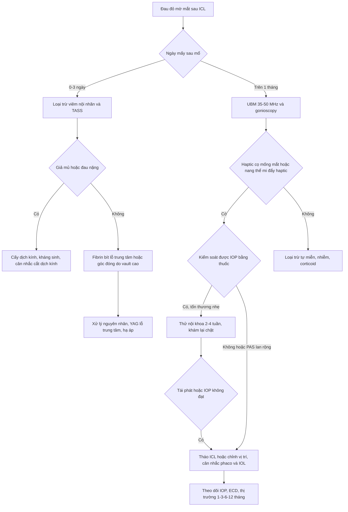
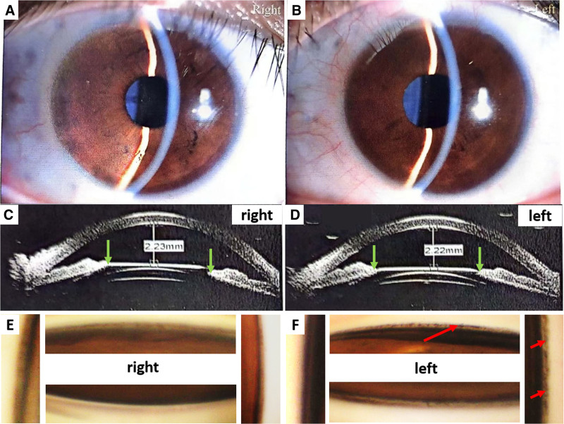
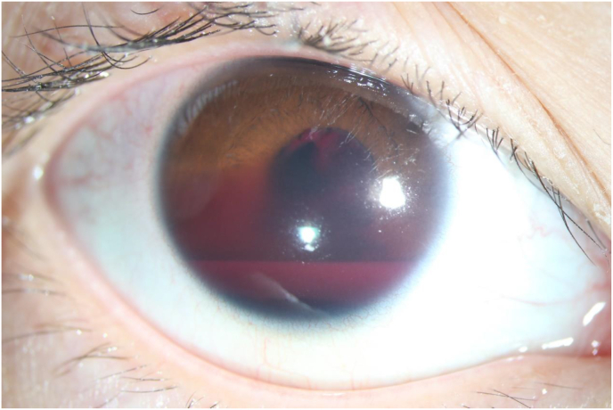
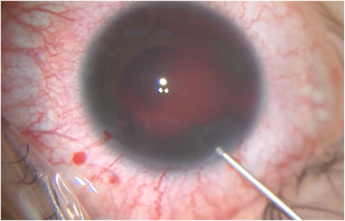
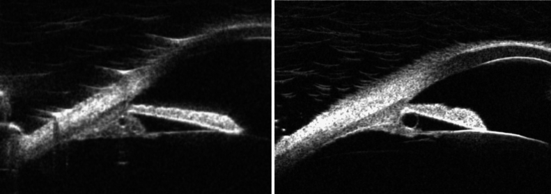
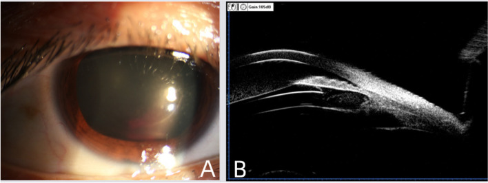

# 3238 — UGH sau ICL: khi "viêm màng bồ đào tái diễn" thực ra là cọ xát cơ học / Uveitis–glaucoma–hyphema after phakic ICL

**Tags:** `pattern:ugh` `pattern:hyphema` `pattern:viem-tien-phong` `pattern:sac-to-goc` `pattern:co-xat-co-hoc` `pattern:tang-nhan-ap` `vung:mat` `vung:tien-phong` `vung:mong-mat` `vung:the-mi` `vung:goc-tien-phong` `protocol:slit-lamp` `protocol:gonioscopy` `protocol:UBM` `protocol:AS-OCT` `protocol:do-nhan-ap` `protocol:soi-giac-mac` `score:khong` `incidentaloma:khong`

**Mức chắc chắn (certainty):** tổng hợp y văn (literature synthesis) — dựng từ **6 ca lâm sàng có ảnh, đều mô tả chi tiết IOP/kích thước tổn thương** (PMC11420483, PMC11853702, PMC12263071, PMC11052560, PMC10997960, PMC13014881), **ca UGH do ICL đầu tiên được công bố** (PMID 38652606 / DOI 10.1080/09273948.2024.2342386), **dữ liệu giám sát hậu mãi FDA MAUDE 17.482 báo cáo** (PMC12534635), **khảo sát UBM 158 người khám ICL** (PMC11452535), **nghiên cứu UBM nang thể mi – vault** (PMC13721216), **khung vault và biên an toàn ICL 2026** (PMC13749031), **đoàn hệ 57 mắt tháo pIOL + phaco** (PMC13235816), **ca TASS–fibrin bít lỗ trung tâm** (PMC12514355), **tổng quan UGH** (PMC5710046) và **tổng quan thấu kính đặt rãnh thể mi** (PMC13047016). Nhóm **không có bệnh nhân của mình**; chỗ chưa đủ chắc ghi **"chưa rõ"**. **Không ghi tên tác giả** — attribution = **tạp chí + năm + PMCID/DOI**.

> **Câu chốt:** sau mổ đặt thấu kính phakic ICL, một bệnh nhân trẻ đến với **đau – đỏ – mờ mắt tái diễn, tế bào tiền phòng, xuất huyết tiền phòng nhỏ và IOP tăng từng đợt** — bộ ba **viêm – glôcôm – xuất huyết (UGH)**. Cơ chế **không phải tự miễn**: **haptic ICL tì vào mặt sau mống mắt/rãnh thể mi**, cọ xát lặp lại làm **rách mạch máu nhỏ và bong tế bào sắc tố**, rồi **đại thực bào mang sắc tố bít bè củng mạc**. Vì thế **corticoid chỉ che triệu chứng**; **UBM 35–50 MHz** là xét nghiệm quyết định vì nhìn được **sau mống mắt** — nơi AS-OCT bị mống mắt che bóng. Bốn số phải nhớ trước khi kết luận: **nang thể mi có ở 34,8% (55/158) người khám ICL**, **52% (83/159) nang thò vào rãnh thể mi**, **3/40 mắt có nang rãnh ngang phải chỉnh vị trí ICL vì xoay hoặc cọ mống mắt** (PMC11452535); và **hyphema chỉ chiếm 3/4.640 (0,06%) báo cáo EVO-ICL trên MAUDE** — tức **hiếm nhưng không phải không thể**, còn **glôcôm được báo cáo 2,30% ở EVO+ so với 0,08% ở EVO** (PMC12534635), nghĩa là **triệu chứng tăng nhãn áp sau ICL phải được giải thích, không được quy cho "căng thẳng"**.

## 1. Tổng quan bệnh học – cơ chế hình ảnh (TẠI SAO)

### 1.1 ICL nằm ở đâu, và vì sao chỗ đó dễ cọ xát

- **Vị trí:** ICL là thấu kính **hậu phòng – phakic** (posterior chamber phakic IOL), đặt **trước thể thủy tinh**, **haptic tựa vào rãnh thể mi** (ciliary sulcus) — khoang chỉ rộng vài trăm micromet, giới hạn bởi **mặt sau mống mắt** phía trước, **thể mi – dây chằng Zinn** phía sau và **thể thủy tinh** phía sau nữa.
- **Ba bề mặt có thể bị cọ:** (1) **mặt sau mống mắt** (biểu mô sắc tố) → **tổn thương xuyên sáng mống mắt (iris transillumination defects)** và **bong sắc tố**; (2) **rãnh thể mi/mỏm thể mi** → đau, co thắt, rách mạch nhỏ; (3) **bè củng mạc** nhận toàn bộ **hồng cầu và sắc tố** từ hai nguồn trên.
- **Vì sao UGH xuất hiện MUỘN (2 tháng – 15 năm):** ICL có thể **xoay, trượt, thay đổi vault** theo thời gian; **nang thể mi to dần** đẩy haptic; mắt cận thị cao **lớn tuổi** làm thay đổi tương quan tiền phòng. Báo cáo UGH đầu tiên do ICL nêu **đau đỏ hai mắt 2 tuần** ở người **41 tuổi có ICL hai mắt và đa xơ cứng (MS)**, với **nhiều nang rãnh thể mi đẩy haptic ICL vào thể mi gây cọ mống mắt** (PMID 38652606); các ca khác xuất hiện ở **6 tháng, 2 tháng, 5 tháng, 7 năm, 13 năm và 15 năm** sau mổ (PMC11420483, PMC11853702, PMC12263071, PMC11052560, PMC13014881).

### 1.2 Chuỗi bệnh sinh: từ cọ xát đến tăng nhãn áp

1. **Cọ xát cơ học** → tổn thương **mao mạch mống mắt/thể mi** và **biểu mô sắc tố** → hồng cầu + hạt sắc tố vào tiền phòng.
2. **Viêm nhẹ – vừa:** tế bào và flare tăng; có thể **giả mủ (hypopyon) nhẹ** nếu lượng hồng cầu – protein nhiều; **không sốt, không đau nhãn cầu dữ dội như viêm nội nhãn**.
3. **Tăng nhãn áp:** **hồng cầu, "bóng ma" hồng cầu (ghost cells), đại thực bào chứa sắc tố** bít **bè củng mạc**; kèm **co thắt thể mi** và **phù thể mi** làm tiền phòng nông hơn. IOP có thể **tăng từng đợt rồi tự về** — đó là lý do bệnh nhân bị chẩn đoán nhầm nhiều lần.
4. **Hậu quả mạn:** **dính góc trước ngoại vi (PAS)** do viêm lặp lại, **glôcôm thứ phát**, **phù hoàng điểm dạng nang (CME)**, **teo thần kinh thị**; tổng quan UGH cổ điển còn nêu **tân mạch mống mắt** (PMC5710046).

### 1.3 Vì sao UBM, không phải AS-OCT, là xét nghiệm "nhìn thấy nguyên nhân"

- **Siêu âm sinh hiển vi (UBM) 35–50 MHz** có **độ phân giải trục ~50 µm**, **độ xuyên sâu 4–5 mm** — đủ để đi qua **mống mắt** và vẽ **rãnh thể mi, haptic, nang thể mi, dây chằng Zinn**. Đây là lý do UBM phát hiện **nang thể mi đẩy haptic** trong ca UGH đầu tiên (PMID 38652606) và trong khảo sát 158 người khám ICL (PMC11452535).
- **AS-OCT** đo rất tốt **vault, ACD, AOD500, TISA** nhưng **bị mống mắt che bóng** ở vùng rãnh thể mi — nên **không thay thế UBM** khi câu hỏi là "haptic có đang tì vào đâu?" (tổng quan AS-OCT cho phakic IOL: PMC12468152).
- **Vault không loại trừ UGH.** Trong ca 27 tuổi bị chẩn đoán nhầm góc đóng, **vault vẫn cao 2,23 mm và 2,22 mm**, UBM lại cho thấy **ICL tiếp xúc trực tiếp mặt sau mống mắt** (mũi tên xanh) (PMC12263071). Khung vault 2026: **thấp < 250 µm**, **đích 250–750 µm**, **cao > 750–1.000 µm**, **quá mức > 1.000 µm**, **< 100 µm hoặc chạm thể thủy tinh là đáng lo** (PMC13749031) — nhưng **vault "đẹp" vẫn có thể cọ mống mắt nếu haptic lệch hoặc nang thể mi đội**.

### 1.4 Bảng số phải nhớ

| Chỉ số | Giá trị | Nguồn |
|---|---|---|
| Nang thể mi ở người khám ICL | **34,8%** (55/158) | PMC11452535 |
| Nang thò vào **rãnh thể mi** | **52%** (83/159 nang) | PMC11452535 |
| Mắt có nang rãnh **ngang** phải chỉnh vị trí ICL (xoay/cọ mống mắt) | **3/40 (7,5%)** | PMC11452535 |
| Vault: thấp / đích / cao / quá mức | **< 250 / 250–750 / > 750–1.000 / > 1.000 µm** | PMC13749031 |
| Hyphema báo cáo MAUDE (EVO-ICL / TICL) | **3/4.640 (0,06%)** / **1/7.221 (0,01%)** | PMC12534635 |
| Glôcôm báo cáo: EVO+ so với EVO (nhóm ICL) | **2,30% so với 0,08%** | PMC12534635 |
| IOP tăng báo cáo: EVO+ so với EVO | **6,89% so với 4,78%** (ICL); **5,25% so với 4,29%** (TICL) | PMC12534635 |
| UGH do ICL đầu tiên | **41 tuổi, đau đỏ hai mắt 2 tuần, MS, nang rãnh đẩy haptic** | PMID 38652606 |
| Hyphema muộn sau toric ICL | **24 tuổi, 6 tháng, IOP 40 mmHg, CDVA đếm ngón tay 50 cm** | PMC11420483 |
| Hai ca hyphema không chấn thương | **27 tuổi/5 tháng, IOP 47,9, ACD 1,8 mm, vault 1,2 mm**; **26 tuổi/2 tháng, IOP 31, hyphema 2 mm, KP/Tyndall/cells 3+** | PMC11853702 |
| PDS – glôcôm sắc tố muộn sau ICL | **7 năm** (27 tuổi, IOP 25–29 trên 2 thuốc); **13 năm** (53 tuổi, IOP bình thường); **15 năm** (38 tuổi, tăng IOP, PI thông) | PMC12263071, PMC11052560, PMC13014881 |
| Tháo pIOL + phaco (57 mắt) | **80,6%** CDVA ≤ 0,3 logMAR; **86,1%** trong ± 1,00 D; đục bao trước là lý do tháo phổ biến nhất | PMC13235816 |
| TASS + fibrin bít lỗ trung tâm ICL | **ngày 1**, IOP **33 mmHg**, vault **1.396 µm**, YAG mở lỗ → hết trong **30 phút** | PMC12514355 |
| ICL có lỗ trung tâm (3.399 mắt, 24,7 tháng) | hiệu quả **1,03**, an toàn **1,19**, biến chứng tăng IOP/đục/giảm nội mô **thấp** | PMC10046236 |

## 2. Mẫu hình + chẩn đoán phân biệt theo vị trí (gamut)

### 2.1 Bốn kiểu hình "sau ICL" cần phân biệt trước khi gọi UGH

1. **UGH điển hình do cọ xát haptic** — đau, đỏ, **hyphema nhỏ tái diễn**, tế bào tiền phòng, IOP tăng; **tổn thương xuyên sáng mống mắt** và **sắc tố trên bè**; UBM thấy **haptic tì mặt sau mống mắt/rãnh thể mi** (PMID 38652606; PMC11420483).
2. **Phân tán sắc tố thứ phát (PDS) không có hyphema** — bệnh nhân **không đau**, phát hiện **sắc tố nội mô giác mạc, tổn thương xuyên sáng mống mắt, sắc tố bè**, IOP có thể bình thường nhiều năm rồi tăng; UBM thấy **mống mắt vồng ra sau tại vùng tiếp xúc ICL** (PMC11052560).
3. **UGH "do nang thể mi"** — nang thể mi **thò vào rãnh**, đẩy haptic; có thể **vỡ nang** gây hyphema; UBM là chìa khóa (PMC11452535, PMC13721216, PMID 38652606).
4. **"Giả UGH" sớm sau mổ** — **TASS/fibrin bít lỗ trung tâm** ngày 1–3 (IOP 33 mmHg, vault 1.396 µm — PMC12514355), **viêm nội nhãn** (đau dữ dội, giả mủ, phản ứng tiền phòng nặng), **góc đóng do vault quá cao**; đây **không phải** UGH và **không được tháo ICL** khi chưa loại trừ nhiễm trùng.

### 2.2 Gamut "đau – đỏ – mờ mắt MỘT BÊN ở người trẻ đã mổ ICL"

- **UGH do ICL** — hyphema nhỏ, tế bào, IOP tăng, **tái diễn** nhiều đợt; UBM thấy haptic cọ.
- **PDS/glôcôm sắc tố sau ICL** — **không đau**, sắc tố góc, tổn thương xuyên sáng, IOP tăng dần.
- **Viêm màng bồ đào tự miễn (kể cả MS)** — tái diễn **hai mắt**, có thể kèm triệu chứng thần kinh; **không có hyphema**; đáp ứng corticoid nhưng **tái phát khi giảm liều**; đây là **bẫy chẩn đoán lớn nhất** vì ca UGH đầu tiên có **MS** (PMID 38652606).
- **Viêm giác mạc – loét giác mạc** — đau, sợ ánh sáng, **thâm nhiễm giác mạc**, tiền phòng phản ứng; **không hyphema**; đèn khe + nhuộm huỳnh quang.
- **Viêm nội nhãn** — **giảm thị lực nặng trong ngày**, đau, giả mủ; **cấp cứu**.
- **TASS/fibrin bít lỗ trung tâm** — **ngày 1–3**, IOP cao, **fibrin trong lỗ ICL**, YAG hiệu quả (PMC12514355).
- **Glôcôm do corticoid** — tiền sử nhỏ corticoid kéo dài, **góc mở**, không viêm; **IOP tăng âm thầm**.
- **Góc đóng cấp do vault quá cao** — **hai mắt**, tiền phòng nông, **đau dữ dội, nôn**; AS-OCT thấy **vault > 1.000 µm**, góc đóng.

### 2.3 Gamut "tăng nhãn áp sau ICL" theo THỜI ĐIỂM

- **Ngày 0–3:** **pupillary block** (fibrin/máu bít lỗ trung tâm), **TASS**, **góc đóng do vault cao**, **viêm nội nhãn**.
- **Tuần 1–8:** **phản ứng corticoid**, **tàn dư viscoelastic**, **hyphema sớm do chấn thương nhẹ**.
- **Tháng 2 – năm 15:** **UGH cơ học**, **PDS thứ phát**, **PAS tiến triển**, **glôcôm do corticoid**, **đục thể thủy tinh**.
- Nguyên tắc: **thời điểm quyết định gamut** — càng muộn càng phải tìm **cọ xát cơ học** bằng UBM.

## 3. Bảng so sánh phân biệt (ma trận đối chiếu)

| Thực thể (entity) | Hình ảnh/khám điển hình | Chốt vào (rule-in) | Chốt loại (rule-out) | Gợi ý xác nhận |
|---|---|---|---|---|
| **UGH do ICL cọ xát** | Hyphema nhỏ tái diễn, tế bào + flare, IOP tăng từng đợt; **tổn thương xuyên sáng mống mắt**, sắc tố bè | **Hyphema + viêm + IOP tăng cùng đợt, có yếu tố cơ học trên UBM** | **Không có hyphema, không sắc tố, hai mắt đối xứng kiểu tự miễn** → nghĩ viêm tự miễn; **sốt/giả mủ nặng** → viêm nội nhãn | Đèn khe + gonioscopy + **UBM 35–50 MHz** tìm haptic cọ; đếm tế bào theo SUN |
| **PDS/glôcôm sắc tố sau ICL** | **Sắc tố nội mô, tổn thương xuyên sáng, sắc tố bè 3–4+**, góc MỞ; thường **không đau** | **Sắc tố bè nặng + góc mở + UBM thấy mống mắt vồng tại vùng tiếp xúc ICL** | **Góc đóng thật/PAS** → không phải PDS; **không sắc tố** → loại | Gonioscopy Spaeth, AS-OCT, UBM, chụp ảnh góc |
| **UGH do nang thể mi** | Nang **tròn, thành mỏng/dày**, **thò vào rãnh**, đẩy haptic; có thể **vỡ nang** | **UBM: nang rãnh thể mi tiếp xúc haptic cùng phía triệu chứng** | **Không nang, haptic nằm đúng rãnh** → loại; **nang trong thể mi, không thò** → ít liên quan | UBM **bản đồ 360°**, ghi giờ và kích thước nang |
| **Viêm màng bồ đào tự miễn (MS)** | Tái diễn **hai mắt**, dính sau, không hyphema; có thể viêm thần kinh thị kèm | **Bệnh sử tự miễn + hai mắt + không yếu tố cơ học trên UBM** | **Hyphema + sắc tố một bên + UBM thấy cọ** → không phải tự miễn | Hỏi bệnh sử MS, MRI sọ khi có triệu chứng thần kinh; **vẫn phải UBM** |
| **TASS/fibrin bít lỗ trung tâm** | **Ngày 1–3**, IOP cao, **fibrin trong lỗ ICL**, vault tăng; thị lực có thể còn tốt | **Fibrin bít lỗ trung tâm + IOP tăng trong 72 giờ đầu** | **Xuất hiện sau nhiều tháng** → không phải TASS; **giả mủ + đau nặng** → viêm nội nhãn | Đèn khe, AS-OCT vault, thử **YAG mở lỗ** (PMC12514355) |
| **Viêm nội nhãn** | Đau tăng nhanh, **giả mủ**, phản ứng tiền phòng nặng, giảm thị lực **ngày** | **Giả mủ + phản ứng tiền phòng nặng + giảm thị lực nhanh** | **Không giả mủ, diễn tiến từng đợt nhiều tháng** → loại | Cấy dịch kính – tiền phòng **trước** kháng sinh; siêu âm B khi không thấy đáy mắt |
| **Glôcôm do corticoid** | IOP tăng **âm thầm**, góc mở, **không viêm**, tiền sử nhỏ corticoid | **IOP tăng tương ứng thời gian dùng corticoid, góc mở, không tế bào** | **Có tế bào/hyphema** → không đơn thuần do corticoid | Nhật ký thuốc, thử giảm/ngừng corticoid có kiểm soát |
| **Góc đóng do vault quá cao** | Tiền phòng nông, **vault > 1.000 µm**, góc đóng **hai mắt**, đau nôn | **AS-OCT vault > 1.000 µm + góc đóng + tiền phòng nông** | **Vault thấp/bình thường** → loại; **góc mở có sắc tố** → PDS | AS-OCT, gonioscopy, đo IOP hai mắt |

## 4. Protocol đánh giá + ngưỡng xử trí

### 4.1 Trình tự khám bắt buộc (không đảo)

| Bước | Việc làm | Ngưỡng/ghi chú |
|---|---|---|
| 1 | **Bệnh sử mổ** | Ngày mổ, **model ICL (V4c/EVO/EVO+), công suất, kích thước**, mắt nào, biến chứng trong mổ |
| 2 | **BCVA, khúc xạ, đèn khe** | Ghi **tế bào/flare theo SUN 0–4+**, **hyphema tính bằng mm**, **dính sau**, **tổn thương xuyên sáng** |
| 3 | **IOP Goldmann** nhiều thời điểm | Ghi **giờ đo**, **số thuốc**, **IOP cao nhất từng ghi nhận** |
| 4 | **Gonioscopy (Spaeth)** | **Sắc tố bè 0–4+**, **Sampaolesi line**, **số giờ PAS**, **góc mở/đóng theo 4 góc phần tư** |
| 5 | **UBM 35–50 MHz, bản đồ 360°** | Vị trí haptic theo **giờ**, **vault**, **nang thể mi** (kích thước, thành, có thò vào rãnh), **mống mắt vồng**, **dây chằng Zinn** |
| 6 | **AS-OCT tiền phòng** | **Vault (µm), ACD, AOD500, TISA750**; so **hai mắt**; đo cả khi đang có viêm |
| 7 | **Soi nội mô (specular)** | **ECD** nền và mỗi 6–12 tháng; ICL làm giảm ECD theo thời gian |
| 8 | **Đáy mắt + OCT hoàng điểm** | Tìm **CME**; **B-scan** nếu không thấy đáy mắt vì hyphema |
| 9 | **Thị trường 24-2 + OCT RNFL/GCC** | Làm **nền** ngay khi có IOP tăng, vì tổn thương thị trường có thể **không hồi phục** (PMC12263071) |

### 4.2 Ngưỡng định lượng dùng để quyết định

- **Hyphema ≥ 2 mm hoặc tái diễn ≥ 2 đợt** → coi là **UGH cho đến khi loại trừ**, không chỉ theo dõi "viêm nhẹ".
- **IOP > 30 mmHg** hoặc **chênh > 8 mmHg so với mắt bên** → điều trị hạ áp ngay, khám lại trong **24–48 giờ**.
- **Tế bào tiền phòng ≥ 2+ kéo dài > 2 tuần** dù đã corticoid → **UBM**, không tăng corticoid mù.
- **Vault > 1.000 µm** → nguy cơ **góc đóng**; **< 250 µm** → nguy cơ **chạm thể thủy tinh/đục bao trước**; **đích 250–750 µm** (PMC13749031) — nhưng **vault trong đích vẫn không loại trừ cọ xát**.
- **Nang thể mi thò vào rãnh cùng phía triệu chứng, đường kính ≥ 1 mm** → nghi **nguyên nhân cơ học**; trong khảo sát 158 người, **3/40 mắt có nang rãnh ngang phải chỉnh vị trí ICL** (PMC11452535).
- **PAS ≥ 180°** hoặc **thị trường tiến triển** → **không chờ**, chuyển **hội chẩn glôcôm** và cân nhắc **tháo ICL + phẫu thuật glôcôm**.

### 4.3 Sơ đồ quyết định

### 4.4 Điều trị: cái gì là "gốc", cái gì là "che triệu chứng"

- **Nội khoa (bắc cầu):** **corticoid tại chỗ** giảm viêm, **thuốc hạ nhãn áp** (ức chế carbonic anhydrase, beta-blocker, alpha-2 agonist), **atropine** khi có co thắt thể mi; **đầu cao 30°** và **hạn chế gắng sức** khi còn hyphema. **Không dùng corticoid kéo dài mà không có chẩn đoán** — vừa gây **glôcôm do corticoid**, vừa **che mất UGH**.
- **Điều trị gốc:** loại bỏ **cọ xát cơ học** — **tháo ICL** hoặc **chỉnh vị trí/xoay ICL** khi nang thể mi khu trú (3/40 mắt trong khảo sát phải chỉnh vị trí — PMC11452535). Khi tháo ICL ở mắt đã có **đục thể thủy tinh** hoặc **không còn phù hợp khúc xạ**, làm **phaco + IOL** cùng thì: **80,6% đạt CDVA ≤ 0,3 logMAR**, **86,1% trong ± 1,00 D** (PMC13235816).
- **Khi có glôcôm thứ phát:** **tháo ICL ± phaco** phối hợp **phẫu thuật glôcôm** (KDB/trabeculectomy/MIGS tùy tổn thương bè). Ca 27 tuổi được **KDB nội soi** sau khi chẩn đoán PDS: IOP **25–29 mmHg trên 2 thuốc** trước mổ → **10–16 mmHg tháng 1** và **14 mmHg sau 1 năm, không thuốc** (PMC12263071).
- **Sau tháo ICL:** khám **1 ngày, 1 tuần, 1 tháng, 3–6–12 tháng**; theo dõi **IOP, ECD, thị trường, OCT RNFL**; cảnh báo **đục bao trước** (lý do tháo pIOL phổ biến nhất — PMC13235816) và **CME**.

## 5. Biến thể bình thường và cạm bẫy

- **"Đã có MS thì mọi viêm là do MS".** Ca UGH do ICL đầu tiên là người **có MS và viêm màng bồ đào tái diễn nhiều năm** (PMID 38652606); chính vì vậy **UBM mới là bước ngoặt**. Ở bệnh nhân tự miễn, **vẫn phải UBM** khi viêm **một bên, kèm hyphema hoặc sắc tố**.

  
  *Nguồn: Medicine 2025 (PMC12263071), Fig. 1 — CC BY 4.0. Ảnh gốc, không chỉnh.*

- **"Vault đẹp là yên tâm".** Vault **2,23 mm** vẫn kèm **tiếp xúc trực tiếp ICL–mống mắt** trên UBM (PMC12263071); **vault không phải đại diện cho vị trí haptic**. Luôn mô tả **haptic theo giờ** và **vùng tiếp xúc**.

- **"Không thấy sắc tố là không phải UGH".** Hai ca hyphema muộn **không có sắc tố, không tổn thương xuyên sáng, UBM không thấy haptic lệch** — tác giả **không dám gọi UGH** và nêu khả năng **vỡ nang thể mi** hoặc nguyên nhân khác (PMC11853702). **Không ép chẩn đoán**: hyphema sau ICL có thể do **nang thể mi vỡ**, **chấn thương nhẹ**, **rối loạn đông máu**.

  
  *Nguồn: Am J Ophthalmol Case Rep 2024 (PMC11420483), Fig. 1 — CC BY-NC-ND 4.0. Ảnh gốc, không chỉnh.*

- **Chẩn đoán nhầm "góc đóng cấp".** Bệnh nhân **27 tuổi, 7 năm sau ICL**, được chẩn đoán **glôcôm góc đóng** ở nơi khác; gonioscopy cho thấy **góc MỞ với sắc tố nặng** (PMC12263071). Tương tự, ca **24 tuổi** bị chẩn đoán **góc đóng thứ phát** rồi đổi thành **PDS** (PMC10997960). **Gonioscopy là bắt buộc**, không suy từ IOP.

- **Quên mắt bên.** UGH/PDS sau ICL có thể **hai bên** (PMID 38652606; PMC11052560). **UBM + gonioscopy hai mắt** trước khi kết luận "một mắt bị".

- **Nhầm TASS với UGH rồi tháo ICL oan.** **Fibrin bít lỗ trung tâm ngày 1** gây **pupillary block** (IOP 33 mmHg, vault 1.396 µm) và **YAG mở lỗ giải quyết trong 30 phút** (PMC12514355). **Can thiệp đúng là mở lỗ**, không phải tháo thấu kính.

  
  *Nguồn: Am J Ophthalmol Case Rep 2024 (PMC11420483), Fig. 6 — CC BY-NC-ND 4.0. Ảnh gốc, không chỉnh.*

- **Nang thể mi bị bỏ qua vì "không triệu chứng".** Nang có ở **34,8%** người khám ICL, **52%** thò vào rãnh (PMC11452535); **hình thái nang** (một ổ thành mỏng so với nhiều ổ thành dày) liên quan **vault** và **vị trí haptic** (PMC13721216). **Bản đồ UBM 360° trước mổ** là cách duy nhất để không bất ngờ.

  
  *Nguồn: Int Ophthalmol 2024 (PMC11452535), Fig. 4 — CC BY-NC-ND 4.0. Ảnh gốc, không chỉnh.*

- **Bỏ sót "hyphema tự phát" sau ICL là bỏ sót IOP cao.** Ca 27 tuổi có **IOP 47,9 mmHg** và **ACD 1,8 mm** ngay khi nhập viện vì mờ mắt thoáng qua (PMC11853702) — **đo IOP trước khi cho về**.

  
  *Nguồn: BMC Ophthalmol 2025 (PMC11853702), Fig. 1 — CC BY-NC-ND 4.0. Ảnh gốc, không chỉnh.*

## 6. Tự lượng giá — Blind Quiz

**Ca 1 — Nữ 24 tuổi, mờ mắt phải đột ngột 6 tháng sau đặt toric ICL hai mắt. Nhìn ảnh trước khi đọc đáp án.**

- Gợi ý: không chấn thương; đã điều trị bảo tồn ở nơi khác nhưng tái phát; IOP 40 mmHg.
- Câu hỏi: Mô tả tổn thương? Ba chẩn đoán phân biệt? Vì sao "chỉ nhỏ thuốc hạ áp" là chưa đủ?

<b>Bấm để hiện đáp án (findings + chẩn đoán)</b>

- **Dấu hiệu:** **cục máu ở vùng đồng tử** và **hyphema khoảng 3 mm ở vùng dưới**; tiền phòng có máu đỏ sẫm, không thấy giả mủ.
- **Phân biệt:** **UGH do ICL cọ xát** (haptic – mống mắt/thể mi), **hyphema do chấn thương nhẹ**, **vỡ nang thể mi**, **viêm nội nhãn** (loại vì không giả mủ, diễn tiến 6 tháng).
- **Vì sao chưa đủ:** máu và sắc tố **bít bè** gây tăng IOP từng đợt; nếu **nguyên nhân cơ học** không được loại bỏ, **tái phát** và có thể **tổn thương thị trường**. Ca gốc: IOP 40 mmHg, CDVA đếm ngón tay 50 cm; **tháo ICL + rửa tiền phòng** → IOP ổn định, CDVA **logMAR 0,6 sau 1 tháng**; trong mổ thấy **máu tươi phun thành tia từ lỗ trung tâm ICL** sau khi gỡ cục máu (PMC11420483).
- Nguồn ảnh: Am J Ophthalmol Case Rep 2024 (PMC11420483), Fig. 1 — CC BY-NC-ND 4.0.

**Ca 2 — Nam 27 tuổi, ICL 7 năm trước, giảm thị lực trái 1 năm, được chẩn đoán "glôcôm góc đóng". Đọc UBM và gonioscopy trước khi trả lời.**

- Gợi ý: IOP 25–29 mmHg trên 2 thuốc; thị trường mất góc dưới–thái dương; góc **mở**.
- Câu hỏi: Ba dấu hiệu trên hình? Chẩn đoán đúng? Vì sao "góc đóng" là chẩn đoán sai?

<b>Bấm để hiện đáp án</b>

- **Dấu hiệu:** **A/B** ICL đặt trung tâm, lỗ trung tâm có dịch; **C/D UBM: ICL tiếp xúc trực tiếp mặt sau mống mắt hai bên** (mũi tên xanh) với **vault 2,23 mm (phải) / 2,22 mm (trái)**; **E/F gonioscopy: góc MỞ nhưng sắc tố bè nặng** (mũi tên đỏ).
- **Chẩn đoán:** **phân tán sắc tố thứ phát sau ICL → glôcôm sắc tố (PDS/SOAG)**, không phải góc đóng.
- **Vì sao sai:** góc **mở** trên gonioscopy; cơ chế là **cọ xát mống mắt–ICL** giải phóng sắc tố, không phải **pupillary block**. Điều trị đúng là **KDB nội soi** (ca gốc: IOP **10–16 mmHg tháng 1**, **14 mmHg sau 1 năm không thuốc**) — không LPI.
- Nguồn ảnh: Medicine 2025 (PMC12263071), Fig. 1 — CC BY 4.0.

**Ca 3 — Nữ 41 tuổi có ICL hai mắt và đa xơ cứng, đau đỏ hai mắt 2 tuần, tiền sử "viêm màng bồ đào + glôcôm" nhiều năm. Nhìn UBM nang thể mi rồi trả lời.**

- Gợi ý: UBM 360° thấy nhiều nang ở rãnh thể mi; haptic ICL bị đẩy vào thể mi.
- Câu hỏi: Cơ chế nào giải thích bộ ba triệu chứng? Vì sao chẩn đoán "viêm do MS" là bẫy? Bước tiếp theo?

<b>Bấm để hiện đáp án</b>

- **Cơ chế:** **nang thể mi thò vào rãnh** đẩy **haptic ICL vào thể mi** → **cọ xát mống mắt** → viêm + hyphema + tăng IOP = **UGH**. Đây là **ca UGH do ICL đầu tiên được công bố** (PMID 38652606).
- **Bẫy:** bệnh nhân **có MS** nên mọi đợt viêm được quy cho tự miễn; **corticoid kéo dài** làm **tăng IOP** và **che nguyên nhân cơ học**. UBM là xét nghiệm phân định.
- **Bước tiếp theo:** **UBM bản đồ 360°** ghi giờ/kích thước nang; **gonioscopy** tìm sắc tố/PAS; **đo IOP, tế bào, ECD, thị trường**; cân nhắc **chỉnh vị trí hoặc tháo ICL** nếu cọ xát tái diễn — nang rãnh **ngang** đã buộc **3/40 mắt phải chỉnh vị trí** trong khảo sát 158 người (PMC11452535).
- Nguồn ảnh: Int Ophthalmol 2024 (PMC11452535), Fig. 4 — CC BY-NC-ND 4.0 (minh họa hai kiểu nang thể mi; không phải ảnh của ca 41 tuổi).

## 7. Câu hỏi nghiên cứu & điểm chưa đồng thuận (tính đến 11/2026)

1. **[Tranh cãi] Ở UGH do ICL đã xác định bằng UBM, nên tháo ICL ngay hay thử nội khoa/chỉnh vị trí trước?**
   - **Đã biết:** các ca công bố đều **tháo ICL** khi tái phát hoặc IOP không kiểm soát, với kết cục tốt (PMC11420483; PMC13014881); tổng quan UGH cổ điển xem **tháo/thay thấu kính** là điều trị gốc (PMC5710046); **chỉnh vị trí** đã được dùng cho **3/40 mắt có nang rãnh ngang** vì xoay hoặc cọ mống mắt (PMC11452535).
   - **Chưa rõ:** **không có nghiên cứu so sánh** "tháo ICL ngay" với "chỉnh vị trí/theo dõi nội khoa" ở UGH do ICL; chưa rõ **thời gian nội khoa an toàn** trước khi nguy cơ **PAS/thị trường** tăng, và **yếu tố nào** (số đợt, mức IOP, tổn thương xuyên sáng) quyết định thất bại nội khoa.
   - **Hướng nghiên cứu:** đoàn hệ tiền cứu phân tầng theo **cơ chế (haptic cọ trực tiếp, nang thể mi, PDS không hyphema)**, so **chỉnh vị trí ± nội khoa** với **tháo ICL**, outcome **IOP đạt đích 12–24 tháng, số đợt hyphema, PAS, thị trường, ECD**.
   - **Nguồn:** PMC11420483 (2024); PMC13014881 (2026); PMC11452535 (2024); PMC5710046 (2017).

2. **[Khoảng trống] Chỉ số UBM/AS-OCT nào dự báo được cọ xát mống mắt TRƯỚC mổ ICL?**
   - **Đã biết:** **nang thể mi 34,8%**, **52% thò vào rãnh**, và **hình thái nang** (một ổ thành mỏng so với nhiều ổ thành dày) liên quan **vault 445 µm so với 158 µm** ở hai ca (PMC11452535; PMC13721216); **khung vault** đã có ngưỡng thực hành (**250–750 µm đích**, **> 1.000 µm quá mức** — PMC13749031).
   - **Chưa rõ:** **chưa có ngưỡng được ngoại kiểm** cho **khoảng cách haptic–mống mắt**, **góc mống mắt–ICL**, hay **bản đồ nang** để dự báo UGH/PDS; các nghiên cứu hiện **cắt ngang, cỡ mẫu nhỏ**, khác thiết bị UBM.
   - **Hướng nghiên cứu:** đoàn hệ **tiền cứu** làm **UBM 360° + AS-OCT trước mổ**, theo dõi **≥ 5 năm**, mô hình dự báo **cọ xát/vault thấp**, **kiểm định ngoài đa trung tâm**.
   - **Nguồn:** PMC11452535 (2024); PMC13721216 (2026); PMC13749031 (2026).

3. **[Khác biệt thực hành] Có nên UBM 360° thường quy cho mọi người khám ICL và theo dõi định kỳ bao lâu?**
   - **Đã biết:** khảo sát 158 người khám ICL **khuyến nghị UBM sàng lọc rãnh thể mi** (PMC11452535); **PDS xuất hiện sau 13 năm** ở người **không triệu chứng** (PMC11052560), sau **15 năm** ở mắt hyperopic có **PI thông nhưng vẫn hẹp góc + sắc tố** (PMC13014881); báo cáo biến chứng trên **MAUDE tăng dần 2015–2023**, trong đó **glôcôm 2,30% ở EVO+ so với 0,08% ở EVO** (PMC12534635).
   - **Chưa rõ:** **không có dữ liệu chi phí–hiệu quả** cho UBM thường quy; **khoảng theo dõi tối ưu** (6, 12 hay 24 tháng) và **có nên chụp UBM lặp** ở mắt không triệu chứng hay không; **tỷ lệ UGH thật** trong dân số ICL vẫn chưa đo được vì **báo cáo thụ động**.
   - **Hướng nghiên cứu:** nghiên cứu **sàng lọc – can thiệp** so **UBM thường quy + theo dõi 12 tháng** với **theo dõi lâm sàng đơn thuần**, outcome **phát hiện UGH/PDS sớm, IOP, thị trường, chi phí mỗi ca phát hiện**; kèm **đăng ký quốc gia** theo dõi ICL dài hạn.
   - **Nguồn:** PMC11452535 (2024); PMC11052560 (2024); PMC13014881 (2026); PMC12534635 (2025).

## Bài liên quan chéo

- [400 – Tổng quan Mắt & thị giác](../400-tong-quan-mat-thi-giac/lesson.md)
- [3237 – PXF + góc đóng: LPI hay lấy thể thủy tinh](../3237-pxf-goc-dong-lpi-hay-lay-the-thuy-tinh/lesson.md) (góc đóng thật và vai trò thể thủy tinh — phân biệt với "góc đóng" chẩn đoán nhầm ở đây)
- [3225 – Hội chứng UGH sau IOL/vật liệu ngoại lai](../3225-hoi-chung-ugh-sau-dat-dai-ong-silicon/lesson.md) (khung UGH chung: cơ chế, chẩn đoán, điều trị)
- [3227 – Theo dõi dài hạn sau UGH đã giải quyết](../3227-theo-doi-sau-ugh-da-giai-quyet/lesson.md) (khi đã tháo nguyên nhân cơ học: IOP tồn tại, RNFL, ngưỡng mổ glôcôm)
- [3236 – Bệnh thần kinh thị do xạ trị (RION)](../3236-benh-than-kinh-thi-do-xa-rion/lesson.md) (giảm thị lực không đau sau can thiệp — cùng nguyên tắc loại trừ nguyên nhân cơ học)
- [3234 – PXF KHÔNG có glôcôm: theo dõi, SLT, phaco sớm](../3234-pex-khong-glaucoma-theo-doi-slt-phaco-som/lesson.md) (sắc tố góc và nguy cơ glôcôm)
- [3235 – Melanocytosis mắt & Nevus of Ota](../3235-melanocytosis-mat-hac-mac-nevus-of-ota/lesson.md) (sắc tố một bên — phân biệt với sắc tố do cọ xát)
- [3231 – U sắc tố mống mắt: melanoma vs nevus](../3231-u-mong-mat-melanoma-nevus-nang/lesson.md) (tổn thương sắc tố mống mắt, khối đẩy góc)
- [1446 – Bỏng hoàng điểm sau quang đông thể mi](../1446-phu-hoang-diem-sau-quang-dong-the-mi/lesson.md) (biến chứng đoạn trước/sau của thủ thuật nội nhãn)
- [6132 – Viêm giác mạc nhiễm khuẩn liên quan kính tiếp xúc](../6132-viem-giac-mac-kinh-tiep-xuc/lesson.md) (đau – đỏ – mờ mắt ở người trẻ, phân biệt nhiễm trùng)

## Ảnh

- Tên file: `3238_ugh-icl_<mô tả>_<Modality>_PMCxxxxxxx-FigN.jpg`; nguồn + giấy phép từng ảnh trong `images/CREDITS.md`.
- **1 ảnh** từ **PMC12263071** (*Medicine* 2025, **CC BY 4.0**), **3 ảnh** từ **PMC11420483** (*Am J Ophthalmol Case Rep* 2024, **CC BY-NC-ND 4.0**), **1 ảnh** từ **PMC11853702** (*BMC Ophthalmol* 2025, **CC BY-NC-ND 4.0**), **1 ảnh** từ **PMC11452535** (*Int Ophthalmol* 2024, **CC BY-NC-ND 4.0**).
- Ảnh **CC BY-NC-ND** được **giữ nguyên bản, không crop, không ghép, không đổi định dạng**; ảnh CC BY 4.0 cũng giữ nguyên để bảo toàn mũi tên và nhãn gốc.
- Không có ảnh nào cần dẫn link thay thế.

> Không dùng để chẩn đoán độc lập khi chưa có người hướng dẫn.
