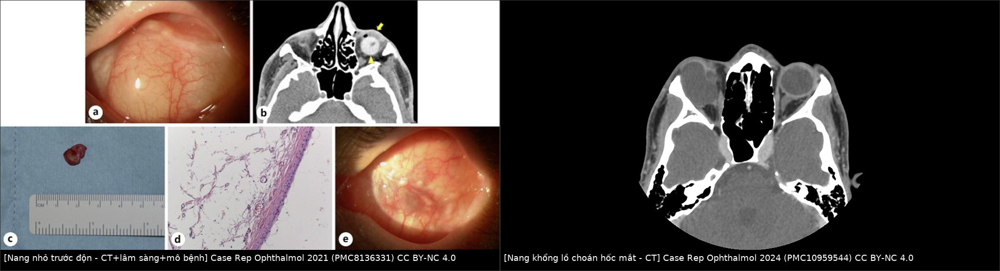
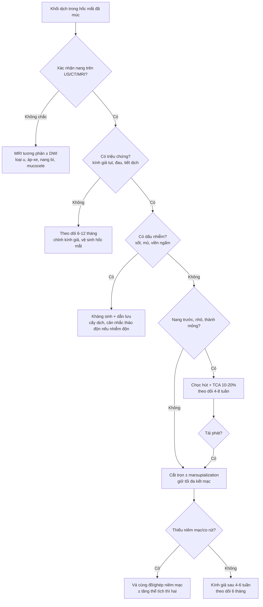
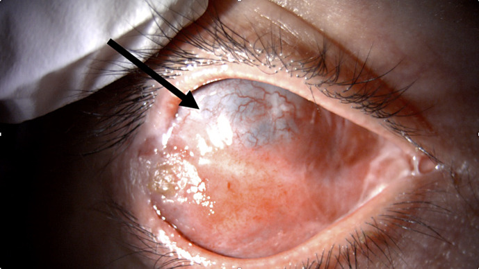
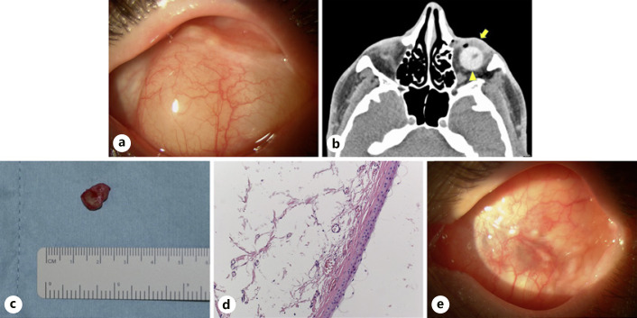
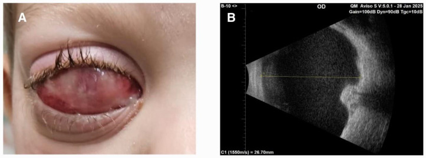

# 3239 — Nang kết mạc khổng lồ trong hốc mắt sau múc nhãn cầu: kính giả tụt, khối dịch "giả u" / Giant conjunctival cyst of the anophthalmic socket

**Tags:** `pattern:nang-hoc-mat` `pattern:khoi-dich-hoc-mat` `pattern:kinh-gia-tut` `pattern:di-lech-the-tich` `pattern:gia-u` `vung:mat` `vung:hoc-mat` `vung:ket-mac` `protocol:CT-hoc-mat` `protocol:MRI-hoc-mat` `protocol:MRI-T1-fat-sat` `protocol:sie-am-Bscan` `incidentaloma:khong`

**Mức chắc chắn (certainty):** tổng hợp y văn (literature synthesis) — dựng từ **347 ca múc nhãn cầu có độn HA** (PMC7093450), loạt **149 ca** và **5 nang kết mạc hốc mắt** (PMC1042379), ca nang khổng lồ **choán toàn hốc mắt** ở người đã múc nhãn cầu vì retinoblastoma (PMC10959544), ca nang sau evisceration có **CT + mô bệnh + hậu phẫu** (PMC8136331), **3 loạt tiêm trichloroacetic acid** (PMC16052137, PMC31282238, PMID 31106628), ca nang khổng lồ trong **mảnh ghép mỡ–bì ở trẻ** (PMC12025870) và các ca nang kết mạc hốc mắt đơn lẻ (PMC11663142, PMID 19839892). Nhóm **không có bệnh nhân của mình**; số nào chưa kiểm chứng ghi **"chưa rõ"**. **Không ghi tên tác giả** — attribution dùng tạp chí + năm + PMCID/PMID (đối chiếu Europe PMC ngày 2026-11-20).

> **Vị trí trong thư viện:** [3229](../3229-hoi-chung-hoc-mat-sau-muc-nhan-cau/lesson.md) trả lời *kính giả tụt vì THIẾU thể tích*; [3228](../3228-lo-don-hoc-mat-sau-muc-nhan-cau/lesson.md) trả lời *lộ độn/nhiễm độn*; [1515](../1515-theo-doi-hoc-mat-sau-muc-nhan-cau/lesson.md) trả lời *khối đặc trong hốc mắt đã múc là tái phát melanoma*; [400](../400-tong-quan-mat-thi-giac/lesson.md) là bản đồ hệ Mắt. Bài này trả lời câu hỏi đối lập với 3229: **kính giả tụt nhưng hốc mắt lại có THỪA một khối dịch — đó là nang kết mạc hay u tái phát, chọc hút/TCA hay phải cắt, và vì sao cắt "sạch" đôi khi làm hốc mắt co rút nặng hơn?**
>
> **Câu chốt:** **(1) Tần suất thấp nhưng tăng sau mổ thì hai:** nang kết mạc gặp **2% (7/347)** sau múc nhãn cầu có độn HA (PMC7093450), **3% (5/149)** sau độn thì hai — **cả 5 xuất hiện trong 2–14 tháng** và **4/5 phải mổ thêm** vì thiếu niêm mạc/tái phát (PMC1042379); các tổng quan ghi **0–7%** (PMC8136331) và **1,5–3,8%** (PMC12025870), riêng sau **mảnh ghép mỡ–bì (DFG)** tới **11%** (PMC8354770). **(2) Chẩn đoán là hình ảnh + mô bệnh, không phải "sờ thấy khối":** CT **đồng nhất, thấp, vỏ mỏng, KHÔNG ngấm thuốc**; MRI **T1 thấp/T2 rất cao, không có thành ngấm nốt**; B-scan **vỏ mỏng phản âm cao + dịch hồi âm thấp** (PMC10959544, PMC8136331, PMC12025870). **(3) Điều trị theo triệu chứng và vị trí:** nang **trước, nhỏ, không triệu chứng** → theo dõi/chỉnh kính giả; nang **có triệu chứng** → **chọc hút + TCA 10–20%** (gộp **14/14 ca** trong 3 loạt không tái phát, theo dõi **4–33 tháng**) hoặc **cắt trọn ± marsupialization**; **cắt trọn làm mất niêm mạc → co rút hốc mắt/PESS** (PMC12025870, PMC8136331), nên phải cân nhắc **vá cùng đồ/tăng thể tích thì hai** ngay từ đầu.

## 1. Tổng quan bệnh học – cơ chế hình ảnh (TẠI SAO)

### 1.1 Nang kết mạc hốc mắt là gì

**Nang kết mạc hốc mắt (conjunctival cyst of the anophthalmic socket)** là một khoang **kín, chứa dịch**, có **thành là biểu mô kết mạc** (biểu mô trụ/lát tầng không sừng hóa, có thể có **tế bào hình đài**), nằm **trong lớp Tenon, trong mô mỡ hốc mắt, quanh độn hoặc trong mảnh ghép mỡ–bì**. Về mô bệnh, ca sau evisceration cho thấy **biểu mô lát tầng không có tế bào hình đài** và **chất nhầy trong lòng nang** (PMC8136331); ca nang khổng lồ choán hốc mắt cho thấy **biểu mô trụ/lát tầng có ổ tế bào hình đài**, mô xơ và **viêm mạn nhẹ**, **không loạn sản, không ung thư** (PMC10959544). Sự khác nhau về tế bào hình đài giải thích vì sao dịch có thể **trong, nhầy hoặc đục như sữa** và vì sao **nang có thể tăng nhanh** khi biểu mô tiết nhầy nhiều.

Về lâm sàng, triệu chứng **không đến từ đau mà từ cơ học**: nang lớn dần **đẩy kính giả ra trước, làm kính tụt hoặc không giữ được**, gây **cảm giác căng/tức hốc mắt** và **tiết dịch thanh dịch**. Y văn mô tả **"không giữ được kính giả vốn vừa" là triệu chứng phổ biến nhất** (PMID 19839892); ca 25 tuổi trong PMC10959544 đến khám chỉ vì **"khó gắn kính giả"**, không đau.

### 1.2 Ba cơ chế hình thành — vì sao mổ thì hai nguy hiểm hơn

Reviewed trong PMC10959544 và PMC8136331, ba con đường đều quy về **biểu mô kết mạc bị chôn trong hốc mắt**:

1. **Mảnh kết mạc tự do rơi vào sâu** trong lúc múc nhãn cầu/evisceration → biểu mô sống, tiết dịch, tạo nang.
2. **Kẹt bờ kết mạc khi đóng vết mổ** → một "lưỡi" kết mạc lộn vào trong, miệng túi bị bịt kín.
3. **Biểu mô mọc xuống (epithelial downgrowth)** sau **hở vết mổ, lộ độn hoặc tháo độn** — đây là lý do **mổ thì hai** (sau khi đã tháo độn, đã xơ hóa, đã có mảnh ghép) có **nguy cơ cao hơn**: mô đệm bị rối loạn, khâu kín Tenon–kết mạc khó hơn, và **mảnh kết mạc dễ bị gieo** (PMC1042379, PMC8136331).

**Hệ quả thực hành:** khâu **Tenon và kết mạc thành hai lớp riêng** làm giảm lộ độn và được xem là biện pháp phòng nang (PMC1042379 dẫn lại; PMC8136331). Khi đặt **DFG**, phải **phủ kết mạc lên phần bì thêm 2 mm** và **không để bờ kết mạc bị chôn** — chính là điểm mà ca DFG ở trẻ đã nhấn mạnh khi mô tả kỹ thuật (PMC12025870).

### 1.3 TẠI SAO hình ảnh là "nang dịch" — vật lý và mô bệnh

| Dấu hiệu | Vì sao (cơ chế) | Hệ quả đọc phim |
|---|---|---|
| **CT: đồng nhất, thấp, vỏ mỏng** | Lòng nang là **nước + mucin/protein** ít tế bào → hệ số hấp thụ tia X thấp, gần nước (khoảng **0–20 HU**; ca báo cáo chỉ ghi "giảm tỷ trọng", không ghi HU) | Không nhầm với **mỡ** (−40…−120 HU) của nang bì, cũng không nhầm với **mô đặc** 40–80 HU |
| **Không ngấm thuốc** | Thành nang **không có mạch máu nuôi đáng kể**, lòng nang không có mạch; thuốc chỉ vào được nếu thành viêm | **Ngấm thành mỏng, đều** = viêm nhẹ; **ngấm nốt/dày không đều** = phải lo **u** hoặc **áp-xe** |
| **MRI T1 thấp – T2 rất cao** | Nước tự do kéo dài **T1** và **T2**; dịch giàu protein làm T1 **tăng nhẹ** nhưng vẫn thấp hơn mỡ | **T2 sáng đồng nhất + vách mỏng** = nang; **T1 sáng + mất tín hiệu trên fat-sat** = **mỡ (nang bì)** |
| **Vỏ mỏng, có vách** | Biểu mô tiết dịch thành nhiều khoang khi bị xơ dính; ca PMC10959544 mô tả nang **hai thùy**, ca PMC33124473 có **vách trong** | Vách mỏng **không ngấm** không loại trừ nang; nhưng **vách dày, nốt trên vách** phải sinh thiết |
| **B-scan: vỏ phản âm cao, dịch hồi âm thấp** | Mặt phân cách biểu mô–dịch tạo **phản xạ mạnh**; dịch đồng nhất **hồi âm thấp**, có thể có **echo lấm tấm** do tế bào/mucin | Đo được **kích thước theo mm**, theo dõi tăng nhanh; ca DFG: **23,6 → 26,7 mm trong 2 tháng** (PMC12025870) |
| **"Dây giả thần kinh thị" (pseudo-optic nerve)** | Dải xơ từ **đỉnh hốc mắt** tới **mặt sau nang** cùng kích thước/vị trí với dây thị đối bên | Đừng gọi là "nhãn cầu teo còn lại" hay "dây thị"; dấu này đã được mô tả trên CT (PMID 2298978) |

- **Vì sao nang có thể "khổng lồ":** biểu mô tiết dịch liên tục vào **khoang kín không có đường dẫn lưu**; áp lực trong nang tăng chậm, thành nang **giãn** thay vì vỡ. Khi nang nằm **sau độn**, nó đẩy độn ra trước và **kính giả ra ngoài**; khi nằm **trong DFG**, nó có thể làm **lồi mi, hở mi** (PMC12025870).
- **Chất dịch quyết định "giả u" trên hình:** nang đặc/đục do protein cao hoặc nhiễm có thể **tăng tỷ trọng không đồng nhất**, giống khối đặc; ca PMC8136331 ghi CT **giảm tỷ trọng chủ yếu nhưng có ổ tăng tỷ trọng**, và giải thích là **chất tiết trong lòng nang**.

### 1.4 Ngưỡng định lượng nằm lòng

| Chỉ số | Giá trị | Nguồn |
|---|---|---|
| Nang kết mạc sau **347 ca múc nhãn cầu có độn HA** (theo dõi trung bình 3,5 năm) | **2%**; kèm **PESS 11,5%**, **tiết dịch mạn 9,2%**, **co rút hốc mắt 1,4%**, **lộ độn 1,2%** | PMC7093450 |
| Nang kết mạc sau **149 ca đặt độn** | **3% (5/149)**; **cả 5 sau độn THÌ HAI**, xuất hiện **2–14 tháng**; **4/5 cần mổ thêm** | PMC1042379 |
| Tổng quan hốc mắt không nhãn cầu | **0–7%** sau đặt độn; **thường gặp hơn sau độn thì hai** | PMC8136331 |
| Tổng quan khác | **1,5–3,8%** | PMC12025870 |
| Sau **mảnh ghép mỡ–bì (DFG)** | Tới **11%**; kèm hoại tử **2,9%** (thì đầu) / **4,5%** (thì hai), **nông cùng đồ 20%**, **rãnh trên sâu 13%** | PMC8354770 |
| Tỷ lệ nang "thứ phát" nằm ở người đã múc nhãn cầu | **Hơn một nửa** | PMC10959544 |
| Thời điểm xuất hiện | **20 tháng** sau evisceration (PMC8136331); **2 năm** sau evisceration (PMID 31106628); **1 năm** sau DFG (PMC12025870); **3 năm** sau DFG (PMID 19839892); **21 năm** sau múc nhãn cầu lúc 4 tuổi (PMC10959544) |  |
| Kích thước "khổng lồ" | **26,7 mm** trước sau (trẻ, DFG); **12 × 25 mm** (người lớn, hốc mắt còn nhãn cầu); "choán toàn bộ hốc mắt" (ca 25 tuổi) | PMC12025870, PMC33124473, PMC10959544 |
| TCA **20%** | **4/4** hết nang, không tái phát, theo dõi trung bình **16 tháng (8–33)** | PMC16052137 |
| TCA **10%** | **10/10** (6 anophthalmic + 4 ophthalmic), không tái phát, theo dõi **18,1 ± 8,3 tháng (6–28)** | PMC31282238 |
| TCA đơn ca | **4 tháng** (PMID 31106628); **8 tháng** (ca tái phát, PMC11663142); **10 tháng** (nang sau, PMID 19839892) |  |
| Cắt trọn | Không tái phát **6 tháng** (PMC8136331); dẫn lưu + cắt một phần: không tái phát **2 năm** (PMC10959544) |  |
| Nang phát hiện **tình cờ** (nhóm nhãn cầu nhỏ bẩm sinh — dân số khác) | **52%** | PMC35101939 |

> **Đọc đúng bảng này:** các tỷ lệ **2–3%** đến từ **đoàn hệ có độn**; **11%** là sau **DFG**, không phải sau múc nhãn cầu đơn thuần. Không được gộp thành "nang gặp 11% sau múc mắt".

## 2. Mẫu hình + chẩn đoán phân biệt theo vị trí (Gamut)

### 2.1 Mẫu hình

Bài toán hình ảnh là: **một khối "dịch" trong hốc mắt đã múc, kính giả không vừa** — cần trả lời 4 câu:

1. **Có thật là nang không?** (thành mỏng, đồng nhất, không ngấm, T2 sáng, không hạn chế khuếch tán).
2. **Nang nằm ở đâu?** (trước độn / sau độn / trong DFG / đỉnh hốc mắt / trong cùng đồ).
3. **Có biến chứng không?** (nhiễm, chảy máu trong nang, vỡ nang, chèn ép thần kinh thị).
4. **Có gì "không phải nang" không?** (nốt đặc trong thành, vôi hóa, phá xương, ngấm thuốc mạnh).

### 2.2 Gamut theo vị trí

| Vị trí | Thực thể hay gặp | Dấu hiệu phân biệt then chốt |
|---|---|---|
| **Trong cùng đồ/ tiền vách** | **Nang kết mạc** · nang biểu mô sau chấn thương · u hạt · **lộ độn** | Nang **trong mờ, chiếu sáng xuyên**; lộ độn **thấy vật liệu**, không có túi dịch kín |
| **Ngay trước độn** | **Nang kết mạc** · **áp-xe quanh độn** · **tụ dịch/seroma** | Áp-xe: **viền ngấm + đau + sốt + hạn chế khuếch tán**; seroma: **sau mổ < 4 tuần**, không có biểu mô |
| **Sau độn/đỉnh hốc mắt** | **Nang kết mạc sau** · **nang bì/epidermoid** · **mucocele xoang** · **u tái phát** | Nang bì: **mỡ (−40…−120 HU)/T1 sáng**; mucocele: **thông với xoang, phá xương**; u: **đặc, ngấm, T2 thấp** |
| **Trong DFG** | **Nang trong mảnh ghép** · **hoại tử mỡ** · **áp-xe** · **tái phát u** | Nang: **vỏ mỏng + dịch**; hoại tử: **mô chết không bờ**; áp-xe: **viền ngấm + khí** |
| **Toàn hốc mắt** | **Nang khổng lồ** · **dị dạng bạch mạch** · **máu tụ lớn** | Nang: **một/hai thùy, dịch đồng nhất**; dị dạng bạch mạch: **nhiều nang, mức dịch–dịch, vách ngấm** (ca giả bệnh này: PMC33124473) |

### 2.3 Vì sao phải phân biệt với "tái phát u" — và khi nào KHÔNG được chọc

Hốc mắt đã múc vẫn có thể phát triển **ung thư biểu mô tế bào vảy, melanoma, ung thư tuyến bã** — ca **ung thư biểu mô vảy xâm lấn hốc mắt 30 năm sau múc nhãn cầu** chỉ có **khối sờ thấy + đau + khô hóa cùng đồ dưới**, hình ảnh **khối xâm lấn rộng**, và **lan theo thần kinh** (PMC13455130). Vì vậy:

- **Nang điển hình** cho phép **chọc hút chẩn đoán/điều trị**.
- **Khối không điển hình** (thành dày, nốt đặc, ngấm thuốc, phá xương, đau tăng nhanh) → **không chọc mù**; cần **sinh thiết/cắt trọn** để loại u. Chọc hút một khối đặc có thể **không lấy được mô** và làm **vỡ nang/gieo tế bào** nếu là u — đây là nguyên tắc, không phải số liệu từ một thử nghiệm.

## 3. Bảng so sánh phân biệt (ma trận đối chiếu)

| Thực thể (entity) | Hình ảnh điển hình (US/CT/MRI) | Chốt vào (rule-in) | Chốt loại (rule-out) | Gợi ý xác nhận |
|---|---|---|---|---|
| **Nang kết mạc hốc mắt** | US: vỏ mỏng phản âm cao, dịch hồi âm thấp; CT: **0–20 HU**, vỏ mỏng, không ngấm; MRI: **T1 thấp, T2 rất cao**, không có nốt trong thành | **Túi dịch kín, thành mỏng đều, không ngấm, T2 sáng đồng nhất** + tiền sử múc nhãn cầu/evisceration/DFG | **Không có thành đặc, không có nốt, không hạn chế khuếch tán**; nhưng **không loại được u nếu thành dày/nốt** | Chọc hút dịch nhầy/trong; tế bào học âm; theo dõi giảm thể tích sau hút |
| **Lộ độn/nhiễm độn (3228)** | Độn **lộ ra**, không có túi dịch; CT thấy **bề mặt độn** + khí/mô viêm; MRI **ngấm quanh độn** | **Nhìn thấy vật liệu độn** + tiết dịch mủ + đau | **Không có khoang dịch kín**; nang có thành biểu mô riêng | Soi hốc mắt; cấy dịch; MRI tương phản |
| **PESS thiếu thể tích (3229)** | **Không có khối**, hốc mắt nhỏ lại; CT/MRI **giảm thể tích mỡ**, độn nhỏ/di lệch | **Kính giả tụt + hốc mắt hẹp, không khối dịch** | **Có khối dịch choán chỗ** → không phải PESS đơn thuần | Hertel, đo thể tích trên CT |
| **Tái phát melanoma/u hốc mắt (1515, 448)** | **Khối đặc**, T1 trung gian, **T2 thấp**, **ngấm không đều**, có thể **phá xương**, đẩy độn | **Khối đặc ngấm + lớn dần + tiền sử u** | **Nang đồng nhất, không ngấm, T2 rất cao** | Sinh thiết; PET/CT khi nghi di căn |
| **Nang bì/epidermoid** | **Mỡ −40…−120 HU**, **T1 sáng**, mất tín hiệu fat-sat; epidermoid **hạn chế khuếch tán** | **Mỡ trong tổn thương** hoặc **DWI sáng/ADC thấp** | **Dịch nước T1 thấp, không hạn chế khuếch tán** | MRI fat-sat; mô bệnh sau cắt |
| **Mucocele xoang** | **Đục xoang + vôi hóa/thành xương mỏng**, thông với xoang; ngấm viền | **Liên tục với xoang**, **phá xương**, viêm xoang trước đó | **Nang nằm trong hốc mắt, không thông xoang** | CT xương; MRI T2 + tương phản |
| **Áp-xe hốc mắt/quanh độn** | Ổ dịch **viền ngấm dày**, **hạn chế khuếch tán**, phù mô mỡ, có thể **khí** | **Sốt + đau + viền ngấm + DWI/ADC hạn chế** | **Không ngấm, không phù, không hạn chế khuếch tán** | Cấy/dẫn lưu; kháng sinh |
| **Dị dạng bạch mạch** | **Nhiều nang, mức dịch–dịch**, vách ngấm, có thể **tăng thể tích theo tư thế** | **Nhiều khoang + mức dịch** | **Một/hai khoang, dịch đồng nhất, không mức dịch** | MRI; mô bệnh nếu cắt |
| **Máu tụ/seroma sau mổ** | Thời gian **< 4 tuần**; máu bán cấp **T1 sáng**; không có biểu mô | **Tiền sử mổ ngay trước + T1 sáng (methemoglobin)** | **T1 thấp, T2 rất cao, thành mỏng** | Theo dõi; siêu âm lặp |

- Ảnh ghép đối chiếu: `` — bên trái là nang **nhỏ, trước độn** (kèm lâm sàng, đại thể, mô bệnh, hậu phẫu); bên phải là nang **khổng lồ choán hốc mắt**; cùng là nang dịch, khác nhau ở **kích thước/vị trí** nên đường vào khác nhau.

## 4. Protocol chụp + hệ phân độ/điểm chuẩn hóa + xử trí

### 4.1 Siêu âm — đầu tay tại phòng khám

- **Đầu dò linear 10–15 MHz** cho phần nông; **B-scan 10 MHz** cho phần sau độn/đỉnh hốc mắt.
- Dấu hiệu: **vỏ mỏng, phản âm cao**, lòng **hồi âm thấp**, có thể **echo lấm tấm**; **tăng hồi âm phía sau** (posterior acoustic enhancement) do dịch.
- Đo **đường kính trước–sau (mm)** để theo dõi; ca DFG cho thấy **23,6 → 26,7 mm trong 2 tháng** là lý do mổ (PMC12025870).
- **Giới hạn:** không thấy rõ nang sau độn HA/vôi hóa mạnh (bóng lưng); khi cần đánh giá quan hệ với độn/đỉnh hốc mắt → CT/MRI.

### 4.2 CT hốc mắt — dùng khi cần "bản đồ" và loại u xương

- **Lát ≤ 1 mm**, trục ngang + đứng, cửa sổ mô mềm và xương; **không cản quang** là đủ cho nang điển hình; **có cản quang** khi nghi u/nhiễm.
- Dấu hiệu nang: **đồng nhất, thấp (khoảng 0–20 HU)**, **vỏ mỏng**, **không ngấm**, có thể **hai thùy/vách mỏng**; ca PMC10959544 mô tả **"thành tăng tỷ trọng, lòng giảm tỷ trọng"**.
- **Chốt loại:** **mỡ** (−40…−120 HU) = nang bì; **vôi hóa thô** = u/quá sản; **phá xương** = u/mucocele; **khí trong ổ** = áp-xe.
- **Dấu "dây giả thần kinh thị"**: dải mô mềm từ đỉnh tới mặt sau nang, **cùng cỡ dây thị đối bên** — đừng nhầm với nhãn cầu/dây thị (PMID 2298978).

### 4.3 MRI — khi CT không phân biệt được nang với u/áp-xe

- **T1W, T2W fat-sat, T1W fat-sat sau gadolinium**; thêm **DWI/ADC** nếu nghi áp-xe/u.
- Nang: **T1 thấp (hoặc trung gian nếu dịch giàu protein)**, **T2 rất cao**, **thành mỏng không ngấm**, **không nốt**, **không hạn chế khuếch tán**; ca PMC10959544 ghi **tín hiệu T1 giống dây thị teo, không ngấm thuốc**.
- **Không được bỏ sót:** **nốt đặc trong thành**, **ngấm dày không đều**, **T2 thấp**, **xâm lấn cơ/xương** → hướng u, cần mô bệnh.

### 4.4 Xử trí theo bậc — không có RADS cho nang hốc mắt

Không có hệ phân độ chuẩn hóa cho nang kết mạc hốc mắt; quyết định dựa trên **triệu chứng + vị trí + kích thước + tái phát**:

- **Chọc hút + TCA:** hút dịch rồi bơm **TCA 10–20%** vào lòng nang, sau đó **rửa lại**; hiệu quả **4/4** với TCA 20% (PMC16052137), **10/10** với TCA 10% (PMC31282238), ca đơn **4–10 tháng** không tái phát (PMID 31106628, PMID 19839892, PMC11663142). **Đau** gặp ở nang sâu → cân nhắc **gây mê** (PMC10959544 dẫn lại).
- **Cồn tuyệt đối:** 2 ca thành công, **1 ca tái phát sau 3 tháng** (PMC10959544 dẫn lại) — không phải lựa chọn đầu tay.
- **Cắt trọn:** hiệu quả nhưng **thành nang mỏng, dễ vỡ**, và **lấy nhiều kết mạc → co rút hốc mắt/PESS** (PMC8136331, PMC12025870). Nếu thiếu niêm mạc: **vá bằng niêm mạc miệng/mảnh ghép** hoặc **tăng thể tích thì hai** — không đóng căng.
- **Marsupialization:** mở rộng miệng nang để dịch thoát và biểu mô lành liền; hợp khi **không thể lấy trọn** hoặc nang sát cấu trúc quan trọng.

### 4.5 Theo dõi

- **Sau chọc hút/TCA:** khám + siêu âm lại **4–8 tuần**, rồi **6 tháng**; tái phát thường **trong vài tháng** (ca TCA theo dõi 4–33 tháng; ca cắt trọn 6 tháng; ca dẫn lưu 2 năm).
- **Sau cắt trọn:** kiểm tra **kính giả vừa** sau **4–6 tuần**, đánh giá **cùng đồ** và **thể tích**; nếu hốc mắt co rút → chuyển 3229 để lên kế hoạch thể tích.
- **Không có lịch "chụp định kỳ" cho nang lành:** chỉ chụp lại khi **triệu chứng tái phát, nang lớn nhanh, hoặc nghi u**.

## 5. Biến thể bình thường và cạm bẫy

- **"Dây giả thần kinh thị"** trên CT: dải xơ từ đỉnh tới nang — **không phải nhãn cầu teo hay dây thị còn lại**; gọi sai dẫn tới mô tả "u đỉnh hốc mắt" (PMID 2298978).
- **Nang nhỏ, không triệu chứng:** có thể **theo dõi** — trong nhóm nhãn cầu nhỏ bẩm sinh, **52% nang phát hiện tình cờ** và **46% được cắt**, phần còn lại giữ lại vì **giúp thể tích hốc mắt** (PMC35101939). **Không áp nguyên tắc này cho người lớn đã múc nhãn cầu vì u** khi chưa loại tái phát.
- **Nang sau DFG ≠ hoại tử mỡ:** nang có **vỏ mỏng, dịch**, hoại tử mỡ **không bờ, mô chết**; nhưng cả hai có thể **lồi mi cấp** — siêu âm phân biệt được (PMC12025870).
- **Tiết dịch mạn ≠ nang:** có thể do **lộ độn, viêm kết mạc mạn, u nhú khổng lồ, rò**; soi hốc mắt + cấy trước khi quy cho nang.
- **Cắt "sạch" có thể gây hại:** lấy quá nhiều kết mạc → **co rút cùng đồ, hẹp cùng đồ, PESS**; ca DFG ở trẻ cắt nang xong vẫn **PESS dai dẳng** (PMC12025870). Kế hoạch phải gồm **bảo tồn niêm mạc** và **vá/tăng thể tích** nếu cần.
- **Bỏ sót ung thư:** hốc mắt đã múc vẫn có **SCC/melanoma/sebaceous** nhiều năm sau; **khối sờ thấy + đau + khô hóa cùng đồ** dù "chỉ là nang" phải **sinh thiết** (PMC13455130). Đây là cạm bẫy "satisfaction of search" điển hình: thấy nang rồi dừng.
- **Chọc hút không lấy được dịch:** nghĩ **nang đặc/u**, không cố chọc lại; chuyển **MRI + sinh thiết**.

## 6. Tự lượng giá — Blind Quiz ngay trên trang tĩnh

**Ca 1 — Người lớn đã múc nhãn cầu vì retinoblastoma, kính giả không còn vừa**

- Gợi ý lâm sàng: nam **25 tuổi**, múc nhãn cầu phải vì retinoblastoma lúc **4 tuổi**, **không đặt độn**; đến khám vì **không gắn được kính giả**, không đau.
- Câu hỏi: Dấu hiệu chính? Ba chẩn đoán phân biệt? Dấu hiệu nào trên hình loại u?

<b>Bấm để hiện đáp án (findings + chẩn đoán)</b>

- Dấu hiệu: **vùng trung tâm trong mờ, tròn, có mạch máu** (mũi tên), kèm **dính cùng đồ dưới**; chiếu sáng xuyên qua vùng trong mờ.
- Chẩn đoán: **nang kết mạc khổng lồ của hốc mắt** — biểu mô kết mạc bị chôn sau múc nhãn cầu tiết dịch tạo túi kín; mô bệnh xác nhận **biểu mô trụ/lát tầng có ổ tế bào hình đài, không loạn sản**.
- Loại u: **không có khối đặc, không ngấm thuốc, T1 giống dây thị teo** — nhưng ca này vẫn **sinh thiết** vì nang choán toàn hốc mắt; sau **dẫn lưu + cắt một phần**, không tái phát **2 năm**.
- Nguồn ảnh: *Case Rep Ophthalmol* 2024;15:250–255, **PMC10959544**, CC BY-NC 4.0.

**Ca 2 — Sau evisceration 20 tháng, nang ngay trước độn**

- Gợi ý lâm sàng: nam **29 tuổi**, evisceration + độn acrylic **20 mm** sau chấn thương; **20 tháng** sau khó đeo kính giả, **không lộ độn**.
- Câu hỏi: Nang nằm ở đâu so với độn? Vì sao CT có ổ tăng tỷ trọng trong nang? Xử trí?

<b>Bấm để hiện đáp án (findings + chẩn đoán)</b>

- Dấu hiệu: **(a)** nang trung tâm hốc mắt, không lộ củng mạc/độn; **(b)** CT trục: **nang giảm tỷ trọng ngay TRƯỚC độn**, có **ổ tăng tỷ trọng** (chất tiết); **(d)** mô bệnh: **biểu mô lát tầng không có tế bào hình đài**, chất nhầy trong lòng.
- Chẩn đoán: **nang biểu mô kết mạc (inclusion cyst)** sau evisceration — mảnh kết mạc bị cấy vào sâu khi đóng thì đầu.
- Xử trí: **cắt trọn dưới gây mê**, không cần chất xơ hóa; khuyết củng mạc nhỏ được che bằng kết mạc; **không tái phát 6 tháng**, kính giả vừa.
- Nguồn ảnh: *Case Rep Ophthalmol* 2021;12:369–372, **PMC8136331**, CC BY-NC 4.0.

**Ca 3 — Trẻ sau DFG, lồi mi nhanh**

- Gợi ý lâm sàng: bé trai **5 tuổi**, retinoblastoma phải đã múc nhãn cầu, **DFG thì hai** 1 năm trước; **lồi mi nhanh**, hở mi.
- Câu hỏi: B-scan cho thấy gì? Vì sao không chọc hút ngay? Nguy cơ sau cắt?

<b>Bấm để hiện đáp án (findings + chẩn đoán)</b>

- Dấu hiệu: **(A)** lồi mi trên, hở mi; **(B)** B-scan: **nang vỏ mỏng phản âm cao**, lòng **hồi âm thấp có echo lấm tấm**, đường kính trước–sau **26,7 mm** (đã tăng từ **23,6 mm** trong **2 tháng**).
- Chẩn đoán: **nang khổng lồ trong mảnh ghép mỡ–bì** — biểu mô kết mạc bị chôn ở bờ ghép; trì hoãn mổ vì **thủy đậu**, nang tiếp tục lớn.
- Xử trí: **cắt trọn**; sau mổ **PESS dai dẳng** — bài học: cắt nang trong DFG dễ để lại **thiếu thể tích/co rút**, cần kế hoạch tăng thể tích.
- Nguồn ảnh: *Children (Basel)* 2025;12:457, **PMC12025870**, CC BY 4.0.

## 7. Câu hỏi nghiên cứu & điểm chưa đồng thuận (tính đến 11/2026)

1. **[Khác biệt thực hành] Ở người lớn có nang kết mạc hốc mắt CÓ triệu chứng, chọc hút + TCA 10–20% có tương đương cắt trọn về tái phát và biến chứng không?**
   - **Đã biết:** TCA **4/4** (PMC16052137) và **10/10** (PMC31282238) hết nang, theo dõi **4–33 tháng**; cắt trọn ở loạt 1991 khiến **4/5** phải mổ thêm (PMC1042379).
   - **Chưa rõ:** không có nghiên cứu so sánh trực tiếp; chọn TCA hay cắt tùy thói quen và độ sâu nang.
   - **Hướng nghiên cứu:** RCT/đoàn hệ tiến cứu theo vị trí nang, đo tái phát và hẹp cùng đồ.
   - **Nguồn:** PMC16052137 (2005); PMC31282238 (2020); PMC1042379 (1991).

2. **[Tranh cãi] Cắt trọn nang có làm tăng co rút hốc mắt/PESS, và có nên tăng thể tích cùng lúc?**
   - **Đã biết:** ca DFG cắt nang xong vẫn **PESS** (PMC12025870); cắt trọn được ghi nhận **có thể gây co rút** (PMC8136331); DFG có nang tới **11%** (PMC8354770).
   - **Chưa rõ:** tỷ lệ co rút sau cắt nang chưa được đo trong đoàn hệ lớn; thời điểm tăng thể tích chưa thống nhất.
   - **Hướng nghiên cứu:** đoàn hệ theo dõi thể tích hốc mắt trước/sau cắt nang.
   - **Nguồn:** PMC12025870 (2025); PMC8136331 (2021); PMC8354770 (2021).

3. **[Khoảng trống] Nang kết mạc ở hốc mắt KHÔNG có độn gặp với tần suất nào và có cần theo dõi định kỳ?**
   - **Đã biết:** tỷ lệ **2–3%** chỉ từ nhóm có độn (PMC7093450, PMC1042379); tác giả PMC10959544 ghi **chưa có số liệu ở người không đặt độn**.
   - **Chưa rõ:** lịch theo dõi tối ưu và nguy cơ tăng sinh về sau ở nhóm không độn.
   - **Hướng nghiên cứu:** registry hốc mắt không nhãn cầu, phân tầng theo có/không độn.
   - **Nguồn:** PMC10959544 (2024); PMC7093450 (2020).

## Bài liên quan chéo

- [3229 – Hội chứng hốc mắt sau múc nhãn cầu (PESS): thiếu thể tích, không phải khối](../3229-hoi-chung-hoc-mat-sau-muc-nhan-cau/lesson.md)
- [3228 – Lộ độn hốc mắt muộn sau múc nhãn cầu](../3228-lo-don-hoc-mat-sau-muc-nhan-cau/lesson.md)
- [1515 – Theo dõi hốc mắt sau múc nhãn cầu vì melanoma hắc mạc](../1515-theo-doi-hoc-mat-sau-muc-nhan-cau/lesson.md)
- [448 – U hắc mạc: gamut và điều trị theo kích thước](../448-u-hac-mac/lesson.md)
- [413 – PFV/PHPV: dây xơ thể thủy tinh và nang bẩm sinh](../413-PFV-PHPV-day-xo-the-thuy-tinh/lesson.md)
- [415 – Nhãn cầu nhỏ và coloboma: nang mắt bẩm sinh](../415-phe-nhan-cau-nho-coloboma/lesson.md)
- [400 – Tổng quan hệ Mắt & thị giác](../400-tong-quan-mat-thi-giac/lesson.md)

## Ảnh

- `3239_nang-ket-mac-khong-lo_Clinical_PMC10959544.jpg` — lâm sàng hốc mắt có nang khổng lồ.
- `3239_nang-ket-mac-khong-lo_CT_PMC10959544.jpg` — CT trục: nang dịch choán hốc mắt.
- `3239_nang-ket-mac-khong-lo_CT-mo-benh_PMC8136331.jpg` — lâm sàng + CT + đại thể + mô bệnh + hậu phẫu.
- `3239_nang-ket-mac-khong-lo_US_PMC12025870.jpg` — lồi mi + B-scan nang **26,7 mm** trong DFG.
- `composite_nang-ket-mac-khong-lo_CT.jpg` — ghép đối chiếu **nang nhỏ trước độn** và **nang khổng lồ choán hốc mắt** (letterbox, không crop/kéo giãn).
- Nguồn + giấy phép từng ảnh: `images/CREDITS.md`; nguồn bài: `sources.md`.

> Không dùng để chẩn đoán độc lập khi chưa có người hướng dẫn.
