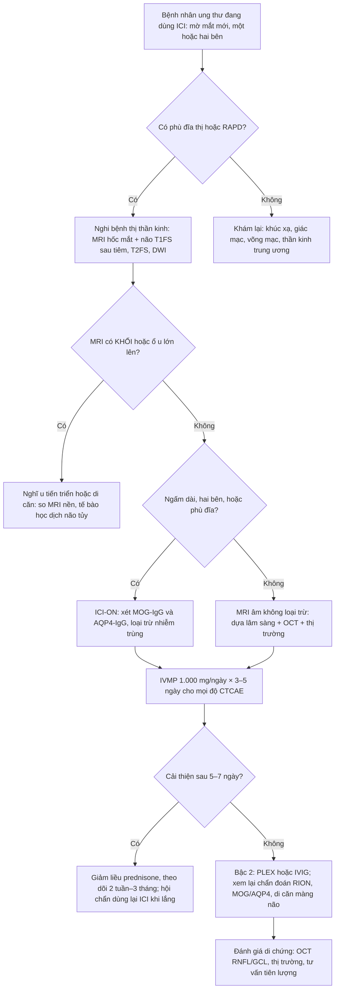
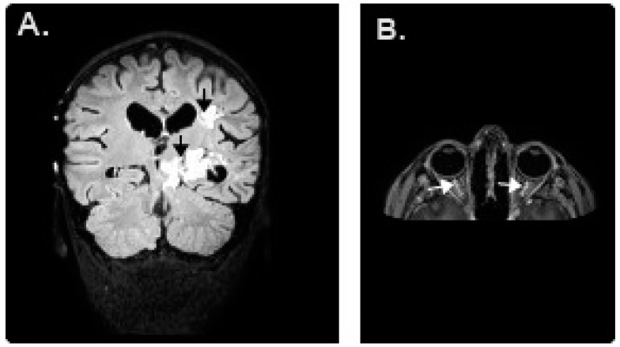
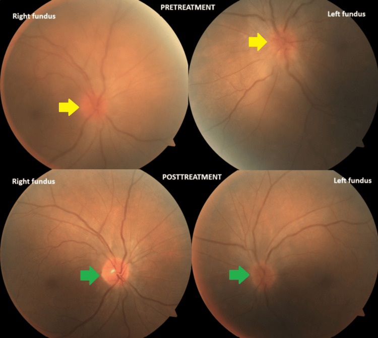
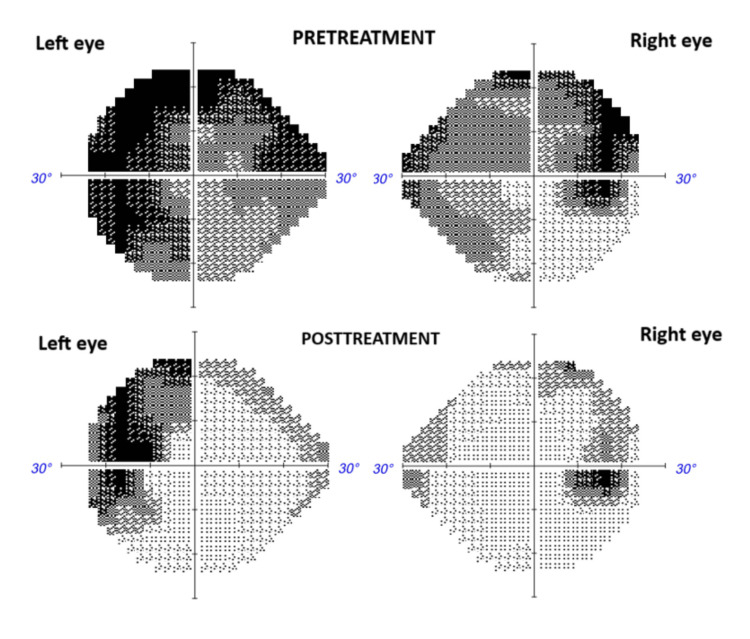

# 3240 — Viêm thần kinh thị do thuốc ức chế miễn dịch (ICI-related optic neuritis): "HAI – DÀI – ĐANG – HỒI PHỤC"

**Tags:** `pattern:ngam-thuoc-TK-thi` `pattern:mat-thi-luc-hai-ben` `pattern:phu-dia-thi` `pattern:viem-quanh-thi-than-kinh` `vung:mat` `vung:than-kinh-thi` `protocol:MRI-hoc-mat` `protocol:T1-fat-sat` `protocol:OCT-RNFL` `protocol:thi-truong` `score:CTCAE` `incidentaloma:khong`

**Mức chắc chắn (certainty):** tổng hợp y văn (literature synthesis) — dựng từ **tổng quan hệ thống 2020 về biến cố thần kinh–nhãn khoa do ICI** (**PMC7648547**), **phân tích dược cảnh giác FAERS 2026 chuyên về độc tính thị thần kinh** (**PMC13547466**), **phân tích FAERS 2026 về biến cố mắt** (**PMC13454064**) và **về biến cố thần kinh–nhãn khoa** (**PMC13433515**), **tổng quan cơ chế + đồng thuận quốc tế 2025 về biến cố mắt do ICI** (**PMC13361132**), **tổng quan hiện trạng 2022** (**PMC11182201**), **tổng quan phạm vi 290 ca** (**PMC9947214**), cùng **2 ca nguyên văn có ảnh** (**PMC6262382**, **PMC12517236**) và 1 ca **MOG-Ab sau tislelizumab** (**PMC13372972**). Nhóm **không có bệnh nhân của mình**; số nào chưa kiểm chứng ghi **"chưa rõ"**. **Không ghi tên tác giả** — attribution dùng **tạp chí + năm + PMCID**, đối chiếu Europe PMC ngày **2026-11-20**.

> **Câu chốt:** bệnh nhân ung thư **đang dùng anti-PD-1/PD-L1 hoặc anti-CTLA-4** mà **mờ mắt nhanh, thường HAI bên, có khi đau khi liếc**, thì **viêm thần kinh thị do ICI (ICI-ON) là chẩn đoán phải loại trừ trước tiên** — vì đây là biến cố **hồi phục được** nếu nhận ra sớm và **không hồi phục** nếu chờ. Bốn con số phải thuộc: **(a) tần suất** — biến cố thần kinh–nhãn khoa **0,46%** người dùng ICI, trong đó **viêm thần kinh thị 12,8%**, gộp lại **9/2.094 = 0,43%** (PMC7648547); FAERS: **286 ca** độc tính thị thần kinh, **ROR 3,02 (95%CI 2,69–3,40)**, **pembrolizumab 114 ca (ROR 3,53)**, **nivolumab 102 (ROR 2,74)**, **ipilimumab 34 (ROR 3,59)**, **atezolizumab 28 (2,46)**, **durvalumab 8 (1,37 — không đạt ngưỡng)** (PMC13547466); **(b) hình thái** — **hai bên 75,0% (9/12)** ca có ghi bên, **ngấm thuốc ± dày dây thị**, **có thể MRI ÂM TÍNH** (ca PMC12517236: MRI âm, đĩa thị vẫn phù); **(c) thời điểm** — trung vị **120 ngày** (pembrolizumab), **109,5** (nivolumab), **192,5** (atezolizumab), **81,5** (ipilimumab), **67,5** (durvalumab), phân bố **"wear-out"** (nguy cơ **tăng dần theo thời gian phơi nhiễm, không phải giảm**) (PMC13547466); **(d) điều trị** — **methylprednisolone IV 1.000 mg/ngày × 3–5 ngày cho MỌI độ CTCAE** (đồng thuận quốc tế 2025), **28,6% (4/14)** cần thêm **IVIG/PLEX/infliximab/MMF**, và **14/14 ca đều cải thiện hoặc khỏi** (4 khỏi hoàn toàn, 10 còn di chứng) (PMC13361132, PMC7648547).

## 1. Tổng quan bệnh học – cơ chế hình ảnh (TẠI SAO)

### 1.1 ICI-ON là bệnh tự miễn "mở khóa" ở một mô có rất ít PD-L1

- **Định nghĩa thực hành:** ICI-ON là **viêm thần kinh thị (optic neuritis)** hoặc **viêm quanh thần kinh thị (optic perineuritis)** khởi phát ở bệnh nhân **đang hoặc vừa dùng thuốc ức chế điểm kiểm soát miễn dịch** (anti-CTLA-4: ipilimumab, tremelimumab; anti-PD-1: nivolumab, pembrolizumab, sintilimab, tislelizumab; anti-PD-L1: atezolizumab, durvalumab, avelumab), sau khi **loại trừ** nguyên nhân nhiễm trùng, u tiến triển/di căn màng não, bệnh khử myelin sẵn có và độc chất.
- **Ba tầng cơ chế (giải thích toàn bộ hình ảnh):**
  1. **Mất dung thứ ngoại vi:** ICI gỡ "phanh" PD-1/PD-L1 và CTLA-4 → **tế bào T tự phản ứng** thoát ức chế, tấn công mô mang kháng nguyên tương tự khối u;
  2. **Mắt là mô "đặc quyền miễn dịch" nhưng dây thị thì không:** **~92% tế bào biểu mô sắc tố võng mạc (RPE)** biểu hiện PD-L1 mạnh, trong khi **thị thần kinh biểu hiện PD-L1 rất thấp** → khi tế bào T đã vượt hàng rào máu–thần kinh, **dây thị gần như không còn "lá chắn"** (PMC13361132). Đây là **lý do sinh học** khiến biến cố mắt do ICI hay gặp ở dây thị, màng bồ đào và cơ hốc mắt hơn là ở võng mạc;
  3. **Hàng rào máu–thần kinh hở** do cytokine (**IFN-γ, CXCL10/IP-10, IL-6, IL-17, TNF-α**) → **gadolinium vào khoang ngoại bào → T1 ngắn → ngấm thuốc** trên **T1 fat-sat sau tiêm**.
- **Vì sao HAI bên:** bệnh **hệ thống**, không phải tổn thương tại chỗ; **75,0% (9/12)** ca có ghi bên là hai bên, thường **hai mắt lệch nhau vài ngày–vài tuần** (PMC7648547). Mắt thứ hai mờ sau mắt đầu **không** có nghĩa là "u đã lan".
- **Vì sao có ca MRI âm tính:** viêm nhẹ/khu trú, hoặc chụp **quá sớm/quá muộn**, hoặc **lát cắt dày 5 mm** bỏ qua dây thị **3–4 mm**. Ca PMC12517236 có **phù đĩa thị hai bên rõ, thị trường mất, mà MRI não + dây thị sau gadolinium KHÔNG ngấm** — nên **MRI âm không loại trừ ICI-ON**.

### 1.2 Vì sao "ngấm – dày – phù đĩa – hồi phục" — vật lý và mô bệnh

| Dấu hiệu | Vì sao (cơ chế) | Hệ quả đọc phim |
|---|---|---|
| **Ngấm gadolinium dọc dây thị** | Hàng rào máu–thần kinh hở do viêm qua trung gian tế bào T → gadolinium vào khoảng ngoại bào | Chỉ đọc được trên **T1 fat-sat sau tiêm**; T1 thường bị **mỡ hốc mắt sáng che mất** |
| **Ngấm "dài" (≥ 1/2 dây thị) hoặc tới giao thoa** | Viêm lan theo **trục sợi trục + mô đệm quanh dây (perineurium)** chứ không khu trú từng ổ như mảng khử myelin nhỏ | Dài + hai bên + không khối = **hướng ICI/MOG/AQP4**, không hướng MS điển hình |
| **Dày dây thị** | **Phù nội bào + ngoại bào** trong ống thị giác kín → tăng áp lực mô, dày và chèn ép vi mạch | Dày **kèm ngấm** mới có giá trị; dày đơn thuần, đối xứng có thể là biến thể |
| **Phù đĩa thị (papillitis)** | Viêm ở **đoạn trong hốc mắt sát nhãn cầu** lan ra đầu dây → phù đĩa; gặp ở **phần lớn** ca ICI-ON có ảnh đáy mắt | Đĩa phù **không** đồng nghĩa tăng áp nội sọ; phải loại trừ **di căn não/giao thoa** |
| **Đau khi liếc (retrobulbar pain)** | Kích thích mô đệm quanh dây có **nhánh thần kinh cảm giác** (V1) bị viêm | Có ở **một phần** ca ICI-ON — **không có đau vẫn không loại trừ** |
| **Hồi phục sau corticoid** | Viêm còn **phù/khử myelin**, sợi trục chưa mất → dẫn truyền phục hồi | **Chốt lâm sàng** khác RION (không hồi phục); nhưng **không phải 100%**: 10/14 ca còn di chứng (PMC7648547) |
| **Teo đĩa muộn, RNFL mỏng** | Mất sợi trục thứ phát sau đợt viêm nặng/tái phát | OCT **RNFL/GCL mỏng sau 1–3 tháng**; đĩa nhợt là dấu **muộn** |

- **Tại sao "wear-out" chứ không phải "wear-off":** với 5 ICI, tham số hình dạng Weibull **β > 1** ở cả 5 (pembrolizumab **1,05**; nivolumab **1,02**; atezolizumab **1,11**; ipilimumab **2,65**; durvalumab **12,42**) → **nguy cơ TÍCH LŨY tăng theo thời gian dùng thuốc**, nghĩa là **không được "yên tâm" sau 3–6 tháng đầu** và **không được quy triệu chứng muộn cho "di chứng cũ"** (PMC13547466).
- **Tại sao tần suất thật khó biết:** hầu hết số liệu đến từ **báo cáo tự nguyện (FAERS)** và **loạt ca hồi cứu**, nơi biến cố mắt **bị mã hóa không đồng nhất**; đồng thuận 2025 ra đời chính vì lý do này (PMC13361132).

### 1.3 Ngưỡng định lượng nằm lòng

| Chỉ số | Giá trị | Nguồn |
|---|---|---|
| Biến cố thần kinh–nhãn khoa do ICI (toàn bộ) | **0,46%** người dùng ICI; **109 ca** chi tiết (tuổi trung bình **66,5**, 9–87; nữ **31,2%**; melanoma **44,0%**, NSCLC **17,4%**) | PMC7648547 |
| Viêm thần kinh thị trong nhóm biến cố thần kinh–nhãn khoa | **12,8%**; ICI hay gặp nhất: **ipilimumab 60%** ca ON, chung: pembrolizumab **32,1%** > nivolumab **24,8%** > ipilimumab **21,1%** > phối hợp **15,6%** | PMC7648547 |
| Tần suất ICI-ON (gộp dược cảnh giác) | **9/2.094 = 0,43%** | PMC7648547 |
| Hai bên | **75,0% (9/12)** ca có ghi bên | PMC7648547 |
| Cần điều trị bậc 2 (IVIG/PLEX/infliximab/MMF) | **28,6% (4/14)** | PMC7648547 |
| Kết cục | **14/14** cải thiện hoặc khỏi (**4/14** khỏi hoàn toàn, **10/14** còn di chứng thị trường/đĩa nhợt); toàn bộ biến cố thần kinh–nhãn khoa: **79,8%** cải thiện/khỏi | PMC7648547 |
| FAERS — độc tính thị thần kinh (2004–Q2/2025) | **286 ca**; **ROR 3,02 (2,69–3,40)**; pembrolizumab **114 ca, ROR 3,53 (2,94–4,24)**; nivolumab **102, 2,74 (2,25–3,33)**; ipilimumab **34, 3,59 (2,58–5,01)**; atezolizumab **28, 2,46 (1,72–3,52)**; durvalumab **8, 1,37 (0,68–2,73) = không đạt ngưỡng** | PMC13547466 |
| FAERS — thời gian tới khởi phát (trung vị, ngày) | Pembrolizumab **120 (49–194)**; nivolumab **109,5 (60,25–181)**; atezolizumab **192,5 (91–305)**; ipilimumab **81,5 (54,5–107)**; durvalumab **67,5 (64,25–70,75)**; dạng **"wear-out"** ở cả 5 | PMC13547466 |
| FAERS — biến cố thần kinh–nhãn khoa nói chung | **521 ca**; trung vị khởi phát **28–38 ngày**; **6 tín hiệu** ở mức PT; **pembrolizumab và avelumab** báo cáo nhiều nhất; nhóm tử vong **nam giới nhiều hơn** | PMC13433515 |
| FAERS — biến cố mắt (2011–Q2/2025) | **5.244 ca**; viêm thần kinh thị **ROR 4,59 (3,91–5,39)**; viêm màng bồ đào **6,04 (5,45–6,69)**; viêm củng mạc **4,85 (3,20–7,36)**; **nivolumab + ipilimumab**: viêm màng bồ đào **ROR 15,44 (13,24–18,00)** vs **4,37** ở đơn trị anti-PD-1/L1 | PMC13454064 |
| Tín hiệu theo kiểu hình (FAERS, ROR toàn nhóm ICI) | **viêm quanh thần kinh thị 23,9 (9,97–57,28)**; **viêm thần kinh thị 2,92 (2,54–3,36)**; **viêm thần kinh thị qua trung gian miễn dịch 162,79 (62,48–534,9)** — **số ca rất nhỏ, ROR bị khuếch đại**, đừng dùng làm "nguy cơ tuyệt đối" | PMC13547466 |
| Nguy cơ biến cố mắt nói chung (gộp 9 thử nghiệm) | **OR 3,40 (95%CI 1,32–8,71)** cho mọi độ | PMC13361132 |
| Tần suất biến cố mắt + thần kinh do ICI (bối cảnh) | **~1%** người được điều trị; irAE nói chung **< 3%** | PMC12517236 |
| Thành phần biến cố mắt trong 290 ca báo cáo | Viêm màng bồ đào **46,2% (134)**; **thần kinh–nhãn khoa 24,5% (71)**; hốc mắt **11,4%**; giác mạc **10,3%**; võng mạc **9,0%** | PMC9947214 |
| Đồng thuận quốc tế 2025 — điều trị ON | **Methylprednisolone IV 1.000 mg/ngày × 3–5 ngày, cho MỌI độ CTCAE**; **ngừng ICI vĩnh viễn không còn bắt buộc ở độ 3**, được **dùng lại sau khi viêm lắng** và hội chẩn đa chuyên khoa | PMC13361132 |

## 2. Mẫu hình + chẩn đoán phân biệt theo vị trí (Gamut)

Bài toán không phải "dây thị có ngấm không" mà là **"ngấm ở ĐOẠN NÀO, HAI bên không, bệnh nhân ĐANG dùng thuốc gì, và có HỒI PHỤC không"**.

### 2.1 Trục vị trí — đoạn nào, kiểu hình nào

- **Đoạn trong hốc mắt (nhãn cầu → đỉnh hốc mắt):** hay gặp nhất với **phù đĩa thị (papillitis)**; trên MRI thấy **ngấm + dày đoạn trước**, có thể kèm **ngấm mô mỡ quanh dây = viêm quanh thần kinh thị (optic perineuritis)** — kiểu hình này có **tín hiệu FAERS mạnh nhất (ROR 23,9)** (PMC13547466).
- **Đoạn trong ống thị giác:** ống xương kín → **phù = tăng áp lực trong ống**, dễ teo nhanh; trên MRI phải cắt **1 mm** mới thấy tổn thương.
- **Đoạn nội sọ trước giao thoa / giao thoa:** thể **"viêm giao thoa" (chiasmal neuritis)** — bán manh hai bên, dễ bị gọi là **u tuyến yên tiến triển**; phải so **ổ u và tuyến yên** trước khi quy cho ICI.
- **Ngoài dây thị nhưng cùng đợt:** **viêm màng bồ đào trước** (ca PMC12517236 có **ON + viêm màng bồ đào trước**), **viêm củng mạc**, **viêm cơ hốc mắt**, **viêm màng não vô khuẩn** — luôn khám **tiền phòng, củng mạc, cơ hốc mắt**, không chỉ đáy mắt.

### 2.2 Trục thời gian — "đồng hồ" ICI-ON

| Mốc từ liều đầu | Điều kỳ vọng | Việc **không** được làm |
|---|---|---|
| **0–4 tuần** | Đã có ca khởi phát **trong vài ngày**; FAERS thần kinh–nhãn khoa trung vị **28–38 ngày** | Không loại trừ vì "mới tiêm 1–2 liều" |
| **1–6 tháng** | **Cửa sổ điển hình** (trung vị 67,5–192,5 ngày tùy thuốc) | Không quy mờ mắt cho "di căn tiến triển" mà không chụp |
| **6–24 tháng** | Vẫn thường gặp; nguy cơ **tăng dần (wear-out)** | Không dừng theo dõi thị giác sau 6 tháng |
| **> 24 tháng** | Ca muộn vẫn có; đừng gán mặc định cho **RION** hoặc **đục thể thủy tinh** | Không bỏ khám thị trường/OCT ở bệnh nhân còn dùng ICI |

- **Hai mắt nối tiếp:** mắt thứ hai thường mờ **sau mắt đầu vài ngày–vài tuần**; khi thấy "mắt còn lại cũng mờ", việc đầu tiên là **khám lại cả hai mắt + MRI**, không phải tăng xạ.

### 2.3 Trục hình thái — mnemonic **"HAI – DÀI – ĐANG – HỒI PHỤC"**

- **HAI:** **hai bên** (75% ca có ghi bên) hoặc **lệch hai bên**; tổn thương **đối xứng theo trục thị**.
- **DÀI:** ngấm **≥ 1/2 dây thị** hoặc tới **giao thoa**, thường **kèm dày**; khác ổ ngắn vài mm của MS điển hình.
- **ĐANG:** bệnh nhân **đang/vừa dùng ICI** (anti-PD-1, anti-PD-L1, anti-CTLA-4, kể cả **phối hợp** → tín hiệu mạnh hơn).
- **HỒI PHỤC:** **đáp ứng corticoid liều cao** (và/hoặc PLEX/IVIG), khác **RION không hồi phục**.

### 2.4 Gamut "thị thần kinh ngấm thuốc ở bệnh nhân ung thư"

- **ICI-ON** — mẫu hình trung tâm: hai bên, dài, đang dùng ICI, ± đau khi liếc, ± phù đĩa, **hồi phục một phần/nhiều** với corticoid.
- **RION (bệnh thần kinh thị do xạ)** — **muộn 16–30 tháng**, **không đau**, **không hồi phục**, liều **Dmax > 50 Gy EQD2**; MRI **giống hệt ICI-ON** (bài [3236](../3236-benh-than-kinh-thi-do-xa-rion/lesson.md)). **Bệnh nhân vừa xạ vừa ICI là bẫy kép** (ca PMC13453118 trong bài 3236).
- **CRION (viêm thần kinh thị tái phát)** — **tái phát khi giảm steroid**, AQP4 âm, **phụ thuộc corticoid** (bài [464](../464-viem-than-kinh-thi-tai-phat-CRION/lesson.md)); ở bệnh nhân ung thư, "phụ thuộc steroid" rất dễ bị quy nhầm cho **di căn**.
- **MOG-ON / AQP4-NMOSD** — **đĩa phù rõ** (MOG), **ngấm dài + giao thoa + area postrema** (AQP4), **huyết thanh MOG-IgG/AQP4-IgG dương**; ICI **có thể khởi phát MOG-ON** (ca **MOG-Ab + GFAP-Ab sau tislelizumab**, PMC13372972) → **phải xét nghiệm kháng thể**, không giả định "chỉ do thuốc".
- **MS-ON** — ổ ngắn, **OCB (+)**, tổn thương não đặc trưng, **đau khi liếc**, đáp ứng corticoid; **hiếm khởi phát de novo do ICI** so với MOG/AQP4.
- **NAION/AION (kể cả GCA)** — **không đau**, mất thị trường **từng phần (altitudinal)**, **đĩa phù + xuất huyết đĩa**, **ngấm nhẹ/không ngấm**; ở người > 50 tuổi có **ĐTĐ/tăng huyết áp** hoặc **CRP/VS cao** → nghĩ AION/GCA (bài [435](../435-gca-va-naion-aion/lesson.md)); ICI **có thể gây AION** (báo cáo ca).
- **Di căn màng não / thâm nhiễm thần kinh thị** — **ngấm màng não dạng nốt**, dày không đều, **đau đầu, liệt dây sọ khác**, **tế bào học dịch não tủy**; nguy cơ cao ở melanoma (ca PMC12517236 phải loại trừ).
- **Nhiễm trùng (giang mai, lao, nấm, Bartonella, toxoplasma)** — có **hội chứng nhiễm**, yếu tố nguy cơ; **RPR/TPHA, IGRA, HIV, cấy/nhuộm** trước khi tăng ức chế miễn dịch.
- **Độc chất – chuyển hóa** — **ethambutol, isoniazid, methanol, amiodarone**, thiếu **B12/folate**; ngấm dài hai bên **không đối xứng** và **tiền sử thuốc** (bài [434](../434-teo-thi-than-kinh-thi-doc-va-LHON/lesson.md)).
- **Chèn ép/u thị thần kinh** — **khối dây thị (glioma/ONSM)** hoặc **u tuyến yên**; **khối + đẩy lệch + hủy xương** = không phải ICI-ON (bài [431](../431-u-than-kinh-thi/lesson.md), [432](../432-vung-yen/lesson.md)).

## 3. Bảng so sánh phân biệt (ma trận đối chiếu)

| Thực thể (entity) | Hình ảnh điển hình (MRI ± OCT/đáy mắt) | Chốt vào (rule-in) | Chốt loại (rule-out) | Gợi ý xác nhận |
|---|---|---|---|---|
| **ICI-ON** | Ngấm **dài**, **hai bên**, ± dày, ± **phù đĩa**, **không khối**; **có thể âm tính** | **Đang dùng ICI + mờ mắt nhanh (ngày–tuần) + hai bên/lệch hai bên + đáp ứng corticoid** | **Ngấm đơn độc một ổ ngắn + OCB (+) + tổn thương não MS** → nghĩ MS; **khối/ổ u lớn dần** → không phải ICI-ON | Ngừng ICI thử + **IVMP 1 g × 3–5 ngày**, khám lại 1–2 tuần; MOG/AQP4; hội chẩn ung thư–mắt |
| **RION** | Ngấm **dài**, T2 cao, dày, **không khối**, teo muộn; **hai bên 60,1%** | **Xạ Dmax > 50 Gy + latency 16–30 tháng + KHÔNG đau + KHÔNG hồi phục** | **Hồi phục nhanh sau corticoid + đang ICI** → nghiêng ICI-ON; **liều xạ thấp/vị trí ngoài trường** → ít khả năng RION | So **liều xạ (Dmax/EQD2)** với ngày khởi phát; theo dõi 3–6 tháng |
| **CRION** | Ngấm dài ± dày; **tái phát nhiều đợt**; OCT mỏng dần | **Tái phát khi giảm prednisone + AQP4/MOG âm** | **Một đợt duy nhất, không tái phát sau ngừng steroid** → không phải CRION | Đếm số đợt, liều tối thiểu duy trì; AQP4/MOG lặp lại |
| **MOG-ON** | **Đĩa phù rõ**, ngấm **dài + quanh dây (perineural)**, có thể **giao thoa** | **MOG-IgG (+) bằng CBA + đĩa phù + hai bên** | **MOG-IgG âm** (kiểm lại khi lui bệnh) + không phù đĩa | MOG-IgG huyết thanh (CBA), OCT RNFL |
| **AQP4-NMOSD** | Ngấm **dài ≥ 1/2 dây + giao thoa**, tổn thương **area postrema/ tủy**, hai bên | **AQP4-IgG (+) + bán manh/nấc–nôn + tổn thương tủy dài** | **AQP4 âm + tổn thương chỉ một đoạn ngắn** | AQP4-IgG, MRI tủy, dịch não tủy |
| **MS-ON** | **Ổ ngấm ngắn** vài mm, dày nhẹ; não có **ổ quanh não thất/juxtacortical** | **Đau khi liếc + OCB (+) + tổn thương não đặc trưng + tiền sử** | **Ngấm dài hai bên đối xứng + giao thoa + không ổ não** | MRI não + tủy, OCB, evoked potentials |
| **NAION/AION** | **Đĩa phù ± xuất huyết**, dây thị **ngấm nhẹ/không**, không dày dài | **Mất thị trường altitudinal + đĩa crowded + ĐTĐ/THA + không đau** | **Ngấm dài mạnh + đau khi liếc + hai bên** → không phải NAION | Soi đáy mắt, thị trường 24–2, CRP/VS nếu ≥ 50 tuổi |
| **Di căn màng não/thâm nhiễm** | **Ngấm màng não dạng nốt**, dày không đều, lan khe ổ mắt trên | **Đau đầu + liệt dây sọ + tế bào học dịch não tủy (+) + tiền sử melanoma/vú/phổi** | **Ngấm đúng trục dây thị, màng não mỏng đều, không nốt** | MRI toàn trục + tế bào học dịch não tủy (làm **trước** khi tăng steroid nếu an toàn) |
| **Nhiễm trùng (giang mai/lao/nấm)** | Ngấm dài, có thể quanh dây; không đối xứng | **RPR/TPHA (+), IGRA (+), HIV (+), sốt/hội chứng nhiễm** | **Huyết thanh âm + không yếu tố nguy cơ + đáp ứng corticoid đơn thuần** | Huyết thanh học, IGRA, HIV, dịch não tủy |
| **Độc chất/chuyển hóa** | Ngấm dài **hai bên không đối xứng**, teo muộn | **Ethambutol/INH/methanol/amiodarone + B12/folate thấp** | **Không tiếp xúc thuốc + B12/folate bình thường** | B12, folate, homocysteine, ngừng thuốc nghi ngờ |

### Ba dấu hiệu hay bị đọc sai

- **"MRI âm = không viêm thị"** — sai: ca PMC12517236 có **phù đĩa thị hai bên + mất thị trường** mà **MRI não và dây thị sau gadolinium không ngấm**; chẩn đoán dựa vào **lâm sàng + đáp ứng điều trị**, MRI chỉ hỗ trợ.
- **"Hai bên = di căn"** — sai: **75%** ICI-ON là hai bên; phân biệt bằng **tính đối xứng theo trục thị**, **không khối**, và **đáp ứng corticoid**.
- **"Đang xạ thì chỉ có RION"** — sai: bệnh nhân **vừa xạ vừa ICI** có **hai nguyên nhân chồng lấp**; **RION không hồi phục**, **ICI-ON có thể hồi phục** — diễn tiến là chốt, không phải hình ảnh.

## 4. Protocol chụp + phân độ + theo dõi

### 4.1 Bộ chuỗi xung tối thiểu (mỗi lần chụp)

1. **MRI 1,5T hoặc 3T, hốc mắt + nội sọ**, lát **2–3 mm** cho hốc mắt và **1 mm** cho **ống thị giác/giao thoa** (dây thị chỉ **3–4 mm** — lát 5 mm có thể nằm giữa hai lát):
   - **T1 axial** không tiêm (mỡ, máu, vật liệu);
   - **T2FS axial + coronal** (phù/T2 cao, phân biệt với mỡ);
   - **DWI b = 0/1000 + ADC** (loại trừ nhồi máu có hạn chế khuếch tán thật; **chưa có ngưỡng ADC cho ICI-ON**);
   - **T1FS sau gadolinium axial + coronal + sagittal**, phủ **từ nhãn cầu tới giao thoa và đường thị** — **bắt buộc**, không có fat-sat là không đọc được;
   - **MRI não đủ chuỗi** (FLAIR, T2, DWI, T1+C) để tìm **ổ khử myelin, di căn, tổn thương thân não**;
   - **MRI tủy toàn bộ** nếu nghi **AQP4/MOG** (ngấm dài, nấc–nôn, yếu chi).
2. **CT hốc mắt/nền sọ lát ≤ 1 mm, cửa sổ xương** khi cần loại trừ **hủy xương, vôi hóa, dị vật, vật liệu cản quang**.
3. **Khám mắt định lượng mỗi lần:** **BCVA logMAR**, **RAPD**, **thị trường 30-2 (MD/PSD)**, **OCT RNFL + GCL**, **soi đáy mắt (phù đĩa, nhợt)**, **khám tiền phòng/củng mạc** (viêm màng bồ đào/viêm củng mạc đồng thời), **VEP** nếu cần.
4. **Xét nghiệm trước khi tăng ức chế miễn dịch:** **MOG-IgG, AQP4-IgG (CBA)**, **RPR/TPHA, HIV, IGRA (lao)**, **HBV/HCV**, **ANA**, **ACE**, **B12/folate/homocysteine**, **TSH**, **CRP/VS** (nếu ≥ 50 tuổi, loại trừ GCA), **tế bào học dịch não tủy** nếu nghi di căn màng não.
5. **Rà soát thuốc:** loại ICI, **số liều/ngày bắt đầu**, thuốc phối hợp (**nivolumab + ipilimumab** → tín hiệu mạnh hơn), **xạ trị trước đó (liều, ngày)**, thuốc độc thị giác khác.

### 4.2 Phân độ CTCAE + tầng xử trí

| Độ CTCAE (rối loạn thần kinh thị / giảm thị lực) | Mô tả thực hành | Xử trí theo đồng thuận 2025 |
|---|---|---|
| **Độ 1** | Không triệu chứng hoặc chỉ phát hiện trên khám; thị lực bình thường | Khám mắt + MRI; **không ngừng ICI**; theo dõi sát **1–2 tuần** |
| **Độ 2** | Triệu chứng trung bình, hạn chế hoạt động thường ngày | **Corticoid toàn thân**; cân nhắc **tạm ngừng ICI**; hội chẩn |
| **Độ 3** | Triệu chứng nặng, hạn chế tự chăm sóc | **IVMP 1.000 mg/ngày × 3–5 ngày**; **ngừng ICI** (đồng thuận 2025: **không bắt buộc vĩnh viễn**, có thể dùng lại sau khi lắng) |
| **Độ 4** | Mù (thị lực ≤ 20/200 mắt bị ảnh hưởng) | **IVMP + PLEX/IVIG sớm**; ngừng ICI; hội chẩn khẩn ung thư–mắt–thần kinh |

- **Nguyên tắc riêng của viêm thần kinh thị:** **IVMP 1.000 mg/ngày × 3–5 ngày cho MỌI độ**, kể cả khi thị lực còn tốt — vì **thời gian thiếu máu/mất sợi trục** quyết định tiên lượng (PMC13361132).
- **Bậc 2 khi không đáp ứng/không dung nạp corticoid:** **PLEX (trao đổi huyết tương)** hoặc **IVIG**; **infliximab/mycophenolate** đã được dùng trong loạt ca (**4/14 = 28,6%**) (PMC7648547). **Chưa có thử nghiệm ngẫu nhiên** so sánh các lựa chọn này.
- **Theo dõi sau đợt:** khám **2 tuần, 1 tháng, 3 tháng**, sau đó **3–6 tháng** khi còn dùng ICI; **OCT RNFL/GCL** để phát hiện **mỏng tiến triển** (di chứng) và **thị trường** để phát hiện **tái phát**.

### 4.3 Điều trị — nói đúng mức bằng chứng

- **Corticoid liều cao là nền tảng, bằng chứng mức C (đồng thuận) + D (loạt ca):** đồng thuận quốc tế 2025 quy định **IVMP 1 g/ngày × 3–5 ngày** cho **mọi độ**; ca PMC6262382 đạt **20/20 hai mắt sau 1 tuần**; ca PMC12517236 đạt **20/40–20/30 sau 5 ngày** rồi **20/20 sau taper 4 tuần**.
- **Ngừng ICI:** với **độ ≥ 3** nên **ngừng**; đồng thuận 2025 cho phép **dùng lại sau khi viêm lắng** và **hội chẩn đa chuyên khoa** — quyết định này thuộc **ung thư + mắt**, không thuộc riêng ai.
- **PLEX/IVIG:** dùng khi **thất bại corticoid** hoặc **độ 4**; tỷ lệ cần **28,6%** trong loạt tổng quan (PMC7648547). Không có so sánh đầu-đối-đầu.
- **Không có "liều dự phòng" nào được chứng minh:** không dùng corticoid liều thấp kéo dài để "phòng" ICI-ON; theo dõi **triệu chứng + khám định kỳ** là biện pháp duy nhất có cơ sở.

## 5. Biến thể bình thường và cạm bẫy

- **MRI âm tính** — ca PMC12517236: **phù đĩa hai bên, thị trường mất, MRI không ngấm**. Không được dùng MRI âm để loại trừ; phải dựa **lâm sàng + OCT + đáp ứng điều trị**.
- **Chỉ một bên** — ICI-ON **không bắt buộc hai bên**; ca một bên dễ bị gọi là **NAION** hoặc **viêm thị do răng/xoang** (bài [430](../430-duong-thi-giac/lesson.md)).
- **"Đã dùng thuốc 1 năm thì không thể do ICI"** — sai: mô hình **wear-out** cho thấy nguy cơ **tăng dần**; trung vị tới **192,5 ngày** với atezolizumab và **đuôi tới > 1.000 ngày**.
- **ROR rất cao không phải nguy cơ rất cao** — "immune-mediated optic neuritis" **ROR 162,79** ở pembrolizumab dựa trên **số ca rất nhỏ**; dùng để **nhận diện tín hiệu**, không để tư vấn nguy cơ tuyệt đối.
- **Bẫy kép xạ + ICI** — cùng MRI "ngấm dài hai bên"; **RION không hồi phục**, **ICI-ON có thể hồi phục**; phải ghi **liều xạ và ngày**, và **đừng bỏ cơ hội điều trị** vì đã có chẩn đoán RION.
- **Bẫy "di căn tiến triển"** — bệnh nhân melanoma (ca PMC12517236) có **tiền sử di căn** nên mờ mắt hai bên rất dễ bị quy cho **di căn màng não/não**; cần **MRI toàn trục + tế bào học dịch não tủy** trước khi kết luận, nhưng **không được trì hoãn corticoid** nếu lâm sàng điển hình.
- **Bẫy "phù đĩa = tăng áp nội sọ"** — phù đĩa do **viêm đầu dây (papillitis)** khác phù đĩa do **tăng áp lực nội sọ**; phân biệt bằng **thị lực, RAPD, thị trường (ám điểm lớn vs thu hẹp đồng tâm), MRI (không giãn não thất, không giãn vỏ thị)**.
- **Bẫy "đau khi liếc là MS"** — ICI-ON **có thể đau**; không dùng sự hiện diện của đau để loại ICI.
- **Bẫy "kháng thể dương = không do ICI"** — MOG/AQP4 dương **không loại trừ** vai trò của ICI: ICI có thể **khởi phát** MOG-ON (PMC13372972); điều trị vẫn là **ức chế miễn dịch + ngừng ICI**.
- **Bẫy nhiễm trùng khi leo thang ức chế miễn dịch** — lao tiềm ẩn, viêm gan B, giang mai có thể **bùng phát** dưới **IVMP + PLEX/IVIG**; sàng lọc **trước** là bắt buộc (mục 4.1).
- **Satisfaction of search** — thấy phù đĩa rồi dừng: luôn khám **tiền phòng (viêm màng bồ đào)**, **củng mạc**, **cơ hốc mắt**, **mắt đối diện**, và **so ổ u/di căn**.

## 6. Tự lượng giá — Blind Quiz ngay trên trang tĩnh

**Ca 1 — bé trai u nguyên bào thần kinh đệm (GBM) độ 4 đang dùng nivolumab; mờ mắt hai mắt nặng dần**

- Gợi ý lâm sàng (theo ca gốc): thị lực **đếm ngón tay 1 m** mắt phải, **chỉ còn cảm giác sáng** mắt trái; **phù đĩa thị hai bên**; không dấu thần kinh khác.
- Câu hỏi: (a) Mô tả A và B? (b) Vì sao **không** gọi là "u lan theo dây thị"? (c) Xử trí đầu tay và **thời gian** kỳ vọng hồi phục?

<b>Bấm để hiện đáp án (findings + chẩn đoán)</b>

- (a) **A:** ổ u/bất thường tín hiệu bán cầu trái và thân não (bối cảnh GBM); **B:** **ngấm thuốc hai dây thị** trên T1 sau gadolinium, kèm **dày** — phù hợp **viêm thần kinh thị hai bên**.
- (b) U lan theo dây thị (perineural spread) tạo **khối/dày không đều liên tục từ ổ u**, thường **một bên**, có **hủy xương/ xâm lấn mô mỡ**; ở đây tổn thương **đối xứng hai bên, theo trục dây, không khối** → **bệnh hệ thống do thuốc**.
- (c) **Ngừng nivolumab + methylprednisolone IV 1 g/ngày × 5 ngày**; ca gốc hồi phục **20/20 hai mắt sau 1 tuần**. Bài học: **chẩn đoán trong 4 ngày** và điều trị ngay là yếu tố quyết định.
- Nguồn ảnh: *Medicina (Kaunas)* 2018, Fig. 1 (PMC6262382), CC BY 4.0 — nguyên bản.

**Ca 2 — nữ 60 tuổi, melanoma di căn, nivolumab 480 mg mỗi 4 tuần; sau liều thứ 7 ba tuần thì mờ mắt + đau khi liếc**

- Gợi ý: thị lực **20/80** phải, **20/150** trái; **RAPD hai bên**; nhãn áp **12/14 mmHg**; **MRI não + dây thị sau gadolinium KHÔNG ngấm**; thị trường: **ám điểm bơi to + giảm độ nhạy ngoại vi hai mắt**.
- Câu hỏi: (a) Dấu hiệu đáy mắt trước điều trị? (b) **MRI âm** có loại trừ ICI-ON không? (c) Phác đồ đã dùng và kết quả?

<b>Bấm để hiện đáp án (findings + chẩn đoán)</b>

- (a) **Phù đĩa thị hai bên (papillitis)**, bờ mờ, mất viền thần kinh–võng mạc; sau điều trị bờ rõ hơn nhưng **đĩa nhợt/teo** — di chứng thường gặp.
- (b) **Không.** MRI âm gặp ở ICI-ON (nhất là khi viêm nhẹ hoặc chụp muộn); chẩn đoán dựa vào **đang dùng ICI + mờ mắt nhanh + phù đĩa + đáp ứng corticoid**, sau khi loại trừ nhiễm trùng/di căn.
- (c) **Methylprednisolone IV 1 g/ngày × 5 ngày** → **20/40 phải, 20/30 trái**; sau đó **prednisone uống 1 mg/kg taper 4 tuần** → **20/20 hai mắt**; đĩa phù và ám điểm cải thiện.
- **Bài học:** ca này **có đau khi liếc** (giống MS) và **MRI âm** — hai đặc điểm dễ đẩy chẩn đoán sai; nhưng **bối cảnh thuốc + hai bên + hồi phục** đưa về ICI-ON.
- Nguồn ảnh: *Cureus* 2025, Fig. 2 (PMC12517236), CC BY 4.0 — nguyên bản.

**Ca 3 — cùng bệnh nhân Ca 2: thị trường trước và sau điều trị**

- Câu hỏi: (a) Mô tả thị trường trước điều trị? (b) Vì sao **ám điểm bơi to** lại gợi ý **bệnh đĩa thị** hơn là bệnh võng mạc? (c) Sau điều trị, dấu hiệu nào **còn lại** và nghĩa là gì?

<b>Bấm để hiện đáp án (findings + chẩn đoán)</b>

- (a) **Ám điểm bơi to hai mắt** + **giảm độ nhạy ngoại vi**; sau điều trị ám điểm **nhỏ lại**, độ nhạy ngoại vi **cải thiện**.
- (b) Ám điểm bơi to phản ánh **vùng đĩa thị bị phù/viêm** (điểm mù sinh lý to ra); bệnh võng mạc thường cho **khiếm khuyết khu trú tương ứng tổn thương** hoặc **thu hẹp đồng tâm**, không mở rộng điểm mù.
- (c) **Ám điểm nhỏ hơn nhưng có thể còn** + **đĩa nhợt** = **di chứng mất sợi trục**, dù thị lực trung tâm **20/20**; cần theo dõi **OCT RNFL/GCL** và **thị trường** để phát hiện **tổn thương tiến triển/tái phát**.
- **Bài học:** thị lực trung tâm hồi phục **không** đồng nghĩa hồi phục hoàn toàn; báo cáo **MD/PSD + RNFL**, không chỉ BCVA (nguyên tắc đã nêu ở bài [3236](../3236-benh-than-kinh-thi-do-xa-rion/lesson.md)).
- Nguồn ảnh: *Cureus* 2025, Fig. 3 (PMC12517236), CC BY 4.0 — nguyên bản.

## 7. Câu hỏi nghiên cứu & điểm chưa đồng thuận (tính đến 11/2026)

1. **[Tranh cãi] Sau một đợt ICI-ON, có nên ngừng ICI VĨNH VIỄN hay được dùng lại khi viêm đã lắng?**
   - **Đã biết:** đồng thuận quốc tế 2025 về biến cố mắt do ICI nêu **ngừng vĩnh viễn không còn bắt buộc ở độ 3**, cho phép **dùng lại sau khi viêm lắng** và hội chẩn đa chuyên khoa (PMC13361132); tổng quan 2022 ghi rõ **chưa có đồng thuận chuyên gia** về việc ngừng hay tiếp tục ICI trong biến cố thần kinh–nhãn khoa (PMC11182201); y văn trước đó chủ yếu là **ngừng thuốc + corticoid** (PMC7648547).
   - **Chưa rõ:** **tỷ lệ tái phát** khi dùng lại ICI, **thời điểm an toàn**, ảnh hưởng của **phối hợp anti-PD-1 + anti-CTLA-4**, và **cách theo dõi** sau dùng lại.
   - **Hướng nghiên cứu:** **registry tiền cứu** bệnh nhân ICI-ON ghi **quyết định ngừng/dùng lại**, **thời gian tới tái phát**, **thị lực cuối**, và **sống còn không tiến triển ung thư**; phân tầng theo loại ICI và bệnh nền.
   - **Nguồn:** PMC13361132 (2026); PMC11182201 (2022); PMC7648547 (2020).

2. **[Khoảng trống] Chưa có tiêu chuẩn hình ảnh/định lượng phân biệt ICI-ON với RION ở bệnh nhân VỪA XẠ VỪA ICI.**
   - **Đã biết:** hai bệnh **trùng hình ảnh** (ngấm dài, dày, T2 cao, không khối); RION **không hồi phục** với latency **16–30 tháng** và ngưỡng **Dmax > 50 Gy EQD2** (bài 3236 dẫn PMC13742046, PMC10577828), còn ICI-ON **hồi phục** sau IVMP (PMC7648547); **MRI có thể âm tính** ở ICI-ON (PMC12517236).
   - **Chưa rõ:** **ngưỡng ADC/DTI/FA** cho dây thị; giá trị của **OCT-A, VEP, DTI** trong phân biệt; **không có mô hình kết hợp liều xạ + thời gian dùng ICI + hình ảnh** được kiểm định ngoài.
   - **Hướng nghiên cứu:** nghiên cứu **chẩn đoán tiền cứu** ở bệnh nhân ung thư đầu–cổ/nền sọ **vừa xạ vừa ICI**, MRI 3T + DTI + OCT-A, ROI chuẩn hóa, báo cáo **Se/Sp theo từng đoạn** và **theo thời gian từ liều xạ cuối**.
   - **Nguồn:** PMC12517236 (2025); PMC7648547 (2020); bài 3236 (PMC10577828, 2023).

3. **[Khác biệt thực hành] Bậc 2 khi thất bại corticoid (PLEX, IVIG, thuốc sinh học) — chọn gì, khi nào, và có cần xét nghiệm kháng thể trước không?**
   - **Đã biết:** **28,6% (4/14)** ca ICI-ON cần **IVIG/PLEX/infliximab/MMF** trong loạt tổng quan (PMC7648547); đồng thuận 2025 xếp **corticoid là mức C**, các thuốc **sparing steroid** chỉ **mức D (loạt ca)** (PMC13361132); **MOG-Ab/GFAP-Ab** có thể xuất hiện **sau ICI** (PMC13372972) nên **kháng thể dương không loại trừ** nguyên nhân thuốc.
   - **Chưa rõ:** **thứ tự ưu tiên** PLEX vs IVIG, **số chu kỳ**, **ngưỡng thời gian** để chuyển bậc 2, và **có nên xét MOG/AQP4 ở mọi ca** hay chỉ ca không điển hình.
   - **Hướng nghiên cứu:** **thử nghiệm pha II** ngẫu nhiên hóa **IVMP đơn thuần vs IVMP + PLEX sớm** ở ICI-ON độ 3–4, outcome **BCVA logMAR + MD/PSD + RNFL** ở 3 và 6 tháng; kèm **nghiên cứu chi phí–hiệu quả** của xét nghiệm kháng thể đầu tay.
   - **Nguồn:** PMC7648547 (2020); PMC13361132 (2026); PMC13372972 (2026).

## Bài liên quan chéo

- [400 – Tổng quan Mắt & thị giác](../400-tong-quan-mat-thi-giac/lesson.md)
- [3236 – Bệnh thần kinh thị do xạ trị (RION)](../3236-benh-than-kinh-thi-do-xa-rion/lesson.md) (ngấm dài không khối — **không hồi phục**, khác ICI-ON)
- [430 – Đường thị giác: viêm vs thiếu máu vs chèn ép](../430-duong-thi-giac/lesson.md) (khung tiếp cận giảm thị lực)
- [431 – U thần kinh thị](../431-u-than-kinh-thi/lesson.md) (khối dây thị — chốt loại ICI-ON)
- [432 – Vùng yên](../432-vung-yen/lesson.md) (u tuyến yên/giao thoa — bán manh hai bên)
- [433 – Phù đĩa thị vs drusen](../433-phu-dia-thi-drusen/lesson.md) (phù đĩa không do viêm)
- [434 – Teo thị thần kinh thị độc và LHON](../434-teo-thi-than-kinh-thi-doc-va-LHON/lesson.md) (độc chất — DDx ngấm dài hai bên)
- [435 – GCA & AAION vs NAION](../435-gca-va-naion-aion/lesson.md) (người ≥ 50 tuổi, không đau)
- [464 – Viêm thần kinh thị tái phát (CRION)](../464-viem-than-kinh-thi-tai-phat-CRION/lesson.md) (phụ thuộc steroid — DDx quan trọng)
- [1458 – Bệnh thần kinh thị do xạ ở trẻ](../1458-benh-than-kinh-thi-do-xa-o-tre/lesson.md) (RION ở trẻ — bẫy kép với ICI)
- [3207 – Viêm củng mạc](../3207-viem-cung-mac-scleritis/lesson.md) (biến cố mắt do ICI có thể đồng thời)

## Ảnh

- Tên file: `3240_viem-than-kinh-thi-do-thuoc-uc-che-mien-dich_<Modality>_<mô tả>_<PMCID>`; nguồn + giấy phép từng ảnh trong `images/CREDITS.md`.
- **5 ảnh gốc + 1 ảnh ghép**, tất cả **CC BY 4.0**: **PMC6262382** (MRI ngấm hai dây thị), **PMC12517236** (MRI âm tính, đáy mắt trước–sau, thị trường), **PMC13547466** (biểu đồ tín hiệu FAERS, biểu đồ thời gian khởi phát).
- **Không dùng ảnh** từ các bài chỉ trích số liệu (PMC7648547, PMC13454064, PMC13433515, PMC13361132, PMC11182201, PMC9947214, PMC13372972) — chỉ lấy số.
- **Không ghi tên tác giả**: attribution dùng **tạp chí + năm + PMCID**, đối chiếu Europe PMC ngày **2026-11-20**.

> Không dùng để chẩn đoán độc lập khi chưa có người hướng dẫn.
