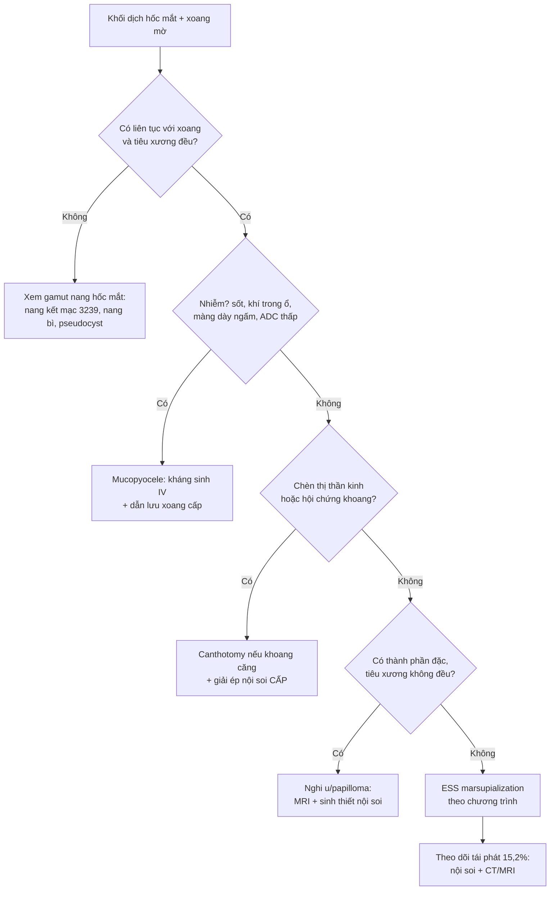
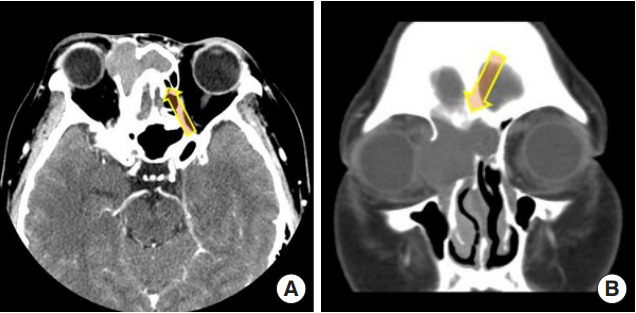
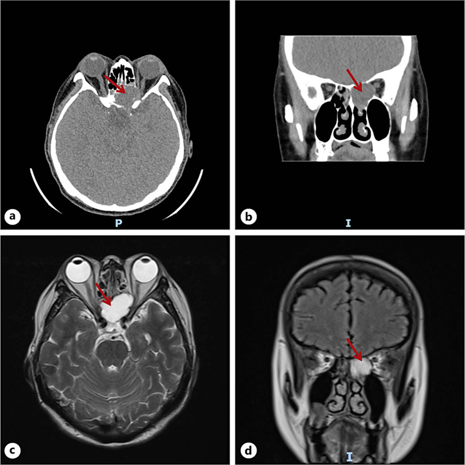
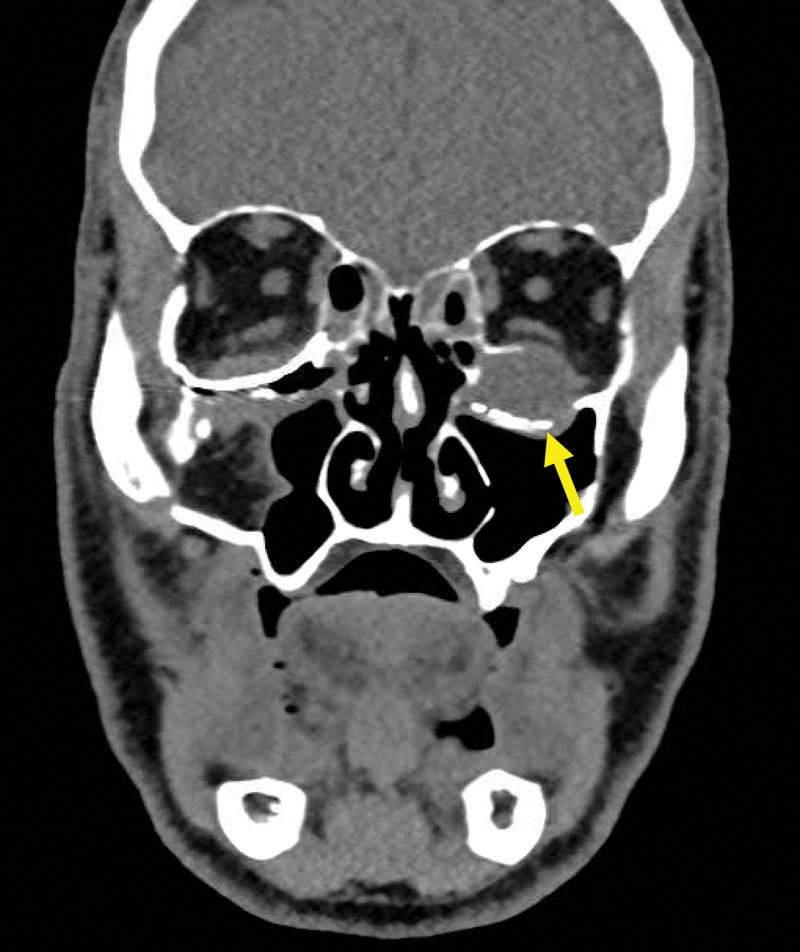

# 3241 — Nang nhầy xoang lan vào hốc mắt (orbital mucocele): khối dịch "mọc" từ xoang, tiêu xương và chèn thị thần kinh / Orbital mucocele

**Tags:** `pattern:khoi-dich-hoc-mat` `pattern:mo-xoang` `pattern:tieu-xuong` `pattern:loi-mat` `pattern:lech-nhan-cau` `pattern:nhin-mo` `vung:mat` `vung:hoc-mat` `vung:xoang` `protocol:CT-xoang-hoc-mat` `protocol:MRI-hoc-mat` `protocol:MRI-T1-fat-sat` `incidentaloma:khong`

**Mức chắc chắn (certainty):** tổng hợp y văn (literature synthesis) — dựng từ tổng quan **18 nghiên cứu / 638 bệnh nhân – 661 bên** (PMC12122635), loạt **46 ca mổ có theo dõi ≥ 5 năm** (PMC6331304), loạt **10 ca có lan vào hốc mắt/sọ** (PMC11806644), các ca **sau mổ xoang nội soi 12 năm** và **sau sửa sàn hốc mắt bằng Medpor 8 năm** (PMC7054188), ca **sau sửa sàn hốc mắt 20 năm** (PMC10597417), ca **sau sửa sàn bằng nẹp 3 năm** (PMC11191023), ca **xoang bướm chèn thị thần kinh bị chẩn đoán nhầm** (PMC12342703), ca **mucopyocele gây hội chứng khoang hốc mắt** (PMC12747089) và ca **mucocele hốc mắt đơn độc ở trẻ** (PMC11309555). Nhóm **không có bệnh nhân của mình**; số nào chưa kiểm chứng ghi **"chưa rõ"**. **Không ghi tên tác giả** — attribution dùng tạp chí + năm + PMCID/PMID (đối chiếu Europe PMC ngày 2026-11-20).

> **Vị trí trong thư viện:** [3239](../3239-nang-ket-mac-khong-lo-hoc-mat-sau-muc-nhan-cau/lesson.md) trả lời *khối dịch trong hốc mắt ĐÃ MÚC nhãn cầu, không thông xoang*; [1515](../1515-theo-doi-hoc-mat-sau-muc-nhan-cau/lesson.md) trả lời *khối đặc sau múc nhãn cầu là tái phát u*; [3051](../3051-mau-tu-to-chuc-hoa-xoang-buom/lesson.md) là gamut khối xoang bướm; [400](../400-tong-quan-mat-thi-giac/lesson.md) là bản đồ hệ Mắt. Bài này trả lời câu hỏi ngược lại 3239: **khối dịch trong hốc mắt CÓ thông với xoang, bờ xương bị tiêu – đó là nang nhầy xoang, và điều trị là mở thông xoang chứ không phải chọc hút qua hốc mắt.**
>
> **Câu chốt:** **(1) Đây là khối dịch "lành tính nhưng phá xương":** 638 ca trong 18 nghiên cứu cho thấy xoang trán **26,36%**, sàng **24,03%**, trán–sàng **23,29%** (PMC12122635); loạt 103 ca có **83,3% lan vào hốc mắt**, **78,7% lồi mắt**, **55,5% tiêu sàn sọ** (Har-El, dẫn trong PMC12122635); loạt 60 ca: **98% xoang giãn rộng, 96% tiêu xương, 69% đứt lamina papyracea** (Malik, dẫn trong PMC12122635). **(2) Chẩn đoán là hình ảnh, không phải mô học:** CT **đồng nhất, thấp, không ngấm, xoang mờ + thành xương mỏng/tiêu, liên tục với hốc mắt**; MRI **T1 thấp–trung gian, T2 rất cao, viền ngấm mỏng**, không có nốt đặc (PMC11806644, PMC7054188, PMC12342703). **(3) Điều trị là mở thông xoang (marsupialization) qua nội soi, không chọc hút qua hốc mắt:** **89,1%** chỉ cần nội soi, **10,9%** cần phối hợp đường mở, **tái phát 15,2% (7/46)** sau theo dõi ≥ 5 năm (PMC6331304); **chèn thị thần kinh là cấp cứu** — chậm **7–10 ngày** thị lực hiếm khi hồi phục (PMC12342703).

## 1. Tổng quan bệnh học – cơ chế hình ảnh (TẠI SAO)

### 1.1 Nang nhầy xoang là gì, vì sao nó "ăn" vào hốc mắt

**Nang nhầy xoang (mucocele)** là một khoang **kín, chứa dịch nhầy**, lót bởi **biểu mô trụ giả tầng có lông chuyển của niêm mạc hô hấp**, hình thành khi **lỗ thông xoang (ostium) bị bít hoàn toàn**. Dịch vẫn được tiết vào khoang kín, áp lực tăng dần, xoang **giãn** và **tái tạo/tiêu xương** thành mỏng — đó là lý do một tổn thương **lành tính về mô học** lại có hình ảnh "xâm lấn" trông như ác tính (PMC12122635, PMC6331304).

Ba con đường bít lỗ thông hay gặp, và mỗi con đường quyết định bối cảnh lâm sàng:

1. **Sau chấn thương – sau mổ xương mặt:** mảnh niêm mạc hô hấp bị **gieo vào hốc mắt** hoặc lỗ thông bị sẹo xơ bít; khoảng cách từ chấn thương đến khi có triệu chứng **1–35 năm** (PMC7054188), với các ca điển hình **3 năm** (PMC11191023), **8 năm** (PMC7054188 ca 2), **12 năm** sau mổ xoang nội soi (PMC7054188 ca 1), **20 năm** sau sửa sàn hốc mắt (PMC10597417).
2. **Sau phẫu thuật xoang:** **19,6% (9/46)** bệnh nhân mucocele có tiền sử mổ xoang trước đó (PMC6331304); tổn thương thường ở **sàng – trán** và xuất hiện âm thầm nhiều năm.
3. **Viêm mạn / polyp / khối chèn lỗ thông:** **21,7%** có viêm xoang mạn, **17,4%** có tiền sử chấn thương sọ mặt trong loạt 46 ca (PMC6331304).

**Vì sao "không đau" mà vẫn nguy hiểm:** xoang giãn chậm, mô mềm hốc mắt **chịu đẩy** tốt, nên bệnh nhân đến muộn với **lồi mắt, lệch nhãn cầu, nhìn đôi** hoặc **mờ mắt**; ca xoang bướm trong PMC12342703 khởi đầu chỉ bằng **mờ mắt một bên không đau**, bị chẩn đoán **bệnh thần kinh thị sau nhãn cầu do thiếu máu (retrobulbar ischemic optic neuropathy)** và điều trị corticoid — **giảm đau và tăng thị lực tạm thời** càng làm chậm chẩn đoán.

### 1.2 TẠI SAO hình ảnh là "khối dịch kiểu nang" — vật lý và mô bệnh

| Dấu hiệu | Vì sao (cơ chế vật lý/mô bệnh) | Hệ quả đọc phim |
|---|---|---|
| **CT: đồng nhất, thấp, không ngấm thuốc** | Lòng nang là **nước + glycoprotein nhầy**, rất ít tế bào → hệ số hấp thụ tia X gần nước, khoảng **0–20 HU**; nồng độ protein cao hoặc mủ có thể đẩy lên **20–40 HU** nhưng vẫn **đồng nhất** và **không có thành dày ngấm nốt** | Không nhầm với **mỡ** (**−40 đến −120 HU**, nang bì) hay **mô đặc** (40–80 HU, u/khoang); **mủ đặc** có thể giả "đặc" — phải xem cộng hưởng từ |
| **Xoang mờ + thành xương mỏng, tiêu, "vỏ trứng" (eggshell)** | Áp lực trong khoang kín + cytokine viêm (collagenase, prostaglandin) kích thích **hủy xương do hủy cốt bào**, đồng thời **tái tạo xương** ở bờ → xương mỏng như vỏ trứng nhưng **còn liên tục**; lamina papyracea (**mỏng dưới 1 mm**) là điểm yếu nhất nên **69%** ca có đứt thành trong (Malik, dẫn trong PMC12122635) | **Tiêu xương + xoang giãn + bờ nhẵn** = mucocele; **tiêu xương bờ nham nhở + khối đặc ngấm** = phải lo **ung thư xoang** |
| **MRI T1 thấp – trung gian, T2 rất cao** | Nước tự do kéo dài **T1** (tối) và **T2** (rất sáng); **protein/mucin** làm **T1 tăng nhẹ** (trung gian) nhưng hiếm khi sáng như mỡ; **đặc/mủ** có thể **T2 tối hơn** | **T1 sáng + mất tín hiệu trên fat-sat** = **mỡ** (nang bì); **T2 rất sáng, đồng nhất, vách mỏng** = nang nhầy |
| **Không ngấm nốt; chỉ viền niêm mạc mỏng ngấm** | Lòng nang không có mạch; lớp niêm mạc bị viêm mạn ngấm **mỏng, đều** ở chu vi | **Ngấm nốt / dày không đều / có thành đặc** = u, papilloma đảo ngược, hoặc áp-xe hóa |
| **DWI không hạn chế khuếch tán** | Dịch nhầy loãng **không** hạn chế khuếch tán mạnh như **mủ đặc**; ADC không tối | **ADC rất thấp + màng ngấm dày** = **mucopyocele/áp-xe** hơn là mucocele vô khuẩn |
| **Không có "điểm dẫn" đặc trong xoang** | Mucocele là **dịch lấp đầy** xoang, không có nhân đặc; nếu có **nốt đặc/ vôi hóa trong lòng** phải tìm **u (papilloma đảo ngược, ung thư) làm bít lỗ thông** | Ca PMC13349747 cho thấy **papilloma đảo ngược tái phát ẩn dưới mucocele** — hình ảnh "chỉ là mucocele" có thể che u |

- **Vì sao nang "mọc" vào hốc mắt chứ không vào não trước:** thành xoang **mỏng nhất ở lamina papyracea và trần hốc mắt**; khi áp lực tăng, đường thoát hình học là **qua xương mỏng vào mô mỡ hốc mắt** (mô mỡ mềm, ít đề kháng) trước khi đủ lực phá sàn sọ dày hơn. Vì vậy **lồi mắt/lệch nhãn cầu** thường xuất hiện **trước** biến chứng nội sọ, nhưng **55,5%** ca trong loạt Har-El có **tiêu sàn sọ kèm lan nội sọ** (PMC12122635) *(suy luận từ giải phẫu – độ dày xương)*.
- **Vì sao hình ảnh giống "u" trên phim không cản quang:** khối **đồng nhất, bờ rõ, đẩy mô** là hình thái của **khối choán chỗ**; chỉ có **liên tục với xoang mờ** và **bờ xương mỏng đều** mới phân biệt được với u. Đây là lý do câu chốt số 2: **chẩn đoán là hình ảnh liên tục xoang–hốc mắt**, không phải "khối dịch đơn thuần".

### 1.3 Ngưỡng định lượng nằm lòng

| Chỉ số | Giá trị | Nguồn |
|---|---|---|
| Tần suất trong khối u hốc mắt | **~6%** tổng số u hốc mắt; **29%** u hốc mắt dạng nang | PMC11309555 |
| Phân bố xoang (gộp 638 ca / 661 bên) | Trán **26,36%** · sàng **24,03%** · trán–sàng **23,29%** | PMC12122635 |
| Loạt 46 ca mổ | Trán **43,5%** · hàm **19,6%** · trán–sàng **8,7%** · sàng **6,5%** · bướm **4,3%** | PMC6331304 |
| Lan vào hốc mắt | **83,3%** (loạt 103 ca) | Har-El, dẫn trong PMC12122635 |
| Triệu chứng hốc mắt | Lồi mắt **78,7%**; lồi mắt **66,7%**, nhìn đôi **33,3%**, giảm thị lực **20%** (loạt 15 ca orbital mucocele); lồi mắt **38,5%**, rối loạn thị lực **25%**, đau hốc mắt **25%**, nhìn đôi **23,1%** (loạt 52 ca) | PMC12122635 |
| Tiêu xương | Xoang giãn **98%**, tiêu xương **96%**, đứt lamina papyracea **69%** (60 ca); tiêu xương hốc mắt **92,3%** (13 ca); ly giải xương **100%** (16 ca) | PMC12122635 |
| Khoảng cách chấn thương → triệu chứng | **1–35 năm**; các ca **3 / 8 / 12 / 20 năm** | PMC7054188, PMC11191023, PMC10597417 |
| Kích thước ca báo cáo | **3,8 × 2,8 cm**; **2,5 × 1,8 cm**; **3 × 3 × 1,2 cm**; **2,1–4,8 cm** | PMC7054188, PMC11191023, PMC11806644 |
| Lồi mắt đo được | **21 mm** (mắt bệnh) vs **17 mm** (mắt lành); **2–7 mm** ở 11 ca | PMC7054188, PMC12122635 |
| Điều trị | **89,1%** nội soi đơn thuần; **10,9%** phối hợp đường mở | PMC6331304 |
| Tái phát | **15,2% (7/46)** — 5 trán, 2 trán–sàng; theo dõi **≥ 5 năm** | PMC6331304 |
| Xoang bướm | **~1%** mucocele xoang; **70%** đau đầu, **60%** có biểu hiện mắt; **70%** ca sàng/bướm đến khám mắt trước | PMC12342703 |
| Cửa sổ thị lực | Chậm **≥ 7–10 ngày** thị lực **hiếm khi hồi phục** | PMC12342703 |
| Biến chứng nhiễm | Mucopyocele → **hội chứng khoang hốc mắt**, phải **canthotomy + dẫn lưu cấp** | PMC12747089 |

## 2. Mẫu hình + chẩn đoán phân biệt theo vị trí (gamut)

**Mẫu hình chung:** một **khối dịch đồng nhất**, **liên tục với một xoang cạnh mũi đang mờ**, **đẩy – tiêu – tái tạo xương** thành xoang, **không ngấm nốt**, kèm **lồi mắt/lệch nhãn cầu** hoặc **tổn thương thị thần kinh** tùy vị trí.

| Vị trí xoang | Đường lan | Dấu hiệu lâm sàng chính | Mẫu hình hình ảnh chốt |
|---|---|---|---|
| **Trán** | Qua **trần hốc mắt** xuống trên | Lồi mắt xuống–ra ngoài, sưng mi trên, đau trán, có thể lan **nội sọ** | Xoang trán mờ, **trần hốc mắt mỏng/tiêu**, khối dịch **trên cơ nâng mi**; **98%** xoang giãn, **96%** tiêu xương (PMC12122635) |
| **Sàng** | Qua **lamina papyracea** vào thành trong | Lệch nhãn cầu **ra ngoài**, nhìn đôi ngang, chèn **cơ trực trong** | Xoang sàng mờ, **thành trong mất/đứt**, khối **ngoài nón** ép cơ trực trong; **69%** đứt lamina papyracea (Malik) |
| **Trán–sàng** | Cả hai | Lồi mắt + lệch ngoài + sưng mi trên | Khối dịch **liên tục hai xoang**, bờ xương mỏng; **23,29%** các ca (PMC12122635) |
| **Hàm** | Qua **sàn hốc mắt** lên | **Hyperglobus** (mắt nhìn lên), nhìn đôi khi nhìn lên, sưng má | Xoang hàm mờ, **sàn hốc mắt nâng/mỏng**, khối dịch dưới cơ trực dưới |
| **Bướm / sàng sau** | Vào **đỉnh hốc mắt** | **Mờ mắt không đau**, RAPD, liệt **III–VI**, đau đầu trán/ổ mắt | Xoang bướm mờ, **thành bên/đỉnh tiêu**, chèn **thị thần kinh** ở đỉnh; **70%** đau đầu, **60%** có dấu mắt (PMC12342703) |
| **Hốc mắt đơn độc (không thông xoang)** | Không có đường lan | Khối dưới mi, không đau, không thay đổi theo tư thế | Khối **dưới–trong**, **1,8 × 1 × 1,5 cm**, **không liên tục xoang**, **không tiêu xương** (ca trẻ 9 tuổi, PMC11309555) |

**Gamut theo hình thái "khối dịch hốc mắt + tiêu xương":**
1. **Nang nhầy xoang (mucocele)** — liên tục xoang, dịch đồng nhất, bờ xương mỏng đều.
2. **Mucopyocele/áp-xe xoang–hốc mắt** — dịch **không đồng nhất**, màng dày ngấm, **khí trong ổ**, phản ứng mô mỡ, sốt/đau cấp.
3. **U xoang (papilloma đảo ngược, ung thư biểu mô, sarcoma)** — **khối đặc ngấm không đều**, tiêu xương bờ nham nhở, có **nốt trong lòng xoang**; **có thể bị che bởi mucocele thứ phát** (PMC13349747).
4. **Nang bì/epidermoid** — **mỡ (−40…−120 HU)**, T1 sáng + **mất tín hiệu trên fat-sat**, thường ở **góc trên–ngoài**, có thể có **đường rò da** (nối [1491](../1491-nang-bi-mui-duong-ro-bam-sinh-o-tre/lesson.md)).
5. **Nang kết mạc hốc mắt đã múc nhãn cầu** — **không liên tục xoang**, **không tiêu xương**, vỏ mỏng (bài [3239](../3239-nang-ket-mac-khong-lo-hoc-mat-sau-muc-nhan-cau/lesson.md)).
6. **Nang xơ quanh mảnh ghép/độn hốc mắt (implant capsule pseudocyst)** — vỏ xơ dày, **không có biểu mô hô hấp**, bám quanh implant; ca **20 năm** sau nẹp nylon (PMC11035081).
7. **Thoát vị màng não – não (meningoencephalocele)** — **liên tục với khoang dưới nhện**, dịch **cùng tín hiệu não**, thành xương **khiếm khuyết bẩm sinh**, không có xoang mờ phía trước.

## 3. Bảng so sánh phân biệt (ma trận đối chiếu)

| Thực thể (entity) | Hình ảnh điển hình (CT / MRI) | Chốt vào (rule-in) | Chốt loại (rule-out) | Gợi ý xác nhận |
|---|---|---|---|---|
| **Nang nhầy xoang (mucocele)** | CT: xoang mờ **đồng nhất**, **0–20 HU**, không ngấm; thành xương **mỏng/tiêu đều**, **vỏ trứng**; MRI: **T1 thấp–trung gian, T2 rất cao**, viền ngấm mỏng | **Khối dịch liên tục với xoang mờ + bờ xương mỏng đều + không nốt đặc** | **Không** có thành dày ngấm nốt; **không** có mỡ trong lòng; **không** có nốt đặc trong xoang | CT ≤ 1 mm + MRI T2 fat-sat; nội soi xoang xác nhận |
| **Mucopyocele / áp-xe xoang–hốc mắt** | Dịch **không đồng nhất**, **màng dày ngấm**, **khí trong ổ**, phản ứng mô mỡ, có thể **dày cân cơ** | **Sốt/đau cấp + khí trong ổ + màng ngấm dày**; **ADC thấp** | **Không** im lặng nhiều năm; **không** bờ xương nhẵn đơn thuần | Cấy mủ khi dẫn lưu; kháng sinh IV |
| **U xoang (papilloma đảo ngược / ung thư)** | **Khối đặc** ngấm **không đều**, **tiêu xương bờ nham nhở**, **vôi hóa trong u**, có thể **hẹp lỗ thông → mucocele thứ phát** | **Thành phần đặc ngấm trong lòng xoang/u + tiêu xương không đều** | **Không** phải dịch thuần nhất; **không** mất tín hiệu hoàn toàn trên T2 | MRI + nội soi sinh thiết; PET/CT khi nghi ác |
| **Nang bì / epidermoid** | **Mỡ −40…−120 HU**, **T1 sáng**, **mất tín hiệu trên fat-sat**, có thể vôi hóa vỏ, **góc trên–ngoài** | **Mỡ trong lòng + T1 sáng mất tín hiệu fat-sat** | **Không** liên tục xoang; **không** T2 rất cao đồng nhất | MRI fat-sat; kiểm tra đường rò da |
| **Nang kết mạc hốc mắt đã múc nhãn cầu** | Khối dịch **trong cùng đồ/Tenon**, **vỏ mỏng**, **không ngấm**, **không liên tục xoang**, **không tiêu xương** | **Tiền sử múc nhãn cầu + kính giả tụt + không thông xoang** | **Không** có xoang mờ/tiêu thành xoang | B-scan + CT; xem [3239](../3239-nang-ket-mac-khong-lo-hoc-mat-sau-muc-nhan-cau/lesson.md) |
| **Nang xơ quanh implant (pseudocyst)** | **Vỏ xơ dày**, bám **quanh mảnh ghép/độn**, dịch có thể **đục**, **không biểu mô hô hấp** | **Tiền sử đặt độn/nẹp + vỏ xơ dày quanh implant** | **Không** có niêm mạc hô hấp; **không** liên tục xoang | Mô bệnh học sau lấy implant (PMC11035081) |
| **Meningoencephalocele** | Dịch **cùng tín hiệu não**, **liên tục khoang dưới nhện**, **khiếm khuyết xương bẩm sinh**, không xoang mờ | **Liên tục với khoang dưới nhện + mô não trong khối** | **Không** có xoang mờ phía trước; **không** bờ xương mỏng kiểu áp lực | MRI + CT sọ; **không chọc hút** |

- **Ảnh ghép đối chiếu:** `images/composite_orbital-mucocele_CT.jpg` — ba thái cực của cùng mẫu hình: **sau mổ xoang (sàng–trán)**, **xoang bướm chèn thị thần kinh**, và **nang nhầy sàng lan hốc mắt – nội sọ**; tạo bằng `tools/make_composite.py`, giữ nguyên tỷ lệ, dải đen ghi attribution.

## 4. Protocol chụp + hệ phân độ/điểm chuẩn hóa

### 4.1 Protocol

| Bước | Nội dung | Vì sao |
|---|---|---|
| **CT xoang–hốc mắt** | Lát **≤ 1 mm**, trục + coronal (hoặc MPR coronal), **cửa sổ xương + cửa sổ mô mềm**, **có cản quang** nếu nghi nhiễm/u | Xương thành xoang chỉ dày **vài phần mười mm đến ~1 mm** nên chỉ thấy rõ trên lát mỏng; cản quang phân biệt **dịch không ngấm** với **u/thành viêm** |
| **MRI hốc mắt – xoang** | **T1W, T2W fat-sat, T1W fat-sat sau tiêm**, **DWI/ADC**; FOV hốc mắt, lát **2–3 mm** | T2 fat-sat xác nhận **dịch**; T1 fat-sat sau tiêm loại **u/thành dày**; DWI phân biệt **mủ đặc** |
| **Mạch** | **CTA/MRA** khi nang ở **bướm/đỉnh** hoặc **sát động mạch cảnh trong** | Ca bướm có thể **chèn/hẹp ICA**; cần biết trước khi nội soi |
| **Nội soi xoang** | Tiêu chuẩn vàng điều trị; **lấy mẫu mô** nếu có phần đặc | Xác nhận **vị trí lỗ thông**, mở rộng, dẫn lưu |

**Không chọc hút qua hốc mắt** khi nghi mucocele: (1) không giải quyết **lỗ thông bị bít** → tái phát; (2) đưa kim qua **mô mỡ hốc mắt** có thể gây **nhiễm khuẩn hốc mắt**; (3) nếu là **meningoencephalocele** thì nguy hiểm. Đường tiếp cận đúng là **qua xoang** (nội soi) hoặc **đường mở kết hợp** khi cần.

### 4.2 Phân độ & ngưỡng xử trí

- **Chandler I–V** cho biến chứng hốc mắt của viêm xoang (khi nang **nhiễm**): I phù mi trước vách; II phù mô mỡ hốc mắt; III **áp-xe dưới màng xương**; IV **áp-xe trong nón**; V **biến chứng nội sọ**. **Mucopyocele** thường ≥ III và cần **dẫn lưu cấp** (PMC12747089).
- **Hội chứng khoang hốc mắt (orbital compartment syndrome)** — lồi mắt căng, **giảm thị lực**, liệt cơ, **nhãn áp tăng**: **canthotomy + cantholysis cấp** trước, rồi **dẫn lưu xoang** (ca PMC12747089 hồi phục hoàn toàn, chỉ còn tê mi tạm thời).
- **Chèn thị thần kinh** (bướm/sàng sau): **mổ giải ép cấp**, không chờ "đáp ứng corticoid"; corticoid chỉ **giảm phù tạm thời** và **che dấu chẩn đoán** — ca PMC12342703 đã bị chẩn đoán nhầm **thiếu máu thị** và điều trị corticoid trước khi mổ.
- **Nang không triệu chứng, không chèn thị giác**: có thể **theo dõi** với CT/MRI định kỳ, nhưng **không được bỏ**: nang vẫn **tiêu xương** và có thể **nhiễm**; ngưỡng can thiệp dựa trên **triệu chứng + tốc độ lớn + vị trí sát thị thần kinh**, không có ngưỡng mm tuyệt đối thống nhất.
- **Tái phát 15,2%** sau mổ (PMC6331304) → theo dõi **nội soi + CT/MRI**; tái phát nhiều lần hoặc xoang trán biến dạng → **phối hợp đường mở/Draf III** hoặc **cắt một phần vỏ nang** (ca tái phát sau nội soi, PMC13599377).

## 5. Biến thể bình thường và cạm bẫy

1. **Nang nhầy hốc mắt "đơn độc" không thông xoang** — hiếm nhưng có thật: ca trẻ **9 tuổi**, khối **1,8 × 1 × 1,5 cm** dưới–trong, **không liên tục xoang, không tiêu xương**, mô bệnh là mucocele (PMC11309555). Đừng vì "không thấy xoang mờ" mà loại trừ hoàn toàn — nhưng cũng đừng gọi mọi nang hốc mắt là mucocele.
2. **"Vỏ trứng" không đồng nghĩa lành:** bờ xương mỏng đều là dấu hiệu **áp lực chậm**, nhưng vẫn có thể **đứt hoàn toàn** và **lan nội sọ**; **55,5%** ca Har-El có **tiêu sàn sọ kèm lan nội sọ** (PMC12122635). Luôn đọc **trần sàng/lamina papyracea** trên coronal.
3. **Corticoid làm "sáng" bệnh án, không chữa bệnh:** giảm phù tạm thời trong chèn thị thần kinh khiến bệnh nhân và bác sĩ yên tâm; **chậm 7–10 ngày** thì thị lực **hiếm khi hồi phục** (PMC12342703). Ở bệnh nhân lớn tuổi có **đái tháo đường/tăng huyết áp**, chẩn đoán "thiếu máu thị" rất dễ che mucocele xoang bướm — **luôn xem lại xoang trên MRI sọ**.
4. **Nang xơ quanh implant không phải mucocele:** vỏ xơ dày, **không có biểu mô hô hấp**, bám quanh nẹp/độn; **20 năm** sau đặt nẹp nylon vẫn có thể xuất hiện (PMC11035081). Điều trị là **lấy implant + vỏ xơ**, không phải mở thông xoang.
5. **Silent sinus syndrome (hội chứng xoang câm)** — ngược chiều: xoang hàm **mờ, xẹp**, sàn hốc mắt **hạ xuống**, **enophthalmos/hypoglobus**; **không** phải khối đẩy lên. Đừng đọc "xoang hàm mờ + lệch nhãn cầu" thành mucocele mà bỏ sót thể xẹp.
6. **Sau múc nhãn cầu, "khối dịch + kính giả tụt" mặc định là nang kết mạc (3239)** — chỉ nghĩ mucocele khi **CT/MRI thấy liên tục với xoang hoặc tiêu thành xoang**, hoặc có **tiền sử chấn thương/mổ xoang** cùng bên.
7. **Đừng bỏ sót u dưới "mucocele":** papilloma đảo ngược có thể **bít lỗ thông** và **ẩn dưới** nang nhầy tái phát (PMC13349747); nếu **một xoang mờ không đều, có phần đặc**, phải **nội soi + sinh thiết**, không chỉ dẫn lưu.

## 6. Tự lượng giá — Blind Quiz ngay trên trang tĩnh

**Ca 1 — nang nhầy sau mổ xoang 12 năm**

- Gợi ý lâm sàng: nữ **28 tuổi**, khối cứng nhỏ mi trên trong **2 năm**, nay to + đau + **lồi mắt phải**; tiền sử **mổ xoang nội soi 12 năm trước**.
- Câu hỏi: (1) Mô tả khối và bờ xương thành trong? (2) Ba chẩn đoán phân biệt? (3) Vì sao **chọc hút qua hốc mắt** là sai hướng?

<b>Bấm để hiện đáp án (findings + chẩn đoán)</b>

- Dấu hiệu: khối **3,8 × 2,8 cm** lấp xoang sàng + trán phải, **liên tục vào hốc mắt**, **tái tạo/thành trong mỏng**, nhãn cầu **lệch ra ngoài**; lồi mắt **21 mm** so với **17 mm** bên lành.
- Chẩn đoán: **nang nhầy xoang (mucocele)** sau mổ xoang — lỗ thông bị sẹo bít, niêm mạc còn tiết dịch.
- Vì sao không chọc qua hốc mắt: không mở được lỗ thông → **tái phát**, và đưa kim qua mô mỡ hốc mắt có thể gây **nhiễm**; điều trị đúng là **mở thông/marsupialization qua nội soi ± đường mở**.
- Nguồn ảnh: *Arch Craniofac Surg* 2020;21:53–57, PMCID **PMC7054188**, **CC BY-NC 4.0**.

**Ca 2 — mờ mắt một bên "không đau" ở người lớn tuổi**

- Gợi ý lâm sàng: nữ **67 tuổi**, **mờ mắt trái 7 ngày**, không đau, không nhìn đôi; có tăng huyết áp, đái tháo đường, rối loạn lipid; lần đầu được chẩn đoán **thiếu máu thị sau nhãn cầu** và điều trị corticoid, thị lực **tạm tăng** rồi **giảm lại sau 3 tháng** kèm đau hốc mắt.
- Câu hỏi: (1) Tổn thương nằm ở đâu và chèn cấu trúc nào? (2) Vì sao corticoid làm chẩn đoán khó hơn? (3) Ngưỡng thời gian để mổ?

<b>Bấm để hiện đáp án (findings + chẩn đoán)</b>

- Dấu hiệu: khối mờ **xoang bướm hai bên + sàng sau**, **tiêu thành bên trái**, chèn **cơ trực ngoài và thị thần kinh trái** ở đỉnh; MRI **T2 rất cao**, không có phần đặc ngấm.
- Chẩn đoán: **nang nhầy xoang bướm (sphenoid mucocele)** chèn thị thần kinh — **không phải** bệnh thần kinh thị do thiếu máu.
- Corticoid: giảm phù → thị lực **tạm cải thiện**, che mất nguyên nhân **chèn cơ học**; **chậm ≥ 7–10 ngày** thì thị lực **hiếm khi hồi phục**.
- Nguồn ảnh: *Case Rep Ophthalmol* 2025;16:559–566, PMCID **PMC12342703**, **CC BY-NC 4.0**.

**Ca 3 — nang nhầy sau sửa sàn hốc mắt bằng nẹp**

- Gợi ý lâm sàng: nam **68 tuổi**, **nhìn đôi + nhìn mờ vùng trên**; tiền sử **chấn thương hàm mặt phức tạp**, đã sửa sàn hốc mắt trái bằng **nẹp MEDPOR có titan** cách đây **3 năm**; nay **lệch nhãn cầu lên trên** làm mi che đồng tử.
- Câu hỏi: (1) Khối nằm ở đâu so với nẹp cũ? (2) Chẩn đoán và cơ chế? (3) Xử trí?

<b>Bấm để hiện đáp án (findings + chẩn đoán)</b>

- Dấu hiệu: khối dịch **3 × 3 × 1,2 cm** dọc **sàn hốc mắt trái**, **bao quanh nẹp cũ**, đẩy nhãn cầu **lên trên và ra ngoài**; bờ xương sàn mỏng.
- Chẩn đoán: **nang nhầy quanh mảnh ghép (implant-associated mucocele)** — niêm mạc hô hấp bị gieo vào hốc mắt sau chấn thương/mổ, bị nẹp **không có lỗ (nonporous)** bít lại; mô bệnh có **niêm mạc hô hấp và kết mạc**.
- Xử trí: **lấy nang + lấy nẹp cũ**, tái tạo sàn bằng **nẹp titan có lỗ**; nhìn đôi và lệch nhãn cầu hết sau mổ.
- Nguồn ảnh: *Plast Reconstr Surg Glob Open* 2024;12:e5917, PMCID **PMC11191023**, **CC BY-NC-ND 4.0** (dùng nguyên bản, không cắt/ghép).

## 7. Câu hỏi nghiên cứu & điểm chưa đồng thuận (tính đến 11/2026)

1. **[Tranh cãi] Ở nang nhầy xoang trán–sàng sau chấn thương/mổ, mở thông nội soi đơn thuần hay cắt bỏ một phần vỏ nang + tái tạo xoang cho tỷ lệ tái phát thấp hơn?**
   - **Đã biết:** nội soi đơn thuần giải quyết **89,1%** ca, nhưng **tái phát 15,2% (7/46)** trong loạt theo dõi **≥ 5 năm** (PMC6331304); ca tái phát sau nội soi ở xoang trán biến dạng được xử lý bằng **cắt một phần vỏ nang + tái tạo** và không tái phát **1 năm** (PMC13599377).
   - **Chưa rõ:** **ai** nên được cắt vỏ ngay từ đầu (diện tích vỏ, mức biến dạng xoang, số lần tái phát), và **tỷ lệ tái phát dài hạn** của từng chiến lược.
   - **Hướng nghiên cứu:** đoàn hệ **tiền cứu** phân tầng theo **vị trí trán–sàng, tiền sử mổ, mức tiêu xương**, outcome **tái phát ≥ 5 năm, thị lực, thẩm mỹ**.
   - **Nguồn:** PMC6331304 (2019); PMC13599377 (2026).

2. **[Khoảng trống] Nang nhầy xoang ở hốc mắt ĐÃ MÚC NHÃN CẦU hoặc quanh độn hốc mắt: tần suất, thời điểm và lịch theo dõi là gì?**
   - **Đã biết:** trong hốc mắt đã múc nhãn cầu, khối dịch hay gặp nhất là **nang kết mạc** — **2% (7/347)** sau độn HA, **3% (5/149)** sau độn thì hai, **0–7%** trong tổng quan (PMC10959544 dẫn PMC7093450, PMC1042379, PMC8136331); nang xơ quanh implant có thể xuất hiện **20 năm** sau đặt nẹp (PMC11035081).
   - **Chưa rõ:** **không có đoàn hệ nào** báo tần suất **mucocele thật** (có biểu mô hô hấp, thông xoang) trong hốc mắt đã múc nhãn cầu; **thời điểm** và **ngưỡng chụp theo dõi** chưa có.
   - **Hướng nghiên cứu:** hồi cứu **đa trung tâm** trên hốc mắt đã múc nhãn cầu có **tiền sử chấn thương/mổ xoang**, ghi **tần suất, thời gian xuất hiện, đặc điểm CT/MRI, kết cục**.
   - **Nguồn:** PMC10959544 (2024); PMC11035081 (2024).

3. **[Khác biệt thực hành] Nang nhầy xoang bướm/sàng sau chèn thị thần kinh: mổ giải ép ngay hay cho corticoid trước để "thử đáp ứng"?**
   - **Đã biết:** ca PMC12342703 được corticoid trước, thị lực **tăng tạm** rồi **giảm nặng**; tác giả kết luận chậm **≥ 7–10 ngày** thì thị lực **hiếm khi hồi phục**; loạt 10 ca lan hốc mắt/sọ mổ nội soi đều **không tái phát** trong theo dõi **1–60 tuần** (PMC11806644); ca **orbital apex syndrome** hồi phục sau mổ nội soi (PMC10009821).
   - **Chưa rõ:** **thời điểm tối ưu** mổ khi thị lực còn tốt, **giá trị của corticoid** trước mổ, và **yếu tố tiên lượng hồi phục** (thời gian chèn, mức chèn trên MRI).
   - **Hướng nghiên cứu:** nghiên cứu **đoàn hệ hồi cứu** với **thời gian từ triệu chứng đến mổ**, liều/thời gian corticoid, **thị lực 3–6 tháng**, phân tầng theo **mức chèn thị thần kinh** trên MRI.
   - **Nguồn:** PMC12342703 (2025); PMC11806644 (2025); PMC10009821 (2023).

## Bài liên quan chéo
- [3239 – Nang kết mạc khổng lồ trong hốc mắt sau múc nhãn cầu](../3239-nang-ket-mac-khong-lo-hoc-mat-sau-muc-nhan-cau/lesson.md) — cùng "khối dịch + kính giả tụt", khác **không thông xoang**.
- [1515 – Theo dõi hốc mắt sau múc nhãn cầu: khối đặc là tái phát u](../1515-theo-doi-hoc-mat-sau-muc-nhan-cau/lesson.md).
- [3229 – Hội chứng hốc mắt sau múc nhãn cầu (thiếu thể tích)](../3229-hoi-chung-hoc-mat-sau-muc-nhan-cau/lesson.md).
- [3051 – Máu tụ tổ chức hóa xoang bướm](../3051-mau-tu-to-chuc-hoa-xoang-buom/lesson.md) — gamut khối xoang bướm.
- [1491 – Nang bì mũi có đường rò bẩm sinh ở trẻ](../1491-nang-bi-mui-duong-ro-bam-sinh-o-tre/lesson.md) — nang bì/đường rò.
- [400 – Tổng quan hệ Mắt & thị giác](../400-tong-quan-mat-thi-giac/lesson.md).

## Ảnh
- File: `3241_nang-nhay-xoang-hoc-mat_CT_PMC7054188.jpg`, `3241_nang-nhay-xoang-hoc-mat_CT-MRI_PMC12342703.jpg`, `3241_nang-nhay-xoang-hoc-mat_CT_PMC11191023.jpg`, `3241_nang-nhay-xoang-hoc-mat_MRI_PMC10009821.jpg` (dùng trong ảnh ghép), `composite_orbital-mucocele_CT.jpg`.
- Nguồn + giấy phép từng ảnh: `images/CREDITS.md`.

> Không dùng để chẩn đoán độc lập khi chưa có người hướng dẫn.
