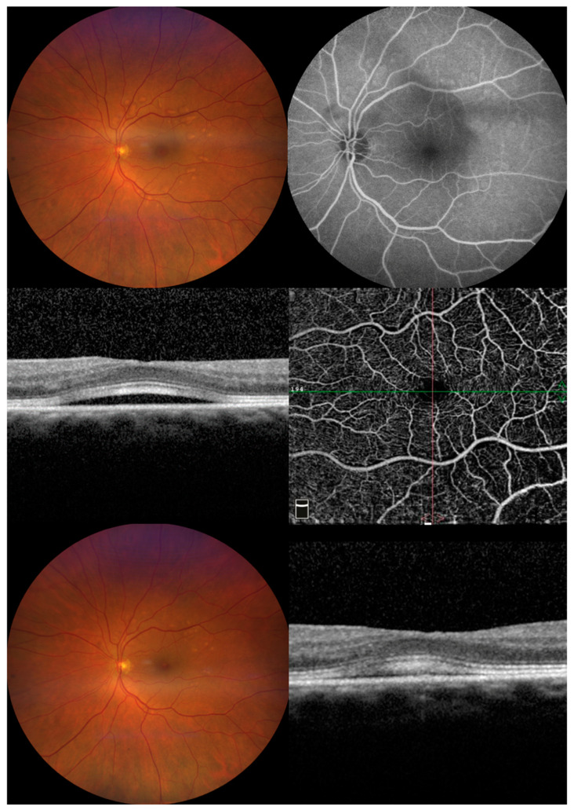
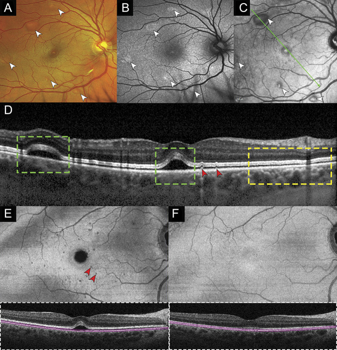
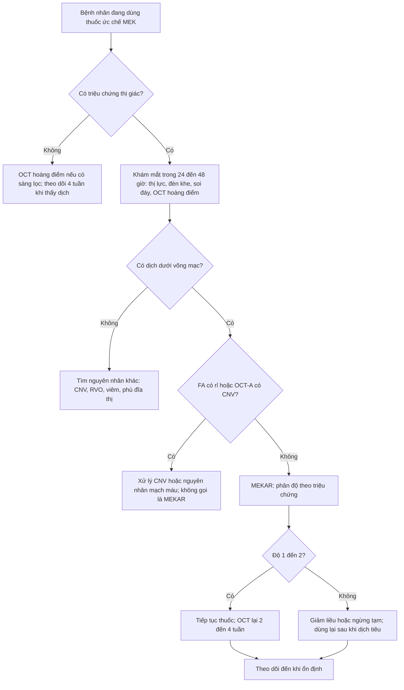
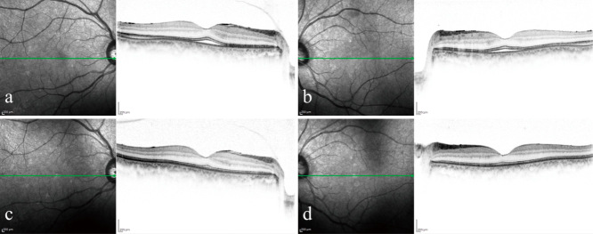
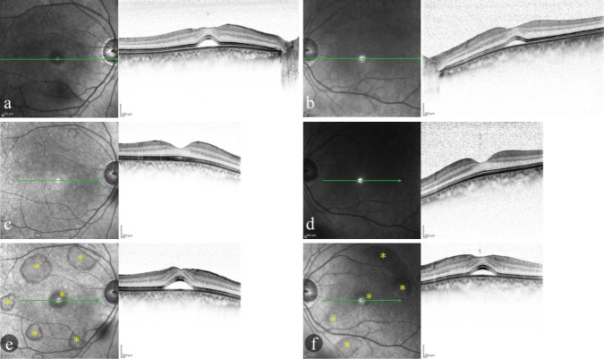

# 3242 — Bệnh võng mạc do thuốc ức chế MEK (MEKAR/RPED): "HAI BÊN – DỊCH DƯỚI VÕNG MẠC – FA KHÔNG RỈ – TỰ KHỎI" / MEK inhibitor–associated retinopathy

**Tags:** `pattern:bong-thanh-dich-vong-mac` `pattern:dich-duoi-vong-mac` `pattern:bong-rpe` `pattern:hai-ben` `pattern:khong-ri-fa` `vung:mat` `vung:vong-mac` `vung:hoang-diem` `protocol:OCT-hoang-diem` `protocol:FA` `protocol:OCT-A` `protocol:EOG` `protocol:do-thi-luc` `score:CTCAE` `incidentaloma:khong`

**Mức chắc chắn (certainty):** tổng hợp y văn (literature synthesis) — dựng từ **tổng quan lớp thuốc 2024** (PMC11067803), **loạt ca BEACON 2025 có ảnh OCT theo ngày** (PMC12574812), **nghiên cứu tiến cứu RPE/EOG 2023** (PMC9918243), **báo cáo PSD trên en face OCT 2021** (PMC8078124), **đoàn hệ trẻ NF1 2024** (PMC11119759), cùng các tổng quan độc tính võng mạc (PMC8688906, PMC5601686, PMC13023833). Nhóm **không có bệnh nhân của mình**; chỗ chưa đủ chắc ghi **"chưa rõ"**. **Không ghi tên tác giả** — attribution dùng **tạp chí + năm + PMCID/PMID**, đối chiếu Europe PMC ngày **2026-11-20**.

> **Câu chốt:** bệnh nhân ung thư **đang dùng thuốc ức chế MEK** (binimetinib, trametinib, cobimetinib, selumetinib) đến với **nhìn mờ, chớp sáng, quầng màu hoặc "nhìn như có giọt nước"** — thường **HAI bên**, xuất hiện **vài ngày đến vài tuần** sau khởi trị. OCT hoàng điểm cho thấy **dịch dưới võng mạc thần kinh, giữa RPE và dải interdigitation zone**, **nhiều ổ**, ± **bong biểu mô sắc tố (RPED)**; **FA KHÔNG rỉ** và **OCT-A không có màng tân mạch**. Đây là **MEKAR (MEK inhibitor–associated retinopathy)** — phần lớn **tự khỏi** và **không được ngừng thuốc ung thư vĩnh viễn**. Bốn con số phải nhớ: **(a) tần suất** — tới **90%** nếu chủ động khám mắt định kỳ, nhưng chỉ **~13%** có triệu chứng trong coBRIM (PMC11067803); **(b) thời điểm** — **73%** biến cố trong **7 ngày đầu**, hơn nửa trong **2 ngày** (PMC12574812); **(c) hồi phục** — COLUMBUS: **82% khỏi**, **3% đang hồi phục**, **0 ca phải ngừng thuốc** vì bong thanh dịch (PMC11067803); **(d) bẫy** — **RVO 0,5%** (so với **0,1%** dân số chung) là biến cố **phải ngừng vĩnh viễn**, và **anti-VEGF không dùng cho MEKAR** khi chưa có CNV.

## 1. Tổng quan bệnh học – cơ chế hình ảnh (TẠI SAO)

### 1.1 MEKAR là bệnh của BƠM RPE, không phải bệnh của mạch máu

- **Thuốc ức chế MEK1/2** chặn **MAPK/ERK** — con đường nằm **dưới FGFR** trong **biểu mô sắc tố võng mạc (RPE)**. FGFR ở RPE không phải "để mọc mạch" mà để **duy trì sống, sửa chữa và vận chuyển nước–ion** qua lớp tế bào có **junctional complex** chặt nhất cơ thể.
- Khi MEK bị chặn: **bơm nước transepithelial của RPE suy** → dịch tích giữa **RPE** và **lớp đoạn ngoài tế bào cảm quang (interdigitation zone – IZ)**; đồng thời **tính thấm RPE tăng** do rối loạn **aquaporin 1 (AQP1)** và có thể do **phá vỡ hàng rào máu–võng mạc** (PMC11067803).
- **Vì sao dịch nằm DƯỚI võng mạc chứ không trong võng mạc:** tổn thương ở **mặt bơm RPE**, không ở mao mạch võng mạc. Dịch thoát ra khoang dưới võng mạc — nơi có **lực dính RPE–tế bào cảm quang** yếu hơn và **không có mao mạch**. Vì thế OCT thấy **khoang trống quang học (hyporeflective) giữa RPE và IZ**, võng mạc thần kinh **còn nguyên, không có nang trong võng mạc** (khác phù hoàng điểm dạng nang).
- **Vì sao HAI bên và nhiều ổ:** thuốc tác động **toàn thân**, RPE là lớp **liên tục toàn võng mạc**; tổn thương không theo lãnh thổ mạch như tắc mạch hay CNV. Nghiên cứu tiến cứu 35 bệnh nhân: **77%** bệnh nhân melanoma da và **60%** melanoma hắc mạc có dịch dưới võng mạc trên OCT; **85%** có tổn thương ở hoàng điểm (PMC11067803).
- **Vì sao phần lớn KHÔNG triệu chứng:** dịch **ngoài hoàng điểm** không làm mờ thị lực trung tâm; dịch ở hoàng điểm nhưng **mỏng, tự tiêu nhanh** chỉ gây **chớp sáng/quầng** thoáng qua. Ca báo cáo cho thấy dịch có thể **tiêu trong 6 giờ** và **tái lập** — giải thích vì sao bệnh nhân "lúc mờ lúc rõ" và vì sao một OCT bình thường sau đó **không loại trừ** (PMC8078124).

### 1.2 Bằng chứng chức năng: EOG — "điện tâm đồ của RPE"

- **Điện thế đứng của mắt (electro-oculogram – EOG)** phản ánh **điện thế đứng của RPE**; tỷ lệ **light peak : dark trough (Arden ratio)** bình thường **≥ 1,8**. Trong MEKAR, tỷ lệ này **tụt ngay trong 2 tuần** — ca có ảnh: **3,5 → 1,8 (giảm 49%)**; **11/15 mắt** của 8 bệnh nhân có EOG **dưới chuẩn** sau 2 tuần, dù **FA không rỉ** và **OCT-A không đổi** (PMC9918243).
- Đây là **chốt cơ chế**: nếu là bệnh mạch máu (CNV, CSCR), **FA phải rỉ** và **hắc mạc phải dày/giãn mạch**. Ở MEKAR, **FA không rỉ**, **hắc mạc không dày**, nhưng **EOG bất thường toàn võng mạc** → tổn thương là **chức năng bơm RPE lan tỏa**, không phải exudation từ mạch.
- **Vì sao FA không rỉ:** fluorescein gắn protein, **không qua được junction RPE còn kín**; dịch hình thành do **bơm nước hỏng** chứ không do **thoát huyết tương**. Vì thế chỉ thấy **pooling trong RPED** (thuốc vào khoang bong RPE), **không có leakage** vào khoang dưới võng mạc.
- **OCT-A không thấy CNV** là điều kiện để **không tiêm anti-VEGF**. Trong nghiên cứu tiến cứu, mật độ mạch hắc mạc **không khác trước–sau** (p = 0,798 và 0,308) (PMC9918243).

### 1.3 Vì sao có RPED và "punctate subretinal deposits"

- **RPED (retinal pigment epithelial detachment):** bong **cả lớp RPE** khỏi màng Bruch do dịch tích dưới RPE; trên OCT là **vòm tăng phản xạ, đồng nhất**, bên dưới **trống quang học**; trên FA là **pooling** (thuốc đọng trong vòm), **không rỉ** ra ngoài. Tổng quan ghi **RPED gặp thường hơn** và là một phần phổ MEKAR (PMC11067803).
- **Punctate subretinal deposits (PSD):** các **chấm giảm phản xạ nhỏ** ở lớp RPE trên **en face OCT**, **đẩy ellipsoid zone/IZ ra trước**, có **đuôi tăng truyền sáng phía sau**; chúng **dao động cùng dịch** và **thoái triển sau 6 giờ** — gợi ý **tổn thương RPE khu trú, hồi phục** (PMC8078124).
- **Hai kiểu dịch:** **"dome"** (vòm khu trú, thường trên RPED) và **"splitting"** (dải dịch thấp, lan rộng giữa RPE và IZ). Kiểu **splitting** dễ bị đọc nhầm là **bình thường** nếu chỉ nhìn một lát cắt.

### 1.4 Vì sao khởi phát sớm nhưng có thể muộn — và vì sao tần suất dao động 0,9–90%

- **Sớm:** thuốc đạt nồng độ ổn định trong **vài giờ–vài ngày**; RPE là **mô tiếp xúc trực tiếp với máu hắc mạc** nên tổn thương xuất hiện trước khi có triệu chứng. Loạt BEACON: khởi phát **ngày 2, 2 và 4**; dữ liệu hậu mãi Nhật ghi **73% trong 7 ngày đầu**, **hơn nửa trong 2 ngày** (PMC12574812).
- **Muộn vẫn có:** phù hoàng điểm dạng nang **8 tháng**, viêm màng bồ đào **3 tháng**, phù đĩa thị **sau nhiều năm** dabrafenib/trametinib (PMC11067803, PMID 31906779). Vì thế **không được đóng khung "chỉ xảy ra tuần đầu"**.
- **Tần suất khác nhau vì cách phát hiện, không phải vì sinh học khác:**
  - **0,9%** — thử nghiệm BEACON (chỉ ghi biến cố có triệu chứng/được khám).
  - **2,9%** — khảo sát hậu mãi Nhật.
  - **13,7%** — ANCHOR; **20%** — COLUMBUS (bong thanh dịch); **40,6%** — COLUMBUS theo một cách ghi nhận khác.
  - **77–90%** — khi **chủ động OCT định kỳ** ở mọi bệnh nhân (PMC11067803, PMC12574812).
- **Bài học:** "incidence" trong thử nghiệm là **tần suất phát hiện**, không phải tần suất bệnh. Đừng trích **0,9%** để nói MEKAR hiếm.

### 1.5 Bảng số phải nhớ

| Chỉ số | Giá trị | Nguồn |
|---|---|---|
| MEKAR khi sàng lọc OCT chủ động | **tới 90%**; phần lớn không triệu chứng | PMC11067803 |
| coBRIM (cobimetinib + vemurafenib, n = 247) | **29%** (72/247) có bệnh võng mạc; **13%** (33) có triệu chứng; 86 đợt dịch/69 bệnh nhân | PMC11067803 |
| COLUMBUS (encorafenib + binimetinib, n = 192) | bong thanh dịch **20%**; **87%** độ 1–2; **11** ca ngắt/giảm liều; **82%** khỏi, **3%** đang hồi phục; **0** ca ngừng thuốc | PMC11067803 |
| Nghiên cứu tiến cứu 35 bệnh nhân | dịch dưới võng mạc **77%** (melanoma da) / **60%** (melanoma hắc mạc); **85%** ở hoàng điểm | PMC11067803 |
| Loạt 32 bệnh nhân | độ 1–2: **13/20** đơn trị binimetinib, **6/12** phối hợp | PMC11067803 |
| SPRINT (selumetinib, 74 trẻ NF1) | biến cố mắt **15%**; **82%** khỏi | PMC11067803 |
| BEACON (thử nghiệm) so với loạt tại viện | **0,9%** so với **3/3** bệnh nhân triplet | PMC12574812 |
| Khởi phát | **73%** trong 7 ngày; hơn nửa trong **2 ngày**; ca **ngày 2–4** | PMC12574812 |
| Hồi phục | thường **1–vài tuần**; ca dịch tiêu sau **6 giờ** | PMC11067803, PMC8078124 |
| RVO | **0,5%** (dân số chung **0,1%**) — **ngừng vĩnh viễn** nếu xác nhận | PMC11067803 |
| EOG light peak : dark trough | **3,5 → 1,8 (−49%)** sau 2 tuần; **11/15 mắt** dưới chuẩn | PMC9918243 |
| Trẻ NF1 (26 bệnh nhân, 13 tuổi) | **0 ca MEKAR** trong **413 ngày**; **15%** khô mắt | PMC11119759 |
| Tiền sử viêm/nhiễm/kích thích mắt | **4/5** bệnh nhân phát triển bệnh võng mạc **có triệu chứng** | PMC11067803 |

## 2. Mẫu hình + chẩn đoán phân biệt theo vị trí (gamut)

### 2.1 Mẫu hình trung tâm: dịch dưới võng mạc HAI BÊN, nhiều ổ

- **Hoàng điểm:** MEKAR, **CSCR** (thường một bên), **CNV** (một bên, kèm máu/xuất tiết), **VKH** (hai bên + viêm), **di căn hắc mạc** (dày hắc mạc dạng gồ), **bệnh võng mạc tăng huyết áp ác tính** (đốm bông, hẹp mạch).
- **Ngoài hoàng điểm / nhiều ổ:** MEKAR (rất hay gặp), lymphoma nội nhãn, bệnh do thuốc khác, **bong thanh dịch do thẩm phân/ghép tế bào gốc**.
- **Quanh đĩa thị:** **phù đĩa thị/IIH**, **MEKAR + phù đĩa** (hiếm, báo cáo ca), **neuroretinitis**, **PPS (pachychoroid quanh đĩa)**.

### 2.2 Mẫu hình theo tổn thương RPE

- **RPED nhiều ổ hai bên:** MEKAR, **CSCR mạn**, **bệnh trung tâm thanh dịch do thuốc** (steroid, MEK), **drusen lớn/PED lành tính** (đối xứng, ổn định nhiều năm).
- **RPED đơn độc + dịch:** **CNV ẩn** (OCT-A có mạng tân mạch, FA rỉ), **PED do tuổi**, **u hắc mạc thể phẳng** (siêu âm dày, không có "dome" đơn thuần).

### 2.3 Mẫu hình trong võng mạc (khác MEKAR)

- **Nang trong võng mạc + dày võng mạc:** phù hoàng điểm do **đái tháo đường**, **RVO**, **viêm màng bồ đào**, **Irvine–Gass sau mổ**, hoặc **phù hoàng điểm do MEK** (hiếm, thường kèm viêm).
- **Xuất huyết theo vùng:** **RVO** (chặn bởi đường ngang, giãn tĩnh mạch), **CNV** (dưới võng mạc), **bệnh võng mạc đái tháo đường**.

### 2.4 Mnemonic MEKAR

**M**ultifocal bilateral — **E**arly (ngày–tuần) — **K**lear FA (không rỉ) — **A**symptomatic thường gặp — **R**eversible.

## 3. Bảng so sánh phân biệt (ma trận đối chiếu)

| Thực thể (entity) | Hình ảnh điển hình (OCT/FA/US) | Chốt vào (rule-in) | Chốt loại (rule-out) | Gợi ý xác nhận |
|---|---|---|---|---|
| **MEKAR** | Dịch dưới võng mạc **giữa RPE và IZ**, hai bên, nhiều ổ; **dome** hoặc **splitting**; ± **RPED**; **FA không rỉ**; **OCT-A không CNV** | **Đang dùng MEK inhibitor + hai bên + nhiều ổ + FA không rỉ + tự khỏi/dao động** | FA rỉ, OCT-A có CNV, xuất huyết/xuất tiết, một bên cố định → không phải MEKAR | OCT hoàng điểm + FA + OCT-A; EOG nếu cần; ngừng thử thuốc |
| **CSCR** | Dịch dưới võng mạc **một bên** (80–90%), **hắc mạc dày** (pachychoroid), **FA rỉ** kiểu inkblot/smokestack, **FAF tăng** | **Một bên + FA rỉ + hắc mạc dày + tiền sử steroid/căng thẳng** | Hai bên, nhiều ổ, FA không rỉ, đang dùng MEK → nghi MEKAR | FA, OCT-A, OCT hắc mạc |
| **CNV / thoái hóa hoàng điểm xuất tiết** | Dịch **dưới RPE và/hoặc dưới võng mạc**, **máu/xuất tiết**, **FA rỉ**, **OCT-A có mạng tân mạch** | **FA rỉ + OCT-A CNV + xuất huyết/xuất tiết** | FA không rỉ + OCT-A sạch + hai bên đối xứng → không CNV | FA + OCT-A; anti-VEGF nếu CNV |
| **Phù đĩa thị / IIH** | **Đĩa phù hai bên**, RNFL dày, **dịch quanh đĩa**, đầu đau, điểm mù lớn | **Đĩa phù + RNFL dày + đau đầu/ù tai + áp lực mở cao** | Đĩa bình thường, RNFL không dày, không đau đầu → không phù đĩa | Soi đáy + OCT RNFL + MRI/CSF |
| **Viêm màng bồ đào do thuốc (BRAF/MEK)** | **Tế bào/flare tiền phòng**, KP, dính mống mắt, đau–sợ ánh sáng; có thể CME | **Viêm tiền phòng + đau + tế bào tiền phòng** | Không tế bào, không đau, chỉ dịch dưới võng mạc → MEKAR thuần | Đèn khe; corticoid tại chỗ |
| **RVO (CRVO/BRVO)** | **Xuất huyết theo vùng**, tĩnh mạch giãn–ngoằn ngoèo, **phù hoàng điểm**, FA rỉ muộn | **Xuất huyết + giãn tĩnh mạch + phù hoàng điểm** | Không xuất huyết, tĩnh mạch bình thường → không RVO | Soi đáy, FA; **ngừng MEK vĩnh viễn** |
| **Di căn hắc mạc / u hắc mạc** | **Dày hắc mạc dạng gồ**, bờ không đều, siêu âm **dày > 2 mm**, có thể **dịch dưới võng mạc** | **Tiền sử ung thư + khối hắc mạc dày + siêu âm** | Hắc mạc mỏng, đối xứng, không khối → không di căn | Siêu âm B-scan, OCT hắc mạc, MRI |

*Bệnh nhân MEKAR sau 2 tuần điều trị: ảnh màu **nhiều bong RPE** ở hậu cực (trên trái); **FAG không rỉ** vùng hoàng điểm, chỉ **pooling** trong các RPED (trên phải); **OCT** có **bong thanh dịch thần kinh–võng mạc hoàng điểm**, **dày/tăng phản xạ dải interdigitation zone**, **không dày hắc mạc** (giữa trái); **OCT-A** không đổi (giữa phải); sau 4 tuần **giảm dịch** (dưới). Nguồn: *J Clin Med* 2023 (PMC9918243), CC BY 4.0; ảnh nguyên bản, không crop.*

### Ba dấu hiệu "chốt" trên hình ảnh

1. **Dịch dưới võng mạc, KHÔNG trong võng mạc:** khoang giảm phản xạ **giữa RPE và IZ**, võng mạc thần kinh phía trên **mỏng nhưng liên tục**, không nang trong võng mạc.
2. **FA không rỉ:** chỉ **pooling** trong RPED; **không leakage** vào khoang dưới võng mạc. Đây là điểm **loại CSCR/CNV** mạnh nhất.
3. **Hai bên + nhiều ổ + dao động:** tổn thương **đối xứng**, thay đổi **trong vài giờ–vài tuần**, **không theo lãnh thổ mạch**.

*MEKAR sau encorafenib + binimetinib: ảnh màu siêu rộng có **vùng vàng–cam gồ** (A), **FAF tăng** (B), **NIR giảm phản xạ** (C); OCT B-scan có **dịch kiểu dome** và **splitting** cùng **punctate subretinal deposits** (D); en face OCT tại lớp RPE: **chấm giảm phản xạ** (E); sau **6 giờ** dịch tiêu và PSD thoái triển (F). Nguồn: *Retina* 2021 (PMC8078124), CC BY-NC-ND 4.0; ảnh nguyên bản, không crop.*

## 4. Protocol chụp + hệ phân độ/điểm chuẩn hóa

### 4.1 Trước khi bắt đầu thuốc (baseline)

- **Thị lực có chỉnh kính (BCVA)**, **đèn khe** (tế bào/flare, KP), **nhãn áp**, **soi đáy giãn đồng tử**.
- **OCT hoàng điểm** (khối 3D hoặc lát cắt qua hoàng điểm) — để phân biệt **bệnh có sẵn** (drusen, ERM, CSCR cũ) với **MEKAR** về sau.
- **OCT RNFL** nếu nghi phù đĩa thị; **chụp màu/FAF** nếu có tổn thương sắc tố.
- **Không bắt buộc EOG/FA/OCT-A thường quy**; làm khi chẩn đoán chưa rõ hoặc nghi CNV.

### 4.2 Theo dõi trong điều trị

- **Không có khuyến cáo sàng lọc mắt thường quy cho mọi bệnh nhân** (PMC11067803). Tuy nhiên:
  - **Mọi bệnh nhân có triệu chứng thị giác** → khám mắt **trong 24–48 giờ**, không chờ lịch hẹn ung thư.
  - **Nhóm nguy cơ cao** (tiền sử **viêm/nhiễm/kích thích mắt**, bệnh hoàng điểm/võng mạc nền) → khám định kỳ; trong coBRIM, **4/5** bệnh nhân có tiền sử viêm mắt phát triển bệnh võng mạc **có triệu chứng** (PMC11067803).
- **Quy trình thực hành của loạt BEACON** (PMC12574812): **điện thoại do dược sĩ ngày 2–4** hỏi triệu chứng mắt; **khám mắt trong 8 ngày**; sau khi có SRD, khám **mỗi 2 tuần** đến khi ổn định.
- **Khi đã có MEKAR:** OCT lặp lại **2–4 tuần** (hoặc sớm hơn nếu triệu chứng tăng); **FA/OCT-A** nếu nghi CNV; **EOG** nếu cần bằng chứng chức năng RPE.

### 4.3 Phân độ và xử trí (theo triệu chứng; CTCAE 4.0 không có mục riêng cho "serous retinopathy")

| Độ | Triệu chứng | Xử trí | Theo dõi |
|---|---|---|---|
| **1** | Không triệu chứng, chỉ thấy dịch trên OCT | **Tiếp tục thuốc** | OCT lại **4 tuần** |
| **2** | Mờ nhẹ, thoáng qua, **không ảnh hưởng sinh hoạt** | **Tiếp tục thuốc** | OCT lại **2–4 tuần**, sớm hơn nếu nặng lên |
| **3** | Mờ **kéo dài, ảnh hưởng sinh hoạt** | **Cân nhắc giảm liều/ngắt thuốc**; dùng lại sau khi dịch tiêu | OCT **1–2 tuần**; hội chẩn ung thư–mắt |
| **4** | Mờ **nặng**, ảnh hưởng nghiêm trọng | **Thử ngừng thuốc**, xử lý nguyên nhân khác; dùng lại sau khi hồi phục | Theo dõi sát, cá thể hóa |
| **RVO** | Xuất huyết võng mạc theo vùng, giãn tĩnh mạch | **Ngừng MEK VĨNH VIỄN** nếu xác nhận | Khám mắt + FA; xử lý phù hoàng điểm |

### 4.4 Liều thuốc và điểm cần nhớ

| Thuốc | Liều thường dùng | Ghi chú mắt |
|---|---|---|
| **Binimetinib** | **45 mg** uống **2 lần/ngày** | Tần suất MEKAR cao nhất trong nhóm có dữ liệu OCT chủ động (20–77%) |
| **Cobimetinib** | **60 mg**/ngày, **21 ngày uống/7 ngày nghỉ** | coBRIM: **29%** bệnh võng mạc, **13%** triệu chứng |
| **Trametinib** | **2 mg**/ngày | **Tần suất MEKAR chưa biết** vì thử nghiệm đăng ký không khám mắt thường quy |
| **Selumetinib** | **25 mg/m²** uống **2 lần/ngày** (trẻ NF1) | SPRINT: biến cố mắt **15%**, **82%** khỏi |

- **Không dùng anti-VEGF cho MEKAR** khi **không có CNV**: dịch do bơm RPE, không phải do VEGF; anti-VEGF không sửa được bơm và có thể gây biến chứng.
- **Corticoid tại chỗ** chỉ dành cho **viêm màng bồ đào/CME viêm**, không phải MEKAR thuần.
- **RVO** là ngoại lệ: **ngừng vĩnh viễn** theo nhãn thuốc (PMC11067803).

## 5. Biến thể bình thường và cạm bẫy

- **MEKAR không triệu chứng dễ bị bỏ:** nếu không OCT, bệnh nhân chỉ được ghi "khám mắt bình thường". Trong nghiên cứu tiến cứu, **77%** bệnh nhân melanoma da có dịch dưới võng mạc nhưng phần lớn **không phàn nàn** (PMC11067803).
- **OCT bình thường sau cơn mờ không loại trừ:** dịch có thể **tiêu trong 6 giờ** rồi tái lập (PMC8078124). Hỏi kỹ **thời điểm** và chụp lại khi có triệu chứng.
- **Đừng dán nhãn "CSCR":** CSCR **một bên**, **FA rỉ**, **hắc mạc dày**; MEKAR **hai bên**, **FA không rỉ**, **hắc mạc không dày**. Dán nhãn CSCR dẫn tới **ngừng thuốc ung thư oan** hoặc **laser/PDT không cần thiết**.
- **Đừng tiêm anti-VEGF:** chỉ khi **OCT-A có CNV**. RPED đơn thuần **không phải** chỉ định anti-VEGF.
- **Đừng neo vào "phù đĩa thị/IIH":** bệnh nhân ung thư có **đau đầu + đĩa phù** dễ bị gọi IIH; nhưng **dịch dưới võng mạc hai bên + đang dùng MEK** phải nghĩ MEKAR. Phù đĩa thị do MEK có báo cáo ca nhưng **không phổ biến** (PMID 31906779).
- **Dịch trong võng mạc ≠ dịch dưới võng mạc:** nang trong võng mạc gợi **đái tháo đường/RVO/viêm**; MEKAR là **dịch dưới võng mạc**.
- **RPED vs CNV:** RPED **không rỉ**, **OCT-A sạch**; CNV **rỉ**, có mạng tân mạch. Đừng điều trị CNV khi chỉ có RPED.
- **Khởi phát muộn vẫn có:** phù hoàng điểm **8 tháng**, viêm **3 tháng**, phù đĩa thị **sau nhiều năm** — không được nói "quá 1 tháng là không do thuốc".
- **Trẻ em không miễn nhiễm:** đoàn hệ NF1 **0/26** nhưng có **báo cáo ca MEKAR ở trẻ** (PMC9164750); không dùng "trẻ ít gặp" để bỏ qua triệu chứng.
- **Bệnh nhân melanoma hắc mạc:** dịch dưới võng mạc có thể do **di căn hắc mạc** hoặc **u tiến triển**, không chỉ MEKAR; siêu âm B-scan và so sánh với ảnh cũ.
- **Biến thể bình thường dễ nhầm:** **drusen mềm/PED lành tính** đối xứng, ổn định nhiều năm, **không dịch**; **ERM** gây nhăn võng mạc nhưng không có khoang dịch dưới võng mạc; **dịch kính đục** không tạo khoang dưới võng mạc.

## 6. Tự lượng giá — Blind Quiz

**Ca 1 — Nữ 70 tuổi, ung thư đại tràng BRAF V600E, ngày thứ 3 của phác đồ ba thuốc có binimetinib. Bệnh nhân thấy "quả bóng màu be" chớp qua mắt. Nhìn ảnh OCT, mô tả trước khi mở đáp án.**

- Câu hỏi: Dịch nằm ở đâu? Một bên hay hai bên? Có cần ngừng cả ba thuốc không? Điều gì quyết định chẩn đoán?

<b>Bấm để hiện đáp án (findings + chẩn đoán)</b>

- **Findings:** (a, b) ngày 3 — **bong thanh dịch thần kinh–võng mạc (SRD) hai bên**, khoang giảm phản xạ **giữa RPE và võng mạc thần kinh**; (c, d) ngày 8 — **dịch tiêu gần hoàn toàn** sau khi ngừng 1 tuần.
- **Chẩn đoán:** **MEKAR** do binimetinib, độ 2 theo triệu chứng.
- **Xử trí:** ngắt **encorafenib + binimetinib 1 tuần** (theo hướng dẫn nhà sản xuất), dịch tiêu; sau đó bệnh nhân tiếp tục **doublet không có binimetinib**. Không cần corticoid, không anti-VEGF.
- **Vì sao không phải CSCR:** hai bên, nhiều ổ, khởi phát **ngày 3** sau thuốc, tự khỏi nhanh; CSCR thường một bên và FA rỉ.
- Nguồn ảnh: *J Anus Rectum Colon* 2025 (PMC12574812), CC BY-NC-ND 4.0.

**Ca 2 — Nam 51 tuổi, ung thư đại tràng BRAF V600E, ngày thứ 4 của binimetinib, khó đọc báo. OCT ngày 4, ngày 11 và sau khi dùng lại thuốc.**

- Câu hỏi: Vì sao dịch tái phát dù đã hết? Có nên ngừng vĩnh viễn binimetinib? Chiến lược nào giữ được thuốc ung thư?

<b>Bấm để hiện đáp án (findings + chẩn đoán)</b>

- **Findings:** (a, b) ngày 4 — SRD hai bên; (c, d) ngày 11 — **tiêu hết** sau ngừng binimetinib; (e, f) **7 ngày sau dùng lại** — **tái phát SRD** (dấu hoa thị vàng).
- **Chẩn đoán:** **MEKAR tái phát sau thử lại (rechallenge)** — hiện tượng **phụ thuộc liều/nồng độ**, không phải thất bại điều trị hay bệnh mới.
- **Xử trí:** giảm liều rồi **dùng theo nhịp 1 tuần uống/1 tuần nghỉ**, các thuốc khác tiếp tục; theo dõi OCT **mỗi 2 tuần** đến khi ổn định. Không ngừng vĩnh viễn vì MEKAR.
- **Bài học:** dùng lại **có thể tái phát**; cần **kế hoạch giảm liều/ngắt nhịp** thay vì bỏ thuốc. Chiến lược 1 tuần uống/1 tuần nghỉ là **kinh nghiệm loạt ca**, chưa có RCT (PMC12574812).
- Nguồn ảnh: *J Anus Rectum Colon* 2025 (PMC12574812), CC BY-NC-ND 4.0.

**Ca 3 — Nam 42 tuổi, melanoma da di căn, đang encorafenib + binimetinib, không phàn nàn thị lực. Ảnh chụp vì lịch khám nghiên cứu.**

- Câu hỏi: Tổn thương vàng–cam là gì? Vì sao FA không rỉ mà vẫn có dịch? Dấu hiệu nào trên en face OCT giúp hiểu cơ chế?

<b>Bấm để hiện đáp án (findings + chẩn đoán)</b>

- **Findings:** vùng **vàng–cam gồ** ở hậu cực và dọc arcade (A), **tăng huỳnh quang** trên FAF (B), **giảm phản xạ** trên NIR (C); OCT có **dome** và **splitting** (D); en face OCT tại RPE: **punctate subretinal deposits** giảm phản xạ (E); sau **6 giờ** dịch tiêu, PSD thoái triển (F).
- **Chẩn đoán:** **MEKAR không triệu chứng** — tổn thương **RPE khu trú**, dịch dưới võng mạc **dao động rất nhanh**.
- **Vì sao FA không rỉ:** dịch do **bơm RPE suy**, không do thoát huyết tương; FA chỉ **pooling** trong RPED.
- **Xử trí:** **tiếp tục thuốc**, theo dõi OCT; không can thiệp.
- Nguồn ảnh: *Retina* 2021 (PMC8078124), CC BY-NC-ND 4.0.

## 7. Câu hỏi nghiên cứu & điểm chưa đồng thuận (tính đến 11/2026)

1. **[Tranh cãi] Ở bệnh nhân MEKAR không triệu chứng, tiếp tục MEK inhibitor có làm tăng nguy cơ mất thị lực lâu dài so với ngừng/giảm liều không?**
   - **Đã biết:** COLUMBUS: **82% khỏi**, **3%** đang hồi phục, **0 ca ngừng thuốc** vì bong thanh dịch; nghiên cứu tiến cứu cho thấy dịch **dao động và tự tiêu** dù tiếp tục thuốc (PMC11067803, PMC8078124).
   - **Chưa rõ:** **tổn thương RPE tích lũy** sau nhiều đợt, **ngưỡng dịch/thời gian** nên can thiệp, và **khác biệt giữa binimetinib với trametinib**.
   - **Hướng nghiên cứu:** **đoàn hệ tiền cứu** với OCT định lượng (thể tích dịch, chiều cao SRF, EOG) và **thị lực 1–2 năm**, phân tầng theo quyết định tiếp tục/ngắt thuốc.
   - **Nguồn:** PMC11067803 (2024); PMC8078124 (2021).

2. **[Khoảng trống] Tần suất thật của MEKAR với trametinib và ở trẻ em là bao nhiêu?**
   - **Đã biết:** trametinib **không có số liệu tần suất** vì thử nghiệm đăng ký **không khám mắt thường quy**; đoàn hệ **26 trẻ NF1** có **0 ca MEKAR** trong **413 ngày**, nhưng có **báo cáo ca MEKAR ở trẻ u đường thị** (PMC11067803, PMC11119759, PMC9164750).
   - **Chưa rõ:** **tỷ lệ theo tuổi/liều**, **yếu tố nguy cơ ở trẻ**, và **giá trị của sàng lọc OCT** ở quần thể nhi.
   - **Hướng nghiên cứu:** **đoàn hệ nhi tiền cứu** với OCT nền + định kỳ, báo cáo **tần suất, thời điểm, hồi phục** theo từng thuốc và liều.
   - **Nguồn:** PMC11067803 (2024); PMC11119759 (2024); PMC9164750 (2022).

3. **[Khác biệt thực hành] Có nên OCT nền và sàng lọc định kỳ cho MỌI bệnh nhân dùng MEK inhibitor, hay chỉ khám khi có triệu chứng?**
   - **Đã biết:** hiện **không có khuyến cáo sàng lọc thường quy**; OCT nền giúp phân biệt bệnh có sẵn; khám chủ động trong thử nghiệm phát hiện tới **90%**, còn thử nghiệm BEACON chỉ ghi **0,9%** (PMC11067803, PMC12574812).
   - **Chưa rõ:** **chi phí–hiệu quả**, **lịch tối ưu** (ngày 2–4, tuần 1, tuần 4), và **ai là nhóm nguy cơ cao** đủ để sàng lọc.
   - **Hướng nghiên cứu:** **nghiên cứu triển khai** so sánh sàng lọc chủ động vs khám theo triệu chứng, outcome **tỷ lệ phát hiện, mất thị lực, thời gian gián đoạn thuốc, chi phí**.
   - **Nguồn:** PMC11067803 (2024); PMC12574812 (2025).

## Bài liên quan chéo

- [3240 – Viêm thần kinh thị do thuốc ức chế miễn dịch (ICI-ON)](../3240-viem-than-kinh-thi-do-thuoc-uc-che-mien-dich/lesson.md) — cùng mô hình "thuốc ung thư – mắt", khác cơ chế (tự miễn vs độc RPE).
- [1479 – Bong võng mạc thanh dịch](../1479-bong-vong-mac-thanh-dich/lesson.md) — tiếp cận dịch dưới võng mạc không có lỗ rách.
- [405 – Pachychoroid quanh đĩa thị/PPS](../405-pachychoroid-quanh-dia-thi-pps/lesson.md) — dịch quanh đĩa, FA không rỉ, hắc mạc dày.
- [433 – Phù đĩa thị vs drusen](../433-phu-dia-thi-drusen/lesson.md) — phân biệt phù đĩa thật với giả phù.
- [378 – Điều trị u đám rối NF1 bằng selumetinib](../378-dieu-tri-u-dam-roi-nf1-selumetinib/lesson.md) — bối cảnh MEK inhibitor ở trẻ NF1.
- [448 – U hắc mạc](../448-u-hac-mac/lesson.md) — phân biệt dịch do u/di căn với MEKAR.
- [487 – Nhiễm độc võng mạc do thuốc khác ngoài HCQ](../487-nhiem-doc-vong-mac-thuoc-khac-ngoai-hcq/lesson.md) — khung chung độc tính võng mạc do thuốc.

## Ảnh

- Bốn ảnh gốc, không ảnh ghép: `images/3242_benh-vong-mac-MEK_OCT-FA_PMC9918243.jpg` (CC BY 4.0), `images/3242_benh-vong-mac-MEK_OCT-case1_PMC12574812.jpg` (CC BY-NC-ND 4.0), `images/3242_benh-vong-mac-MEK_OCT-tai-phat-case3_PMC12574812.jpg` (CC BY-NC-ND 4.0), `images/3242_benh-vong-mac-MEK_OCT-enface_PMC8078124.jpg` (CC BY-NC-ND 4.0). Nguồn + giấy phép từng ảnh: `images/CREDITS.md`.
- Không tải ảnh từ nguồn không rõ giấy phép; không crop/ghép ảnh CC BY-NC-ND.

> Không dùng để chẩn đoán độc lập khi chưa có người hướng dẫn.
