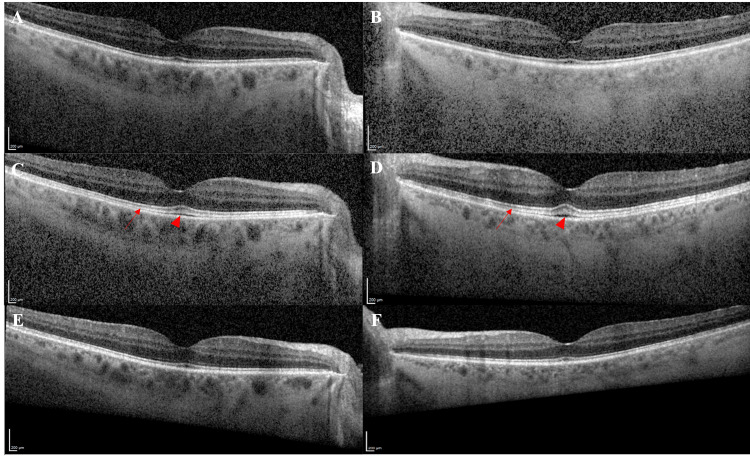
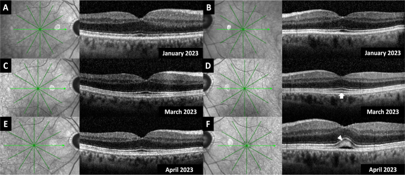
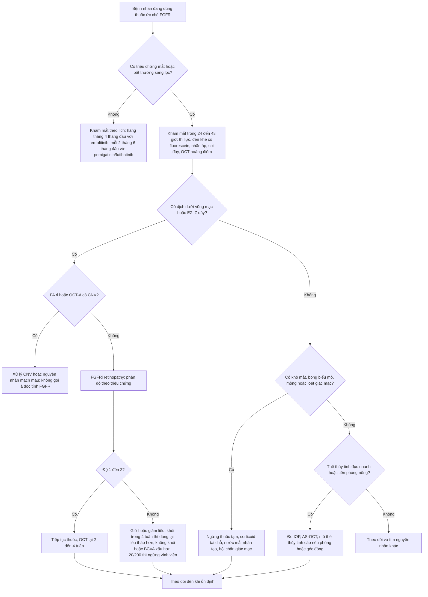
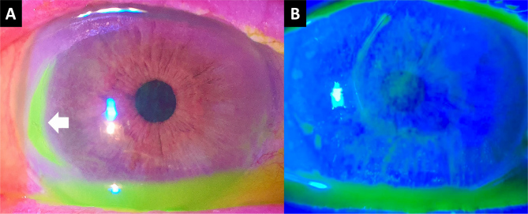
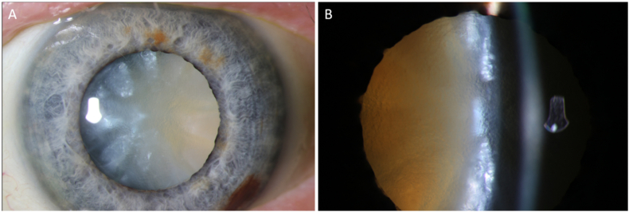

# 3243 — Độc tính mắt của thuốc ức chế FGFR: bệnh võng mạc kiểu MEKAR, mỏng–loét giác mạc và đục thể thủy tinh nhanh / FGFR inhibitor–associated ocular toxicity

**Tags:** `pattern:dich-duoi-vong-mac` `pattern:day-ez-iz` `pattern:mong-giac-mac` `pattern:loet-giac-mac` `pattern:duc-the-thuy-tinh` `pattern:hai-ben` `pattern:nhieu-o` `vung:mat` `vung:vong-mac` `vung:hoang-diem` `vung:giac-mac` `vung:the-thuy-tinh` `protocol:OCT-hoang-diem` `protocol:den-khe` `protocol:sac-giac-mac` `score:CTCAE` `incidentaloma:khong`

**Mức chắc chắn (certainty):** tổng hợp y văn (literature synthesis) — dựng từ **phân tích gộp 6 thử nghiệm erdafitinib 2026** (479 bệnh nhân ung thư niệu mạc + 314 bệnh nhân RAGNAR, **PMC13293072**), **loạt ca có ảnh OCT theo ngày** (**PMC11401776**, **PMC10987836**), **ca đồng thời tổn thương giác mạc + võng mạc** (**PMC11152229**), **cảnh giác dược FAERS FGFR-TKI** (**PMC12274456**), **tổng quan độc tính mắt thuốc đích 2026** (**PMC13023833**) và **ca tổn thương RPE không hồi phục** (**PMC10898545**). Nhóm **không có bệnh nhân của mình**; chỗ chưa đủ chắc ghi **"chưa rõ"**. **Không ghi tên tác giả** — attribution dùng **tạp chí + năm + PMCID/DOI**, đối chiếu Europe PMC ngày **2026-11-21**.

> **Câu chốt:** bệnh nhân ung thư **đang dùng thuốc ức chế FGFR** (erdafitinib, pemigatinib, infigratinib, futibatinib) có thể đến với **nhìn mờ hai bên** do **dịch dưới võng mạc giữa RPE và dải interdigitation zone (IZ)** — hình ảnh **giống MEKAR**, **không phải CSCR** vì **không dày hắc mạc và FA không rỉ**. Điều dễ bỏ sót: **cùng một thuốc còn gây bệnh đoạn trước và thể thủy tinh** — **khô mắt 28%**, **mỏng/loét giác mạc**, và **đục thể thủy tinh trắng nhanh trong vài tháng đến 20 tháng**; đục thể thủy tinh **phồng (intumescent)** có thể làm **nông tiền phòng và gây góc đóng cấp**. Bốn con số phải nhớ: **(a) tần suất** — bệnh võng mạc **21,5%** (103/479) ở ung thư niệu mạc gộp và **13,7%** (43/314) ở RAGNAR; **(b) thời điểm** — trung vị **45 ngày** (5–554), **78,6% trong 90 ngày đầu**; **(c) hồi phục** — **63,1%** và **65,1%** khỏi, **92,0%** thị lực về nền ở RAGNAR; **(d) bẫy** — **"canxi hóa giác mạc" không phải tổn thương được ghi nhận**; tín hiệu cảnh giác dược mới là **mỏng giác mạc** (3 báo cáo, ROR **447,48**), còn **canxi hóa ngoài mắt** xảy ra ở **da/mô dưới da** khi tăng phosphate.

## 1. Tổng quan bệnh học – cơ chế hình ảnh (TẠI SAO)

### 1.1 Vì sao dịch nằm DƯỚI võng mạc và vì sao giống MEKAR

- **FGFR1–4** là **thụ thể tyrosine kinase** nằm **thượng nguồn** của **RAS/RAF/MEK/ERK** (và PI3K/AKT, PLCγ, STAT). Ức chế FGFR vì thế **chặn gián tiếp MEK** — giải thích vì sao **phổ tổn thương võng mạc gần như trùng với MEKAR** (PMC13293072, PMC11401776).
- **RPE** dùng tín hiệu FGF để **duy trì sống, sửa chữa và vận chuyển nước–ion** qua lớp tế bào có **junctional complex** chặt nhất cơ thể. Khi FGFR bị chặn, **bơm nước transepithelial của RPE suy** → dịch tích **giữa đáy tế bào cảm quang và RPE**, tức **giữa RPE và IZ**.
- **Vì sao OCT thấy khoang giảm phản xạ chứ không phải nang trong võng mạc:** tổn thương ở **mặt bơm của RPE**, không ở mao mạch võng mạc. Võng mạc thần kinh phía trên **còn liên tục**, **không có nang trong võng mạc**; lớp **RPE và tế bào cảm quang còn nguyên**, **không bong RPE, không dày hắc mạc** ở thể điển hình (PMC13293072).
- **Vì sao dải EZ/IZ dày và "sáng như bút dạ quang":** các **đoạn ngoài tế bào cảm quang tách khỏi RPE**, xếp lớp và phản xạ mạnh; trên OCT là **dải tăng phản xạ dày, bờ nham nhở (shaggy)**, đo **khoảng cách EZ–đỉnh RPE** tăng. Ca có ảnh: **36 → 71 µm ở mắt phải**, **34 → 85 µm ở mắt trái** sau **1 tháng** (PMC11401776).
- **Vì sao HAI bên và nhiều ổ:** thuốc tác động **toàn thân**, RPE là **lớp liên tục**; tổn thương **không theo lãnh thổ mạch** như tắc tĩnh mạch hay CNV. Hoàng điểm bị ưu thế vì **mật độ tế bào cảm quang và nhu cầu chuyển hóa cao nhất**, vùng **không có mạch (foveal avascular zone)**.

### 1.2 Vì sao đoạn TRƯỚC cũng bị — và vì sao không phải "canxi hóa giác mạc"

- **Giác mạc** biểu hiện FGF-1/FGF-2 và FGFR1/2; tín hiệu này cần cho **di chuyển–biệt hóa biểu mô**, **duy trì chất nền** và **lành vết**. Ức chế FGFR làm **biểu mô mỏng manh, khô mắt, bong biểu mô**, nặng hơn là **mỏng mô đệm giác mạc** và **loét ngoại vi (PUK)** (PMC12274456, PMC11152229).
- **Số liệu đoạn trước:** trong thử nghiệm pha II dẫn đến phê duyệt, **khô mắt 28%**; ca báo cáo có **khô mắt nặng hai bên + PUK một bên** sau **2 tháng** dùng erdafitinib **8 mg**, hồi phục khi **ngừng thuốc + dexamethasone + nước mắt nhân tạo**, và **ổn định khi dùng lại** với **dexamethasone liều thấp + cyclosporine A + nước mắt nhân tạo** (PMC10987836, PMC11152229).
- **"Canxi hóa giác mạc" — cần đính chính bằng bằng chứng:** phân tích FAERS 2025 trên FGFR-TKI **không** ghi nhận canxi hóa/band keratopathy; tín hiệu **mới, chưa có trong nhãn** là **mỏng giác mạc** (**3 báo cáo**, **ROR 447,48**, KTC 95% **140,84–1.421,72**; **PRR 8,74**), cùng **loét giác mạc** và **mù** (PMC12274456). Canxi hóa do FGFRi trong y văn là **calcinosis cutis/calciphylaxis ở da–mô dưới da**, gắn với **tăng phosphate** (PMC12145569). Vì thế bài này **không** dạy "canxi hóa giác mạc" như một dấu hiệu của erdafitinib; nếu gặp **band keratopathy**, phải tìm **bệnh thận mạn/tăng calci–phosphate** trước.

### 1.3 Vì sao thể thủy tinh đục NHANH và vì sao nguy hiểm

- **Tế bào biểu mô thể thủy tinh** sống nhờ tín hiệu FGF; ức chế FGFR làm rối loạn **cân bằng nước–protein**, gây **đục nhanh, có thể trắng hoàn toàn**. Ca có ảnh: bệnh nhân **69 tuổi**, sau **20 tháng** erdafitinib xuất hiện **đục thể thủy tinh trắng, chín hai bên**, phải **mổ thể thủy tinh hai mắt** (PMC10987836). Loạt 3 ca khác ghi nhận **đục trắng khởi phát cấp** kèm **mỏng mô đệm giác mạc hồi phục** và **glôcôm góc đóng** (PMID 33162180 / DOI 10.1016/j.jfo.2020.03.018).
- **Vì sao nguy hiểm:** thể thủy tinh **phồng (intumescent)** đẩy **mống mắt ra trước → tiền phòng nông → góc đóng cấp**, nhãn áp tăng nhanh; đây là **cấp cứu nhãn khoa**, không phải "đục thể thủy tinh tuổi già". Ca PUK ở trên còn cho thấy **tổn thương đoạn trước và đoạn sau có thể xuất hiện đồng thời**.

### 1.4 Vì sao tăng phosphate — và vì sao đừng nhầm với canxi hóa giác mạc

- FGFRi chặn **FGF23** ở ống thận → **giảm bài tiết phosphate**; **tăng phosphate gặp 60–85%** bệnh nhân, phần lớn **độ 1–2** (PMC12145569). Khi **tích calci × phosphate > 70 mg²/dL²**, calci–phosphate kết tủa ở **mô mềm**: **calcinosis cutis**, **calciphylaxis** — tổn thương **da**, không phải giác mạc.
- Vì phosphate là **chỉ dấu dược lực**, erdafitinib được **chuẩn độ 8 → 9 mg** theo **nồng độ phosphate huyết thanh**; đây cũng là lý do phải **theo dõi phosphate** song song với khám mắt (PMC13293072).

### 1.5 Bảng số phải nhớ

| Quần thể | n | Bệnh võng mạc | Độ 3 | Khởi phát trung vị | Khỏi | Ngừng thuốc |
|---|---|---|---|---|---|---|
| Ung thư niệu mạc gộp 5 nghiên cứu | **479** | **21,5%** (103) | **2,3%** (11) | **45 ngày** (5–554); **78,6%** trong **90 ngày** | **63,1%** (65/103) | **2,9%** (14) |
| RAGNAR (u đặc, tumor-agnostic) | **314** | **13,7%** (43) | **1,0%** (3) | **44 ngày** (8–297) | **65,1%** (28/43) | **1,0%** (3) |

- **Tuổi ≥ 65** là yếu tố nguy cơ: bệnh võng mạc **25,3%** (73/288) so với **15,7%** (30/191) ở người **< 65**; **bong RPE 6,3% vs 2,1%**; **ngừng thuốc vì mắt 4,5% vs 0,5%** (PMC13293072).
- **Thời gian khỏi** ngắn: **dịch dưới võng mạc 21 ngày** (n = 7), **chorioretinopathy (bệnh lý hắc–võng mạc) 24 ngày** (22/30); **bong dịch kính 97 ngày** (n = 3).
- **RAGNAR:** **92,0%** thị lực về nền, **78,5%** bong RPE khỏi; **30/43** biến cố trong **90 ngày**.
- **BLC2001 (nhãn):** **khô mắt 28%**, **"central serous retinopathy" 25%**, **6% có triệu chứng**, **3% giảm thị lực đáng kể** (BCVA **< 20/40** hoặc giảm **> 3 dòng**) (PMC10987836).
- **FAERS (FGFR-TKI):** **mỏng giác mạc** 3 báo cáo — **ROR 447,48**, **PRR 8,74**; **loét giác mạc** và **mù** là tín hiệu mới (PMC12274456).
- **Pemigatinib/futibatinib:** khởi phát trung vị **~62 ngày** và **~40 ngày**; theo dõi **mỗi 2 tháng trong 6 tháng đầu**, sau đó **mỗi 3 tháng** (PMC13023833).

## 2. Mẫu hình + chẩn đoán phân biệt theo vị trí (gamut)

### 2.1 Mẫu hình hậu đoạn: dịch dưới võng mạc HAI BÊN, nhiều ổ

- **Hoàng điểm:** FGFRi retinopathy, **MEKAR**, **CSCR** (thường một bên, hắc mạc dày), **CNV** (một bên, máu/xuất tiết, FA rỉ), **VKH** (hai bên + viêm), **di căn hắc mạc** (dày hắc mạc dạng gồ), **bệnh võng mạc tăng huyết áp ác tính** (đốm bông, hẹp mạch).
- **Ngoài hoàng điểm/nhiều ổ:** FGFRi/MEKAR (rất hay gặp), lymphoma nội nhãn, bong thanh dịch do thẩm phân/ghép tế bào gốc.
- **Kèm bong RPE:** FGFRi ghi nhận **bong RPE 4,6%** ở nhóm niệu mạc gộp; nhưng khác CSCR ở chỗ **không dày hắc mạc** và **FA không rỉ** (PMC13293072).

### 2.2 Mẫu hình đoạn trước: "mắt đỏ – khô – mỏng – loét"

- **Khô mắt/bong biểu mô:** FGFRi, **ADC (belantamab, mirvetuximab, T-DXd)** gây **bệnh biểu mô giác mạc dạng vi nang**, **bệnh mắt do thuốc khác**, **khô mắt do tuổi/Thuốc kháng cholinergic**.
- **Loét ngoại vi (PUK):** FGFRi, **PUK tự miễn (RA, GPA, viêm loét đại tràng)**, **Herpes**, **Acanthamoeba/nấm**, **bỏng hóa chất**, **thiếu tế bào gốc rìa**.
- **Mỏng mô đệm lan tỏa:** FGFRi, **bệnh giác mạc dạng nang/gai**, **loạn dưỡng**, **sau radial keratotomy** (bệnh nhân trong ca có tiền sử **RK hai bên** — PMC10987836).

### 2.3 Mẫu hình thể thủy tinh: đục NHANH, có thể trắng và phồng

- **FGFRi:** đục **trắng chín nhanh** trong **vài tháng đến 20 tháng**, hai bên, kèm **nông tiền phòng**, có thể **góc đóng**.
- **Phân biệt:** đục **tuổi già** (tiến triển **nhiều năm**, không phồng), **đái tháo đường** (đục nhanh nhưng thường kèm bệnh võng mạc), **chấn thương**, **viêm màng bồ đào**, **corticoid** (đục **dưới bao sau**), **tia xạ**.

### 2.4 Mnemonic đoạn trước + đoạn sau của FGFRi

**F**luid bilateral (dịch hai bên) — **G**laucoma góc đóng do thể thủy tinh phồng — **F**ragile cornea (giác mạc mỏng/loét) — **R**eversible phần lớn, nhưng **RPE có thể tổn thương vĩnh viễn**.

## 3. Bảng so sánh phân biệt (ma trận đối chiếu)

| Thực thể (entity) | Hình ảnh điển hình (OCT/đèn khe/FA) | Chốt vào (rule-in) | Chốt loại (rule-out) | Gợi ý xác nhận |
|---|---|---|---|---|
| **FGFRi retinopathy** | Dịch **giữa RPE–IZ**, hai bên, nhiều ổ; **EZ/IZ dày, "shaggy"**, EZ–RPE tăng; **không dày hắc mạc**; ± bong RPE | **Đang dùng FGFRi + dịch dưới võng mạc hai bên + EZ/IZ dày + FA không rỉ** | FA rỉ, OCT-A có CNV, xuất huyết/xuất tiết, một bên cố định, hắc mạc dày → không phải FGFRi | OCT hoàng điểm nền + theo dõi; FA/OCT-A khi nghi CNV |
| **MEKAR** | Cùng phổ dịch dưới võng mạc hai bên; **khởi phát sớm ngày–tuần** sau MEK inhibitor | **Đang dùng MEK inhibitor + hai bên + FA không rỉ** | Không dùng MEK; một bên; FA rỉ | OCT + FA; xem bài 3242 |
| **CSCR** | Dịch dưới võng mạc **một bên**, **hắc mạc dày (pachychoroid)**, **FA rỉ inkblot/smokestack** | **Một bên + hắc mạc dày + FA rỉ** | Hai bên, nhiều ổ, hắc mạc mỏng, FA không rỉ | FA + OCT hắc mạc |
| **CNV/thoái hóa hoàng điểm xuất tiết** | Dịch dưới RPE/võng mạc, **máu/xuất tiết**, **FA rỉ**, **OCT-A có mạng tân mạch** | **FA rỉ + OCT-A CNV** | FA không rỉ + OCT-A sạch + hai bên đối xứng | FA + OCT-A; anti-VEGF nếu CNV |
| **VKH** | Hai bên, **dịch dưới võng mạc + viêm màng bồ đào**, **dày hắc mạc**, đĩa phù, ù tai | **Viêm màng bồ đào + dày hắc mạc + triệu chứng toàn thân** | Không viêm, hắc mạc mỏng, chỉ dịch → không VKH | Đèn khe, siêu âm, FA |
| **FGFRi bệnh giác mạc** | **Khô mắt nặng, bong biểu mô, mỏng mô đệm, loét ngoại vi**; fluorescein bắt màu | **Đang dùng FGFRi + khô/mỏng/loét + không có nguyên nhân khác** | Viêm mủ tiền phòng do vi khuẩn/nấm/herpes, bệnh tự miễn đang hoạt động | Đèn khe + fluorescein; cạo/soi nấm khi nghi nhiễm |
| **ADC keratopathy** | **Vi nang biểu mô**, giác mạc ướt, hai bên, liên quan liều | **Đang dùng ADC + vi nang biểu mô hai bên** | Không dùng ADC; tổn thương mô đệm/loét sâu | Đèn khe; ngừng/giảm liều theo phác đồ |
| **Đục thể thủy tinh do FGFRi** | **Đục trắng nhanh, hai bên, thể thủy tinh phồng, tiền phòng nông**; có thể **góc đóng** | **Đang dùng FGFRi + đục tiến triển vài tháng + hai bên** | Đục nhiều năm, một bên, không phồng | Đèn khe + AS-OCT; đo IOP; mổ thể thủy tinh |

*Bệnh nhân **64 tuổi**, ung thư niệu mạc FGFR3, dùng erdafitinib **8 mg/ngày**: OCT hoàng điểm **trước điều trị** (A, B), **sau 1 tháng** (C, D) và **2 tháng sau khi ngừng thuốc** (E, F). Sau 1 tháng, **dải ellipsoid (EZ) và interdigitation zone (IZ) dày, tăng phản xạ** (mũi tên đỏ) kèm **một lượng nhỏ dịch dưới võng mạc** (đầu mũi tên); EZ–đỉnh RPE tăng **36 → 71 µm** (mắt phải) và **34 → 85 µm** (mắt trái). Sau ngừng thuốc 2 tháng, OCT **trở về nền**. Nguồn: *Cureus* 2024 (PMC11401776), CC BY 4.0; ảnh nguyên bản, không crop.*

### Ba dấu hiệu "chốt" trên hình ảnh

1. **Dịch dưới võng mạc, KHÔNG trong võng mạc:** khoang giảm phản xạ **giữa RPE và IZ**, võng mạc thần kinh phía trên **liên tục**, không nang trong võng mạc.
2. **EZ/IZ dày và nham nhở** — có thể là **dấu hiệu SỚM NHẤT**, xuất hiện **trước khi có dịch rõ**; đo **khoảng cách EZ–RPE** so với nền.
3. **Hai bên + nhiều ổ + FA không rỉ + không dày hắc mạc** — bộ ba loại CSCR/CNV mạnh nhất.

*Cùng bệnh nhân **76 tuổi** (ca 2): OCT trước điều trị (A, B), sau mổ đục thể thủy tinh (C, D) và **2 tháng sau khởi trị erdafitinib 8 mg** (E, F). **Dày dải ellipsoid/interdigitation zone** (mũi tên trắng) và **dịch dưới võng mạc** (đầu mũi tên) xuất hiện **dù bệnh nhân không có triệu chứng**; đây là lý do phải **chụp OCT theo lịch**, không chờ bệnh nhân phàn nàn. Nguồn: *Eur J Case Rep Intern Med* 2024 (PMC11152229), CC BY-NC-ND 4.0; ảnh nguyên bản, không crop.*

## 4. Protocol chụp + hệ phân độ/điểm chuẩn hóa

### 4.1 Đánh giá nền trước khi bắt đầu thuốc

- **Thị lực có chỉnh kính (BCVA)**, **đèn khe có fluorescein**, **nhãn áp**, **soi đáy giãn đồng tử**.
- **OCT hoàng điểm** (khối 3D hoặc lát qua hoàng điểm) — lưu **độ dày trung tâm hoàng điểm** và **khoảng EZ–đỉnh RPE** để so sánh.
- **Test lưới Amsler** và hướng dẫn bệnh nhân **tự báo triệu chứng** (nhìn mờ, chớp sáng, quầng, đau, đỏ, sợ ánh sáng).
- **Phosphate, calci, chức năng thận** — vì vừa là chỉ dấu dược lực vừa là nền của calcinosis.
- **Không bắt buộc FA/OCT-A thường quy**; làm khi nghi CNV hoặc chẩn đoán chưa rõ.

### 4.2 Lịch theo dõi (khác nhau giữa các thuốc — đây là điểm hay bị bỏ)

| Thuốc | Khám nền | Theo dõi định kỳ | Ngưỡng xử trí chính |
|---|---|---|---|
| **Erdafitinib** | Khám mắt đầy đủ + OCT | **Hàng tháng × 4 tháng**, sau đó **mỗi 3 tháng**; khám ngay khi có triệu chứng | **Bong thanh dịch/bong RPE → giữ thuốc**; khỏi **≤ 4 tuần** → **dùng lại liều thấp hơn**; **không khỏi trong 4 tuần**, **BCVA ≤ 20/200**, hoặc **tái phát sau dùng lại** → **ngừng vĩnh viễn** |
| **Pemigatinib / futibatinib** | Khám mắt đầy đủ + OCT | **Mỗi 2 tháng trong 6 tháng đầu**, sau đó **mỗi 3 tháng** | Bong RPE **không triệu chứng, ổn định** → tiếp tục; **nặng lên** → giữ thuốc đến khi khỏi; **không cải thiện** → cân nhắc ngừng vĩnh viễn |

- Nguồn lịch: nhãn erdafitinib được tổng hợp trong **PMC11401776**; bảng pemigatinib/futibatinib trong **PMC13023833** (Bảng 3). **Khởi phát trung vị** pemigatinib **~62 ngày**, futibatinib **~40 ngày** — sớm hơn lịch khám 2 tháng, nên **triệu chứng phải thắng lịch hẹn**.
- **Phân độ CTCAE 5.0** (không có mục riêng cho "serous retinopathy", nên thử nghiệm phân độ theo triệu chứng):

| Độ | Triệu chứng | Xử trí |
|---|---|---|
| **1** | Không triệu chứng, chỉ thấy dịch/EZ–IZ dày trên OCT | Tiếp tục thuốc; OCT lại **4 tuần** |
| **2** | Mờ nhẹ, thoáng qua, không ảnh hưởng sinh hoạt | Tiếp tục; OCT lại **2–4 tuần** |
| **3** | Mờ kéo dài, ảnh hưởng sinh hoạt | **Giữ/giảm liều**, hội chẩn ung thư–mắt; OCT **1–2 tuần** |
| **4** | Mờ nặng, đe dọa thị lực | **Ngừng**, xử lý nguyên nhân khác; dùng lại khi hồi phục |
| **Đoạn trước nặng** | Loét giác mạc, mỏng mô đệm, PUK | **Ngừng thuốc + corticoid tại chỗ + nước mắt nhân tạo**, hội chẩn giác mạc |
| **Thể thủy tinh** | Đục trắng phồng, tiền phòng nông, IOP tăng | **Mổ thể thủy tinh cấp**, điều trị góc đóng |

### 4.3 Sơ đồ quyết định

### 4.4 Theo dõi phosphate

- **Tăng phosphate 60–85%**; đo **phosphate, calci, PTH, chức năng thận** theo lịch ung thư.
- **Tích calci × phosphate > 70 mg²/dL²** là ngưỡng gợi ý **canxi hóa mô mềm**; xử trí: **hạn chế phosphate trong ăn**, **chất kết dính phosphate** (calcium acetate, sevelamer), **giảm/ngừng FGFRi** khi nặng (PMC12145569).
- **Không dùng phosphate thấp để "chẩn đoán" độc tính mắt:** bệnh võng mạc có thể xảy ra **với phosphate bình thường**; phosphate là **yếu tố nguy cơ của calcinosis**, không phải của retinopathy.

## 5. Biến thể bình thường và cạm bẫy

- **Đừng gọi CSCR:** CSCR **một bên**, **hắc mạc dày**, **FA rỉ**; FGFRi **hai bên**, **hắc mạc mỏng**, **FA không rỉ**. Gọi CSCR dẫn tới **ngừng thuốc ung thư oan** hoặc **laser/PDT vô ích**.
- **OCT bình thường không loại trừ:** dấu hiệu sớm có thể **chỉ là EZ/IZ dày**; dịch có thể **dao động**. Hỏi **thời điểm triệu chứng** và **so sánh với OCT nền**, đừng chỉ đọc một lát cắt.
- **Đừng bỏ đoạn trước vì "thuốc này gây bệnh võng mạc":** **khô mắt 28%**, **PUK** đã có ca; bệnh nhân **đỏ mắt, cộm, chảy nước mắt** phải **đèn khe + fluorescein**, không chỉ OCT.
- **Đục thể thủy tinh nhanh không phải "tuổi già":** hai bên, **vài tháng**, **trắng/phồng** → **đo IOP + AS-OCT**; bỏ sót **góc đóng** làm mất thị lực không hồi phục.
- **"Canxi hóa giác mạc" — bẫy danh pháp:** không có trong dữ liệu FGFRi; nếu thấy **band keratopathy**, tìm **bệnh thận mạn/tăng calci máu**. Canxi hóa do FGFRi là **ở da** (calcinosis cutis), không phải giác mạc.
- **Dùng lại có thể tái phát:** ca **8 mg → ngừng → 6 mg** vẫn **tái phát dịch sau 2 tháng**; phải có **kế hoạch theo dõi**, không hứa "hết hẳn".
- **Người ≥ 65 nguy cơ cao hơn:** bệnh võng mạc **25,3% vs 15,7%**, ngừng thuốc **4,5% vs 0,5%** — ngưỡng khám và tư vấn phải thấp hơn.
- **Phối hợp MEK + FGFR:** tổn thương **cộng gộp**; không quy cho một thuốc rồi tiếp tục cả phác đồ mà không hội chẩn.
- **Anti-VEGF không dùng cho thuần FGFRi retinopathy:** chỉ khi **OCT-A có CNV**; dịch do bơm RPE, không do VEGF.
- **Biến thể lành tính dễ nhầm:** **drusen mềm/PED lành tính** (đối xứng, ổn định nhiều năm, **không dịch**), **ERM** (nhăn võng mạc, không khoang dịch), **bong thanh dịch sau mổ** (vòm nhẵn, không EZ/IZ dày).

## 6. Tự lượng giá — Blind Quiz

**Ca 1 — Nam 64 tuổi, ung thư niệu mạc FGFR3, khởi trị erdafitinib 8 mg/ngày. Sau 1 tháng thấy nhìn mờ nhẹ. So sánh ba thời điểm OCT trước–sau–sau khi ngừng.**

- Câu hỏi: Dịch nằm ở lớp nào? Dấu hiệu nào xuất hiện **trước** dịch? Có nên ngừng vĩnh viễn thuốc ung thư?

<b>Bấm để hiện đáp án (findings + chẩn đoán)</b>

- **Findings:** (A, B) nền bình thường; (C, D) sau 1 tháng **EZ và IZ dày, tăng phản xạ kiểu "bút dạ quang"** + **dịch dưới võng mạc lượng nhỏ**; EZ–RPE **36 → 71 µm** (OD), **34 → 85 µm** (OS), độ dày trung tâm **215 → 245 µm** và **217 → 242 µm**; (E, F) **2 tháng sau ngừng** trở về nền.
- **Chẩn đoán:** **FGFRi-associated retinopathy** (phổ MEKAR), độ 2 theo triệu chứng.
- **Xử trí:** ngừng thuốc, OCT hồi phục; **dùng lại 6 mg** sau 3 tháng nhưng **tái phát sau 2 tháng** → ngừng vĩnh viễn. Không corticoid, không anti-VEGF.
- **Vì sao không phải CSCR:** hai bên, nhiều ổ, **không dày hắc mạc**, không rỉ trên FA.
- Nguồn ảnh: *Cureus* 2024 (PMC11401776), CC BY 4.0.

**Ca 2 — Nam 76 tuổi, ung thư niệu mạc, erdafitinib 8 mg. Hai tháng sau khởi trị: dịch dưới võng mạc dưới hoàng điểm nhưng không triệu chứng. Sáu tuần sau: đỏ, cộm, chảy nước mắt hai bên, mắt phải đau nhiều.**

- Câu hỏi: Tổn thương nào đe dọa thị lực **trước**? Có phải chỉ là "khô mắt" không? Xử trí và cách dùng lại thuốc?

<b>Bấm để hiện đáp án (findings + chẩn đoán)</b>

- **Findings:** (A) **loét ngoại vi giác mạc (PUK)** mắt phải, bắt màu fluorescein hình liềm; (B) **bắt màu biểu mô lan rộng** mắt trái. Trước đó bệnh nhân đã có **dịch dưới võng mạc nhiều ổ hai bên** nhưng **không triệu chứng**.
- **Chẩn đoán:** **độc tính đoạn trước do erdafitinib** — khô mắt nặng hai bên + **PUK một bên**, trên nền **bệnh võng mạc do FGFRi**.
- **Xử trí:** **dexamethasone + sodium hyaluronate**; sau 1 tuần giảm bắt màu, PUK ngừng tiến triển; **ngừng erdafitinib** (lý do khác) rồi **dùng lại** cùng **dexamethasone liều thấp + cyclosporine A + nước mắt nhân tạo**, giác mạc **ổn định** dù dịch võng mạc tái phát.
- **Bài học:** **tổn thương đoạn trước có thể xuất hiện âm thầm** và **đe dọa thị lực cấp** hơn cả dịch dưới võng mạc.
- Nguồn ảnh: *Am J Ophthalmol Case Rep* 2024 (PMC11152229), CC BY-NC-ND 4.0; ảnh nguyên bản, không crop.

**Ca 3 — Nam 69 tuổi, ung thư niệu mạc, erdafitinib 8 mg. Sau 20 tháng, cả hai mắt đục nhanh, nhìn rất kém; tiền phòng nông.**

- Câu hỏi: Vì sao đục thể thủy tinh ở bệnh nhân này **không** phải "tuổi già"? Nguy cơ cấp tính đi kèm là gì? Xử trí?

<b>Bấm để hiện đáp án (findings + chẩn đoán)</b>

- **Findings:** (A) **đục trắng toàn bộ thể thủy tinh**; (B) **đèn khe: thể thủy tinh phồng, tiền phòng nông**. Bệnh nhân **đục thể thủy tinh trắng chín hai bên trong 20 tháng** dù trước đó chỉ **đục nhân nhẹ**; đã **mổ thể thủy tinh hai mắt**.
- **Chẩn đoán:** **đục thể thủy tinh do FGFRi**, thể **phồng (intumescent)**.
- **Vì sao nguy hiểm:** thể thủy tinh phồng đẩy mống mắt ra trước → **góc đóng cấp**, IOP tăng; cần **mổ thể thủy tinh cấp** và điều trị góc đóng, không chờ "đục chín".
- **Bài học:** theo dõi **đoạn trước** lâu dài, không chỉ OCT hoàng điểm; bệnh nhân **lớn tuổi, đái tháo đường, tiền sử radial keratotomy** là nền dễ nặng.
- Nguồn ảnh: *Am J Ophthalmol Case Rep* 2024 (PMC10987836), CC BY-NC 4.0; ảnh nguyên bản, không crop.

## 7. Câu hỏi nghiên cứu & điểm chưa đồng thuận (tính đến 11/2026)

1. **[Tranh cãi] Tổn thương RPE do FGFRi có hồi phục hoàn toàn hay để lại di chứng vĩnh viễn?**
   - **Đã biết:** phân tích gộp erdafitinib: **63,1%** (65/103) và **65,1%** (28/43) biến cố khỏi; ở RAGNAR **92,0%** thị lực về nền và **78,5%** bong RPE khỏi (PMC13293072). Nhưng một ca **73 tuổi** sau **4 chu kỳ** có **dịch hai bên**, dù dịch tiêu sau **11 tuần** vẫn còn **dày dưới hoàng điểm không đều** và **ám điểm hình vành** ở **14 tháng** (PMC10898545).
   - **Chưa rõ:** **yếu tố dự báo** (tuổi, thời gian phơi nhiễm, liều, bệnh nền hoàng điểm) và **ngưỡng OCT** phân biệt hồi phục với **di chứng RPE**.
   - **Hướng nghiên cứu:** đoàn hệ tiền cứu với **OCT định lượng EZ/IZ**, **vi phẫu trường (microperimetry)** và **thị lực 1–2 năm**, phân tầng theo quyết định tiếp tục/ngừng.
   - **Nguồn:** PMC13293072 (2026); PMC10898545 (2024).

2. **[Khoảng trống] Tần suất thật của độc tính ĐOẠN TRƯỚC và đục thể thủy tinh do FGFRi là bao nhiêu?**
   - **Đã biết:** **khô mắt 28%** trong thử nghiệm phê duyệt (PMC10987836); FAERS chỉ có **3 báo cáo mỏng giác mạc** nhưng **ROR 447,48** (PMC12274456); đục thể thủy tinh trắng nhanh chỉ có **báo cáo ca/loạt 3 ca** (PMC10987836; PMID 33162180).
   - **Chưa rõ:** **tỷ lệ thật** của mỏng/loét giác mạc và đục thể thủy tinh, **thời gian tới đục**, và **liên hệ với tăng phosphate**.
   - **Hướng nghiên cứu:** đoàn hệ tiền cứu **đèn khe + AS-OCT + soi tế bào nội mô** định kỳ, đối chiếu **phosphate/Ca×P**, báo cáo **tần suất và thời điểm** theo thuốc.
   - **Nguồn:** PMC12274456 (2025); PMC10987836 (2024).

3. **[Khác biệt thực hành] Lịch khám mắt nào là tối ưu — theo nhãn erdafitinib hay theo khuyến cáo pemigatinib/futibatinib?**
   - **Đã biết:** erdafitinib: **hàng tháng × 4 tháng rồi mỗi 3 tháng**, giữ thuốc khi có dịch, dùng lại liều thấp nếu khỏi **≤ 4 tuần**, ngừng vĩnh viễn nếu **BCVA ≤ 20/200** hoặc tái phát (PMC11401776). Pemigatinib/futibatinib: **mỗi 2 tháng trong 6 tháng đầu rồi mỗi 3 tháng**; khởi phát trung vị **~62** và **~40 ngày** (PMC13023833).
   - **Chưa rõ:** **lịch nào phát hiện sớm hơn**, **chi phí–hiệu quả**, và **có nên OCT nền cho mọi bệnh nhân** hay chỉ nhóm nguy cơ (≥ 65 tuổi, đái tháo đường, bệnh hoàng điểm nền).
   - **Hướng nghiên cứu:** nghiên cứu triển khai so sánh **khám theo lịch nhãn** với **khám theo triệu chứng + Amsler**, đầu ra **tỷ lệ phát hiện, mất thị lực, thời gian gián đoạn thuốc**.
   - **Nguồn:** PMC11401776 (2024); PMC13023833 (2026).

## Bài liên quan chéo

- [3242 – Bệnh võng mạc do thuốc ức chế MEK (MEKAR)](../3242-benh-vong-mac-do-thuoc-uc-che-mek/lesson.md) — cùng phổ dịch dưới võng mạc, khác đích phân tử.
- [3240 – Viêm thần kinh thị do thuốc ức chế miễn dịch (ICI-ON)](../3240-viem-than-kinh-thi-do-thuoc-uc-che-mien-dich/lesson.md) — mô hình "thuốc ung thư – mắt", khác cơ chế.
- [1479 – Bong võng mạc thanh dịch](../1479-bong-vong-mac-thanh-dich/lesson.md) — tiếp cận dịch dưới võng mạc không có lỗ rách.
- [3216 – Viêm giác mạc do nấm sợi](../3216-viem-giac-mac-nam-soi/lesson.md) — phân biệt loét giác mạc nhiễm nấm với loét do thuốc.
- [3237 – PXF và góc đóng](../3237-pxf-goc-dong-lpi-hay-lay-the-thuy-tinh/lesson.md) — phân biệt góc đóng do thể thủy tinh phồng.
- [3252 – Hội chứng bao chết](../3252-hoi-chung-bao-chet-dead-bag-syndrome/lesson.md) — bệnh thể thủy tinh/bao khác, cùng câu hỏi "mờ dần sau đặt IOL".

## Ảnh

- Bốn ảnh gốc, không ảnh ghép: `images/3243_doc-tinh-mat-FGFR_OCT-som_PMC11401776.jpg` (CC BY 4.0), `images/3243_doc-tinh-mat-FGFR_OCT-dien-tien_PMC11152229.jpg` (CC BY-NC-ND 4.0), `images/3243_doc-tinh-mat-FGFR_Giac-mac-PUK_PMC11152229.jpg` (CC BY-NC-ND 4.0), `images/3243_doc-tinh-mat-FGFR_Duc-the-thuy-tinh_PMC10987836.jpg` (CC BY-NC 4.0).
- Nguồn + giấy phép từng ảnh: `images/CREDITS.md`. **Không crop/ghép ảnh CC BY-NC-ND**; ảnh CC BY-NC giữ nguyên bản.

> Không dùng để chẩn đoán độc lập khi chưa có người hướng dẫn.
