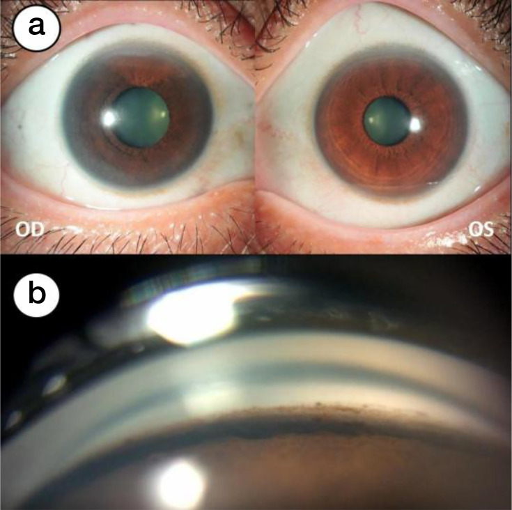
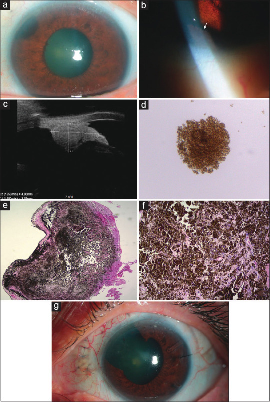
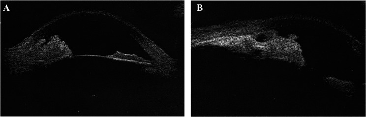
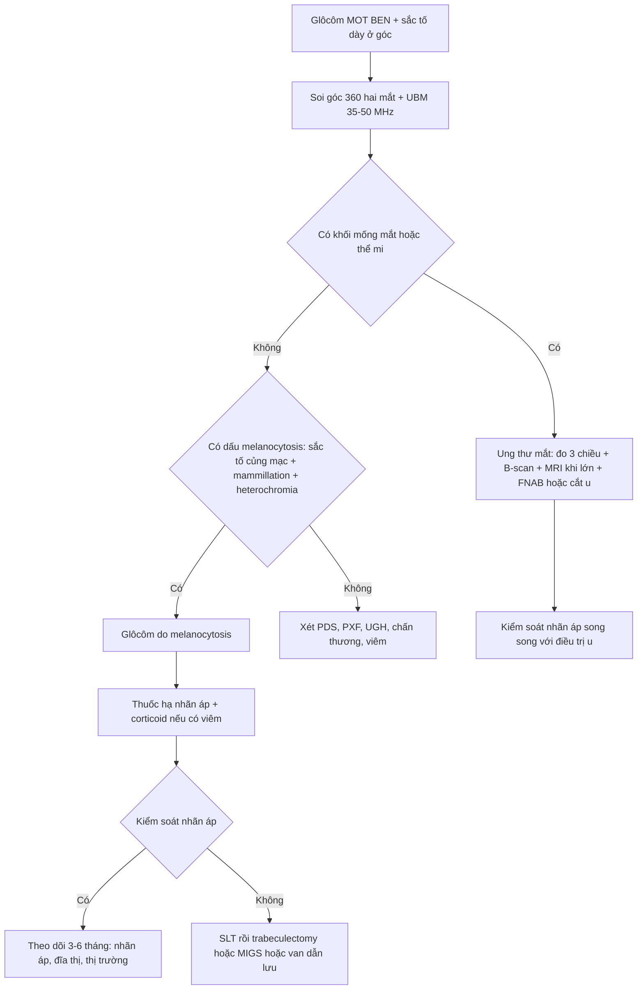

# 3245 — Glôcôm trên nền melanocytosis mắt (melanomalytic glaucoma): "một mắt – góc đầy sắc tố – nhãn áp không theo mức sắc tố" / Melanomalytic glaucoma in ocular melanocytosis

**Tags:** `pattern:sac-to-goc-tien-phong` `pattern:goc-mo-mot-ben` `pattern:glaucoma-mot-ben` `pattern:khong-co-khoi` `vung:mat` `vung:goc-tien-phong` `vung:mong-mat` `vung:the-mi` `protocol:soi-goc` `protocol:UBM-35-50MHz` `protocol:AS-OCT` `protocol:sieu-am-B-scan` `protocol:EDI-OCT` `incidentaloma:khong`

**Mức chắc chắn (certainty):** tổng hợp y văn (literature synthesis) — dựng từ **đoàn hệ 194 bệnh nhân melanocytosis mắt–da** (*Ophthalmology* 1990, **PMID 2342801**), **đoàn hệ 163 bệnh nhân Nevus of Ota có soi góc** (*BMJ Open Ophthalmol* 2025, **PMC12083371**), **tổng quan hình ảnh melanocytosis 2023** (**PMC9837000**), các **ca melanomalytic glaucoma có ảnh** (**PMC11981570**, **PMC12082992**) và các mô tả **mô bệnh học kinh điển** (**PMID 5492453**, **PMID 623184**, **PMID 3801367**). Nhóm **không có bệnh nhân của mình**; chỗ chưa đủ chắc ghi **"chưa rõ"**. **Không ghi tên tác giả** — attribution dùng **tạp chí + năm + PMCID/PMID**, đối chiếu Europe PMC ngày **2026-11-20**.

> **Vị trí trong thư viện:** [3235](../3235-melanocytosis-mat-hac-mac-nevus-of-ota/lesson.md) phủ **melanocytosis hắc mạc – nguy cơ melanoma**; [3231](../3231-u-mong-mat-melanoma-nevus-nang/lesson.md) phủ **tổn thương sắc tố mống mắt**; [3237](../3237-pxf-goc-dong-lpi-hay-lay-the-thuy-tinh/lesson.md) phủ **góc đóng trên nền PXF**; [3238](../3238-ugh-sau-icl-phakic-iol/lesson.md) phủ **sắc tố + máu tiền phòng sau ICL**. Bài này trả lời **một câu duy nhất**: *khi một mắt có nhãn áp cao và góc tiền phòng đầy sắc tố, làm sao phân biệt "sắc tố lành" của melanocytosis với một khối u đang rỉ sắc tố vào góc — và khi nào được phép đặt stent/giảm áp mà không cắt u trước?*
>
> **Câu chốt:** **(1)** Glôcôm xuất hiện ở **10,3%** bệnh nhân melanocytosis mắt–da (20/194, cộng dồn trong theo dõi — **PMID 2342801**) và ở **~10%** trong các tổng quan (**PMC9837000**); **(2)** cơ chế chính là **melanomalytic**: đại thực bào nuốt melanin rồi **bít lưới bè**, làm **giảm mạnh khả năng thoát dịch** — đo được trên mắt cắt rời (**PMID 623184**), không phải "sắc tố nhuộm góc" đơn thuần; **(3)** mức sắc tố ở góc **KHÔNG tương quan với nhãn áp** (PMID 2342801) — nên "góc rất đen mà nhãn áp bình thường" và "góc hơi sắc tố mà nhãn áp 54 mmHg" đều có; **(4)** bẫy chết người là **ring melanoma mống mắt**: sắc tố 360°, **UBM không thấy khối**, đã điều trị "glôcôm" trung bình **30 tháng** trước khi chẩn đoán (**PMC7983622**) — nên **mọi glôcôm một bên có sắc tố góc phải được coi là u cho tới khi loại trừ**.

## 1. Tổng quan bệnh học – cơ chế hình ảnh (TẠI SAO)

### 1.1 Hai bệnh cảnh dưới một cái tên

- **Melanocytosis mắt (ocular melanocytosis)** là **u mô thừa tế bào hắc tố bẩm sinh** ở mống mắt, thể mi, hắc mạc và củng mạc/củng mạc ngoài; khi kèm mảng sắc tố da vùng V1–V2 cùng bên thì gọi là **melanocytosis mắt–da (oculodermal melanocytosis – ODM, Nevus of Ota)** ([3235](../3235-melanocytosis-mat-hac-mac-nevus-of-ota/lesson.md)). Sắc tố **một bên** ở **87%** ca (**213 ca**, PMC11834911).
- **Melanomalytic glaucoma** là **glôcôm góc mở thứ phát** do **melanin + đại thực bào** bít lưới bè. Tên do **mô tả lần đầu năm 1970** ở một mắt có u hắc mạc hoại tử (**PMID 5492453**), sau đó được xác nhận bằng **đo khả năng thoát dịch** và **kính hiển vi điện tử** (**PMID 623184**, **PMID 3801367**).
- Vì vậy "glôcôm do melanocytosis" **không phải một bệnh** mà là **một cơ chế**, có 4 đường vào: (a) **melanomalytic** — sắc tố + đại thực bào; (b) **tắc nghẽn do khối** — u mống mắt/thể mi xâm lấn góc; (c) **góc đóng** — thể mi to ra do sắc tố, hoặc thuốc gây tràn dịch thể mi–hắc mạc; (d) **viêm** — 5/194 bệnh nhân có **tăng nhãn áp cấp kèm viêm màng bồ đào trước** (PMID 2342801).

### 1.2 Vì sao melanin làm tắc dòng chảy — cơ chế "melanomalytic"

- **Bình thường**, thủy dịch thoát qua **lưới bè** (khe giữa các bè xơ – tế bào nội mô bè) rồi vào **ống Schlemm**. Bè là **bộ lọc cỡ tế bào**: hạt tự do nhỏ đi qua được, **tế bào thì không**.
- **Melanin** (melanosome) bị **đại thực bào** nuốt. Đại thực bào no melanin (**melanomacrophage**) to ra, **bám vào mặt bè và nằm trong khoang gian bè**; một phần **tế bào nội mô bè** cũng tự thực bào melanin rồi bong ra (**PMID 623184**). Kết quả là **tắc cơ học** — tác giả gọi thẳng là "quá trình cơ học đơn thuần" (**PMID 3801367**).
- **Hệ quả định lượng:** trên mắt melanomalytic, **khả năng thoát dịch (facility of outflow) giảm rõ rệt cả in vivo và in vitro** (**PMID 623184**). Đây là lý do **nhãn áp tăng không tương xứng với "vẻ ngoài" của góc**, và vì sao **thuốc hạ nhãn áp thường chỉ kiểm soát được một phần**.
- **Nguồn melanin** có thể từ: (a) **mống mắt melanocytosis** rỉ sắc tố mạn tính; (b) **u hoại tử** — melanoma thể mi/xơ nhiều tế bào hoại tử + **phản ứng đại thực bào ồ ạt** (**PMID 3801367**); (c) **sau xạ** — mảng xạ (plaque brachytherapy) làm u hoại tử, giải phóng melanin (**PMID 26592671**); (d) **melanocytoma hoại tử** rỉ sắc tố từng đợt (**PMC11981570**).
- **Chi tiết nguy hiểm:** trong u thể mi, **tế bào u còn được tìm thấy trên mặt mống mắt và trong lưới bè, cách xa u nguyên phát** (**PMID 3801367**). Nghĩa là "chỉ có sắc tố, không thấy khối ở góc" **không** đồng nghĩa "không có tế bào u ở góc" — đây là cơ sở mô học cho quy tắc phải loại trừ u trước khi can thiệp góc.

### 1.3 Vì sao MỘT BÊN — và vì sao so sánh hai mắt là bước rẻ nhất

- Melanocytosis là **bất thường bẩm sinh một bên** (87% — PMC11834911) → sắc tố góc, sắc tố củng mạc, **heterochromia** và **mammillation mống mắt** đều **một bên**. Tổng quan 2023 nêu rõ: glôcôm do **iris melanocytosis thường MỘT bên**, còn glôcôm sắc tố do **hội chứng phân tán sắc tố (PDS) thường HAI bên** (**PMC9837000**).
- **Vì sao đáy mắt và góc bên bệnh tối hơn:** melanin hấp thụ ánh sáng **mọi bước sóng** → vùng có nhiều melanin phản xạ ít hơn, soi góc thấy **dải bè sẫm màu**; đây là **màu của sắc tố**, không phải "phù" hay "viêm".
- **Bất đối xứng là chốt lâm sàng:** cùng một máy, cùng cường độ đèn, **soi góc hai mắt cạnh nhau**; chênh lệch **mức sắc tố 1 bậc** đã có ý nghĩa. Ở PDS, hai mắt thường **cùng mức**; ở melanocytosis, **mắt bên bệnh luôn đậm hơn**.

### 1.4 Vì sao mức sắc tố KHÔNG dự đoán nhãn áp — bài học từ 194 bệnh nhân

- Trong 194 bệnh nhân ODM: **tăng nhãn áp ở mắt cùng bên 15 ca lúc khám đầu + 5 ca trong theo dõi = 10,3%**; chia ra **3 glôcôm bẩm sinh/muộn**, **14 tăng nhãn áp hoặc glôcôm góc mở**, **3 glôcôm góc đóng cấp** (**PMID 2342801**).
- **Sắc tố góc lan rộng ở TẤT CẢ** bệnh nhân (trừ nhóm góc đóng cấp), **nhưng không có tương quan nhất quán giữa mức độ/lan rộng của sắc tố và việc tăng nhãn áp** (**PMID 2342801**). Nói cách khác: **góc đen ≠ glôcôm**, và **góc chỉ hơi sắc tố vẫn có thể glôcôm nặng**.
- **19 bệnh nhân khác** có **C/D lớn hơn ở mắt bên bệnh** dù nhãn áp bình thường — gợi ý **giảm tế bào hạch/tổn thương đĩa thị bẩm sinh** đi kèm, nên **phải chụp OCT RNFL và đo thị trường** chứ không chỉ đo nhãn áp (**PMID 2342801**).
- **Vì sao tỉ lệ khác nhau giữa các nghiên cứu:** đoàn hệ Thái Lan 1990 là **bệnh nhân chuyên khoa mắt, theo dõi nhiều năm, cộng dồn** → **10,3%**; đoàn hệ Nevus of Ota Thái Lan 2025 khám **163 người, tuổi trung bình 15,0 ± 15,6**, chỉ **2 mắt (1,1%)** glôcôm góc mở, **6 mắt (3,3%)** tăng nhãn áp, **16 mắt (8,7%)** nghi glôcôm (**PMC12083371**). Hai số **không mâu thuẫn**: một bên là **tỉ lệ suốt đời ở người được theo dõi**, một bên là **tỉ lệ tại một thời điểm ở quần thể trẻ**.

### 1.5 Bảng số phải nhớ

| Chỉ số | Giá trị | Nguồn |
|---|---|---|
| Tăng nhãn áp/glôcôm ở ODM (194 bệnh nhân, cộng dồn) | **10,3%** (20 ca): 3 bẩm sinh, 14 OHT/góc mở, 3 góc đóng cấp | PMID 2342801 |
| Tương quan mức sắc tố góc ↔ nhãn áp | **KHÔNG nhất quán** | PMID 2342801 |
| Tăng nhãn áp cấp + viêm màng bồ đào trước (góc mở) | **5/194** | PMID 2342801 |
| C/D lớn hơn ở mắt bệnh dù nhãn áp bình thường | **19 ca** | PMID 2342801 |
| Nevus of Ota 2025 (163 người/184 mắt, tuổi TB 15,0) | glôcôm góc mở **1,1%**; OHT **3,3%**; nghi glôcôm **8,7%** | PMC12083371 |
| Melanocytosis mắt: một bên | **87%** (213 ca) | PMC11834911 |
| Nguy cơ melanoma hắc mạc suốt đời ở ODM | **1/400** (2,6 × 10⁻³); **90%** chẩn đoán ở **31–80 tuổi** | PMID 9442799 |
| Melanomalytic glaucoma (ca có ảnh) | nhãn áp **54 mmHg** dù thuốc; tổn thương **5 × 3 × 2 mm** trên UBM | PMC11981570 |
| Iris melanoma (29 mắt) | đường kính lớn nhất TB **6,1 mm** (1,8–11,0); **34%** ở chân mống mắt; **17%** có glôcôm thứ phát | PMC8725464 |
| Ring melanoma mống mắt | chậm chẩn đoán TB **30 tháng** (24 ca); **> 50%** đã được điều trị "glôcôm" trước đó | PMC7983622 |
| UBM | **36–100 MHz**, phân giải trục tới **20 µm**, bên tới **50 µm**, xuyên **4–5 mm**; B-scan thường **8–12 MHz** | PMC9318338 |

## 2. Mẫu hình + chẩn đoán phân biệt theo vị trí (gamut)

**Mẫu hình trung tâm:** *một mắt* có **nhãn áp cao (thường > 21 mmHg, có ca 40–54 mmHg)** + **soi góc thấy sắc tố dày ở dải bè**, góc **MỞ** (không dính), **không có khối rõ** hoặc **có khối nhỏ ở chân mống mắt/thể mi**.

**Gamut theo vị trí và cơ chế:**

| Vị trí chính | Nhóm nguyên nhân | Điểm phân biệt then chốt |
|---|---|---|
| **Mống mắt + góc** | Melanocytosis mống mắt (melanomalytic) · PDS/glôcôm sắc tố · melanoma mống mắt/ring melanoma · melanocytoma mống mắt hoại tử | một bên + sắc tố củng mạc/mammillation = melanocytosis; **khối/thickening** = u |
| **Thể mi** | U thể mi (melanoma, melanocytoma) · nang thể mi · thể mi to do melanocytosis | **UBM 35–50 MHz** là xương sống; nang **trống âm**, u **đặc** |
| **Tiền phòng** | Viêm màng bồ đào trước + tăng nhãn áp · UGH (mống mắt cọ IOL) · máu tiền phòng cũ (hemosiderin) | tế bào viêm + dính đồng tử; tiền sử IOL/chấn thương |
| **Góc đóng** | Góc đóng cấp do melanocytosis thể mi to · góc đóng do thuốc (topiramate) · góc đóng nguyên phát | **hai bên + cận thị cấp + tràn dịch hắc mạc** = do thuốc |
| **Hậu đoạn** | Melanoma hắc mạc hoại tử rỉ sắc tố vào dịch kính rồi ra tiền phòng | **sắc tố trong dịch kính** + không thấy u trước = phải siêu âm hậu đoạn |

- **Ảnh minh hoạ mẫu hình:** sắc tố mống mắt + soi góc dày sắc tố (`images/3245_glaucoma-melanocytosis_SlitLamp-Gonio_PMC12083371.jpg`); u mống mắt rỉ sắc tố + UBM (`images/3245_glaucoma-melanocytosis_SlitLamp-UBM-Cytology_PMC11981570.jpg`); UBM khối thể mi chèn góc (`images/3245_glaucoma-melanocytosis_UBM_PMC12082992.jpg`).

## 3. Bảng so sánh phân biệt (ma trận đối chiếu)

| Thực thể (entity) | Hình ảnh điển hình (soi góc / UBM / AS-OCT / siêu âm) | Chốt vào (rule-in) | Chốt loại (rule-out) | Gợi ý xác nhận |
|---|---|---|---|---|
| **Glôcôm melanomalytic trên melanocytosis** | Sắc tố dày **dải bè** một bên, **Sampaolesi line**, góc mở, **không khối**; sắc tố củng mạc + mammillation mống mắt cùng bên | **Một bên + sắc tố củng mạc/mammillation + heterochromia**; nhãn áp cao **không tương xứng** với mức sắc tố | **Bilateral + khuyết xuyên sáng mống mắt giữa ngoại vi + tuổi trẻ cận thị** → PDS, không phải melanocytosis | Soi góc hai mắt cạnh nhau; UBM 35–50 MHz loại khối; theo dõi nhãn áp nhiều lần |
| **PDS / glôcôm sắc tố** | Sắc tố góc **360°**, **Krukenberg spindle** trên nội mô giác mạc, **khuyết xuyên sáng** mống mắt giữa ngoại vi, góc mở sâu | **HAI bên**, khuyết xuyên sáng điển hình, **myope trẻ** | **Sắc tố củng mạc + mammillation + một bên** → melanocytosis | Soi góc + đèn khe hai mắt; tiền sử gia đình |
| **Melanoma mống mắt / ring melanoma** | Sắc tố **360°** lan **trên mặt mống mắt và cả chân**, mống mắt **dày không đều**; UBM có thể **chỉ thấy dày, không có khối khu trú** | **Sắc tố góc dày toàn chu vi + mống mắt dày/ectropion uveae + nhãn áp khó kiểm soát kéo dài** | **UBM bình thường KHÔNG loại trừ ring melanoma**; chỉ mô bệnh mới loại trừ | UBM + AS-OCT toàn chu vi; chụp ảnh màu; **FNAB/cắt u khi nghi**; theo dõi bằng ảnh chuẩn hoá |
| **Melanocytoma mống mắt/thể mi** | Khối **sẫm màu rất đậm**, bờ rõ, **5 × 3 × 2 mm** trong ca có ảnh; rỉ sắc tố từng đợt; có thể hoại tử | **Khối đặc + rỉ sắc tố + nhãn áp tăng từng đợt** | **Không có khối trên UBM** → không phải melanocytoma thể tích lớn | UBM đo 3 chiều; tế bào học dịch tiền phòng/FNAB; cắt u nếu tiếp tục rỉ sắc tố |
| **Melanoma thể mi xâm lấn góc** | Khối thể mi **đặc**, phá vỡ cấu trúc thể mi, đẩy rễ mống mắt; góc có thể **dính (PAS)** | **Khối thể mi trên UBM + góc dính một vùng + nhãn áp cao** | Chỉ sắc tố, **không khối**, thể mi bình thường → không phải u thể mi | UBM 35–50 MHz + B-scan + MRI hốc mắt khi u lớn |
| **UGH / sắc tố sau IOL (mống mắt cọ IOL)** | Sắc tố + **máu tiền phòng** tái diễn, IOL **trong rãnh/lệch**, UBM thấy **tiếp xúc mống mắt–IOL** | **Tiền sử IOL + hyphema tái diễn + tiếp xúc trên UBM** | Không có IOL/vật liệu nội nhãn → loại | UBM; xem [3238](../3238-ugh-sau-icl-phakic-iol/lesson.md), [3225](../3225-hoi-chung-ugh-sau-dat-dai-ong-silicon/lesson.md) |
| **PXF một bên** | Sắc tố + **chất bẩn (dandruff) trên bao trước thể thủy tinh và bờ đồng tử**, **góc hẹp/đóng**, đồng tử giãn kém | **Chất bẩn bao trước + bờ đồng tử** khi giãn | Sắc tố lan tỏa **không có chất bẩn** → không phải PXF | Soi sau giãn; xem [3237](../3237-pxf-goc-dong-lpi-hay-lay-the-thuy-tinh/lesson.md) |
| **Viêm màng bồ đào trước + tăng nhãn áp** | Tế bào + flare tiền phòng, **dính đồng tử**, KPs; nhãn áp tăng **cấp** | **Tế bào viêm + KPs + đau/đỏ** | Không tế bào, không KPs → loại | Đèn khe; đáp ứng với corticoid |
| **Sắc tố sau chấn thương / hemosiderin** | Sắc tố góc một vùng, có thể **Vossius ring**, tiền sử đụng dập; góc có thể **rẽ** | **Tiền sử chấn thương + sắc tố khu trú/vòng** | Lan tỏa 360° một bên + mammillation → melanocytosis | Soi góc + UBM; xem [1962](../1962-rach-the-mi-goc-re/lesson.md) |

**Ảnh minh hoạ ma trận:**

## 4. Protocol chụp + hệ phân độ/điểm chuẩn hóa

### 4.1 Bộ ba khám bắt buộc

1. **Soi góc (gonioscopy) có ấn** — hai mắt, ghi: **mức sắc tố bè 0–4**, **Sampaolesi line** (sắc tố trước đường Schwalbe), **dính góc (PAS)**, **khối ở chân mống mắt**, **góc mở/đóng**. Đây là bước **quyết định** và phải ghi **bằng ảnh** để so sánh giữa các lần.
2. **UBM 35–50 MHz** — đo **độ dày mống mắt**, **thể mi**, và nếu có khối thì **đo 3 chiều**. UBM **36–100 MHz, phân giải trục tới 20 µm, bên tới 50 µm, xuyên 4–5 mm** — sâu hơn AS-OCT nên **thấy được thể mi sau mống mắt** (**PMC9318338**). Đây là lý do **UBM phải làm TRƯỚC khi đặt stent góc**.
3. **AS-OCT đoạn trước** — định lượng góc: **góc mở (AOD), diện tích góc (TISA)**, độ dày mống mắt; bước sóng **830–870 nm hoặc 1310 nm**, phân giải cao nhưng **xuyên kém** hơn UBM (**PMC9318338**).

### 4.2 Bổ sung theo bệnh cảnh

- **Hậu đoạn:** **B-scan 8–12 MHz** khi không thấy đáy mắt (sắc tố dịch kính, đục thể thủy tinh); **EDI-OCT** đo độ dày hắc mạc và so hai mắt nếu nghi melanocytosis hắc mạc ([3235](../3235-melanocytosis-mat-hac-mac-nevus-of-ota/lesson.md)).
- **Đĩa thị:** **OCT RNFL** + **thị trường** — vì **C/D lớn hơn** có thể có sẵn ở mắt melanocytosis dù nhãn áp bình thường (**PMID 2342801**), nên chỉ nhãn áp là không đủ.
- **MRI hốc mắt** (T1 fat-sat + tiêm tương phản) khi u thể mi **lớn/xâm lấn ra ngoài củng mạc** hoặc cần phân biệt melanoma – melanocytoma; **ngưỡng kích thước chính xác để chuyển MRI: chưa rõ** (khác nhau giữa trung tâm).
- **Đo nhãn áp nhiều thời điểm** (đường cong ngày) vì trong melanocytosis có ca **tăng nhãn áp cấp kèm viêm** (5/194) và ca **tăng theo đợt** khi u rỉ sắc tố (**PMC11981570**).

### 4.3 Phân độ/điểm chuẩn hoá

- **Không có RADS hay thang điểm riêng cho glôcôm melanocytosis**; **không có thang điểm nào được xác nhận để dự đoán nhãn áp từ mức sắc tố góc** — đây là **khoảng trống** (mục 7).
- Dùng khung chung: **glôcôm = tổn thương đĩa thị/thị trường đi kèm nhãn áp**; **tăng nhãn áp (OHT) = nhãn áp > 21 mmHg, đĩa thị bình thường**. Mục tiêu hạ nhãn áp **20–30%** so với ban đầu là quy ước thực hành, **không có ngưỡng riêng cho melanocytosis**.
- Nếu có u: phân giai đoạn theo **AJCC 8th** cho u hắc mạc (mống mắt/thể mi), nhưng **ngưỡng kích thước trong bài này không nêu** vì chưa đối chiếu toàn văn bảng AJCC.

### 4.4 Đường đi quyết định

> **Lưu ý Mermaid:** sơ đồ chỉ là khung tư duy; **quyết định cuối thuộc bác sĩ điều trị**.

## 5. Biến thể bình thường và cạm bẫy

### 5.1 Biến thể bình thường dễ gọi nhầm

- **Mammillation mống mắt** (các gờ nhỏ như "vú") và **heterochromia** ở melanocytosis là **bẩm sinh, lành tính**; **không** phải u. Chúng chỉ có ý nghĩa **định vị mắt bệnh** để so sánh.
- **Sắc tố góc lan tỏa nhưng nhãn áp bình thường** là **biến thể thường gặp** (sắc tố góc lan rộng ở gần như tất cả bệnh nhân ODM — **PMID 2342801**). **Không** đặt stent/không mổ chỉ vì "góc đen".
- **Sampaolesi line** có thể thấy ở người **lành mạnh lớn tuổi** hoặc **PDS**; một mình nó **không** chẩn đoán melanocytosis.

### 5.2 Cạm bẫy chết người

1. **"Mật độ sắc tố = mức glôcôm"** — SAI. 194 bệnh nhân cho thấy **không tương quan** (**PMID 2342801**). Hệ quả: bỏ theo dõi người "góc hơi sắc tố", và mổ oan người "góc rất đen nhưng nhãn áp tốt".
2. **Ring melanoma không có khối trên UBM** — ca 85 tuổi được điều trị "glôcôm tân mạch" **2 năm** trước khi cắt nhãn cầu; UBM chỉ thấy **mống mắt dày không đều, không có khối khu trú**; mô bệnh là **ring melanoma** thể hỗn hợp, **GEP class 2** (**PMC7983622**). Tổng quan 24 ca: **chậm chẩn đoán trung bình 30 tháng**, **> 50%** đã được điều trị glôcôm trước đó.
3. **Giãn đồng tử làm bùng sắc tố** — mydriasis có thể gây **phân tán sắc tố vào thủy dịch** và **mất bù glôcôm góc mở mạn** (**PMID 7236569**). Ở mắt melanocytosis, **giãn đồng tử để khám đáy mắt phải kèm đo nhãn áp sau đó**.
4. **Tăng nhãn áp sau mảng xạ không phải "tái phát"** — melanomalytic glaucoma được mô tả **sau brachytherapy** do u hoại tử xạ (**PMID 26592671**). Đừng vội xạ lại/mổ lại; hãy tìm **melanin + đại thực bào** và điều trị nhãn áp.
5. **Sắc tố trong dịch kính + tiền phòng mà không thấy u trước** — ca melanoma hắc mạc **hoại tử** rỉ sắc tố toàn nhãn cầu; **2 lần cắt dịch kính chẩn đoán** trước đó **không tìm ra u** (**PMID 3050685**). Vì vậy: **luôn siêu âm hậu đoạn** ở "glôcôm một mắt + sắc tố dịch kính".
6. **Tế bào u có thể nằm trong lưới bè xa u nguyên phát** (**PMID 3801367**) → đặt stent/MIGS khi chưa loại trừ u là **gieo tế bào vào đường thoát** (suy luận cơ học, không có thử nghiệm).
7. **Góc đóng cấp trong melanocytosis** vẫn xảy ra (**3/194**) — thể mi to do sắc tố/thuốc gây tràn dịch thể mi–hắc mạc; **LPI không giải quyết** thể do thuốc.
8. **Nhãn áp kiểm soát sau cắt u ≠ hết bệnh**: sau iridocyclectomy, ca có ảnh vẫn cần **thuốc hạ nhãn áp tối đa** và **van dẫn lưu** vì tổn thương bè đã hình thành (**PMC11981570**).

## 6. Tự lượng giá — Blind Quiz (bấm mở đáp án)

**Ca 1 — nam 44 tuổi, nhìn mờ mắt phải 3 tháng, nhãn áp 52 mmHg**

- Gợi ý lâm sàng: mắt phải có **mảng sắc tố xanh xám quanh mắt** từ nhỏ; mắt trái bình thường; không đau, không đỏ.
- Câu hỏi: (1) Mô tả 2 dấu hiệu chính trên ảnh. (2) Nêu 3 chẩn đoán phân biệt cho "góc đầy sắc tố một bên". (3) Dấu hiệu nào **chốt** nguyên nhân nền?

<b>Bấm để hiện đáp án (findings + chẩn đoán)</b>

- **Dấu hiệu:** (a) mống mắt **sẫm màu hơn** với **mammillation** và mất cấu trúc hốc mống mắt; (b) soi góc: **sắc tố dày ở dải bè**, góc **mở**, không khối, có **Sampaolesi line**.
- **Chẩn đoán:** **melanocytosis mắt (Nevus of Ota)** với **glôcôm melanomalytic** — melanin + đại thực bào bít lưới bè, giảm khả năng thoát dịch (PMID 623184; PMID 2342801).
- **Chốt:** sắc tố **củng mạc/mammillation cùng bên** + **một bên** + **không khối trên UBM**; phân biệt PDS (hai bên, khuyết xuyên sáng) và ring melanoma (mống mắt dày toàn chu vi, cần loại trừ dù UBM "không khối").
- **Nguồn ảnh:** *BMJ Open Ophthalmol* 2025, PMCID **PMC12083371**, CC BY-NC 4.0.

**Ca 2 — nữ 54 tuổi, mắt trái đau, nhãn áp 54 mmHg dù 3 thuốc**

- Gợi ý lâm sàng: tổn thương sẫm màu nhỏ ở mống mắt góc trên–mũi, **rỉ sắc tố lấm tấm** ra mặt trước mống mắt; thị lực 20/100; giác mạc phù nhẹ.
- Câu hỏi: (1) Tổn thương nằm ở đâu và kích thước? (2) Vì sao nhãn áp tăng **từng đợt**? (3) Xử trí: thuốc, cắt u hay đặt van?

<b>Bấm để hiện đáp án (findings + chẩn đoán)</b>

- **Dấu hiệu:** khối sẫm màu **mống mắt–thể mi**, **5 × 3 × 2 mm** trên UBM, **rỉ sắc tố** ra mặt trước mống mắt và **dày sắc tố toàn chu vi dải bè** với góc mở.
- **Chẩn đoán:** **melanocytoma mống mắt hoại tử** gây **melanomalytic glaucoma** — tế bào học: tế bào đa giác chứa đầy hạt sắc tố che nhân.
- **Xử trí:** thuốc hạ nhãn áp tối đa + **cắt u (iridocyclectomy)**; sau mổ **nhãn áp 13 mmHg vẫn cần thuốc tối đa**, cuối cùng **van dẫn lưu** — vì tổn thương bè do melanin đã cố định.
- **Nguồn ảnh:** *Taiwan J Ophthalmol* 2025, PMCID **PMC11981570**, CC BY-NC-SA 4.0.

**Ca 3 — nữ 44 tuổi, nhãn áp không kiểm soát, "chỉ thấy sắc tố ở góc"**

- Gợi ý lâm sàng: mắt trái có **tổn thương sẫm màu ở rễ mống mắt**, soi góc thấy **góc bị chèn**, nhãn áp cao; FNAB lần đầu **không kết luận**.
- Câu hỏi: (1) UBM cho thấy gì? (2) Vì sao FNAB có thể âm? (3) Bước tiếp theo?

<b>Bấm để hiện đáp án (findings + chẩn đoán)</b>

- **Dấu hiệu:** UBM: **khối không phẳng, bờ không đều ở mống mắt, chèn vào góc tiền phòng**; **thể mi kế cận dày và tăng phản xạ** → u **xâm lấn thể mi**.
- **Chẩn đoán:** **melanocytoma mống mắt–thể mi** (mô bệnh xác nhận) gây glôcôm thứ phát; FNAB âm vì tế bào **chứa đầy sắc tố che nhân** và mẫu ít.
- **Bước tiếp theo:** **cắt u tại chỗ (iridocyclectomy) ± phaco** thay vì chỉ điều trị nhãn áp; nhãn áp về bình thường trong **8 tháng**, không tái phát ở **2 năm**.
- **Nguồn ảnh:** *Diagn Pathol* 2025, PMCID **PMC12082992**, CC BY-NC-ND 4.0 (nguyên bản, không phái sinh).

## 7. Câu hỏi nghiên cứu & điểm chưa đồng thuận (tính đến 11/2026)

1. **[Tranh cãi] Ở bệnh nhân glôcôm do melanocytosis mắt, SLT có phải là điều trị đầu tay thay cho thuốc hạ nhãn áp không?**
   - **Đã biết:** tổng quan 2023 dẫn một loạt **13 mắt** ODM được SLT bằng Nd:YAG Q-switched, ghi nhận **hiệu quả và an toàn** (PMC9837000); nhưng đây là loạt nhỏ, không có nhóm chứng.
   - **Chưa rõ:** tỉ lệ thành công **1 năm/2 năm**, số mũi cần lặp, và nguy cơ viêm/bùng sắc tố ở góc **rất đậm** (melanin hấp thụ mạnh bước sóng 532 nm).
   - **Hướng nghiên cứu:** RCT hoặc đoàn hệ tiến cứu SLT vs thuốc, phân tầng theo mức sắc tố góc.
   - **Nguồn:** PMC9837000; PMID 12362088.

2. **[Khoảng trống] Có thang điểm nào dự đoán nhãn áp từ mức sắc tố góc ở melanocytosis không?**
   - **Đã biết:** 194 bệnh nhân cho thấy **không tương quan** giữa mức/lan rộng sắc tố và tăng nhãn áp (PMID 2342801); đoàn hệ 2025 chỉ có **1,1%** glôcôm góc mở ở tuổi trung bình 15 (PMC12083371).
   - **Chưa rõ:** yếu tố nào **thực sự** dự báo glôcôm (độ dày thể mi? mật độ đại thực bào? gen GNAQ/GNA11?), và **tần suất theo dõi tối ưu** theo tuổi.
   - **Hướng nghiên cứu:** đoàn hệ tiến cứu có **UBM/AS-OCT định lượng** + nhãn áp đường cong, phân tích sống còn.
   - **Nguồn:** PMID 2342801; PMC12083371.

3. **[Khác biệt thực hành] Sau khi cắt u mống mắt–thể mi, khi nào đặt van/MIGS thay vì tiếp tục thuốc?**
   - **Đã biết:** một ca vẫn cần **thuốc tối đa** và **van dẫn lưu** dù u đã cắt (PMC11981570); ca khác kiểm soát được nhãn áp sau **iridocyclectomy + phaco** và không tái phát 2 năm (PMC12082992).
   - **Chưa rõ:** **ngưỡng nhãn áp/thời gian** để chuyển phẫu thuật glôcôm, và liệu **đặt stent góc** ở mắt đã có tế bào u trong lưới bè có làm tăng gieo tế bào.
   - **Hướng nghiên cứu:** registry đa trung tâm về phẫu thuật glôcôm sau cắt u hắc mạc, có phân tích tái phát/di căn.
   - **Nguồn:** PMC11981570; PMC12082992.

## Bài liên quan chéo

- [3235 – Melanocytosis mắt – hắc mạc & Nevus of Ota: nền sắc tố che melanoma](../3235-melanocytosis-mat-hac-mac-nevus-of-ota/lesson.md)
- [3231 – U mống mắt (melanoma, nevus, nang)](../3231-u-mong-mat-melanoma-nevus-nang/lesson.md)
- [3237 – PXF + góc đóng: LPI hay lấy thể thủy tinh](../3237-pxf-goc-dong-lpi-hay-lay-the-thuy-tinh/lesson.md)
- [3238 – UGH sau ICL (sắc tố + máu tiền phòng)](../3238-ugh-sau-icl-phakic-iol/lesson.md)
- [1962 – Rách thể mi chấn thương & góc rẽ](../1962-rach-the-mi-goc-re/lesson.md)
- [448 – U hắc mạc](../448-u-hac-mac/lesson.md)

## Ảnh

- `images/3245_glaucoma-melanocytosis_SlitLamp-Gonio_PMC12083371.jpg` — *BMJ Open Ophthalmol* 2025, **PMC12083371**, CC BY-NC 4.0.
- `images/3245_glaucoma-melanocytosis_SlitLamp-UBM-Cytology_PMC11981570.jpg` — *Taiwan J Ophthalmol* 2025, **PMC11981570**, CC BY-NC-SA 4.0.
- `images/3245_glaucoma-melanocytosis_UBM_PMC12082992.jpg` — *Diagn Pathol* 2025, **PMC12082992**, CC BY-NC-ND 4.0 (nguyên bản, không ghép/cắt).
- Chi tiết nguồn, hình gốc, giấy phép và phái sinh: `images/CREDITS.md`.

> Không dùng để chẩn đoán độc lập khi chưa có người hướng dẫn.
