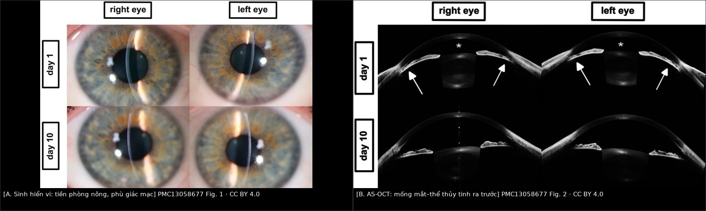
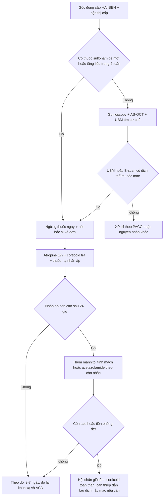
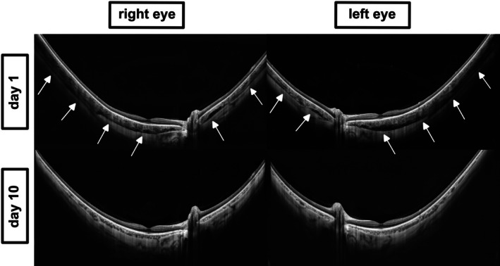
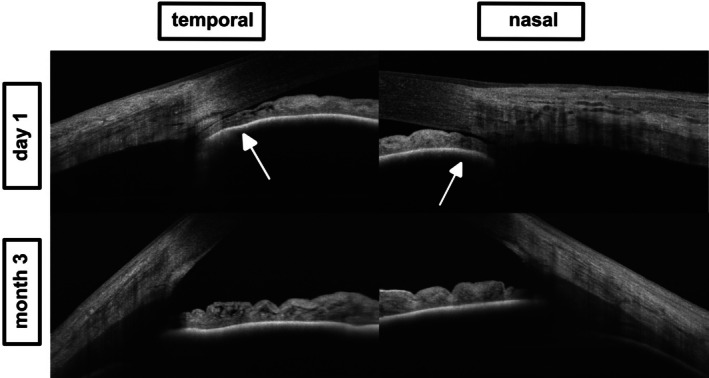
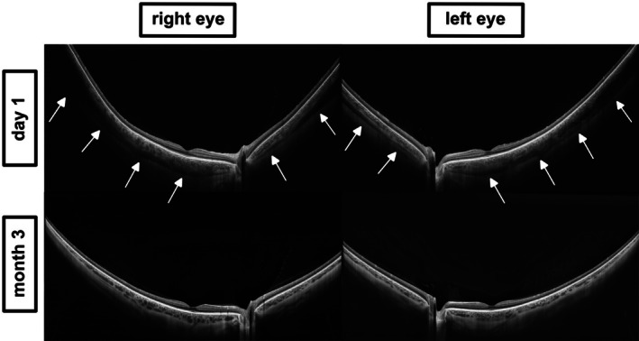

# 3246 — Góc đóng cấp HAI BÊN do thuốc (topiramate/sulfonamide): tràn dịch thể mi–hắc mạc, cận thị cấp, vì sao LPI vô hiệu / Drug-induced bilateral ciliary effusion angle closure

**Tags:** `pattern:goc-dong-hai-ben` `pattern:tien-phong-nong` `pattern:can-thi-cap` `pattern:tran-dich-the-mi-hac-mac` `pattern:khong-pupillary-block` `vung:mat` `vung:goc-tien-phong` `vung:tien-phong` `vung:the-mi` `vung:hac-mac` `protocol:sinh-hien-vi` `protocol:AS-OCT` `protocol:UBM` `protocol:sieu-am-B` `protocol:do-khuc-xa` `score:khong` `incidentaloma:khong`

**Mức chắc chắn (certainty):** tổng hợp y văn (literature synthesis) — dựng từ **tổng quan hệ thống 73 bài / 77 ca** góc đóng do topiramate (*Indian J Ophthalmol* 2022, **PMC9333044**, CC BY-NC-SA 4.0), **tổng quan tự sự 2026** về thuốc hệ thống gây góc đóng cấp (*J Clin Med* 2026, **PMC13467174**, CC BY 4.0), **đoàn hệ 688 người khởi trị topiramate** so với valproate/lamotrigine (*Epilepsia* 2026, **PMC13075613**, CC BY 4.0), **nghiên cứu tiền cứu 40 bệnh nhân / 80 mắt** theo dõi 3 tháng (*BMC Ophthalmol* 2026, **PMC12980903**, CC BY-NC-ND 4.0), **2 ca có ảnh AS-OCT và UWF-OCT** (*Acta Ophthalmol* 2026, **PMC13058677**, CC BY 4.0), **ca acetazolamide liều duy nhất** (*Case Rep Ophthalmol* 2026, **PMC13134845**, CC BY-NC 4.0) và **ca hydrochlorothiazide** (*Einstein (São Paulo)* 2026, **PMC13399298**, CC BY 4.0). Nhóm **không có bệnh nhân của mình**; chỗ chưa đủ chắc ghi **"chưa rõ"**. **Không ghi tên tác giả** — attribution = **tạp chí + năm + PMCID/DOI**.

> **Câu chốt:** Đây **không phải** góc đóng nguyên phát có "thêm thuốc". Ở thể do sulfonamide/topiramate, **tràn dịch thể mi–hắc mạc đẩy toàn bộ màng mống mắt–thể thủy tinh ra trước**: 77 ca trong y văn có **nhãn áp 41,0 ± 15,8 mmHg**, **cận thị −5,37 ± 2,20 D**, **tiền phòng trước 1,65 ± 0,63 mm** và **tràn dịch thể mi–hắc mạc thấy ở 55,8%** (**PMC9333044**). Vì **không có pupillary block**, **LPI không mở được góc** — 8/77 ca vẫn được làm LPI mà không có lợi ích — và **pilocarpine có thể làm nặng thêm**. Chìa khóa là **nhận ra thuốc + ngừng thuốc + cycloplegic + corticoid**, không phải "bắn laser cho xong".

## 1. Tổng quan bệnh học – cơ chế hình ảnh (TẠI SAO)

### 1.1 Cơ chế ba bước: từ ức chế carbonic anhydrase đến góc đóng

- **Bước 1 — thể mi phù và tăng tính thấm.** Topiramate là **dẫn xuất sulfamate của fructose**, ức chế **carbonic anhydrase isoenzyme II và IV**; ức chế này làm **thể mi phù** và tăng tính thấm mao mạch thể mi–hắc mạc, có giả thuyết trung gian **prostaglandin** gây giãn mạch và tăng thoát dịch (**PMC13058677**, **PMC9333044**).
- **Bước 2 — dịch tích trong khoang trên hắc mạc.** Dịch thoát vào **khoang trên hắc mạc (suprachoroidal space)** và khoang dưới hắc mạc; trên **UWF-OCT** đây là **dải giảm tín hiệu hình liềm giữa hắc mạc và củng mạc**, hai bên, thấy rõ ở **ngày 1** và **mất hoàn toàn ở ngày 10** (**PMC13058677**, Hình 3).
- **Bước 3 — thể mi xoay ra trước, màng mống mắt–thể thủy tinh bị đẩy ra trước.** Thể mi xoay quanh **vòng xơ củng mạc** về phía trước, kéo **màng mống mắt–thể thủy tinh** ra trước. Hệ quả trên **AS-OCT**: **tiền phòng nông**, **mống mắt áp sát nội mạc giác mạc ngoại vi**, nhưng **KHÔNG có mống mắt vồng kiểu iris bombe** — mặt sau mống mắt vẫn phẳng, vì không có chênh áp qua đồng tử (**PMC13058677**, Hình 2).
- **Vì sao cận thị cấp:** đưa **thể thủy tinh ra trước** làm giảm khoảng cách vật–thấu kính hiệu dụng của hệ quang học, tăng công suất khúc xạ → **cận thị** (myopic shift). Đây là **dịch chuyển vị trí**, không phải "thể thủy tinh tăng công suất" đơn thuần; thể thủy tinh cũng dày lên nhẹ: **3,81 → 3,85 mm** sau 3 tháng ở 40 bệnh nhân (**PMC12980903**).
- **Vì sao HAI BÊN:** thuốc dùng toàn thân → **hai mắt cùng phản ứng**. Cơ chế **không đòi hỏi góc hẹp có sẵn**, nên **gonioscopy trước điều trị không dự báo được** thể này (**PMC13467174**). Đây là điểm khác cốt lõi với góc đóng nguyên phát, vốn thường **một mắt bùng phát** trên nền góc hẹp hai bên.

### 1.2 Vì sao LPI và pilocarpine vô hiệu — thậm chí có hại

- **LPI chỉ tháo chênh áp qua lỗ đồng tử.** Khi góc đóng vì **khối dịch sau thể mi đẩy ra trước**, lỗ thông **không kéo được màng mống mắt–thể thủy tinh về sau**; **không có pupillary block để tháo**. Trong 77 ca, **8 ca (10,4%) vẫn được làm LPI**, tất cả vì chẩn đoán ban đầu nhầm là góc đóng nguyên phát hoặc vì "thử" — **không ca nào được ghi nhận là LPI giải quyết được bệnh** (**PMC9333044**).
- **LPI thông không bảo vệ khỏi thể tràn dịch.** Một **LPI đang thông** làm giảm nguy cơ góc đóng do pupillary block, nhưng **không ngăn được góc đóng do tràn dịch thể mi–hắc mạc** (**PMC13467174**).
- **Pilocarpine là bẫy kép.** Thuốc co đồng tử gây **co cơ vòng mống mắt**, kéo **mống mắt–thể thủy tinh ra trước thêm**, làm **nông tiền phòng** và **tăng cận thị**; đồng thời khi nhãn áp rất cao (**> 40–50 mmHg**), **cơ vòng mống mắt thiếu máu không đáp ứng** (**PMC13467174**). Vì vậy trong thể tràn dịch, **cycloplegic (atropine) mới là thuốc đúng**: giãn cơ thể mi, căng dây chằng Zinn, **kéo thể thủy tinh về sau**.
- **Ngược lại, cycloplegic + corticoid + ngừng thuốc là bộ ba điều trị.** Trong 77 ca, **tất cả** được ngừng topiramate và dùng thuốc tra; **51,9%** dùng carbonic anhydrase ức chế toàn thân, **36,4%** dùng thuốc tăng áp thẩm thấu, **15,6%** dùng corticoid toàn thân (**PMC9333044**).

### 1.3 Vì sao số ca nặng hơn vẻ ngoài — dịch tễ và nguy cơ

- **Thời điểm:** khởi phát **trung bình 14,1 ± 31,5 ngày** (0–262), **đỉnh ở 2 tuần đầu** sau khởi trị hoặc sau **tăng liều** (**PMC9333044**, **PMC13467174**). Ca muộn **262 ngày** đã được báo cáo, nên **không loại trừ chỉ vì đã dùng thuốc lâu**.
- **Liều không quyết định:** liều ghi nhận **12,5–200 mg/ngày**; phản ứng **idiosyncratic**, **không phụ thuộc liều** và có thể xảy ra **ngay liều đầu** (**PMC9333044**, **PMC13134845**).
- **Ai:** **75,3% là nữ**, tuổi trung bình **34,9 ± 11,2** (7–57); chỉ định hay gặp **đau nửa đầu 59,7%**, **động kinh 10,4%**, **giảm cân 9,1%** (**PMC9333044**).
- **Nguy cơ quần thể:** đoàn hệ 2026 so **688 người khởi trị topiramate** với **4.490 người dùng valproate** và **4.179 người dùng lamotrigine**: **tăng nguy cơ tuyệt đối 1 năm ~2,4%** so với valproate và **~2,0%** so với lamotrigine; **aHR 2,66 (1,12–6,32)** và **3,57 (1,76–7,26)**. Nguy cơ tập trung ở **nữ** (**HR 5,31 / 5,73**) và **người động kinh** (**2,23 / 5,08**), **không có ý nghĩa ở nam hoặc nhóm chỉ đau nửa đầu** (**PMC13075613**). Lưu ý: kết cục của đoàn hệ là **"glaucoma" nói chung** (chẩn đoán/thủ thuật/thuốc), **không riêng góc đóng cấp**.
- **Tín hiệu dược cảnh giác:** trong **1.629 báo cáo góc đóng** trên FAERS, **642 (39,4%)** liên quan **sulfonamide** — nhóm đứng đầu (**PMC13467174**). Con số này phản ánh **mẫu báo cáo**, **không phải tỷ lệ mắc**.

### 1.4 Bảng số phải nhớ

| Chỉ số | Giá trị | Nguồn |
|---|---|---|
| Số ca trong tổng quan hệ thống | **77 ca / 73 bài** (2001–2020) | PMC9333044 |
| Nữ giới | **58/77 = 75,3%** | PMC9333044 |
| Tuổi trung bình | **34,9 ± 11,2** (7–57) | PMC9333044 |
| Thời gian từ khởi trị đến góc đóng | **14,1 ± 31,5 ngày** (0–262); đỉnh **2 tuần** | PMC9333044 |
| Liều topiramate | **12,5–200 mg/ngày**; không phụ thuộc liều | PMC9333044 |
| Nhãn áp lúc vào | **41,0 ± 15,8 mmHg** (mắt phải); **41,0 ± 15,3** (trái) | PMC9333044 |
| Cận thị lúc vào | **−5,37 ± 2,20 D** (phải); **−5,31 ± 2,18** (trái) | PMC9333044 |
| Tiền phòng trước | **1,65 ± 0,63 mm** (phải); **1,64 ± 0,60** (trái) | PMC9333044 |
| Trục nhãn cầu | **22,32 ± 1,15 mm** | PMC9333044 |
| Tràn dịch thể mi–hắc mạc | **43/77 = 55,8%** | PMC9333044 |
| Viêm màng bồ đào kèm | **8/77 = 10,4%** | PMC9333044 |
| LPI được thực hiện | **8/77 = 10,4%** — không lợi ích | PMC9333044 |
| Thời gian hồi phục | **3,9 ± 3,6 ngày** (1–18); **50,6%** trong 3 ngày đầu | PMC9333044 |
| Thuốc tăng áp thẩm thấu | Hồi phục **2,7 ± 2,1** so với **4,4 ± 3,9 ngày** (p = 0,0261) | PMC9333044 |
| Nguy cơ glaucoma 1 năm (topiramate so với valproate) | **aHR 2,66**; tăng tuyệt đối **~2,4%** | PMC13075613 |
| Nguy cơ glaucoma 1 năm (topiramate so với lamotrigine) | **aHR 3,57**; tăng tuyệt đối **~2,0%** | PMC13075613 |
| Nữ dùng topiramate | **HR 5,31** (so valproate); **5,73** (so lamotrigine) | PMC13075613 |
| IOP sau 3 tháng ở 40 bệnh nhân | **13,46 → 18,18 mmHg** (p < 0,001) | PMC12980903 |
| Cận thị sau 3 tháng | **−0,20 → −0,37 D** (p < 0,001) | PMC12980903 |
| Acetazolamide liều duy nhất 250 mg | Góc đóng sau **24 giờ**, IOP **40 mmHg**, hồi phục sau **6 ngày** | PMC13134845 |

## 2. Mẫu hình + chẩn đoán phân biệt theo vị trí (gamut)

### 2.1 Bốn mẫu hình hình ảnh của cùng một bệnh

1. **Sinh hiển vi:** **tiền phòng nông toàn bộ**, **giác mạc phù nhẹ**, **đồng tử giãn vừa**, **không có iris bombe**; sau ngừng thuốc **ngày 10 tiền phòng sâu trở lại** (**PMC13058677**, Hình 1).
2. **AS-OCT đoạn trước:** **mống mắt–thể thủy tinh đẩy ra trước** (mũi tên), **góc đóng chu vi**, **ACD giảm**; đối chiếu **ngày 1 và ngày 10** cho thấy **đảo ngược hoàn toàn** (**PMC13058677**, Hình 2).
3. **UBM 35–50 MHz:** **thể mi xoay ra trước**, **dịch giảm âm ở khoang trên thể mi/hắc mạc**, **góc đóng dạng áp sát (appositional)** — đây là modality chốt cơ chế khi AS-OCT chỉ thấy "góc đóng".
4. **Hậu đoạn:** **tràn dịch trên hắc mạc hai bên** trên **UWF-OCT** hoặc **B-scan**; có thể kèm **nếp gấp võng mạc hướng tâm (retinal folds)** và **bong võng mạc thanh dịch** (2,6% trong tổng quan) (**PMC13058677**, **PMC13399298**, **PMC9333044**).

### 2.2 Gamut "góc đóng cấp HAI BÊN" — nghĩ đến thuốc trước tiên

- **Góc đóng do thuốc gây tràn dịch thể mi–hắc mạc** — **topiramate/zonisamide**, **acetazolamide**, **hydrochlorothiazide/chlorthalidone**, **cotrimoxazole**, **brinzolamide/dorzolamide tra mắt**; **hai bên + cận thị cấp + tiền phòng nông + không iris bombe**.
- **Góc đóng nguyên phát cấp (PACG)** — thường **một mắt** bùng phát, **đồng tử giãn giữa**, **iris bombe**, **góc hẹp hai bên có sẵn**, **không cận thị cấp**; **LPI có hiệu quả**.
- **Phacomorphic** — **thể thủy tinh phồng, trắng đục**, **một mắt**, IOP **40–60 mmHg**; khác với **thể thủy tinh bình thường** trong thể do thuốc.
- **Tràn dịch hắc mạc sau mổ/hạ áp** — tiền sử **phaco/trabeculectomy**, **nhãn áp thấp hoặc dao động**, **dịch hắc mạc không đối xứng**, **không cận thị cấp kiểu thuốc**.
- **VKH/viêm màng bồ đào cấp** — **hai bên**, **KP, flare, dính sau**, **phù đĩa thị**, **dịch dưới võng mạc nhiều ổ**; có thể **góc đóng thứ phát do mống mắt dày dính**.
- **Plateau iris** — góc hẹp **do thể mi ra trước**, **LPI không mở góc**, **không cận thị cấp**, **không tràn dịch hắc mạc**.
- **Nanophthalmos** — **trục nhãn < 21 mm**, **củng mạc dày**, dễ **tràn dịch hắc mạc tự phát/sau mổ**; ACD nông **mạn tính**, không phải cấp.

### 2.3 Gamut "cận thị cấp HAI BÊN"

- **Tràn dịch thể mi–hắc mạc do thuốc** — **thuốc mới 1–2 tuần**, **hai bên**, **tiền phòng nông**, **nếp gấp võng mạc**, **hết sau ngừng thuốc 3–10 ngày**.
- **Co thắt thể mi (ciliary spasm)** — thường **một mắt**, **đau**, **tiền sử viêm màng bồ đào hoặc thuốc cholinergic**; **khúc xạ sau liệt điều tiết khớp với khúc xạ chủ quan**.
- **Tăng đường huyết cấp** — **thể thủy tinh phồng do thẩm thấu**, **đường huyết rất cao**, **tiền phòng có thể nông**, hết khi kiểm soát đường huyết.
- **VKH** — **hai bên**, **dịch dưới võng mạc**, **phù đĩa thị**, **tiếng ù tai**, **viêm màng não vô khuẩn**.
- **Bong hắc mạc/tràn dịch sau mổ** — **nhãn áp thấp**, **tiền sử mổ**, **không liên quan thuốc mới**.
- **Cận thị do thuốc khác** — **topiramate, acetazolamide, HCTZ** là ba thuốc hay gặp nhất; **phentermine, daratumumab, tramadol** đã có ca báo cáo nhưng hiếm hơn (**PMC13467174**).

## 3. Bảng so sánh phân biệt (ma trận đối chiếu)

| Thực thể (entity) | Hình ảnh/khám điển hình | Chốt vào (rule-in) | Chốt loại (rule-out) | Gợi ý xác nhận |
|---|---|---|---|---|
| **Góc đóng do thuốc (tràn dịch thể mi–hắc mạc)** | **Hai bên**, **cận thị cấp −4 đến −9 D**, **tiền phòng nông**, **không iris bombe**; **AS-OCT: màng mống mắt–thể thủy tinh ra trước**; **UBM/B-scan: dịch trên hắc mạc** | **Thuốc mới khởi trị/tăng liều trong 2 tuần + hai bên + cận thị cấp + tràn dịch thể mi–hắc mạc** | **Một mắt + iris bombe + không cận thị cấp** → PACG; **thể thủy tinh phồng trắng** → phacomorphic; **không có dịch hắc mạc, có dính sau/KP** → viêm | AS-OCT, **UBM 35–50 MHz**, B-scan; **hỏi thuốc là bước 1** |
| **PACG nguyên phát cấp** | **Một mắt** đau, **đồng tử giãn giữa**, **giác mạc phù**, **góc hẹp hai bên**, **iris bombe** | **Góc hẹp có sẵn hai bên + một mắt bùng phát + LPI mở góc** | **Hai bên + cận thị cấp + tràn dịch hắc mạc** → thể thuốc; **ACD rất nông toàn bộ** → thể thuốc/phacomorphic | Gonioscopy hai mắt, AS-OCT, đáp ứng LPI |
| **Phacomorphic** | **Thể thủy tinh phồng, trắng đục**, **một mắt**, IOP **40–60 mmHg**, tiền phòng **rất nông** | **Thể thủy tinh phồng + một mắt + IOP rất cao** | **Thể thủy tinh trong, hai bên, cận thị cấp** → thể thuốc; **tiền sử thuốc sulfonamide** → thể thuốc | Đèn khe, siêu âm A/B, AS-OCT |
| **Tràn dịch hắc mạc sau mổ/hạ áp** | **Tiền sử phaco/trab**, **nhãn áp thấp**, **dịch hắc mạc**, **tiền phòng nông**, **không cận thị cấp kiểu thuốc** | **Tiền sử mổ + nhãn áp thấp + dịch hắc mạc** | **Thuốc mới + hai bên + IOP cao** → thể thuốc; **không tiền sử mổ** → loại | B-scan, AS-OCT, đo IOP |
| **VKH/viêm màng bồ đào cấp** | **Hai bên**, **KP/flare**, **dính sau**, **phù đĩa thị**, **dịch dưới võng mạc nhiều ổ** | **Viêm tiền phòng + phù đĩa thị + dịch dưới võng mạc hai bên** | **Không viêm, không dính sau, không phù đĩa** → thể thuốc; **thuốc mới** → thể thuốc | Đèn khe, OCT hoàng điểm, siêu âm B |
| **Plateau iris** | **Góc hẹp chu vi**, **mống mắt ngoại vi dày**, **LPI không mở góc**, **không cận thị cấp** | **UBM: thể mi ra trước + mống mắt cao nguyên** | **Cận thị cấp + tràn dịch hắc mạc** → thể thuốc; **có vảy PXF** → PXF | UBM, AS-OCT, gonioscopy |
| **Nanophthalmos** | **Trục nhãn < 21 mm**, **củng mạc dày**, **ACD nông mạn**, dễ tràn dịch hắc mạc | **AL < 21 mm + tiền phòng nông mạn + tràn dịch hắc mạc** | **AL bình thường + thuốc mới + cận thị cấp** → thể thuốc | Sinh trắc, B-scan, AS-OCT |
| **Co thắt thể mi/cận thị do nguyên nhân khác** | **Một mắt**, **đau**, **tiền sử viêm/thuốc cholinergic**, **không tràn dịch hắc mạc** | **Khúc xạ sau liệt điều tiết khớp + không dịch hắc mạc** | **Hai bên + dịch hắc mạc + thuốc sulfonamide** → thể thuốc | Đo khúc xạ, B-scan, hỏi thuốc |

## 4. Protocol chụp/đánh giá + hệ phân độ và ngưỡng xử trí

### 4.1 Trình tự khám bắt buộc (không đảo)

| Bước | Việc làm | Ngưỡng/ghi chú |
|---|---|---|
| 1 | **Hỏi thuốc có hệ thống** | Tên thuốc, **ngày bắt đầu**, **ngày tăng liều**, thuốc không kê đơn, **sulfonamide** (topiramate, zonisamide, acetazolamide, HCTZ, cotrimoxazole) |
| 2 | **Khúc xạ và thị lực** | So với khúc xạ cũ: **cận thị hóa ≥ 1 D** là dấu hiệu mạnh; ghi **SE từng mắt** |
| 3 | **Nhãn áp Goldmann hai mắt** | Thể thuốc: **thường 40–50 mmHg**, nhưng **có thể bình thường** nếu dùng thuốc hạ áp trước đó (**PMC13399298**) |
| 4 | **Sinh hiển vi** | **Độ sâu tiền phòng trung tâm và ngoại vi**, **van Herick**, **có/không iris bombe**, **giác mạc phù**, **phản ứng tiền phòng** |
| 5 | **Gonioscopy** | Góc đóng **chu vi dạng áp sát**, **chưa có PAS** ở giai đoạn sớm; **hai mắt** |
| 6 | **AS-OCT đoạn trước** | **ACD, góc mở, khoảng cách mống mắt–giác mạc**; chụp **trước và sau điều trị** để chứng minh đảo ngược |
| 7 | **UBM 35–50 MHz** | **Thể mi xoay ra trước**, **dịch trên thể mi**, **góc đóng áp sát**; bắt buộc khi AS-OCT không giải thích được cơ chế |
| 8 | **B-scan/UWF-OCT hậu đoạn** | **Tràn dịch hắc mạc**, **bong võng mạc thanh dịch**, **nếp gấp võng mạc**; **đo chiều dày hắc mạc** nếu có |
| 9 | **Đáy mắt** | **Nếp gấp hướng tâm hoàng điểm**, **dịch dưới võng mạc**, **phù đĩa thị**; loại trừ **VKH** |

### 4.2 Ngưỡng định lượng dùng để quyết định

- **ACD ≤ 2,0 mm** hoặc **van Herick ≤ độ II** → coi là **tiền phòng nông nguy cơ**; trong 77 ca, ACD trung bình **1,65 mm** (**PMC9333044**). Ngưỡng này là **quy ước thực hành**, không phải cut-off từ một thử nghiệm.
- **Cận thị hóa ≥ 1 D so với khúc xạ nền** → nghĩ **dịch chuyển thể thủy tinh**, không phải "mờ mắt do giác mạc".
- **IOP > 21 mmHg** kèm góc đóng **hai bên** → xử trí như cấp cứu; IOP trung bình trong y văn **41 mmHg**, có ca **88 mmHg** (**PMC9333044**).
- **Dịch trên hắc mạc ≥ 1 mm** hoặc **nếp gấp võng mạc hoàng điểm** → **nhập viện theo dõi**, vì có thể tiến triển **bong võng mạc thanh dịch**.
- **Hồi phục kỳ vọng 3–5 ngày**; nếu **> 7–10 ngày không cải thiện**, xem lại chẩn đoán (VKH, nhiễm trùng, nguyên nhân khác) và cân nhắc **corticoid toàn thân** (**PMC13134845**).
- **Không dùng pilocarpine** trong thể tràn dịch; **không làm LPI** để "điều trị" thể này (**PMC13467174**, **PMC9333044**).

### 4.3 Sơ đồ quyết định

### 4.4 Điều trị cụ thể và theo dõi

- **Ngừng thuốc nghi ngờ** là điều trị gốc; phối hợp với bác sĩ kê đơn để **đổi thuốc** (ví dụ chuyển kháng động kinh khác, thuốc hạ áp khác).
- **Cycloplegic:** **atropine 1%** hai lần/ngày (hoặc scopolamine) trong **vài ngày đến 1 tuần**, cho đến khi **tiền phòng sâu và khúc xạ trở về**.
- **Corticoid tra:** **prednisolone 1%** mỗi 1–2 giờ trong giai đoạn cấp, giảm dần theo viêm; **corticoid toàn thân** khi dịch hắc mạc lan rộng hoặc không đáp ứng sau 48 giờ (**PMC13134845**).
- **Hạ nhãn áp:** **chẹn beta, alpha-agonist, ức chế carbonic anhydrase tra, prostaglandin**; **thuốc tăng áp thẩm thấu tĩnh mạch** (mannitol) khi IOP rất cao. **Acetazolamide toàn thân**: dùng ở **51,9%** ca trong y văn nhưng **gây tranh cãi** vì bản thân là sulfonamide; nếu nghi cơ chế sulfonamide, **tránh dùng lại** và ưu tiên **mannitol** (**PMC13467174**, **PMC9333044**).
- **Không làm LPI**, **không dùng pilocarpine**, **không mổ trabeculectomy** trong giai đoạn cấp — chỉ **2/77 ca (2,6%)** cần can thiệp phẫu thuật vì thất bại nội khoa (**PMC9333044**).
- **Theo dõi:** khám lại **24 giờ, 3 ngày, 1 tuần, 1 tháng**; ghi **IOP, ACD, khúc xạ, dịch hắc mạc**; **không khởi trị lại** thuốc nghi ngờ nếu không có ý kiến chuyên khoa.

## 5. Biến thể bình thường và cạm bẫy

- **Nhãn áp bình thường không loại trừ.** Ca hydrochlorothiazide có **IOP 14/13 mmHg** nhưng **cận thị −4,0 D hai bên** và **nếp gấp võng mạc**; nguyên nhân là **tràn dịch thể mi–hắc mạc** chứ không phải tăng áp (**PMC13399298**). Luôn **đo khúc xạ** và **khám đáy mắt**.

- **Tiền phòng trung tâm sâu không loại trừ đóng góc ngoại vi.** Ca acetazolamide có **ACD trung tâm 2,9 mm** nhưng **nông ngoại vi, mống mắt chạm giác mạc 4 góc phần tư**; ACD chỉ giảm còn **2,56 mm** khi dịch tiến triển (**PMC13134845**). Đánh giá **góc ngoại vi**, đừng chỉ nhìn trục trung tâm.

- **"LPI đã thông" không phải giấy miễn trừ.** LPI thông **không ngăn** góc đóng do tràn dịch; nếu bệnh nhân đã có LPI mà vẫn **cận thị cấp + tiền phòng nông**, cơ chế **không phải pupillary block** (**PMC13467174**).

- **Đừng nhầm "cận thị cấp" với "khúc xạ dao động do đường huyết".** Tăng đường huyết gây **thể thủy tinh phồng do thẩm thấu**, thường **không có tràn dịch hắc mạc** và **không liên quan thuốc mới**; thể thuốc có **dịch trên hắc mạc** và **hết sau ngừng thuốc**.

- **Trẻ em cũng gặp.** Ca nhỏ nhất trong tổng quan là **7 tuổi** dùng topiramate cho **động kinh/đau đầu**; ở trẻ **co giật + mờ mắt hai bên**, đừng quy hết cho bệnh nền thần kinh (**PMC9333044**).

- **Giác mạc phù che mất chi tiết.** Khi IOP rất cao, **phù biểu mô** làm khó đánh giá tiền phòng; **giảm áp nhanh bằng mannitol** rồi khám lại, hoặc dùng **AS-OCT/UBM** để nhìn xuyên qua.

- **Sai lầm "chờ cấy/Chờ khám chuyên khoa".** Đây là **cấp cứu do thuốc**, không phải viêm nhiễm; **ngừng thuốc ngay** và **cycloplegic** quan trọng hơn chờ xét nghiệm (**PMC13467174**).

## 6. Tự lượng giá — Blind Quiz

**Ca 1 — Nữ 35 tuổi, mờ mắt hai bên 1 tuần sau khi bắt đầu topiramate dự phòng đau nửa đầu. Nhìn ảnh trước khi đọc đáp án.**

- Gợi ý: IOP **45/48 mmHg**, khúc xạ **−9,00/−8,25 D**, van Herick độ I, không đau bụng, không sốt.
- Câu hỏi: Dấu hiệu chính trên sinh hiển vi và AS-OCT? Ba chẩn đoán phân biệt? Vì sao không nên làm LPI?

<b>Bấm để hiện đáp án (findings + chẩn đoán)</b>

- **Dấu hiệu:** **tiền phòng nông hai bên**, **giác mạc phù nhẹ**; **AS-OCT ngày 1** cho thấy **màng mống mắt–thể thủy tinh đẩy ra trước** (mũi tên), **góc đóng chu vi**, **không có iris bombe**; **ngày 10** tiền phòng sâu trở lại sau ngừng thuốc.
- **Chẩn đoán:** **góc đóng cấp hai bên do tràn dịch thể mi–hắc mạc sau topiramate** — cơ chế **ức chế carbonic anhydrase → phù thể mi → dịch trên hắc mạc → thể mi xoay ra trước**.
- **Vì sao không LPI:** **không có pupillary block**; LPI không kéo được màng mống mắt–thể thủy tinh về sau, còn **pilocarpine** làm **nông tiền phòng thêm**. Điều trị: **ngừng topiramate + atropine 1% + corticoid tra + hạ nhãn áp**; trong ca gốc, IOP về **15 mmHg trong 24 giờ** và **hết dịch hắc mạc ngày 10**.
- Nguồn ảnh: *Acta Ophthalmol* 2026 (**PMC13058677**), Hình 1–2 — **CC BY 4.0**.

**Ca 2 — Cùng bệnh nhân, câu hỏi hậu đoạn. Nhìn ảnh UWF-OCT này trước khi trả lời.**

- Gợi ý: ảnh chụp **ngày 1** và **ngày 10**, hai mắt.
- Câu hỏi: Mô tả bất thường? Nó giải thích cận thị cấp như thế nào? Cần làm gì thêm trên lâm sàng?

<b>Bấm để hiện đáp án</b>

- **Dấu hiệu:** **dải giảm tín hiệu hình liềm giữa hắc mạc và củng mạc** ở **cả hai mắt** (mũi tên) — **tràn dịch trên hắc mạc (suprachoroidal effusion)**; **ngày 10** dải này **mất hoàn toàn**.
- **Giải thích cận thị:** dịch đẩy **thể mi ra trước**, kéo **màng mống mắt–thể thủy tinh** ra trước → **tăng công suất khúc xạ hiệu dụng** → **cận thị cấp**; khi dịch tiêu, khúc xạ trở về (trong ca gốc **−5,25/−4,75 D** ở ngày 10, rồi về gần bình thường sau 3 tháng).
- **Cần làm thêm:** **B-scan/UBM xác nhận dịch**, **đo lại khúc xạ và ACD**, **khám đáy mắt tìm nếp gấp/bong thanh dịch**, và **ngừng thuốc** là điều trị chính.
- Nguồn ảnh: *Acta Ophthalmol* 2026 (**PMC13058677**), Hình 3 — **CC BY 4.0**.

**Ca 3 — Nữ 30 tuổi, mờ mắt hai bên 12 ngày sau topiramate; IOP 39/38 mmHg, khúc xạ −9,50/−8,50 D. Nhìn hai ảnh rồi chọn bước tiếp theo.**

- Gợi ý: tiền phòng nông, van Herick độ I, không có mủ tiền phòng, không đau khớp.
- Câu hỏi: Hai ảnh cho thấy gì? Ba chẩn đoán phân biệt? Bước điều trị đầu tiên và điều **không** nên làm?

<b>Bấm để hiện đáp án</b>

- **Dấu hiệu:** **AS-OCT**: màng mống mắt–thể thủy tinh **đẩy ra trước**, tiền phòng nông, góc đóng; **UWF-OCT**: **tràn dịch trên hắc mạc hai bên**. Cùng bệnh cảnh **góc đóng do tràn dịch thể mi–hắc mạc**.
- **Phân biệt:** **PACG nguyên phát** (một mắt, iris bombe, không cận thị cấp), **phacomorphic** (thể thủy tinh phồng, một mắt), **VKH/viêm màng bồ đào** (KP, dính sau, phù đĩa thị).
- **Điều trị:** **ngừng topiramate**, **atropine 1%**, **corticoid tra**, **hạ nhãn áp**; trong ca gốc IOP về **11 mmHg trong 24 giờ**. **Không** làm **LPI**, **không** dùng **pilocarpine**, **không** mổ trabeculectomy cấp.
- Nguồn ảnh: *Acta Ophthalmol* 2026 (**PMC13058677**), Hình 4–5 — **CC BY 4.0**.

## 7. Câu hỏi nghiên cứu & điểm chưa đồng thuận (tính đến 11/2026)

1. **[Tranh cãi] Ở góc đóng do tràn dịch thể mi–hắc mạc, có nên dùng acetazolamide toàn thân để hạ nhãn áp hay tránh vì bản thân nó là sulfonamide?**
   - **Đã biết:** **51,9%** ca trong tổng quan hệ thống được dùng **carbonic anhydrase ức chế toàn thân**, nhưng tổng quan 2026 khuyến cáo **tránh acetazolamide** khi nghi cơ chế sulfonamide vì có thể **làm nặng tràn dịch**; ca acetazolamide liều duy nhất vẫn gây góc đóng cho thấy **phản ứng chéo trong nhóm sulfonamide** là có thật (**PMC9333044**, **PMC13467174**, **PMC13134845**).
   - **Chưa rõ:** **không có thử nghiệm** so **acetazolamide toàn thân** với **mannitol** hoặc **chỉ thuốc tra** về **thời gian hạ IOP, thời gian hết dịch hắc mạc và tỷ lệ phải can thiệp**; chưa rõ **liều/timing** nào an toàn ở người đã từng phản ứng.
   - **Hướng nghiên cứu:** đoàn hệ tiền cứu hoặc **RCT nhỏ** ở bệnh nhân góc đóng do thuốc, phân tầng theo **loại thuốc và mức dịch hắc mạc**, so **mannitol** với **acetazolamide** (outcome: **IOP 24 giờ, thời gian hết dịch, nhập viện, biến chứng**).
   - **Nguồn:** PMC9333044 (2022); PMC13467174 (2026); PMC13134845 (2026).

2. **[Khoảng trống] Corticoid toàn thân có rút ngắn thời gian hồi phục so với corticoid tra đơn thuần ở thể tràn dịch nặng?**
   - **Đã biết:** ca acetazolamide có **dịch hắc mạc lan đến vùng mạch** tiến triển **4 ngày** dù đã ngừng thuốc và dùng corticoid tra, nhưng **hồi phục nhanh sau methylprednisolone tĩnh mạch**; các ca trong y văn dùng **corticoid toàn thân** đều hồi phục **< 8 ngày**, trong khi một số ca không dùng kéo dài **14 ngày** (**PMC13134845**). Tổng quan hệ thống lại thấy **thuốc tăng áp thẩm thấu** rút ngắn hồi phục (**2,7 so với 4,4 ngày**, p = 0,0261) nhưng **không phân tích corticoid toàn thân** (**PMC9333044**).
   - **Chưa rõ:** **không có RCT** so **corticoid toàn thân + tra** với **tra đơn thuần**; các so sánh hiện có **nhiễu theo mức độ nặng** (ca nặng mới được dùng toàn thân), nên **không kết luận được nhân quả**.
   - **Hướng nghiên cứu:** thử nghiệm **corticoid toàn thân liều ngắn** ở ca có **dịch hắc mạc ≥ 1 mm hoặc không cải thiện sau 48 giờ**, outcome **thời gian hết dịch, IOP, thị lực, tác dụng phụ**.
   - **Nguồn:** PMC13134845 (2026); PMC9333044 (2022).

3. **[Khác biệt thực hành] Sau khi hồi phục, có được khởi trị lại topiramate (hoặc sulfonamide khác) và có nên làm LPI dự phòng ở người có góc hẹp?**
   - **Đã biết:** phản ứng là **idiosyncratic, không phụ thuộc liều**, có thể tái phát khi **dùng lại**; **LPI thông không ngăn** góc đóng do tràn dịch, nên **LPI dự phòng không giải quyết cơ chế** (**PMC13467174**, **PMC9333044**). Đoàn hệ cho thấy nguy cơ **tập trung ở nữ và người động kinh**, nên **theo dõi mắt** ở nhóm này có thể hợp lý (**PMC13075613**).
   - **Chưa rõ:** **chưa có dữ liệu tiền cứu** về **tỷ lệ tái phát khi khởi trị lại**, **liều khởi đầu an toàn**, hay **thời gian theo dõi tối thiểu**; cũng chưa rõ **có nên làm LPI** ở người có **góc hẹp thật** trước khi dùng thuốc (chỉ giảm nguy cơ pupillary block, không giảm nguy cơ tràn dịch).
   - **Hướng nghiên cứu:** **registry** bệnh nhân từng bị góc đóng do thuốc, theo dõi **tái phơi nhiễm có kiểm soát**, và **RCT/đoàn hệ** đánh giá **LPI dự phòng** ở người góc hẹp dùng topiramate (outcome: **góc đóng cấp, nhập viện, thị lực**).
   - **Nguồn:** PMC13467174 (2026); PMC9333044 (2022); PMC13075613 (2026).

## Bài liên quan chéo

- [400 – Tổng quan Mắt & thị giác](../400-tong-quan-mat-thi-giac/lesson.md)
- [3237 – PXF + góc đóng: LPI có đủ hay phải lấy thể thủy tinh?](../3237-pxf-goc-dong-lpi-hay-lay-the-thuy-tinh/lesson.md) (góc đóng MỘT mắt, cơ chế thể thủy tinh; đối chiếu với thể hai bên do thuốc)
- [1452 – Glôcôm do thể thủy tinh chưa mổ: phacolytic & viêm do protein thể thủy tinh](../1452-glaucom-do-the-thuy-tinh-chua-mo/lesson.md) (phacomorphic — phân biệt một mắt, thể thủy tinh phồng)
- [1484 – Bong hắc mạc sau mổ mắt](../1484-bong-hac-mac-sau-mo-mat/lesson.md) (tràn dịch hắc mạc sau mổ/hạ áp — cùng hình ảnh hậu đoạn, khác bối cảnh)
- [3245 – Glôcôm trên nền melanocytosis mắt](../3245-glaucoma-melanocytosis-mat/lesson.md) (góc mở một bên + sắc tố; đối chiếu "góc đóng hai bên do thuốc")

## Ảnh

- Tên file: `3246_*` + `composite_goc-dong-do-thuoc_AS-OCT.jpg`. Nguồn + giấy phép từng ảnh trong `images/CREDITS.md`.
- Toàn bộ ảnh lấy từ **một bài CC BY 4.0** (*Acta Ophthalmol* 2026, **PMC13058677**); **giữ nguyên bản**, chỉ đổi tên; composite dùng `tools/make_composite.py` (letterbox, không crop/kéo giãn).

> Không dùng để chẩn đoán độc lập khi chưa có người hướng dẫn.
