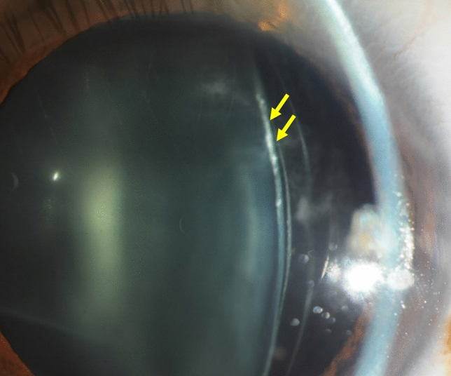
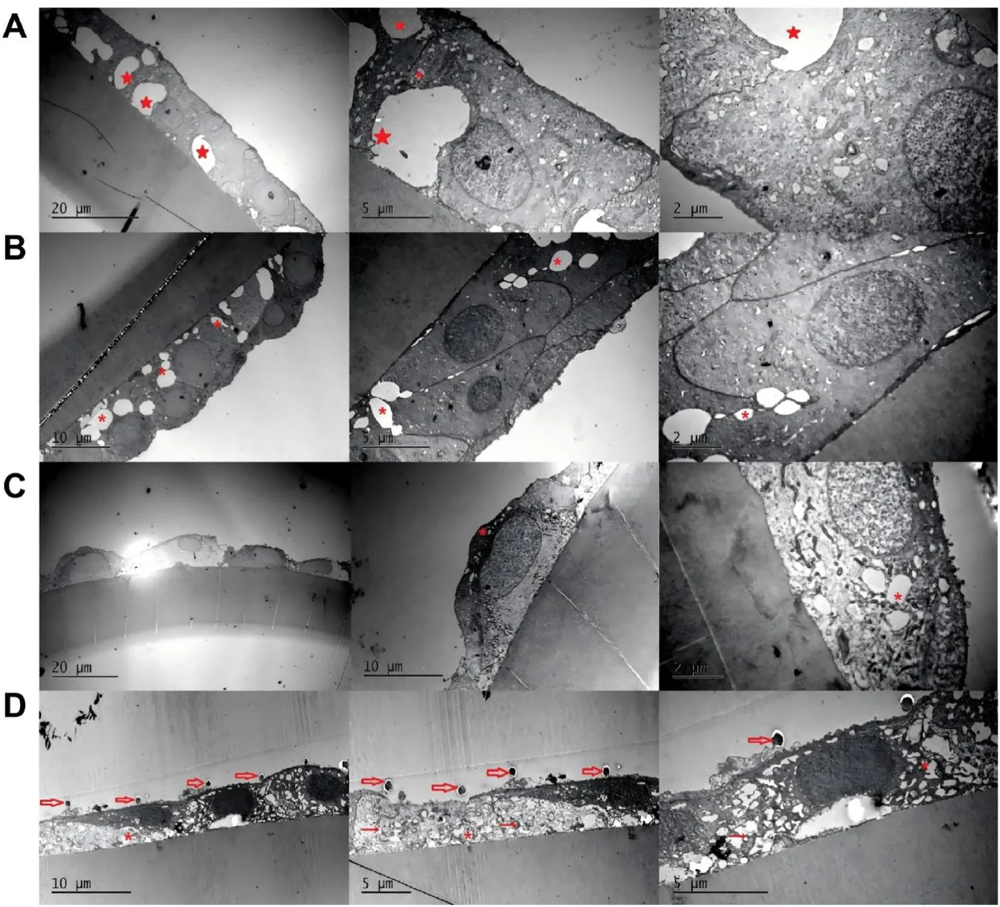
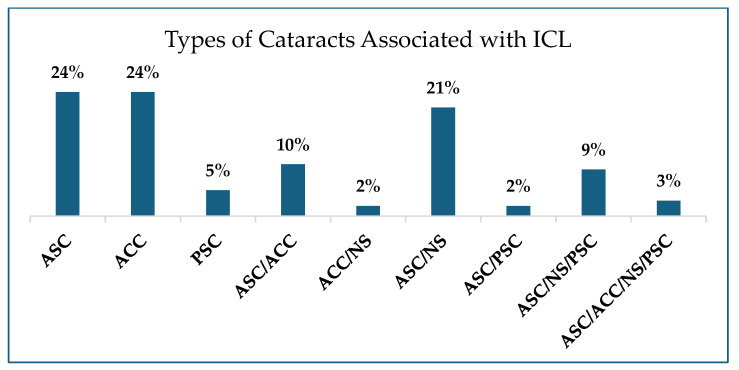
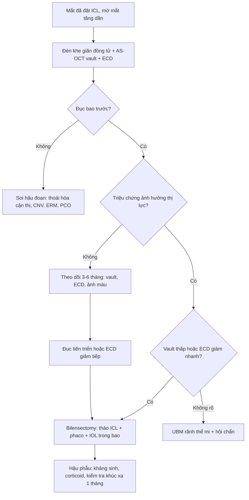
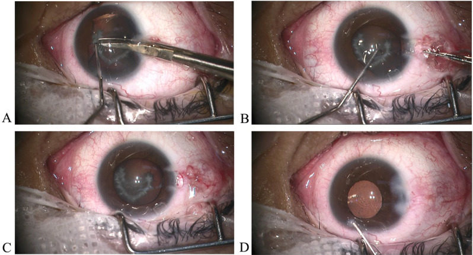
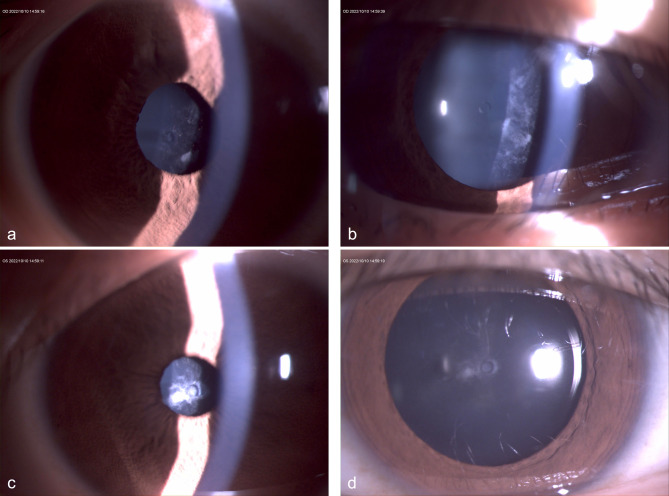

# 3247 — Đục bao trước sau ICL: khi "mờ mắt từ từ" ở người trẻ đã đặt thấu kính phakic / Anterior subcapsular cataract after phakic ICL

**Tags:** `pattern:duc-bao-truoc` `pattern:duc-the-thuy-tinh` `pattern:co-xat-co-hoc` `pattern:vault-thap` `pattern:mo-mat-tien-trien` `vung:mat` `vung:the-thuy-tinh` `vung:tien-phong` `vung:the-mi` `protocol:slit-lamp` `protocol:AS-OCT` `protocol:Pentacam` `protocol:UBM` `protocol:sinh-trac-IOL` `protocol:phaco` `score:LOCS-III` `incidentaloma:khong`

**Mức chắc chắn (certainty):** tổng hợp y văn (literature synthesis) — dựng từ các đoàn hệ lớn và ca có ảnh: **6.258 mắt ICL V4c và 1.208 mắt V4** theo dõi tới 15 năm (PMC13572004), **57 mắt** tháo pIOL + phaco (PMC13235816), **44 mắt** phaco sau ICL (PMC11312979), **38 mắt** (PMID 28732607), **175 mắt** tháo pIOL (PMID 35239580), **770 mắt** tháo ICL (PMC7730447), **114 mắt/10 năm** (PMID 31078536), **66 mắt/12 năm** (PMC12010185), **118 mắt** ICL có lỗ ở tuổi 45–65 (PMC8913835), ca **vault 0 µm** (PMC12486667), ca **đục ngày 1 do bơm rửa** (PMID 28823445), ca phẫu thuật có ảnh (PMC12057150). Nhóm **không có bệnh nhân của mình**; chỗ chưa đủ chắc ghi **"chưa rõ"**. **Không ghi tên tác giả** — attribution = **tạp chí + năm + PMCID/DOI**.

> **Câu chốt:** người trẻ đã đặt **ICL** (implantable collamer lens — thấu kính phakic hậu phòng) đến khám vì **mờ mắt tăng dần nhiều tháng–nhiều năm**, không đỏ, không đau. Đèn khe sau giãn đồng tử thấy **đục trắng–xám dưới bao trước**, thường **bắt đầu ở ngoại vi** rồi lan vào trục quang. Đây là **đục bao trước (anterior subcapsular cataract, ASC)** — biến chứng **thường gặp nhất** của ICL và là **lý do tháo ICL phổ biến nhất**. Ba số phải nhớ: **ASC 2,32% ở ICL V4 so với 0,10% ở V4c** (PMC13572004); **10,5% ở 10 năm, trong đó 3,5% có triệu chứng phải mổ** (PMID 31078536); và **tháo ICL + phaco đưa 80,6% mắt đạt CDVA ≤ 0,3 logMAR, 86,1% trong ± 1,00 D** (PMC13235816). Điều quyết định không phải "đục hay không" mà là **vault – vị trí haptic – mật độ tế bào nội mô – bệnh võng mạc cận thị cao**, vì các yếu tố đó đổi cả thời điểm mổ lẫn công suất IOL.

## 1. Tổng quan bệnh học – cơ chế hình ảnh (TẠI SAO)

### 1.1 Giải phẫu: ICL nằm sát bao trước thể thủy tinh

- ICL là thấu kính **hậu phòng – phakic**: mặt sau tựa vào **rãnh thể mi (ciliary sulcus)** bằng hai **footplate/haptic**, mặt sau optic cách **bao trước thể thủy tinh** một khoảng gọi là **vault**. Khung vault 2026: **thấp < 250 µm**, **đích 250–750 µm**, **cao > 750–1.000 µm**, **quá mức > 1.000 µm**; **< 100 µm hoặc chạm thể thủy tinh là đáng lo** (PMC13749031).
- Vùng **tiếp xúc cơ học** không phải tâm optic mà là **chu vi optic – chỗ optic gặp haptic**, tương ứng **ngoại vi bao trước**. Vì vậy ASC sau ICL **khởi đầu ngoại vi** (ảnh dưới) rồi lan vào trung tâm — khác đục nhân (trung tâm) và đục dưới bao sau (trục quang).
- Haptic nằm trong rãnh thể mi, nên **hình thái thể mi quyết định vault**: ca **0 µm hai mắt** có **mỏm thể mi ngắn + footplate trượt một phần xuống rãnh** trên UBM; thay ICL bằng cỡ lớn hơn **vẫn 0 µm** (PMC12486667).

*Đục bao trước **vùng ngoại vi** (mũi tên vàng) sau ICL, nhìn bằng **ánh sáng ngược (retroillumination)**. Đây là vị trí tương ứng chu vi optic–haptic tì vào bao trước. Nguồn: Sci Rep 2020 (PMC7730447), Fig. 1, **CC BY 4.0** — nguyên bản.*

### 1.2 Ba con đường sinh bệnh — và vì sao hình ảnh lại "trắng, chậm, ngoại vi"

1. **Cơ học – mạn tính (chủ yếu):** optic/haptic tì hoặc cọ lặp lại lên **bao trước và biểu mô thể thủy tinh (lens epithelial cells, LEC)**. Phản ứng xơ hóa của LEC sinh ra **fibronectin và collagen** dưới bao. Mô xơ **tán xạ ánh sáng mạnh** hơn sợi thể thủy tinh trong suốt → trên đèn khe là **đám trắng–xám**; trên **ánh sáng ngược** là **đốm tối trên nền đỏ cam** (ánh sáng bị chặn, không tới được võng mạc). Vì là quá trình xơ hóa, **ASC xuất hiện muộn (tháng–năm)**, không phải ngày 1.
2. **Chấn thương thủ tục – cấp tính:** bơm rửa **quá mạnh qua lỗ trung tâm** của ICL thổi thẳng vào bao trước gây **đục trắng lan tỏa ngay ngày 1** — loạt **11 mắt/8 bệnh nhân**, 9 mắt phải tháo ICL, 8 mắt phaco; đổi kỹ thuật thì **không còn ca mới** (PMID 28823445). Đây là nguyên nhân **do kỹ thuật, phòng được**, và là lý do phải hỏi **"đục xuất hiện lúc nào"**.
3. **Chuyển hóa – tế bào:** siêu cấu trúc mô thể thủy tinh lấy trong lúc mổ cho thấy **LEC tăng sinh nhiều lớp, lắng đọng fibronectin/collagen, ty thể bất thường (cristae dày, không bào quanh nhân)** ở nhóm ASC (PMC13572004). Nghĩa là ngoài cọ xát còn có **rối loạn chuyển hóa của LEC** — giải thích vì sao cùng một vault mà mắt này đục nhanh, mắt khác đục chậm.

*TEM biểu mô thể thủy tinh: **A–B** đục nhân (LEC một lớp/dày, không bào gian bào); **C–D** **ASC** — LEC dẹt một lớp, **không bào quanh nhân**, lưới nội bào hạt giãn, và **collagen phủ mặt LEC** (mũi tên đặc). Đây là bằng chứng **xơ hóa dưới bao**, không phải "vẩn đục do tuổi". Nguồn: Adv Ophthalmol Pract Res 2026 (PMC13572004), Fig. 5, **CC BY-NC-ND 4.0** — nguyên bản webp, không đổi định dạng.*

### 1.3 Yếu tố nguy cơ và con số nền

- **Tuổi lớn hơn lúc đặt ICL** và **tiền phòng nông (shallow anterior chamber depth, ACD)** là yếu tố nguy cơ độc lập; **cận thị siêu cao** làm tăng biến chứng nói chung (PMC13572004). Đoàn hệ 12 năm xác nhận nhóm đục có **vault thấp hơn** và **tuổi mổ cao hơn** (p < 0,05) (PMC12010185).
- **Vault thấp dự báo đục sớm:** trong 44 mắt phaco sau ICL, **vault 1 tuần sau đặt** và **vault 1 tuần trước phaco** tương quan **tuyến tính dương với thời gian tới lúc mổ đục** (p = 0,0081 và p = 0,0154) — vault càng thấp, đục có triệu chứng càng sớm (PMC11312979).
- **Loại ICL quan trọng:** V4 (không lỗ) có **đục thể thủy tinh 6,46% vs 0,16%**, **ASC 2,32% vs 0,10%**, **bilensectomy 3,89% vs 0,16%** so với V4c (có lỗ) (PMC13572004).
- **Tần suất thay đổi theo thời gian theo dõi:** **10,5% ASC ở 10 năm, 3,5% có triệu chứng** (PMID 31078536); **19,7% đục ở 10 năm** (PMC12010185); **29% có đục, 16,1% ảnh hưởng thị lực** sau 10,5 ± 3,5 năm (PMID 29394074); ở nhóm 45–65 tuổi đặt ICL có lỗ: **6,8% ASC không triệu chứng ngay sau mổ**, **2,5% đục nhân có triệu chứng** (PMC8913835).
- **Tỷ lệ phải tháo:** **1,0%** (8/770 mắt) trong một đoàn hệ Nhật, trong đó **63% do đục tiến triển** (PMC7730447); **3,8%** (30/787) tháo/đổi ICL, **4 ca vì đục** (PMC5141621); **44% ca tháo pIOL vì đục, 50,3% vì mất tế bào nội mô**, thời gian sống trung bình của pIOL **12,9 ± 4,8 năm** (PMID 35239580).

### 1.4 Vì sao "chờ đục chín" là sai ở mắt đã đặt ICL

- **Vỏ bao xơ hóa làm tháo ICL khó hơn:** ICL nằm sát bao; khi bao dày–xơ, tách ICL khỏi bao và tạo liên tục bao trước khó hơn, dễ **rách bao** và **mất nhân vào dịch kính**.
- **Nhân càng cứng, năng lượng phaco càng cao** trên mắt **cận thị cao, tiền phòng nông, nội mô đã mỏng** — đúng nhóm dễ mất bù nội mô. Đoàn hệ tháo pIOL cho thấy **4,6% (8/175) phải ghép giác mạc** trong theo dõi (PMID 35239580).
- Vì vậy mục tiêu là **phát hiện ASC khi còn khu trú + theo dõi ECD**, không phải chờ thị lực giảm nặng.

## 2. Mẫu hình + chẩn đoán phân biệt theo vị trí (gamut)

### 2.1 Mẫu hình cần nhận

- **Vị trí:** dưới **bao trước**, **ngoại vi trước** (chu vi optic–haptic), có thể **hình cung, hình vòng, hoặc "bông tuyết" (snowflake)**; một bên hay hai bên tùy mắt đặt ICL.
- **Thời gian:** **ngày 1** (thể do bơm rửa/kỹ thuật) hoặc **tháng–năm** (thể cơ học–chuyển hóa). Trong ca 19 tuổi, ASC xuất hiện **19 tháng** sau TICL cùng **vault 0 µm** (PMC12486667).
- **Triệu chứng:** mờ mắt từ từ, **lóa/glare**, giảm tương phản; **không đau, không đỏ** — khác UGH (đau–đỏ–hyphema) và khác viêm nội nhãn.
- **Phân bố loại đục sau ICL** (58 bệnh nhân): **ASC đơn thuần 24%**, **ASC + đục nhân 21%**, **ASC + đục vỏ trước 10%**, **ASC + nhân + dưới bao sau 9%**, **ASC + dưới bao sau 2%**, **ASC + cả ba 3%** — tức **ASC có mặt trong 69%** hồ sơ đục thể thủy tinh sau ICL (PMC11312979).

*ASC (24%) và ASC phối hợp với các loại khác chiếm phần lớn; đục nhân đơn thuần cũng 24%, đục dưới bao sau đơn thuần chỉ 5%. Nguồn: J Clin Med 2024 (PMC11312979), Figure A1, **CC BY 4.0** — nguyên bản.*

### 2.2 Gamut theo vị trí và bối cảnh

| Vị trí / bối cảnh | Nghĩ trước | Vì sao |
|---|---|---|
| **Bao trước, ngoại vi, có ICL, vault thấp** | **ASC sau ICL** | Điểm tì optic–haptic; xơ hóa LEC |
| **Bao trước, lan tỏa, ngày 1 sau đặt ICL có lỗ** | **ASC do bơm rửa qua lỗ trung tâm** | Chấn thương thủy lực lên bao (PMID 28823445) |
| **Trung tâm, màu vàng–nâu, không ranh giới rõ** | **Đục nhân (nuclear sclerosis)** | Xơ cứng sợi trục, thường tuổi lớn |
| **Sau, trục quang, hình chén** | **Đục dưới bao sau (PSC)** | Corticoid, đái tháo đường, viêm |
| **Vỏ trước hình nan hoa (spokes)** | **Đục vỏ (cortical)** | Mất nước, chấn thương |
| **Màng trắng–fibrin ngày 1–3, tiền phòng viêm** | **TASS/fibrin** | Độc chất, không phải đục bao |
| **Bọt khí/OVD tồn lưu** | **Giả đục** | Di động, tự tan |
| **Đục bao trước + tiền sử xạ vùng mắt** | **Đục do xạ** | Liều xạ, thời gian ủ bệnh |

- **Mnemonic vị trí "3 lớp – 3 câu hỏi":** (1) đục **trước hay sau bao**? (2) **trung tâm hay ngoại vi**? (3) **có tiếp xúc cơ học** (ICL, chấn thương) không? Trả lời 3 câu này phân được 80% gamut trước khi cần xét nghiệm.

## 3. Bảng so sánh phân biệt (ma trận đối chiếu)

| Thực thể (entity) | Hình ảnh điển hình | Chốt vào (rule-in) | Chốt loại (rule-out) | Gợi ý xác nhận |
|---|---|---|---|---|
| **ASC sau ICL (cơ học)** | Đục trắng–xám **dưới bao trước, ngoại vi**, hình cung/bông tuyết; ICL in situ, **vault thấp** | **Vị trí ngoại vi đúng chu vi optic + ICL + vault thấp/0 µm** | Đục trung tâm vàng–nâu, bao trước trong → nghĩ đục nhân | Đèn khe giãn đồng tử + **AS-OCT/Scheimpflug đo vault**, so ảnh cũ; theo dõi **ECD** |
| **ASC do bơm rửa (ngày 1)** | **Trắng lan tỏa ngay sau mổ**, thị lực giảm sớm, không đau | **Khởi phát ngày 1 + tiền sử bơm rửa qua lỗ trung tâm** | Đục xuất hiện muộn tháng–năm → thể cơ học | Hỏi kỹ thuật mổ; loại trừ TASS (không fibrin, không viêm tiền phòng) |
| **Đục nhân (nuclear sclerosis)** | Vàng–nâu **trung tâm**, mất trong suốt đều, không đổi theo ánh sáng ngược | **Màu nhân + LOCS III NO/NC tăng + tuổi** | Đục khu trú ngoại vi, có ICL → ASC | LOCS III (NO1–6, NC1–6); AS-OCT không phân độ thay được |
| **Đục dưới bao sau (PSC)** | Hình chén **trước bao sau/trục quang**, soi ngược thấy rõ | **Vị trí sau + tiền sử corticoid/ĐTĐ/viêm** | Đục ngoại vi trước → ASC | Đèn khe đồng tử giãn; OCT hoàng điểm nếu phù |
| **Đục vỏ do chấn thương** | Nan hoa, khe nứt bao, có thể **vỡ bao** | **Tiền sử chấn thương + khe/rách bao** | Bao trước liên tục, không chấn thương → ASC | Sinh hiển vi + AS-OCT bao; B-scan nếu không thấy đáy mắt |
| **TASS/fibrin** | Màng fibrin, **tế bào tiền phòng**, có thể giả mủ, **ngày 1–3** | **Viêm tiền phòng + fibrin + khởi phát sớm** | Không viêm, chỉ đục bao → ASC | Đáp ứng corticoid; cấy âm |
| **OVD/bọt khí tồn lưu** | Bọt tròn **di động**, tan trong vài ngày | **Di chuyển theo tư thế, tự hết** | Đục cố định, không đổi → thực thể | Theo dõi 1–7 ngày |
| **Đục do xạ** | Đục bao trước + khô mắt, tiền sử xạ | **Tiền sử xạ + liều + thời gian ủ** | Không xạ, có ICL → ASC sau ICL | Hồ sơ xạ trị; so ảnh trước xạ |

## 4. Protocol chụp/đo + hệ phân độ + quyết định mổ

### 4.1 Đo gì, bằng gì, ngưỡng nào

| Bước | Dụng cụ | Số đo / ngưỡng | Ý nghĩa |
|---|---|---|---|
| Đèn khe + giãn đồng tử | Sinh hiển vi | Mô tả **vị trí, hình thái, LOCS III** | Phát hiện ASC **ngoại vi**; không giãn đồng tử dễ bỏ sót |
| Ánh sáng ngược | Retroillumination | Đốm tối trên phản xạ đỏ | Xác nhận **tán xạ ánh sáng** do mô xơ |
| Đo vault | **AS-OCT** (Casia, Avanti) hoặc **Scheimpflug (Pentacam)** | **< 250 µm thấp; 250–750 đích; > 1.000 quá mức; < 100/chạm = đáng lo** (PMC13749031) | Vault thấp → ASC sớm (PMC11312979) |
| Rãnh thể mi/haptic | **UBM 35–50 MHz** | Mỏm thể mi ngắn, footplate trượt, nang thể mi | Giải thích **vault 0 µm dù đã đổi cỡ** (PMC12486667) |
| Nội mô | Soi nội mô (specular) | **ECD và tốc độ mất/năm** | Chỉ định tháo pIOL khi mất nhanh hơn dự kiến (PMID 38242162) |
| Sinh trắc IOL | IOLMaster 700/Argos + Pentacam | **AL, K, ACD, độ sâu tiền phòng** | Công thức sau khúc xạ; ICL **không đổi AL/K** |
| Hậu đoạn | OCT hoàng điểm ± B-scan | Cận thị cao: thoái hóa hoàng điểm, CNV, ERM | Tránh quy mọi mờ mắt cho đục |

- **Không có ngưỡng "mật độ đục" chuẩn hóa cho ASC sau ICL** trên Scheimpflug/Pentacam: densitometry cho **thang tùy ý**, dùng để **theo dõi xu hướng cùng một mắt**, không dùng để chẩn đoán hay so giữa hai mắt. Chẩn đoán vẫn là **đèn khe + bối cảnh ICL/vault**.

### 4.2 Lịch theo dõi mắt đã đặt ICL

- **1 ngày, 1 tuần, 1 tháng, 3–6 tháng, 12 tháng**, sau đó **hằng năm**: thị lực, khúc xạ, **IOP**, **đèn khe giãn đồng tử**, **AS-OCT vault**, **ECD** (PMC10417808; PMC13572004).
- **Vault thấp < 250 µm hoặc có dấu hiệu chạm:** khám **3–6 tháng/lần**, đo lại vault cùng máy, **UBM nếu vault không giải thích được**; giáo dục bệnh nhân **báo ngay khi mờ/lóa tăng**.
- **ECD giảm nhanh hơn dự kiến** (không có ngưỡng tuyệt đối thống nhất): hội chẩn tháo pIOL **trước khi** có đục nặng (PMID 38242162; PMID 35239580).

### 4.3 Quyết định: theo dõi hay bilensectomy (tháo ICL + phaco + IOL)

> **Ba mốc quyết định:** (1) **ASC có triệu chứng** → mổ; (2) **vault 0–100 µm/chạm thể thủy tinh** dù chưa đục → theo dõi sát, cân nhắc tháo **khi ECD giảm** hoặc đục tiến triển; (3) **đục ngày 1 do bơm rửa** → đánh giá lại kỹ thuật, không chờ "tự khỏi".

### 4.4 Kỹ thuật bilensectomy — các điểm không được bỏ

- **Trước mổ:** sinh trắc **khi ICL còn trong mắt** (ICL không ảnh hưởng AL/K nhưng có thể ảnh hưởng chất lượng đo), dùng **công thức sau khúc xạ** (Barrett True-K/Universal II; nhóm 57 mắt báo **Barrett Suite dự đoán công suất đáng tin**, 86,1% trong ± 1,00 D — PMC13235816). **Đích khúc xạ** ở cận thị cao thường **để lại −0,50 đến −0,75 D** để tránh lệch về viễn (ca PMC12057150).
- **Vào tiền phòng – bảo vệ nội mô:** OVD đủ, **không bơm thẳng vào bao**; nếu ICL có lỗ trung tâm, **tránh dòng bơm rửa mạnh xuyên lỗ** (đúng cơ chế ca đục ngày 1 — PMID 28823445).
- **Lấy ICL:** **cắt đôi ICL bằng micro scissors** trong tiền phòng rồi gắp ra, hoặc đẩy ra qua vết mổ rộng vừa đủ; **không kéo haptic qua vết mổ nhỏ** (nguy cơ rách bao, tổn thương mống mắt). Hình dưới cho thấy trình tự **cắt ICL → lấy ICL → thấy ASC → phaco → đặt IOL**.
- **Sau khi lấy ICL:** **CCC ~5 mm**, phaco, **IOL trong bao**; bảo vệ **zonule** (cận thị cao, tiền phòng nông) và **bao sau**. FLACS khả thi nhưng **bọt cavitation bị giữ dưới ICL** có thể làm **nucleotomy không hoàn toàn** (PMID 26856431; PMID 27070235).
- **Kết cục tham chiếu:** **80,6% CDVA ≤ 0,3 logMAR**, **86,1% ± 1,00 D**, **PCO 11/57**, **bong võng mạc 1/57** (PMC13235816); **82% ± 1,00 D**, **57,9% ± 0,50 D**, **PCO 39,5%** (PMID 28732607); **70% UDVA trong 1 dòng**, **43% ± 0,25 D**, **69% ± 0,50 D** (PMC11312979); **safety index 1,08** (PMC13572004) và **1,50** (PMC11312979).

*Trình tự: **A** cắt đôi ICL bằng micro scissors; **B** lấy ICL qua vết mổ; **C** thấy **ASC** dưới bao trước, mở CCC ~5 mm rồi phaco; **D** đặt IOL trong bao. Nguồn: BMC Ophthalmol 2025 (PMC12057150), Fig. 3, **CC BY-NC-ND 4.0** — nguyên bản, không cắt/ghép.*

## 5. Biến thể bình thường và cạm bẫy

- **Vault 0 µm không đồng nghĩa phải mổ ngay:** ca 19 tuổi có **vault 0 µm hai mắt + ASC**; mắt trái thay ICL lớn hơn **vẫn 0 µm**, mắt phải **theo dõi không can thiệp** (PMC12486667). Quyết định dựa trên **triệu chứng + ECD + tiến triển đục**, không chỉ con số vault.
- **Đục "ngoại vi" là bình thường ở mắt đặt ICL?** Không. Đục bao trước ngoại vi là **dấu sớm của ASC**, khác **vòng phản xạ ánh sáng** ở chu vi optic (ánh sáng viền, không phải mô đục) — phân biệt bằng **ánh sáng ngược** và **so ảnh cũ**.
- **Cạm bẫy 1 — không giãn đồng tử:** ASC ngoại vi **nằm ngoài vùng đồng tử 3 mm**, khám thường quy bỏ sót; phải **giãn đồng tử** và ghi **ảnh màu/retroillumination**.
- **Cạm bẫy 2 — gọi "đục nhân do tuổi"** ở người 40–50 tuổi có ICL rồi chờ: nhân càng cứng, phaco càng nhiều năng lượng trên mắt cận thị cao/nội mô mỏng; ASC **khu trú + ICL** là bối cảnh khác.
- **Cạm bẫy 3 — YAG bao sau "điều trị đục":** mắt còn **thể thủy tinh thật**, không có PCO; YAG đục bao sau **không điều trị ASC** và có thể **làm rách/tổn thương bao–thể thủy tinh**. Chỉ YAG khi **đã phaco và có PCO**.
- **Cạm bẫy 4 — bỏ sót bệnh hậu đoạn cận thị cao (satisfaction of search):** trong 6.258 mắt V4c có **thoái hóa hoàng điểm cận thị 0,38%**, **CNV 0,24%**, **bong võng mạc 0,04%** (PMC13572004); bong võng mạc 10 năm **1,71% vs 1,25%** ở nhóm không mổ (PMID 36730449). Luôn **OCT hoàng điểm + soi đáy mắt ngoại vi** trước khi quy mọi mờ mắt cho đục.
- **Cạm bẫy 5 — đục ngày 1 bị coi là "phù giác mạc/OVD":** đục trắng sau bao **ngay ngày 1** kèm giảm thị lực là **ASC do bơm rửa**, không phải OVD; OVD **di động và tan**, ASC **cố định** (PMID 28823445).
- **Cạm bẫy 6 — tính IOL theo khúc xạ hiện tại khi đục đã nặng:** khúc xạ lúc đục **không dùng được** cho công thức sau khúc xạ; phải dùng **khúc xạ trước ICL/trước đục + AL/K hiện tại** (PMC13235816; PMC12057150).

## 6. Tự lượng giá — Blind Quiz

**Ca 1 — Nữ 34 tuổi, cận thị −11,00 D, đặt ICL 6 năm, mờ mắt từ từ 8 tháng, không đau.**

- Gợi ý: không đỏ mắt, IOP bình thường, ICL đúng vị trí, vault đo được 180 µm.
- Câu hỏi: (1) Mô tả vị trí và hình thái đục. (2) Ba chẩn đoán phân biệt. (3) Dấu hiệu nào chốt nguyên nhân?

<b>Bấm để hiện đáp án (findings + chẩn đoán)</b>

- **Dấu hiệu:** đục trắng–xám **dưới bao trước, ngoại vi**, hình cung, thấy rõ nhất bằng **ánh sáng ngược** (mũi tên vàng); bao trước còn liên tục; không có fibrin/tế bào tiền phòng.
- **Chẩn đoán:** **ASC sau ICL do cọ xát cơ học** — vault **180 µm** thuộc nhóm thấp (< 250 µm), đúng vị trí chu vi optic–haptic.
- **Phân biệt:** đục nhân (trung tâm, vàng–nâu), PSC do corticoid (sau, trục quang), đục vỏ do chấn thương (nan hoa, rách bao).
- **Nguồn ảnh:** Sci Rep 2020 (PMC7730447), Fig. 1, CC BY 4.0.

**Ca 2 — Nữ 19 tuổi, cận thị cao, TICL hai mắt 19 tháng, mờ cả hai mắt; vault 0 µm hai bên.**

- Gợi ý: UBM cho **mỏm thể mi ngắn**, footplate trượt một phần; thay TICL trái bằng cỡ lớn hơn.
- Câu hỏi: (1) Hình thái đục? (2) Vì sao vault 0 µm tái diễn dù đổi cỡ? (3) Có nên thay ICL phải không?

<b>Bấm để hiện đáp án (findings + chẩn đoán)</b>

- **Dấu hiệu:** (a–b) mắt phải **ASC dạng bông tuyết** ở đồng tử thường và giãn; (c–d) mắt trái **đục đậm vùng đồng tử**.
- **Cơ chế:** **cấu trúc thể mi bất thường (mỏm ngắn) + footplate trượt** làm ICL luôn nằm sát bao trước; đổi sang ICL lớn hơn **không sửa được** vì vấn đề là **giải phẫu thể mi**, không phải cỡ ICL.
- **Xử trí:** mắt trái thay ICL vẫn **0 µm** → cần **bilensectomy** khi đục ảnh hưởng thị lực; mắt phải **theo dõi** vì chưa có chỉ định tuyệt đối — quyết định theo **triệu chứng + ECD + tiến triển**.
- **Nguồn ảnh:** BMC Ophthalmol 2025 (PMC12486667), Fig. 1, CC BY-NC-ND 4.0.

**Ca 3 — Nam 39 tuổi, cận thị cao, đã PRK rồi đặt ICL, nay ASC hai mắt; mổ tháo ICL + phaco + IOL hai thì cách 2 tuần.**

- Gợi ý: đích khúc xạ **−0,50 đến −0,75 D**, IOL **TECNIS Symfony ZXR00**, theo dõi 3 tháng bằng AS-OCT/defocus curve.
- Câu hỏi: (1) Vì sao chọn đích cận thị nhẹ? (2) Trình tự lấy ICL–phaco–IOL? (3) Đo công suất IOL dựa trên dữ liệu nào?

<b>Bấm để hiện đáp án (findings + chẩn đoán)</b>

- **Đích −0,50 đến −0,75 D:** ở mắt **cận thị cao + sau khúc xạ**, để lại cận thị nhẹ giúp **giảm nguy cơ lệch về viễn** và tăng hài lòng khi IOL đa tiêu cự/giãn tiêu cự; đây là **lựa chọn ca**, không phải khuyến cáo tuyệt đối.
- **Trình tự:** **A** cắt đôi ICL bằng micro scissors → **B** lấy ICL → **C** thấy ASC, CCC ~5 mm, phaco → **D** đặt IOL trong bao; bảo vệ nội mô/zonule/bao sau.
- **Công suất IOL:** dùng **AL/K hiện tại + khúc xạ trước ICL (hoặc trước khi đục tiến triển)** theo **công thức sau khúc xạ**; nhóm 57 mắt cho thấy **Barrett Suite** dự đoán tốt (**86,1% ± 1,00 D**) (PMC13235816).
- **Nguồn ảnh:** BMC Ophthalmol 2025 (PMC12057150), Fig. 3, CC BY-NC-ND 4.0.

## 7. Câu hỏi nghiên cứu & điểm chưa đồng thuận (tính đến 11/2026)

1. **[Tranh cãi] Ở mắt vault 0–100 µm chưa có đục, tháo ICL dự phòng có giảm ASC so với theo dõi?**
   - **Đã biết:** vault < 100 µm/chạm thể thủy tinh được xem là **đáng lo**; ca vault 0 µm hai mắt đã có ASC ở 19 tháng và **tái diễn 0 µm dù thay ICL lớn hơn**, gợi ý yếu tố giải phẫu thể mi (PMC12486667; PMC13749031).
   - **Chưa rõ:** chưa có **RCT** so **tháo sớm** với **theo dõi** ở nhóm chưa có triệu chứng; ngưỡng vault nào đủ để mổ dự phòng chưa thống nhất.
   - **Hướng nghiên cứu:** đoàn hệ tiến cứu có **vault chuẩn hóa bằng AS-OCT + UBM**, outcome **thời gian tới ASC có triệu chứng** và **ECD**.
   - **Nguồn:** PMC12486667 (2025); PMC13749031 (2026).

2. **[Khoảng trống] Công thức IOL nào chính xác nhất sau tháo ICL ở mắt cận thị cao đã phẫu thuật khúc xạ?**
   - **Đã biết:** các loạt nhỏ cho kết quả tốt với **Barrett Suite** (**86,1% ± 1,00 D**, 57 mắt) và **82% ± 1,00 D** (38 mắt), nhưng **không có so sánh trực tiếp** giữa các công thức.
   - **Chưa rõ:** ảnh hưởng của **vết PRK/RK cũ**, **độ dài AL**, và **vùng trung tâm giác mạc** lên sai số; chưa có ngưỡng chọn **multifocal/EDOF** theo bệnh hoàng điểm cận thị.
   - **Hướng nghiên cứu:** nghiên cứu **diagnostic accuracy** đa trung tâm, so **Barrett True-K vs Kane vs ASCRS trung bình**, outcome **MAE và % trong ± 0,50 D**.
   - **Nguồn:** PMC13235816 (2026); DOI 10.1016/j.jcrs.2017.03.032 (2017).

3. **[Khác biệt thực hành] Mổ ASC sau ICL ngay khi có triệu chứng hay chờ "đục đủ chín"?**
   - **Đã biết:** pIOL tồn tại trung bình **12,9 năm**; **44% tháo vì đục, 50,3% vì mất tế bào nội mô**; sau tháo, ECD nhóm đục **giảm 2,27%/năm**, và **4,6% phải ghép giác mạc** (PMID 35239580). Mất ECD nhanh hơn dự kiến là chỉ định tháo pIOL (PMID 38242162).
   - **Chưa rõ:** ngưỡng **ECD tuyệt đối** và **mức đục tối thiểu** để mổ khác nhau giữa trung tâm; chưa có dữ liệu so **mổ sớm** với **chờ** về **CDVA cuối cùng và biến chứng**.
   - **Hướng nghiên cứu:** registry theo **ECD, vault, LOCS III**, so **thời điểm mổ** với outcome **CDVA 1 năm, PCO, bong võng mạc**.
   - **Nguồn:** DOI 10.1097/j.jcrs.0000000000000920 (2022); DOI 10.1055/a-2209-5251 (2024).

## Bài liên quan chéo
- [3238 – UGH sau ICL (viêm – glôcôm – xuất huyết tiền phòng)](../3238-ugh-sau-icl-phakic-iol/lesson.md) — cùng mắt đặt ICL, khác mặt bệnh (cọ xát → hyphema/IOP), dùng chung UBM/AS-OCT.
- [3237 – PXF + góc đóng: LPI hay lấy thể thủy tinh](../3237-pxf-goc-dong-lpi-hay-lay-the-thuy-tinh/lesson.md) — đo ACD/thể thủy tinh trước phaco.
- [1935 – Đục thể thủy tinh sau MIGS](../1935-duc-the-thuy-tinh-sau-migs/lesson.md) — đục bao trước "không bào" ngày 1 sau can thiệp: phân biệt với ASC thật.
- [6214 – Đục thể thủy tinh do xạ trị retinoblastoma](../6214-duc-the-thuy-tinh-xa-tri-retinoblastoma/lesson.md) — đục bao trước do xạ, bối cảnh khác.
- [1504 – Đục thể thủy tinh cực sau](../1504-duc-the-thuy-tinh-cuc-sau/lesson.md) — phân độ và chỉ định phaco.
- [1480 – Đục thể thủy tinh sau bóc màng ERM](../1480-duc-the-thuy-tinh-sau-boc-mang-erm/lesson.md) — tính IOL và phối hợp phẫu thuật ở mắt đã mổ.
- [400 – Tổng quan Mắt & thị giác](../400-tong-quan-mat-thi-giac/lesson.md)

> Không dùng để chẩn đoán độc lập khi chưa có người hướng dẫn.
