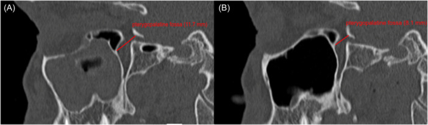
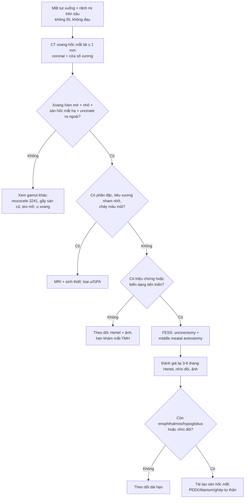
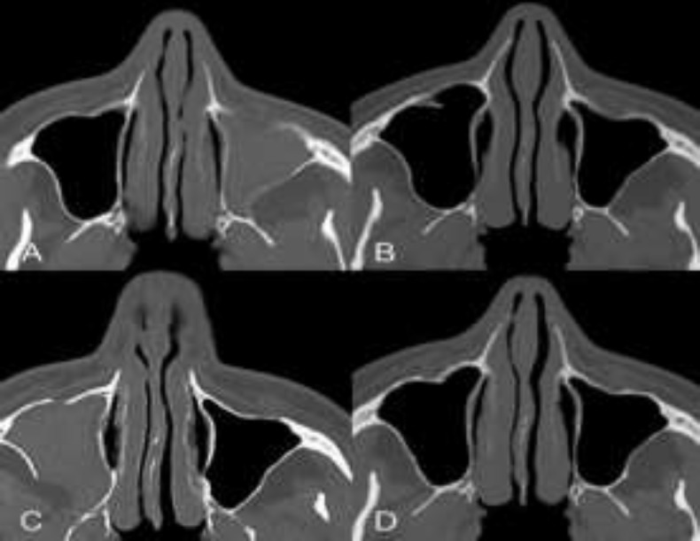
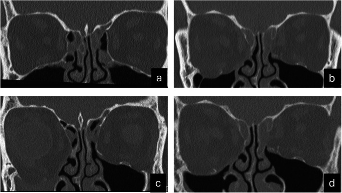
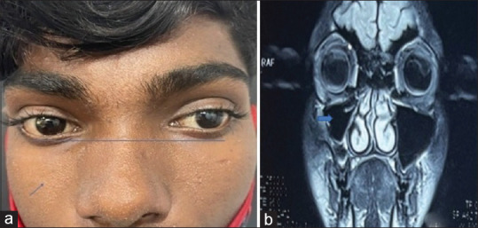
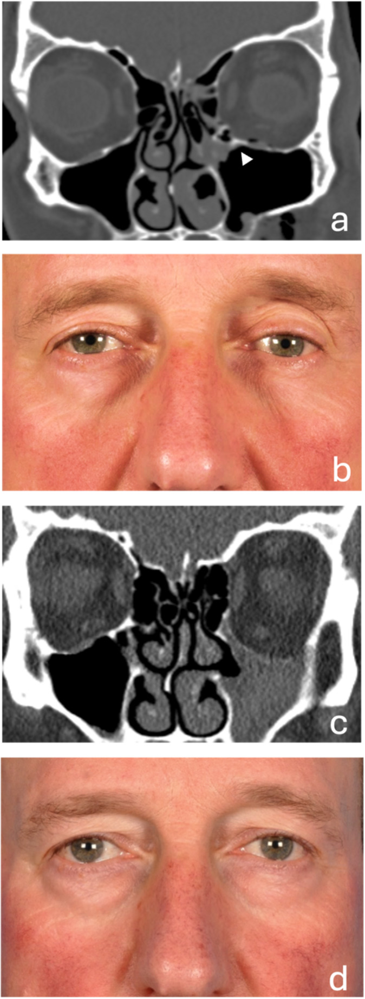
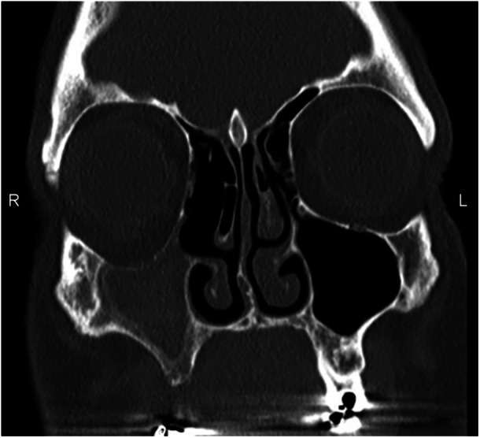

# 3248 — Hội chứng xoang câm (silent sinus syndrome, "imploding antrum"): xoang hàm xẹp kéo sàn hốc mắt xuống — mắt tụt, KHÔNG lồi / Silent sinus syndrome

**Tags:** `pattern:xoang-xep` `pattern:mo-xoang` `pattern:san-hoc-mat-ha` `pattern:enophthalmos` `pattern:hypoglobus` `pattern:retroantral-fat` `pattern:lech-vach-mui` `vung:mat` `vung:hoc-mat` `vung:xoang` `protocol:CT-xoang-hoc-mat` `protocol:MRI-hoc-mat` `incidentaloma:khong`

**Mức chắc chắn (certainty):** tổng hợp y văn (literature synthesis) — dựng từ tổng quan hệ thống **153 bài / 558 bệnh nhân** (PMID **37219052**), tổng quan **28 nghiên cứu / 276 bệnh nhân** (PMC9577692), đoàn hệ đo hình ảnh **30 bệnh nhân** (PMC12955829), đoàn hệ mổ nội soi theo dõi **4,71 năm** ở **24 bệnh nhân** (PMC13399144), loạt **9 ca SSS thứ phát** sau chấn thương/mổ (PMC12098178), nghiên cứu **891 phim CT** về tần suất (PMID 34236252) và các ca báo cáo có số liệu (PMC7302533, PMC10062103, PMC11214768). Nhóm **không có bệnh nhân của mình**; số nào chưa kiểm chứng ghi **"chưa rõ"**. **Không ghi tên tác giả** — attribution dùng tạp chí + năm + PMCID/PMID (đối chiếu Europe PMC ngày 2026-11-21).

> **Vị trí trong thư viện:** [3241](../3241-nang-nhay-xoang-hoc-mat/lesson.md) trả lời *xoang mờ + khối đẩy xương RA → lồi mắt*; bài này là **chiều NGƯỢC LẠI**: xoang **xẹp**, xương **cong VÀO**, sàn hốc mắt **hạ xuống** → **enophthalmos/hypoglobus**. [410](../410-giai-phau-hoc-mat/lesson.md) là bảng giải phẫu hốc mắt (đã có một dòng về "xoang hàm kém phát triển"); [3229](../3229-hoi-chung-hoc-mat-sau-muc-nhan-cau/lesson.md) là mặt *thiếu thể tích hốc mắt sau múc nhãn cầu*; [3245](../3245-glaucoma-melanocytosis-mat/lesson.md) và [400](../400-tong-quan-mat-thi-giac/lesson.md) là các bài mắt liên quan.
>
> **Câu chốt:** **(1) Đây là bệnh của ÁP LỰC ÂM, không phải của khối u:** bít lỗ thông xoang → khí bị hấp thu → áp lực trong xoang thấp hơn khí quyển → thành xoang **cong vào lòng**, xoang **mất 8,885 mL** thể tích (10,057 vs 18,942 mL, p < 0,01) (PMC12955829). **(2) Hình ảnh chốt là CT xương lát ≤ 1 mm, coronal:** xoang hàm **mờ hoàn toàn**, **xoang thu nhỏ**, **uncinate ra ngoài**, **sàn hốc mắt hạ** và **mỏng ~1,05 mm**, cộng **vách mũi lệch VỀ phía xoang bệnh ở 87%** (PMC12955829) — không có khối đặc, không tiêu xương nham nhở. **(3) Điều trị là MỞ THÔNG xoang (uncinectomy + middle meatal antrostomy), không phải "nâng sàn" ngay:** **87%** bệnh nhân được FESS, chỉ **23,5%** cần tái tạo sàn hốc mắt; sau điều trị enophthalmos giảm từ **2,67 ± 1,39 mm** còn **0,33 ± 0,75 mm**, hypoglobus từ **2,22 ± 1,43 mm** còn **0,23 ± 0,62 mm**, **83,2%** hết hoặc giảm triệu chứng (PMID 37219052).

## 1. Tổng quan bệnh học – cơ chế hình ảnh (TẠI SAO)

### 1.1 "Xoang câm" là gì và vì sao nó kéo mắt xuống

**Hội chứng xoang câm (silent sinus syndrome, SSS; còn gọi *imploding antrum syndrome*)** là tình trạng **xoang hàm xẹp dần, không triệu chứng mũi xoang**, gây **enophthalmos (mắt tụt) và hypoglobus (nhãn cầu thấp hơn bên lành)**, do **sàn hốc mắt bị kéo cong xuống** vào lòng xoang đang giảm áp (PMC9577692, PMC12955829). Bệnh nằm trong **phổ của teo xoang hàm mạn (chronic maxillary atelectasis, CMA)**; nhiều tác giả coi **SSS = CMA giai đoạn III** (khi đã có biến dạng lâm sàng), nhưng **danh pháp vẫn còn tranh cãi** (PMC12955829).

Cơ chế được chấp nhận rộng nhất gồm 4 bước:

1. **Bít lỗ thông tự nhiên** (ostium) của xoang hàm — do **uncinate ra ngoài**, phì đại niêm mạc, biến thể giải phẫu (concha bullosa), hoặc di chứng chấn thương/mổ vùng lỗ thông (PMC12955829, PMC12098178).
2. **Giảm thông khí** → khí trong xoang (O₂, N₂) bị niêm mạc hấp thu, không được bù.
3. **Áp lực trong xoang thấp hơn khí quyển** → chênh áp kéo **thành xoang mỏng nhất** vào trong: thành trong, thành sau, rồi **sàn hốc mắt**.
4. **Tái tạo xương dưới áp lực âm kéo dài** → xương mỏng dần (sàn hốc mắt còn **~1,05 mm**), có thể **nứt/khuyết**; mô mỡ hốc mắt và mỡ sau xoang **lấp vào khoảng trống** (PMC12955829).

Giả thuyết thứ hai (**Baujat, cơ học**) cho rằng **co cơ nhai** tạo áp lực âm trong **hõm chân bướm–khẩu cái**, đẩy mỡ hốc mắt ra sau rồi thành sau xoang cong vào — **chưa có nghiên cứu phân xử hai giả thuyết** (PMC12955829 dẫn lại).

**Vì sao bệnh "câm":** bệnh nhân **không đau, không chảy mũi, không sốt**; cái họ thấy là **mắt như tụt vào, rãnh mi trên sâu hơn, mặt hơi lệch**, đôi khi **nhìn đôi khi nhìn lên**. Vì vậy người khám mắt là người phát hiện, còn **xoang là nơi gây bệnh** — đúng lý do bài này nằm trong tab Mắt.

### 1.2 TẠI SAO hình ảnh trông như vậy — vật lý và mô bệnh

| Dấu hiệu trên hình ảnh | Vì sao (cơ chế vật lý/mô bệnh) | Hệ quả khi đọc phim |
|---|---|---|
| **Xoang hàm mờ hoàn toàn** | Lòng xoang chứa **dịch–nhầy** thay vì khí: dịch/mucin có độ hấp thụ tia X gần nước, khoảng **0–30 HU**, so với khí **−1.000 HU** | Mờ **đồng nhất**, không có **nốt đặc**, không **vôi hóa trong lòng**; nếu có phần đặc/ngấm phải nghĩ **u hoặc mucocele** |
| **Thể tích xoang giảm** | Thành xoang cong vào lòng do chênh áp; đo bằng **phân đoạn 3D** trên DICOM | Xoang bệnh **10,057 ± 6,222 mL** vs bên lành **18,942 ± 7,992 mL**; chênh **8,885 mL** (PMC12955829) |
| **Sàn hốc mắt hạ + mỏng** | Sàn là **xương mỏng nhất** giữa xoang và hốc mắt (**~1,05 mm**), chịu lực uốn lớn nhất; áp lực âm + hủy xương do hủy cốt bào làm xương mỏng, cong xuống | Đo **chiều cao hốc mắt** (trần→nhãn cầu + nhãn cầu→sàn): **16,95 ± 2,793 mm** vs **14,81 ± 2,282 mm** (p = 0,003) — tức hốc mắt **sâu thêm ~2,1 mm**; độ dày sàn **không** khác có ý nghĩa (1,054 vs 1,154 mm, p = 0,476) |
| **Nhãn cầu tụt xuống, không lồi** | Hốc mắt **tăng thể tích** phía dưới + sàn hạ → nhãn cầu trượt xuống; trục nhãn cầu không bị đẩy ra trước | Khoảng cách **sàn hốc mắt → nhãn cầu**: **9,527 ± 2,0 mm** vs **7,861 ± 1,74 mm** (p = 0,001); khoảng cách **trần → nhãn cầu** không đổi (p = 0,276) → **hốc mắt sâu xuống, không nông ra** (PMC12955829) |
| **Mỡ sau xoang ("retroantral fat pad") + hõm chân bướm–khẩu cái rộng ra** | Thành sau xoang cong **ra trước**, nhường chỗ cho mỡ vùng chân bướm–khẩu cái và hố chân bướm–khẩu cái bị đẩy vào | Hõm rộng thêm **2,354 mm** (10,7 vs 8,346 mm), củ xương hàm cao thêm **4,99 mm** (17,98 vs 12,99 mm), thành sau lồi vào **3,763 mm** (p < 0,01) — giải thích vì sao phẫu thuật viên **gặp mỡ trong xoang dù KHÔNG vào hốc mắt** |
| **Vách mũi lệch VỀ phía xoang bệnh** | Xoang nhỏ kéo cả khối xương–niêm mạc về phía mình; **87% (26/30)** ca có lệch vách kiểu này | Lệch vách **về phía xoang xẹp** là dấu phụ rất hữu ích khi hai xoang khác nhau rõ; lệch **ra xa** xoang xẹp phải nghĩ nguyên nhân khác |
| **MRI: dịch T2 rất sáng, niêm mạc T2 trung gian, không hạn chế khuếch tán** | Nước tự do kéo dài T2; niêm mạc dày viêm mạn ngấm thuốc mỏng; **không có mô đặc** nên ADC không tối | Dùng để **loại u** và xem **cơ vận nhãn/thị thần kinh** khi hypoglobus nhiều; mỡ hõm chân bướm–khẩu cái **T1 sáng, tắt trên fat-sat** |

- **Vì sao gọi là "silent" mà vẫn nguy hiểm:** bệnh tiến triển **chậm nhiều năm**, không đau, nên bệnh nhân đến khi **biến dạng đã cố định**; sàn hốc mắt mỏng **~1 mm** cũng là **nguy cơ vào hốc mắt khi mổ nội soi** — đây là lý do bài này nhấn mạnh **đo trước mổ** chứ không chỉ đặt tên bệnh (PMC12955829).

### 1.3 Ngưỡng định lượng nằm lòng

| Chỉ số | Giá trị | Nguồn |
|---|---|---|
| Tuổi trung bình khi chẩn đoán | **38,8 ± 14,1 tuổi** (558 bệnh nhân); **40,4 tuổi** (276 bệnh nhân); **44,9 tuổi** (30 ca); **45,2 ± 12,8 tuổi**, khoảng **33–67** (24 ca) | PMID 37219052; PMC9577692; PMC12955829; PMC13399144 |
| Tần suất trên phim CT người lớn không có tiền sử chấn thương/mổ | **SSS 0,56% (5/891)**; **thiểu sản xoang hàm (MSH) 6,17% (55/891)**; báo cáo X-quang **chỉ ghi nhận 1/5 ca SSS** | PMID 34236252 |
| Phân bố bên | Phải **60%** (18/30); trong đoàn hệ khác: phải **45,8%**, trái **45,8%**, **hai bên 8,3%** (2/24) | PMC12955829; PMC13399144 |
| Thể tích xoang hàm | Bệnh **10,057 ± 6,222 mL** vs lành **18,942 ± 7,992 mL**, chênh **8,885 mL** | PMC12955829 |
| Đường kính xoang | Sagittal **31,4 vs 36,93 mm**; coronal **18,82 vs 25,05 mm** | PMC12955829 |
| Sàn hốc mắt | Độ dày **1,054 vs 1,154 mm** (p = 0,476); chiều cao hốc mắt **16,95 vs 14,81 mm** (p = 0,003) | PMC12955829 |
| Hõm chân bướm–khẩu cái + củ xương hàm | Rộng thêm **2,354 mm**; cao thêm **4,99 mm**; thành sau lồi vào **3,763 mm** | PMC12955829 |
| Lệch vách mũi về phía xoang bệnh | **87% (26/30)** | PMC12955829 |
| Triệu chứng hốc mắt | Enophthalmos và/hoặc hypoglobus **83,3%**; hypoglobus **66,7%**; nhìn đôi **8/9 ca SSS thứ phát** | PMC13399144; PMC12098178 |
| Đo lâm sàng | Enophthalmos **2,67 ± 1,39 mm** → **0,33 ± 0,75 mm**; hypoglobus **2,22 ± 1,43 mm** → **0,23 ± 0,62 mm** sau điều trị | PMID 37219052 |
| Điều trị | **FESS 87%** + **tái tạo sàn hốc mắt 23,5%**; **83,2%** hết/giảm triệu chứng | PMID 37219052 |
| FESS đơn thuần | **116 bệnh nhân**; còn enophthalmos **6%**; **3,4%** phải mổ tái tạo sàn sau đó; **72 ca** FESS + tái tạo sàn; **57 ca** theo dõi | PMC9577692 |
| Theo dõi dài hạn sau FESS | **24 ca**, theo dõi **4,71 ± 3,45 năm** (1,0–13,2): **100%** hết triệu chứng, **0** mổ lại, **1 ca (4,2%)** tái tạo sàn, QoL **4,58/5** | PMC13399144 |
| SSS thứ phát (sau chấn thương/mổ) | **9 ca**, xuất hiện **1–36 tháng** sau chấn thương/mổ, **trung vị 3 tháng** ở nhóm sau chấn thương | PMC12098178 |
| Thể không mờ xoang | **3 ca** SSS có xoang **còn thông khí** — không được loại trừ chỉ vì xoang sáng | PMID 29726628 |

## 2. Mẫu hình + chẩn đoán phân biệt theo vị trí (gamut)

**Mẫu hình chung:** **xoang hàm mờ + nhỏ + thành cong vào lòng** (đặc biệt **sàn hốc mắt hạ xuống**) + **uncinate ra ngoài** + **mắt tụt xuống, không lồi**, **không triệu chứng mũi xoang**, thường **một bên**, người **30–60 tuổi**.

| Vị trí / thể | Đường lan và dấu hiệu | Chốt hình ảnh |
|---|---|---|
| **Xoang hàm (điển hình)** | Sàn hốc mắt hạ → **hypoglobus** (mắt thấp), **enophthalmos**, rãnh mi trên sâu | Xoang hàm **mờ + thể tích giảm**, **uncinate ra ngoài**, **sàn hốc mắt hạ/mỏng**, **vách mũi lệch về xoang bệnh** |
| **Xoang trán (hiếm)** | Trần hốc mắt hạ → **hyperglobus** (mắt cao) + enophthalmos, bất đối xứng sống mũi | Xoang trán **mờ + xẹp**, vách mũi xương lệch nặng về bên bệnh; ca **23 tuổi**, nhiều chấn thương mũi thời thơ ấu (PMC11723780) |
| **Hai bên (8,3%)** | Có thể **đồng thời** hoặc **lần lượt** (metachronous) | Ca **45 tuổi**: SSS trái, sau mổ thông xoang **2 năm** xuất hiện SSS phải; CT axial cho thấy **mỡ sau xoang tăng + mỏng thành trước–bên** rồi **thông khí lại sau FESS** (PMC7302533) |
| **Thứ phát sau chấn thương/mổ (secondary SSS)** | Sau gãy sàn hốc mắt, gãy gò má, hoặc **giải ép hốc mắt** → bít lỗ thông; xuất hiện **1–36 tháng** | CT lúc chấn thương: **mờ vùng infundibulum** (dấu sớm); CT sau: **mờ toàn bộ + uncinate ra ngoài + sàn hạ** (PMC12098178) |
| **Không mờ xoang (aerated SSS)** | Vẫn có enophthalmos + sàn hạ + uncinate ra ngoài nhưng xoang **còn khí** | **3 ca**; không loại trừ SSS khi xoang sáng (PMID 29726628) |

**Gamut "mắt tụt + xoang hàm mờ/xẹp" (theo thứ tự thường gặp):**

1. **Hội chứng xoang câm** — xoang mờ, thể tích giảm, sàn hạ, **không khối**, không triệu chứng mũi.
2. **Thiểu sản xoang hàm bẩm sinh (maxillary sinus hypoplasia)** — xoang nhỏ từ nhỏ, **96,36% vẫn thông khí bình thường/một phần**, thường **không có triệu chứng hốc mắt**; là **nền** cho SSS chứ không đồng nghĩa SSS (PMID 34236252).
3. **Di chứng gãy sàn hốc mắt cũ** — sàn hạ nhưng **xoang thông khí**, có **đường gãy/dính mô mỡ vào xoang**, tiền sử chấn thương rõ.
4. **Teo mỡ hốc mắt** (tuổi, xơ cứng bì, sau xạ, HIV) — **xoang bình thường**, hốc mắt rỗng hơn, không có bất thường xương hàm.
5. **Viêm mạch u hạt (GPA/ANCA)** gây xẹp xoang — có **triệu chứng mũi xoang, chảy máu mũi, tổn thương thận**, mô bệnh **hoại tử + viêm mạch + tế bào khổng lồ** (PMC11214768).
6. **Nang nhầy xoang (mucocele)** — **ngược chiều**: xoang **giãn**, xương **đẩy RA**, **lồi mắt** (bài [3241](../3241-nang-nhay-xoang-hoc-mat/lesson.md)).
7. **U xoang co kéo/xâm lấn** (hiếm) — **tiêu xương nham nhở**, phần **đặc ngấm thuốc**, có thể **chảy máu mũi**; phải MRI + sinh thiết.

## 3. Bảng so sánh phân biệt (ma trận đối chiếu)

| Thực thể (entity) | Hình ảnh điển hình (CT / MRI) | Chốt vào (rule-in) | Chốt loại (rule-out) | Gợi ý xác nhận |
|---|---|---|---|---|
| **Hội chứng xoang câm (SSS)** | CT ≤ 1 mm coronal: xoang hàm **mờ đồng nhất**, **thể tích giảm** (10,06 vs 18,94 mL), **uncinate ra ngoài**, **sàn hốc mắt hạ + mỏng ~1,05 mm**, **vách lệch về xoang bệnh 87%**; MRI: dịch **T2 rất sáng**, không khối | **Enophthalmos/hypoglobus + xoang hàm mờ nhỏ + sàn hạ + uncinate ra ngoài + không khối** | **Không** có phần đặc ngấm; **không** tiêu xương nham nhở; **không** lồi mắt | CT coronal ≤ 1 mm + đo thể tích; Hertel; nội soi mũi thấy uncinate ra ngoài |
| **Thiểu sản xoang hàm bẩm sinh (MSH)** | Xoang nhỏ, thành dày, **thường còn thông khí**; không cong sàn rõ | **Xoang nhỏ từ nhỏ + 96,36% còn thông khí + không triệu chứng hốc mắt** | **Không** có hội chứng hốc mắt tiến triển; **không** mỡ sau xoang tăng | So phim cũ; đối chiếu hai bên; theo dõi |
| **Di chứng gãy sàn hốc mắt cũ** | Sàn hạ, **mô mỡ/thoát vị vào xoang**, đường gãy xương, **xoang thông khí** | **Tiền sử chấn thương + đường gãy + mỡ trong xoang** | **Không** có xoang mờ thu nhỏ kiểu áp lực; **không** uncinate ra ngoài đơn thuần | CT coronal + so phim chấn thương; hỏi tiền sử |
| **Teo mỡ hốc mắt** | Hốc mắt rỗng, **xoang hàm bình thường**, không hạ sàn | **Enophthalmos + xoang bình thường + mô mỡ hốc mắt giảm** | **Không** có bất thường xoang–xương | MRI hốc mắt T1 fat-sat; loại trừ bệnh hệ thống |
| **GPA/viêm mạch gây xẹp xoang** | Xoang mờ + xẹp + **dày niêm mạc, phá xương**, có thể tổn thương mũi–thận | **Triệu chứng mũi xoang + chảy máu mũi + ANCA (+) + sinh thiết viêm mạch/hoại tử** | **Không** "câm" hoàn toàn; **không** chỉ có xẹp đơn thuần | c-ANCA/PR3, sinh thiết, xét nghiệm thận |
| **Nang nhầy xoang (mucocele)** | Xoang **giãn**, xương **mỏng/tiêu đều**, khối dịch **0–20 HU**, **lồi mắt** | **Khối dịch đẩy xương RA + lồi mắt + liên tục xoang** | **Không** xoang thu nhỏ; **không** mắt tụt | MRI T2 fat-sat; nội soi xoang |
| **U xoang (ung thư/papilloma)** | Khối **đặc ngấm không đều**, **tiêu xương nham nhở**, có thể vôi hóa; xoang **không nhỏ đều** | **Phần đặc + tiêu xương không đều + chảy máu mũi** | **Không** phải dịch đồng nhất; **không** thành xoang cong đều kiểu áp lực | MRI + nội soi sinh thiết; PET/CT khi nghi ác |

- **Ảnh ghép đối chiếu:** `images/composite_xoang-cam_CT.jpg` — hai đường vào của cùng cơ chế bít lỗ thông: **SSS sau mổ giải ép hốc mắt (iatrogenic, coronal)** và **SSS hai bên lần lượt, tái thông sau FESS (axial)**; tạo bằng `tools/make_composite.py`, giữ nguyên tỷ lệ, dải đen ghi attribution.

## 4. Protocol chụp + hệ phân độ/điểm chuẩn hóa

### 4.1 Protocol

| Bước | Nội dung | Vì sao |
|---|---|---|
| **CT xoang–hốc mắt** | Lát **≤ 1 mm**, **axial + coronal MPR**, **cửa sổ xương + mô mềm**, **không cản quang** mặc định | Sàn hốc mắt chỉ dày **~1 mm**; chỉ lát mỏng + coronal mới thấy **cong xuống, mỏng, nứt** và **uncinate ra ngoài** |
| **Đo trên CT** | Thể tích xoang (phân đoạn 3D); đường kính sagittal/coronal; **chiều cao hốc mắt**; độ dày sàn; bề rộng **hõm chân bướm–khẩu cái** + chiều cao **củ xương hàm** ở lát sagittal ngang lỗ tròn | Bộ số này phân biệt **xẹp do áp lực** với **thiểu sản bẩm sinh** và cho biết **nguy cơ vào hốc mắt khi FESS** (PMC12955829) |
| **MRI hốc mắt** | **T1W, T2W fat-sat, T1W fat-sat sau tiêm**, **DWI/ADC**; FOV hốc mắt, lát 2–3 mm | Khi có **phần đặc/thành dày không đều**, khi **hypoglobus nhiều** cần xem **cơ vận nhãn/thị thần kinh**, hoặc trước mổ tái tạo sàn |
| **Mắt** | **Hertel exophthalmometry** (chênh **≥ 2 mm** là đáng kể), đánh giá **hypoglobus**, **nhìn đôi khi nhìn lên**, **thị lực**, vận nhãn | Enophthalmos trung bình **2,67 mm**, hypoglobus **2,22 mm** (PMID 37219052); đo lâm sàng là mốc theo dõi sau FESS |
| **Tai mũi họng** | Nội soi mũi: **uncinate ra ngoài**, hẹp infundibulum, concha bullosa, polyp; **không** cần sinh thiết nếu hình ảnh điển hình | Xác nhận cơ chế bít lỗ thông và lập kế hoạch **uncinectomy + middle meatal antrostomy** |

**Không chọc hút xoang khi nghi SSS** (không giải quyết lỗ thông, có thể làm nhiễm); **không "nâng sàn" ngay** khi chưa mở thông xoang — vì nguyên nhân là **áp lực âm**, không phải sàn yếu đơn thuần.

### 4.2 Phân độ và ngưỡng xử trí

- **Teo xoang hàm mạn (CMA) I–III:** giai đoạn **I–II** mô tả thay đổi giải phẫu; **giai đoạn III** thêm **biến dạng lâm sàng** (hypoglobus/enophthalmos) → **SSS được coi là CMA III**; **danh pháp chưa thống nhất** giữa các trường phái (PMC12955829).
- **Đề xuất hệ phân độ hợp nhất 2024** gộp SSS và CMA (**DOI 10.1002/alr.23342**) — mới, **chưa được dùng rộng rãi**, và các đoàn hệ 2026 vẫn dùng cách chia CMA/de Dorlodot (PMC12955829, PMC13399144).
- **Chỉ định mổ:** **có triệu chứng hốc mắt** (enophthalmos/hypoglobus rõ, nhìn đôi) hoặc **bệnh đang tiến triển** trên phim; **không triệu chứng + biến dạng nhẹ** → có thể **theo dõi** (trong tổng quan có **57 bệnh nhân** được "wait & see") (PMC9577692, PMC10062103).
- **Chọn phẫu thuật:** **FESS (uncinectomy + middle meatal antrostomy) là bước đầu** — đơn thuần đủ ở **116 bệnh nhân**, chỉ **6%** còn enophthalmos và **3,4%** phải tái tạo sàn sau đó (PMC9577692); đoàn hệ 24 ca: **100%** hết triệu chứng, **0** mổ lại, tái tạo sàn **1 ca (4,2%)** (PMC13399144).
- **Tái tạo sàn hốc mắt** (PEEK/titanium/ghép tự thân): dành cho **enophthalmos/hypoglobus tồn tại sau khi xoang đã thông**, hoặc **biến dạng nặng ngay từ đầu**; một thì hay hai thì **chưa có chuẩn** — **không có ngưỡng mm nào được nghiên cứu xác lập** (PMC9577692 nêu rõ).
- **Không có "phân độ RADS"** cho SSS; theo dõi bằng **Hertel + ảnh + triệu chứng**, không cần chụp lại thường quy nếu không triệu chứng.

## 5. Biến thể bình thường và cạm bẫy

1. **Thiểu sản xoang hàm bẩm sinh KHÔNG phải SSS.** Xoang nhỏ gặp ở **6,17%** người khám CT, nhưng **96,36%** vẫn thông khí bình thường/một phần và **không có** enophthalmos tiến triển (PMID 34236252). Chỉ gọi SSS khi có **hội chứng hốc mắt + sàn hạ + xoang mờ/xẹp**; nếu chỉ thấy "xoang nhỏ" trên phim vì lý do khác, **đừng** gán bệnh.
2. **SSS có thể KHÔNG mờ xoang.** **3 ca** trong y văn có xoang còn khí nhưng vẫn đủ enophthalmos, sàn hạ và uncinate ra ngoài (PMID 29726628). Đừng loại trừ chỉ vì xoang "sáng".
3. **Trẻ và người trẻ vẫn có thể mắc.** Ca **18 tuổi** phát hiện tình cờ khi khám liệt mặt, **Hertel chênh 2 mm**, không chấn thương, **theo dõi** vì không triệu chứng (PMC10062103); ca **13 tuổi** sau chấn thương mặt nhẹ, chẩn đoán tình cờ trên CT (PMC13200221). Ở trẻ, biến dạng mặt dễ bị quy cho **thiểu sản giữa mặt**.
4. **"Secondary SSS" sau chấn thương/mổ là thật và đến sớm.** **9 ca**: xuất hiện **1–36 tháng**, **trung vị 3 tháng** sau chấn thương; **8/9** có nhìn đôi; **mờ infundibulum** trên CT lúc chấn thương là dấu gợi ý sớm (PMC12098178). Định nghĩa cổ điển loại trừ thể này, nhưng **xử trí giống hệt**.
5. **Ngược chiều với nang nhầy xoang.** Mucocele **đẩy xương ra**, **lồi mắt**; SSS **kéo xương vào**, **mắt tụt**. Đọc coronal: bờ xương **cong ra ngoài + xoang giãn** = mucocele; **cong vào trong + xoang nhỏ** = SSS (bài [3241](../3241-nang-nhay-xoang-hoc-mat/lesson.md)).
6. **Gặp mỡ trong xoang khi mổ KHÔNG có nghĩa là đã vào hốc mắt.** Mỡ có thể từ **hõm chân bướm–khẩu cái/hố chân bướm–khẩu cái** bị hút vào do áp lực âm; hõm này rộng thêm **2,354 mm** và củ xương hàm cao thêm **4,99 mm** (PMC12955829). Nhận biết sai dẫn tới **dừng mổ hoặc vá hốc mắt không cần thiết**.
7. **Đừng bỏ GPA/viêm mạch dưới "xoang xẹp".** Ca **39 tuổi** có triệu chứng mũi xoang kéo dài, chảy máu mũi, tiền sử viêm cầu thận ANCA; mô bệnh **hoại tử + viêm mạch + tế bào khổng lồ** (PMC11214768). Có triệu chứng mũi xoang + tổn thương thận → **c-ANCA/PR3 trước khi quy cho SSS**.
8. **Bẫy mặt cắt:** trên **axial**, sàn hốc mắt hạ xuống rất dễ bị bỏ qua; phải dựng **coronal** và đo **chiều cao hốc mắt**. Ngược lại, **lệch vách mũi về phía xoang nhỏ** (87%) là dấu phụ giúp phát hiện trên lát axial.
9. **Đừng hứa "mổ là hết tụt mắt".** FESS cải thiện phần lớn, nhưng **6%** còn enophthalmos và **3,4%** phải tái tạo sàn; tư vấn trước mổ phải nói rõ **hai thì** có thể cần (PMC9577692, PMC13399144).

## 6. Tự lượng giá — Blind Quiz ngay trên trang tĩnh

**Ca 1 — chấn thương gò má, 21 tháng sau mắt tụt**

- Gợi ý lâm sàng: nam **58 tuổi**, chấn thương mặt; **21 tháng** sau thấy **bất đối xứng rãnh mi trên**, **nhìn đôi khi nhìn lên** (xuất hiện **6 tháng** sau chấn thương).
- Câu hỏi: (1) Trên CT lúc chấn thương (A) có dấu hiệu nào ở vùng lỗ thông xoang? (2) CT lúc khám (C) khác gì? (3) Vì sao đây vẫn là "silent sinus syndrome" dù có chấn thương?

<b>Bấm để hiện đáp án (findings + chẩn đoán)</b>

- Dấu hiệu: (A) gãy gò má trái lan **sàn hốc mắt + vùng lỗ thông xoang hàm**, **mờ infundibulum** (mũi tên), chưa có dấu hiệu xoang khác; (C) **mờ hoàn toàn xoang hàm trái**, **uncinate ra ngoài**, **sàn hốc mắt hạ**; ảnh mặt (B) cho thấy **enophthalmos + hypoglobus** mắt trái.
- Chẩn đoán: **SSS thứ phát sau chấn thương (post-traumatic secondary SSS)** — chấn thương làm bít lỗ thông → áp lực âm → xoang xẹp.
- Xử trí trong ca: **uncinectomy ngược dòng + tái tạo sàn hốc mắt bằng PEEK**, sau **11 tháng** nhãn cầu trở về vị trí bình thường (Hertel 12-118-12), hết nhìn đôi.
- Nguồn ảnh: *Oral Maxillofac Surg* 2025 (PMC12098178), **CC BY 4.0**.

**Ca 2 — mắt tụt một bên ở người trung niên, không chấn thương**

- Gợi ý lâm sàng: nam **47 tuổi**, **mắt phải tụt xuống** và **rãnh mi trên sâu** nhiều năm, không đau, không chảy mũi; không tiền sử chấn thương hay mổ xoang.
- Câu hỏi: (1) So sánh hai xoang hàm và hai sàn hốc mắt? (2) Dấu hiệu nào cho thấy nguyên nhân là **áp lực âm** chứ không phải khối? (3) Bước điều trị đầu tiên?

<b>Bấm để hiện đáp án (findings + chẩn đoán)</b>

- Dấu hiệu: **xoang hàm phải mờ, thể tích giảm**, **uncinate ra ngoài**, **sàn hốc mắt hạ xuống**, **nhãn cầu và mô mỡ hốc mắt bị kéo xuống**; xoang trái thông khí rộng bình thường.
- Chẩn đoán: **SSS nguyên phát (primary SSS)** — mẫu hình "xoang nhỏ + sàn hạ + uncinate ra ngoài", không khối, không tiêu xương nham nhở.
- Điều trị: **FESS (uncinectomy + middle meatal antrostomy)**; tái tạo sàn chỉ khi còn biến dạng sau khi xoang đã thông.
- Nguồn ảnh: *World J Otorhinolaryngol Head Neck Surg* 2026 (PMC13399144), **CC BY-NC-ND 4.0** — dùng **nguyên bản, không cắt/ghép**.

**Ca 3 — mắt bên này tụt sau khi đã mổ xoang bên kia**

- Gợi ý lâm sàng: nam **45 tuổi**, SSS **trái**, được **uncinectomy + thông khí xoang**; **2 năm** sau xuất hiện triệu chứng **bên phải**.
- Câu hỏi: (1) Ảnh A và B khác nhau thế nào? (2) Ảnh C cho thấy gì ở bên đối diện? (3) Bài học về theo dõi bệnh hai bên?

<b>Bấm để hiện đáp án (findings + chẩn đoán)</b>

- Dấu hiệu: (A) xoang hàm trái **mờ, xẹp**, **mỡ sau xoang tăng**, **mỏng/xơ thành trước–bên**; (B) xoang trái **thông khí lại 10 tháng sau mổ**; (C) xoang phải **mờ + xẹp + mỡ sau xoang tăng** (SSS mới); (D) xoang phải **thông khí lại sau mổ**.
- Chẩn đoán: **SSS hai bên lần lượt (metachronous bilateral SSS)** — ca thứ hai được báo cáo trong y văn; cho thấy **uncinate/lỗ thông** là khâu quyết định.
- Bài học: sau mổ một bên, **vẫn phải theo dõi bên còn lại**; **uncinectomy tối thiểu** có thể phòng bệnh bên đối diện.
- Nguồn ảnh: *Iran J Otorhinolaryngol* 2020 (PMC7302533), **CC BY 3.0**.

## 7. Câu hỏi nghiên cứu & điểm chưa đồng thuận (tính đến 11/2026)

1. **[Tranh cãi] Ở bệnh nhân SSS có enophthalmos/hypoglobus rõ, FESS đơn thuần hay FESS + tái tạo sàn hốc mắt một thì cho kết cục vị trí nhãn cầu tốt hơn?**
   - **Đã biết:** FESS đơn thuần ở **116 bệnh nhân** để lại enophthalmos **6%** và chỉ **3,4%** phải tái tạo sàn sau đó (PMC9577692); gộp **558 bệnh nhân** cho thấy **87%** được FESS, **23,5%** tái tạo sàn, enophthalmos giảm **2,67 → 0,33 mm**, **83,2%** cải thiện (PMID 37219052); đoàn hệ 24 ca theo dõi **4,71 năm** dùng tái tạo sàn **4,2%** và **100%** hết triệu chứng (PMC13399144).
   - **Chưa rõ:** **không có ngưỡng mm** nào được nghiên cứu xác lập để chọn một thì hay hai thì (PMC9577692 nêu rõ); chưa có **RCT** so sánh trực tiếp.
   - **Hướng nghiên cứu:** **RCT/đoàn hệ tiền cứu** phân tầng theo **enophthalmos ≥ 2 mm**, **hypoglobus**, **nhìn đôi**, với outcome **Hertel 6–12 tháng, QoL, biến chứng**.
   - **Nguồn:** PMC9577692 (2022); PMID 37219052 (2023); PMC13399144 (2026).

2. **[Khoảng trống] SSS phát hiện tình cờ trên CT (0,56% người khám, phần lớn không được báo cáo) tiến triển tự nhiên thế nào, và theo dõi bao lâu thì đủ?**
   - **Đã biết:** **0,56% (5/891)** phim CT người lớn có SSS, nhưng **báo cáo X-quang chỉ ghi 1 ca** (PMID 34236252); ca **18 tuổi** không triệu chứng được **theo dõi** (PMC10062103); tổng quan có **57 bệnh nhân** chọn "wait & see" nhưng thời gian theo dõi không đồng nhất (PMC9577692).
   - **Chưa rõ:** **tỷ lệ tiến triển** từ xẹp không triệu chứng sang biến dạng hốc mắt, **tốc độ** xẹp theo tháng/năm, và **ngưỡng** phải can thiệp khi chưa có triệu chứng.
   - **Hướng nghiên cứu:** **đoàn hệ hình ảnh tiến cứu** trên người có MSH/SSS tình cờ, đo **thể tích xoang + Hertel** mỗi 12 tháng, outcome **tiến triển, can thiệp, biến chứng**.
   - **Nguồn:** PMID 34236252 (2022); PMC10062103 (2023); PMC9577692 (2022).

3. **[Khác biệt thực hành] Định nghĩa SSS có nên gồm thể sau chấn thương/mổ và thể KHÔNG mờ xoang không?**
   - **Đã biết:** định nghĩa 1994 **loại trừ** chấn thương/mổ, nhưng loạt **9 ca thứ phát** cho thấy bệnh cảnh và xử trí **giống hệt** (PMC12098178); **3 ca** SSS **không mờ xoang** (PMID 29726628); các tác giả vẫn **chưa đồng thuận danh pháp** SSS/CMA (PMC12955829).
   - **Chưa rõ:** **tiêu chuẩn chẩn đoán tối thiểu** nào là bắt buộc (mờ xoang? uncinate ra ngoài? mỡ sau xoang?), và **thể không mờ** có cùng tiên lượng không.
   - **Hướng nghiên cứu:** **Delphi đồng thuận** đa chuyên khoa (mắt–TMH–CĐHA) + **registry** quốc tế ghi tiêu chuẩn chẩn đoán, để so sánh kết cục giữa các thể.
   - **Nguồn:** PMC12098178 (2025); PMID 29726628 (2018); PMC12955829 (2026).

## Bài liên quan chéo
- [3241 – Nang nhầy xoang lan vào hốc mắt](../3241-nang-nhay-xoang-hoc-mat/lesson.md) — chiều ngược lại: xoang **giãn**, xương **đẩy ra**, **lồi mắt**.
- [410 – Giải phẫu hốc mắt trên hình ảnh](../410-giai-phau-hoc-mat/lesson.md) — bảng giải phẫu, có dòng phân biệt xoang hàm kém phát triển với xẹp xoang sau chấn thương.
- [3229 – Hội chứng hốc mắt sau múc nhãn cầu (thiếu thể tích)](../3229-hoi-chung-hoc-mat-sau-muc-nhan-cau/lesson.md) — enophthalmos do **thiếu thể tích**, xoang bình thường.
- [3239 – Nang kết mạc khổng lồ trong hốc mắt sau múc nhãn cầu](../3239-nang-ket-mac-khong-lo-hoc-mat-sau-muc-nhan-cau/lesson.md) — khối dịch trong hốc mắt **không thông xoang**.
- [3051 – Máu tụ tổ chức hóa xoang bướm](../3051-mau-tu-to-chuc-hoa-xoang-buom/lesson.md) — gamut khối xoang bướm.
- [400 – Tổng quan hệ Mắt & thị giác](../400-tong-quan-mat-thi-giac/lesson.md).

## Ảnh
- File: `3248_hoi-chung-xoang-cam_CT_PMC12098178.jpg`, `3248_hoi-chung-xoang-cam_CT_PMC12098178-fig2.jpg`, `3248_hoi-chung-xoang-cam_CT_PMC13399144.jpg`, `3248_hoi-chung-xoang-cam_CT_PMC7302533.jpg`, `3248_hoi-chung-xoang-cam_CT_PMC12955829.jpg`, `3248_hoi-chung-xoang-cam_MRI_PMC10062103.jpg`, `composite_xoang-cam_CT.jpg`.
- Nguồn + giấy phép từng ảnh: `images/CREDITS.md`.

> Không dùng để chẩn đoán độc lập khi chưa có người hướng dẫn.
