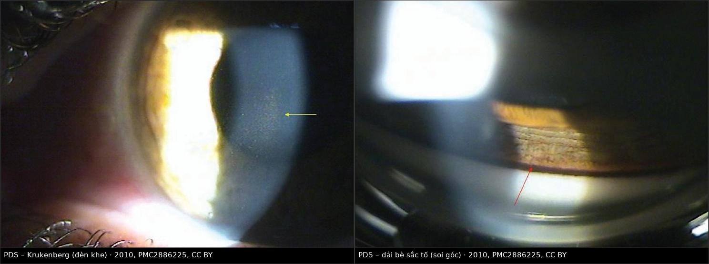
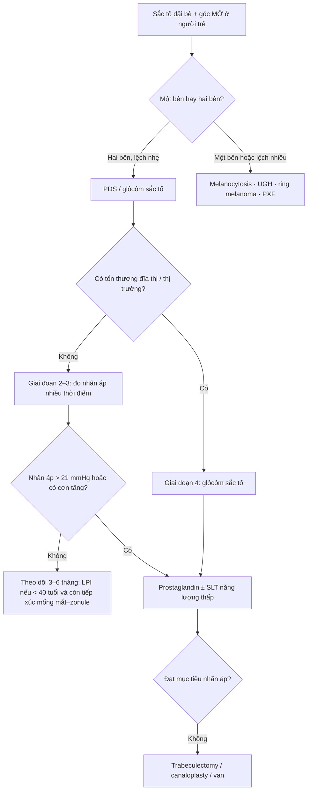
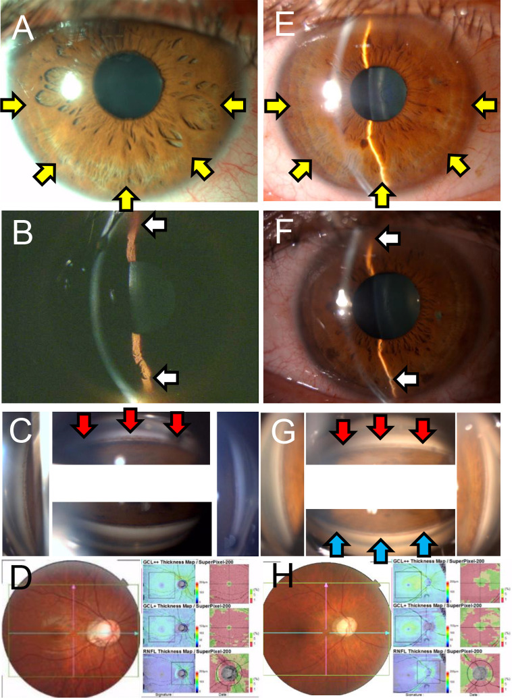
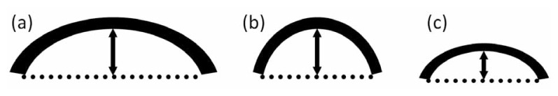

# 3249 — Hội chứng phân tán sắc tố (PDS) & glôcôm sắc tố: "sắc tố HAI bên, góc MỞ, mống mắt lõm ra sau" / Pigment dispersion syndrome & pigmentary glaucoma

**Tags:** `pattern:sac-to-goc-tien-phong` `pattern:goc-mo` `pattern:hai-ben` `pattern:glaucoma-thu-phat` `pattern:lom-mong-mat` `pattern:khong-co-khoi` `vung:mat` `vung:goc-tien-phong` `vung:mong-mat` `vung:the-mi` `vung:the-thuy-tinh` `protocol:soi-goc` `protocol:AS-OCT` `protocol:UBM-35-50MHz` `protocol:phe-thu-phenylephrine` `protocol:SLT` `score:khong` `incidentaloma:khong`

**Mức chắc chắn (certainty):** tổng hợp y văn (literature synthesis) — dựng từ **tổng quan + thang phân độ mới 2026** (*J Clin Med* 2026, **PMC12841909**, CC BY), **tổng quan PDS 2022** (*J Clin Transl Res* 2022, **PMC9741933**), **loạt 10 bệnh nhân Nhật có ảnh** (*PLoS One* 2022, **PMC9223319**, CC BY), **so sánh AS-OCT 25 mắt PG** (*Indian J Ophthalmol* 2022, **PMC9023982**), **Cochrane 2016 về LPI** (**PMC5032906**), **trabeculectomy 8 năm** (**PMC4894034**), **canaloplasty 11 năm** (**PMC7763242**) và **ca PDS không điển hình có ảnh** (**PMC2886225**, CC BY). Nhóm **không có bệnh nhân của mình**; chỗ chưa đủ chắc ghi **"chưa rõ"**. **Không ghi tên tác giả** — attribution dùng **tạp chí + năm + PMCID/DOI**, đối chiếu Europe PMC ngày **2026-11-21**.

> **Vị trí trong thư viện:** [3245](../3245-glaucoma-melanocytosis-mat/lesson.md) phủ **glôcôm sắc tố MỘT bên trên nền melanocytosis**; [3237](../3237-pxf-goc-dong-lpi-hay-lay-the-thuy-tinh/lesson.md) phủ **PXF + góc đóng**; [3238](../3238-ugh-sau-icl-phakic-iol/lesson.md) phủ **sắc tố + máu tiền phòng sau ICL**; [3246](../3246-goc-dong-cap-hai-ben-do-thuoc/lesson.md) phủ **góc đóng cấp hai bên do thuốc**. Bài này trả lời **một câu duy nhất**: *một người trẻ cận thị có sắc tố dày ở góc, góc MỞ, nhãn áp dao động từ 16 đến 50 mmHg — làm sao chứng minh đây là PDS (hai bên, cơ học mống mắt–zonule) chứ không phải melanocytosis, PXF, UGH hay melanoma mống mắt?*
>
> **Câu chốt:** **(1)** PDS là bệnh **HAI bên**, thường ở **nam cận thị 30–50 tuổi**, và **~10% chuyển thành glôcôm sắc tố sau 5 năm**, **15% sau 15 năm**, **tới 1/3 về lâu dài** (**PMC12841909**); **(2)** cơ chế là **mống mắt lõm ra sau + tiếp xúc mống mắt–zonule** → rỉ melanin → **đại thực bào/lưới bè quá tải** → tăng sức cản thoát dịch, nên **nhãn áp tăng theo cơn** và **có thể bình thường đúng lúc khám**; **(3)** bộ ba cổ điển **Krukenberg – TID hình nan hoa – sắc tố dải bè** có độ nhạy **rất khác nhau theo màu mống mắt**: ở người Nhật **TID 0%**, Krukenberg **10%**, nhưng **vạch Sampaolesi 100%** và **lõm mống mắt 100%** (**PMC9223319**); **(4)** **LPI không được chứng minh ngăn chuyển glôcôm** (Cochrane: **5 RCT, 260 mắt/195 người**) và **SLT trên lưới bè đầy sắc tố dễ gây vọt nhãn áp** — nên điều trị phải theo giai đoạn, không theo "thấy sắc tố là bắn laser".

## 1. Tổng quan bệnh học – cơ chế hình ảnh (TẠI SAO)

### 1.1 Chuyện gì đang cọ vào đâu

- **Biểu mô sắc tố mống mắt (iris pigment epithelium – IPE)** là **hai lớp tế bào đầy melanosome** ở mặt sau mống mắt. Melanosome là hạt **cỡ dưới 1 µm**, bền, không tan trong thủy dịch.
- Trong PDS, **mống mắt lõm ra sau** nên **phần giữa ngoại vi mặt sau mống mắt cọ vào các sợi zonule** khi đồng tử di động. Cọ học → **đứt lông melanosome** khỏi IPE → hạt melanin rơi vào tiền phòng.
- **Bằng chứng hình thái:** trên AS-OCT, **100% (25/25) mắt glôcôm sắc tố có mống mắt lõm (concave)**, so với **12% (3/25) mắt chứng**; **độ lõm (iris bowing) thì thái dương −0,29 mm ở PG so với +0,12 mm ở chứng** (âm = lõm ra sau) (**PMC9023982**). Đây là dấu **đo được**, không phải suy đoán.

### 1.2 Vì sao mống mắt lõm ra sau — "reverse pupillary block"

- Bình thường thủy dịch đi từ sau mống mắt ra trước qua đồng tử; chênh áp **sau > trước** đẩy mống mắt **ra trước** (mống mắt lồi).
- Ở mắt PDS, **tiền phòng sâu** và **thể thủy tinh–mống mắt có cấu hình đặc biệt**: áp lực tiền phòng **cao hơn tương đối** so với sau mống mắt (khi chớp mắt, thủy dịch bị đẩy vào tiền phòng) → mống mắt bị **ép ra sau** thành **"reverse pupillary block"** (**PMC12841909**).
- **Vì sao mắt cận thị:** cận thị trung bình–nặng đi kèm **tiền phòng sâu, thể tích tiền phòng lớn, góc rộng** — đúng điều kiện hình học cho mống mắt lõm. **Cận thị càng cao, nguy cơ chuyển PG càng lớn** (**PMC12841909**).
- **Vì sao triệu chứng theo hoàn cảnh:** rỉ sắc tố xảy ra khi **đồng tử di động mạnh** — **tập thể dục, phòng tối rồi ra sáng (rạp phim, hòa nhạc), chớp mắt nhiều, lắc đầu nhanh, điều tiết mạnh, stress** (**PMC12841909**). Đó là lý do bệnh nhân kể **"mờ từng cơn, quầng màu, đau đầu"** chứ không mờ liên tục.
- **Nghiên cứu AS-OCT ở người khỏe mạnh** cho thấy sau **20 phút chạy bộ**, độ lõm mống mắt tăng từ **−0,078 lên −0,153 mm** và AOD500 tăng từ **0,800 lên 0,942 mm** (**PMC5836894**) — tức **vận động thật sự làm thay đổi hình học góc**, không chỉ là "cảm giác".

### 1.3 Vì sao sắc tố làm tăng nhãn áp — lưới bè bị "no" melanin

- Hạt melanin xuống góc, **bị tế bào lưới bè thực bào**. Khi lượng hạt vượt khả năng tiêu hóa: **tế bào lưới bè chết theo chương trình, bè xẹp, màng bè dính nhau, vật liệu ngoại bào tăng, ống Schlemm bị bít** → **sức cản thoát dịch tăng** (**PMC12841909**).
- **Hệ quả định lượng:** nhãn áp trung vị **26 mmHg (22,5–31) ở PG** so với **15 mmHg (12,5–16) ở chứng** trong loạt AS-OCT (**PMC9023982**); nhiều bệnh nhân **phát hiện tình cờ với nhãn áp ≥ 50 mmHg** (**PMC12841909**).
- **Vì sao "nhãn áp bình thường mà thị trường đã mất":** tổn thương do **cơn tăng nhãn áp** (spike) lặp lại, không phải mức nhãn áp đo một lần. Tổng quan 2026 nhấn mạnh: **mỗi 1 mmHg tăng nhãn áp có thể làm nguy cơ chuyển PG tăng 1,4 lần**, và **phải đo nhãn áp nhiều thời điểm trong ngày** (**PMC12841909**).
- **Vì sao sắc tố trông nâu đậm:** melanin **hấp thụ mạnh bước sóng ngắn** (xanh) và phản xạ phần đỏ → nhìn **nâu sô-cô-la**; trên soi góc, vùng có nhiều melanin **tối hơn** vì phản xạ ít hơn — **màu là của sắc tố, không phải phù hay viêm**.

### 1.4 Vì sao HAI bên nhưng thường lệch — và vì sao "một bên" phải nghĩ bệnh khác

- PDS do **cấu hình giải phẫu hai mắt** (cận thị, tiền phòng sâu, mống mắt lõm) → **hai bên**. Nhưng mức rỉ sắc tố, mức sắc tố góc và nhãn áp **có thể lệch rõ**, nên một mắt có thể đã glôcôm trong khi mắt kia còn "chỉ PDS".
- Vì vậy **"một bên" là cờ đỏ**: melanocytosis mắt (bẩm sinh, một bên), UGH sau IOL/ICL (một bên hoặc lệch theo mắt mổ), ring melanoma mống mắt, PXF (thường lệch), chấn thương cũ. Bài [3245](../3245-glaucoma-melanocytosis-mat/lesson.md) xử lý nhánh một bên này.
- **Vì sao PDS "già đi thì dịu":** thể thủy tinh **dày lên theo tuổi** kéo mống mắt ra khỏi zonule; sắc tố **không tái sinh** nên cọ xát không giải phóng thêm; và **sắc tố có thể được thải khỏi lưới bè**. Trong theo dõi **17 năm**, **28% bệnh nhân cần ít thuốc hơn** ở giai đoạn muộn (**PMC12841909** dẫn lại). Đây là cơ sở của giai đoạn **"PDS không hoạt động"**.

### 1.5 Bảng số phải nhớ

| Chỉ số | Giá trị | Nguồn |
|---|---|---|
| PDS trong dân số / PG trong tổng số glôcôm | **1–2%** / **1–1,5%** | PMC9741933; PMC12841909 |
| Chuyển PDS → PG | **10% sau 5 năm**, **15% sau 15 năm**, **tới 1/3 lâu dài** | PMC12841909 |
| Nam giới trẻ cận thị so với nữ | **~3 lần** | PMC12841909 |
| Người da trắng so với da đen/Á | **~4 lần** (kiểu hình khác ở da đen: viễn thị, nữ, mống mắt lồi) | PMC12841909 |
| Tuổi chẩn đoán điển hình | **30–50 tuổi** | PMC12841909 |
| Nhãn áp lúc phát hiện | có thể **≥ 50 mmHg** | PMC12841909 |
| Mỗi **+1 mmHg** nhãn áp | nguy cơ chuyển PG **×1,4** | PMC12841909 |
| Bộ ba ở người da trắng (Krukenberg / sắc tố bè / TID) | **95% / 86% / 86%** (loạt gần: **91% / 88,9% / 24,3%**) | PMC12841909 |
| Bộ ba ở người Nhật (n = 10 bệnh nhân) | **10% / 60% / 0%**; **Sampaolesi 100%**, **lõm mống mắt 100%**, **giảm sắc tố giữa ngoại vi 90%** | PMC9223319 |
| AS-OCT PG so với chứng | **AOD500 1,11 vs 0,40 mm**; **TISA500 0,39 vs 0,15 mm²**; **lõm 100% vs 12%** | PMC9023982 |
| Trabeculectomy 8 năm (18 mắt) | **34,5 ± 4,7 → 13,7 ± 2,5 mmHg** | PMC4894034 |
| Canaloplasty (29 mắt, theo dõi TB 59,8 tháng) | **31,8 → 14,1 mmHg** ở 3 năm; **4 ca** phải trabeculectomy sau 3–30 tháng | PMC7763242 |

## 2. Mẫu hình + chẩn đoán phân biệt theo vị trí (gamut)

### 2.1 Bốn câu hỏi định vị (rẻ nhất trước)

1. **Một bên hay hai bên?** Hai bên + lệch nhẹ → PDS/PG. Một bên hoặc lệch nhiều → melanocytosis, UGH, melanoma, PXF, chấn thương.
2. **Góc mở hay đóng?** PDS **luôn góc mở** (thường rất rộng); nếu góc hẹp/đóng thì đang nhìn sai bệnh, hoặc có **thêm** PXF/thể thủy tinh to.
3. **Có khối, tiền sử chấn thương/mổ nội nhãn, hay IOL/ICL?** Có → UGH, pigment sau mổ, ring melanoma, PDS **thứ phát sau ICL**.
4. **Có dấu hiệu PXF?** Vảy trên bao trước thể thủy tinh, **mất viền đồng tử**, **phacodonesis**, **vạch Sampaolesi** — nhớ Sampaolesi **không dành riêng cho PDS**.

### 2.2 Gamut theo vị trí tổn thương

- **Sắc tố dày ở góc, góc MỞ:** PDS/PG · PXF · melanocytosis mắt/melanomalytic glaucoma · UGH sau IOL/ICL · ring melanoma mống mắt · sắc tố sau chấn thương (góc rẽ, iridodialysis) · hemosiderin sau xuất huyết tiền phòng · viêm màng bồ đào (tế bào + sắc tố) · PDS **thứ phát sau ICL**.
- **Sắc tố trên nội mô giác mạc:** **Krukenberg spindle** (PDS) · PXF · sau phẫu thuật (pigment trên IOL/mống mắt) · **blood staining** (hemosiderin sau hyphema) · melanocytosis · **BAIT** (bilateral acute iris transillumination sau moxifloxacin).
- **Khuyết xuyên sáng mống mắt (TID):** **hình nan hoa giữa ngoại vi** = PDS · **mất viền đồng tử** = PXF · **hình quạt** = chấn thương · **lan tỏa 4 phần tư** = BAIT/HSV · **sau ICL** = cọ xát mặt sau mống mắt.
- **Người trẻ cận thị + nhãn áp cao:** PG · **JOAG** (myocilin, góc có dị sản) · **glôcôm do corticoid** · **NTG** (đừng nhầm giai đoạn thoái triển của PDS với NTG — xem mục 5).

## 3. Bảng so sánh phân biệt (ma trận đối chiếu)

| Thực thể (entity) | Hình ảnh điển hình (đèn khe / soi góc / AS-OCT-UBM) | Chốt vào (rule-in) | Chốt loại (rule-out) | Gợi ý xác nhận |
|---|---|---|---|---|
| **PDS / glôcôm sắc tố** | **Hai bên**, góc **mở rộng**, sắc tố bè **đồng nhất, đậm, dưới > trên khi hoạt động**; **Krukenberg** trục dọc; **TID nan hoa giữa ngoại vi**; **lõm mống mắt** trên AS-OCT; vạch Sampaolesi có thể có | **Hai bên + góc mở + lõm mống mắt (bowing âm) + TID nan hoa** | **Một bên tuyệt đối + sắc tố củng mạc/mống mắt một bên** → melanocytosis; **mất viền đồng tử + vảy bao trước** → PXF; **tiền sử chấn thương/mổ** → UGH | Soi góc ấn (indentation) hai mắt cạnh nhau; retroillumination; AS-OCT đo độ lõm; đo nhãn áp nhiều thời điểm |
| **PXF (pseudoexfoliation)** | Vảy trắng xám trên **bao trước thể thủy tinh + viền đồng tử**, **mất viền đồng tử**, **phacodonesis**, sắc tố bè **lệch**, **vạch Sampaolesi** (điển hình PXF), góc có thể hẹp | **Vảy bao trước + mất viền đồng tử + tuổi > 60** | **TID nan hoa giữa ngoại vi + lõm mống mắt + hai bên đối xứng ở người trẻ** → PDS | Soi sau giãn đồng tử tìm vảy; UBM/AS-OCT đánh giá zonule và góc |
| **Melanocytosis / melanomalytic glaucoma** | **Sắc tố củng mạc ngoài + mống mắt một bên**, đáy mắt tối một bên, **heterochromia**; góc đầy sắc tố nhưng **có thể không có TID**; UBM tìm khối | **Một bên + sắc tố củng mạc ngoài/mammillation** | **Hai bên + bowing âm + TID nan hoa** → PDS | Soi củng mạc dưới ánh sáng; UBM 35–50 MHz trước can thiệp góc; theo dõi melanoma |
| **UGH sau IOL/ICL** | **Một bên (mắt mổ)**, tế bào + sắc tố tiền phòng, **hyphema nhỏ**, IOL/ICL **cọ mặt sau mống mắt** trên UBM, có thể **nang thể mi** | **Tiền sử IOL/ICL + cọ xát trên UBM + đáp ứng với thuốc tra/đổi vị trí** | **Hai bên, không phẫu thuật, bowing âm** → PDS | UBM 35–50 MHz tìm khoảng hở ICL–mống mắt; hỏi mổ khúc xạ **nhiều năm trước** |
| **Ring melanoma mống mắt** | Sắc tố **360°** mống mắt, **dày không đều**, **UBM/AS-OCT có thể không thấy khối**, giảm thị lực, có thể **tăng nhãn áp một bên** | **Sắc tố 360° + dày khu trú + một bên + tiến triển** | **Hai bên + TID nan hoa đối xứng + không dày** → PDS | UBM/AS-OCT đo độ dày mống mắt; sinh thiết khi nghi ngờ; theo dõi sát |
| **PDS thứ phát sau ICL** | **Hai bên**, khởi phát **nhiều năm sau đặt ICL** (ca báo: **13 năm**), sắc tố nội mô + TID + sắc tố bè, **ICL áp mặt sau mống mắt** | **Tiền sử ICL + TID/vault bất thường + hai bên** | **Không phẫu thuật, bowing âm nguyên phát** → PDS nguyên phát | UBM đo vault và khoảng hở; hỏi mổ khúc xạ |
| **Sắc tố sinh lý ở mống mắt nâu đậm** | Sắc tố bè **đều, nhẹ–trung bình**, **không TID**, **không lõm mống mắt**, nhãn áp bình thường, **hai bên đối xứng** | **Sắc tố nhẹ + không dấu hiệu cơ học + nhãn áp bình thường** | **Lõm mống mắt + TID + sắc tố đậm + nhãn áp dao động** → PDS | AS-OCT hình thái mống mắt; theo dõi nhãn áp nhiều lần |

*Trái: sắc tố trục dọc trên nội mô (Krukenberg). Phải: dải bè phủ sắc tố nâu đậm trên soi góc. Nguồn: Tạp chí 2010, PMC2886225, CC BY. Ảnh ghép letterbox.*

### 3.1 Ba dấu hiệu "thay thế" khi mống mắt quá đậm

- **Vạch Sampaolesi** (sắc tố **trước** đường Schwalbe) — nhạy **100%** trong loạt người Nhật (**PMC9223319**), nhưng **không đặc hiệu** (PXF cũng có).
- **Lõm mống mắt (iris concavity/bowing)** trên **AS-OCT hoặc UBM** — nhạy **100%** trong cùng loạt và **100%** trong loạt AS-OCT (**PMC9023982**).
- **Giảm sắc tố mống mắt giữa ngoại vi (midperipheral depigmentation)** — nhìn trên đèn khe thấy **vùng mất màu/vân mống mắt** ở giữa ngoại vi, nhạy **90%** (**PMC9223319**); đây là **mặt trước** của cùng quá trình bào mòn mặt sau.

## 4. Protocol chụp/khám + hệ phân độ & ngưỡng xử trí

### 4.1 Trình tự khám tối thiểu (mỗi lần)

1. **Nhãn áp kế Goldmann (GAT)** — **không dùng nhãn áp không tiếp xúc** vì máy đo không tiếp xúc **thường đọc cao hơn** (**PMC12841909**); đo **nhiều thời điểm trong ngày**, ghi giờ.
2. **Đèn khe:** tìm **Krukenberg** (trục dọc), tế bào/sắc tố tiền phòng, **giảm sắc tố giữa ngoại vi**.
3. **Retroillumination sau giãn đồng tử:** tìm **TID hình nan hoa**; đồng thời **soi bao trước thể thủy tinh + zonule** (vảy PXF, sắc tố trên dây zonule = **Scheie stripe/Zentmayer ring**).
4. **Soi góc ấn (indentation gonioscopy):** ghi **mức sắc tố bè** (đồng nhất/đậm), **dưới so với trên** (dấu **pigment reversal**), **vạch Sampaolesi**, **góc mở/rộng**, có **PAS** hay không. Soi **hai mắt cạnh nhau**.
5. **Đĩa thị + OCT RNFL/GCC + thị trường 24-2 hoặc 30-2** — bệnh nhân trẻ làm thị trường **dễ hơn** người già nên **phải làm sớm và lặp lại** (**PMC12841909**).
6. **AS-OCT/UBM** khi cần chứng minh cơ chế: **độ lõm mống mắt**, **ACD**, **TISA500/AOD500**, khoảng hở mống mắt–zonule, và **loại trừ ICL/IOL cọ xát**.

### 4.2 Test kích thích bằng phenylephrine (khi nhãn áp bình thường mà nghi ngờ)

- Nhỏ **phenylephrine 10% ba lần, cách 5 phút**; đánh giá **sắc tố thoát vào tiền phòng**; đo nhãn áp ở **giờ thứ 1 và thứ 2** sau nhỏ, xử trí nếu nhãn áp tăng (**PMC12841909**).
- **Ý nghĩa:** chọn bệnh nhân **có nguy cơ tăng nhãn áp** — nhóm này là đối tượng tiềm năng của LPI trong các nghiên cứu chọn lọc (xem 4.4).

### 4.3 Thang phân độ 5 giai đoạn (2026) — dùng để quyết định, không phải để "dán nhãn"

| Giai đoạn | Đặc điểm | Xử trí gợi ý |
|---|---|---|
| **1. PDS tiền lâm sàng** | Không dấu hiệu; bè **đậm hơn bình thường nhưng chưa đồng nhất**; **chưa có Krukenberg/TID**; **lõm mống mắt thấy trên AS-OCT**; nhãn áp bình thường, **không cơn tăng** | **Không điều trị**; theo dõi định kỳ |
| **2. PDS rõ + nghi glôcôm** | Đủ dấu hiệu; nhãn áp **thường bình thường nhưng có cơn tăng**; **chưa tổn thương đĩa thị** | Theo dõi **sát hơn nếu có yếu tố nguy cơ**; **LPI cân nhắc ở người < 40 tuổi có reverse pupillary block rõ** |
| **3. Chuyển thành PG** | Nhãn áp **tăng ở phần lớn**, cơn tăng biên độ lớn; **chưa tổn thương** | Khám **mỗi 3–6 tháng**; nếu nhãn áp **> 21 mmHg rõ** → **SLT hoặc thuốc**; nặng → cân nhắc phẫu thuật |
| **4. Glôcôm sắc tố** | **Có tổn thương đĩa thị/thị trường** | Như glôcôm góc mở: **prostaglandin trước**, **SLT năng lượng thấp**, **phẫu thuật sớm hơn POAG** vì bệnh nhân trẻ |
| **5. PDS không hoạt động** | **Sắc tố trên > dưới** (pigment reversal), **không còn cơn tăng**, cần **ít thuốc hơn** | **Giảm thuốc** khi có thể; theo dõi |

### 4.4 Ngưỡng điều trị — số của từng lựa chọn

- **Thuốc:** **prostaglandin là lựa chọn đầu tay** (tăng thoát qua đường thể mi–củng mạc); RCT 1 năm cho thấy **latanoprost 1 lần/ngày hiệu quả và dễ dung nạp hơn timolol 2 lần/ngày** (**PMC12841909** dẫn lại). **Pilocarpine** làm hẹp đồng tử và giảm lõm mống mắt nhưng **gây co thắt điều tiết, nhức đầu, tăng nguy cơ bong võng mạc** ở người cận thị trẻ → **hiếm dùng dài hạn**.
- **SLT:** hiệu quả **tới ~2 năm**, **thời gian thất bại trung bình ~27 tháng**; **lưới bè đầy sắc tố dễ vọt nhãn áp** → **giảm năng lượng** và **dự phòng** (hạ nhãn áp trước, acetazolamide uống ở nhóm nguy cơ) (**PMC12841909**). **ALT** có dữ liệu cũ hơn: **thành công 45% sau 6 năm**.
- **LPI:** về cơ chế làm giảm hạt melanin trong tiền phòng, nhưng **Cochrane 2016 (5 RCT, 260 mắt/195 người)** **không chứng minh** giảm tiến triển thị trường và **không gộp được số liệu**; tổng quan **8 thử nghiệm/218 người** cũng **không đổi nguy cơ tiến triển sau trung bình 28 tháng** (**PMC5032906**; **PMC12841909**). Chỉ **cân nhắc** ở người **< 40 tuổi**, còn **tiếp xúc mống mắt–zonule**, nhãn áp bình thường, **chưa tổn thương**.
- **Phẫu thuật:** **trabeculectomy 8 năm: 34,5 ± 4,7 → 13,7 ± 2,5 mmHg** (18 mắt); **canaloplasty: 31,8 → 14,1 mmHg ở 3 năm** (29 mắt), **4 ca** phải trabeculectomy; **iStent + phaco: 95% giữ < 18 mmHg ở 3 năm** — nhưng **kết quả MIGS trong PG không đồng nhất** (có loạt báo kiểm soát **kém hơn** POAG; **trabecular aspiration chỉ 12% thành công sau 1 tháng**) (**PMC4894034**; **PMC7763242**; **PMC12841909**).
- **Lấy thể thủy tinh sớm** ở người lớn tuổi **loại bỏ cọ xát mống mắt–thể thủy tinh** và được khuyến cáo khi có đục thể thủy tinh (**PMC12841909**).

## 5. Biến thể bình thường và cạm bẫy

- **Mống mắt nâu/đen dày:** **TID có thể vắng hoàn toàn** (0% ở loạt người Nhật) và **Krukenberg chỉ 10%** — **không được loại trừ PDS** chỉ vì thiếu bộ ba; chuyển sang **Sampaolesi + lõm mống mắt + giảm sắc tố giữa ngoại vi** (**PMC9223319**).
- **Vạch Sampaolesi ≠ PDS:** đây là dấu **điển hình của PXF**; thấy Sampaolesi mà không có TID/lõm mống mắt phải **giãn đồng tử tìm vảy bao trước** và **mất viền đồng tử**.
- **Nhãn áp bình thường tại phòng khám:** PDS gây **cơn tăng**; đo một lần có thể **bỏ sót glôcôm** — cần **đo nhiều thời điểm**, hỏi triệu chứng **sau vận động/phòng tối**, và **đánh giá đĩa thị/RNFL** chứ không chỉ nhãn áp.
- **Giai đoạn thoái triển bị gọi là POAG/NTG:** khi sắc tố đã thải bớt và nhãn áp "bình thường", bệnh nhân **vẫn có tổn thương thị trường** → dễ bị xếp vào **NTG**; hỏi tiền sử **cận thị, cơn mờ, sắc tố cũ**, tìm **pigment reversal** (trên > dưới) và **lõm mống mắt** (**PMC9223319**; **PMC12841909**).
- **PDS sau ICL xuất hiện nhiều năm sau mổ** (ca báo **13 năm**) → **luôn hỏi tiền sử phẫu thuật khúc xạ** ở người trẻ có sắc tố; đây là PDS **thứ phát**, xử lý khác (xem [3238](../3238-ugh-sau-icl-phakic-iol/lesson.md)) (**PMC11052560**).
- **Bất đối xứng "vừa phải" vs "một bên":** PDS hai bên có thể lệch; nhưng **sắc tố củng mạc ngoài một bên, heterochromia, đáy mắt tối một bên** là **melanocytosis**, không phải PDS (xem [3245](../3245-glaucoma-melanocytosis-mat/lesson.md)).
- **SLT trên bè đầy sắc tố:** **vọt nhãn áp** đã được báo ở nhóm PG dù dùng **năng lượng thấp hơn** POAG → **không bắn "mạnh tay"** vì bè "đen".
- **LPI không phải "chữa khỏi":** đừng hứa với bệnh nhân rằng LPI ngăn được glôcôm — bằng chứng hiện tại **không chứng minh** điều đó.

## 6. Tự lượng giá — Blind Quiz

**Ca 1 — nam 28 tuổi, cận thị, nhãn áp 15–16 mmHg nhưng thị trường đã mất nhiều**

- Gợi ý lâm sàng: nam **28 tuổi**, cận thị **−3,75 D hai mắt**, nhãn áp **15/16 mmHg** lúc khám, **MD −17,7 dB** mắt phải; ảnh A–D là mắt phải.
- Câu hỏi: (1) Ba dấu hiệu nào được đánh dấu? (2) Vì sao nhãn áp "bình thường" mà đĩa thị đã tổn thương nặng? (3) Chẩn đoán?

<b>Bấm để hiện đáp án (findings + chẩn đoán)</b>

- Dấu hiệu: mũi tên **vàng** = **giảm sắc tố mống mắt giữa ngoại vi**; mũi tên **trắng** = **lõm mống mắt**; mũi tên **đỏ** = **sắc tố dải bè + vạch Schwalbe**; mũi tên **xanh** = **dấu đảo sắc tố** (trên > dưới) ở giai đoạn thoái triển; D/H = RNFL và GCC mỏng.
- Chẩn đoán: **glôcôm sắc tố** — tổn thương do **cơn tăng nhãn áp** lặp lại (spike), không phải mức đo một lần; đây là lý do phải đo nhãn áp nhiều thời điểm và chụp OCT.
- Nguồn ảnh: *PLoS One* 2022, **PMC9223319**, CC BY.

**Ca 2 — nam 30 tuổi, viễn thị +2,5 D, một mắt nhãn áp 38 mmHg**

- Gợi ý lâm sàng: nam **30 tuổi**, **viễn thị +2,5 D** (không cận thị), nhãn áp **38 mmHg mắt phải / 16 mmHg mắt trái**, **không có TID**, đĩa thị và thị trường bình thường.
- Câu hỏi: (1) Hai dấu hiệu trong ảnh? (2) Vì sao ca này **không điển hình**? (3) Có loại trừ được PDS vì bệnh nhân viễn thị và không có TID không?

<b>Bấm để hiện đáp án (findings + chẩn đoán)</b>

- Dấu hiệu: **Krukenberg spindle** (sắc tố trục dọc trên nội mô) và **sắc tố dày đồng nhất ở dải bè**; kèm **sắc tố mống mắt đồng tâm**, **không có TID**.
- Chẩn đoán: **PDS/glôcôm sắc tố không điển hình** — PDS **hiếm nhưng có** ở người viễn thị, và **TID có thể vắng** (đặc biệt mống mắt đậm); chẩn đoán dựa trên **sắc tố bè + lõm mống mắt + hai bên**, không dựa riêng vào TID.
- Phản biện: ca đơn lẻ, không đại diện cho quần thể — nhưng đúng nguyên tắc "bộ ba không bắt buộc đủ".
- Nguồn ảnh: *Oman J Ophthalmol* 2010, **PMC2886225**, CC BY.

**Ca 3 — sơ đồ: đo "độ lõm" mống mắt**

- Gợi ý lâm sàng: ba đường cong (a), (b), (c) là mặt sau mống mắt trên mặt cắt; đường chấm là **dây cung** nối chân mống mắt với bờ đồng tử.
- Câu hỏi: (1) Mũi tên hai đầu đo gì? (2) Đường cong nào tương ứng mống mắt lõm ra sau? (3) Vì sao đo này quan trọng hơn "nhìn mống mắt đẹp hay xấu"?

<b>Bấm để hiện đáp án (findings + chẩn đoán)</b>

- Dấu hiệu: mũi tên đo **khoảng cách lớn nhất từ dây cung đến mặt sau mống mắt** = **độ lõm (iris concavity/bowing)**; giá trị **âm** = lõm ra sau.
- Đáp án: **(a) lõm nhiều nhất**; trong nghiên cứu AS-OCT, **PG có bowing −0,29 mm** so với **+0,12 mm ở chứng**, và **100% PG lõm** so với **12% chứng**.
- Vì sao quan trọng: đây là **dấu cơ chế đo được**, giúp chứng minh PDS khi **TID/Krukenberg không có** (mống mắt đậm) và giúp chọn người có thể hưởng lợi từ LPI.
- Nguồn ảnh: *J Ophthalmic Vis Res* 2010, **PMC3379916**, CC BY.

## 7. Câu hỏi nghiên cứu & điểm chưa đồng thuận (tính đến 11/2026)

1. **[Tranh cãi] Ở bệnh nhân PDS chưa có tổn thương thị thần kinh, LPI có giảm nguy cơ chuyển thành glôcôm sắc tố so với theo dõi đơn thuần không?**
   - **Đã biết:** Cochrane 2016 gộp **5 RCT (260 mắt/195 người)** không thể meta-analysis; không thử nghiệm nào chứng minh giảm tiến triển thị trường. Ngược lại, LPI ở nhóm chọn bằng **test phenylephrine** giảm nguy cơ tăng nhãn áp trong **10 năm** ở người **< 35 tuổi**.
   - **Chưa rõ:** lợi ích có thật ở nhóm chọn lọc (phenylephrine dương, < 40 tuổi, còn tiếp xúc mống mắt–zonule) hay chỉ là hiệu ứng của quần thể trẻ.
   - **Hướng nghiên cứu:** RCT phân tầng theo **test phenylephrine/độ lõm AS-OCT**, kết cục **chuyển PG + thị trường ≥ 5 năm**.
   - **Nguồn:** PMC5032906 (2016); PMC12841909 (2026).

2. **[Khác biệt thực hành] Bộ ba cổ điển (Krukenberg, TID nan hoa, sắc tố dải bè) có đủ nhạy ở mống mắt nâu/đen để không bỏ sót PG?**
   - **Đã biết:** người da trắng **Krukenberg 95% / bè 86% / TID 86%** (loạt gần **91 / 88,9 / 24,3%**); người Nhật **10 / 60 / 0%**, bù lại **Sampaolesi 100%**, **lõm mống mắt 100%**, **giảm sắc tố giữa ngoại vi 90%**.
   - **Chưa rõ:** ngưỡng "đủ" theo tông mống mắt, và nguy cơ chuyển PG có khác theo kiểu hình sắc tộc hay không.
   - **Hướng nghiên cứu:** nghiên cứu chẩn đoán đa sắc tộc, chuẩn tham chiếu AS-OCT/UBM, báo cáo **sens/spec từng dấu**.
   - **Nguồn:** PMC9223319 (2022); PMC12841909 (2026).

3. **[Khoảng trống] Có công cụ tiên lượng chuyển PG tốt hơn các yếu tố lâm sàng (nhãn áp khởi đầu, Krukenberg, bệnh > 5 năm) chưa?**
   - **Đã biết:** PRS đa tính trạng (OAG + IOP + VCDR) phân tầng được nguy cơ: nhóm ngũ phân vị cao nhất **OR 5,29 (95% CI 1,57–21,28)** so với thấp nhất, trên **264 + 203 người** — nhưng là nghiên cứu **cắt ngang**.
   - **Chưa rõ:** giá trị tiên lượng **theo thời gian**, và khả năng chuyển sang quần thể **không phải da trắng**.
   - **Hướng nghiên cứu:** đoàn hệ tiến cứu kết hợp **PRS + AS-OCT**, kết cục chuyển PG/tiến triển thị trường.
   - **Nguồn:** PMC12797852 (2026).

## Bài liên quan chéo

- [3245 – Glôcôm trên nền melanocytosis mắt: sắc tố MỘT bên](../3245-glaucoma-melanocytosis-mat/lesson.md)
- [3237 – PXF + góc đóng: LPI hay lấy thể thủy tinh](../3237-pxf-goc-dong-lpi-hay-lay-the-thuy-tinh/lesson.md)
- [3238 – UGH sau ICL (sắc tố + máu tiền phòng)](../3238-ugh-sau-icl-phakic-iol/lesson.md)
- [3234 – PXF không glôcôm: theo dõi, SLT hay phaco sớm](../3234-pex-khong-glaucoma-theo-doi-slt-phaco-som/lesson.md)
- [3246 – Góc đóng cấp hai bên do thuốc](../3246-goc-dong-cap-hai-ben-do-thuoc/lesson.md)
- [3247 – Đục bao trước sau ICL](../3247-duc-bao-truoc-sau-icl-phakic/lesson.md)

## Ảnh

- `images/3249_pds-glaucoma_SlitLamp_PMC2886225.jpg` — *Oman J Ophthalmol* 2010, **PMC2886225**, CC BY.
- `images/3249_pds-glaucoma_Gonio_PMC2886225.jpg` — *Oman J Ophthalmol* 2010, **PMC2886225**, CC BY.
- `images/3249_pds-glaucoma_SlitLamp-Gonio-OCT_PMC9223319.jpg` — *PLoS One* 2022, **PMC9223319**, CC BY.
- `images/3249_pds-glaucoma_AS-OCT-Schema_PMC3379916.jpg` — *J Ophthalmic Vis Res* 2010, **PMC3379916**, CC BY.
- `images/composite_bo-ba-dau-hieu.jpg` — ảnh ghép từ hai ảnh **PMC2886225**, CC BY.
- Chi tiết nguồn, hình gốc, giấy phép và phái sinh: `images/CREDITS.md`.

> Không dùng để chẩn đoán độc lập khi chưa có người hướng dẫn.
