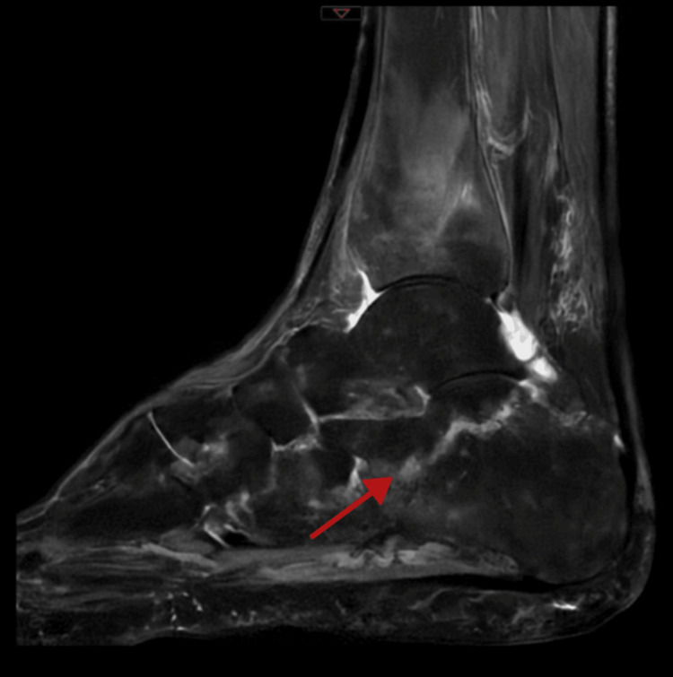
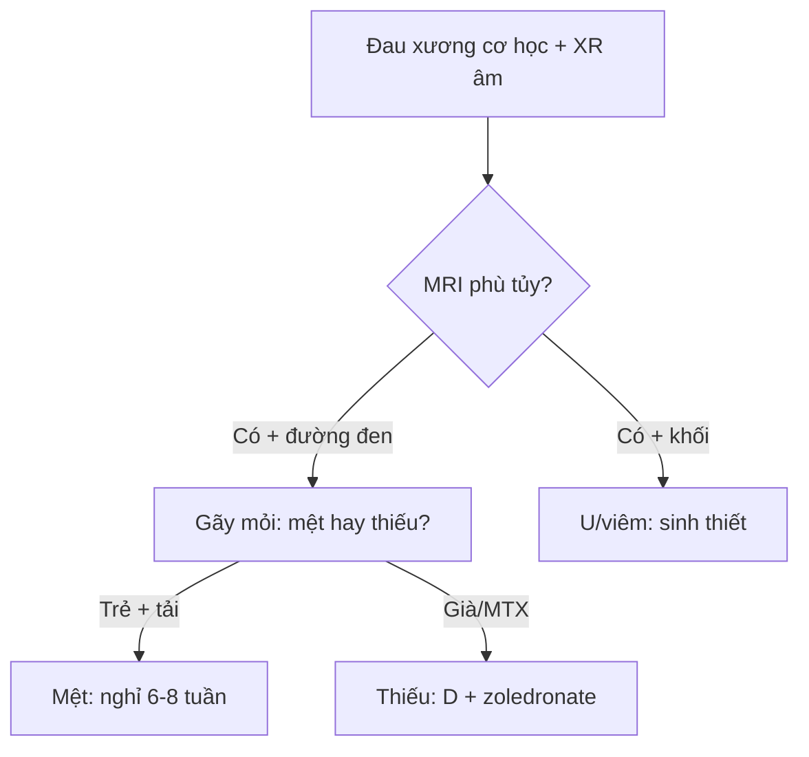

# 325 — Gãy kín đáo & gãy mỏi: phù tủy trên MRI / Occult & stress fractures

**Tags:** `pattern:gay-kin-moi` `vung:xuong` `protocol:MRI-stress`
**Mức chắc chắn (certainty):** tổng hợp y văn (literature synthesis) — nhóm tự biên từ y văn mở, chưa gắn ca nguyên văn đơn lẻ.

## 1. Tổng quan — X-quang mù 2–3 tuần đầu, MRI thấy phù từ ngày đầu

- Gãy mỏi (stress): mệt (fatigue: lực bất thường + xương lành, vận động viên) vs thiếu (insufficiency: lực thường + xương yếu, loãng xương/MTX/thuốc) — TẠI SAO X-quang thường âm tính 2–3 tuần đầu: phải mất 30–50% khoáng mới thấy, trong khi phù tủy (máu + dịch viêm) hiện ngay trên STIR/T2 fat-sat.
- Diễn tiến MRI: phù màng xương → phù tủy → đường gãy đen T1/T2 → gãy hoàn toàn — TẠI SAO đường gãy đen cả 2 xung: bè xương đặc + xơ, không còn proton tự do.
- Thuốc (methotrexate dài hạn) + viêm khớp cũng gãy thiếu dù DEXA bình thường — đừng đổ hết cho loãng xương.

## 2. Gamut đau xương cơ học không chấn thương (Gamut)

- **Vận động viên + đau tăng dần + phù tủy + đường đen:** gãy mệt — nghỉ + giảm tải 6–8 tuần.
- **Già/loãng/MTX + đau + phù gót-chày:** gãy thiếu — giảm tải + canxi/D + zoledronate + ngừng thuốc gây xương.
- **X-quang âm + MRI phù:** gãy kín — CT lát mỏng tìm đường gãy + bảo vệ.
- **Phù lan + khối + đau đêm:** u/viêm (bài 330/370) — sinh thiết/cấy, đừng bó bột mù.

## 3. Bảng so sánh phân biệt (ma trận đối chiếu)

| Thực thể (entity) | Hình ảnh điển hình | Chốt vào (rule-in) | Chốt loại (rule-out) | Gợi ý xác nhận |
|---|---|---|---|---|
| Gãy mệt | **Phù tủy + đường đen T1/T2 + VĐV + xương lành** | **Tải tăng + phù khu trú + đường gãy** | Uống MTX/loãng → thiếu | Nghỉ 6–8 tuần + quay lại dần |
| Gãy thiếu | **Phù gót/chày/xương cùng + già/MTX + DEXA có thể bình thường** | **Lực thường + xương yếu + phù** | Trẻ + tải cao → mệt | Giảm tải + D + zoledronate + ngừng MTX |
| Gãy kín chấn thương | **X-quang âm + MRI phù + tiền sử ngã** | **Chấn thương + phù + đường gãy CT** | Không chấn thương → mỏi | CT + bó/nẹp |
| U/viêm giả mỏi | **Khối + hoại tử + ngấm + đau đêm/sốt** | **Khối/mủ + toàn thân** | Phù đơn thuần + cơ học → mỏi | Sinh thiết/cấy trước bó bột |

*Phù gót sau-dưới lan rộng, X-quang gần như bình thường, DEXA bình thường (MTX 15 năm!). Nguồn: Hajar et al., Cureus 2026 Fig. 1, CC BY 4.0.*

## 4. Protocol MRI stress

- **MRI STIR/T1 + CT lát mỏng** khi đau cơ học + X-quang âm; DEXA + thuốc + vitamin D khi gãy thiếu.

## 5. Cạm bẫy

- **Gãy thiếu gọi nhầm flare viêm khớp** (ca trên!) — cơ học + MRI phù + viêm bình thường là gãy, không phải flare.
- **DEXA bình thường loại trừ gãy thiếu** — MTX/vùng chịu lực vẫn gãy (ca trên!).
- **Phù lan tưởng u** mổ oan — đường đen + bối cảnh tải + không khối mới là mỏi.

## 6. Tự lượng giá — Blind Quiz

**Ca 1 — Bà 75 tuổi viêm khớp lui bệnh + đau gót cơ học 12 tháng, XR mờ. Đọc MRI.**

- Hỏi: tín hiệu gì? Gãy thiếu hay flare? Thuốc nào phải ngừng?

<b>Bấm để hiện đáp án</b>

- Dấu hiệu (findings): phù tủy gót lan tỏa + đường gãy, không viêm màng hoạt dịch.
- Chẩn đoán (diagnosis): **gãy thiếu gót do MTX (15 mg/tuần 15 năm)** — ngừng MTX + giảm tải + zoledronate (DEXA bình thường vẫn gãy!).
- Nguồn: Hajar et al., Fig. 1, CC BY 4.0.

**Ca 2 — Lính tân binh chạy + đau chày + phù + đường đen:** mệt hay thiếu? *(Bảng mục 3.)*

<b>Bấm để hiện đáp án</b>

- **Gãy mệt:** nghỉ 6–8 tuần + quay lại dần (xương lành + tải bất thường).

## Bài liên quan chéo
- [300 – Tổng quan MSK](../300-tong-quan-he-co-xuong-khop/lesson.md)
- [320 – Gãy & trật khớp](../320-gay-xuong-trat-khop-cap-cuu/lesson.md) (gãy rõ)
- [330 – U xương](../330-tiep-can-u-xuong-va-dont-touch/lesson.md) (phù quanh u)

> Không dùng để chẩn đoán độc lập khi chưa có người hướng dẫn.
