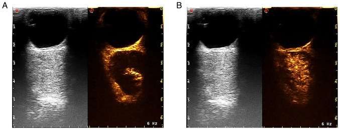
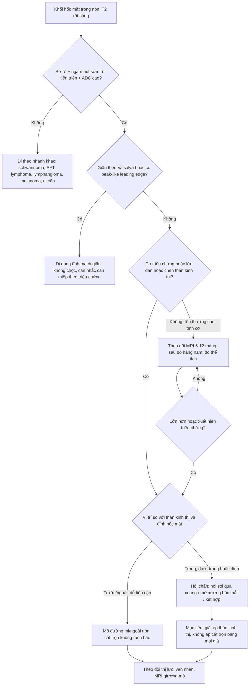
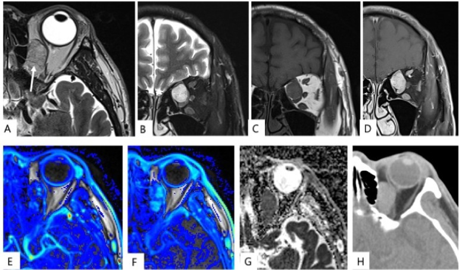
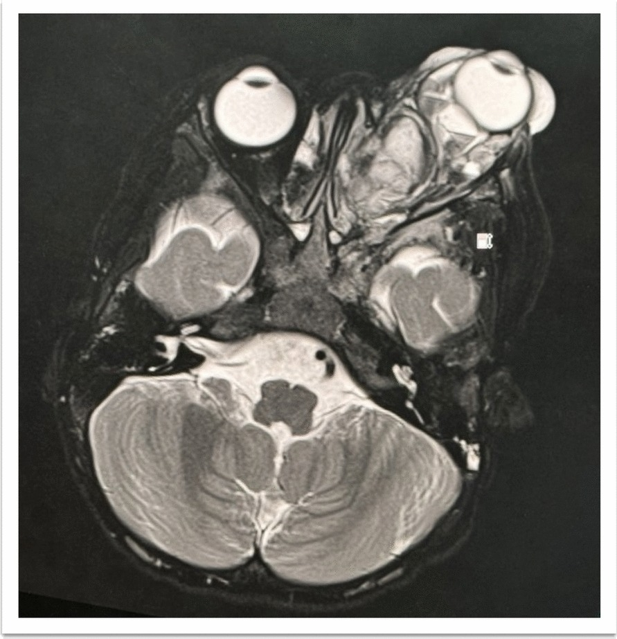
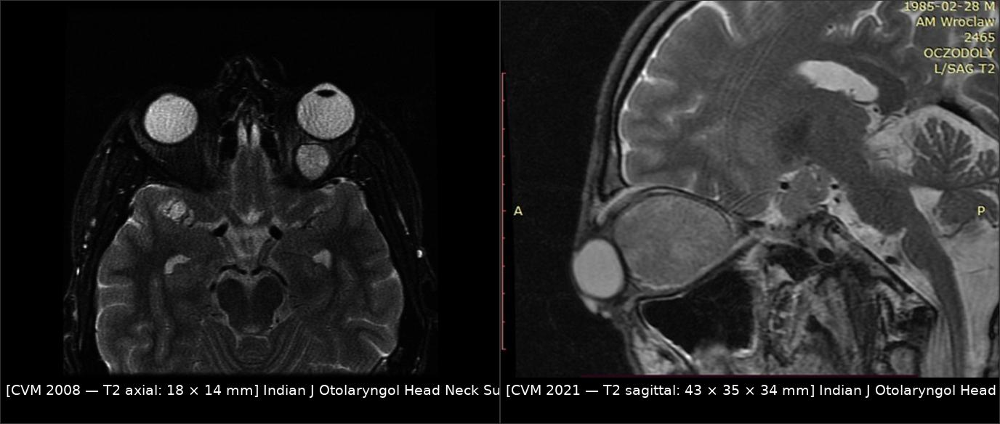

# 3250 — U mạch máu thể hang hốc mắt: T2 rất sáng + ngấm thuốc tiến triển / Orbital cavernous venous malformation

**Tags:** `pattern:khoi-hoc-mat` `pattern:trong-non` `pattern:t2-rat-sang` `pattern:ngam-tien-trien` `pattern:khong-han-che-khuech-tan` `pattern:duong-t2-thap-tuyen-tinh` `pattern:phebolith` `pattern:khong-gian-theo-valsalva` `vung:mat` `vung:hoc-mat` `protocol:MRI-hoc-mat` `protocol:CT-lat-mong` `protocol:DWI-ADC` `protocol:DCE` `protocol:T1-fat-sat` `protocol:Valsalva` `score:ADC-ratio` `incidentaloma:u-hoc-mat`

**Mức chắc chắn (certainty):** tổng hợp y văn (literature synthesis) — dựng từ **tổng quan sinh học – mô bệnh CVM** (*Arq Bras Oftalmol* 2024, **PMC11622445**, CC BY), **26 CVM đối chiếu 13 schwannoma có MRI/CT/DCE/ADC** (*Sci Rep* 2025, **PMC12615646**, CC BY-NC-ND), **56 CVM có siêu âm cản quang** (*Exp Ther Med* 2025, **PMC12131292**, CC BY-NC-ND), **116 bệnh nhân venous malformation hốc mắt (51 không giãn / 65 giãn)** (*Invest Ophthalmol Vis Sci* 2025, **PMC12707329**, CC BY-NC-ND), **91 khối hốc mắt bờ rõ có mô bệnh** (*Ophthalmic Plast Reconstr Surg* 2024, DOI 10.1097/IOP.0000000000002584), **43 u hốc mắt tình cờ** (*Sci Rep* 2025, **PMC12647749**, CC BY), ca **trẻ 3 tuổi CVM chảy máu trong u** (*J Med Case Rep* 2026, **PMC13037030**, CC BY), ca **lớn 43 × 35 × 34 mm theo dõi 13 năm** (*Indian J Otolaryngol Head Neck Surg* 2023, **PMC10234882**, CC BY), ca **CVM lớn có CT–MRI–ngấm muộn** (*Cureus* 2025, **PMC12515354**, CC BY), **386 ca nội soi trong 56 nghiên cứu** (DOI 10.1007/s00405-026-10766-z) và **60 ca mổ có/không cryo** (*BMC Ophthalmol* 2026, **PMC13343621**, CC BY). Nhóm **không có bệnh nhân của mình**; số nào chưa kiểm chứng ghi "chưa rõ". **Không ghi tên tác giả** — attribution dùng tạp chí + năm + PMCID/DOI.

> **Câu chốt:** đây **KHÔNG phải u** mà là **dị dạng tĩnh mạch dòng chậm, không giãn** (low-flow nondistensible venous malformation) theo ISSVA — tên cũ "cavernous hemangioma" là **di sản danh pháp** và là nguồn gốc của hai sai lầm: **(1) sinh thiết khối** (chảy máu, rách bao) và **(2) cắt "cho hết u"** dù đang chèn thần kinh thị. Bốn con số phải thuộc: **(a)** CVM chiếm **4–9% tổng u hốc mắt** (DOI 10.25259/SNI_274_2021), **5–15% tổng khối hốc mắt** (DOI 10.1016/j.wneu.2023.07.023), **9% các ca báo cáo** (PMC11622445); **> 80% trong nón**, thường **phía ngoài thần kinh thị**; **(b)** ngấm thuốc **tiến triển 93,9%** (10.1097/IOP.0000000000002584), dạng **nút sớm → lan dần muộn**, còn schwannoma ngấm **lan sớm** (PMC12615646); **(c)** **ADC 1,26 ± 0,21** × 10⁻³ mm²/s và **tỷ lệ ADC 1,8 ± 0,4** — **không hạn chế khuếch tán**, khác lymphoma **0,9 ± 0,2** (PMC12615646; 10.1097/IOP.0000000000002584); **(d)** lớn chậm **~0,2 cm³/năm** (DOI 10.1016/j.wneu.2023.07.023) nhưng **có thể đứng yên nhiều năm rồi lớn** — ca **18 × 14 mm → 43 × 35 × 34 mm sau 13 năm** (PMC10234882). Bẫy chết người: **trẻ 3 tuổi CVM chảy máu trong u làm lồi mắt cấp, sốt, giống rhabdomyosarcoma/viêm mô tế bào** (PMC13037030), và **5/85 "lymphangioma" được chẩn đoán trước mổ là CVM**, trong đó **1 ca tắc động mạch trung tâm võng mạc khi bóc dính** (DOI 10.1016/S0002-9394(00)00826-6).

## 1. Tổng quan bệnh học – cơ chế hình ảnh (TẠI SAO)

### 1.1 CVM là dị dạng mạch, không phải u — và điều đó giải thích toàn bộ hình ảnh

- **Mô bệnh:** các **khoang mạch lớn, thành mỏng, chứa máu**, lót bởi **nội mô phẳng bình thường**, ngăn cách bởi **mô sợi collagen dày vừa**; **không có lá chun trong**, **không có thành phần bạch mạch**, **không có mitose** (PMC11622445). Bao xơ thật bao quanh tổn thương, **tái tạo liên tục khi tổn thương lớn** và có thể **nuốt các cấu trúc quan trọng ở đỉnh hốc mắt** — mức độ "dính" này **không thấy được trước mổ** (DOI 10.1016/j.ajo.2010.07.027).
- **Vì sao không phải u:** không có tăng sinh nội mô, không di căn, **chưa từng ghi nhận thoái triển ác**; phân loại ISSVA xếp vào **dị dạng tĩnh mạch dòng chậm** (PMC11622445). Vì vậy **"kích thước lớn" không đồng nghĩa "ác"**, và **"cắt hết bằng mọi giá" không phải mục tiêu**.
- **Dịch tễ:** tổn thương hốc mắt nguyên phát **hay gặp nhất ở người lớn**; **nữ > nam**; biểu hiện lâm sàng thường ở **thập kỷ 4–5**, dù có thể gặp **6–86 tuổi** trong gộp 386 ca (DOI 10.1007/s00405-026-10766-z). **> 80% trong nón**, hay gặp **phía ngoài thần kinh thị**; **một bên, một ổ** là quy luật, **hai bên/đa ổ rất hiếm** và có liên hệ **Blue rubber bleb nevus, Maffucci** (PMC11622445).
- **Lâm sàng:** **lồi mắt trục, không đau, tiến triển** ở **~70%** (PMC11622445); các loạt mổ ghi **lồi mắt 43–92%**, **rối loạn thị giác 34–60,7%** (10.1016/j.wneu.2021.06.089; 10.4103/IJO.IJO_2589_23; 10.1007/s00405-026-10766-z). Đau, chảy máu trong u, nhìn đôi, phù gai do chèn thần kinh thị là các thể ít gặp nhưng **đổi hoàn toàn cách xử trí**.

### 1.2 Vì sao T2 rất sáng, vì sao ngấm thuốc "từ từ" — vật lý đơn giản

- **T2 rất sáng:** khoang mạch chứa **máu/plasma di chuyển rất chậm** = **nước ngoại bào nhiều, thời gian T2 dài**, cộng thêm **không có mô tế bào dày đặc** làm giảm tín hiệu. Vì thế CVM **tăng tín hiệu mạnh và thường đồng nhất** trên T2, khác schwannoma **không đồng nhất** (p = 0,044) (PMC12615646).
- **Vì sao có "đường tăng tín hiệu tuyến tính T2 thấp":** **vách xơ/collagen** giữa các khoang mạch — gặp **57,7% CVM** so với schwannoma (p = 0,008) (PMC12615646). Đây là dấu **hữu ích nhưng không bắt buộc**.
- **Vì sao ngấm thuốc chậm và tiến triển:** thuốc đi vào **khoang mạch lớn, dòng chảy chậm**, không phải mao mạch mô u; thuốc **vào dần từ ngoại vi/ổ nhỏ** rồi **lấp dần toàn khối ở thì muộn**. Kết quả: **nút ngấm sớm + lan dần muộn (progressive fill-in)**, gặp **93,9%** khối CVM (10.1097/IOP.0000000000002584) và **94,6%** trên siêu âm cản quang (PMC12131292). Ngược lại, **schwannoma ngấm lan sớm** (p < 0,001) (PMC12615646).
- **Vì sao KHÔNG hạn chế khuếch tán:** khoảng nước ngoại bào rộng, **mật độ tế bào thấp** → **ADC cao**; **ADC 1,26 ± 0,21** × 10⁻³ mm²/s (PMC12615646), **tỷ lệ ADC 1,8 ± 0,4** (10.1097/IOP.0000000000002584). Lymphoma **0,9 ± 0,2** vì tế bào xếp cực dày — **đây là ngưỡng tách hai bệnh**.
- **Vì sao CT "hơi trắng" hơn cơ:** máu trong khoang mạch + vi xơ hóa làm **đậm độ cao hơn cơ ngoài nhãn cầu**: **56 HU vs 40 HU** ở schwannoma (p = 0,001) (PMC12615646). **Phlebolith** (sỏi tĩnh mạch) là dấu kinh điển nhưng **không thường gặp**; tần suất chính xác **chưa rõ** trong các loạt đã đọc — không dùng "không có phlebolith" để loại trừ.
- **Vì sao không giãn theo Valsalva:** **không có shunt động–tĩnh mạch** và **không thông rộng với hệ tĩnh mạch** trong thì Valsalva; đây là tiêu chí phân biệt với **varix/dị dạng tĩnh mạch giãn** (PMC11622445). Tuy vậy, **chỉ ~60% ca "giãn" có Valsalva dương** — xem mục 5.

### 1.3 Ngưỡng định lượng nằm lòng

| Chỉ số | Ngưỡng / giá trị | Nguồn |
|---|---|---|
| Tần suất | **4–9%** tổng u hốc mắt; **5–15%** tổng khối hốc mắt; **9%** ca báo cáo | 10.25259/SNI_274_2021; 10.1016/j.wneu.2023.07.023; PMC11622445 |
| Vị trí | **> 80% trong nón**, thường **ngoài thần kinh thị**; gộp 386 ca: **trong nón 64,5%** | PMC11622445; 10.1007/s00405-026-10766-z |
| Tuổi / giới | Thập kỷ **4–5**; nữ **59,7%** (160/268); tuổi **6–86** | PMC11622445; 10.1007/s00405-026-10766-z |
| Triệu chứng | Lồi mắt trục không đau **~70%**; loạt mổ: lồi mắt **43–92%**, rối loạn thị giác **34–60,7%** | PMC11622445; 10.1016/j.wneu.2021.06.089; 10.4103/IJO.IJO_2589_23 |
| Tốc độ lớn | **~0,2 cm³/năm**; có thể đứng yên nhiều năm rồi lớn; ca **18 × 14 → 43 × 35 × 34 mm trong 13 năm** | 10.1016/j.wneu.2023.07.023; PMC11622445; PMC10234882 |
| T2 | Tăng mạnh, **đồng nhất**; **đường T2 thấp tuyến tính 57,7%** | PMC12615646 |
| Ngấm thuốc | **Tiến triển 93,9%**; **nút sớm → lan muộn**; schwannoma **lan sớm** (p < 0,001) | 10.1097/IOP.0000000000002584; PMC12615646 |
| ADC | **1,26 ± 0,21** × 10⁻³ mm²/s; **tỷ lệ ADC 1,8 ± 0,4**; lymphoma **0,9 ± 0,2** | PMC12615646; 10.1097/IOP.0000000000002584 |
| CT | **56 HU** vs schwannoma **40 HU** (p = 0,001) | PMC12615646 |
| Siêu âm | **Giảm âm 64,2%**, bờ rõ **98,2%**, Doppler **yếu/không 89,3%**; CEUS **ngấm tiến triển dạng nút 94,6%**, **không đồng nhất đỉnh 96,4%** | PMC12131292 |
| Giãn / không giãn | **116 ca: 56% giãn**; không giãn **lớn hơn (3,64 vs 2,93 cm, p < 0,001)**, **giãn xoang hốc mắt 56,9%**, **mức dịch–dịch 25,5%**; giãn có **"peak-like leading edge" 60% vs 9,8% (OR 55,89)** | PMC12707329 |
| Mô hình phân biệt giãn/không giãn | **AUC 0,869** (Se **0,723**, Sp **0,824**) | PMC12707329 |
| U hốc mắt tình cờ | **43 ca: CVM 55,8%**, schwannoma 27,9%; theo dõi **67,4%**, **ổn định 96,6%**; nhóm mổ **trước + có triệu chứng 71,4% vs 13,8%** (p = 0,001) | PMC12647749 |
| Mổ | **En bloc không rách bao 100%**; nội soi **68,9%** ca (266/386), **cắt toàn bộ 92,2%**; thị lực **ổn định/cải thiện 97%** | PMC12615646; 10.1007/s00405-026-10766-z; PMC13343621 |
| Biến chứng nặng | **54 ca xâm lấn ống thị/ngoài ổ: 15 giảm thị lực sớm, 8 mù do tắc ĐM trung tâm võng mạc**; nguy cơ khi **lan ống thị, thị lực giảm vừa–nặng, giai đoạn muộn** | 10.17116/neiro20258902148 |

## 2. Mẫu hình + chẩn đoán phân biệt (gamut)

**Năm mẫu hình quyết định (đọc theo thứ tự):**

1. **Trong nón, một bên, bờ rõ, T2 rất sáng đồng nhất, ngấm nút sớm → lan dần muộn, ADC cao, không phá xương, không giãn theo Valsalva** → **CVM không giãn** (điển hình).
2. **Cùng vị trí nhưng bờ có "peak-like leading edge" (mép trước gợn sóng như đường núi), TIC kiểu plateau, nhỏ hơn, giãn xoang hốc mắt ít hơn, có thể to ra khi cúi/Valsalva** → **dị dạng tĩnh mạch giãn (distensible OVM/varix)**.
3. **Trong nón, T2 không đồng nhất, có "tail sign"/"target sign", ngấm lan sớm, ADC 1,64, CT 40 HU** → **schwannoma**.
4. **Trước/giữa hốc mắt, T2 không đồng nhất, ngấm mạnh, ADC ratio 1,6, mạch máu trong u** → **u xơ đơn độc (solitary fibrous tumor/hemangiopericytoma)**.
5. **T2 tối (81,8%), ADC ratio 0,9, bờ không đều, ôm khuôn nhãn cầu, hai bên** → **lymphoma**.

- **Gamut theo vị trí:**
  - **Trong nón** — CVM, schwannoma, SFT, lymphoma, **dị dạng bạch mạch–tĩnh mạch**, di căn, **angioleiomyoma/leiomyoma** (kẻ bắt chước hiếm).
  - **Ngoài nón** — u tuyến lệ (bài 3230), **CVM ngoài nón (ít gặp)**, viêm mô tế bào/áp-xe, nang nhầy xoang (bài 3241), dermoid.
  - **Đỉnh hốc mắt/ống thị** — CVM thể đỉnh, schwannoma, meningioma bao thần kinh thị, di căn; **đây là nhóm nguy cơ mổ cao nhất**.
- **Gamut theo tín hiệu T2:** **rất sáng + đồng nhất** → CVM, nang, dermoid, lymphangioma (nhưng nang **không ngấm**); **rất sáng + không đồng nhất** → schwannoma, SFT, lymphangioma; **tối** → lymphoma, melanoma, xơ hóa, tổn thương sau xạ.
- **Gamut theo mức ngấm:** **nút sớm → tiến triển** → CVM; **lan sớm, đồng nhất** → schwannoma/SFT; **ngấm viền + trung tâm hoại tử** → áp-xe/u hoại tử; **không ngấm** → nang, mucocele.
- **Gamut theo bối cảnh:** **trẻ nhỏ + lồi mắt cấp + sốt** → không được chỉ nghĩ CVM; phải loại **rhabdomyosarcoma, viêm mô tế bào/áp-xe, dị dạng bạch mạch–tĩnh mạch chảy máu** (PMC13037030). **Tiền sử ung thư + phá xương** → di căn.

## 3. Bảng so sánh phân biệt (ma trận đối chiếu)

| Thực thể (entity) | Hình ảnh điển hình (CT / MRI ± DWI, DCE) | Chốt vào (rule-in) | Chốt loại (rule-out) | Gợi ý xác nhận |
|---|---|---|---|---|
| **CVM không giãn (bài này)** | Trong nón, một bên, bờ rõ; **T2 rất sáng, thường đồng nhất**; **đường T2 thấp tuyến tính 57,7%**; T1 đồng cơ; **ngấm nút sớm → tiến triển 93,9%**; **ADC 1,26 / tỷ lệ 1,8**; CT **56 HU**; không giãn theo Valsalva | **T2 sáng đồng nhất + ngấm tiến triển + ADC cao + không phá xương + Valsalva âm** | **Ngấm lan sớm + T2 không đồng nhất + tail/target sign** → không phải CVM; **ADC rất thấp** → nghĩ lymphoma; **giãn rõ theo Valsalva** → thể giãn | **MRI động (DCE) + Valsalva/tư thế**; **không sinh thiết**; theo dõi thể tích |
| **Dị dạng tĩnh mạch giãn (distensible OVM/varix)** | Trong/nón hoặc lan mô mỡ; **mép trước gợn sóng "peak-like"**; **TIC plateau**; giãn xoang hốc mắt ít hơn; **to ra khi cúi/Valsalva** | **Giãn theo tư thế/Valsalva + peak-like leading edge (OR 55,89)** | **Valsalva âm không loại trừ** (chỉ ~60% dương); **không có peak-like** làm thể giãn ít khả năng hơn | **MRI/CT có nghiệm pháp Valsalva**; siêu âm Doppler theo tư thế; **không chọc** |
| **Schwannoma** | Trong nón **66,7%**, giữa/sau **83,4%**; **T2 không đồng nhất**; **tail sign/target sign 46,2%**; **ngấm lan sớm**; **ADC 1,64**; **CT 40 HU**; có thể **mòn xương** | **Tail/target sign + ngấm sớm lan tỏa + T2 không đồng nhất + CT thấp hơn CVM** | **T2 rất sáng đồng nhất + ngấm nút tiến triển + ADC thấp hơn** → không điển hình schwannoma | MRI + CT; **có thể cắt bán phần nếu dính thần kinh thị** (tái phát hiếm) |
| **U xơ đơn độc (SFT/hemangiopericytoma)** | **87,5% trước/giữa hốc mắt**; **T2 không đồng nhất 45,5%**; ngấm mạnh; **ADC ratio 1,6**; mạch máu trong u | **T2 không đồng nhất + ngấm mạnh + vị trí trước/giữa + ADC ratio ~1,6** | **T2 rất sáng đồng nhất + ngấm tiến triển muộn** → ít nghĩ SFT | CT/MRI + mô bệnh; **theo dõi tái phát dài hạn** |
| **Lymphoma hốc mắt** | **T2 tối 81,8%**, bờ không đều, **ôm khuôn nhãn cầu**, **ADC ratio 0,9 ± 0,2**, ngấm đồng nhất, **hai bên** | **T2 tối + ADC ratio < 1,0 + ôm khuôn + hai bên** | **T2 rất sáng + ADC 1,8 + ngấm tiến triển** → loại lymphoma | **Sinh thiết core + hóa mô miễn dịch**; PET/CT giai đoạn |
| **Dị dạng bạch mạch (lymphangioma)** | Trẻ/người trẻ; **nhiều thùy nang**, **mức dịch–dịch**, vách mỏng; nang **không ngấm**, chỉ vách ngấm; có thể **chảy máu trong nang** | **Nhiều nang + mức dịch–dịch + nang không ngấm** | **Một khối đặc ngấm tiến triển toàn bộ** → không phải lymphangioma | MRI; **5/85 ca trước mổ bị gọi là CVM**, bóc dính khó, **1 ca tắc CRA** (10.1016/S0002-9394(00)00826-6) |
| **Melanoma hắc mạc lan hốc mắt** | **T1 sáng (melanin)**, **T2 tối**, ADC thấp, khối trong nhãn cầu xuyên củng mạc; tiền sử/u hắc mạc | **T1 sáng + T2 tối + khối xuyên củng mạc + ADC thấp** | **T1 đồng cơ + T2 rất sáng + ADC cao** → loại melanoma | MRI hốc mắt + siêu âm B; **không chọc** |
| **Di căn hốc mắt** | Bờ không rõ, **phá xương**, T2 trung gian, ngấm không đồng nhất; tiền sử ung thư (vú, phổi, thận, tiền liệt tuyến) | **Tiền sử ung thư + phá xương + bờ không rõ** | **Bờ rõ + không phá xương + T2 rất sáng** → ít nghĩ di căn | CT xương + sinh thiết nếu cần; PET/CT |
| **Angioleiomyoma / leiomyoma (kẻ bắt chước)** | Trong nón/đỉnh; **T1 đồng, T2 tăng, ngấm đồng nhất** — **giống CVM trên hình ảnh**; angioleiomyoma có **đột biến GJA4 p.Gly41Cys** | **Chỉ chốt bằng mô bệnh/IHC + GJA4** | **Không có dấu hiệu hình ảnh nào loại trừ được** | **Cắt trọn + mô bệnh**; đừng mặc định "CVM" chỉ vì T2 sáng |

### Ba tiểu mục dấu hiệu hay bị đọc sai

- **"Ngấm thuốc mạnh = u mạch máu ác"** — sai: CVM ngấm **tiến triển** nhưng **tổng lượng thuốc muộn mới đầy**; u ác thường **ngấm sớm rồi thải**. Đọc **kiểu ngấm theo thời gian**, không chỉ "có ngấm".
- **"T2 sáng = nang"** — sai: CVM **đặc, ngấm tiến triển**; nang **không ngấm** (trừ vách). Mức dịch–dịch gặp cả ở CVM không giãn **25,5%** (PMC12707329), nên **mức dịch không loại trừ CVM**.
- **"ADC thấp = ác"** — sai: CVM **1,26** thấp hơn schwannoma **1,64** nhưng **cao hơn lymphoma 0,9**; ADC là **mật độ tế bào**, không phải độ ác.

## 4. Protocol chụp + phân tầng xử trí

### 4.1 Protocol tối thiểu (mọi khối trong nón chưa rõ)

1. **MRI hốc mắt 1,5T/3T** — bộ tối thiểu: **T1 axial**, **T2FS axial + coronal**, **DWI b = 0/1000 + ADC**, **DCE T1** (8 thì × 20 giây, tổng 240 giây) và **T1FS sau tiêm muộn 5–10 phút**; **fat-sat bắt buộc** vì hốc mắt nhiều mỡ.
2. **Nghiệm pháp Valsalva/tư thế** (cúi đầu) khi nghi **thể giãn** — nhưng nhớ **chỉ ~60% ca giãn có Valsalva dương** (PMC12707329).
3. **CT hốc mắt lát mỏng ≤ 1 mm, cửa sổ xương + mô mềm** — tìm **phlebolith**, **giãn xoang hốc mắt**, **mòn/phá xương**, và **mốc giải phẫu cho mổ nội soi**.
4. **Siêu âm + CEUS** (nếu có): đầu dò **7–12 MHz**, **SonoVue 1,0 mL**; dấu chốt là **ngấm dạng nút ở 31 giây → lấp dần ở 120 giây** (PMC12131292). Không thay thế MRI.

5. **Checklist 9 mục ghi vào báo cáo:**
   - kích thước **3 chiều** và **thể tích** (mL);
   - **trong nón / ngoài nón / hỗn hợp**;
   - **khoảng cách tới thần kinh thị** và **có chèn/chạm ống thị không**;
   - **đỉnh hốc mắt – khe ổ mắt trên – xoang hang**;
   - **T2 đồng nhất? đường T2 thấp tuyến tính?**;
   - **kiểu ngấm: nút sớm → tiến triển / lan sớm**;
   - **ADC trung bình + tỷ lệ ADC** (ROI vùng đặc, tránh vách/máu tụ);
   - **giãn theo Valsalva?**;
   - **giãn xoang hốc mắt, phlebolith, mòn xương**.
6. **KHÔNG sinh thiết khối nghi CVM** khi hình ảnh điển hình: chẩn đoán hình ảnh **đáng tin, không cần mô bệnh** (PMC11622445); chọc có thể **chảy máu, rách bao, gieo mầm** và làm mổ khó hơn.

### 4.2 Phân tầng xử trí (không có ngưỡng kích thước tuyệt đối)

- **Theo dõi** là lựa chọn đầu tay cho **tổn thương sau, không triệu chứng**: trong **43 u hốc mắt tình cờ**, **67,4% được theo dõi**, **96,6% ổn định**, không mất chức năng (PMC12647749). Nhưng **"ổn định" không phải vĩnh viễn** — CVM có thể lớn **0,2 cm³/năm** (10.1016/j.wneu.2023.07.023).
- **Chỉ định mổ** dựa trên **triệu chứng/tiến triển**, không dựa trên con số kích thước đơn thuần: **lồi mắt tiến triển, giảm thị lực/thiếu hụt thị trường, chèn thần kinh thị, nhìn đôi, biến dạng mi**, hoặc **tăng thể tích đã xác nhận**. Các loạt mổ có khối **1,8–3,2 cm** (10.4103/IJO.IJO_2589_23) và **20 ± 5 mm** (PMC12615646) — **không có ngưỡng mm được validate**.
- **Kỹ thuật:** **cắt trọn en bloc, không rách bao** đạt **100%** ở CVM trong loạt đối chiếu (PMC12615646); **nội soi** chiếm **68,9%** trong 386 ca gộp, **cắt toàn bộ 92,2%** (10.1007/s00405-026-10766-z); **cryoextraction** rút ngắn mổ đường mi **49 vs 59 phút** (p = 0,04) (PMC13343621). Với **thể đỉnh/xâm lấn ống thị**, phải chấp nhận **cắt bán phần** để giữ thị lực — **"inoperable attachments" phải nhận ra trong mổ** (DOI 10.1016/j.ajo.2010.07.027).
- **Xạ trị định vị** (Gamma Knife **20 Gy/4 phiên**) là lựa chọn cho **u đỉnh hốc mắt** ở người không mổ được: **5/5 ca cải thiện thị lực, u nhỏ lại** (DOI 10.1016/j.ophtha.2012.08.015). Không phải điều trị đầu tay cho CVM thông thường.
- **Biến chứng phải nói trước mổ:** trong **54 ca xâm lấn ống thị/ngoài ổ**, **15 ca giảm thị lực sớm**, **8 ca mù do tắc động mạch trung tâm võng mạc**; nguy cơ cao khi **lan ống thị, thị lực giảm vừa–nặng, giai đoạn muộn** (10.17116/neiro20258902148). Ở nhóm **trước/giữa hốc mắt**, loạt này **không ghi nhận giảm thị lực**.

## 5. Biến thể bình thường và cạm bẫy

- **Tên gọi "cavernous hemangioma"** khiến bác sĩ nghĩ **u lành cần cắt** hoặc **u cần sinh thiết**. CVM **không phải u**, **không có thoái triển ác**, và **sinh thiết không cần** khi hình ảnh điển hình (PMC11622445).
- **"Không giãn theo Valsalva = chắc chắn không giãn"** — sai: chỉ **~60%** dị dạng giãn có Valsalva dương; **peak-like leading edge** (OR **55,89**) và **TIC plateau** bù vào chỗ thiếu (PMC12707329).
- **"Mức dịch–dịch = lymphangioma"** — sai: **25,5%** CVM không giãn có mức dịch–dịch và **31,4%** có thành phần nang; đó là **thoái hóa/dịch trong khoang mạch**, không phải bạch mạch (PMC12707329).
- **Lymphangioma giả CVM:** **5/85** dị dạng bạch mạch–tĩnh mạch được chẩn đoán trước mổ là CVM; bóc dính khó, **1 ca tắc động mạch trung tâm võng mạc** (10.1016/S0002-9394(00)00826-6). Nếu **nhiều nang + vách mỏng + không ngấm toàn khối**, đừng gọi CVM.
- **Angioleiomyoma/leiomyoma giả CVM:** ca **42 tuổi u đỉnh hốc mắt** giống CVM, mô bệnh + **GJA4 p.Gly41Cys** mới chốt (DOI 10.1080/01676830.2025.2515594); ca **38 tuổi** T1 đồng/T2 tăng/ngấm đều, hóa ra **leiomyoma** (DOI 10.25259/SNI_201_2025). **Không có dấu hình ảnh nào loại trừ** — chỉ mô bệnh.
- **CVM ở trẻ chảy máu trong u:** **trẻ 3 tuổi**, lồi mắt **1 tuần**, sau 2 tuần **sốt, li bì, lồi nặng hơn**, MRI có **mức dịch máu + mạch giãn + tĩnh mạch mắt trên giãn**; chẩn đoán phân biệt ban đầu là **rhabdomyosarcoma/viêm mô tế bào/dị dạng bạch mạch** (PMC13037030). **Chảy máu trong u làm CVM "ác tính giả"** — đừng mổ cấp vì "u to nhanh" mà bỏ qua đặc điểm T2/ngấm.
- **Phlebolith bị đọc là dị vật/vôi hóa màng não:** trên CT, **chấm canxi trong khối** có thể bị quy cho **dị vật kim loại** hoặc **meningioma vôi hóa**; đối chiếu MRI và tiền sử chấn thương.
- **Chemical shift artifact ở mặt phân cách mỡ–khối** tạo **viền sáng/tối giả** trên T2 không fat-sat (PMC12615646) — đừng đọc là "vỏ bao" hay "chảy máu".
- **"T2 rất sáng" không dành riêng cho CVM:** schwannoma, lymphangioma, dermoid, mucocele, nang khe mang đều sáng; phải đọc **kiểu ngấm + ADC + bờ**.
- **Satisfaction of search:** thấy khối trong nón rồi dừng — bỏ sót **lan vào ống thị/khe ổ mắt trên/xoang hang** (yếu tố quyết định mù sau mổ), **tổn thương thứ hai** (đa ổ hiếm), và **giãn tĩnh mạch mắt trên** gợi ý shunt.
- **Mang thai/hormone:** CVM có thể **to nhanh theo thay đổi hormone** — không loại trừ CVM vì "to nhanh trong thai" (PMC12707329).
- **Sau mổ:** vật liệu cầm máu/gelfoam trong giường mổ có thể **giả khối ngấm thuốc**; đối chiếu MRI có/không cản quang và chờ 3–6 tháng trước khi gọi "tái phát".

## 6. Tự lượng giá — Blind Quiz ngay trên trang tĩnh

**Ca 1 — nam 65 tuổi, sờ thấy khối vùng trên–ngoài hốc mắt trái, không đau**

- Gợi ý lâm sàng: khối **tiến triển chậm**, không đau, không sụt cân; ảnh gồm T2, T2FS, T1, T1FS+C, DCE, ADC và CT.
- Câu hỏi: (a) Ba dấu hiệu nào trên T2/ngấm thuốc gợi ý CVM? (b) ADC **1,160 × 10⁻³ mm²/s** nói gì? (c) Vì sao **không chọc sinh thiết**?

<b>Bấm để hiện đáp án (findings + chẩn đoán)</b>

- (a) **T2 tăng tín hiệu không đồng nhất với "đường T2 thấp tuyến tính" trong u** (mũi tên, A); **T2FS rất sáng**; **ngấm nút ở thì sớm rồi tiến triển ở thì muộn** (E, F); **CT đồng đậm cao hơn cơ** (H).
- (b) **1,160** vẫn **cao hơn lymphoma (~0,9)** và **không hạn chế khuếch tán mạnh**; ADC **một mình không chốt** — phải đọc cùng T2 và kiểu ngấm.
- (c) Hình ảnh **điển hình CVM**; chọc có thể **chảy máu, rách bao, làm mổ khó** và **không đổi điều trị**. Chẩn đoán dựa trên MRI/CT (PMC11622445).
- Nguồn ảnh: *Sci Rep* 2025, Fig. 3 (PMC12615646), CC BY-NC-ND 4.0.

**Ca 2 — bé trai 3 tuổi, lồi mắt trái 1 tuần, không đau; 2 tuần sau sốt, li bì, lồi nặng hơn**

- Gợi ý lâm sàng: khối **trong và ngoài nón**, nhãn cầu bị đẩy mạnh; không có chấn thương.
- Câu hỏi: (a) Vì sao ban đầu nghĩ **rhabdomyosarcoma/viêm mô tế bào**? (b) Dấu hiệu nào trên MRI gợi ý **chảy máu trong dị dạng**? (c) Xử trí ban đầu nên là gì?

<b>Bấm để hiện đáp án (findings + chẩn đoán)</b>

- (a) **Lồi mắt tiến triển nhanh + sốt + khối lớn** ở trẻ là bệnh cảnh kinh điển của **rhabdomyosarcoma** và **viêm mô tế bào/áp-xe**; CVM ở trẻ **hiếm** và thường chậm.
- (b) **Mức dịch–dịch của sản phẩm máu**, **mạch máu bất thường trong khối**, **tĩnh mạch mắt trên giãn** — chảy máu/huyết khối trong u làm khối **to cấp**.
- (c) **MRI + hội chẩn nhi–mắt–hình ảnh**, **không chọc mù**; mổ **debulking** khi chèn ép/thị lực đe dọa; mô bệnh xác nhận **CVM với mạch huyết khối**. Trẻ còn **sẹo giác mạc dày** sau đợt — tiên lượng thị lực thận trọng.
- Nguồn ảnh: *J Med Case Rep* 2026, Fig. 2 (PMC13037030), CC BY 4.0.

**Ca 3 — nam 35 tuổi, khối hốc mắt trái, từ chối mổ, theo dõi 13 năm**

- Gợi ý lâm sàng: năm 2008 khối **nhỏ**, không triệu chứng; năm 2021 **lồi mắt rõ**, khối **lấp đầy hốc mắt**.
- Câu hỏi: (a) Tốc độ lớn gợi ý gì? (b) Vì sao "theo dõi ổn định" không đồng nghĩa "không bao giờ lớn"? (c) Điều gì thay đổi chỉ định mổ?

<b>Bấm để hiện đáp án (findings + chẩn đoán)</b>

- (a) **18 × 14 mm → 43 × 35 × 34 mm trong 13 năm** — lớn chậm, phù hợp **~0,2 cm³/năm**, nhưng **khối cuối rất lớn** và chèn ép.
- (b) CVM có thể **đứng yên nhiều năm rồi lớn**; theo dõi phải **đo thể tích**, không chỉ "thấy không đổi trên một mặt phẳng".
- (c) **Lồi mắt biến dạng, chèn thần kinh thị, giảm thị lực, nhìn đôi** — mổ **giải ép**, chấp nhận **cắt bán phần** nếu dính đỉnh hốc mắt.
- Nguồn ảnh: *Indian J Otolaryngol Head Neck Surg* 2023, Fig. 3 + Fig. 4 (PMC10234882), CC BY 4.0 — ảnh ghép letterbox, **không crop**.

## 7. Câu hỏi nghiên cứu & điểm chưa đồng thuận (tính đến 11/2026)

1. **[Tranh cãi] Phân biệt "giãn" và "không giãn" trước mổ có thay đổi kết cục phẫu thuật hay không?**
   - **Đã biết:** **116 ca** venous malformation hốc mắt: **56% giãn**; không giãn **lớn hơn (3,64 vs 2,93 cm, p < 0,001)**; **peak-like leading edge** tách thể giãn với **OR 55,89**; mô hình MRI đa tham số **AUC 0,869** (PMC12707329). Valsalva chỉ dương ở **~60%** ca giãn (PMC12707329).
   - **Chưa rõ:** **không có định nghĩa thống nhất** "giãn"; chưa có nghiên cứu **tiền cứu** xem phân loại này có giảm **chảy máu trong mổ, cắt bán phần, tái phát** hay không; các loạt mổ dùng tiêu chí khác nhau.
   - **Hướng nghiên cứu:** đoàn hệ **tiền cứu** chuẩn hóa **Valsalva + DCE + tư thế**, phân tầng giãn/không giãn, outcome **mất máu, thời gian mổ, thị lực, tái phát**.
   - **Nguồn:** PMC12707329; PMC11622445; 10.1007/s00405-026-10766-z.

2. **[Khác biệt thực hành] CVM trong nón/đỉnh hốc mắt: nội soi qua xoang hay mở xương hốc mắt?**
   - **Đã biết:** gộp **56 nghiên cứu/386 ca**: **68,9% mổ nội soi thuần**, **cắt toàn bộ 92,2%**, biến cố mổ **chỉ báo cáo ở mức nghiên cứu 8,9%**; nhóm mở **54 ca xâm lấn ống thị/ngoài ổ** có **15 giảm thị lực, 8 mù do tắc CRA** (10.1007/s00405-026-10766-z; 10.17116/neiro20258902148).
   - **Chưa rõ:** **không có so sánh trực tiếp** nội soi vs mở; chọn đường mổ theo **vị trí so với thần kinh thị** nhưng **chưa có tiêu chí đồng thuận**; tỷ lệ biến chứng **theo từng đường mổ** chưa được báo cáo thống nhất.
   - **Hướng nghiên cứu:** registry đa trung tâm, **so khớp theo vị trí/khối tích**, outcome **thị lực, vận nhãn, cắt toàn bộ, biến chứng, thời gian nằm viện**; phân tích theo **phân vùng giải phẫu**.
   - **Nguồn:** 10.1007/s00405-026-10766-z; 10.17116/neiro20258902148; PMC12515354.

3. **[Khoảng trống] Ai sẽ lớn nhanh, theo dõi bao lâu, và ngưỡng thể tích nào phải mổ?**
   - **Đã biết:** lớn **~0,2 cm³/năm** (10.1016/j.wneu.2023.07.023); **67,4% u tình cờ được theo dõi, 96,6% ổn định** (PMC12647749); nhưng ca **18 × 14 → 43 × 35 × 34 mm trong 13 năm** (PMC10234882) và **trẻ chảy máu cấp** (PMC13037030) cho thấy **diễn tiến không dự báo được**.
   - **Chưa rõ:** **không có ngưỡng thể tích/tốc độ tăng** được validate để dự báo **giảm thị lực**; khoảng theo dõi tối ưu **chưa được nghiên cứu**; yếu tố **hormone/thai** mới ở mức quan sát.
   - **Hướng nghiên cứu:** đoàn hệ **tiền cứu, đo thể tích MRI bán tự động**, tương quan **thể tích – thị trường – OCT RNFL**, xây mô hình dự báo và **kiểm định ngoài**.
   - **Nguồn:** PMC10234882; PMC12647749; 10.1016/j.ajo.2010.07.027.

## Bài liên quan chéo

- [400 – Tổng quan Mắt & thị giác](../400-tong-quan-mat-thi-giac/lesson.md)
- [410 – Giải phẫu hốc mắt cắt lớp](../410-giai-phau-hoc-mat/lesson.md) (khoang trong nón, đỉnh hốc mắt, khe ổ mắt trên)
- [3230 – Khối tuyến lệ: PA vs ACC vs lymphoma vs IgG4](../3230-khoi-tuyen-le/lesson.md) (khối ngoài nón, ADC thấp, wedge sign)
- [3241 – Nang nhầy xoang lan vào hốc mắt](../3241-nang-nhay-xoang-hoc-mat/lesson.md) (khối "dịch" hốc mắt, không ngấm)
- [1510 – Hội chứng khoang hốc mắt cấp](../1510-hoi-chung-khoang-hoc-mat/lesson.md) (khối + căng khoang = cấp cứu)
- [1461 – Áp-xe dưới màng xương hốc mắt ở trẻ](../1461-ap-xe-duoi-mang-xuong-hoc-mat-o-tre/lesson.md) (trẻ lồi mắt cấp + sốt)
- [1515 – Theo dõi hốc mắt sau múc nhãn cầu](../1515-theo-doi-hoc-mat-sau-muc-nhan-cau/lesson.md) (khi phải múc vì tổn thương đỉnh)
- [1507 – Melanoma hắc mạc lan tỏa](../1507-melanoma-hac-mac-lan-toa/lesson.md) (T1 sáng/T2 tối — ngược CVM)
- [1506 – Dị vật hốc mắt tồn lưu](../1506-di-vat-hoc-mat-ton-luu/lesson.md) (chấm canxi/dị vật trên CT)

## Ảnh

- Tên file: `3250_cvm-hoc-mat_<Modality>_<mô tả>_<PMCID>.jpg`; nguồn + giấy phép từng ảnh trong `images/CREDITS.md`.
- **4 ảnh gốc + 1 ảnh ghép**: 2 ảnh **CC BY 4.0** (PMC12515354, PMC13037030), 1 ảnh **CC BY 4.0** dùng cho composite (PMC10234882 — Fig. 3 + Fig. 4), 2 ảnh **CC BY-NC-ND 4.0** (PMC12615646, PMC12131292 — giữ **nguyên bản**, không crop/ghép).
- **Không dùng ảnh** từ các bài chỉ trích số liệu hoặc không OA.

> Không dùng để chẩn đoán độc lập khi chưa có người hướng dẫn.
