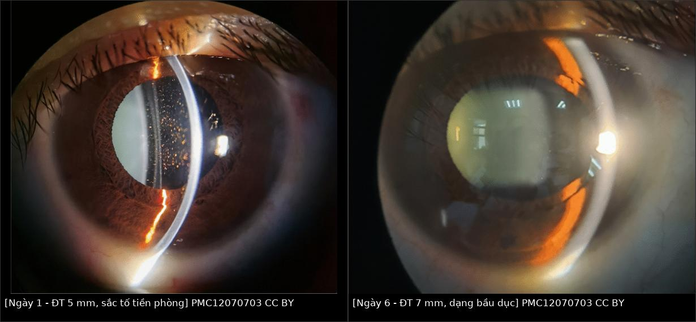
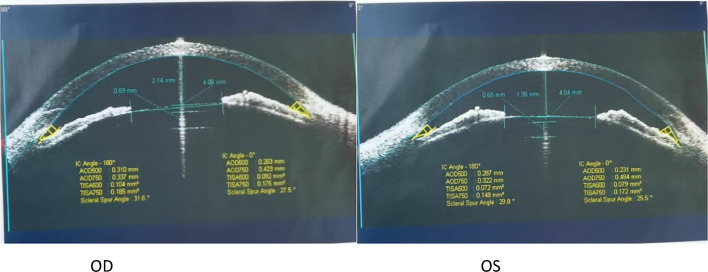
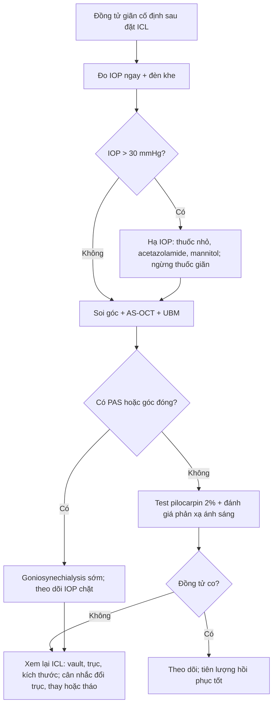
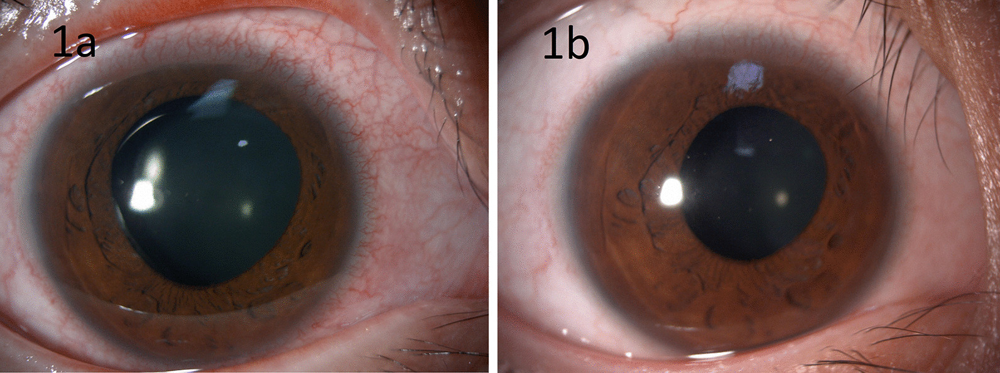
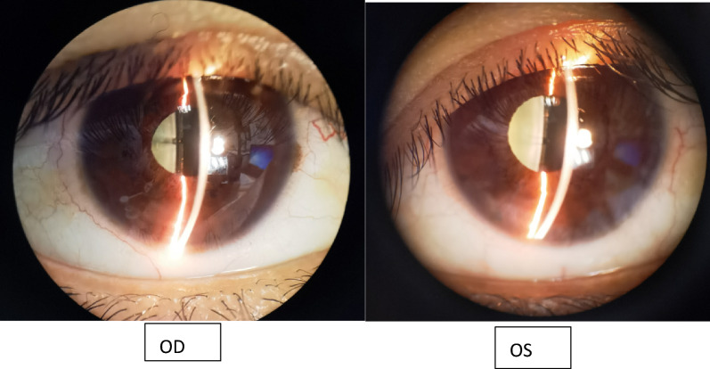
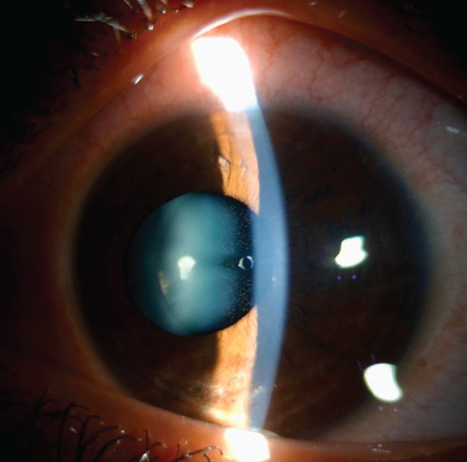

# 3251 — Hội chứng Urrets–Zavalia sau ICL/phakic IOL: "đồng tử giãn cố định – teo mống mắt – glôcôm thứ phát" / Urrets–Zavalia syndrome after phakic IOL implantation

**Tags:** `pattern:dong-tu-gian-co-dinh` `pattern:mot-ben` `pattern:tang-nhan-ap-som` `pattern:goc-dong-thu-phat` `pattern:teo-mong-mat` `pattern:sac-to-tien-phong` `vung:mat` `vung:mong-mat` `vung:goc-tien-phong` `vung:the-thuy-tinh` `protocol:den-khe` `protocol:soi-goc` `protocol:AS-OCT` `protocol:UBM-35-50MHz` `protocol:pilocarpine-test` `score:khong` `incidentaloma:khong`

**Mức chắc chắn (certainty):** tổng hợp y văn (literature synthesis) — dựng từ **hai ca UZS sau ICL có ảnh và bảng 6 ca phakic IOL** (*J Med Case Rep* 2021 **PMC8456705**, CC BY; *J Med Case Rep* 2025 **PMC12070703**, CC BY), **ca UZS sau pIOL kèm TASS** (*Turk J Ophthalmol* 2025 **PMC12372556**, CC BY-NC-ND), **loạt 9 ca TASS/UZS sau phaco cùng cụm** (*Oman J Ophthalmol* 2023 **PMC10062078**, CC BY-NC-SA), **tổng quan tăng nhãn áp sau ICL** (*Front Med* 2024 **PMC10879591**, CC BY), **tổng quan biến chứng chu phẫu ICL** (*Int Ophthalmol* 2022 **PMC9587946**), **152 ca UZS sau PKP** (*J Clin Med* 2022 **PMC8911052**, CC BY) và **3.364 mắt ICL-V4c** cho tiêu chuẩn chọn/vault (*Ophthalmol Ther* 2026 **PMC12882899**, CC BY). Nhóm **không có bệnh nhân của mình**; chỗ chưa đủ chắc ghi **"chưa rõ"**. **Không ghi tên tác giả** — attribution dùng **tạp chí + năm + PMCID/DOI**, đối chiếu Europe PMC ngày **2026-11-21**.

> **Vị trí trong thư viện:** [3238](../3238-ugh-sau-icl-phakic-iol/lesson.md) phủ **UGH sau ICL** (máu tiền phòng + tăng nhãn áp tái diễn); [3247](../3247-duc-bao-truoc-sau-icl-phakic/lesson.md) phủ **đục bao trước sau ICL**; [3249](../3249-pds-glaucoma-sac-to/lesson.md) phủ **PDS/glôcôm sắc tố** (sắc tố HAI bên, góc mở); [3246](../3246-goc-dong-cap-hai-ben-do-thuoc/lesson.md) phủ **góc đóng cấp hai bên do thuốc**; [1425](../1425-viem-noi-nhan-sau-tiem-noi-nhan/lesson.md) phủ **viêm nội nhãn sau tiêm**. Bài này trả lời **một câu duy nhất**: *một người trẻ đặt ICL, hôm sau đồng tử giãn 5–7 mm không co, nhãn áp 40 mmHg, mắt gần như trắng — đây là UZS, TASS, góc đóng cấp hay chỉ là thuốc giãn đồng tử còn tác dụng, và ca nào sẽ hồi phục?*
>
> **Câu chốt:** **(1)** UZS là **tam chứng sau mổ nội nhãn**: **đồng tử giãn cố định + teo mống mắt + glôcôm thứ phát**, lần đầu mô tả sau ghép giác mạc xuyên (PKP) ở keratoconus, nay gặp sau **ICL/pIOL, DALK, DSEK, phaco, trabeculectomy**; **(2)** cơ chế được chấp nhận nhất là **thiếu máu cơ vòng đồng tử** do **tăng nhãn áp cấp** (OVD tồn lưu, TASS, viêm tiền phòng) cộng **cọ cơ học** của ICL quá cỡ; **(3)** **tốc độ hạ nhãn áp quyết định tiên lượng**: hạ trong **24 giờ** + còn phản xạ ánh sáng + đáp ứng **pilocarpin 2%** → có thể hồi phục một phần; tăng nhãn áp kéo dài ngày 1 (**32–64 mmHg**) → thường **giãn cố định vĩnh viễn** (**PMC8456705**); **(4)** **vault "bình thường" không loại trừ ICL quá cỡ** — phải xem **trục, đường kính, tương tác mống mắt–haptic**, và triệu chứng học của vault khi co đồng tử (**PMC12070703**); **(5)** **PAS** là dấu chốt của glôcôm thứ phát: chỉ gặp ở nhóm UZS, **không** ở TASS, và **goniosynechialysis/trabeculectomy thường thất bại** nếu làm muộn (**PMC10062078**).

## 1. Tổng quan bệnh học – cơ chế hình ảnh (TẠI SAO)

### 1.1 Cơ vòng đồng tử: một dải cơ "ăn" bằng máu mao mạch, không có dự trữ

- **Cơ vòng đồng tử (sphincter pupillae)** là dải cơ trơn **đồng tâm, rộng ~0,5–1 mm** sát bờ đồng tử, chi phối bởi **phó giao cảm** (dây III → hạch thể mi → thần kinh thể mi ngắn). Khi co, đồng tử nhỏ lại; khi mất chức năng, **cơ giãn (dilator)** — chỉ có lực đối kháng yếu — kéo đồng tử ra ở vị trí **giãn trung bình đến tối đa**.
- Máu nuôi mống mắt đến từ **vòng động mạch lớn (major arterial circle)** và các nhánh xuyên, tận cùng bằng **mao mạch**. Tưới máu phụ thuộc **chênh áp tưới máu = áp lực động mạch – nhãn áp (IOP)**. Vì vậy khi IOP tăng vọt lên **40–60 mmHg**, mống mắt là mô **"đầu cuối"** — giảm tưới máu trước tiên, trong khi võng mạc còn được bảo vệ một phần bởi áp lực tưới máu sau nhãn cầu.
- **Bằng chứng hình ảnh chức năng:** chụp mạch huỳnh quang mống mắt (iris fluorescein angiography) ở bệnh nhân UZS cho thấy **chậm làm đầy từng đoạn mạch mống mắt ở 4–6 tuần sau mổ** — tức **thiếu máu vùng**, không phải tổn thương toàn bộ (dẫn lại trong **PMC8456705**).
- **Hệ quả định lượng:** nếu IOP hạ **trong vòng 24 giờ** và cơ vòng chưa hoại tử, đồng tử còn **phản xạ ánh sáng** và **co với pilocarpin**; nếu IOP cao **qua ngày 1** (trong bảng 6 ca pIOL: **32–64 mmHg**), **4/4 ca giãn cố định không hồi phục** (**PMC8456705**).

### 1.2 Bốn con đường dẫn tới cùng một hình ảnh — mô hình "FIXED"

| Nhánh | Cơ chế | Bằng chứng / ngưỡng |
|---|---|---|
| **F** — Pharmacologic (thuốc) | Atropin/tropicamid còn tác dụng; **không phải UZS** | Đồng tử còn đáp ứng pilocarpin, tự co sau 1–7 ngày; loại trừ bằng hỏi thuốc |
| **I** — Ischemia (thiếu máu) | Tăng IOP cấp → giảm tưới máu mống mắt → hoại tử cơ vòng | IOP **≥ 30 mmHg** sau ICL chiếm **10,8%** biến chứng; OVD tồn lưu đỉnh **ngày 1**, thường **≥ 30 mmHg** (**PMC10879591**) |
| **X** — Mechanical (cơ học) | ICL/haptic cọ mặt sau mống mắt – rãnh thể mi; ICL quá cỡ dù vault trung tâm bình thường | Vault lý tưởng **250–750 µm**, an toàn **250–1.000 µm** (**PMC10776513**); ca vault **690/650 µm** vẫn quá cỡ theo chiều ngang (**PMC12070703**) |
| **E** — Endotoxin/Exudate (TASS, viêm) | Dịch viêm/độc chất bít bè + tổn thương nội mô và cơ vòng | TASS khởi phát **12–48 giờ**, phù giác mạc, phản ứng tiền phòng mạnh, cấy âm (**PMC10879591**); cùng cụm TASS/UZS: **9/9 teo mống mắt đồng tâm** (**PMC10062078**) |
| **D** — Denervation (thần kinh) | Tổn thương thần kinh thể mi ngắn sau hạch → mất trương lực cơ vòng | Giả thuyết, **chưa có bằng chứng mô học ở người** — ghi "chưa rõ" |

- **Vì sao phải tách "thuốc" khỏi UZS:** bệnh nhân nào sau mổ cũng được nhỏ **tropicamid/phenylephrin**; đồng tử giãn trong **vài giờ** là bình thường. UZS được định nghĩa khi đồng tử **vẫn giãn cố định ≥ 3 tuần sau liều giãn cuối**, sau khi đã loại trừ uveitis trước mổ, khuyết mống mắt do chấn thương, bất thường đồng tử có sẵn (**PMC8911052**).
- **Ngưỡng "đủ để gây thiếu máu" không tuyến tính:** IOP **48 mmHg trong 1 giờ** nhưng hạ ngay vẫn có thể chỉ **giãn một phần và hồi phục**; trong khi IOP **52–65 mmHg kéo dài đến ngày 1** gây **giãn cố định** (**PMC8456705**). Điều này giải thích vì sao **thời gian tăng IOP** quan trọng hơn **trị số đỉnh**.

### 1.3 Vì sao thấy teo mống mắt và sắc tố tiền phòng

- **Teo mống mắt** là hệ quả **muộn** của thiếu máu: biểu mô sắc tố và mô đệm mống mắt mất dần theo vùng tưới máu → **mảng teo rải rác**, ở thể nặng thành **vòng đồng tâm** (concentric rings). Trong loạt 9 ca TASS/UZS sau phaco, **100% có vòng teo đồng tâm ở 3 tháng**, kể cả nhóm TASS không có PAS (**PMC10062078**).
- **Sắc tố tiền phòng** trong ca ICL là do **cọ xát cơ học** giữa ICL và mặt sau mống mắt làm bong hạt melanin — cùng cơ chế với PDS sau ICL, nhưng ở đây **một bên và có mốc thời gian rõ** (**PMC12070703**).
- **Teo mống mắt + sắc tố** không đặc hiệu: PDS ([3249](../3249-pds-glaucoma-sac-to/lesson.md)), UGH sau ICL ([3238](../3238-ugh-sau-icl-phakic-iol/lesson.md)) và UZS đều có. **Dấu phân biệt là bối cảnh mổ, một bên, và PAS.**

### 1.4 Vì sao glôcôm thứ phát — PAS chứ không chỉ "bè bị bít"

- Sau UZS, mống mắt **mất trương lực và dày lên**, tiền phòng có viêm nhẹ kéo dài; ICL chiếm chỗ ở rãnh thể mi đẩy **chu vi mống mắt ra trước** → **dính góc trước (PAS)** hình thành từng đoạn rồi lan.
- **Bằng chứng mạnh nhất:** trong loạt 9 ca cùng cụm phaco, **PAS chỉ có ở 4/4 ca UZS**, **không có ở 5/5 ca TASS**; kèm theo **nhãn áp 30–34 mmHg** ở ca UZS dù đã dùng thuốc (**PMC10062078**). Tức **PAS là dấu chốt phân biệt UZS với TASS**, và là **cơ chế glôcôm**.
- **Hệ quả điều trị:** khi đã có PAS, **hạ nhãn áp bằng thuốc không đủ**; **goniosynechialysis** cần làm **sớm** (dính còn mềm). Trong loạt trên, **2 ca goniosynechialysis + 1 ca trabeculectomy** vẫn **không kiểm soát được IOP (28–40 mmHg)** — can thiệp muộn có tiên lượng xấu (**PMC10062078**).

### 1.5 Vì sao "vault bình thường" vẫn có thể là ICL quá cỡ

- **Vault** là khoảng cách **trung tâm** từ mặt trước ICL đến mặt sau giác mạc (đo AS-OCT): **250–750 µm lý tưởng**, **250–1.000 µm an toàn** (**PMC10776513**; **PMC12070703**). Nhưng vault **không phản ánh đường kính ngang** của ICL trong rãnh thể mi.
- **Nghiệm pháp động (độc đáo của ca 2025):** khi ICL **quá dài theo trục ngang**, **co đồng tử làm vault TĂNG** (mống mắt ép ICL ra sau) — **ngược sinh lý**; khi ICL đặt **trục dọc**, co đồng tử làm **vault giảm** như bình thường. Ca minh họa: vault **690 µm (OD) / 650 µm (OS)** lúc đầu, giảm còn **390 µm** ở mắt có triệu chứng khi đồng tử co — và **đồng tử chỉ hồi phục sau khi đổi trục rồi thay ICL nhỏ hơn** (**PMC12070703**).
- **Bài học:** đừng dùng vault làm tiêu chí duy nhất. Phải xem **kích thước ICL theo WTW/ACD, trục đặt, vị trí haptic, và tương tác với mống mắt trên UBM/AS-OCT**.

### 1.6 Bảng số phải nhớ

| Chỉ số | Giá trị | Nguồn |
|---|---|---|
| Tỷ lệ UZS sau PKP | **2,2–17,7%** tùy loạt; **15,13%** (23/152) | PMC8911052 |
| UZS sau PKP ở keratoconus vs loét giác mạc do nấm | **42,11% vs 6,25%** | PMC8911052 |
| Hồi phục tự nhiên sau UZS (PKP) | **33,33%** (7/21), trong **48 ngày – 1,5 năm** | PMC8911052 |
| Hồi phục một phần sau UZS (pIOL) | **1/3 – 2/3** ca tổn thương nhẹ, trong **1–18 tuần** | PMC12372556 |
| Nhãn áp ngày 1 ở ca pIOL giãn cố định | **32–64 mmHg** | PMC8456705 |
| IOP tăng sau ICL | **10,8%** biến chứng; **64%** do corticoid; OVD đỉnh **ngày 1**, **≥ 30 mmHg** | PMC10879591 |
| Vault lý tưởng / an toàn | **250–750 µm** / **250–1.000 µm** | PMC10776513 |
| Tiêu chuẩn chọn ICL | **ACD ≥ 2,8 mm**, **ECD ≥ 1.800 tế bào/mm²**, khúc xạ ổn định **≤ 0,5 D/12 tháng** | PMC12882899 |
| PAS trong UZS vs TASS | **4/4 vs 0/5** | PMC10062078 |
| Teo mống mắt đồng tâm ở 3 tháng | **9/9** (TASS + UZS) | PMC10062078 |

## 2. Mẫu hình + chẩn đoán phân biệt theo vị trí (gamut)

**Mẫu hình trung tâm:** *một mắt, đồng tử giãn 4–7 mm, phản xạ ánh sáng mất hoặc giảm, xuất hiện trong 24 giờ đầu sau mổ nội nhãn, kèm nhãn áp tăng và mắt tương đối "trắng" sau khi hạ áp.*

### 2.1 Gamut theo thời điểm sau mổ

| Thời điểm | Gamut chính | Dấu chốt phân biệt |
|---|---|---|
| **0–24 giờ** | OVD tồn lưu · TASS · pupil block (khí/OVD) · UZS sớm | OVD: IOP **≥ 30 mmHg**, đau, có thể thấy OVD trong tiền phòng; TASS: phù giác mạc lan bờ limbus, phản ứng mạnh, cấy âm; pupil block: tiền phòng nông, iris bombe |
| **1–7 ngày** | **UZS** · TASS muộn · góc đóng cấp · viêm nội nhãn | UZS: tiền phòng **sâu**, góc **mở lúc đầu**, đau ít sau khi hạ IOP; góc đóng: **đau dữ dội**, tiền phòng nông, giác mạc phù; viêm nội nhãn: **giảm thị lực + mủ tiền phòng**, cấy dịch kính |
| **2–6 tuần** | Tăng nhãn áp do corticoid · PAS hình thành · PDS do cọ ICL | Corticoid: IOP tăng **> 10 mmHg** so nền, hết sau giảm thuốc; PAS: soi góc thấy dính; PDS: sắc tố bè + mống mắt lõm |
| **> 3 tháng** | Glôcôm thứ phát do PAS · teo mống mắt cố định · PDS/PDG muộn | Đồng tử **không hồi phục**, teo mống mắt, thị trường/RNFL mất dần |

### 2.2 Gamut theo "đau hay không đau" — câu hỏi rẻ tiền nhưng cứu mắt

- **Đau nhiều, giác mạc phù, tiền phòng nông:** nghĩ **góc đóng cấp** hoặc **pupil block** — cần hạ áp + mở góc, không chờ.
- **Đau nhiều, thị lực giảm, mủ tiền phòng:** nghĩ **viêm nội nhãn** — cấy dịch kính trước, tiêm kháng sinh nội nhãn; **không được bỏ qua** vì UZS cũng có phản ứng tiền phòng.
- **Không đau hoặc chỉ khó chịu, thị lực tốt, mắt trắng:** nghĩ **UZS** — bệnh nhân than **chói, quầng, sợ ánh sáng**, không than đau.

### 2.3 Ba câu hỏi bắt buộc trước khi gọi UZS

1. **Mổ gì, khi nào?** (ICL/pIOL, phaco, PKP, DALK, trabeculectomy — tất cả đều đã gây UZS.)
2. **Nhãn áp bao nhiêu, đã hạ được chưa, hạ trong bao lâu?** (đây là yếu tố tiên lượng mạnh nhất.)
3. **Soi góc có PAS không, và đồng tử có co với pilocarpin 2% không?** (phân biệt UZS với TASS và với giãn do thuốc.)

## 3. Bảng so sánh phân biệt (ma trận đối chiếu)

| Thực thể (entity) | Hình ảnh điển hình | Chốt vào (rule-in) | Chốt loại (rule-out) | Gợi ý xác nhận |
|---|---|---|---|---|
| **UZS sau ICL/pIOL** | Đồng tử **5–7 mm**, phản xạ mất/giảm, **một bên**, mắt trắng sau khi hạ IOP; teo mống mắt muộn; PAS | **Mổ nội nhãn 1–7 ngày trước + IOP từng tăng + đồng tử giãn cố định; PAS khi soi góc** | Đồng tử còn co rõ với pilocarpin **và** không có tiền sử tăng IOP → nghĩ giãn do thuốc | Đèn khe + soi góc + test pilocarpin 2% + AS-OCT/UBM |
| **TASS** | **Phù giác mạc lan bờ limbus**, phản ứng tiền phòng mạnh, có thể fibrine/mủ; đồng tử **thường co nhỏ**, có thể giãn | **Khởi phát 12–48 giờ**, cấy âm, đáp ứng corticoid, **không PAS** | Có PAS + đồng tử giãn cố định → UZS; cấy dương → viêm nội nhãn | Đèn khe hằng ngày, cấy tiền phòng khi nghi nhiễm |
| **Góc đóng cấp** | Giác mạc phù, **tiền phòng nông**, đồng tử **giãn trung bình cố định**, iris bombe | **Đau dữ dội + IOP 40–60 mmHg + góc đóng > 270°** | Tiền phòng sâu + góc mở + đau ít → không phải góc đóng cấp | Soi góc mắt kia, AS-OCT góc, hỏi thuốc |
| **Giãn đồng tử do thuốc** | Đồng tử **6–8 mm**, một bên nếu nhỏ thuốc một mắt; mắt trắng, IOP bình thường | **Co với pilocarpin**, tự hết sau 1–7 ngày | Không co + IOP từng tăng + mổ gần đây → UZS | Hỏi thuốc, theo dõi 24–48 giờ |
| **Adie (đồng tử tonic)** | Đồng tử giãn một bên, phản xạ gần **chậm**, co **với pilocarpin pha loãng 0,1%** | **Tăng nhạy cảm khử thần kinh với pilocarpin loãng** | Co với pilocarpin 2% nhưng **không** với 0,1% → không phải Adie | Test pilocarpin 0,1% (**PMC11238870**) |
| **Đứt cơ vòng do chấn thương / góc rẽ** | Đồng tử **hình bầu dục**, khuyết mống mắt, **transillumination**, góc rẽ khi soi góc | **Tiền sử chấn thương + khuyết mống mắt + góc rẽ** | Mổ nội nhãn gần đây, không chấn thương → UZS | Soi góc, hỏi chấn thương; UZS cũng có thể gặp trên mắt góc rẽ (**PMC12258849**) |
| **Dính sau do viêm màng bồ đào (herpes, HLA-B27)** | Đồng tử **dính chỗ rộng chỗ hẹp**, seclusio pupillae, iris bombe | **Dính sau thấy rõ + tiền sử viêm + tế bào tiền phòng** | Không dính sau + mổ gần đây → UZS | Đèn khe sau giãn, soi góc, PCR dịch tiền phòng nếu nghi herpes |
| **ICL quá cỡ (cơ học thuần, chưa UZS)** | Vault có thể **bình thường**, đồng tử giãn nhẹ, sắc tố tiền phòng, triệu chứng chói | **Vault tăng khi co đồng tử** (trục ngang) + cọ mống mắt trên UBM | Vault thấp + không cọ → không phải quá cỡ | AS-OCT/UBM theo trục, đổi trục thử (**PMC12070703**) |

*Trái: ngày 1 — đồng tử ~5 mm, nhiều sắc tố trong tiền phòng. Phải: ngày 6 — đồng tử ~7 mm, dạng bầu dục, mất phản xạ. Cùng một mắt, cùng phương pháp chụp. Nguồn: J Med Case Rep 2025 (PMC12070703), CC BY 4.0; ảnh ghép letterbox bằng `tools/make_composite.py`.*

### 3.1 Hai dấu hiệu chốt cần mô tả đúng

- **Test pilocarpin 2%:** nhỏ **1 giọt mỗi 15 phút × 4 lần**, đo lại sau 30–60 phút. **Co ≥ 1 mm** = cơ vòng còn sống → khả năng hồi phục; **không co** = tổn thương cơ vòng nặng. Test này **chỉ để tiên lượng**, **không dùng làm điều trị thường quy** — pilocarpin có thể gây co thắt, viêm và làm bệnh nhân khó chịu (**PMC12070703**).
- **PAS trên soi góc:** ghi **số giờ/độ** dính. **PAS càng rộng, khả năng kiểm soát IOP càng kém**; PAS **360°** tương đương góc đóng hoàn toàn và cần can thiệp sớm (**PMC10062078**).
- **Glaukomflecken** (đục bao trước dưới dạng vảy trắng) là **di chứng của cơn tăng nhãn áp cấp**, có thể **thoái triển** theo thời gian — đừng nhầm với đục thể thủy tinh do tuổi (DOI 10.1016/j.jfo.2024.104089).

## 4. Protocol chụp/khám + phân tầng tiên lượng

### 4.1 Trước mổ ICL — dự phòng là phần quan trọng nhất

- **Chọn bệnh nhân:** tuổi **18–55**, khúc xạ ổn định **≤ 0,5 D/12 tháng**, **ACD ≥ 2,8 mm**, **ECD ≥ 1.800 tế bào/mm²**, loại trừ glôcôm/uveitis/PXF (**PMC12882899**).
- **Chọn cỡ ICL:** theo **WTW + ACD**, đặt mục tiêu vault **250–750 µm**; với ICL toric, **cân nhắc trục đặt** (ngang vs dọc) vì trục ảnh hưởng tương tác với mống mắt (**PMC12070703**).
- **Kỹ thuật:** ưu tiên **min-OVD/non-OVD** và **rửa sạch OVD** — OVD tồn lưu là nguyên nhân **số 1** tăng IOP ngày 1 (**PMC10879591**). Không để **khí** trong tiền phòng ở mắt phakic.

### 4.2 Theo dõi sau mổ — cửa sổ vàng là 1–4 giờ

- **Đo IOP 1, 2 và 4 giờ sau mổ** (hoặc theo protocol đơn vị), **bắt buộc đo lại ngày 1**; dặn bệnh nhân **đau nhức, nhìn mờ, quầng sáng → quay lại ngay**, không chờ lịch hẹn.
- **Ngưỡng xử trí thực hành:** IOP **> 30 mmHg và còn tăng** → **rửa tiền phòng lại** để lấy OVD; IOP **> 40 mmHg** hoặc kèm phù giác mạc → **acetazolamide uống/tĩnh mạch ± mannitol**, thuốc nhỏ hạ áp, ngừng ngay mọi thuốc giãn đồng tử (**PMC10879591**).
- **Phân biệt OVD với TASS trước khi rửa:** OVD → **rửa là điều trị**; TASS nặng → **không rửa tiền phòng thường quy** (làm nặng viêm), điều trị **corticoid tại chỗ/toàn thân** (**PMC10879591**). Đây là quyết định hay bị làm ngược.

### 4.3 Khi đồng tử đã giãn cố định — bộ khám tối thiểu

| Bước | Dụng cụ | Ghi nhận |
|---|---|---|
| 1 | Đèn khe | Đường kính đồng tử **mm**, phản xạ ánh sáng, hình dạng, teo mống mắt, sắc tố, glaukomflecken, phù giác mạc |
| 2 | Nhãn áp kế Goldmann | IOP **mmHg**, số thuốc đang dùng, thời điểm so với mổ |
| 3 | Soi góc (gonioscopy) | **PAS theo giờ/độ**, sắc tố bè, góc mở/đóng, góc rẽ |
| 4 | Test pilocarpin 2% | Co **≥ 1 mm** hay không — **tiên lượng** |
| 5 | AS-OCT | **Vault µm**, ACD, **AOD500**, độ mở góc, tương tác mống mắt–ICL |
| 6 | UBM 35–50 MHz | Vị trí haptic, **nang thể mi**, ICL xoay/lệch, cọ rãnh thể mi |
| 7 | Pentacam + specular | ACD, WTW, **ECD** (theo dõi nội mô nếu ICL gần nội mô) |
| 8 | Đáy mắt/B-scan | Loại trừ **viêm nội nhãn**, bong võng mạc, xuất huyết |

*AS-OCT 1 tuần sau mổ: vault **690 µm (OD)** và **650 µm (OS)** — đều trong khoảng "bình thường" 250–750 µm. Ở mắt trái, vault **tăng khi co đồng tử** (bất thường), gợi ý ICL quá dài theo trục ngang dù vault trung tâm đạt chuẩn. Nguồn: J Med Case Rep 2025 (PMC12070703), CC BY 4.0.*

### 4.4 Phân tầng tiên lượng (nhóm tự tổng hợp — **không phải thang đã kiểm chứng**)

> Chưa có thang phân độ UZS được validation. Bảng dưới là **cách phân tầng thực hành** để quyết định theo dõi hay can thiệp, dựa trên các yếu tố đã được báo cáo có giá trị tiên lượng (**PMC8456705**, **PMC12372556**, **PMC10062078**).

| Tầng | Đặc điểm | Tiên lượng | Xử trí |
|---|---|---|---|
| **A — còn sống** | Còn phản xạ ánh sáng, **co với pilocarpin 2%**, IOP đã hạ < 24 giờ, không PAS | Hồi phục một phần/tất cả trong **1–18 tuần** | Theo dõi, ngừng giãn đồng tử, corticoid ngắn, kiểm IOP |
| **B — tổn thương nặng** | Mất phản xạ, **không co** với pilocarpin, IOP từng **32–64 mmHg**, teo mống mắt | Một phần hoặc **cố định** | Kiểm IOP chặt, xem lại ICL (vault/trục/cỡ), cân nhắc pupilloplasty nếu chói nặng |
| **C — glôcôm thứ phát** | **PAS** khi soi góc, IOP **28–40 mmHg** dù thuốc, teo mống mắt đồng tâm | Nguy cơ mù nếu muộn | **Goniosynechialysis sớm**; nếu thất bại → lọc/van; theo dõi RNFL/thị trường |

### 4.5 Sơ đồ quyết định

### 4.6 Xử trí ICL khi nghi quá cỡ

1. **Đổi trục** (với ICL toric) là bước **ít xâm lấn nhất**, có thể **dự báo** cỡ thay thế: nếu đồng tử ngừng giãn sau đổi trục → xác nhận cơ chế cơ học (**PMC12070703**).
2. **Thay ICL nhỏ hơn** khi có cỡ phù hợp; chờ ICL đặt riêng có thể **2–3 tháng** — trong thời gian chờ, đổi trục tạm là giải pháp hợp lý (**PMC12070703**).
3. **Tháo ICL** khi không xác định được nguyên nhân hoặc đồng tử không hồi phục — nhưng phải tư vấn rõ **mất khúc xạ** và kế hoạch thay thế.
4. **Pupilloplasty** (McCannel, single-pass four-throw) khi đồng tử giãn cố định **có triệu chứng chói nặng** và IOP đã ổn định; kết quả thẩm mỹ/chức năng tốt nhưng **không chữa được teo mống mắt**.

## 5. Biến thể bình thường và cạm bẫy

- **Giãn đồng tử sinh lý sau mổ:** 1–2 mm, còn phản xạ, tự hết trong **24–72 giờ** — **không phải UZS**. Đừng gọi UZS khi chưa qua **3 tuần** kể từ liều giãn cuối (**PMC8911052**).
- **Anisocoria do thuốc dính ở mi/đệm mắt:** đồng tử bên mổ giãn không đều; rửa mắt, đo lại sau 30 phút.
- **UZS hai bên:** hiếm nhưng có — **không loại trừ** chỉ vì hai mắt cùng giãn; hỏi kỹ đợt mổ hai mắt và thuốc.
- **"Mắt trắng, thị lực 20/20" không loại trừ UZS:** bệnh nhân có thể chỉ than **chói/quầng**; nếu không đo IOP và không soi góc, sẽ bỏ sót **PAS** và glôcôm thứ phát.
- **Vault bình thường không loại trừ ICL quá cỡ:** phải xem **trục, đường kính, tương tác mống mắt–haptic**; vault **tăng khi co đồng tử** là dấu hiệu động học gợi ý (**PMC12070703**).
- **Rửa tiền phòng không phải lúc nào cũng đúng:** OVD tồn lưu → **rửa**; TASS nặng → **không rửa thường quy**, ưu tiên corticoid (**PMC10879591**).
- **Đừng nhầm glaukomflecken với đục thể thủy tinh do tuổi:** glaukomflecken **dưới bao trước**, dạng vảy, có thể **thoái triển** sau khi hết cơn tăng nhãn áp (DOI 10.1016/j.jfo.2024.104089).
- **Pilocarpin không phải điều trị UZS:** dùng **liều test** để đánh giá cơ vòng; dùng kéo dài có thể gây co thắt, viêm, và **không cải thiện teo cơ** (**PMC12070703**).
- **Satisfaction of search:** đã thấy sắc tố tiền phòng và nghĩ PDS/UGH ([3249](../3249-pds-glaucoma-sac-to/lesson.md), [3238](../3238-ugh-sau-icl-phakic-iol/lesson.md)) → **vẫn phải soi góc tìm PAS và đo IOP**.

## 6. Tự lượng giá — Blind Quiz

**Ca 1 — Nam 20 tuổi, đặt ICL mắt phải, 1 giờ sau mổ đau nhẹ, IOP 48 mmHg.**

- Gợi ý: IOP được hạ ngay bằng acetazolamide, về 15 mmHg trong 24 giờ. Ngày 1 đồng tử 6 mm, còn phản xạ ánh sáng nhẹ.
- Câu hỏi: (1) Đồng tử 6 mm này là do thuốc giãn hay UZS? (2) Hai panel a/b nói gì về tiên lượng? (3) Ba yếu tố nào dự báo hồi phục?

<b>Bấm để hiện đáp án (findings + chẩn đoán)</b>

- **Findings:** panel a — đồng tử ~6 mm, còn phản xạ ánh sáng yếu; panel b — sau **pilocarpin 2%** (4 giọt/15 phút) đồng tử co còn ~3 mm, tức **cơ vòng còn sống**.
- **Chẩn đoán:** **UZS sau ICL** với **yếu tố tiên lượng thuận**: IOP hạ trong 24 giờ, còn phản xạ ánh sáng, đáp ứng pilocarpin. Theo dõi 3 tháng: đồng tử **6 → 3,5 mm**, không teo mống mắt, thị lực 20/20.
- **Ba yếu tố dự báo hồi phục:** (1) hạ IOP **sớm (< 24 giờ)**; (2) **còn phản xạ ánh sáng**; (3) **co với pilocarpin 2%**.
- **Nguồn ảnh:** *J Med Case Rep* 2021 (PMC8456705), CC BY 4.0.

**Ca 2 — Nữ 33 tuổi, đặt toric ICL hai mắt; mắt trái ngày 2 IOP 40 mmHg, đồng tử 5 mm; ngày 9 đồng tử 7 mm.**

- Gợi ý: vault đo 1 tuần: **690 µm (OD)** và **650 µm (OS)** — cả hai "bình thường". Khi nhỏ pilocarpin, vault mắt trái **tăng** thay vì giảm.
- Câu hỏi: (1) Vault bình thường có loại trừ ICL quá cỡ? (2) Vì sao vault tăng khi co đồng tử? (3) Hướng xử trí nào ít xâm lấn nhất?

<b>Bấm để hiện đáp án (findings + chẩn đoán)</b>

- **Findings:** đồng tử **4–5 mm ngày 1 → 7 mm ngày 9**, dạng bầu dục theo trục ICL; vault **650–690 µm** lúc đầu, **390 µm** khi đồng tử co; sắc tố tiền phòng nhiều.
- **Chẩn đoán:** **UZS + toric ICL quá cỡ theo trục ngang** dù vault trung tâm đạt chuẩn. Vault **tăng khi co đồng tử** là dấu hiệu động học của ICL quá dài.
- **Xử trí:** **đổi trục ICL sang dọc** (ít xâm lấn, đồng thời kiểm chứng giả thuyết) → đồng tử ngừng giãn; sau đó **thay ICL cỡ phù hợp** → đồng tử và phản xạ **hồi phục hoàn toàn sau 3 tháng**.
- **Ảnh hồi phục 3 tháng:**

- **Nguồn ảnh:** *J Med Case Rep* 2025 (PMC12070703), CC BY 4.0.

**Ca 3 — Nam 25 tuổi, đặt pIOL mắt trái; 1 giờ sau đau tăng, IOP 40 mmHg, phản ứng tiền phòng 3+, đồng tử giãn lệch mũi.**

- Gợi ý: 14 ngày sau, pilocarpin 2% **không co**; góc mở trên Pentacam; trên mống mắt có **mảng teo** và **sắc tố bám pIOL**.
- Câu hỏi: (1) Chẩn đoán là TASS, UZS hay cả hai? (2) Dấu hiệu nào cho thấy tổn thương cơ vòng nặng? (3) Tiên lượng và điều trị?

<b>Bấm để hiện đáp án (findings + chẩn đoán)</b>

- **Findings:** đồng tử **giãn trung bình, lệch mũi, không đáp ứng pilocarpin**, **mảng teo mống mắt**, **sắc tố trên pIOL**; IOP 12–14 mmHg sau điều trị; góc **mở**, vault **650 µm**.
- **Chẩn đoán:** **TASS tiến triển thành UZS** — cùng phổ bệnh; TASS là "cơn thoáng qua", UZS là tổn thương cơ vòng không hồi phục. **Không đáp ứng pilocarpin** = tổn thương cơ vòng nặng.
- **Điều trị:** corticoid tại chỗ + toàn thân sớm, hạ IOP, ngừng thuốc giãn; theo dõi teo mống mắt. Bệnh nhân cải thiện triệu chứng nhưng **đồng tử giữ dạng giãn lệch mũi**.
- **Nguồn ảnh:** *Turk J Ophthalmol* 2025 (PMC12372556), CC BY-NC-ND 4.0 (nguyên bản, không chỉnh sửa).

## 7. Câu hỏi nghiên cứu & điểm chưa đồng thuận (tính đến 11/2026)

1. **[Tranh cãi] Ở mắt đặt ICL bị giãn đồng tử cố định, nguyên nhân chính là thiếu máu cơ vòng do tăng nhãn áp hay tổn thương độc chất/viêm (TASS)?**
   - **Đã biết:** cả hai cơ chế đều có bằng chứng — loạt 9 ca cùng cụm có **4 UZS + 5 TASS**, TASS **không PAS** còn UZS **có PAS**, và **9/9 teo mống mắt đồng tâm**; chụp mạch huỳnh quang mống mắt cho thấy **chậm làm đầy từng đoạn** ở UZS.
   - **Chưa rõ:** không có **mô học/mô hình động vật** phân biệt "thiếu máu đơn thuần" với "độc chất + viêm"; chưa rõ ngưỡng thời gian – áp lực gây hoại tử cơ vòng ở người.
   - **Hướng nghiên cứu:** phối hợp **FA mống mắt + AS-OCT tiền cứu** ở mắt sau ICL có IOP tăng, kèm mô hình tưới máu mống mắt theo áp lực.
   - **Nguồn:** PMC10062078 (2023); PMC12372556 (2025).

2. **[Khoảng trống] Tỷ lệ UZS sau ICL/pIOL là bao nhiêu, và test pilocarpin 2% có giá trị tiên lượng độc lập không?**
   - **Đã biết:** UZS sau ICL chỉ có **ca lẻ**; các loạt pIOL gộp 6 ca cho thấy **5/6 có tăng IOP**, **4 ca tăng ngày 1 (32–64 mmHg) đều không hồi phục**; hồi phục một phần **1/3–2/3 trong 1–18 tuần**.
   - **Chưa rõ:** **không có mẫu số** (bao nhiêu mắt ICL được theo dõi) nên **không tính được tỷ lệ**; test pilocarpin dựa trên quan sát hồi cứu, chưa có nghiên cứu tiên lượng tiến cứu.
   - **Hướng nghiên cứu:** đăng ký theo dõi tiến cứu đa trung tâm sau ICL, đo IOP 1–4 giờ và test pilocarpin chuẩn hóa, outcome là đường kính đồng tử ở 3–6 tháng.
   - **Nguồn:** PMC8456705 (2021); PMC12070703 (2025).

3. **[Khác biệt thực hành] Khi nghi ICL quá cỡ mà vault bình thường, nên theo dõi – đổi trục – thay ICL – hay tháo ICL? Và PAS nên xử lý bằng goniosynechialysis hay lọc glôcôm?**
   - **Đã biết:** một ca hồi phục hoàn toàn sau **đổi trục rồi thay ICL nhỏ hơn**; ngược lại, ca khác **thay ICL vẫn giãn đồng tử và phải phaco**; **goniosynechialysis/trabeculectomy muộn** để lại IOP **28–40 mmHg**.
   - **Chưa rõ:** chưa có tiêu chí chọn bệnh nhân cho từng bước (dấu hiệu động học nào đủ để đổi trục thay vì thay ICL), và **thời điểm vàng** của goniosynechialysis chưa được xác định.
   - **Hướng nghiên cứu:** so sánh tiến cứu **đổi trục trước** với **thay ICL ngay**, và thử nghiệm thời điểm goniosynechialysis ở UZS có PAS.
   - **Nguồn:** PMC12070703 (2025); PMC10062078 (2023); PMC11845084 (2025).

## Bài liên quan chéo
- [400 – Tổng quan Mắt & thị giác](../400-tong-quan-mat-thi-giac/lesson.md)
- [3238 – UGH sau ICL: máu tiền phòng + tăng nhãn áp tái diễn](../3238-ugh-sau-icl-phakic-iol/lesson.md)
- [3247 – Đục bao trước sau ICL](../3247-duc-bao-truoc-sau-icl-phakic/lesson.md)
- [3249 – PDS & glôcôm sắc tố](../3249-pds-glaucoma-sac-to/lesson.md)
- [3246 – Góc đóng cấp hai bên do thuốc](../3246-goc-dong-cap-hai-ben-do-thuoc/lesson.md)
- [1425 – Viêm nội nhãn sau tiêm nội nhãn](../1425-viem-noi-nhan-sau-tiem-noi-nhan/lesson.md)

## Ảnh
- Tên file theo quy ước `NNN_slug_Modality_SourceID.jpg`; nguồn + giấy phép từng ảnh trong `images/CREDITS.md`.
- Ảnh ghép `images/composite_dong-tu-gian-tien-trien.jpg` tạo bằng `tools/make_composite.py` (letterbox, không crop/kéo giãn), chỉ ghép ảnh **CC BY 4.0**.
- Ảnh CC BY-NC-ND (PMC12372556) **giữ nguyên bản**, không ghép, không chỉnh sửa.

> Không dùng để chẩn đoán độc lập khi chưa có người hướng dẫn.
