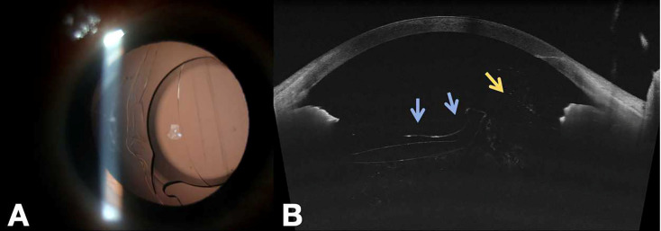
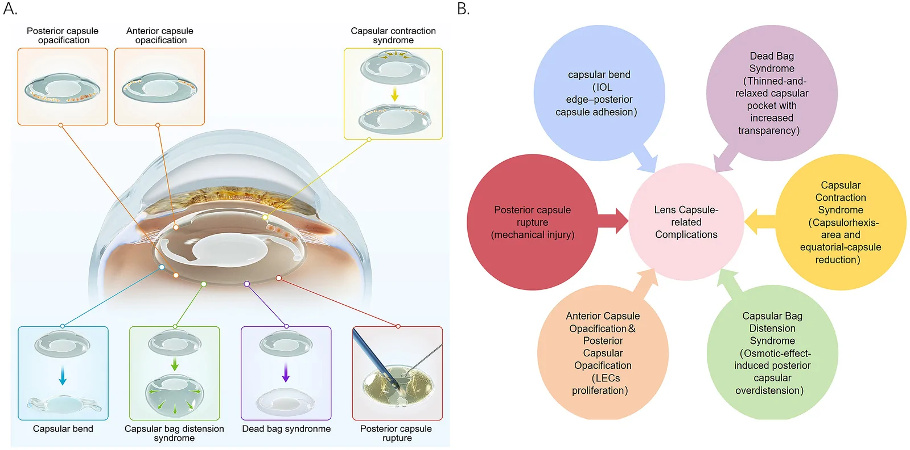
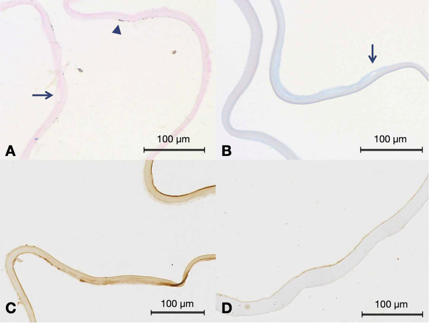
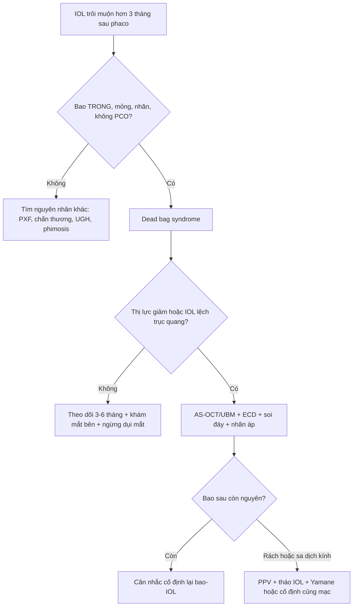

# 3252 — Hội chứng "bao chết" (dead bag syndrome): IOL trôi muộn trong một bao TRONG, MỎNG, NHĂN / Dead bag syndrome

**Tags:** `pattern:iol-troi-muon` `pattern:bao-trong-mong` `pattern:mat-lec` `pattern:khong-pco` `pattern:chuoi-tran-bao-sau` `vung:mat` `vung:the-thuy-tinh` `vung:bao-the-thuy-tinh` `vung:goc-tien-phong` `protocol:slit-lamp` `protocol:AS-OCT` `protocol:UBM` `protocol:sinh-trac-IOL` `protocol:phaco` `protocol:Yamane` `score:khong` `incidentaloma:khong`

**Mức chắc chắn (certainty):** tổng hợp y văn (literature synthesis) — dựng từ các đoàn hệ/ca có mô bệnh học và ảnh: **46 mắt** (DOI 10.1016/j.ajo.2025.01.008), **50 mắt** (DOI 10.1111/ceo.14606), **25 mắt SEM** (PMC11980883), **7 bao** mô bệnh (PMID 34261985), **9 bao** hóa mô miễn dịch (PMID 38711217), **10 mắt** viêm da cơ địa (PMC11146175), ca **17 tháng** (PMC13393839) và ca **12 tháng** (PMC11419931), tổng quan (PMC13694961) + StatPearls (PMID 39163461). Nhóm **không có bệnh nhân của mình**; chỗ chưa đủ chắc ghi **"chưa rõ"**. **Không ghi tên tác giả** — attribution = **tạp chí + năm + PMCID/DOI**.

> **Câu chốt:** bệnh nhân **đã mổ phaco 6–17 năm**, nay **mờ mắt từ từ, không đau**; đèn khe sau giãn đồng tử thấy **IOL và bao cùng trôi**, nhưng **bao TRONG như thủy tinh, mỏng, nhăn, KHÔNG có màng xơ/PCO, bờ bao không trắng dày**. Đây là **hội chứng bao chết (dead bag syndrome, DBS)** — bao thể thủy tinh **mất biểu mô (lens epithelial cells, LEC)** nên **không xơ hóa, không đục** nhưng cũng **mất khả năng tự sửa và bám dây chằng**. Ba số phải nhớ: khoảng cách mổ → trôi **trung bình 9,25 ± 4,79 năm** (PMID 35703837 tóm tắt trong PMC13393839), **82,2–91% là nam**, và **trên 50% có trục nhãn cầu > 24 mm**. Điều quyết định không phải "bao còn hay mất" mà là **bao sau còn nguyên hay đã rách + dịch kính sa**, vì điều đó đổi hẳn kỹ thuật: **cố định lại bao–IOL** hay **tháo IOL + cố định củng mạc (Yamane)**.

## 1. Tổng quan bệnh học – cơ chế hình ảnh (TẠI SAO)

### 1.1 Bao thể thủy tinh là một màng sống — sống nhờ biểu mô nằm trên nó

- Bao thể thủy tinh là **màng đáy (basement membrane)** dày, thành phần chính là **collagen type IV và laminin**; mặt trong bao trước có **một lớp biểu mô thể thủy tinh (LEC)**. LEC **tổng hợp và tái tạo** chất nền ngoại bào (extracellular matrix, ECM), nhờ đó bao **giữ độ dày, độ đàn hồi và chỗ bám dây chằng Zinn**.
- Sau phaco, LEC còn lại ở **xích đạo** thường **tăng sinh và biến đổi xơ (epithelial–mesenchymal transition)** → tạo **vòng Soemmering**, **đục bao sau (PCO)** và **co bao trước (capsular phimosis)**. Bình thường, chính phản ứng xơ này **"hàn"** bao vào IOL và giữ IOL ổn định — dù nó gây đục trục quang.
- **DBS là mặt trái của quá trình đó:** LEC **biến mất** thay vì tăng sinh. Mô bệnh 7 bao cho thấy **bao mỏng và/hoặc tách lớp**, **không có LEC ở 2/7** và **chỉ còn LEC thưa ở 5/7**, **không có tăng sinh thứ phát hay xơ hóa** (PMID 34261985).

### 1.2 Vì sao bao "chết" lại TRONG — và đây là chốt hình ảnh

- **Tán xạ ánh sáng cần sự bất đồng nhất về chiết suất.** Mô xơ (collagen type I, fibronectin) và tế bào là các "hạt" tán xạ mạnh → **màng trắng đục**. Ở DBS, hóa mô miễn dịch cho thấy **collagen IV và laminin (thành phần màng đáy) vẫn còn**, còn **collagen I và fibronectin chỉ có ở vài ổ rất nhỏ**, phần lớn bao **không có thành phần xơ** (PMID 38711217). Vì vậy bao **trong như kính**, không có màng trắng — **dấu chốt để phân biệt với PCO/phimosis**.
- Hệ quả thực hành: **"bao trong" ở mắt đã phaco nhiều năm KHÔNG phải bao khỏe** — đó là bao **không còn khả năng sửa chữa**. Trên **ánh sáng ngược (retroillumination)**, bờ bao hiện thành **vòng mảnh, trong**, không phải **vòng trắng dày** của co bao; không có **vòng Soemmering** trắng ở xích đạo (nhưng xem cạm bẫy 5.3: vẫn có thể gặp).

### 1.3 Vì sao mất vững MUỘN — tách lớp bao ở chỗ bám dây chằng

- Mất LEC → **ECM không được tái tạo** → bao **mỏng dần** và **tách lớp (delamination/splitting)** đúng tại **vùng xích đạo nơi dây chằng Zinn bám**. SEM 25 mẫu cắt bỏ vì trôi IOL cho thấy **3 kiểu tổn thương**: **đứt sợi dây chằng** (nhóm PXF), **bong lớp zonular lamella**, và **tách lớp bao**; **4 mắt bao trong** có **tách lớp + không có LEC**, giống DBS (PMC11980883).
- Tách lớp làm **chỗ bám dây chằng yếu dần** → bao **mềm, nhăn, "floppy"**; IOL **vẫn nằm trong bao** nhưng **cả bao–IOL trôi** theo trọng lực và chuyển động mắt. Vì **không có xơ dính**, bao **không co lại quanh IOL** — đó là lý do IOL **trượt và lệch** thay vì bị khóa chặt.
- Khi tách lớp lan tới **bao sau**, bao sau **rách tự phát** → IOL **rời khỏi bao (out-of-the-bag)** và **dịch kính sa vào tiền phòng**. Loạt 50 mắt: **khuyết bao sau trung vị 60%** ở nhóm **dụi mắt** so với **50%** ở nhóm không dụi (p = 0,029); **dịch kính tiền phòng 38,2% vs 6,2%** (OR 10,3) (DOI 10.1111/ceo.14606).

### 1.4 Con số nền — thời gian, giới, trục nhãn cầu, yếu tố nguy cơ

| Đại lượng | Số liệu | Nguồn |
|---|---|---|
| Định nghĩa "muộn" | **≥ 3 tháng** sau phaco; DBS báo cáo **6–12 năm** | StatPearls PMID 39163461 |
| Khoảng cách mổ → trôi (trung bình) | **9,25 ± 4,79 năm** | PMID 35703837 (dẫn trong PMC13393839) |
| Tuổi lúc mổ lại | **68,7 ± 8,9** (46 mắt); **61,9 ± 14,1** (50 mắt) | DOI 10.1016/j.ajo.2025.01.008; DOI 10.1111/ceo.14606 |
| Thời gian tới mổ lại | **16,8 năm** (46 mắt); **11,2 ± 6,0 năm** (50 mắt); **12,5 ± 7,0 năm** (25 mẫu) | như trên + PMC11980883 |
| Giới | **91%** và **82,2%** là **nam** | 2 loạt trên |
| Cận thị trục dài | **> 50%** có **AL > 24 mm** | DOI 10.1016/j.ajo.2025.01.008 |
| PXF kèm theo | chỉ **9,3%** (4/46) | DOI 10.1016/j.ajo.2025.01.008 |
| Hai mắt | **7/43 bệnh nhân (16,3%)** | DOI 10.1016/j.ajo.2025.01.008 |
| Vòng Soemmering **vẫn có** | **71,7%** (33/46) — **phản lại mô tả kinh điển "không Soemmering"** | DOI 10.1016/j.ajo.2025.01.008 |
| Dụi mắt (eye rubbing) | **68,0%** (34/50) — **hình thức chấn thương duy nhất** | DOI 10.1111/ceo.14606 |
| Tăng nhãn áp | **32,4% vs 6,2%** (dụi vs không dụi), **OR 10,9** | DOI 10.1111/ceo.14606 |
| Tế bào nội mô | **−145 ± 507** tế bào/mm² so với mắt bên **+315 ± 639** (p = 0,026) | DOI 10.1111/ceo.14606 |

- **Yếu tố nguy cơ kinh điển:** **PXF, viêm màng bồ đào, cận thị cao, bệnh mô liên kết, tiền sử cắt dịch kính, chấn thương mắt** (PMID 39163461) — nhưng **không yếu tố nào là đặc hiệu**, và trong loạt 46 mắt **PXF chỉ 9,3%**, tức **đa số DBS không có PXF** (DOI 10.1016/j.ajo.2025.01.008).
- **Viêm da cơ địa (atopic dermatitis)** là bối cảnh đáng nhớ: trong 10 mắt viêm da cơ địa có **3 mắt DBS**; nhóm này có **tách lớp bao 60% vs 18%**, **xơ mật độ thấp 90% vs 25%**, **LEC bất thường 90% vs 50%** so với nhóm không viêm da (PMC11146175).

## 2. Mẫu hình + chẩn đoán phân biệt theo vị trí (gamut)

### 2.1 Bộ dấu hiệu cần nhận — khám theo thứ tự

1. **Giãn đồng tử tối đa**, soi **ánh sáng ngược**: bờ bao trước **trong, mảnh**, **không dày trắng**; **không màng xơ sau IOL**; có thể thấy **nếp nhăn bao** và **bờ bao lượn sóng**.
2. **Rung thể thủy tinh/bao (phacodonesis)** khi **không có thể thủy tinh** — rung **cả khối IOL–bao**, không chỉ IOL.
3. **Vị trí IOL–bao**: lệch **một phần** (thường ra **thái dương** hoặc **xuống dưới**) hay **trôi hẳn vào dịch kính**.
4. **Bao sau**: còn nguyên hay **rách** — tìm **mảnh bao sau cuộn**, **dịch kính tiền phòng**, **haptic lộ ra**.
5. **Nhãn áp, đáy mắt, ECD**: tăng IOP do **dịch kính/mảnh bao bít góc** hoặc **viêm**; soi đáy tìm **bong võng mạc**, **phù hoàng điểm**.

*Hội chứng bao chết **17 tháng** sau phaco: **A** — ảnh tiền đoạn, khối **IOL–bao trôi ra thái dương**, bao **mềm và trong**; **B** — **AS-OCT**: bao bị **nới lỏng** (mũi tên xanh), **dịch kính sa vào tiền phòng** (mũi tên vàng). Nguồn: BMC Ophthalmol 2026 (PMC13393839), Fig. 2, **CC BY-NC-ND 4.0** — nguyên bản, không cắt/ghép.*

### 2.2 Gamut "IOL trôi MUỘN sau phaco" — phân biệt theo cơ chế

| Cơ chế | Thực thể | Mấu chốt phân biệt |
|---|---|---|
| Bao mất biểu mô, không xơ | **DBS** | Bao **trong**, **không PCO**, **không phimosis**, IOL **trong bao**; có thể **Soemmering** |
| Dây chằng thoái hóa + lắng đọng | **PXF** (bài 1512) | **Vảy bờ đồng tử**, **ba vùng bao**, đồng tử **giãn kém**, **IOP cao**, **Soemmering/PCO thường rõ** |
| Bao tách lớp do nhiệt/IR | **True exfoliation** (bài 1520) | **Màng bao trước tự do, cuộn, di động** trong tiền phòng; tiền sử **nghề nóng/hàn** |
| Xơ co bao | **Phimosis/co bao trước** | **Bờ bao trắng dày, đường kính mở bao nhỏ**, IOL **nghiêng**, **cận thị do IOL ra trước** |
| Dịch sau IOL | **Capsular bag distension** | **Tiền phòng nông**, **dịch đục sau IOL**, **cận thị cấp** |
| IOL cọ mống mắt | **UGH** (bài 3238) | **Máu tiền phòng tái phát**, **khuyết xuyên sáng mống mắt**, **sắc tố trên IOL** |
| Dây chằng đứt do lực | **Chấn thương/Marfan** | **Tiền sử chấn thương**, **khuyết zonule khu trú**, bao **không mỏng toàn bộ** |
| Bao sau rách tự phát | **Rách bao sau muộn** | **Mảnh bao cuộn**, **dịch kính tiền phòng**, IOL **ra khỏi bao**; là **biến cố của DBS** chứ không loại trừ DBS |

### 2.3 Gamut "bao TRONG, không PCO" — đừng mừng vội

- **DBS** — bao trong **nhưng mỏng, nhăn, mất vững**; IOL trôi muộn.
- **Mắt đã cắt bao sau (YAG/PPV)** — không PCO vì **không còn bao sau**, nhưng **bờ YAG** và **tiền sử** khác; bao trước vẫn có thể dày/xơ.
- **Aphakia/không đặt IOL** — bao có thể trong nhưng **không có IOL để trôi**; khác hoàn toàn.
- **True exfoliation** — **màng tách rời** chứ không phải **bao mỏng đều**.

*Sơ đồ (A) định vị các biến chứng bao: **tím = bao chết (DBS)** — bao **mỏng và trong**; vàng = co bao; xanh lá = giãn bao; đỏ = rách bao sau. (B) cơ chế chung của các biến chứng bao. Nguồn: Adv Ophthalmol Pract Res 2026 (PMC13694961), Fig. 2, **CC BY 4.0** — nguyên bản webp.*

## 3. Bảng so sánh phân biệt (ma trận đối chiếu)

| Thực thể (entity) | Hình ảnh điển hình | Chốt vào (rule-in) | Chốt loại (rule-out) | Gợi ý xác nhận |
|---|---|---|---|---|
| **DBS** | IOL **trong bao** trôi muộn; **bao trong, mỏng, nhăn**; **không PCO/phimosis**; AS-OCT bao **nới lỏng**, có thể **dịch kính tiền phòng** | **Bao trong nhiều năm sau phaco + không xơ + IOL và bao cùng trôi** | **Bờ bao trắng dày + màng xơ sau IOL** → không phải DBS; **vảy PXF** → PXF | Đèn khe giãn đồng tử + **AS-OCT/UBM**; mô bệnh nếu phải tháo bao |
| **PXF** | **Vảy trắng bờ đồng tử**, **ba vùng bao trước**, đồng tử **giãn kém**, **phacodonesis**, **IOP cao** | **Vảy bờ đồng tử + IOP cao + zonule yếu** | **Bao trong, không vảy** → nghĩ DBS | Soi góc, đèn khe; theo dõi IOP |
| **True exfoliation** | **Màng bao trước tách, cuộn, di động** trong tiền phòng; **AS-OCT tách lớp** | **Màng tự do di động + tiền sử nhiệt/IR** | Màng **dính cố định**, bao **mỏng toàn bộ** → DBS | AS-OCT, hỏi nghề nghiệp |
| **Phimosis/co bao trước** | **Bờ bao trắng dày**, **lỗ mở bao nhỏ** (< 3–4 mm), IOL **nghiêng**, **cận thị** | **Bờ bao dày trắng + lỗ mở bao co** | Bờ bao **trong, rộng** → DBS | Đèn khe, AS-OCT |
| **Capsular bag distension** | **Tiền phòng nông**, **dịch sau IOL**, **cận thị cấp** trong **ngày–tuần** đầu | **Dịch sau IOL + cận thị sớm sau mổ** | **Nhiều năm sau mổ, không dịch** → DBS | AS-OCT, khúc xạ |
| **UGH** (bài 3238) | **Máu tiền phòng tái phát**, **TID**, **sắc tố IOL**, IOP dao động | **Máu + TID + sắc tố** | **Không máu, không sắc tố** → DBS | Soi góc, đèn khe |
| **Rách bao sau muộn** | **Mảnh bao cuộn**, **dịch kính tiền phòng**, IOL **ra khỏi bao** | **Dịch kính tiền phòng + mảnh bao sau** | Bao sau **nguyên vẹn**, IOL **trong bao** → DBS thuần | Đèn khe, **AS-OCT**, siêu âm khi không thấy |
| **Đứt zonule chấn thương/Marfan** | **Khuyết zonule khu trú**, thể thủy tinh/IOL **lệch một hướng**, tiền sử **chấn thương** | **Tiền sử chấn thương + khuyết zonule thấy được** | **Không chấn thương, bao mỏng toàn bộ** → DBS | Đèn khe, UBM |

- **Ảnh mô bệnh là chốt phụ khi mổ:** bao **mỏng/tách lớp**, **LEC thưa hoặc mất**, **không xơ hóa**.

*Mô bệnh **bao chết**: **A** — H&E: **LEC thưa** (tam giác) + **tách lớp/khía bao** (mũi tên); **B** — Masson: **sợi collagen mảnh, có không bào**; **C–D** — **collagen type IV** vẫn dương tính dọc màng đáy (màng đáy **được bảo tồn**), trong khi thành phần xơ **gần như mất**. Nguồn: BMC Ophthalmol 2026 (PMC13393839), Fig. 4, **CC BY-NC-ND 4.0** — nguyên bản.*

## 4. Protocol chụp/đo + hệ phân độ & quyết định

### 4.1 Đo gì, bằng gì, ngưỡng nào

| Bước | Dụng cụ | Ghi nhận | Ngưỡng hành động |
|---|---|---|---|
| 1 | **Đèn khe + giãn đồng tử**, ánh sáng ngược | Bờ bao **trong/dày**, PCO, Soemmering, phimosis, vị trí IOL–bao | **Bờ bao trong + không PCO** → nghĩ DBS |
| 2 | **AS-OCT tiền đoạn** | Độ dày/nếp bao, khoảng bao–IOL, **dịch kính tiền phòng**, bao sau | Bao **nới lỏng/tách lớp**, **khuyết bao sau** |
| 3 | **UBM 35–50 MHz** (khi AS-OCT bị che) | Chỗ bám zonule, bao sau, thể mi | **Tách lớp xích đạo**, **đứt zonule** |
| 4 | **Nhãn áp, ECD, soi đáy** | IOP, tế bào nội mô, bong võng mạc/CME | **IOP > 21 mmHg**, **ECD giảm**, **bong võng mạc** |
| 5 | **Sinh trắc quang** trước mổ lại | AL, K, công thức IOL | Dùng **Barrett/Kane**; **không tin công suất IOL cũ** |

- Loạt 46 mắt sau **tháo IOL + PPV + Yamane**: **87% cải thiện CDVA**, **95% đạt CDVA ≤ 0,3 logMAR**; biến chứng **tăng IOP thoáng qua 17%**, **phù hoàng điểm 13%** (DOI 10.1016/j.ajo.2025.01.008).

### 4.2 Sơ đồ quyết định

### 4.3 Xử trí — nguyên tắc và các lựa chọn

- **Lệch nhẹ, thị lực còn tốt:** **theo dõi** và **tư vấn ngừng dụi mắt**; khám **mắt bên** vì **16,3% hai mắt** (DOI 10.1016/j.ajo.2025.01.008); kiểm tra **IOP** mỗi lần vì **32,4% nhóm dụi mắt có IOP cao**.
- **Lệch nhiều/ra trục quang:** **mổ lại**. Hai hướng:
  1. **Cố định lại khối bao–IOL** khi bao còn đủ vững và bao sau nguyên — có kỹ thuật mô tả riêng cho DBS (PMC10683701), nhưng **chưa có so sánh tiến cứu** với tháo IOL.
  2. **Tháo IOL + cố định củng mạc** (Yamane 3 mảnh gấp, hoặc cố định bằng chỉ củng mạc) — lựa chọn của loạt 46 mắt và ca 17 tháng (PMC13393839), thường kèm **PPV** vì **dịch kính đã sa**.
- **Không đặt IOL mới vào bao "chết"** nếu bao đã mỏng/tách lớp: bao **không cung cấp lực giữ**; nguy cơ **trôi tái phát 14%** sau thay IOL trong loạt 50 mắt (DOI 10.1111/ceo.14606).
- **Phòng ngừa ở mắt nguy cơ cao** (PXF, cận thị trục dài, tiền sử PPV, viêm da cơ địa, dụi mắt): tổng quan đề xuất **cố định haptic trong bao dự phòng (intracapsular suture loop fixation)** — **chưa có RCT** (PMC13694961).

## 5. Biến thể bình thường và cạm bẫy

1. **"Bao trong = bao khỏe"** — sai. Ở DBS, **trong** nghĩa là **không còn LEC để sửa chữa**; đừng đặt IOL vào bao này, đừng đánh giá thấp nguy cơ trôi.
2. **Ranh giới thời gian không tuyệt đối.** Kinh điển **6–12 năm**, nhưng đã có ca **17 tháng** (PMC13393839) và ca **12 tháng** với **dụi mắt + nằm sấp tì mắt** (PMC11419931) — **khởi phát sớm không loại trừ DBS**.
3. **Vòng Soemmering KHÔNG loại trừ DBS.** Mô tả cũ nhấn "không Soemmering", nhưng loạt 46 mắt thấy **71,7% có vòng Soemmering** (DOI 10.1016/j.ajo.2025.01.008) — **đừng dùng tiêu chí này để loại**.
4. **Một mắt không đủ.** **16,3% hai mắt**; khám mắt bên **cùng lúc**.
5. **Dụi mắt là "chấn thương" hay bị bỏ qua.** Hỏi thẳng: **dụi mắt khi ngứa, nằm sấp tì mắt vào gối, dị ứng mắt** — **68%** ca có dụi mắt; can thiệp hành vi **giảm tái phát**.
6. **PXF bị gọi nhầm và ngược lại.** PXF **không có bao trong**; DBS **không có vảy bờ đồng tử**. Đừng "gộp" hai bệnh chỉ vì cùng **trôi IOL muộn**.
7. **AS-OCT đặt sai trục** dễ đọc "bao dày" giả; luôn **cắt qua đúng trục IOL–bao** và đối chiếu **hai kinh tuyến**.
8. **Bỏ sót bong võng mạc/CME** khi chỉ tập trung vào IOL lệch — **soi đáy** trước khi kết luận "chỉ là IOL trôi".

## 6. Tự lượng giá — Blind Quiz

**Ca 1 — Nam 55 tuổi, phaco không biến chứng 17 tháng trước, nay mờ mắt trái 1 tháng, không đau.**

- Gợi ý: **BCVA 20/66**, **IOP 29,8 mmHg**, **AL 25,96 mm**, đồng tử giãn thấy **IOL và bao cùng lệch ra thái dương**.
- Câu hỏi: (1) Bao có đục/xơ không? (2) Vì sao IOL trôi dù **bao sau còn nguyên**? (3) Ba chẩn đoán phân biệt và bước xác nhận?

<b>Bấm để hiện đáp án (findings + chẩn đoán)</b>

- **Dấu hiệu:** bao **mềm, nhăn, trong**, **không PCO, không phimosis**; IOL **trong bao** lệch ra thái dương; **AS-OCT** bao **nới lỏng** + **dịch kính tiền phòng** (mũi tên vàng).
- **Chẩn đoán:** **hội chứng bao chết (DBS)** — mất LEC → bao **mỏng/tách lớp** ở chỗ bám zonule → mất lực giữ; **bao sau còn nguyên nhưng đã có dịch kính sa**.
- **Phân biệt:** **PXF** (không có vảy), **phimosis** (bờ bao không dày trắng), **rách bao sau muộn** (mảnh bao cuộn). Xác nhận: **AS-OCT/UBM + ECD + soi đáy**; xử trí **tháo IOL + Yamane ± PPV**.
- **Nguồn ảnh:** BMC Ophthalmol 2026 (PMC13393839), Fig. 2, **CC BY-NC-ND 4.0**.

**Ca 2 — Cùng bệnh nhân, mảnh bao lấy trong mổ được nhuộm H&E, Masson và collagen IV.**

- Câu hỏi: Ba dấu hiệu mô bệnh nào **chốt DBS**? Dấu hiệu nào **chứng minh màng đáy còn** nhưng **thành phần xơ mất**?

<b>Bấm để hiện đáp án</b>

- **Chốt DBS:** (1) **LEC thưa/gần như mất**; (2) **bao mỏng và tách lớp** ở xích đạo; (3) **không có xơ hóa/tăng sinh thứ phát**.
- **Màng đáy vs xơ:** **collagen IV dương tính dọc màng đáy** (C–D) trong khi **collagen I/fibronectin gần như không có** — giải thích **bao trong** trên đèn khe.
- **Nguồn ảnh:** BMC Ophthalmol 2026 (PMC13393839), Fig. 4, **CC BY-NC-ND 4.0**.

**Ca 3 — Nữ 74 tuổi, phaco 12 năm trước, nay nhìn mờ dần; đèn khe: IOL lệch xuống dưới, bao trong, không PCO; IOP 18 mmHg.**

- Câu hỏi: (1) Nêu 5 bước khám cần làm. (2) Khi nào **theo dõi**, khi nào **mổ**? (3) Vì sao **không** đặt IOL mới vào bao này?

<b>Bấm để hiện đáp án</b>

- **5 bước:** giãn đồng tử + **ánh sáng ngược**; **AS-OCT/UBM** bao và bao sau; **IOP**; **ECD**; **soi đáy** (bong võng mạc/CME). Khám **mắt bên**.
- **Theo dõi** nếu **thị lực còn tốt, IOL chưa ra trục quang**; **mổ** khi **lệch trục quang, thị lực giảm, IOL–bao trôi tiến triển** hoặc **dịch kính tiền phòng**.
- **Không đặt IOL vào bao chết** vì bao **mất LEC, mỏng/tách lớp**, không tạo được **xơ dính** giữ IOL → **trôi tái phát**; chọn **Yamane/cố định củng mạc**.

## 7. Câu hỏi nghiên cứu & điểm chưa đồng thuận (tính đến 11/2026)

1. **[Tranh cãi] Ở mắt nguy cơ cao (PXF, cận thị trục dài, tiền sử PPV), cố định haptic trong bao dự phòng có giảm trôi IOL muộn so với đặt IOL trong bao thường quy không?**
   - **Đã biết:** tổng quan đề xuất kỹ thuật này cho mắt nguy cơ, dựa trên sinh bệnh học tách lớp bao.
   - **Chưa rõ:** chưa có RCT; lợi ích/nguy cơ (co bao, can thiệp thì đầu) chưa định lượng.
   - **Hướng nghiên cứu:** RCT hoặc đoàn hệ tiến cứu có đối chứng, outcome trôi IOL ≥ 5 năm.
   - **Nguồn:** PMC13694961 (2026); DOI 10.1016/j.ajo.2025.01.008.

2. **[Khoảng trống] Tỷ lệ mắc DBS thật trong quần thể phaco là bao nhiêu, và vòng Soemmering có phải tiêu chí loại trừ?**
   - **Đã biết:** loạt 46 mắt thấy **71,7% có Soemmering**, khác mô tả kinh điển; chưa có tỷ lệ quần thể.
   - **Chưa rõ:** mẫu số (bao nhiêu mắt phaco được theo dõi đủ lâu) và tiêu chuẩn chẩn đoán thống nhất.
   - **Hướng nghiên cứu:** registry theo dõi dài hạn + tiêu chuẩn Delphi về hình ảnh/mô bệnh.
   - **Nguồn:** DOI 10.1016/j.ajo.2025.01.008; PMC11146175 (2024).

3. **[Khác biệt thực hành] DBS lệch nhẹ: theo dõi + ngừng dụi mắt, hay cố định lại bao–IOL sớm?**
   - **Đã biết:** **68%** ca có dụi mắt; nhóm dụi mắt có **IOP cao hơn (OR 10,9)** và **khuyết bao sau lớn hơn**.
   - **Chưa rõ:** chưa so sánh trực tiếp theo dõi vs can thiệp sớm; ca **17 tháng** cho thấy diễn tiến có thể nhanh.
   - **Hướng nghiên cứu:** đoàn hệ tiến cứu phân tầng theo mức lệch và hành vi dụi mắt.
   - **Nguồn:** DOI 10.1111/ceo.14606 (2025); PMC13393839 (2026).

## Bài liên quan chéo

- [1512 – Bệnh bong vảy bao thể thủy tinh (PXF) trước phaco](../1512-pseudoexfoliation-truoc-phaco/lesson.md)
- [1520 – Đục thể thủy tinh do tia hồng ngoại và UV, true exfoliation](../1520-duc-the-thuy-tinh-tia-hong-ngoai-uv/lesson.md)
- [1492 – Đục bao sau (PCO) và YAG sau cắt dịch kính](../1492-duc-bao-sau-iol-yag-sau-cat-dich-kinh/lesson.md)
- [3238 – UGH sau ICL phakic](../3238-ugh-sau-icl-phakic-iol/lesson.md)
- [1454 – Đặt IOL ở mắt phacolytic: trong bao, rãnh thể mi hay cố định củng mạc](../1454-dat-iol-mat-phacolytic/lesson.md)
- [1883 – Rách bao sau trong phaco ở mắt đã cắt dịch kính](../1883-rach-bao-sau-phaco-mat-da-cat-dich-kinh/lesson.md)

## Ảnh

- `images/3252_bao-chet_SlitLamp_PMC13393839-Fig2.jpg` — BMC Ophthalmol 2026 (PMC13393839), Fig. 2, **CC BY-NC-ND 4.0**, nguyên bản.
- `images/3252_bao-chet_Histology_PMC13393839-Fig4.jpg` — BMC Ophthalmol 2026 (PMC13393839), Fig. 4, **CC BY-NC-ND 4.0**, nguyên bản.
- `images/3252_so-do-bao_PMC13694961-Fig2.webp` — Adv Ophthalmol Pract Res 2026 (PMC13694961), Fig. 2, **CC BY 4.0**, nguyên bản webp.

> Không dùng để chẩn đoán độc lập khi chưa có người hướng dẫn.
