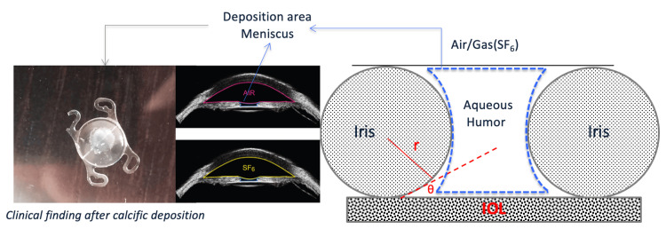
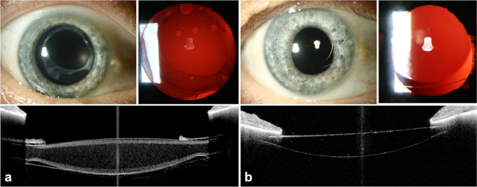
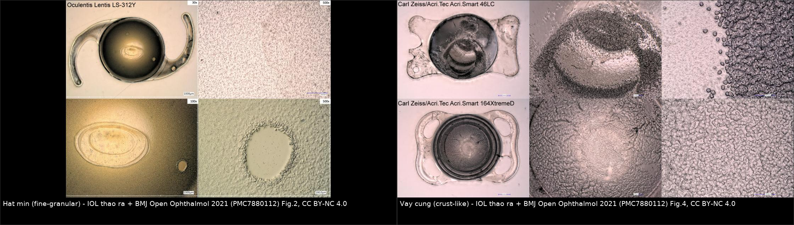
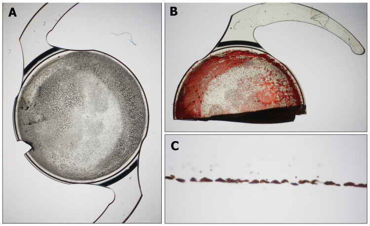
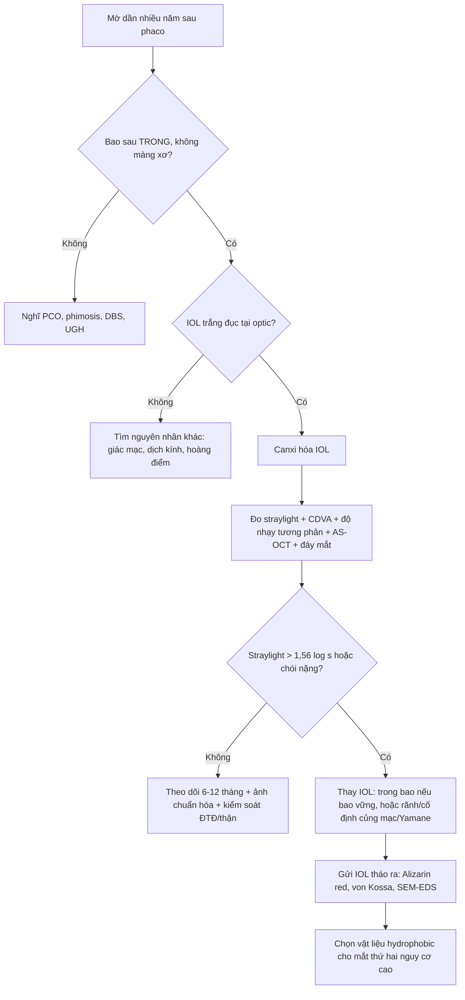
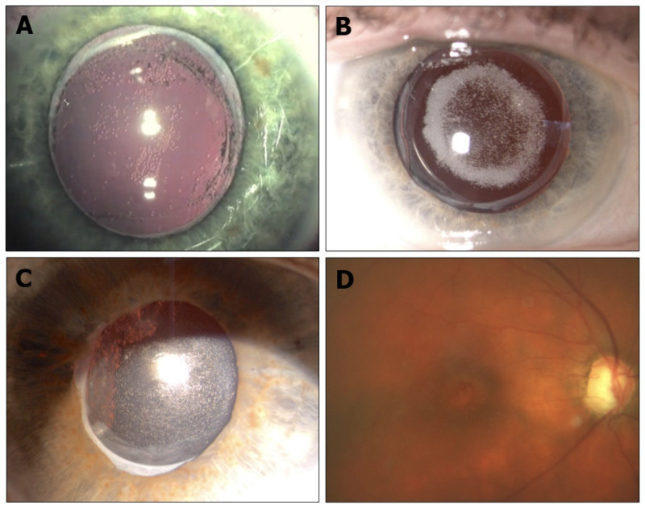
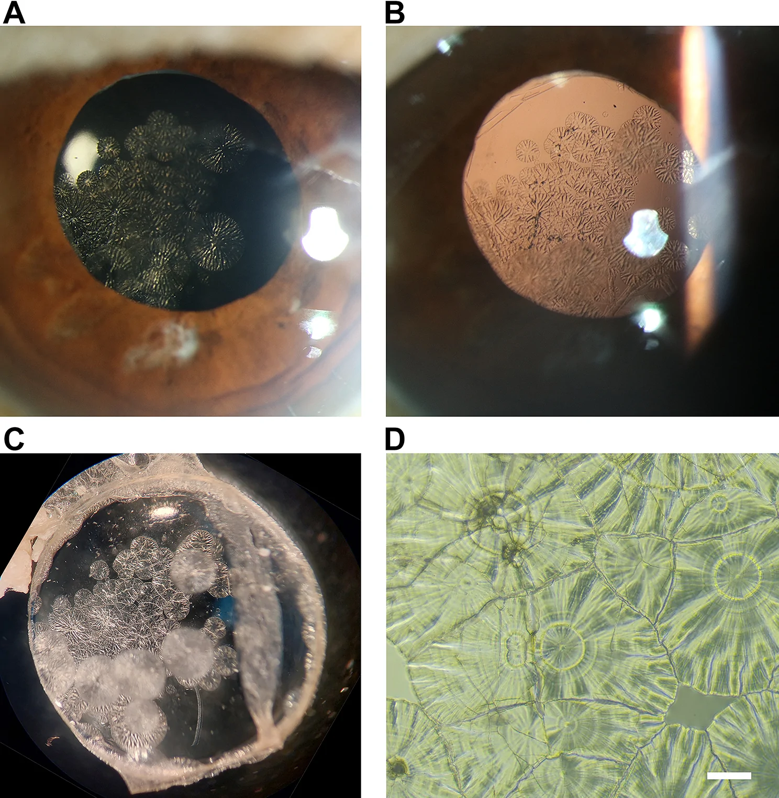

# 3253 — IOL canxi hóa / ngấm thuốc: mờ dần nhiều năm sau phaco dù bao TRONG / IOL calcification & opacification

**Tags:** `pattern:iol-duc-tien-trien` `pattern:khong-pco` `pattern:lang-canxi-mat-truoc` `pattern:sau-phaco-nhieu-nam` `pattern:bao-trong` `vung:mat` `vung:the-thuy-tinh` `vung:bao-the-thuy-tinh` `vung:tien-phong` `protocol:slit-lamp` `protocol:AS-OCT` `protocol:sinh-trac-IOL` `protocol:IOL-exchange` `protocol:phaco` `score:straylight` `incidentaloma:khong`

**Mức chắc chắn (certainty):** tổng hợp y văn (literature synthesis) — dựng từ các đoàn hệ, loạt IOL tháo ra và mô tả kỹ thuật: **53 mắt/42 bệnh nhân** canxi hóa đồng nhất (DOI 10.1186/s40662-024-00415-z), **75 IOL tháo ra** phân tích hình thái (PMC7880112), **14 mắt sau cắt dịch kính** (PMC10252848), **20 IOL thí nghiệm điện di** (PMC11342483), mô hình buồng tiền phòng nhân tạo (PMC12745019), ca bệnh **hyperphosphatemia/lọc màng bụng** (PMC13670496) và ca **hội chứng Ehlers–Danlos** (PMC11143781), tổng quan 2 ca + y văn (PMC5905315). Nhóm **không có bệnh nhân của mình**; chỗ chưa đủ chắc ghi **"chưa rõ"**. **Không ghi tên tác giả** — attribution = **tạp chí + năm + PMCID/DOI**.

> **Câu chốt:** bệnh nhân **đã phaco 2–15 năm**, nay **mờ mắt từ từ, không đau, không đỏ**; đèn khe thấy **IOL trắng đục** nhưng **bao sau TRONG, không màng xơ (không PCO)**. Đây là **canxi hóa/ngấm thuốc IOL (IOL calcification/opacification)** — tinh thể **calcium phosphate (hydroxyapatite)** lắng **trong lòng polymer** hoặc **trên mặt IOL**, **không hồi phục** và **YAG bao sau KHÔNG chữa được**. Bốn số phải nhớ: lắng canxi **dày 7,55–16,7 µm**, **Ca 69,69% / P 30,31%**; **mặt trước IOL bị 75/75 (100%) còn mặt sau chỉ 23/75 (31%)**; và ngưỡng quyết định mổ thay IOL là **straylight > 1,56 log(s)** — vì **thị lực 20/20 vẫn có thể kèm chói lóa nặng**.

## 1. Tổng quan bệnh học – cơ chế hình ảnh (TẠI SAO)

### 1.1 Chất liệu quyết định: chỉ acrylic ƯA NƯỚC mới canxi hóa

- IOL **acrylic ưa nước (hydrophilic acrylic)** ngậm nước trong lòng polymer; chính **nước nội tại** là đường vào cho **calci (Ca²⁺)** và **phosphate (PO₄³⁻)** của thủy dịch gặp nhau và **kết tinh** thành **calcium phosphate**, cuối cùng là **hydroxyapatite** — **không tan, không hồi phục**. IOL **acrylic kỵ nước (hydrophobic acrylic)** không canxi hóa, mà tạo **vi bọng nước (microvacuoles / glistenings)** trong polymer (PMC11610101; PMC11472889).
- Vì vậy câu hỏi đầu tiên khi thấy "IOL đục" không phải "đục bao hay đục IOL" mà là **"IOL này chất liệu gì, và mờ nằm ở mặt nào"**: **hydrophilic → nghĩ canxi hóa**; **hydrophobic → nghĩ glistenings/giọt dầu**; **silicone → nghĩ lắng mặt sau (asteroid hyalosis, dầu silicon)**.
- **Bằng chứng thành phần:** phân tích IOL tháo ra bằng SEM–EDS cho **Ca 69,69% / P 30,31%**, lớp lắng **7,55–16,7 µm**, cấu trúc **hoa thị (rosette)** trên **cả hai mặt** IOL ở bệnh nhân **suy thận mạn lọc màng bụng + đái tháo đường** (PMC13670496). Định lượng bằng **ICP-OES** trên IOL tháo ra cho thấy **canxi và phosphate trong IOL canxi hóa nguyên phát cao hơn thể thứ phát**, và chính lượng này quyết định **mất ánh sáng (light loss)** và **straylight** (PMC11472889).

### 1.2 Vì sao TRẮNG — và vì sao "trắng" không tỷ lệ với thị lực

- Tinh thể canxi **tán xạ ánh sáng** mạnh hơn polymer trong suốt, nên IOL **trắng đục**; mức tán xạ phụ thuộc **kích thước và mật độ tinh thể**, không phụ thuộc "độ trắng" nhìn thấy.
- Hệ quả đo lường: canxi hóa chủ yếu làm **giảm chất lượng quang học (MTF) ít nhưng tăng straylight nhiều**. Vì vậy bệnh nhân có thể còn **20/20** mà **chói–quầng dữ dội**; trong loạt 53 mắt, **CDVA và straylight TRƯỚC mổ KHÔNG tương quan** (PMC11610101). Đây là lý do phải đo **straylight**, không chỉ thị lực.

### 1.3 Hai ổ lắng: trong lòng polymer (nguyên phát) và trên mặt IOL (thứ phát)

| Kiểu | Vị trí | Cơ chế | Hình ảnh |
|---|---|---|---|
| **Nguyên phát / đồng nhất (primary, homogeneous)** | **Trong lòng** toàn bộ optic | Vật liệu + quy trình sản xuất/đóng gói; mắt **lành** trước đó | Trắng đục **lan tỏa**, không theo bờ bọt khí; **YAG vô hiệu** |
| **Thứ phát / khu trú (secondary, localized)** | **Mặt trước** (đôi khi mặt sau) IOL | Môi trường tiền phòng: **khí/gas/dầu silicon**, viêm, **phosphate cao**, ĐTĐ, suy thận | Lắng **dạng hạt/vảy**, thường **theo vùng tiếp xúc bọt khí** hoặc vùng optic lộ ra |
| **Giả canxi hóa (pseudo-calcification)** | Bề mặt | **Tinh thể/dầu** từ môi trường (asteroid hyalosis, dầu silicon, thuốc) | Hạt lấp lánh, **không phải canxi phosphate**; YAG có thể hiệu quả nếu ở **mặt sau** |

- **Vì sao mặt TRƯỚC chiếm gần như toàn bộ:** trong 75 IOL tháo ra, **mặt trước bị 75/75 (100%)**, **mặt sau chỉ 23/75 (31%)** (PMC7880112). Mặt trước là nơi **tiếp xúc trực tiếp thủy dịch và bọt khí**, còn mặt sau nằm sát bao sau — ít "tắm" thủy dịch hơn.
- **Cơ chế "mâm khí" (air–IOL meniscus)** giải thích hình thái sau ghép nội mô: bơm khí vào tiền phòng ở **30–40 mmHg trong 10–60 phút**, bọt khí chiếm **60–90% thể tích tiền phòng**; tại **mặt phân cách khí–thủy dịch–IOL**, nước bay hơi làm **Ca và phosphate bị cô đặc cục bộ**, kết tủa thành **vòng canxi men theo bờ bọt khí** (PMC12745019).

*Trái: IOL tháo ra vì canxi hóa sau ghép nội mô — lắng thành **vùng tròn** đúng nơi bọt khí tiếp xúc optic. Giữa: AS-OCT cho thấy **bờ lắng** (AFR = mâm khí, SF6 = bọt khí). Phải: sơ đồ — dung dịch thủy dịch dâng theo **mặt khum (meniscus)** ở mặt phân cách khí–IOL, nơi **Ca/P cô đặc** và kết tủa. Nguồn: Cureus 2025 (PMC12745019), Fig. 1, **CC BY 4.0**.*

### 1.4 Con số nền — tần suất, thời gian, yếu tố nguy cơ

| Đại lượng | Số liệu | Nguồn |
|---|---|---|
| Tần suất sau phaco **không biến chứng** | **0,03%** | PMC12745019 (dẫn lại) |
| Sau **ghép nội mô (EK/DSEK/DMEK)** | tới **4,5%** | PMC11472889 |
| Theo **model IOL** | **5–30%**, tới **50%** ở một số đoàn hệ; có model **14,5%** | PMC11610101; PMC11472889 |
| Thời gian **sau cắt dịch kính (PPV)** → canxi hóa | **20,5 ± 18,6 tháng** | PMC10252848 |
| Ca bệnh riêng lẻ | **1,5 năm** (ĐTĐ + PPV); **4,5 năm** (VKH); **14 năm** (Ehlers–Danlos) | PMC5905315; PMC11143781 |
| Vật liệu | **hydrophilic 68/75**, kể cả **7 mắt hydrophilic có phủ hydrophobic** | PMC7880112; PMC10252848 |
| Tamponade đi kèm | **C₂F₆ 8**, **C₃F₈ 1**, **khí 2**, **dầu silicon 3** (14 mắt) | PMC10252848 |
| Khí trong tiền phòng sau PPV/lấy dầu | **6/14 mắt** | PMC10252848 |
| Phosphate cao (như thủy dịch ĐTĐ) | **14 mM** làm canxi hóa nhiều hơn **10 mM**; phụ thuộc **thời gian phơi nhiễm** | PMC11342483 |

- **Yếu tố nguy cơ hệ thống:** **đái tháo đường** (phosphate thủy dịch cao + hàng rào máu–thủy dịch vỡ), **suy thận mạn/lọc máu** (rối loạn Ca–P, PTH cao), **viêm màng bồ đào**, **PPV + khí/dầu**, **ghép nội mô**, **chấn thương** (PMC13670496; PMC5905315; PMC10252848).
- **Bẫy tưởng an toàn:** IOL **hydrophilic phủ hydrophobic** được thiết kế để giảm canxi hóa nguyên phát **nhưng vẫn canxi hóa thứ phát** — **7 mắt** trong loạt PPV (PMC10252848).

## 2. Mẫu hình + chẩn đoán phân biệt theo vị trí (gamut)

### 2.1 Trình tự khám "mờ dần sau phaco" — 5 bước

1. **Đèn khe + giãn đồng tử**, soi **ánh sáng ngược (retroillumination)**: mờ **lan tỏa** hay **khu trú**; **bờ mờ có men theo vòng tròn** (gợi mâm bọt khí); mờ ở **mặt trước** (thấy khi cắt ánh sáng bên) hay **trong lòng** optic.
2. **Bao sau**: còn **TRONG** hay có **màng xơ trắng/PCO**; bờ bao **dày trắng** (co bao) hay **mỏng trong** (bao chết — bài 3252).
3. **Vị trí IOL**: trung tâm, nghiêng, trôi (nếu trôi **cùng bao** → nghĩ 3252, không phải bài này).
4. **AS-OCT tiền đoạn**: định vị lớp lắng **mặt trước** và **độ dày**; ví dụ trong y văn dùng AS-OCT để minh họa bờ lắng và mâm khí (PMC11610101 Fig. 1; PMC12745019 Fig. 1).
5. **Chức năng + đáy mắt**: **CDVA**, **straylight (C-Quant)**, **độ nhạy tương phản có/không chói**, **IOP**, **ECD**, **soi đáy** (loại trừ nguyên nhân khác gây mờ).

*Hai mắt của cùng bệnh cảnh. **(a)** trước mổ: IOL **trắng đục đồng nhất**, ánh sáng ngược cho **mờ lan tỏa**; AS-OCT: mặt IOL **không đều**. **(b)** sau **thay IOL cố định mống mắt**: optic **trong**, AS-OCT **phẳng, đều**. Nguồn: Eye Vis (Lond) 2024 (PMC11610101), Fig. 1, **CC BY 4.0**.*

### 2.2 Hình thái lắng — hai kiểu cần phân biệt

- **Hạt mịn (fine-granular): 67/75 (89%)** — hạt nhỏ rải đều, có thể **khiếm khuyết trung tâm (43/75)** hoặc **đảo trong (clear islet) 21/75**. Gặp ở **cả type 1 và type 2** → **hình thái KHÔNG tách được nguyên phát/thứ phát**.
- **Vảy cứng (crust-like): 8/75 (11%)** — mảng dày, bờ nham nhở; trong loạt này **chỉ gặp ở type 2 (thứ phát)**.
- **Hoa thị (rosette)** — kiểu đặc biệt ở **hyperphosphatemia/lọc màng bụng**, tinh thể xếp **cánh hoa** trên **cả hai mặt** IOL (PMC13670496).

*Trái: **hạt mịn (fine-granular)** — hạt li ti rải đều trên optic, kèm **khiếm khuyết/đảo trong** ở trung tâm. Phải: **vảy cứng (crust-like)** — mảng dày, nham nhở, chỉ gặp ở thể **thứ phát**. Cả hai là IOL **tháo ra**, chụp 30–500×. Nguồn: BMJ Open Ophthalmol 2021 (PMC7880112), Fig. 2 và Fig. 4, **CC BY-NC 4.0**; ảnh ghép letterbox, không crop.*

### 2.3 Gamut "mờ dần nhiều năm sau phaco, bao TRONG"

| Cơ chế | Thực thể | Mấu chốt phân biệt |
|---|---|---|
| Lắng canxi trong/mặt IOL | **Canxi hóa IOL (bài này)** | IOL **trắng đục**, bao **trong**, **không PCO**; mờ **theo vòng bọt khí** hoặc lan tỏa |
| Xơ bao sau | **PCO** (bài 1492) | **Màng trắng SAU IOL**, bao sau dày; **YAG hiệu quả** |
| Co bao trước | **Phimosis** | **Bờ bao trắng dày**, lỗ mở bao nhỏ, IOL nghiêng; mờ ở **rìa** không phải optic |
| Bao mất biểu mô | **Bao chết / DBS** (bài 3252) | Bao **trong, mỏng, nhăn**; **IOL và bao cùng trôi**; mờ do **lệch trục**, không do đục IOL |
| Vi bọng nước polymer | **Glistenings** | IOL **hydrophobic**, hạt **lấp lánh trong lòng**, thường **không tiến triển** |
| Dầu/khí trong IOL | **Giọt dầu, bọt khí** | Tiền sử **bơm dầu/gas**; hạt **tròn, đổi vị trí theo tư thế** |
| Lắng mặt sau | **Asteroid hyalosis** | **Hạt lấp lánh** trên **mặt sau** IOL silicone; **YAG có thể làm tan** |
| Sắc tố/viêm | **UGH** (bài 3238) | **Máu tiền phòng**, TID, sắc tố IOL, IOP dao động |
| Ngoài IOL | **Giác mạc, dịch kính, hoàng điểm** | Bệnh cảnh + soi đáy/OCT: mờ **không nằm ở IOL** |

## 3. Bảng so sánh phân biệt (ma trận đối chiếu)

| Thực thể (entity) | Hình ảnh điển hình | Chốt vào (rule-in) | Chốt loại (rule-out) | Gợi ý xác nhận |
|---|---|---|---|---|
| **Canxi hóa IOL (nguyên phát)** | IOL **hydrophilic**, trắng đục **đồng nhất** nhiều năm sau phaco; bao **trong** | **IOL đục + bao trong + không PCO**; **YAG không cải thiện** | **Màng trắng sau IOL** → PCO; **IOL lệch** → cơ học | Đèn khe + **straylight** + AS-OCT; phân tích IOL nếu tháo |
| **Canxi hóa IOL (thứ phát)** | Lắng **mặt trước**, **theo vòng bờ bọt khí/vùng optic lộ**; sau **PPV/EK**, ĐTĐ, suy thận | **Bối cảnh khí/gas/dầu + lắng khu trú mặt trước** | Lắng **mặt sau** đơn thuần → nghĩ asteroid/dầu | Tiền sử mổ; **Alizarin red** nếu tháo IOL |
| **PCO** (bài 1492) | **Màng trắng sau IOL**, bao sau dày, thường **trung tâm** | **Màng sau IOL + YAG hiệu quả** | Mờ **trong optic** → canxi hóa | Đèn khe sau giãn; chụp ảnh ngược sáng |
| **Bao chết / DBS** (bài 3252) | Bao **trong, mỏng, nhăn**; **IOL + bao trôi** | **IOL và bao cùng di chuyển**; không PCO | **IOL đứng yên, đục tại chỗ** → canxi hóa | AS-OCT/UBM; ECD |
| **Phimosis** | **Bờ bao trắng dày**, lỗ mở bao nhỏ (< 3–4 mm) | **Bờ bao dày trắng + lỗ co** | Bờ bao **trong, rộng** → không phimosis | Đèn khe, AS-OCT |
| **Glistenings** | **Hạt lấp lánh trong lòng**, IOL **hydrophobic** | **IOL hydrophobic + hạt nội tại, ổn định** | IOL **hydrophilic** + tiến triển → canxi | Soi ánh sáng hẹp; so ảnh cũ |
| **Giọt dầu/bọt khí** | Hạt **tròn, trong**, thay đổi theo tư thế | **Tiền sử bơm dầu/gas + hạt di động** | Lắng **cố định, bám mặt** → canxi | Đèn khe đổi tư thế; AS-OCT |
| **Asteroid hyalosis** | Hạt lấp lánh **mặt sau** IOL silicone | **Đáy mắt lấp lánh + lắng mặt sau** | Lắng **mặt trước** → canxi | Soi đáy; **YAG thử** (log(s) 2,08 → 1,76) |

*IOL tháo ra vì canxi hóa sau cắt dịch kính: **(A)** đục dày **mặt trước optic**, chừa haptic; **(B)** nhuộm **Alizarin red** — canxi **đỏ** đúng vùng mặt trước; **(C)** mặt cắt: lớp lắng **bám mặt**, không ăn vào lòng optic. Nguồn: Diagnostics (Basel) 2023 (PMC10252848), Fig. 3, **CC BY 4.0**.*

## 4. Protocol chụp/đo + ngưỡng quyết định & kỹ thuật

### 4.1 Đo gì, bằng gì, ngưỡng nào

| Bước | Dụng cụ | Ghi nhận | Ngưỡng hành động |
|---|---|---|---|
| 1 | **Đèn khe + giãn đồng tử** | Vị trí mờ (trước/trong/sau), bờ theo bọt khí, bao sau | Mờ **trong optic + bao trong** → nghĩ canxi hóa |
| 2 | **Ánh sáng ngược + ảnh** | Mức lan tỏa, đảo trong, khiếm khuyết trung tâm | Theo dõi bằng **ảnh chuẩn hóa cùng điều kiện** |
| 3 | **AS-OCT tiền đoạn** | Lớp lắng **mặt trước**, độ dày, bờ lắng | **Mờ mặt trước dày, bờ rõ** → thể thứ phát |
| 4 | **Straylight (C-Quant)** | log(s), trung bình 2 lần đo | **> 1,56 log(s) → cân nhắc thay IOL** |
| 5 | **CDVA + độ nhạy tương phản có/không chói** | logMAR, CSV-1000 | **Không dùng CDVA đơn độc** (có thể 20/20) |
| 6 | **IOP, ECD, soi đáy** | Loại trừ glôcôm, mất bù nội mô, bệnh võng mạc | Bất thường → xử lý trước/đồng thời |

- **Con số kết quả sau thay IOL (53 mắt, 30 mắt được thay):** CDVA **0,16 ± 0,13 → 0,05 ± 0,10 logMAR**; straylight **2,32 ± 0,34 → 1,23 ± 0,33 log(s)**; độ nhạy tương phản **tăng cả khi có chói**; **điểm gãy (breakeven) là straylight 1,56 log(s)** — trên ngưỡng này khả năng cải thiện sau mổ **> 50%** (PMC11610101).
- **Phân tích IOL tháo ra (khi cần chốt):** **Alizarin red** và **von Kossa** (canxi), **SEM–EDS** (Ca/P), **ICP-OES** (định lượng Ca/P). Trong loạt sau PPV, **Alizarin red dương** đúng vùng **mặt trước optic** (PMC10252848).

### 4.2 Sơ đồ quyết định

### 4.3 Xử trí — nguyên tắc

- **Không có thuốc làm tan canxi.** Điều trị duy nhất khi ảnh hưởng chức năng là **thay IOL (IOL exchange)**; canxi hóa **nguyên phát trong lòng polymer** thì **Nd:YAG không hiệu quả**, chỉ thể lắng **mặt sau dạng bám** (asteroid hyalosis) mới có thể làm tan bằng YAG (log(s) **2,08 → 1,76**) (PMC11610101; PMC7424163).
- **Chọn đường vào khi thay:** **trong bao** nếu bao còn vững và bao sau nguyên; **rãnh thể mi (sulcus)** hoặc **cố định củng mạc/Yamane**, **IOL cố định mống mắt** khi bao yếu/đã mở — các loạt trên dùng **IOL cố định mống mắt** và **thay trong bao** tùy mắt (PMC11610101; PMC13670496).
- **Phòng ngừa:** ở mắt **nguy cơ cao** (ĐTĐ, suy thận/lọc máu, viêm màng bồ đào, PPV + khí/dầu, ghép nội mô) chọn **acrylic kỵ nước hoặc PMMA** thay vì hydrophilic (PMC13670496; PMC11472889); **mắt thứ hai** phải đổi vật liệu; kiểm soát **phosphate/PTH** ở bệnh thận.

## 5. Biến thể bình thường và cạm bẫy

1. **"Bao trong nghĩa là không sao"** — sai. Bao trong chỉ loại trừ **PCO**, không loại trừ **IOL đục**; đây chính là bẫy hay gặp vì bác sĩ soi bao sau rồi kết luận "không có gì".
2. **YAG "thử cho chắc"** — vô ích và tốn một lần can thiệp khi canxi nằm **trong lòng** hoặc **mặt trước**; YAG chỉ có cơ sở khi lắng **mặt sau** dạng bám (asteroid/dầu).
3. **Thị lực 20/20 không loại trừ canxi hóa nặng về chất lượng quang học** — phải hỏi **chói, quầng, lái xe ban đêm** và đo **straylight**; ngưỡng **1,56 log(s)**.
4. **Hình thái KHÔNG tương ứng cơ chế:** **hạt mịn** gặp ở **cả** nguyên phát và thứ phát; **chỉ vảy cứng (crust-like)** mới giới hạn ở thể thứ phát (PMC7880112). Đừng suy ngược từ hình thái ra nguyên nhân.
5. **Mặt sau chỉ 31%** — lắng mặt sau đơn thuần ở IOL **silicone** gợi **asteroid hyalosis/dầu**, không phải canxi hóa điển hình.
6. **IOL phủ hydrophobic vẫn canxi hóa** — **7 mắt** trong loạt PPV; đừng yên tâm vì tên thương mại "chống canxi".
7. **Đảo trong (clear islet) và khiếm khuyết trung tâm** dễ bị đọc là "đỡ rồi" — nhưng chúng nằm trong **tiến trình lắng**, không phải hồi phục (PMC7880112).
8. **Đừng quy mọi canxi hóa cho thuốc/thủ tục mới:** phải loại trừ **bệnh nền Ca–P** (suy thận, cường cận giáp); nếu không, mắt thứ hai sẽ lặp lại y hệt.

## 6. Tự lượng giá — Blind Quiz

**Ca 1 — Nữ 72 tuổi, phaco 6 năm trước, mờ mắt phải 1 năm, không đau. Bao sau trong, không YAG trước đó.**

- Gợi ý: **CDVA 0,16 logMAR** nhưng **chói nặng khi lái xe**; **straylight 2,4 log(s)**.
- Câu hỏi: (1) Mờ nằm ở đâu? (2) YAG có ích không? (3) Ngưỡng nào quyết định mổ?

<b>Bấm để hiện đáp án (findings + chẩn đoán)</b>

- **Dấu hiệu:** IOL **trắng đục đồng nhất**, bao sau **trong**, **không màng xơ**; AS-OCT mặt IOL **không đều**.
- **Chẩn đoán:** **canxi hóa IOL nguyên phát/đồng nhất** (IOL hydrophilic).
- **YAG:** **không có ích** vì canxi nằm **trong lòng polymer/mặt trước**, không phải màng bao sau.
- **Chỉ định:** **straylight > 1,56 log(s)** + triệu chứng chói → **thay IOL**; trong loạt này CDVA lên **0,05 logMAR**, straylight xuống **1,23 log(s)**.
- **Nguồn ảnh:** Eye Vis (Lond) 2024 (PMC11610101), Fig. 1, **CC BY 4.0**.

**Ca 2 — Nam 60 tuổi, ĐTĐ tăng sinh, phaco + cắt dịch kính + C₂F₆ 2 năm trước, nay mờ dần.**

- Gợi ý: lắng **dày ở mặt trước optic**, mật độ **khác nhau giữa các mắt**; haptic **trong**.
- Câu hỏi: (1) Vì sao lắng mặt trước? (2) Cần gì để chốt canxi? (3) Xử trí?

<b>Bấm để hiện đáp án</b>

- **Cơ chế:** **khí/gas thoát vào tiền phòng** tạo **mâm khí–IOL**, cô đặc Ca/P tại mặt phân cách → lắng **mặt trước**, men theo bờ bọt khí (PMC12745019).
- **Chốt:** **Alizarin red dương** đúng vùng mặt trước optic (Hình B) + **SEM–EDS** thấy Ca/P; thời gian PPV → canxi hóa **20,5 ± 18,6 tháng**.
- **Xử trí:** **thay IOL** khi ảnh hưởng chức năng; **mắt thứ hai** chọn **hydrophobic**; kiểm soát ĐTĐ.
- **Nguồn ảnh:** Diagnostics (Basel) 2023 (PMC10252848), Fig. 1, **CC BY 4.0**.

**Ca 3 — Nữ 58 tuổi, ĐTĐ 20 năm, suy thận mạn lọc màng bụng, mờ mắt trái; thấy nhiều "bông hoa" trắng trong đồng tử.**

- Câu hỏi: (1) Hình thái gợi ý gì? (2) Vì sao bệnh nền quan trọng? (3) Một câu tư vấn cho mắt còn lại?

<b>Bấm để hiện đáp án</b>

- **Hình thái:** **hoa thị (rosette)** — tinh thể xếp cánh hoa trên **cả hai mặt** IOL, gặp ở **hyperphosphatemia** (lọc màng bụng/suy thận) + ĐTĐ.
- **Bệnh nền:** Ca này **PTH cao, phosphate cao**; phân tích cho **Ca 69,69% / P 30,31%**, lớp lắng **7,55–16,7 µm** → **hydroxyapatite**; thị lực **6/30 → 6/12** sau thay IOL.
- **Tư vấn mắt còn lại:** chọn **hydrophobic acrylic hoặc PMMA**, tránh hydrophilic; kiểm soát Ca–P–PTH.
- **Nguồn ảnh:** BMC Ophthalmol 2026 (PMC13670496), Fig. 1, **CC BY-NC-ND 4.0** — nguyên bản, không cắt/ghép.

## 7. Câu hỏi nghiên cứu & điểm chưa đồng thuận (tính đến 11/2026)

1. **[Tranh cãi] Ở mắt canxi hóa IOL đồng nhất còn CDVA tốt, thay IOL có cải thiện chất lượng thị giác nhiều hơn theo dõi không?**
   - **Đã biết:** loạt 53 mắt cho thấy **straylight 2,32 → 1,23 log(s)** sau thay IOL, nhưng đây là nghiên cứu **không đối chứng**; ngưỡng đề xuất **1,56 log(s)**.
   - **Chưa rõ:** chưa có **RCT** so sánh thay IOL với theo dõi; nguy cơ phẫu thuật ở mắt đã phaco lâu năm chưa được cân đo trong cùng quần thể.
   - **Hướng nghiên cứu:** RCT/đoàn hệ tiến cứu phân tầng theo straylight, outcome **chói–quầng + Catquest-9SF**.
   - **Nguồn:** DOI 10.1186/s40662-024-00415-z; PMC11610101 (2024).

2. **[Khoảng trống] Tỷ lệ canxi hóa thật trong quần thể phaco hiện nay là bao nhiêu, và hình thái có dùng để phân loại nguyên phát/thứ phát được không?**
   - **Đã biết:** tần suất báo cáo **0,03%** chung nhưng **tới 4,5%** sau ghép nội mô và **5–30%** theo model IOL; **hạt mịn gặp ở cả hai type**.
   - **Chưa rõ:** thiếu **mẫu số** theo dõi đủ dài và **tiêu chuẩn hình thái thống nhất**; chưa rõ tỷ lệ thật của thể **hoa thị**.
   - **Hướng nghiên cứu:** registry quốc gia theo **model/lô IOL** + đồng thuận Delphi về hình thái.
   - **Nguồn:** PMC7880112 (2021); PMC11472889 (2024).

3. **[Khác biệt thực hành] Ở mắt nguy cơ cao (ĐTĐ, suy thận, PPV + khí, ghép nội mô), chọn IOL hydrophobic/PMMA thay hydrophilic có giảm canxi hóa đủ để đổi thực hành thường quy?**
   - **Đã biết:** ca hoa thị được khuyến cáo chọn **hydrophobic/PMMA**; canxi hóa "chỉ gặp ở hydrophilic" trong các loạt in vitro/in vivo.
   - **Chưa rõ:** chưa có thử nghiệm so sánh trực tiếp **cùng quần thể nguy cơ**; ưu điểm khác của hydrophilic (tương thích miễn dịch, dễ xoay toric) vẫn được cân nhắc.
   - **Hướng nghiên cứu:** đoàn hệ tiến cứu theo vật liệu ở nhóm nguy cơ, outcome canxi hóa **≥ 5 năm**.
   - **Nguồn:** PMC13670496 (2026); PMC11472889 (2024).

## Bài liên quan chéo

- [1492 – Đục bao sau (PCO) và YAG sau cắt dịch kính](../1492-duc-bao-sau-iol-yag-sau-cat-dich-kinh/lesson.md)
- [3252 – Hội chứng "bao chết" và IOL trôi muộn](../3252-hoi-chung-bao-chet-dead-bag-syndrome/lesson.md)
- [3247 – Đục bao trước sau ICL phakic](../3247-duc-bao-truoc-sau-icl-phakic/lesson.md)
- [1873 – PCO muộn trên mắt bơm dầu và thời điểm YAG](../1873-bao-sau-duc-thu-phat-mat-bom-dau-yag/lesson.md)
- [1443 – Viêm màng bồ đào do thấu kính](../1443-viem-mang-bo-dao-do-thau-kinh/lesson.md)
- [3238 – UGH sau ICL phakic](../3238-ugh-sau-icl-phakic-iol/lesson.md)
- [400 – Tổng quan Mắt & thị giác](../400-tong-quan-mat-thi-giac/lesson.md)

## Ảnh

- `images/3253_dong-nhat_SlitLamp_PMC11610101-Fig1.jpg` — Eye Vis (Lond) 2024 (PMC11610101), Fig. 1, **CC BY 4.0**.
- `images/3253_co-che_Ky-thuat_PMC12745019-Fig1.jpg` — Cureus 2025 (PMC12745019), Fig. 1, **CC BY 4.0**.
- `images/3253_hat-min_SlitLamp_PMC7880112-Fig2.jpg` — BMJ Open Ophthalmol 2021 (PMC7880112), Fig. 2, **CC BY-NC 4.0**.
- `images/3253_vay-cung_Macro_PMC7880112-Fig4.jpg` — BMJ Open Ophthalmol 2021 (PMC7880112), Fig. 4, **CC BY-NC 4.0**.
- `images/composite_hat-min_vay-cung.jpg` — ảnh ghép từ 2 ảnh trên (letterbox, không crop, không kéo giãn), **CC BY-NC 4.0**.
- `images/3253_sau-PPV_SlitLamp_PMC10252848-Fig1.jpg` — Diagnostics (Basel) 2023 (PMC10252848), Fig. 1, **CC BY 4.0**.
- `images/3253_alizarin_Micro_PMC10252848-Fig3.jpg` — Diagnostics (Basel) 2023 (PMC10252848), Fig. 3, **CC BY 4.0**.
- `images/3253_rosette_SlitLamp_PMC13670496-Fig1.webp` — BMC Ophthalmol 2026 (PMC13670496), Fig. 1, **CC BY-NC-ND 4.0**, nguyên bản.

> Không dùng để chẩn đoán độc lập khi chưa có người hướng dẫn.
