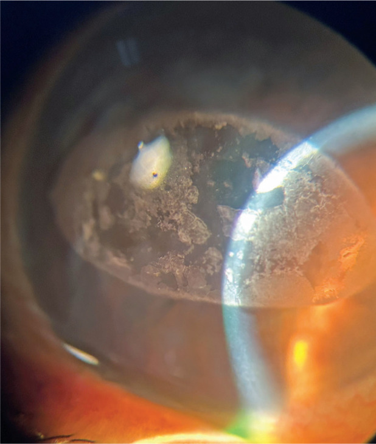
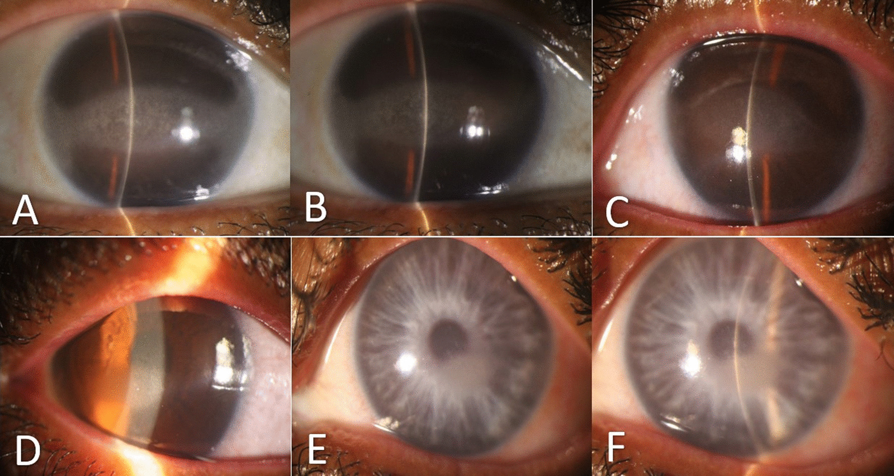
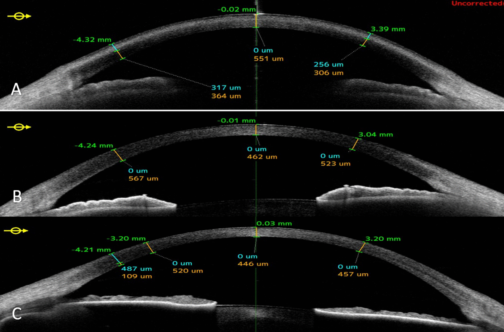
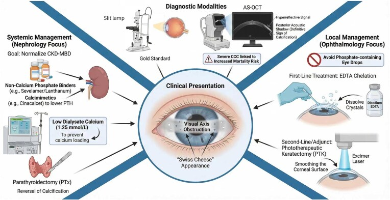
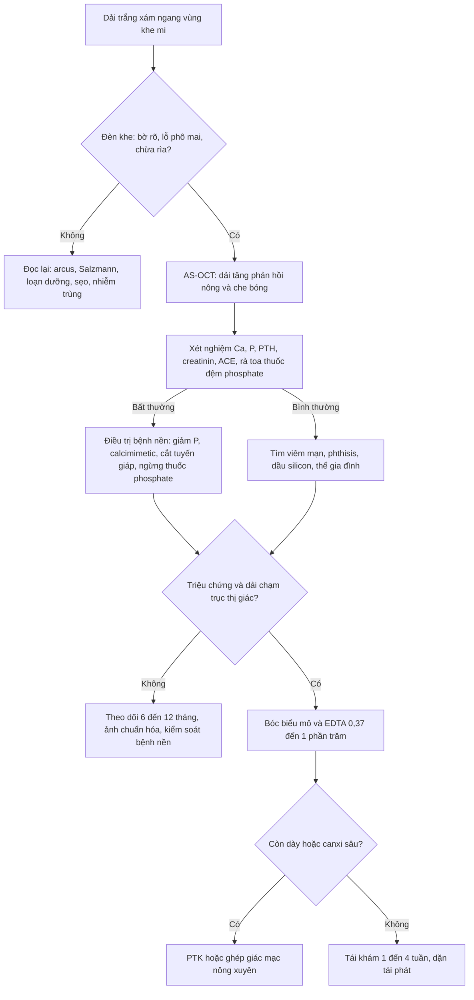
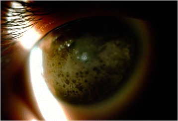

# 3254 — Dải canxi hóa giác mạc / Calcific band keratopathy

**Tags:** `pattern:dai-ngang-khe-mi` `pattern:lo-pho-mai` `pattern:lan-tu-ria-vao-trung-tam` `pattern:giac-mac-nong` `pattern:canxi-hoa` `vung:mat` `vung:giac-mac` `vung:be-mat-nhan-cau` `protocol:slit-lamp` `protocol:AS-OCT` `protocol:chelation-EDTA` `protocol:PTK` `score:Porter-Crombie` `score:AS-OCT-Pessoa` `incidentaloma:khong`

**Mức chắc chắn (certainty):** tổng hợp y văn (literature synthesis) — dựng từ một tổng quan hệ thống hoá 2026 về canxi hóa mắt ở bệnh thận mạn (PMC12997402), một đoàn hệ ghép cặp toàn quốc **94.039 bệnh nhân** (PMC4921853), hai loạt EDTA lớn (**230 bệnh nhân** — PMID 15183790; **108 ca, 89 ca phân tích** — PMC5770724), một nghiên cứu bệnh–chứng **100 mắt** sau chấn thương nhãn cầu hở bơm dầu (PMC8342885), loạt PTK viêm màng bồ đào (PMC4654727), loạt PTK cải tiến (PMC11476468) và ca gia đình **3/7 anh chị em** (PMC10925011). Nhóm **không có bệnh nhân của mình**; chỗ chưa đủ chắc ghi **"chưa rõ"**. **Không ghi tên tác giả** — attribution = **tạp chí + năm + PMCID/DOI**.

> **Câu chốt:** bệnh nhân có **dải trắng–xám nằm NGANG, đúng vùng khe mi**, bờ rõ, **có các lỗ trong nhỏ** ("phô mai Thụy Sĩ"), **chừa một khoảng trong sát rìa**, và **lan dần từ 3 giờ – 9 giờ vào trung tâm**. Dải này là **calci phosphate (hydroxyapatite)** lắng ở **màng Bowman và mô đệm nông**, **không phải màng xơ** — nên **không đáp ứng corticoid**, mà **bóc biểu mô + EDTA hòa tan canxi** là điều trị đầu tay (sạch trục thị giác **97,8%**, tái phát **28,1%**). Bốn số phải nhớ: **bệnh thận mạn làm tăng nguy cơ gấp 11,56 lần**; **1 điểm nặng hơn trên thang canxi hóa = +26,4% nguy cơ tử vong 1 năm**; **EDTA sạch trục thị giác 97,8%, thị lực giữ hoặc cải thiện 79,8%**; và **thuốc nhỏ mắt đệm phosphate là nguyên nhân iatrogenic bỏ sót được**.

## 1. Tổng quan bệnh học – cơ chế hình ảnh (TẠI SAO)

### 1.1 Chất lắng là gì và lắng ở đâu

- **Calcific band keratopathy (CBK)** = lắng **calci phosphate**, xác định bằng tinh thể **hydroxyapatite**, ở **lớp nông nhất của giác mạc**: **màng đáy biểu mô**, **màng Bowman** và **mô đệm nông** (PMC12997402). Mô bệnh ca gia đình cho thấy canxi nằm **ngoài tế bào, trong mô đệm nông**, kèm **thoái hóa dạng nang** suốt bề dày mô đệm (PMC10925011).
- Vị trí nông này quyết định **toàn bộ chiến lược**: canxi **nằm trên đường ánh sáng nhưng còn bóc được bằng cơ học/chelation**; khi lắng **sâu vào mô đệm giữa** mới cần **PTK** hoặc **ghép giác mạc**.
- **TẠI SAO canxi lắng thành DẢI NGANG:** vùng **khe mi** là phần giác mạc **phơi ra không khí**. CO₂ **khuếch tán từ bề mặt ra ngoài** làm **pH tại chỗ tăng nhẹ (kiềm hóa cục bộ)**; đồng thời **nước mắt bay hơi** làm **calci và phosphate bị cô đặc**. Khi **tích Ca × P vượt tích số hòa tan**, muối canxi kết tủa đúng ở vùng phơi sáng — tạo **hình dải** chứ không phải đám tròn (PMC12997402). Khô mắt làm nặng thêm vì nước mắt càng cô đặc.
- **TẠI SAO bắt đầu ở 3 và 9 giờ rồi lan vào trung tâm:** hai đầu dải nằm ở **rìa vùng khe mi** — nơi màng nước mắt mỏng nhất và tiếp xúc bờ mi nhiều nhất; tổn thương **lan dọc theo vùng phơi** vào trục thị giác, nên **mức lan vào trung tâm chính là mức ảnh hưởng thị lực** (PMC12997402).
- **TẠI SAO có "lỗ phô mai Thụy Sĩ" (Swiss-cheese holes):** các **nhánh thần kinh giác mạc xuyên qua màng Bowman** tạo vùng **không lắng tinh thể**; khi dải canxi dày lên, các vùng này **còn trong** và nổi bật thành **lỗ nhỏ bờ rõ** — đây là dấu **gần như đặc hiệu** của dải canxi hóa, và là chìa khóa phân biệt với dải xơ/arcus (PMC12997402).
- **TẠI SAO trắng đục và TẠI SAO chói nhiều hơn mờ:** hydroxyapatite **tán xạ ánh sáng mạnh** hơn nhu mô trong suốt; bề mặt **gồ ghề** làm tăng **tán xạ ngược (straylight)** và **chói–quầng**, trong khi **thị lực trung tâm có thể còn tốt** nếu dải chưa phủ trục. Vì vậy phải hỏi **chói, quầng, lái xe ban đêm**, không chỉ đo thị lực.

### 1.2 Hai "cú đánh": toàn thân quá bão hòa + cú tác động tại mắt

Mô hình **"two-hit"** của tổng quan 2026 (PMC12997402):

| Thành phần | Nội dung | Hệ quả trên giác mạc |
|---|---|---|
| **Cú đánh 1 — toàn thân** | Bệnh thận mạn–rối loạn khoáng xương (CKD-MBD): **tăng phosphate**, **tải calci**, **cường cận giáp thứ phát**, **thiếu chất ức chế** (fetuin-A, Klotho, MGP hoạt hóa) | Huyết tương và **nước mắt quá bão hòa Ca–P**, sẵn sàng kết tủa |
| **Cú đánh 2 — tại mắt** | **pH kiềm cục bộ** do CO₂ thoát ra, **khô mắt**, **viêm mạn**, **thuốc đệm phosphate**, **dầu silicon**, **mất biểu mô** | Tạo **mầm kết tinh** tại màng Bowman/mô đệm nông |

- **Chất ức chế bị mất:** **fetuin-A** giảm ở bệnh thận mạn (giảm khả năng "hút" Ca–P thành hạt hòa tan); **Klotho** giảm làm **FGF23 kháng** và phosphate không thải được; **MGP** cần vitamin K để carboxyl hóa — bệnh thận mạn thường **thiếu vitamin K chức năng** (PMC12997402). Đây là lý do **canxi hóa xuất hiện dù calci máu chỉ "cao–bình thường"**.

### 1.3 Nguyên nhân — con số thật từ các loạt lớn

| Bối cảnh | Số liệu | Nguồn |
|---|---|---|
| Bệnh thận mạn giai đoạn cuối (ESRD) lọc máu | **94.039** bệnh nhân ghép cặp: **230 ca** dải canxi hóa vs **26 ca** chứng; **IRR 12,21** (95% CI 8,14–18,32); **aHR 11,56** (7,70–17,35) | PMC4921853 |
| "Nghịch lý tuổi" | Tuổi **< 50**: **8,37/10.000 người–năm**; tuổi **> 65**: **1,86/10.000** — người trẻ bị dải canxi hóa là **dấu hiệu canxi hóa hệ thống hung hãn** | PMC4921853; PMC12997402 |
| Tần suất ở lọc máu | **43,8%** và **60,6%** (đèn khe); **79,5%** (44 bệnh nhân); **82,7%** khi sàng lọc bằng **AS-OCT** (29 bệnh nhân) | PMC12997402 |
| Độ nặng ở lọc máu | **39,4%** nhẹ, **32,1%** trung bình, **28,4%** nặng; **mỗi 1 điểm nặng = +26,4% tử vong 1 năm** (HR 1,26) | PMC12997402 (dẫn Hsiao) |
| Nguyên nhân trong loạt **230 bệnh nhân** | **Phù giác mạc mạn 28%** (80 mắt), **vô căn 25,9%** (74 mắt); các nguyên nhân khác: viêm màng bồ đào, glôcôm mạn, sau mổ | PMID 15183790 |
| Nguyên nhân trong loạt **108 ca** (2018) | **Vô căn 36%**; **thuốc nhỏ glôcôm dài hạn 27%** — nhóm **điều trị được bằng cách đổi thuốc** | PMC5770724 |
| Viêm màng bồ đào mạn | **aOR 9,5** (một phân tích) hoặc **aOR 4,3** (phân tích khác); tái phát sau EDTA ở nhóm viêm **3/5 mắt (60%, p = 0,03)** | PMC12997402; PMID 15183790 |
| **Phthisis bulbi** | **aOR 141,9** — nhãn cầu teo làm canxi lắng cực mạnh | PMC12997402 |
| Đái tháo đường | **aOR 2,617** | PMC12997402 |
| Mắt bơm dầu silicon, không có thể thủy tinh, sau chấn thương hở | **28% (28/100 mắt)**; **giữ dầu ≥ 6 tháng** và **chấn thương zone III** là yếu tố nguy cơ; nguy cơ **tăng rõ từ ≥ 10 tháng**, gần như **ổn định 4–6 tháng** | PMC8342885 |
| Cường cận giáp thứ phát | **PTH 357,3 pg/mL** (nhóm canxi hóa vừa/nặng) vs **228,4 pg/mL** (nhẹ); **R² = 0,434** giữa điểm canxi hóa và PTH | PMC12997402 |
| Lọc màng bụng vs lọc máu | Khác biệt **không có ý nghĩa** (0% vs 6,3%, **p = 0,09**) — **kiểm soát chuyển hóa** quan trọng hơn **kiểu lọc** | PMC12997402 |
| Bẩm sinh/gia đình | **3/7 anh chị em** trong một gia đình; **bố mẹ cận huyết**; khởi phát **thập niên đầu đời**; một người phát hiện **bệnh thận 38 năm sau** triệu chứng mắt | PMC10925011 |
| Cystinosis | Dải canxi hóa gặp ở **nhóm lớn tuổi hơn** của bệnh cystinosis, cùng **tân mạch rìa và dính sau** | PMC4841061 |

> **Điểm cần nhớ:** ở người **trẻ không rõ nguyên nhân**, dải canxi hóa **không phải "già hóa"** mà là **cửa sổ soi vào bệnh thận–khoáng xương**. Ở người lớn, nguyên nhân **thường gặp nhất lại là vô căn và thuốc nhỏ glôcôm dài hạn** — hai nhóm rất khác nhau về xử trí.

## 2. Mẫu hình + chẩn đoán phân biệt theo vị trí (gamut)

### 2.1 Đọc dải canxi hóa theo 5 câu hỏi

1. **Có đúng khe mi không?** Dải **ngang**, giới hạn trên–dưới bởi **bờ mi**, không vượt ra ngoài vùng phơi sáng (trừ khi bệnh nhân có **hở mi, lác, sụp mi** làm lệch vùng phơi).
2. **Có chừa rìa không?** Điển hình **chừa một khoảng trong 1–2 mm sát rìa** rồi mới tới dải — khác **arcus** (vòng sát rìa).
3. **Có lỗ "phô mai Thụy Sĩ" không?** Lỗ nhỏ, bờ rõ, phân bố rải rác trong dải = **dấu chốt**.
4. **Dải phẳng hay nổi?** Dải canxi **phẳng–hơi gồ**, bề mặt **nhám như phấn**; nốt nổi bờ rõ từng cục gợi **Salzmann**.
5. **Bối cảnh toàn thân/ổ mắt là gì?** Thận–Ca–P–PTH; viêm màng bồ đào; **dầu silicon**; **thuốc nhỏ đệm phosphate**; **gia đình**; **cystinosis**.

### 2.2 Gamut theo cơ chế

| Nhóm cơ chế | Thực thể | Gợi ý nhận diện |
|---|---|---|
| **Chuyển hóa (metastatic)** | Bệnh thận mạn/lọc máu, cường cận giáp nguyên phát/thứ phát, tăng calci máu (sarcoidosis, lao, vitamin D, milk-alkali), **hypophosphatasia** | Dải hai bên, đối xứng; xét nghiệm Ca–P–PTH–creatinin bất thường |
| **Viêm/ổ mắt mạn (dystrophic)** | Viêm màng bồ đào mạn, **phthisis bulbi**, phù giác mạc mạn, glôcôm mạn, sau mổ/xạ | Một hoặc hai bên; kèm dính sau, đục, teo nhãn cầu |
| **Vật liệu ngoại lai** | **Dầu silicon** (nhũ tương hóa), khí, IOL, thuốc | Tiền sử PPV/bơm dầu; hạt dầu trong tiền phòng/góc |
| **Iatrogenic – thuốc** | **Thuốc nhỏ mắt đệm phosphate** (nước mắt nhân tạo, thuốc glôcôm), **corticoid–phosphate** | Bệnh nhân khô mắt dùng nhiều loại thuốc; ngừng thuốc → cải thiện |
| **Di truyền/bẩm sinh** | **Dải canxi hóa gia đình nguyên phát**, **cystinosis**, loạn dưỡng giác mạc | Trẻ em, nhiều anh chị em, tinh thể cystine, hội chứng Fanconi |
| **Thoái hóa/bề mặt** | **Salzmann**, arcus, limbal girdle of Vogt, pterygium tái phát | Nốt/vòng/cung khu trú, không có lỗ phô mai |

### 2.3 Ảnh minh họa mẫu hình kinh điển

*Đèn khe phóng đại: dải trắng–xám **nằm ngang đúng khe mi**, bề mặt **nhám như phấn**, có **vùng trong nhỏ** trong dải; phần rìa và trung tâm còn tương đối trong. Nguồn: Arq Bras Oftalmol 2025 (PMC12818042), Figure, **CC BY 4.0**.*

## 3. Bảng so sánh phân biệt (ma trận đối chiếu)

| Thực thể (entity) | Hình ảnh điển hình | Chốt vào (rule-in) | Chốt loại (rule-out) | Gợi ý xác nhận |
|---|---|---|---|---|
| **Dải canxi hóa giác mạc (bài này)** | Dải **ngang đúng khe mi**, bờ rõ, **nhám**, **lỗ phô mai**, **chừa rìa**; có thể kèm **hạt phấn ở kết mạc vùng rìa** | **Dải đúng khe mi + lỗ phô mai + chừa rìa**; kèm bệnh nền **Ca–P–PTH** hoặc viêm mạn/dầu | Vòng **kín sát rìa** → arcus; **nốt nổi rời** → Salzmann; thâm nhiễm **bờ mờ + đau** → nhiễm | Đèn khe; **AS-OCT**: dải **tăng phản hồi nông + che bóng**; xét nghiệm Ca, P, PTH, creatinin |
| **Arcus senilis (lipid)** | Vòng trắng–xám **sát rìa**, **chừa khoảng trong**, hai bên, đối xứng | **Vòng kín sát rìa + chừa khoảng trong + không lỗ** | Dải chỉ ở **khe mi** có lỗ → canxi hóa | Đèn khe đủ chẩn đoán; **không cần** xét nghiệm canxi |
| **Salzmann nodular degeneration** | **Nốt trắng–xám nổi**, bờ rõ, hay ở vùng rìa/trung tâm, trên giác mạc có **tiền sử viêm/khô** | **Nốt nổi từng cục, không tôn trọng khe mi**, bề mặt không phấn đều | Dải phẳng ngang khe mi + lỗ → canxi hóa | AS-OCT: **nốt dày khu trú**, không phải dải liên tục |
| **Loạn dưỡng giác mạc (granular/macular/lattice)** | Chấm/nốt/lưới **hai bên, trung tâm**, tiến triển theo tuổi | **Tính gia đình + tổn thương dạng hạt/lưới**; có thể kèm **mờ đều** | Dải ngang khe mi đơn thuần → không phải loạn dưỡng | Soi đèn khe + gia hệ; OCT/AS-OCT; **xét gen** khi cần |
| **Dải do dầu silicon** | Dải giác mạc nông trên mắt **đã bơm dầu**, có thể kèm **hạt dầu** trong tiền phòng/góc | **Tiền sử PPV + bơm dầu ≥ 6 tháng**, đặc biệt **chấn thương zone III, mắt không thể thủy tinh** | Không có tiền sử dầu → nguyên nhân khác | Soi góc/tiền phòng tìm dầu; AS-OCT; hỏi mốc bơm–lấy dầu |
| **Dải do thuốc đệm phosphate (iatrogenic)** | Dải nông xuất hiện/cấp tính ở người **dùng nhiều thuốc nhỏ mắt**, thường **bệnh thận mạn** | **Dùng thuốc chứa phosphate + dải mới + cải thiện khi ngừng** | Không dùng thuốc, tiến triển nhiều năm → nguyên nhân khác | Rà **toa thuốc** từng lọ; thử ngừng thuốc đệm phosphate |
| **Cystinosis** | **Tinh thể cystine lấp mô đệm** + dải canxi hóa, **trẻ em**, sợ ánh sáng | **Tinh thể dày đặc + tuổi nhỏ + hội chứng Fanconi** | Người lớn, không tinh thể → không phải cystinosis | Đèn khe; **cysteamine**; xét gen/xét cystine bạch cầu |
| **Viêm giác mạc/loét nhiễm trùng** | Thâm nhiễm trắng **bờ mờ**, **mủ tiền phòng**, **fluorescein dương**, **đau nhiều** | **Đau + thâm nhiễm + mủ tiền phòng + tiền sử kính/dị vật** | Dải phẳng, không viêm, không mủ → canxi hóa | Soi đèn khe + nhuộm; **cạo giác mạc** trước khi nhỏ kháng sinh |
| **Phthisis bulbi** | **Nhãn cầu teo nhỏ**, dải canxi hóa trên mắt **mất chức năng**, có thể vôi hóa nội nhãn | **Nhãn cầu teo + tiền sử viêm/chấn thương/mổ** | Nhãn cầu bình thường → tìm nguyên nhân khác | Siêu âm/B-scan, CT khi cần; **không mổ vì thẩm mỹ** |

*Sáu mắt của **3 anh chị em** (A–B: chị 41 tuổi; C–D: em trai 37 tuổi; E–F: em gái 33 tuổi). Dải canxi hóa **hai bên**, mức độ từ **dải mảnh vùng khe mi** đến **mảng dày gần toàn bộ giác mạc** ở hai mắt E–F; đi kèm **thoái hóa dạng nang** trên mô bệnh. Nguồn: J Med Case Rep 2024 (PMC10925011), Fig. 1, **CC BY 4.0**.*

## 4. Protocol chụp/đo + hệ phân độ & ngưỡng quyết định

### 4.1 Khám và đo — thứ tự cố định

| Bước | Dụng cụ | Ghi nhận | Ngưỡng hành động |
|---|---|---|---|
| 1 | **Đèn khe, ánh sáng khuếch tán + khe sáng hẹp** | Chiều cao dải, khoảng cách tới rìa, **mức lan vào trục thị giác**, lỗ phô mai, bề mặt | **Chạm trục thị giác + triệu chứng** → cân nhắc can thiệp |
| 2 | **Fluorescein** | **Mất biểu mô trên dải**, loét, dấu Seidel | Mất biểu mô → **điều trị bề mặt trước**, tránh chelation khi đang nhiễm |
| 3 | **AS-OCT tiền đoạn** | **Dải tăng phản hồi ở lớp nông**, **che bóng phía sau (posterior shadowing)**, độ dày, vị trí so với Bowman | **Tăng phản hồi nông + che bóng** = canxi hóa; **dày sâu** → PTK/ghép thay vì chỉ EDTA |
| 4 | **Đo nhãn áp, soi góc** | Loại trừ glôcôm thứ phát/dính góc; tìm **dầu silicon** trong góc | IOP cao + dính góc → xử trí glôcôm trước |
| 5 | **Đáy mắt, ECD** | Loại trừ bệnh võng mạc, mất bù nội mô làm mờ | ECD thấp → cân nhắc ghép nội mô phối hợp |
| 6 | **Xét nghiệm toàn thân** | **Calci, phosphate, PTH, creatinin/eGFR, albumin**, ACE (sarcoid), vitamin D, calci niệu | **Bất thường Ca–P–PTH/eGFR** → phối hợp thận–nội tiết; **ngừng thuốc đệm phosphate** |
| 7 | **Rà toa thuốc nhỏ mắt** | Thành phần **phosphate** trong nước mắt nhân tạo, thuốc glôcôm, corticoid | **Đổi sang chế phẩm không phosphate** ở bệnh thận mạn |

### 4.2 Hai thang phân độ đang dùng

| Thang | Cách làm | Điểm | Dùng khi nào |
|---|---|---|---|
| **Porter–Crombie/Tokuyama** | Đèn khe | **0** bình thường; **1** chỉ kết mạc; **2** kết mạc + rìa; **3** kết mạc + **một đường** giác mạc; **4** đường rõ + kết mạc; **5** lan rộng hơn | Lâm sàng thường quy; dùng trong nghiên cứu tiên lượng (Hsiao) — **chủ quan, bỏ sót tổn thương dưới lâm sàng** |
| **AS-OCT (Pessoa)** | AS-OCT | **0** không tăng phản hồi; **1** kết mạc rời rạc; **2** kết mạc dạng đường; **3** kết mạc dạng cục/nốt; **4** **tổn thương giác mạc (dải canxi hóa)** | Phát hiện **dưới lâm sàng** (**82,7%** ở lọc máu), theo dõi **thoái triển sau điều trị** |

- **AS-OCT là chốt hình ảnh:** dải canxi cho **tín hiệu tăng phản hồi** và **che bóng phía sau** — dấu của vật liệu **đặc, chắn sáng**; AS-OCT còn dùng để **theo dõi giảm kích thước sau cắt tuyến giáp** (quan sát thấy **thoái triển rõ sau 6 tháng**) (PMC12997402).

*AS-OCT ba mắt phải của cùng gia đình: **dải tăng phản hồi sát bề mặt** (mũi tên trắng của tác giả), **che bóng** các lớp phía sau; đo bề dày giác mạc trung tâm **551 / 462 / 446 µm**. Tổn thương **nông**, phù hợp điều trị bề mặt (EDTA/PTK). Nguồn: J Med Case Rep 2024 (PMC10925011), Fig. 2, **CC BY 4.0**.*

### 4.3 Điều trị — bảng so sánh có số

| Biện pháp | Cơ chế | Chỉ định | Kết quả (số) | Hạn chế |
|---|---|---|---|---|
| **EDTA chelation** (disodium EDTA **0,37–1%**, bóc biểu mô bằng cồn **20%** hoặc cơ học) | EDTA **bắt calci** → phức hợp tan → bóc dải | **Đầu tay** cho dải nông có triệu chứng | **Sạch trục thị giác 97,8%**; thị lực **giữ/cải thiện 79,8%** (**13,5%** tăng ≥ 2 dòng); mổ **20 phút** (10–45); **tái phát 28,1%** (trung bình **546 ngày**); chỉ **4/89** phải làm lại | Cần bóc biểu mô; **không lấy được canxi sâu**; tái phát khi bệnh nền không kiểm soát |
| **EDTA loạt 2004** | Như trên | Dải có triệu chứng | **98%** giảm triệu chứng; **33,3%** tăng ≥ 2 dòng ở 1 tháng; **tái phát 17,8%** với theo dõi **17,7 năm**; viêm màng bồ đào **3/5 (60%)** tái phát | Theo dõi rất dài mới thấy tái phát; khác biệt với loạt 2018 do **thời gian theo dõi** |
| **PTK (excimer laser)** | **Bốc bay** mô/ canxi nông, làm **phẳng bề mặt** | Dải **dày, gồ**, canxi **sâu hơn** hoặc sau EDTA chưa sạch | Loạt viêm màng bồ đào **13 mắt**: **12/13** cải thiện thị lực, **trẻ cải thiện nhiều hơn người lớn**; PTK xuyên biểu mô cải tiến **15 mắt**: **0,68 → 0,22 logMAR** (p < 0,001) | Đắt; **lệch khúc xạ (viễn thị)**, mờ/haze; cần máy excimer |
| **Bào bằng burr kim cương (không EDTA)** | **Mài cơ học** lớp canxi | Khi **không có EDTA**, mắt **tiềm năng thị lực kém** | **7 mắt**: **100%** giảm khó chịu; **2 mắt tái phát** (4 và 28 tháng) | Không kiểm soát độ sâu; **loạn thị không đều**, sẹo |
| **Ghép giác mạc nông/xuyên (DALK/PKP)** | Thay mô chứa canxi | Dải **rất dày, sâu**, hoặc canxi hóa gia đình tái phát | Ca gia đình: **DALK** một mắt + **SK** mắt còn lại; thị lực **1–2/10 → 4/10**; em gái **4/10 và 6/10 → 6/10 và 7/10** | Phẫu thuật lớn; thải ghép; **vẫn tái phát nếu bệnh nền tiếp diễn** |
| **Điều trị toàn thân** | Giảm **tải Ca–P**, hạ **PTH** | Bệnh thận mạn–CKD-MBD, cường cận giáp | **Cắt tuyến giáp → thoái triển canxi sau 6 tháng** trên AS-OCT; **dùng binder không calci**, **calcimimetic**, **dịch lọc Ca 1,25 mmol/L** | Không có RCT lấy **canxi hóa mắt** làm tiêu chí chính |

*Sơ đồ của tổng quan 2026: **hai nhánh song song** — **thận–nội tiết** (binder không calci, calcimimetic, dịch lọc Ca thấp **1,25 mmol/L**, cắt tuyến giáp) và **mắt** (**tránh thuốc nhỏ đệm phosphate**, **EDTA đầu tay**, **PTK thứ hai**), với **đèn khe là chuẩn** và **AS-OCT** phát hiện tổn thương dưới lâm sàng. Nguồn: Clin Kidney J 2026 (PMC12997402), Fig. 2, **CC BY 4.0**.*

### 4.4 Sơ đồ quyết định

## 5. Biến thể bình thường và cạm bẫy

1. **Arcus senilis bị gọi là "dải canxi hóa"** — arcus là **vòng lipid kín sát rìa, chừa khoảng trong**, không có lỗ phô mai, không cần xét nghiệm calci. Gọi nhầm dẫn tới **xét nghiệm và điều trị canxi vô ích**.
2. **Limbal girdle of Vogt** — cung trắng–vàng **khu trú ở 3 và 9 giờ**, chỉ ở rìa, **lành tính**; khác dải canxi hóa vì **không lan vào trung tâm**.
3. **"Dải do dầu silicon" không phải lúc nào cũng là canxi** — dầu nhũ tương hóa có thể tạo **dải khúc xạ/hạt dầu**, và dầu cũng **gây canxi hóa thật**. Trước khi chelation, **soi tiền phòng/góc tìm hạt dầu** và hỏi **mốc bơm–lấy dầu**: giữ dầu **≥ 6 tháng** làm tăng nguy cơ rõ (28% ở mắt chấn thương hở không thể thủy tinh).
4. **Quy mọi canxi hóa cho thuốc mới** — bài 3243 đã đính chính **"canxi hóa giác mạc" không phải tổn thương của FGFRi**. Trước khi quy cho thuốc, **phải loại trừ bệnh thận, cường cận giáp, sarcoid, viêm mạn**; nếu không, **mắt thứ hai sẽ lặp lại**.
5. **Bỏ sót thuốc đệm phosphate** — bệnh nhân lọc máu thường dùng **nước mắt nhân tạo và thuốc glôcôm có phosphate**; đây là "điểm mù liên chuyên khoa": thận giảm phosphate toàn thân, mắt lại **bơm phosphate tại chỗ**. Luôn **đọc thành phần từng lọ**.
6. **Điều trị corticoid đơn thuần** — dải canxi **không phải viêm**, corticoid **không làm tan canxi**; dùng kéo dài còn làm **mỏng giác mạc, tăng nhãn áp, nhiễm trùng**.
7. **Chelation khi đang có mất biểu mô/nhiễm** — **không bóc biểu mô trên mắt đang nhiễm**; điều trị nhiễm trước (xem bài 3216, 6132), rồi mới can thiệp dải.
8. **"Lỗ phô mai" bị đọc là loét** — lỗ là **vùng không lắng canxi**, **fluorescein âm** (trừ khi biểu mô trên đó mất); đừng chẩn đoán loét nhiễm trùng chỉ vì thấy lỗ.
9. **Tưởng dải một bên là "chuyện của mắt"** — dải **một bên** vẫn có thể do **bệnh thận**; ngược lại **dải hai bên** có thể do **dùng thuốc đệm phosphate**. **Tính đối xứng không định được nguyên nhân**.
10. **Đo nhãn áp trên giác mạc nhám** — bề mặt không đều làm **Tono-Pen sai lệch**; dùng **Goldmann/đo lại nhiều lần**, và **soi góc** trước khi kết luận glôcôm.

## 6. Tự lượng giá — Blind Quiz

**Ca 1 — Bệnh nhân lớn tuổi, mờ mắt và chói cả hai bên nhiều tháng, không đau; có đái tháo đường type 2 và suy thận mạn (bối cảnh lâm sàng minh họa dựng từ ảnh).**

- Gợi ý: dải **ngang đúng khe mi**, bề mặt **nhám**, có **vùng trong nhỏ** trong dải.
- Câu hỏi: (1) Mô tả hình thái và vị trí. (2) Ba chẩn đoán phân biệt? (3) Xét nghiệm nào **bắt buộc** trước khi điều trị?

<b>Bấm để hiện đáp án (findings + chẩn đoán)</b>

- **Dấu hiệu:** dải trắng–xám **nằm ngang vùng khe mi**, **bờ rõ**, **nhám như phấn**, có **lỗ/vùng trong**; phần rìa chừa tương đối.
- **Chẩn đoán:** **dải canxi hóa giác mạc (calcific band keratopathy)** — hydroxyapatite lắng ở **màng Bowman/mô đệm nông**.
- **Phân biệt:** **arcus senilis** (vòng kín sát rìa), **Salzmann nodular degeneration** (nốt nổi rời), **loạn dưỡng giác mạc** (hai bên, dạng hạt/lưới), **dải do dầu silicon** (nếu có tiền sử bơm dầu).
- **Bắt buộc:** **calci, phosphate, PTH, creatinin/eGFR**; **rà toa thuốc nhỏ mắt tìm phosphate**; AS-OCT để đo độ sâu. Ở bệnh nhân này, **suy thận + đái tháo đường** là hai yếu tố nguy cơ độc lập (**aHR 11,56** cho ESRD; **aOR 2,617** cho ĐTĐ).
- **Nguồn ảnh:** Arq Bras Oftalmol 2025 (PMC12818042), Figure, **CC BY 4.0**.

**Ca 2 — Ba anh chị em (41, 37 và 33 tuổi) mờ mắt từ nhỏ, bố mẹ cận huyết; chị cả mới phát hiện protein niệu và creatinin tăng.**

- Gợi ý: tổn thương **hai bên**, mức độ **khác nhau giữa các mắt**; em gái 33 tuổi có **mảng dày gần toàn bộ**.
- Câu hỏi: (1) Chẩn đoán? (2) Vì sao phải **theo dõi toàn thân lâu dài** dù xét nghiệm ban đầu bình thường? (3) Hai hướng điều trị đã dùng trong loạt này?

<b>Bấm để hiện đáp án</b>

- **Chẩn đoán:** **dải canxi hóa giác mạc gia đình nguyên phát (familial primary calcific band-shaped keratopathy)** — **3/7 anh chị em**, khởi phát **thập niên đầu đời**.
- **Theo dõi lâu dài:** chị 41 tuổi được phát hiện **bệnh thận (creatinin tăng, protein niệu)** **38 năm sau** triệu chứng mắt; các xét nghiệm Ca–P–PTH trước đó **bình thường**. Vì vậy **không được kết luận "nguyên phát lành tính"** chỉ vì xét nghiệm một lần bình thường.
- **Điều trị trong loạt:** **DALK** cho mắt chị cả (thị lực **1–2/10 → 4/10**), **ghép giác mạc nông (SK)** cho em gái (triệu chứng **chói/dị vật** hết; **4/10 và 6/10 → 6/10 và 7/10**). Mô bệnh: canxi **ngoài tế bào ở mô đệm nông** + **thoái hóa dạng nang**.
- **Nguồn ảnh:** J Med Case Rep 2024 (PMC10925011), Fig. 1, **CC BY 4.0**.

**Ca 3 — Bệnh nhân trong loạt viêm màng bồ đào mạn (7–53 tuổi), mờ mắt nhiều tháng, chói nặng; giác mạc có mảng trắng dày phủ trục thị giác.**

- Gợi ý: mảng **dày, nhám**, nhiều **chấm/lỗ nhỏ** trong mảng; mắt có **dính sau** và **đục thể thủy tinh** kèm theo.
- Câu hỏi: (1) Vì sao dải dày thế này mà **không đau nhiều**? (2) EDTA có đủ không? (3) PTK có an toàn ở trẻ không?

<b>Bấm để hiện đáp án</b>

- **Vì sao ít đau:** canxi lắng **phẳng theo bề mặt**, chỉ đau khi **biểu mô trên dải mất đi** gây **bào mòn tái phát**; đau không tỷ lệ với độ dày.
- **EDTA có đủ không:** dải **dày và có thể sâu** → EDTA có thể **không lấy hết**; đây là chỉ định **PTK** (hoặc EDTA + bào nông). Trong loạt **13 mắt viêm màng bồ đào**, **12/13** cải thiện thị lực sau PTK; **1 mắt** không cải thiện vì **lắng đọng biểu mô 2 tuần sau mổ**.
- **PTK ở trẻ:** loạt này kết luận PTK **an toàn và hiệu quả cả ở trẻ**, nhưng **mức cải thiện bị giới hạn** bởi **đục thể thủy tinh, bệnh võng mạc và loạn dưỡng giác mạc** do viêm màng bồ đào — phải tư vấn **kỳ vọng thực tế**.
- **Nguồn ảnh:** J Ophthalmic Inflamm Infect 2015 (PMC4654727), Fig. 1 (trước PTK), **CC BY 4.0**.

## 7. Câu hỏi nghiên cứu & điểm chưa đồng thuận (tính đến 11/2026)

1. **[Tranh cãi] Ở bệnh nhân bệnh thận mạn có dải canxi hóa, cấm/đổi thuốc nhỏ mắt đệm phosphate có làm giảm tái phát sau EDTA so với chỉ điều trị bệnh nền không?**
   - **Đã biết:** ca bệnh và tổng quan cho thấy thuốc đệm phosphate tạo **tải phosphate tại chỗ** trên nền nước mắt giàu calci; khuyến cáo **tránh chế phẩm phosphate** ở bệnh thận mạn (PMC12997402).
   - **Chưa rõ:** **không có** nghiên cứu can thiệp nào đo **tỷ lệ tái phát** khi đổi thuốc; tần suất thật của dải do thuốc trong quần thể lọc máu chưa được định lượng.
   - **Hướng nghiên cứu:** đoàn hệ tiến cứu/registry theo **thành phần phosphate trong toa thuốc**, outcome **tái phát sau EDTA 12–24 tháng**.
   - **Nguồn:** PMC12997402 (2026); PMC5770724 (2018).

2. **[Khoảng trống] Thang AS-OCT (Pessoa 0–4) có dự báo nguy cơ tử vong và biến cố tim mạch tốt hơn thang đèn khe Porter–Crombie không?**
   - **Đã biết:** AS-OCT phát hiện canxi hóa **82,7%** ở lọc máu (so với **43,8–79,5%** bằng đèn khe); thang đèn khe **mỗi điểm +26,4% tử vong 1 năm**; AS-OCT **không tương quan** với điểm calci động mạch vành (29 bệnh nhân).
   - **Chưa rõ:** chưa có nghiên cứu **lớn, tiến cứu** xem **canxi hóa dưới lâm sàng trên AS-OCT** có cùng ý nghĩa tiên lượng; cỡ mẫu AS-OCT hiện rất nhỏ.
   - **Hướng nghiên cứu:** đoàn hệ đa trung tâm **AS-OCT + theo dõi tử vong**, so sánh **AUC** với thang đèn khe.
   - **Nguồn:** PMC12997402 (2026); PMC4921853 (2016).

3. **[Khác biệt thực hành] Với dải canxi hóa có triệu chứng, EDTA chelation hay PTK xuyên biểu mô là lựa chọn đầu tay khi cả hai đều sẵn có?**
   - **Đã biết:** EDTA: **sạch trục thị giác 97,8%**, tái phát **28,1%**; PTK xuyên biểu mô cải tiến: **0,68 → 0,22 logMAR** (15 mắt); bào burr không EDTA: **100% giảm khó chịu** nhưng **2/7 tái phát**; chưa có **RCT** so sánh trực tiếp.
   - **Chưa rõ:** khác biệt **tái phát, lệch khúc xạ, chi phí** giữa EDTA và PTK; phần lớn bằng chứng là **loạt hồi cứu**, và **thời gian theo dõi** khác nhau (546 ngày vs 17,7 năm) làm **tỷ lệ tái phát không so sánh được**.
   - **Hướng nghiên cứu:** RCT đa trung tâm phân tầng theo **độ sâu AS-OCT**, outcome **thị lực + tái phát + lệch khúc xạ**.
   - **Nguồn:** PMC5770724 (2018); PMC11476468 (2024); PMC6171751 (2018).

## Bài liên quan chéo

- [3243 – Độc tính mắt của thuốc ức chế FGFR (đính chính "canxi hóa giác mạc")](../3243-doc-tinh-mat-thuoc-uc-che-fgfr/lesson.md)
- [3216 – Viêm giác mạc nấm (chẩn đoán phân biệt thâm nhiễm giác mạc)](../3216-viem-giac-mac-nam-soi/lesson.md)
- [6132 – Viêm giác mạc do kính tiếp xúc (loét nhiễm khuẩn)](../6132-viem-giac-mac-kinh-tiep-xuc/lesson.md)
- [1456 – Bỏng hóa chất giác mạc](../1456-bong-hoa-chat-mat/lesson.md)
- [3204 – Loét giác mạc do thần kinh](../3204-loet-giac-mac-than-kinh/lesson.md)
- [3201 – Sẹo giác mạc và ghép giác mạc](../3201-seo-giac-mac-ghep/lesson.md)
- [1837 – Dầu silicon trong tiền phòng và tổn thương nội mô](../1837-dau-silicone-tien-phong-ton-thuong-noi-mo/lesson.md)
- [400 – Tổng quan Mắt & thị giác](../400-tong-quan-mat-thi-giac/lesson.md)

## Ảnh

- `images/3254_dai-canxi_SlitLamp_PMC12818042-Fig1.jpg` — Arq Bras Oftalmol 2025 (PMC12818042), Figure, **CC BY 4.0**.
- `images/3254_gia-dinh_SlitLamp_PMC10925011-Fig1.jpg` — J Med Case Rep 2024 (PMC10925011), Fig. 1, **CC BY 4.0**.
- `images/3254_AS-OCT_PMC10925011-Fig2.jpg` — J Med Case Rep 2024 (PMC10925011), Fig. 2, **CC BY 4.0**.
- `images/3254_so-do-xu-tri_Ky-thuat_PMC12997402-Fig2.jpg` — Clin Kidney J 2026 (PMC12997402), Fig. 2, **CC BY 4.0**.
- `images/3254_truoc-PTK_SlitLamp_PMC4654727-Fig1.jpg` — J Ophthalmic Inflamm Infect 2015 (PMC4654727), Fig. 1, **CC BY 4.0**.

> Không dùng để chẩn đoán độc lập khi chưa có người hướng dẫn.
