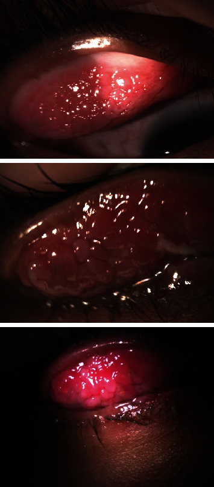
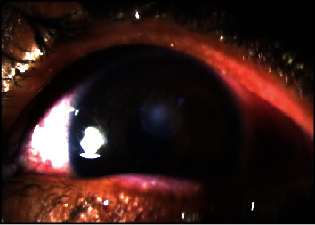
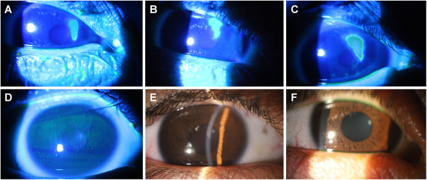
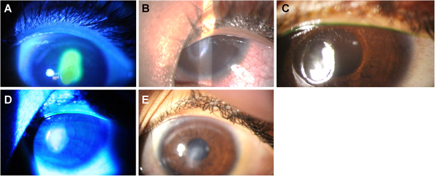
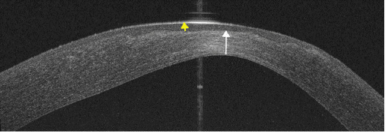
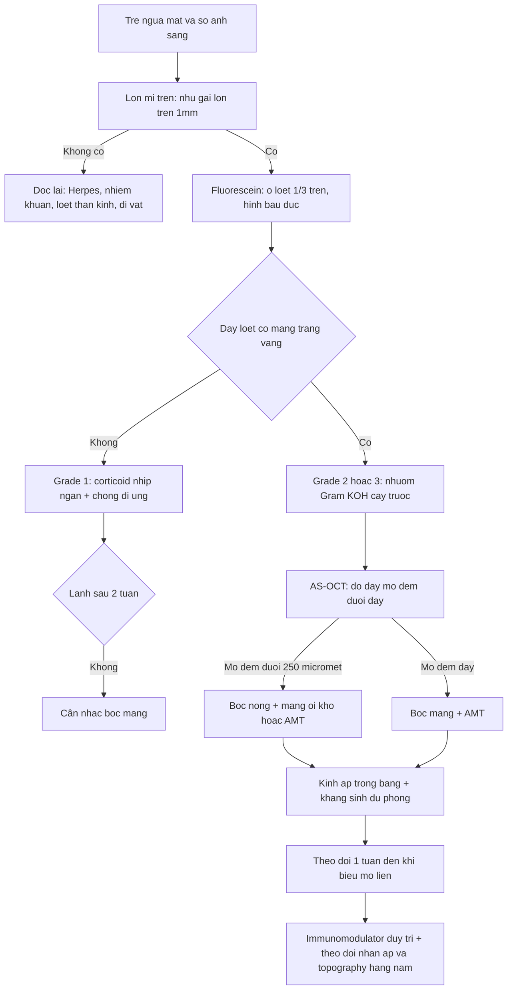
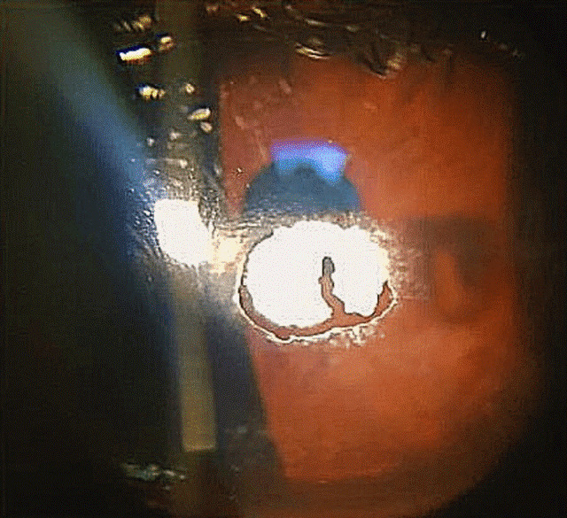

# 3255 — Loét giác mạc hình khiên trong viêm kết mạc mùa xuân / Corneal shield ulcer in vernal keratoconjunctivitis (VKC)

**Tags:** `pattern:loet-giac-mac` `pattern:loet-hinh-khien` `pattern:nhu-gai-lon` `pattern:manh-inhien` `pattern:khuyet-bieu-mo-man-tinh` `pattern:canxi-hoa` `pattern:di-ung-mat` `vung:mat` `vung:giac-mac` `vung:ket-mac` `vung:mi-mat` `protocol:den-khe` `protocol:fluorescein` `protocol:AS-OCT` `protocol:cam-mau-cay` `protocol:te-bao-hoc` `protocol:debridement` `protocol:AMT` `score:Cameron` `score:Bonini` `incidentaloma:khong`

**Mức chắc chắn (certainty):** tổng hợp y văn (literature synthesis) — dựng từ loạt **193 mắt/163 bệnh nhân** loét khiên có phân độ Cameron và kết cục theo từng cách điều trị (*Am J Ophthalmol* 2013, **PMID 23218707**, DOI 10.1016/j.ajo.2012.09.014), **2 ca** có ảnh diễn tiến đầy đủ (*J Med Case Rep* 2020, **PMC7298766**, CC BY 4.0), loạt **290 mắt** VKC (J Ayub Med Coll Abbottabad 2017, **PMID 28712175**), loạt **135 bệnh nhân** VKC (*Rom J Ophthalmol* 2022, **DOI 10.22336/rjo.2022.61**), khuyến cáo chuyên gia châu Á (*Front Med* 2022, **PMC9376221**, CC BY), tổng quan 2026 về VKC trẻ em (*Children* 2026, **PMC13025120**, CC BY), ca loét canxi hóa ở giác mạc hình chóp có AS-OCT (*GMS Ophthalmol Cases* 2025, **PMC12286868**, CC BY 4.0), loạt phẫu thuật nhú gai + màng kết tự thân (*Case Rep Ophthalmol Med* 2024, **PMC11319060**, CC BY), kỹ thuật debridement dưới OCT trong mổ (*Indian J Ophthalmol* 2018, **PMC5989504**, CC BY-NC-SA 4.0), cùng các nghiên cứu tacrolimus (**PMC7852099**, **PMID 33144336**) và triamcinolone dưới sụn mi (**PMID 31276459**). Nhóm **không có bệnh nhân của mình**; chỗ chưa đủ chắc ghi rõ "chưa rõ". **Không ghi tên tác giả** — attribution = tạp chí + năm + PMCID/DOI.

> **Câu chốt:** đứa trẻ **ngứa mắt, sợ ánh sáng**, mi trên có **nhú gai lớn ("sỏi cuội")**, và trên **1/3 trên giác mạc** có một **ổ loét hình bầu dục/bờ rõ** — đó là **loét hình khiên (shield ulcer)**, biến chứng **3–11%** của VKC và là nguyên nhân **mù một mắt ở trẻ**. Bốn số phải nhớ: **loét khiên gặp ở 3–11% bệnh nhân VKC** và **3,1% số mắt** trong một loạt 290 mắt; **grade 1 khỏi bằng thuốc 94%**, nhưng **grade 3 chỉ 1,7% khỏi bằng thuốc so với 100% khi bóc mảng + màng ối**; **tái phát 14,5%**, **viêm giác mạc nhiễm khuẩn thứ phát 10%**; và **mảng xơ–protein ở đáy loét chính là thứ chặn biểu mô lành** — nên **corticoid đơn thuần không bao giờ làm tan mảng**.

## 1. Tổng quan bệnh học – cơ chế hình ảnh (TẠI SAO)

### 1.1 Vì sao "mùa xuân" lại có loét giác mạc

- **Viêm kết mạc mùa xuân (vernal keratoconjunctivitis, VKC)** là bệnh **dị ứng mạn tính bề mặt nhãn cầu**, đỉnh ở **trẻ trai 5–15 tuổi** (tỉ lệ nam:nữ **3:1** trước dậy thì), thường **hai bên không đối xứng**, tái diễn theo mùa ở vùng ôn đới và **quanh năm ở vùng nóng ẩm** (PMC7298766).
- Cơ chế **hai pha**: pha **type I qua IgE** (tế bào mast xổ hạt → histamin, tryptase) và pha **muộn type IV qua Th2/eosinophil** (IL-4, IL-5, IL-13). **Eosinophil** giải phóng **protein hạt gây độc biểu mô** — **MBP (major basic protein)**, **ECP**, **EDN** — vừa **phá biểu mô** vừa **ức chế biểu mô di chuyển để bít ổ khuyết** (PMID 24079715; PMC13025120).
- Hình thái: **thể sụn mi** (nhú gai lớn ở kết mạc sụn mi trên, hay gặp châu Âu/Bắc Mỹ), **thể rìa** (nhú ở rìa + **dải Trantas** — châu Á/châu Phi), và **thể hỗn hợp** (hay gặp vùng nhiệt đới) (PMC7298766).
- **Nhú gai lớn (giant papilla)** được định nghĩa là **> 1 mm**; bề mặt nhú **dẹt**, có thể **bắt màu fluorescein** — chính các đỉnh dẹt này cọ xát giác mạc (PMC9376221).

### 1.2 Hai "cú đánh" tạo ra ổ loét hình khiên

| Thành phần | Cơ chế | Hệ quả trên giác mạc |
|---|---|---|
| **Cú đánh 1 — cơ học** | Mỗi lần chớp, **nhú gai lớn ở sụn mi trên** cọ vào **1/3 trên giác mạc**; **hiện tượng Bell** đưa giác mạc lên dưới mi khi nhắm → vùng tổn thương **luôn ở trên** | **Trợt biểu mô vi thể tái diễn** → mất hàng rào |
| **Cú đánh 2 — hóa học/miễn dịch** | **MBP/ECP/EDN** từ eosinophil **gây độc biểu mô + chặn di chuyển tế bào**; **mucus** dính vào ổ khuyết | Ổ khuyết **không lành**, bờ **dày, gồ**, đáy đọng **mảng xơ–protein** |

- **TẠI SAO hình "khiên" (shield):** ổ loét **bầu dục, bờ rõ, bề ngang rộng hơn bề dọc**, nằm đúng **vùng quét của bờ mi** ở 1/3 trên — hình dạng phản ánh **diện cọ xát**, không phản ánh mạch máu hay vùng giải phẫu (PMC9376221; PMC12286868).
- **TẠI SAO có mảng (plaque):** khi ổ khuyết kéo dài, **mảnh vụn viêm + mucus + protein nước mắt** lắng ở đáy, rồi **canxi hóa**. Mô bệnh mảng cho thấy **sợi collagen chạy từ màng Bowman vào sâu trong mảng** và **protein hạt eosinophil (MBP) dương tính** — tức mảng **không phải "giả màng" rửa trôi được** mà là **cấu trúc xơ–protein bám chắc** (PMID 24079715; PMC12286868).
- **TẠI SAO mảng chặn lành:** biểu mô lành bằng **di chuyển từ rìa vào**, nhưng phải có **nền (basement membrane) tương thích**. Mảng **che mất màng Bowman**, tạo **bậc thềm cao** và **canxi** làm biểu mô **không bám được** — đây là lý do **bóc mảng làm lành nhanh hơn hẳn** (PMC7298766; PMID 23218707).

### 1.3 Vì sao hình ảnh học lại là "đo" chứ không chỉ "nhìn"

- **Đèn khe** cho biết **vị trí, kích thước, bờ, đáy, mảng, mủ tiền phòng, dấu Seidel** — nhưng **không đo được độ dày biểu mô** và **không thấy tổn thương dưới lâm sàng**.
- **AS-OCT tiền đoạn** đo **bản đồ bề dày biểu mô 5 mm trung tâm**: ở trẻ VKC, **vùng trên mỏng hơn có ý nghĩa** — **51,07 ± 4,11 µm vs 52,54 ± 2,01 µm** (p = 0,008), **bề dày tối thiểu 45,99 vs 50,11 µm** (p < 0,001), và **hiệu (MIN−MAX) âm hơn** (**−11,77 ± 9,38 vs −5,80 ± 1,88 µm**, p = 0,001) — tức **mỏng khu trú** đúng nơi nhú gai cọ (PMID 36462126).
- Sau khi ổ loét lành, AS-OCT phát hiện **mô đệm mỏng đi + biểu mô phì đại bù trừ**: ca loét canxi hóa ở giác mạc hình chóp có **mô đệm 233 µm** và **biểu mô 92 µm** (PMC12286868). *Lưu ý trung thực: chú thích ảnh của bài gốc ghi **325 µm**, thân bài ghi **233 µm** — nguồn không thống nhất, bài này dẫn theo thân bài.*
- **TẠI SAO mô đệm mỏng quan trọng:** nó là **ngưỡng an toàn của dao/bàn chải** khi bóc mảng — bóc trên mô đệm **233 µm** có nguy cơ **thủng giác mạc**, đúng tình huống ca báo cáo phải **dừng bóc** và chuyển sang **màng ối khô + kính áp tròng băng** (PMC12286868).
- **Giới hạn:** AS-OCT **không phân biệt được mảng vô khuẩn với thâm nhiễm nhiễm khuẩn**; muốn phân biệt phải **nhuộm Gram/KOH + cấy** trước khi nhỏ corticoid mạnh (PMC9376221).

### 1.4 Dịch tễ và gánh nặng — số cụ thể

- **VKC** hiếm ở châu Âu (**< 1–3,2/10.000 dân**, trong đó **0,8/10.000** có biến chứng giác mạc), **1,2%** ở Nhật, **4,0–11,1%** ở một số nước châu Phi (PMC9376221).
- **Loét khiên** gặp ở **~3–11% bệnh nhân VKC** (PMC12286868 dẫn lại); **3,1% số mắt** trong loạt **290 mắt** (PMID 28712175); **2,96%** trong loạt **135 bệnh nhân** (PMID 36589333).
- Trong **700 trẻ** điều trị tại một trung tâm, chỉ **4 ca** loét khiên (**0,57%**) — cho thấy **tần suất phụ thuộc tuyến** (PMC7298766 dẫn lại).
- Biến chứng nặng nhất của VKC không chỉ là loét: trong loạt 290 mắt, **sẹo giác mạc 20,3%**, **giác mạc hình chóp 5,9%** (PMID 28712175); trong loạt 135 bệnh nhân, **glôcôm do corticoid 8,89%** — **cao hơn cả loét khiên** (PMID 36589333).

## 2. Mẫu hình + chẩn đoán phân biệt theo vị trí (Gamut)

- **Mẫu hình chốt:** **ổ loét nông, bầu dục, bờ rõ, ở 1/3 trên giác mạc** ± **mảng trắng–vàng ở đáy** ± **mủ tiền phòng**, kèm **nhú gai lớn ở sụn mi trên** và/hoặc **dải Trantas ở rìa**.
- **Gamut theo vị trí:**
  - **1/3 trên (kinh điển):** **loét khiên VKC/AKC**; **viêm kết mạc rìa trên (SLK)**; **loét do mi quặm/lông xiêu**; **dị vật dưới mi trên**.
  - **Trung tâm/trung tâm–cạnh:** **loét khiên canxi hóa ở giác mạc hình chóp** (cọ xát ở đỉnh chóp — PMC12286868); **loét do kính tiếp xúc**; **loét sau chấn thương**.
  - **Bất kỳ vị trí:** **Herpes**, **vi khuẩn**, **nấm**, ***Acanthamoeba***, **loét thần kinh dưỡng**, **do phơi nhiễm/mi hở**, **bỏng hóa chất**.
- **Gợi nhớ SHIELD** (do nhóm tự đặt, không phải thang chuẩn):
  **S**hield ulcer (VKC/AKC) · **H**erpes · **I**nfection (vi khuẩn/nấm/Acanthamoeba) · **E**xposure/neurotrophic · **L**ens (kính tiếp xúc) · **D**ry eye/dellen/mechanical.

*Ba mức độ **nhú gai lớn (cobblestone)** ở kết mạc sụn mi trên của cùng một trẻ VKC thể sụn mi, chụp cách nhau nhiều tháng: nhú **tăng dần kích thước và số lượng**, bề mặt **dẹt, bóng**, xếp như **sỏi cuội**. Đây là "cối xay" cọ vào 1/3 trên giác mạc mỗi lần chớp. Nguồn: Case Rep Ophthalmol Med 2024 (PMC11319060), Fig. 4, **CC BY 4.0**.*

*Mắt đỏ, sợ ánh sáng ở trẻ VKC: **ổ loét bầu dục ở 1/3 trên giác mạc**, bờ rõ, đáy mờ đục; xung quanh là **kết mạc rìa phù nề**. Ảnh **đèn khe ánh sáng khuếch tán**, không nhuộm fluorescein. Nguồn: Case Rep Ophthalmol Med 2024 (PMC11319060), Fig. 1, **CC BY 4.0**.*

## 3. Bảng so sánh phân biệt (ma trận đối chiếu)

| Thực thể (entity) | Hình ảnh điển hình | Chốt vào (rule-in) | Chốt loại (rule-out) | Gợi ý xác nhận |
|---|---|---|---|---|
| **Loét khiên VKC grade 1** | Ổ loét bầu dục 1/3 trên, **đáy trong, không mảng**, bờ đều | **Nhú gai lớn > 1 mm + dải Trantas + loét 1/3 trên** | **Đáy đục/mảng vàng** → đã sang grade 2–3; **dendrite** → Herpes | Đèn khe + fluorescein; hỏi **ngứa theo mùa**, tiền sử dị ứng |
| **Loét khiên VKC grade 2–3 (có mảng)** | **Mảng trắng–vàng dày ở đáy**, bờ loét **gồ, dày**, ổ khuyết **kéo dài > 2 tuần** | **Mảng bám chắc, không trôi khi rửa** + nhú gai lớn | **Mủ tiền phòng + thâm nhiễm lan** → nghĩ **bội nhiễm**, phải cấy trước | Đèn khe + **AS-OCT** (độ dày mô đệm dưới mảng); cấy/nhuộm trước khi corticoid mạnh |
| **Herpes biểu mô** | **Đuôi gai (dendrite)** nhánh, đầu tận cùng có **bóng**, nhuộm fluorescein **bắt màu nhánh** | **Dendrite + giảm cảm giác giác mạc** ± tiền sử tái phát | **Bờ loét bầu dục đều + nhú gai lớn** → không phải Herpes | Đèn khe sau nhuộm; **so sánh cảm giác 2 bên**; PCR HSV nếu nghi |
| **Viêm giác mạc vi khuẩn** | **Thâm nhiễm đặc, bờ mờ, lan nhanh**, **mủ tiền phòng**, đau nhiều | **Khởi phát < 48 giờ + thâm nhiễm đặc + mủ tiền phòng** | **Nhú gai lớn + loét 1/3 trên mạn tính** → VKC | **Cạo giác mạc nhuộm Gram + cấy** trước kháng sinh |
| **Viêm giác mạc nấm** | Bờ **lông vũ**, **tổn thương vệ tinh**, **mảng nội mô**, tiền sử chấn thương thực vật | **Bờ lông vũ + vệ tinh**; **KOH dương** | **Bờ bầu dục rõ, không vệ tinh** → ít nghĩ nấm | **KOH/calcofluor + cấy nấm**; IVCM hỗ trợ |
| ***Acanthamoeba*** | **Đau nhiều hơn hình ảnh**, **vòng thâm nhiễm**, tiền sử kính/tiếp xúc nước | **Đau–hình ảnh không tương xứng + vòng thâm nhiễm** | **Không đau tương xứng + nhú gai lớn** → VKC | **KOH/calcofluor, cấy, PCR**; IVCM |
| **Loét thần kinh dưỡng** | Ổ khuyết **bờ cuộn tròn**, **đáy khô**, **giảm/không cảm giác**, không đau | **Giảm cảm giác + bờ cuộn + tiền sử HSV/phẫu thuật/thân não** | **Cảm giác bình thường + ngứa + nhú gai** → không phải | **Test cảm giác**, nhuộm fluorescein, loại trừ nhiễm |
| **Loét khiên canxi hóa ở giác mạc hình chóp** | Ổ loét **trung tâm/trung tâm–cạnh**, **mảng canxi hình vòng**, **KHÔNG nhú gai**, **KHÔNG dải Trantas**; AS-OCT **mô đệm mỏng 233 µm** | **Giác mạc hình chóp + mảng canxi + không bệnh dị ứng** | **Có nhú gai lớn/dải Trantas** → VKC | Topography/Pentacam + AS-OCT; **không bóc sâu** nếu mô đệm mỏng |

*Cùng một mắt phải, **A–F**: (A) loét **6,0 × 2,7 mm** ở 1/3 trên, bờ rõ; (B) sau 3 tuần điều trị thuốc — **giảm nhẹ nhưng còn ổ khuyết**; (C) sau 90 ngày **ổ khuyết và mảng to hơn** — đây là thời điểm quyết định bóc; (D) **1 tuần sau bóc mảng**: biểu mô **liền hoàn toàn**, còn **mờ mô đệm nông**; (E) 45 ngày và (F) 8 tháng: **mờ mô đệm khu trú, không tái phát**. Nguồn: J Med Case Rep 2020 (PMC7298766), Fig. 1, **CC BY 4.0**.*

**Ba dấu hiệu quyết định trên đèn khe:**
1. **Vị trí 1/3 trên + hình bầu dục** — gần như là "chữ ký" của loét khiên.
2. **Đáy có mảng trắng–vàng bám chắc** — chuyển từ grade 1 sang grade 2/3 và là **chỉ định bóc**.
3. **Nhú gai lớn ở sụn mi trên** — phải **lộn mi trên** mới thấy; không lộn mi là bỏ sót chẩn đoán.

## 4. Protocol khám/đo + phân độ + ngưỡng quyết định

### 4.1 Thứ tự khám cố định (7 bước)

| Bước | Dụng cụ | Ghi nhận | Ngưỡng hành động |
|---|---|---|---|
| 1 | **Thị lực** (Snellen/Lea) | Thị lực từng mắt, có/không kính | Chênh **≥ 2 dòng** hoặc **< 20/40** → tầm soát nhược thị |
| 2 | **Đèn khe — lộn mi trên** | **Nhú gai > 1 mm**, dải Trantas, sẹo, **co rút mi** | Nhú gai lớn + loét → VKC là chẩn đoán chính |
| 3 | **Fluorescein + ánh sáng cobalt** | Kích thước ổ loét (mm), **bờ**, **đáy**, mảng, **Seidel** | **Mảng + ổ khuyết > 2 tuần** → cân nhắc bóc |
| 4 | **AS-OCT tiền đoạn** | **Bề dày biểu mô**, **bề dày mô đệm dưới đáy**, bậc thềm bờ | **Mô đệm < 250 µm** → **không bóc sâu**, chuẩn bị màng ối |
| 5 | **Nhuộm Gram/KOH + cấy** (khi có mảng/mủ/không lành) | Vi khuẩn, nấm, Acanthamoeba | **Bất kỳ dấu hiệu nhiễm** → điều trị nhiễm **trước** corticoid mạnh |
| 6 | **Nhãn áp + soi góc** | IOP, sắc tố, dính góc | **IOP tăng** → giảm/ngừng corticoid, thêm thuốc hạ nhãn áp |
| 7 | **Topography/tomography + khúc xạ** (định kỳ **hằng năm**) | **Giác mạc hình chóp**, loạn thị không đều | Bất thường → CXL/khám chuyên khoa giác mạc |

**Nguyên tắc:** **luôn lộn mi trên** ở mọi trẻ ngứa mắt mạn; **luôn nhuộm fluorescein** trước khi kết luận "chỉ là dị ứng"; **luôn đo nhãn áp** khi dùng corticoid — trong loạt 135 bệnh nhân, **glôcôm do corticoid 8,89%** (PMID 36589333).

### 4.2 Phân độ Cameron cho loét khiên (1–3) và kết cục

| Độ | Định nghĩa | Điều trị | Lành biểu mô (số từ loạt 193 mắt) |
|---|---|---|---|
| **Grade 1** | **Đáy trong, bờ rõ, KHÔNG có vật liệu viêm đại thể** | **Thuốc đơn thuần** (corticoid ngắn + thuốc chống dị ứng/immunomodulator) | **94% (67/71 mắt)** |
| **Grade 2** | **Có vật liệu viêm ở bờ/đáy** (mảng nhầy, đáy đục) — lành chậm hơn | Thuốc **hoặc** bóc mảng **hoặc** bóc + màng ối | **88% thuốc · 95% bóc · 100% màng ối** |
| **Grade 3** | **Mảng xơ–protein dày**, protein lắng vào **màng Bowman** | **Bóc mảng + màng ối** (thuốc đơn thuần gần như vô hiệu) | **1,7% (1/59 mắt) với thuốc** vs **100% khi bóc + màng ối** |

- Thị lực sau lành trung bình: **20/30 (grade 1)**, **20/30 (grade 2)**, **20/40 (grade 3)**; **tái phát 14,5% (28/193 mắt)**; **viêm giác mạc vi khuẩn thứ phát 10% (20/193 mắt)** (PMID 23218707).
- Loạt của **Cameron**: **20/23 (87%)** ổ loét có mảng **lành nhanh sau bóc mảng**; chỉ **25%** grade 2 lành tốt với thuốc đơn thuần (dẫn trong PMC7298766).
- **Phân độ toàn bệnh VKC** (dùng để quyết định bước điều trị): **Bonini** (theo dấu hiệu + triệu chứng, hay dùng ở châu Á), **Gokhale** (nhẹ → trung bình từng đợt → trung bình mạn → nặng → "blinding VKC") và thang **5-5-5** (100 điểm cho **nhú gai hoạt động, thâm nhiễm rìa, loét khiên**…) (PMC9376221; PMC12507153).

*Mắt trái, **grade 3**: (A) ổ loét **8,0 × 3,5 mm** với **mảng đặc ở trung tâm**; (B) ngày 1 sau bóc — **khuyết biểu mô/mô đệm nông rộng** đúng diện bóc; (C) 2 tuần: **biểu mô liền**, còn **mỏng mô đệm trước 20%**; (D) 45 ngày và (E) 6 tháng: **mờ mô đệm lan tỏa, không tái phát**; thị lực 20/60 do mờ trục. Nguồn: J Med Case Rep 2020 (PMC7298766), Fig. 2, **CC BY 4.0**.*

### 4.3 Điều trị — so sánh có số

| Biện pháp | Cơ chế | Chỉ định | Kết quả (số) | Hạn chế |
|---|---|---|---|---|
| **Corticoid tại chỗ, nhịp ngắn** (loteprednol, fluorometholon; prednisolon khi nặng) | Ức chế phospholipase A2, giảm di chuyển bạch cầu và phù | **Mọi grade**, đặc biệt khi **giác mạc đã tổn thương**; nhịp **3–5 ngày**, loteprednol **7–8 ngày** | Giảm nhanh ngứa, sợ ánh sáng, viêm rìa | **Glôcôm do corticoid 8,89%**; **chậm lành biểu mô**; **KHÔNG dùng corticoid–kháng sinh phối hợp** (VKC không phải nhiễm) |
| **Tacrolimus 0,02–0,1%** | Ức chế calcineurin trong lympho T (mạnh hơn cyclosporin **~100 lần**) | VKC **trung bình–nặng**, **phụ thuộc corticoid**, hoặc **thể sụn mi** | Meta-phân tích **5 RCT/203 mẫu**: điểm dấu hiệu **SMD −1,39** (95% CI −2,50…−0,27), triệu chứng **SMD −0,92**; loạt **12 bệnh nhân**: điểm **14,3 → 7,33** sau **2 tuần**, **50%** cai corticoid sau **1 năm** | **Bỏng rát khi nhỏ (100%)**; **chưa được cấp phép ở nhiều nước**; nguy cơ nhiễm nếu dùng dài |
| **Cyclosporin A 0,05–2%** | Ức chế calcineurin qua cyclophilin | **Bước đầu tiên** ở VKC trung bình–nặng/không dung nạp corticoid (khuyến cáo châu Á) | Kiểm soát triệu chứng, giảm corticoid; khởi tác **> 1 tuần** | Bỏng rát; cần theo dõi dài |
| **Triamcinolone dưới sụn mi** | Corticoid **tác dụng kéo dài tại chỗ** | Thất bại thuốc nhỏ, **đợt cấp nặng**, **nhú gai lớn gây co rút mi** | **46 mắt/145 mũi**, trung bình **3,2 mũi/mắt**; thị lực **0,33 → 0,11 logMAR** (p < 0,0001); **không ca nào tăng IOP cần điều trị** | Thủng/lõm mô mỡ mi, teo da; kỹ thuật |
| **Bóc mảng (debridement)** | Lấy **vật liệu độc + hàng rào cơ học**, tạo nền cho biểu mô | **Grade 2 không lành sau 2 tuần**, **grade 3** | Grade 2: **95%** lành; grade 3: **100%** lành (kèm màng ối); **87%** lành nhanh (loạt Cameron) | Chảy máu, **thủng nếu mô đệm mỏng**, nhiễm sau mổ |
| **Màng ối (AMT), kể cả màng ối khô** | **Giá đỡ** cho biểu mô di chuyển; giảm TGF-β, giảm viêm | **Grade 3**, ổ khuyết sâu, mô đệm mỏng | Grade 3: **100%**; ca màng ối khô: **lành sau 3 tuần**, thị lực **1,06 → 0,3 logMAR** | Cần phòng mổ/khâu; màng ối khô đắt, ít nơi có |
| **PTK (excimer)** | Bào phẳng **mảng + bậc thềm** | Mảng dày, gồ, sau bóc chưa sạch | **3 mắt** trong y văn có cải thiện (dẫn trong PMC7298766) | Loạn thị, mờ; ít dữ liệu ở trẻ |
| **Cắt nhú gai + ghép màng kết tự thân** | Loại **nguồn cọ xát** | **Thể sụn mi kháng trị**, **co rút mi cơ học** | Loạt ca: hết loét, cải thiện mi; ghép màng kết sống | Phẫu thuật lớn ở trẻ; nguy cơ dính |
| **Omalizumab (kháng IgE)** | Bắt IgE tự do, giảm FcεRI trên mast/basophil | VKC **nặng kháng trị**, phụ thuộc corticoid | **46 bệnh nhân/18 bài** (chủ yếu ca báo cáo): cải thiện/rút hết triệu chứng | **Ngoài nhãn**, giá cao, chưa có RCT ở trẻ |

*AS-OCT tiền đoạn **3 tuần sau phẫu thuật**: **mô đệm mỏng khu trú** (mũi tên trắng) + **biểu mô phì đại bù trừ** (mũi tên vàng) — biểu mô "đội" lên che khiếm khuyết mô đệm. Đây là lý do **bề mặt có thể trông lành nhưng khúc xạ vẫn lệch**. Nguồn: GMS Ophthalmol Cases 2025 (PMC12286868), Fig. 8, **CC BY 4.0**.*

### 4.4 Sơ đồ quyết định

## 5. Biến thể bình thường và cạm bẫy

1. **Không lộn mi trên** — nhú gai lớn chỉ ở **sụn mi trên**, nên khám thường quy "không thấy gì" rồi kết luận "viêm kết mạc dị ứng nhẹ". Đây là **lỗi bỏ sót số 1**; trẻ VKC có thể **không chịu mở mắt** vì sợ ánh sáng nên phải **giảm ánh sáng phòng khám** và khám nhiều lần (PMC13025120).
2. **Gọi là "loét nhiễm khuẩn" rồi chỉ nhỏ kháng sinh** — ổ loét **vô khuẩn**, kháng sinh không làm tan **mảng**; trì hoãn bóc làm **sẹo dày + nhược thị**. Phải **cấy trước** rồi mới dùng corticoid mạnh (PMC7298766).
3. **Corticoid đơn thuần kéo dài** — giảm viêm nhưng **không lấy mảng**, lại gây **tăng nhãn áp (8,89%)**, **mỏng giác mạc**, **nhiễm nấm/herpes**. Không dùng **corticoid + kháng sinh phối hợp** như "vừa chống viêm vừa phòng nhiễm" (PMC9376221).
4. **Bỏ qua nhiễm nấm** — VKC + corticoid dài là **môi trường thuận lợi**; đã có ca **viêm giác mạc do *Aspergillus* trên loét khiên** hồi phục nhờ **ngừng corticoid, natamycin/amphotericin + cyclosporin** (PMID 20127389). **Mảng không lành dù đã bóc** phải nghĩ nấm.
5. **Bóc quá tay trên mô đệm mỏng** — ca loét canxi hóa ở **giác mạc hình chóp** có mô đệm **233 µm**, bác sĩ **dừng bóc** vì nguy cơ **thủng** và chuyển **màng ối khô + kính áp tròng băng** (PMC12286868). **AS-OCT trước khi bóc** là bắt buộc khi nghi mỏng.
6. **Nhầm với Herpes** — **dendrite có nhánh + đầu tận cùng**, **giảm cảm giác**, không có nhú gai lớn; **corticoid làm Herpes bùng phát**. Nếu bờ loét **không đều, có nhánh**, phải **nhuộm fluorescein kỹ + so cảm giác 2 bên**.
7. **Nhầm với loét thần kinh dưỡng** — **không đau, bờ cuộn, đáy khô, cảm giác giảm**; điều trị khác hẳn (dưỡng ẩm, huyết thanh tự thân, kính băng), không phải immunomodulator.
8. **Nhầm mảng canxi hóa với dải canxi hóa (bài 3254)** — **dải** nằm **ngang đúng khe mi**, **hai bên**, lan từ 3–9 giờ; **mảng** của loét khiên **bầu dục, khu trú 1/3 trên, một bên**, có **nhú gai** kèm. Điều trị khác nhau (**EDTA/PTK** vs **bóc + màng ối**).
9. **"Loét khiên chỉ do VKC"** — **sai**: đã có ca **loét khiên canxi hóa ở giác mạc hình chóp** **không nhú gai, không dải Trantas**, do **cọ xát ở đỉnh chóp** (PMC12286868). Ở người trẻ **mờ mắt + loét trung tâm không rõ nguyên nhân**, hãy **topography** để tìm chóp.
10. **Quên nhược thị** — ổ loét ở **1/3 trên** gây **loạn thị không đều + sẹo**, ở trẻ **5–10 tuổi** là **cửa sổ nhược thị**; phải **đo khúc xạ, cho kính, che mắt** và theo dõi thị lực **sau khi loét lành**, không chỉ nhìn giác mạc.

## 6. Tự lượng giá — Blind Quiz

**Ca 1 — Bé trai 8 tuổi, ngứa mắt tái diễn mỗi mùa 3 năm, nay sợ ánh sáng và chảy nước mắt nhiều; mi trên có nhiều nốt to.**

- Gợi ý: ổ loét **bầu dục, bờ rõ**, ở **1/3 trên**; kết mạc rìa phù.
- Câu hỏi: (1) Dấu hiệu chính và vị trí? (2) Cần khám gì ngay để tìm **nguồn cọ xát**? (3) Ba chẩn đoán phân biệt?

<b>Bấm để hiện đáp án (findings + chẩn đoán)</b>

- **Dấu hiệu:** **ổ loét hình khiên** ở **1/3 trên giác mạc**, bờ rõ, đáy mờ đục; kết mạc rìa sung huyết.
- **Phải làm ngay:** **lộn mi trên** tìm **nhú gai lớn > 1 mm** + **dải Trantas** — đây là chốt chẩn đoán VKC.
- **Chẩn đoán:** **loét giác mạc hình khiên trong VKC** — grade 1–2 tùy đáy có mảng hay không.
- **Phân biệt:** **Herpes** (dendrite), **viêm giác mạc vi khuẩn** (thâm nhiễm đặc + mủ tiền phòng, khởi phát < 48 giờ), **loét thần kinh dưỡng** (không đau, bờ cuộn).
- **Nguồn ảnh:** Case Rep Ophthalmol Med 2024 (PMC11319060), Fig. 1, **CC BY 4.0**.

**Ca 2 — Bé trai 4 tuổi, ngứa mắt 1 năm, đã nhỏ thuốc nhiều tháng không đỡ; mắt trái có ổ loét lớn, đáy đặc trắng–vàng.**

- Gợi ý: ổ loét **8,0 × 3,5 mm**, **mảng dày ở trung tâm**; các ảnh B–E là **diễn tiến sau can thiệp**.
- Câu hỏi: (1) Phân độ Cameron? (2) Vì sao **thuốc đơn thuần gần như chắc chắn thất bại**? (3) Hai lựa chọn phẫu thuật và **nguy cơ** của từng cách?

<b>Bấm để hiện đáp án (findings + chẩn đoán)</b>

- **Phân độ:** **grade 3** — mảng xơ–protein dày, protein lắng vào **màng Bowman**.
- **Vì sao thuốc thất bại:** mảng là **hàng rào cơ học + kho dự trữ protein độc của eosinophil**; corticoid **không phân giải** mảng, biểu mô **không thể bắc cầu** qua bậc thềm. Trong loạt 193 mắt, **chỉ 1,7% grade 3 lành bằng thuốc** (PMID 23218707).
- **Phẫu thuật:** **bóc mảng** (blunt spatula, bóc cả **bờ gồ** quanh ổ) → **95–100% lành**; **kèm màng ối** khi mô đệm mỏng/sâu. Nguy cơ: **thủng giác mạc** nếu mô đệm mỏng, **nhiễm sau mổ**, **mờ mô đệm** tồn tại (ca này còn **mỏng mô đệm trước 20%** và thị lực **20/60**).
- **Nguồn ảnh:** J Med Case Rep 2020 (PMC7298766), Fig. 2, **CC BY 4.0**.

**Ca 3 — Nam 38 tuổi, giác mạc hình chóp hai bên, không tiền sử dị ứng, không ngứa mắt; mắt trái đau và mờ 1 tháng, có mảng canxi hình vòng ở trung tâm–cạnh, KHÔNG có nhú gai.**

- Gợi ý: **không nhú gai, không dải Trantas**, mảng **canxi hóa hình vòng**, trung tâm còn mô đệm; AS-OCT cho **mô đệm 233 µm**.
- Câu hỏi: (1) Vì sao vẫn gọi là "loét khiên" dù không VKC? (2) Vì sao **không bóc hết mảng**? (3) Điều trị thay thế đã dùng?

<b>Bấm để hiện đáp án (findings + chẩn đoán)</b>

- **Chẩn đoán:** **loét khiên canxi hóa do cọ xát ở đỉnh chóp** (giác mạc hình chóp) — cơ chế **cơ học thuần**, không có thành phần dị ứng; đây là ca đầu tiên được báo cáo **không kèm VKC/AKC** (PMC12286868).
- **Vì sao không bóc hết:** **mô đệm chỉ 233 µm**, bóc sâu có nguy cơ **thủng**; bác sĩ **dừng bóc** phần còn lại.
- **Điều trị thay thế:** **màng ối khô 12 mm** + **kính áp tròng băng**; màng ối **tiêu trong 2–3 tuần**, biểu mô liền, thị lực **1,06 → 0,3 logMAR** sau 3 tháng, **không tái phát**.
- **Bài học:** loét khiên **không độc quyền** cho VKC; phải **topography** khi không có nhú gai, và **AS-OCT** trước khi can thiệp.
- **Nguồn ảnh:** GMS Ophthalmol Cases 2025 (PMC12286868), Fig. 1, **CC BY 4.0**.

## 7. Câu hỏi nghiên cứu & điểm chưa đồng thuận (tính đến 11/2026)

1. **[Tranh cãi] Ở trẻ VKC có loét khiên grade 2 (đáy có mảng), bóc mảng sớm ngay sau 2 tuần có làm giảm thời gian lành và nguy cơ sẹo so với kéo dài thuốc đơn thuần không?**
   - **Đã biết:** loạt hồi cứu **193 mắt** cho thấy grade 2 lành **88% với thuốc**, **95% với bóc**, **100% với bóc + màng ối**; loạt Cameron báo **87% lành nhanh** sau bóc mảng, và **chỉ 25% grade 2** lành tốt với thuốc (PMID 23218707; PMC7298766).
   - **Chưa rõ:** **không có RCT** so sánh **thời điểm bóc**; các loạt khác nhau về **định nghĩa grade 2**, **thời gian theo dõi** và **cách đo sẹo**, nên không thể kết luận bóc sớm luôn tốt hơn.
   - **Hướng nghiên cứu:** RCT đa trung tâm phân tầng theo **độ dày mô đệm trên AS-OCT**, outcome **thời gian liền biểu mô (ngày)**, **mờ mô đệm**, **thị lực 6–12 tháng**, **nhược thị**.
   - **Nguồn:** PMID 23218707 (2013, DOI 10.1016/j.ajo.2012.09.014); PMC7298766 (2020).

2. **[Khoảng trống] Độ dày/độ rộng mảng trên AS-OCT có dự báo được ổ loét nào sẽ không lành bằng thuốc — và ngưỡng nào là chỉ định bóc?**
   - **Đã biết:** AS-OCT đo được **bề dày biểu mô** (vùng trên **51,07 vs 52,54 µm**, p = 0,008) và **bề dày mô đệm dưới đáy** (ca loét canxi hóa: **233 µm**), cho thấy giá trị **định lượng** ngoài đèn khe (PMID 36462126; PMC12286868).
   - **Chưa rõ:** **chưa có nghiên cứu tiến cứu** nào liên hệ **độ dày mảng/độ sâu tổn thương trên AS-OCT** với **kết cục lành**; ngưỡng **"mô đệm < 250 µm thì không bóc"** hiện là **suy luận từ ca**, không phải chuẩn.
   - **Hướng nghiên cứu:** đoàn hệ tiến cứu **AS-OCT + đèn khe** ở trẻ loét khiên, mô hình dự báo **không lành sau 2 tuần**, kiểm định ngoài (external validation).
   - **Nguồn:** PMC12286868 (2025); PMID 36462126 (2023, DOI 10.1007/s10792-022-02596-9).

3. **[Khác biệt thực hành] Với VKC trung bình–nặng, nên bắt đầu bằng cyclosporin A (rẻ, sẵn có) hay tacrolimus (mạnh hơn, nhưng off-label và bỏng rát) — và nồng độ tacrolimus nào?**
   - **Đã biết:** khuyến cáo châu Á đặt **CsA là bước đầu** ở VKC trung bình–nặng, **tacrolimus dành cho ca kháng CsA**; meta-phân tích **5 RCT/203 mẫu** cho thấy tacrolimus giảm điểm dấu hiệu **SMD −1,39**; loạt **0,1% tacrolimus** giảm điểm **14,3 → 7,33** sau 2 tuần nhưng **100% bỏng rát** (PMC9376221; PMID 33144336; PMC7852099).
   - **Chưa rõ:** **không có RCT so sánh trực tiếp CsA vs tacrolimus** ở trẻ, và **0,03% vs 0,1%** chưa được so sánh đầu-đối-đầu; **tỉ lệ bỏ trị do bỏng rát** khác nhau rất nhiều giữa các nghiên cứu.
   - **Hướng nghiên cứu:** RCT **không kém hơn (non-inferiority)** CsA 0,1% vs tacrolimus 0,03%, outcome **thời gian kiểm soát**, **số đợt cấp/năm**, **lượng corticoid tiết kiệm**, **tuân thủ**.
   - **Nguồn:** PMC9376221 (2022); PMID 33144336 (2022, DOI 10.1136/ejhpharm-2020-002447); PMC7852099 (2021).

## Bài liên quan chéo

- [400 – Tổng quan Mắt & thị giác](../400-tong-quan-mat-thi-giac/lesson.md)
- [6132 – Viêm giác mạc nhiễm khuẩn liên quan kính tiếp xúc](../6132-viem-giac-mac-kinh-tiep-xuc/lesson.md) (phân biệt loét vô khuẩn vs nhiễm khuẩn)
- [3216 – Viêm giác mạc do nấm sợi](../3216-viem-giac-mac-nam-soi/lesson.md) (bội nhiễm nấm trên loét khiên)
- [1472 – Viêm giác mạc *Acanthamoeba*](../1472-viem-giac-mac-acanthamoeba/lesson.md)
- [1456 – Bỏng hóa chất mắt](../1456-bong-hoa-chat-mat/lesson.md)
- [3204 – Loét giác mạc thần kinh dưỡng](../3204-loet-giac-mac-than-kinh/lesson.md)
- [3203 – Đe dọa thủng giác mạc](../3203-de-doa-thung-giac-mac/lesson.md)
- [3201 – Sẹo giác mạc & ghép giác mạc](../3201-seo-giac-mac-ghep/lesson.md)
- [3254 – Dải canxi hóa giác mạc](../3254-dai-canxi-hoa-giac-mac/lesson.md) (phân biệt mảng canxi khu trú với dải ngang khe mi)
- [3249 – Hội chứng phân tán sắc tố & glôcôm sắc tố](../3249-pds-glaucoma-sac-to/lesson.md) (theo dõi nhãn áp khi dùng corticoid)

## Ảnh

- Tên file: `3255_<mô tả>_<phương thức>_<nguồn>.jpg`; nguồn + giấy phép từng ảnh trong `images/CREDITS.md`.
- Tất cả ảnh đều tải từ **PMC** và dùng **nguyên bản** (không cắt/ghép/đổi màu). Không dùng ảnh từ bài không rõ giấy phép hoặc paywall.

> Không dùng để chẩn đoán độc lập khi chưa có người hướng dẫn.
