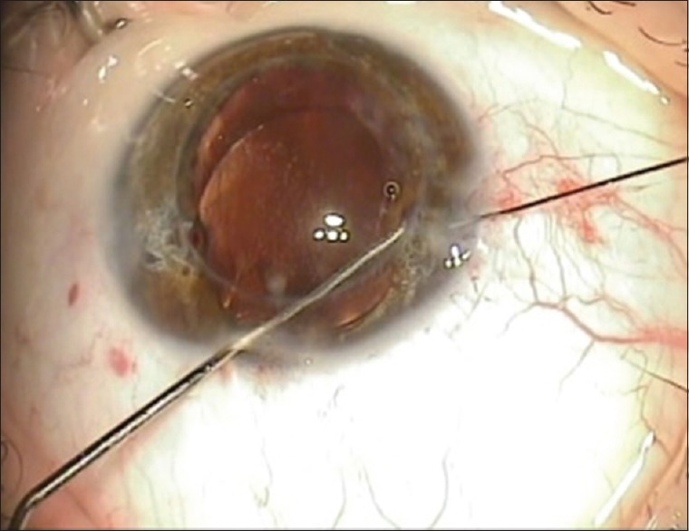
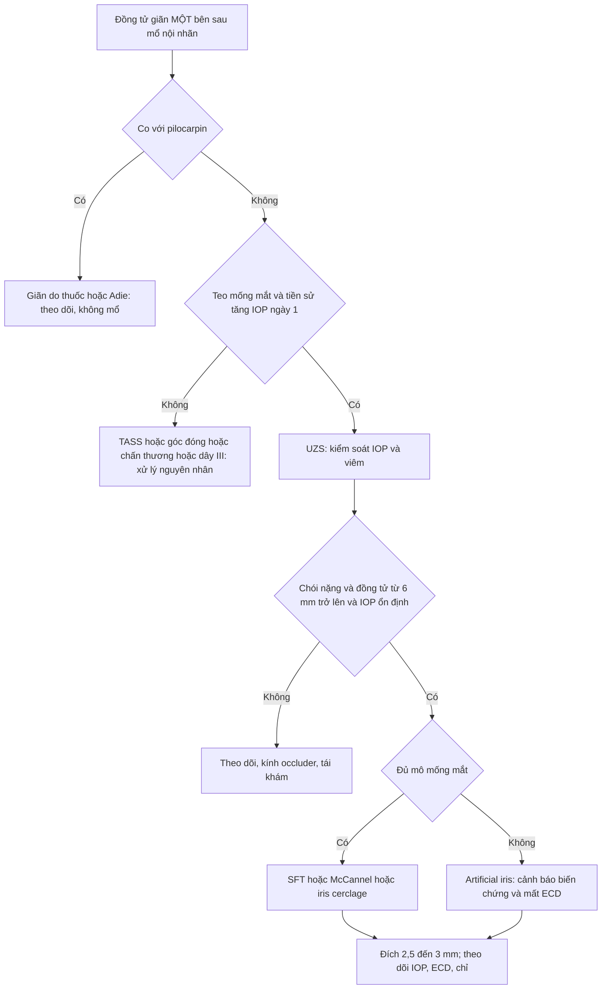
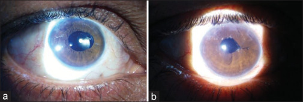
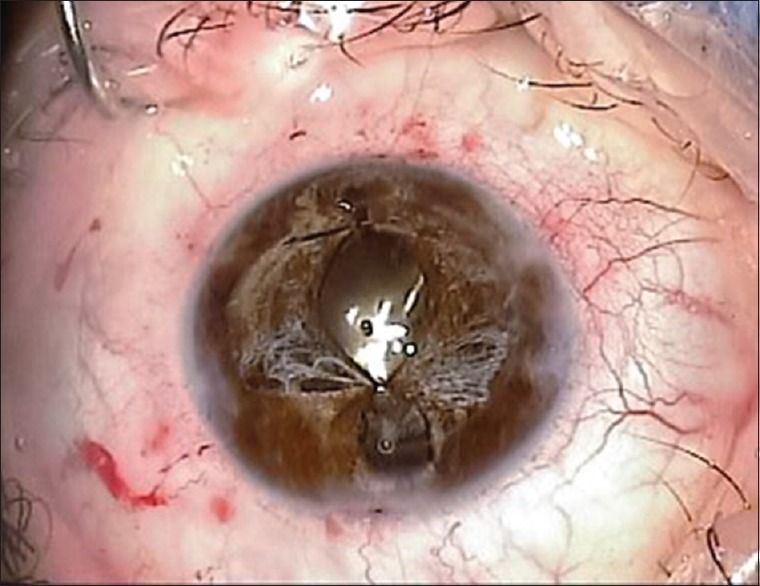
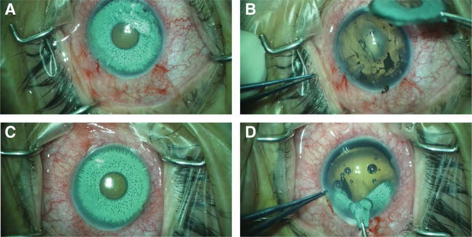

# 3256 — Đồng tử giãn cố định sau UZS: pupilloplasty (McCannel / single-pass four-throw) có đáng làm? / Pupilloplasty for persistent mydriasis after Urrets–Zavalia syndrome

**Tags:** `pattern:dong-tu-gian-co-dinh` `pattern:mot-ben` `pattern:mat-phan-xa-anh-sang` `pattern:choi-quang` `pattern:teo-mong-mat` `pattern:di-ung-anh-sang` `vung:mat` `vung:mong-mat` `vung:dong-tu` `vung:tien-phong` `vung:goc-tien-phong` `protocol:do-dong-tu` `protocol:den-khe` `protocol:soi-goc` `protocol:AS-OCT` `protocol:wavefront` `protocol:do-nhan-ap` `protocol:dem-te-bao-noi-mo` `score:khong` `incidentaloma:khong`

**Mức chắc chắn (certainty):** tổng hợp y văn (literature synthesis) — dựng từ **ca UZS sau DALK mổ iridoplasty** (*Oman J Ophthalmol* 2017, **PMC5657167**, CC BY-NC-SA), **video kỹ thuật SFT cho UZS** (*Indian J Ophthalmol* 2022, **PMC9672779**, CC BY-NC-SA), **14 mắt SFT sau cố định IOL xuyên củng mạc** (*Indian J Ophthalmol* 2026, **PMC13235860**, CC BY-NC-ND), **13 mắt SFT sau ghép giác mạc xuyên có hướng dẫn wavefront** (*Indian J Ophthalmol* 2025, **PMC11831946**, CC BY-NC-SA), **12 mắt SFT ở khuyết mống mắt bẩm sinh/chấn thương** (*Indian J Ophthalmol* 2024, **PMC11149503**, CC BY-NC-SA), **22 mắt SFT + phaco trong góc đóng cấp** (*BMC Ophthalmol* 2025, **PMC12860118**, CC BY-NC-ND), **45 mắt SFT so với khâu thắt nút cổ điển** (*BMC Ophthalmol* 2023, **PMC9830823**, CC BY), **4 mắt iris cerclage** (*Indian J Ophthalmol* 2021, **PMC8186584**, CC BY-NC-SA), **9 mắt iris cerclage + cố định IOL** (*Front Med* 2026, **PMC13657979**, CC BY), **70 mắt pupilloplasty đa kỹ thuật** (*J Clin Med* 2022, **PMC9181509**, CC BY), **19 mắt artificial iris nội bao** (*Clin Exp Ophthalmol* 2022, **PMC9542440**, CC BY-NC-ND), **51 lần đặt artificial iris** (*J Ophthalmol* 2018, **PMC6174745**, CC BY), **14 mắt triple procedure** (*Cornea* 2021, **PMC8423143**, CC BY-NC-ND), và **2 ca biến chứng implant mống mắt thẩm mỹ** (*BMC Ophthalmol* 2015, **PMC4528717**, CC BY; *Medicine* 2024, **PMC10956980**, CC BY). Nhóm **không có bệnh nhân của mình**; chỗ chưa đủ chắc ghi **"chưa rõ"**. **Không ghi tên tác giả** — attribution dùng **tạp chí + năm + PMCID/DOI**, đối chiếu Europe PMC ngày **2026-11-21**.

> **Vị trí trong thư viện:** [3251](../3251-urrets-zavalia-sau-icl-phakic-iol/lesson.md) phủ **UZS cấp sau ICL** (đồng tử giãn + teo mống mắt + glôcôm thứ phát, tiên lượng theo tốc độ hạ nhãn áp); [3238](../3238-ugh-sau-icl-phakic-iol/lesson.md) phủ **UGH sau ICL**; [3249](../3249-pds-glaucoma-sac-to/lesson.md) phủ **PDS/glôcôm sắc tố**; [3257](../3257-posner-schlossman/lesson.md) phủ **tăng nhãn áp từng cơn một bên**; [3255](../3255-vkc-loet-giac-mac-hinh-khien/lesson.md) phủ **loét giác mạc dị ứng**; [3253](../3253-iol-canxi-hoa-sau-phaco/lesson.md) phủ **canxi hóa IOL**. Bài này trả lời **một câu duy nhất**: *bệnh nhân UZS đã ổn định nhãn áp nhưng đồng tử vẫn giãn 6–8 mm, chói–quầng không chịu được — có nên mổ sửa đồng tử không, mổ kiểu nào, và kỳ vọng thực tế là gì?*

>
> **Câu chốt:** **(1)** UZS là **thiếu máu → teo cơ vòng đồng tử**, không phải "cơ vòng đang ngủ": thuốc co đồng tử **không có tác dụng** (**PMC9672779**), nên **không có "thuốc chữa"** — chỉ có **thu nhỏ khẩu độ bằng phẫu thuật**; **(2)** phẫu thuật **không phục hồi phản xạ ánh sáng**, chỉ **kéo bờ mống mắt lại gần nhau** tạo khẩu độ **2,5–3 mm**, và có thể **bẻ dính góc trước (PAS)** giúp hạ nhãn áp (**PMC9672779**; **PMC5778544**); **(3)** chỉ định là **triệu chứng** (chói, quầng, sợ ánh sáng, anisocoria) + **đồng tử ≥ 6 mm** + **nhãn áp đã ổn định** + **không viêm hoạt động** + **đủ nội mô**; **(4)** kỹ thuật ít xâm lấn nhất là **single-pass four-throw (SFT)** với **chỉ polypropylene 10-0**: đồng tử **5,79 → 3,83 mm**, **6,18 → 2,59 mm** và **Strehl tăng > 3 lần** (**PMC12860118**; **PMC13235860**); SFT **nhanh hơn** khâu thắt nút cổ điển (**22,32 vs 30,35 phút**) với kết quả tương đương (**PMC9830823**); **(5)** khi mống mắt **đã mất tổ chức**, **artificial iris** là lựa chọn nhưng **25,5% biến chứng** và **mất nội mô 57,6%** ở triple procedure (**PMC6174745**; **PMC8423143**), còn **implant mống mắt thẩm mỹ đặt trong tiền phòng là chống chỉ định** — gây **phù giác mạc, glôcôm, teo mống mắt toàn bộ** nhiều năm sau (**PMC4528717**; **PMC10956980**).

## 1. Tổng quan bệnh học – cơ chế hình ảnh (TẠI SAO)

### 1.1 UZS: cơ vòng đồng tử chết vì thiếu máu, không phải "liệt tạm thời"

- **Cơ vòng đồng tử (sphincter pupillae)** là dải cơ trơn đồng tâm, rộng **0,5–1 mm** sát bờ đồng tử, chỉ có **phó giao cảm** co lại; **cơ giãn (dilator pupillae)** chỉ là lực đối kháng yếu. Máu nuôi mống mắt đến từ **vòng động mạch lớn (major arterial circle)** rồi mao mạch tận — tưới máu tỉ lệ với **chênh áp tưới máu = huyết áp động mạch − nhãn áp**.
- Khi nhãn áp vọt **40–65 mmHg** sau mổ nội nhãn, mống mắt là mô **"đầu cuối"**: giảm tưới máu trước tiên. Trong loạt pIOL, nhãn áp ngày 1 **32–64 mmHg** và **4/4 mắt giãn cố định không hồi phục**; chụp mạch huỳnh quang mống mắt còn thấy **làm đầy từng đoạn chậm ở 4–6 tuần** (**PMC8456705**). Ca UZS sau DALK: đồng tử **7 mm** không đáp ứng ánh sáng ngay trong mổ, nhãn áp ngày 1 **45 mmHg** (**PMC5657167**).
- Hệ quả mô học (suy ra từ hình ảnh và diễn tiến): **teo cơ vòng + xơ hóa mô đệm mống mắt**. Cơ đã hoại tử thì **không co lại được**; cơ giãn không còn đối kháng nên đồng tử nằm ở vị trí **giãn trung bình – tối đa**. Vì vậy **pilocarpin 1–2% không làm nhỏ đồng tử** trong UZS thật (**PMC9672779**) — đây là điểm khác biệt với **giãn do thuốc** (còn đáp ứng, tự co sau 1–7 ngày).
- **Chưa rõ:** chưa có nghiên cứu mô học ở người chứng minh tỉ lệ **hoại tử vs chỉ mất chức năng** của cơ vòng; cũng chưa rõ vì sao một số mắt cùng mức nhãn áp lại **hồi phục một phần**. Ghi **"chưa rõ — cần tra"**, không suy diễn.

### 1.2 Phẫu thuật làm gì — và KHÔNG làm gì

- **Làm được:** khâu **kéo bờ đồng tử lại gần nhau** → khẩu độ nhỏ hơn, tròn hơn; đồng thời **kéo mống mắt ra khỏi góc tiền phòng**, có thể **bẻ dính góc trước (PAS)** và **hạ nhãn áp** (**PMC9672779**; **PMC5778544**). Đây là lý do "sửa đồng tử" đôi khi vừa **giảm chói** vừa **cứu góc**.
- **Không làm được:** **không phục hồi cơ vòng**. Đồng tử sau mổ **vẫn không co giãn theo ánh sáng**; mục tiêu là một **khẩu độ cố định 2,5–3 mm**, không phải "đồng tử bình thường". Các loạt công bố **kích thước đồng tử ổn định** nhưng **không báo tỉ lệ phản xạ ánh sáng trở lại** — đây là **khoảng trống** (xem mục 7).
- **Hệ quả thực hành:** phải nói trước với bệnh nhân **ba điều**: (1) chói giảm nhưng có thể **không hết hoàn toàn**; (2) đồng tử **vẫn không phản xạ**, chỉ nhỏ hơn; (3) **anisocoria có thể còn** nếu mắt bên 2–3 mm mà mắt mổ 3–4 mm. Ca UZS sau DALK đạt **4 mm** (từ 7 mm) và **giảm chói rõ** nhưng không về 2–3 mm (**PMC5657167**).

### 1.3 Tại sao đích là 2,5–3 mm — giải thích bằng quang học

- Đồng tử là **khẩu độ chắn sáng** của hệ quang. Hai lực đối nghịch: **nhiễu xạ (diffraction)** tăng khi khẩu độ **nhỏ** (tỉ lệ với **λ/D**), còn **quang sai bậc cao (higher-order aberration)** tăng khi khẩu độ **lớn** (diện tích đồng tử tăng theo bình phương bán kính). Điểm cân bằng của mắt người **≈ 2,5–3 mm**: dưới 2 mm nhiễu xạ chiếm ưu thế, trên 3–4 mm quang sai và tán xạ ngoại vi tăng nhanh.
- Bằng chứng định lượng sau SFT ở **14 mắt** cố định IOL xuyên củng mạc: đồng tử mesopic **6,18 ± 0,88 → 2,59 ± 0,21 mm**; **HO RMS 3,41 ± 2,96 → 0,38 ± 0,32 µm**; **coma 1,38 ± 1,53 → 0,16 µm**; **PSF Strehl 0,064 ± 0,039 → 0,210 ± 0,094** (tăng **hơn 3 lần**); BCVA **0,62 ± 0,31 → 0,23 ± 0,10 logMAR** (**PMC13235860**).
- Ở **13 mắt sau ghép giác mạc xuyên** có **hướng dẫn wavefront**: đồng tử **6,077 ± 0,787 → 2,538 ± 0,139 mm**; BCVA **1,03 ± 0,32 → 0,24 ± 0,09 logMAR**; **astigmatism RMS 4,169 ± 3,876 → 0,875 ± 0,926 µm** (**PMC11831946**).
- **Cách đọc đúng:** cải thiện thị lực/quang sai đến từ **khẩu độ nhỏ + bờ đồng tử đều**, **không** phải "cơ vòng hồi phục". Vì vậy **đo wavefront/pupillometry trước mổ** giúp chọn ca và **dự đoán mức cải thiện**; mổ "đại trà" cho mọi đồng tử giãn mà không đo là bỏ qua phần định lượng này.

### 1.4 Vì sao bệnh nhân xin mổ: chói, quầng, sợ ánh sáng và anisocoria

- Đồng tử lớn làm **tăng lượng ánh sáng tán xạ vào mắt** và **tăng quang sai ngoại vi**, biểu hiện **chói (glare)**, **quầng (halos)**, **nhìn mờ khi ngược sáng**, có khi **đau đầu do sợ ánh sáng**. Ca UZS sau DALK mô tả **"severe photophobia, glare, and decreased vision"**, BCVA **20/200**, sau phẫu thuật **20/25** và **giảm chói đáng kể** (**PMC5657167**).
- **Anisocoria** gây **mất thẩm mỹ** rõ ở người trẻ; đây là lý do thứ hai, nhưng **không được là lý do duy nhất** để mổ — vì phẫu thuật có nguy cơ **mất nội mô, viêm, tăng nhãn áp**.
- **Thử không phẫu thuật trước:** **kính tiếp xúc có đồng tử nhân tạo (pupil occluder/iris-print contact lens)** hoặc **kính râm có tròng phân cực** giúp **dự đoán** mức giảm chói nếu khẩu độ nhỏ lại. Đây là **thử nghiệm chức năng**, không điều trị nguyên nhân; **chưa có số liệu đối chứng** trong các loạt đã đọc → ghi nhận là **kinh nghiệm thực hành**, không phải bằng chứng mức cao.

## 2. Mẫu hình + chẩn đoán phân biệt theo vị trí (Gamut)

- **Mẫu hình chốt:** **MỘT mắt**, đồng tử **5–9 mm**, **không co với ánh sáng và không đáp ứng pilocarpin**, xuất hiện **sau mổ nội nhãn** (ICL, phaco, PKP/DALK, trabeculectomy), kèm **teo mống mắt** (mảng teo/vòng đồng tâm), **tiền phòng sâu**, có thể **PAS** và **nhãn áp cao** giai đoạn đầu; bệnh nhân **chói–quầng** nhiều.
- **Gamut theo "vị trí của dấu hiệu":**

| Vị trí dấu hiệu | Gamut chính | Câu hỏi phân biệt |
|---|---|---|
| **Bờ đồng tử (khẩu độ)** | UZS · giãn do thuốc · TASS · góc đóng cấp · đứt cơ vòng do chấn thương · Adie · liệt dây III · khuyết mống mắt bẩm sinh | **Đáp ứng pilocarpin?** Có → thuốc/Adie; **không** → UZS/chấn thương/teo |
| **Mô đệm mống mắt** | UZS (teo lan tỏa/vòng đồng tâm) · herpes (teo từng vùng) · PDS (lõm ra sau, sắc tố) · chấn thương (rách, iridodialysis) · bẩm sinh (coloboma) | **Teo đồng tâm + sau mổ + một bên = UZS**; **sắc tố dải bè hai bên = PDS** |
| **Góc tiền phòng** | UZS có PAS · góc đóng cấp · PXF · UGH · tân mạch | **PAS một bên sau mổ** → UZS đã gây glôcôm; **góc mở, không PAS** → ít UZS |
| **Tiền phòng** | TASS (mủ, fibrin, phù giác mạc) · UZS (thường trong, ít tế bào) · viêm màng bồ đào | **Phản ứng tiền phòng mạnh 12–48 giờ = TASS**, không phải UZS đơn thuần |
| **Hậu đoạn** | UZS **không có tổn thương hậu đoạn** | **Vitritis, đốm trắng võng mạc, phù hoàng điểm** → tìm nguyên nhân khác |

- **Ba câu hỏi lâm sàng quyết định (theo thứ tự):** **(1)** Đồng tử có **co với pilocarpin 1–2%** không? **(2)** Có **tiền sử mổ nội nhãn + tăng nhãn áp cấp ngày 1** không? **(3)** Có **teo mống mắt** và **PAS** không? Ba "có" = **UZS**; nếu (1) "có" thì **chưa mổ**, chờ thêm.

## 3. Bảng so sánh phân biệt (ma trận đối chiếu)

| Thực thể (entity) | Hình ảnh điển hình (đèn khe/AS-OCT) | Chốt vào (rule-in) | Chốt loại (rule-out) | Gợi ý xác nhận |
|---|---|---|---|---|
| **UZS (đồng tử giãn cố định sau mổ)** | **Một bên**, đồng tử **5–9 mm** không phản xạ, **teo mống mắt** (mảng/vòng đồng tâm), tiền phòng sâu, **PAS** ở ca muộn; sau ICL/PKP/DALK/phaco | **Sau mổ nội nhãn + tăng nhãn áp ngày 1 + không đáp ứng pilocarpin + teo mống mắt** | **Còn co với pilocarpin** → giãn do thuốc; **mủ tiền phòng** → TASS; **góc đóng** → góc đóng cấp | Soi góc + pilocarpin test + AS-OCT mống mắt; hỏi mốc mổ |
| **Giãn do thuốc (tropicamid/phenylephrin/atropin)** | Đồng tử **đều, tròn**, mống mắt **không teo**, tiền phòng trong, **không PAS** | **Co lại với pilocarpin 1–2%**; tự hết **1–7 ngày** sau liều cuối | **Không đáp ứng pilocarpin + teo mống mắt** → không phải | Ngừng thuốc, theo dõi 1 tuần; hỏi thuốc nhỏ |
| **TASS (toxic anterior segment syndrome)** | Khởi phát **12–48 giờ**, **phù giác mạc lan tỏa**, **mủ/fibrin tiền phòng**, đồng tử có thể giãn, **đau nhiều** | **Phản ứng tiền phòng mạnh sau mổ + cấy âm + đáp ứng corticoid** | **Tiền phòng gần trong, teo mống mắt đồng tâm, PAS** → UZS hơn là TASS | Đèn khe; cấy âm; đáp ứng corticoid; theo dõi teo mống mắt 3 tháng |
| **Góc đóng cấp nguyên phát** | **Đau dữ dội + nôn**, giác mạc phù, **tiền phòng nông**, **góc đóng**, đồng tử giãn **dạng bầu dục** | **Góc đóng trên soi góc + tiền phòng nông + nhãn áp rất cao** | **Tiền phòng sâu + góc mở** → không phải góc đóng; **PAS một bên sau mổ** → UZS | Soi góc sau làm mềm giác mạc; AS-OCT; LPI cho mắt bên |
| **Đứt cơ vòng do chấn thương** | **Khuyết bờ đồng tử (notch)**, bờ **rách**, có thể **iridodialysis**, tiền sử chấn thương | **Tiền sử chấn thương + notch/rách bờ đồng tử** | **Không tiền sử chấn thương, teo đồng tâm sau mổ** → UZS | Đèn khe; soi góc tìm iridodialysis; UBM/AS-OCT |
| **Adie (đồng tử tonic)** | **Một bên**, giãn **4–6 mm**, co **chậm** với ánh sáng gần, **co với pilocarpin 0,125%** (liều thấp), mống mắt **không teo**, hay ở **nữ trẻ**, giảm phản xạ gân | **Co với pilocarpin loãng 0,125%** + **không teo mống mắt** + không sau mổ | **Không co với pilocarpin loãng + teo mống mắt** → không phải Adie | Pilocarpin 0,125%; đèn khe; khám phản xạ gân |
| **Liệt dây III (thể chèn ép)** | **Sụp mi + mắt lệch xuống–ngoài + đồng tử giãn**, có thể đau đầu; **một bên** | **Sụp mi + hạn chế vận nhãn + đồng tử giãn** | **Không sụp mi, vận nhãn bình thường** → không phải | Khám vận nhãn; **MRI/CTA sọ** nếu nghi chèn ép (PTA) |
| **Khuyết mống mắt bẩm sinh/aniridia** | **Từ nhỏ**, hai bên hoặc một bên, **thiếu mô mống mắt**, có thể kèm **rung giật nhãn cầu**, **giảm thị lực** | **Có từ nhỏ + thiếu mô mống mắt** | **Mống mắt đủ, teo mới sau mổ** → không phải bẩm sinh | Hỏi tiền sử; ảnh cũ; khám gia đình; gene nếu cần |

- **Ba dấu hiệu quyết định:** **(1)** **Pilocarpin 1–2% không làm nhỏ** = cơ vòng mất chức năng; **(2)** **teo mống mắt đồng tâm + sau mổ** = UZS; **(3)** **PAS một bên** = UZS đã gây glôcôm, phẫu thuật sửa đồng tử có thể **vừa giảm chói vừa hạ nhãn áp**.

*Mắt trái của bệnh nhân **38 tuổi** có UZS sau ghép giác mạc xuyên (DALK): đồng tử **7 mm**, không đáp ứng ánh sáng; ảnh chụp trong mổ đang đưa kim qua tiền phòng để đặt mũi khâu mống mắt đầu tiên. Ghép giác mạc còn trong. Nguồn: Oman J Ophthalmol 2017 (PMC5657167), Fig. 1, **CC BY-NC-SA 3.0**.*

## 4. Protocol khám/đo + chỉ định + kỹ thuật

### 4.1 Thứ tự đánh giá trước mổ (8 bước)

| Bước | Dụng cụ | Ghi nhận | Ngưỡng hành động |
|---|---|---|---|
| 1 | **Hỏi bệnh** | Mốc mổ, thuốc nhỏ, **chói/quầng** mức nào, **sợ ánh sáng**, anisocoria | Chói **ảnh hưởng sinh hoạt** mới cân nhắc mổ; chỉ "thấy khó chịu nhẹ" → theo dõi |
| 2 | **Đo đồng tử chuẩn hóa** | Đường kính **dưới 5 lux (mesopic)** và dưới ánh sáng mạnh, **cả hai mắt**; ghi mm | **≥ 6 mm** là ngưỡng thực dụng; các loạt dùng **≥ 5 mm** hoặc **> 4 mm sau camcoline** (**PMC13235860**; **PMC9830823**) |
| 3 | **Pilocarpin 1–2%** | Co đồng tử sau 30–45 phút | **Co rõ** → giãn do thuốc/Adie, **không mổ**; **không co** → UZS/chấn thương/teo |
| 4 | **Đèn khe** | **Teo mống mắt** (mảng, vòng đồng tâm), **rách bờ**, **dính sau**, **mủ/tế bào**, **thể thủy tinh/IOL** | **Viêm hoạt động** → điều trị trước; **rách lớn** → kế hoạch khâu khác |
| 5 | **Soi góc + nhãn áp** | **PAS**, góc mở/đóng, sắc tố; IOP **cả hai mắt** | **IOP chưa ổn định** → hạ áp/kiểm soát trước; **PAS rộng** → cân nhắc **goniosynechialysis** cùng lúc |
| 6 | **AS-OCT tiền đoạn** | **Độ dày mống mắt**, **khoảng cách IOL–mống mắt**, **góc**, **ACD** | Mống mắt **quá mỏng** → nguy cơ **chỉ cắt qua mô (cheese-wiring)**; ghi kế hoạch khâu |
| 7 | **Đếm tế bào nội mô** | **ECD** (tế bào/mm²) | **ECD thấp** (< ~1.500/mm² tùy tuổi/mắt bên) → cân nhắc **artificial iris/ghép** thay vì khâu nhiều; thận trọng |
| 8 | **Wavefront + thị trường/đáy mắt** | **HO RMS, coma, Strehl**, thị lực, **tiềm năng thị giác** | **Wavefront dự đoán cải thiện rõ** (như ca ghép giác mạc, **PMC11831946**) → chỉ định hợp lý; **mắt không còn tiềm năng** → không mổ vì thẩm mỹ |

**Nguyên tắc:** đo **trước khi giãn đồng tử**; đo **cả hai mắt** để so; **không mổ khi còn viêm hoặc IOP chưa ổn định**; **không hứa "đồng tử bình thường"**.

### 4.2 Chỉ định – chống chỉ định (bảng quyết định)

| Chỉ định (đủ các điều kiện) | Chống chỉ định / hoãn |
|---|---|
| **Chói–quầng–sợ ánh sáng ảnh hưởng sinh hoạt**, bệnh nhân hiểu mục tiêu là **khẩu độ** | **Viêm hoạt động** hoặc **nhãn áp chưa kiểm soát** |
| Đồng tử **≥ 6 mm**, **không đáp ứng pilocarpin**, **teo mống mắt** | **Giãn do thuốc** còn khả năng hồi phục (thử pilocarpin âm) |
| **IOP ổn định** ≥ 3 tháng (hoặc đã có kế hoạch glaucoma surgery) | **ECD rất thấp** không đủ dự trữ, hoặc **giác mạc mất bù** chưa xử lý |
| **Không viêm**, **không nhiễm**, **không có chỉ định mổ nội nhãn cấp** | **Mắt không còn tiềm năng thị giác**, mổ chỉ vì thẩm mỹ |
| **Đủ mô mống mắt** để khâu (đánh giá trên đèn khe/AS-OCT) | **Mống mắt mất gần toàn bộ** → chuyển **artificial iris**, không cố khâu |

### 4.3 So sánh kỹ thuật (có số)

| Kỹ thuật | Cách làm (tóm tắt) | Kết quả định lượng | Ưu / nhược |
|---|---|---|---|
| **Single-pass four-throw (SFT)** | **Chỉ polypropylene 10-0**, một lần xuyên qua bờ đồng tử, **4 vòng (throw)** quanh sợi chỉ, **không thắt nút ngoài**; đầu chỉ cắt sát, giấu trong mô | **5,79 → 3,83 mm** (**PMC12860118**); **6,18 → 2,59 mm**, **Strehl 0,064 → 0,210**, BCVA **0,62 → 0,23 logMAR** (**PMC13235860**); thời gian **22,32 ± 4,58 phút** vs **30,35 ± 5,55 phút** ở kỹ thuật thắt nút (**PMC9830823**) | **Nhanh, ít dụng cụ, khó tuột nút**; **không** dùng khi mống mắt quá mỏng/rách phức tạp |
| **McCannel / Siepser slip-knot** | Khâu mũi rời qua bờ đồng tử, **nút trượt** ra ngoài rồi rút vào tiền phòng | **70 mắt**: BCVA nhóm mydriasis **0,7 → 0,52 logMAR**; **slip-knot là kỹ thuật duy nhất cải thiện thị lực có ý nghĩa** (**PMC9181509**) | Kinh điển, dễ học; **nhiều mũi** nếu khuyết rộng; **nút có thể lộ** |
| **Iris cerclage** | Chỉ **9-0/10-0 polypropylene** luồn **vòng quanh chu vi mống mắt** ~1 mm từ bờ, siết đều | **6–9 mm → 3,5–4,5 mm**, không biến chứng (**PMC8186584**); **8,851 → 5,263 mm**, BCVA **0,94 → 0,75 logMAR**, IOP **17,81 → 13,70 mmHg** (**PMC13657979**) | Tốt cho **giãn lan tỏa**; **khó**, nhiều lần vào tiền phòng, **nguy cơ cắt mô** |
| **Artificial iris (nội bao/xuyên củng mạc)** | Đặt **diaphragm** nhân tạo thay mống mắt | **19 mắt**: tăng IOP **42,1%**, CME **15,8%**, viêm kéo dài **15,8%**, sửa lại **5,3%**; **94,4%** hài lòng thẩm mỹ (**PMC9542440**); **51 lần**: biến chứng **25,5%**, giảm dần **83,3% → 13,3%** theo kinh nghiệm; **13/45 mắt giảm thị lực** (**PMC6174745**); triple procedure **mất 57,6% ECD** (**PMC8423143**) | Dành cho **mất mô lớn/aniridia**; **không** phải lựa chọn đầu tay cho UZS còn mô |
| **Implant mống mắt thẩm mỹ tiền phòng** | Đặt implant màu trong tiền phòng (NewColorIris...) | **Phù giác mạc, tăng nhãn áp, teo mống mắt toàn bộ** sau **4 năm**; cần **ghép giác mạc/keratoprosthesis** (**PMC4528717**; **PMC10956980**) | **Chống chỉ định** — không dùng để đổi màu mắt |
| **Kính tiếp xúc đồng tử nhân tạo** | Thử **khẩu độ nhỏ** trước mổ | Không có số liệu đối chứng trong các loạt đã đọc | **Thử không xâm lấn**, giúp bệnh nhân hình dung; **không điều trị** |

### 4.4 Kích thước đích và theo dõi sau mổ

- **Đích 2,5–3 mm**: tác giả loạt SFT + phaco nêu **3,0–3,5 mm là phù hợp** (**PMC12860118**); loạt wavefront đạt **2,538 mm** (**PMC11831946**) và **2,59 mm** (**PMC13235860**). **Quá nhỏ (< 2 mm)** → nhiễu xạ, khó soi đáy mắt; **quá lớn (> 4 mm)** → còn chói.
- **Theo dõi:** ngày 1, tuần 1, tháng 1–3–6–12: **IOP**, **tế bào/flare**, **vị trí chỉ**, **đồng tử**, **ECD**, **BCVA**. **AS-OCT** kiểm tra chỉ có cắt qua mô hay không.
- **Kỳ vọng thực tế:** cải thiện **triệu chứng chói** và **thẩm mỹ**; **không** hồi phục phản xạ; **có thể** cần **mổ bổ sung** nếu chỉ tuột hoặc đồng tử giãn lại.

### 4.5 Sơ đồ quyết định

## 5. Biến thể bình thường và cạm bẫy

1. **Mổ khi còn viêm hoặc nhãn áp chưa ổn định** — chỉ khâu trên mống mắt viêm dễ **bục chỉ, viêm bùng phát, dính lại**; UZS cấp cần **hạ IOP trước** (bài [3251](../3251-urrets-zavalia-sau-icl-phakic-iol/lesson.md)), chỉ sửa đồng tử khi đã ổn định.
2. **Nhầm giãn do thuốc với UZS** — bệnh nhân nào sau mổ cũng được nhỏ **tropicamid/phenylephrin**; giãn trong vài giờ là bình thường. **Pilocarpin 1–2%** là nghiệm pháp rẻ nhất: **co lại = chưa mổ**.
3. **Khâu quá tay trên mống mắt teo** — mống mắt mỏng dễ **rách bờ/đứt chỉ xuyên qua mô (cheese-wiring)**; trong loạt SFT + phaco, **2/22 (9,09%)** rách bờ đồng tử do **teo mống mắt + lực siết**, phải khâu lại (**PMC12860118**). Đích **2,5–3 mm**, không cố "càng nhỏ càng tốt".
4. **Kéo mống mắt quá mạnh** — có thể **bong chân mống mắt (iris root detachment)**, **đa đồng tử**, **hyphema**; các biến chứng này có trong danh sách của SFT (**PMC12860118**).
5. **Đồng tử sau mổ không tròn** — ca UZS sau DALK sau **2 mũi khâu** đạt **4 mm** nhưng bờ **không đều**; bờ đều cần **nhiều mũi/cerclage** hoặc chấp nhận **khẩu độ tròn tương đối**. Đừng hứa "tròn như mắt lành".
6. **Đo kết quả quá sớm** — loạt SFT sau cố định IOL chỉ theo dõi **1 tuần** (**PMC13235860**); loạt cerclage đo **ngay cuối mổ** (**PMC13657979**). **Không** kết luận ổn định dài hạn từ các con số này; cần **6–12 tháng**.
7. **Bỏ qua nội mô** — khâu nhiều mũi + thì giờ dài làm **mất tế bào nội mô**; triple procedure **mất 57,6% ECD** (**PMC8423143**). Đếm ECD trước mổ và **giảm số lần vào tiền phòng**.
8. **Tăng nhãn áp sau mổ** — do **viscoelastic, viêm, bít góc**; cần đo **ngày 1** và điều trị; đừng quy mọi tăng áp sau mổ là "UZS tiến triển".
9. **Mổ trên mắt còn thể thủy tinh** — kim/forceps có thể **chạm thể thủy tinh gây đục**; kỹ thuật bảo vệ bằng **mảnh lenticule/viscoelastic** đã được mô tả (**PMC12361618**). Cân nhắc **phaco + pupilloplasty cùng lúc** nếu đã có đục thể thủy tinh.
10. **Hứa quá mức** — phẫu thuật **không chữa teo cơ vòng**, **không phục hồi phản xạ**, có thể **còn anisocoria**; bệnh nhân kỳ vọng "mắt bình thường" sẽ **thất vọng** dù kết quả kỹ thuật tốt.
11. **Dùng implant thẩm mỹ tiền phòng** — **không bao giờ** cho mục đích đổi màu mắt: biến chứng **phù giác mạc, glôcôm, teo mống mắt** xuất hiện **nhiều năm sau**, có ca phải **keratoprosthesis** (**PMC4528717**; **PMC10956980**).

*Ảnh đèn khe cùng một mắt: **(a)** đồng tử giãn bệnh lý, không đều trước mổ; **(b)** đồng tử **tròn, trung tâm** sau **single-pass four-throw**. Đồng tử nhỏ lại nhưng **không có nghĩa cơ vòng hồi phục** — khẩu độ được giữ bằng chỉ. Nguồn: Indian J Ophthalmol 2026 (PMC13235860), Fig. 1, **CC BY-NC-ND 4.0** (nguyên bản, không cắt/ghép).*

## 6. Tự lượng giá — Blind Quiz

**Ca 1 — Nữ 38 tuổi, UZS sau ghép giác mạc xuyên vì keratoconus; đồng tử trái 7 mm không đáp ứng ánh sáng, nhãn áp ngày 1 45 mmHg, sau đó chói và sợ ánh sáng nặng, thị lực 20/200. Ảnh chụp trong mổ khi bắt đầu khâu mống mắt.**

- Gợi ý: **một bên**, **sau ghép giác mạc**, **đồng tử 7 mm**, **nhãn áp tăng ngày 1**.
- Câu hỏi: (1) Vì sao pilocarpin không làm nhỏ đồng tử? (2) Mổ sửa đồng tử nhằm mục tiêu gì và **không** nhằm mục tiêu gì? (3) Kết quả thực tế có thể đạt tới đâu?

<b>Bấm để hiện đáp án (findings + chẩn đoán)</b>

- **Dấu hiệu:** đồng tử **7 mm**, **không phản xạ**, mống mắt **teo**, sau DALK; nhãn áp ngày 1 **45 mmHg**.
- **Chẩn đoán:** **hội chứng Urrets–Zavalia** — cơ vòng đồng tử **thiếu máu/teo**, không phải giãn do thuốc; pilocarpin **không hiệu quả** vì cơ không còn co được.
- **Mục tiêu mổ:** **thu nhỏ khẩu độ** (giảm chói, cải thiện thẩm mỹ), có thể **bẻ PAS**; **không** phục hồi phản xạ ánh sáng.
- **Kết quả:** sau **phaco + iridoplasty** (khâu trượt trong buồng kín), 3 tháng: BCVA **20/25**, đồng tử **4 mm**, chói giảm rõ — nhưng **không về 2–3 mm** và **không tròn hoàn hảo**.

- **Nguồn ảnh:** Oman J Ophthalmol 2017 (PMC5657167), Fig. 1 và Fig. 3, **CC BY-NC-SA 3.0**.

**Ca 2 — Nam 60 tuổi, sau cố định IOL xuyên củng mạc (glued IOL) còn đồng tử không đều 6,18 mm, chói và nhìn mờ; BCVA 0,62 logMAR, không viêm, nhãn áp ổn định.**

- Gợi ý: **đồng tử không đều sau mổ**, **IOP ổn định**, **đủ mô mống mắt**.
- Câu hỏi: (1) Chọn kỹ thuật nào và vì sao? (2) Hai thông số quang học nào sẽ cải thiện? (3) Hai giới hạn của bằng chứng trong loạt này?

<b>Bấm để hiện đáp án (findings + chẩn đoán)</b>

- **Dấu hiệu:** đồng tử **6,18 ± 0,88 mm** (mesopic), không đều; sau SFT **2,59 ± 0,21 mm**.
- **Chẩn đoán:** **mydriasis bệnh lý sau cố định IOL** — chỉ định **SFT** vì nhanh, ít xâm lấn, không cần mở bao.
- **Quang học:** **HO RMS 3,41 → 0,38 µm**, **coma 1,38 → 0,16 µm**, **PSF Strehl 0,064 → 0,210** (hơn 3 lần); BCVA **0,62 → 0,23 logMAR**.
- **Giới hạn:** chỉ **1 tuần** theo dõi; **14 mắt**, không nhóm chứng; chưa trả lời độ bền 1–2 năm và tỉ lệ **tuột chỉ**.
- **Nguồn ảnh:** Indian J Ophthalmol 2026 (PMC13235860), Fig. 1, **CC BY-NC-ND 4.0** (nguyên bản).

**Ca 3 — Nữ 44 tuổi, đã đặt implant mống mắt thẩm mỹ hai bên; nay phù giác mạc, glôcôm, teo mống mắt toàn bộ; ảnh (A, C) trước và (B, D) sau tháo implant.**

- Gợi ý: **implant màu trong tiền phòng**, **nhiều năm sau**, **giác mạc mờ + nhãn áp cao**.
- Câu hỏi: (1) Vì sao implant tiền phòng gây hại? (2) Vì sao **không** được tư vấn "đổi màu mắt" bằng implant? (3) Nếu bệnh nhân chỉ muốn giảm chói, lựa chọn nào an toàn hơn?

<b>Bấm để hiện đáp án (findings + chẩn đoán)</b>

- **Dấu hiệu:** **(A, C)** implant phủ toàn mống mắt, giác mạc mờ; **(B, D)** sau tháo: **teo mống mắt toàn bộ**, lộ thể thủy tinh/IOL, góc bị tổn thương.
- **Cơ chế:** implant **áp sát mống mắt và góc tiền phòng** → **bít lỗ bè, viêm mạn, thiếu dinh dưỡng nội mô** → **glôcôm + phù giác mạc + teo mống mắt**. Biến chứng có thể xuất hiện **4 năm** sau đặt; có ca phải **ghép giác mạc/keratoprosthesis**.
- **Kết luận:** **implant mống mắt thẩm mỹ là chống chỉ định**; nếu cần giảm chói, ưu tiên **kính tiếp xúc đồng tử nhân tạo/kính râm**, rồi **phẫu thuật khâu mống mắt** hoặc **artificial iris** đúng chỉ định — với cảnh báo biến chứng.
- **Nguồn ảnh:** Medicine 2024 (PMC10956980), Fig. 1, **CC BY 4.0**.

## 7. Câu hỏi nghiên cứu & điểm chưa đồng thuận (tính đến 11/2026)

1. **[Tranh cãi] Ở bệnh nhân UZS còn mô mống mắt, pupilloplasty có cải thiện chói–quầng và chất lượng sống tốt hơn theo dõi/kính occluder không?**
   - **Đã biết:** các loạt nhỏ cho thấy **giảm đồng tử 6,18 → 2,59 mm** và **Strehl tăng > 3 lần** (**PMC13235860**), BCVA **0,62 → 0,23 logMAR**; loạt 12 mắt giảm **8,12 → 5,2 mm** ở nhóm chấn thương (**PMC11149503**). Tuy nhiên **80%** ca trong loạt 70 mắt phải **mổ kèm** thủ thuật khác, nên không tách được phần cải thiện do riêng pupilloplasty (**PMC9181509**).
   - **Chưa rõ:** **không có RCT** so với theo dõi/kính occluder; các loạt **không đo PRO** (chói theo thang, chất lượng sống) một cách chuẩn hóa; **không có ngưỡng đồng tử** hay **ngưỡng triệu chứng** được đồng thuận.
   - **Hướng nghiên cứu:** RCT/thử nghiệm tiến cứu phân tầng theo **kích thước đồng tử** và **triệu chứng chói**, outcome **PRO + wavefront + BCVA + tỉ lệ mổ bổ sung**.
   - **Nguồn:** PMC13235860 (2026); PMC11149503 (2024); PMC9181509 (2022).

2. **[Khoảng trống] Độ bền 1–5 năm của khẩu độ sau khâu và tỉ lệ mất nội mô/tuột chỉ là bao nhiêu?**
   - **Đã biết:** loạt SFT sau cố định IOL theo dõi **1 tuần** (**PMC13235860**); loạt SFT + phaco theo dõi **12 tháng**, ECD **2.074 → 2.163/mm²** nhưng **6 mắt không đo được trước mổ vì phù giác mạc** (**PMC12860118**); loạt cerclage đo đồng tử **ngay cuối mổ** (**PMC13657979**); triple procedure **mất 57,6% ECD** ở 1 năm (**PMC8423143**).
   - **Chưa rõ:** **tỉ lệ tuột chỉ/giãn lại** theo thời gian, **tốc độ mất ECD** sau 1 năm, và **độ bền của khẩu độ 2,5–3 mm** ở mắt UZS có mô mống mắt teo (khác mắt chấn thương).
   - **Hướng nghiên cứu:** đoàn hệ tiến cứu **≥ 5 năm**, chụp AS-OCT chỉ + đếm ECD định kỳ, báo **tỉ lệ mổ lại** và **thời điểm tuột chỉ**.
   - **Nguồn:** PMC13235860 (2026); PMC12860118 (2025); PMC13657979 (2026); PMC8423143 (2021).

3. **[Khác biệt thực hành] Khi mống mắt đã mất nhiều tổ chức, chọn khâu (SFT/cerclage) hay artificial iris — và ai đủ điều kiện?**
   - **Đã biết:** **artificial iris** cho kết quả thẩm mỹ tốt (**94,4%** hài lòng) nhưng **tăng IOP 42,1%**, **CME 15,8%**, **viêm 15,8%**, **sửa lại 5,3%** (**PMC9542440**); loạt **51 lần** có **25,5% biến chứng**, **13/45 mắt giảm thị lực**, và **biến chứng giảm từ 83,3% (năm 1) xuống 13,3% (năm 4)** theo kinh nghiệm phẫu thuật viên (**PMC6174745**). Khâu mống mắt **rẻ, ít xâm lấn** nhưng **không tạo được mống mắt** khi thiếu mô.
   - **Chưa rõ:** **ngưỡng mất mô** (bao nhiêu độ/giờ cung) để chuyển từ khâu sang artificial iris; **so sánh trực tiếp** hai chiến lược ở cùng quần thể UZS; ảnh hưởng của **học đường (learning curve)** tới lựa chọn trung tâm.
   - **Hướng nghiên cứu:** registry đa trung tâm phân tầng theo **% chu vi mống mắt còn lại**, so sánh **khâu vs artificial iris**, outcome **IOP, ECD, BCVA, mổ lại, PRO**.
   - **Nguồn:** PMC9542440 (2022); PMC6174745 (2018); PMC8423143 (2021).

## Bài liên quan chéo

- [400 – Tổng quan Mắt & thị giác](../400-tong-quan-mat-thi-giac/lesson.md)
- [3251 – Hội chứng Urrets–Zavalia sau ICL/phakic IOL](../3251-urrets-zavalia-sau-icl-phakic-iol/lesson.md) (UZS cấp: IOP ngày 1, PAS, tiên lượng)
- [3238 – UGH sau ICL](../3238-ugh-sau-icl-phakic-iol/lesson.md) (máu tiền phòng + tăng nhãn áp sau ICL)
- [3249 – PDS & glôcôm sắc tố](../3249-pds-glaucoma-sac-to/lesson.md) (teo mống mắt + sắc tố hai bên)
- [3257 – Posner–Schlossman](../3257-posner-schlossman/lesson.md) (tăng nhãn áp một bên, viêm nhẹ)
- [3247 – Đục bao trước sau ICL](../3247-duc-bao-truoc-sau-icl-phakic/lesson.md)
- [3253 – Canxi hóa IOL sau phaco](../3253-iol-canxi-hoa-sau-phaco/lesson.md) (mờ sau phaco do IOL, không do đồng tử)
- [3255 – Loét giác mạc hình khiên trong VKC](../3255-vkc-loet-giac-mac-hinh-khien/lesson.md) (đau–chói một mắt ở người trẻ)
- [6132 – Viêm giác mạc nhiễm khuẩn liên quan kính tiếp xúc](../6132-viem-giac-mac-kinh-tiep-xuc/lesson.md) (chói + đau + thâm nhiễm)

## Ảnh

- Tên file: `3256_<mô tả>_<nguồn>-Fig<N>.jpg`; nguồn + giấy phép từng ảnh trong `images/CREDITS.md`.
- Ảnh tải từ **PMC** ngày **2026-11-21**, dùng **nguyên bản**, **không cắt/ghép/đổi màu**. Ảnh **CC BY-NC-ND** (PMC13235860) đặc biệt **không được chỉnh sửa**.
- Không dùng ảnh từ bài không rõ giấy phép hoặc paywall; không dùng ảnh implant thẩm mỹ để quảng bá.

> Không dùng để chẩn đoán độc lập khi chưa có người hướng dẫn.
