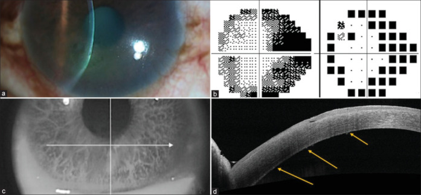
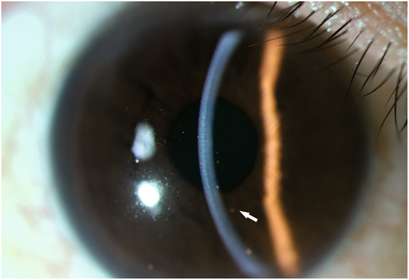
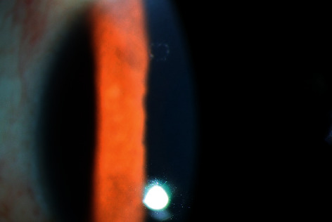
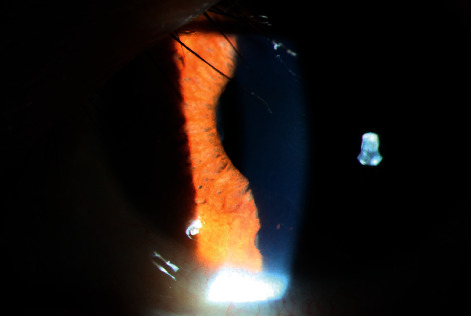
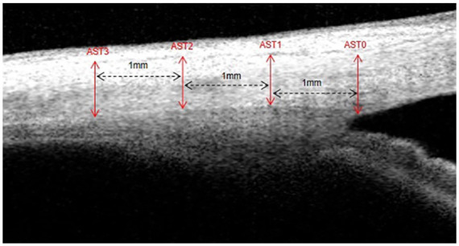
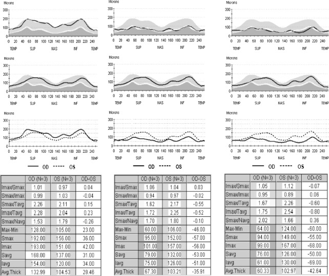
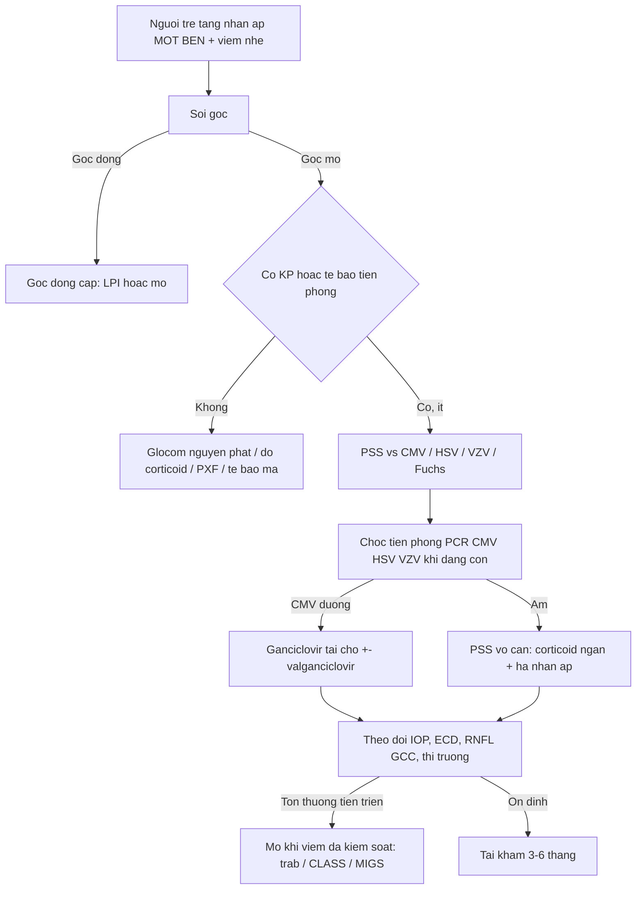
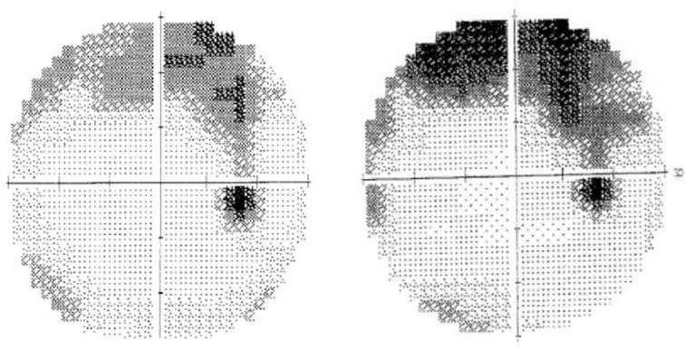

# 3257 — Hội chứng Posner–Schlossman (glaucomatocyclitic crisis): "nhãn áp vọt cao MỘT BÊN, viêm tiền phòng nhẹ, góc MỞ" / Posner–Schlossman syndrome

**Tags:** `pattern:tang-nhan-ap-tung-con` `pattern:vien-tien-phong-nhe` `pattern:kp-dong-xu` `pattern:kp-mo-dong` `pattern:kp-sac-to` `pattern:mot-ben` `pattern:goc-mo` `pattern:teo-mong-mat` `pattern:glaucoma-thu-phat` `pattern:cmv` `vung:mat` `vung:tien-phong` `vung:goc-tien-phong` `vung:mong-mat` `vung:giac-mac` `vung:noi-mo-giac-mac` `protocol:den-khe` `protocol:soi-goc` `protocol:do-nhan-ap` `protocol:AS-OCT` `protocol:choc-tien-phong-PCR` `protocol:OCT-RNFL` `protocol:thi-truong` `protocol:ganciclovir` `protocol:valganciclovir` `score:khong` `incidentaloma:khong`

**Mức chắc chắn (certainty):** tổng hợp y văn (literature synthesis) — dựng từ loạt **130 mắt/126 bệnh nhân** ở Ấn Độ (*Indian J Ophthalmol* 2024, **PMC11001245**, CC BY-NC-SA), loạt **106 bệnh nhân** Trung Quốc về yếu tố nguy cơ phẫu thuật (*Int J Med Sci* 2026, **PMC13133883**, CC BY), loạt **52 mắt** phân biệt PSS có tăng nhãn áp từng cơn với PSS đã glôcôm (*Ophthalmic Res* 2023, **PMC10614483**, CC BY-NC), loạt **98 mắt** về hình thái KP và ganciclovir 2% (*J Ophthalmol* 2021, **PMC8189808**, CC BY 4.0), tổng quan CMV đoạn trước (*Front Public Health* 2023, **PMC10014866**, CC BY; *Taiwan J Ophthalmol* 2025, **PMC12204650**, CC BY-NC-SA; *Pathogens* 2026, **PMC13119229**, CC BY), so sánh **PSS với Fuchs** trên AS-OCT mống mắt (*Graefes Arch Clin Exp Ophthalmol* 2025, **DOI 10.1007/s00417-024-06714-4**; *Int Ophthalmol* 2026, **PMID 42611114**), loạt **63 mắt** về dao động nhãn áp và mất RNFL (*Transl Vis Sci Technol* 2026, **PMC13089651**, CC BY-NC-ND), **149 mắt CMV** về nguy cơ phẫu thuật (*Sci Rep* 2026, **PMC13357539**, CC BY-NC-ND), **15 mắt trabeculectomy** (*Sci Rep* 2025, **PMC12518586**, CC BY-NC-ND), **6 mắt CLASS** (*Front Med* 2026, **PMC12913144**, CC BY), **88 mắt** viêm tiền phòng tăng nhãn áp có PCR (*Sci Rep* 2021, **PMC8065052**, CC BY), **62 bệnh nhân** đo độ dày củng mạc trước (*SAGE Open Med* 2025, **PMC12475334**, CC BY-NC), **44 mắt** IVCM (*Sci Rep* 2017, **PMC5575237**, CC BY), **100 bệnh nhân** HLA (*PLoS One* 2015, **PMC4498812**, CC0), ca **RNFL mỏng dần** (*Taiwan J Ophthalmol* 2015, **PMC5602734**, CC BY-NC-ND) và ca **teo đĩa thị** (*Korean J Ophthalmol* 2012, **PMC3506825**, CC BY-NC). Nhóm **không có bệnh nhân của mình**; chỗ chưa đủ chắc ghi rõ "chưa rõ". **Không ghi tên tác giả** — attribution = tạp chí + năm + PMCID/DOI, đối chiếu Europe PMC ngày **2026-11-21**.

> **Câu chốt:** một người **20–50 tuổi**, **một mắt** đột nhiên **mờ nhẹ + quầng + hơi khó chịu**, **nhãn áp thường > 30 mmHg** (**83,08%** trong loạt 130 mắt; có ca **60 mmHg**), nhưng **tiền phòng gần như trong** (vài tế bào), **góc MỞ**, **không dính sau**, và **cơn tự lui trong vài giờ đến vài tuần** — đó là **hội chứng Posner–Schlossman (PSS)**, không phải "glôcôm" thông thường cũng không phải "viêm màng bồ đào" thông thường. Bốn số phải nhớ: **(1)** PSS chỉ chiếm **0,004%** bệnh nhân mới khám (**40/1 triệu dân**), **96,83%** một bên, **81,75%** nam, tuổi trung bình **40,05 ± 12,86**; **(2) 83,08%** mắt có **nhãn áp > 30 mmHg** lúc vào, nhưng **97,69%** góc **MỞ**; **(3)** có tới **26,4%** về lâu dài bị glôcôm thứ phát và **17%** phải mổ hạ nhãn áp trong một loạt 106 bệnh nhân — dù cơn **tự lui** và nhãn áp **bình thường giữa các cơn**; **(4)** CMV DNA được phát hiện trong thủy dịch ở **65,5%** mắt PSS trong một loạt Ý, nên **PCR thủy dịch** là câu hỏi bắt buộc trước khi chỉ coi là "vô căn".

## 1. Tổng quan bệnh học – cơ chế hình ảnh (TẠI SAO)

### 1.1 PSS là gì — và vì sao "nhãn áp cao không tương xứng với viêm"

- **Posner và Schlossman mô tả năm 1948** ở **9 bệnh nhân**: cơn **viêm màng bồ đào trước không hạt (non-granulomatous) một bên, tái diễn**, kèm **nhãn áp tăng rất cao**, **góc mở**, và **tự lui** (PMC11001245). Tên cũ là **glaucomatocyclitic crisis** — "cơn glôcôm–thể mi", nhấn đúng bản chất: **tăng nhãn áp do viêm**, không do góc đóng.
- **Triệu chứng thường nghèo nàn so với con số nhãn áp**: mờ nhẹ, quầng sáng, **khó chịu nhẹ** chứ không đau dữ dội; nhiều ca **không đỏ mắt** hoặc đỏ rất ít. Triệu chứng kéo dài **vài giờ đến vài tuần** rồi **tự hết**; **nhãn áp trở về bình thường giữa các cơn** (PMC10014866).
- **Nghịch lý "viêm nhẹ – áp cao"** giải thích bằng **vị trí viêm**: tổn thương chính nằm ở **lưới bè (trabecular meshwork – TM)** và **nội mô giác mạc**, nơi **rất ít tế bào viêm** nhưng **dòng chảy thủy dịch đi qua toàn bộ**. Một lượng nhỏ **tế bào viêm, mảnh vụn, fibrin, prostaglandin** đủ làm **tăng sức cản thoát dịch** mà **không tạo mủ tiền phòng** nhìn thấy được. Vì vậy **độ nặng của viêm trên đèn khe không dự báo được mức nhãn áp**.
- **Vì sao giác mạc phù**: khi nhãn áp vượt khả năng bơm của nội mô (**thường > 40 mmHg** ở mắt có nội mô bình thường), **dịch vào mô đệm nhanh hơn bơm ra** → **phù biểu mô/mô đệm**, nhìn thấy **vùng phù khu trú** (ảnh 1). Phù **hết khi nhãn áp hạ**, khác phù do mất nội mô.
- **Vì sao không dính sau**: viêm **nông, ít fibrin** và **không kéo dài**; đồng tử **hơi giãn** nhưng **vẫn di động**, nên **không tạo dính mống mắt–thể thủy tinh**. Đây là điểm **rất mạnh để loại trừ** HSV/HLA-B27 (những bệnh **hay dính sau**).

### 1.2 Vì sao nghĩ tới CMV — bằng chứng định lượng

- **CMV là nguyên nhân hàng đầu được nghi ngờ** của PSS. Trong một loạt **131 mắt/66 bệnh nhân** so sánh PSS với Fuchs, **CMV DNA dương ở 21/32 bệnh nhân PSS (65,5%)**, trong khi Fuchs chủ yếu **rubella (22/34, 64,7%)** và **chỉ 1 ca CMV (2,9%)** (**DOI 10.1007/s00417-024-06714-4**).
- Ngược lại, trong **88 mắt viêm tiền phòng tăng nhãn áp** ở Hàn Quốc, **PCR đa mồi dương 31,8%**: **HSV 6,8%**, **VZV 8,0%**, **CMV 15,9%**, EBV 1,1% (PMC8065052). Tức **CMV không phải nguyên nhân duy nhất**, và **PCR âm không loại trừ PSS**.
- **KP hình đồng xu (coin-shaped)** là dấu lâm sàng gợi ý CMV mạnh nhất: trong loạt 88 mắt trên, **KP đồng xu làm tăng khả năng PCR dương với OR 6,01** (p = 0,044) (PMC8065052). Tổng quan CMV đoạn trước cũng xếp **KP đồng xu/linear + phù giác mạc + tăng nhãn áp tái diễn** là bộ ba của **viêm nội mô do CMV** (PMC12204650; PMC13119229).
- **Vì sao CMV gây tăng nhãn áp**: virus **nhiễm tế bào nội mô và lưới bè**, gây **viêm + phù + xẹp lưới bè**, đồng thời **phản ứng miễn dịch tại chỗ** làm tăng cytokine (IL-6, IL-8, IFN-γ) — các cytokine này **cao hơn** ở PSS so với mắt chứng và **cao hơn nữa** ở PSS đã có glôcôm thứ phát (PMC9868410; **PMC10614483**).
- **Yếu tố cơ địa**: ở **100 bệnh nhân Hán miền Nam** so với **128 chứng**, **HLA-C*1402** tăng có ý nghĩa (**OR 4,12**; p = 0,002; **Pc = 0,04**), gợi ý **con đường miễn dịch qua HLA class I** (PMC4498812).
- **Tóm lại — mô hình bệnh sinh đang được chấp nhận**: **nhiễm CMV tiềm ẩn/tái hoạt ở đoạn trước** (ở một phần bệnh nhân) → **viêm nội mô + lưới bè rất nhẹ nhưng khu trú** → **giảm thoát thủy dịch từng cơn** → **nhãn áp vọt cao** → **phù giác mạc và đau nhẹ** → **tự lui khi viêm lắng**; lặp lại nhiều lần → **tổn thương đĩa thị/RNFL không hồi phục**. Ở nhóm **PCR âm**, cơ chế có thể là **viêm vô khuẩn/cytokine** hoặc **virus chưa phát hiện** — chưa rõ.

### 1.3 Vì sao một bệnh "lành tính" lại làm mù — bài học từ RNFL

- **Nhãn áp bình thường giữa các cơn KHÔNG có nghĩa là mắt an toàn.** Trong **63 mắt CMV** (95,2% mang kiểu hình PSS) theo dõi **5,4 ± 3,1 năm** với **2.304 lần đo nhãn áp** và **451 lần OCT**, nhãn áp trung bình ở mắt bệnh **16,4 ± 7,8 mmHg** (mắt bên **14,6 ± 3,0**), nhưng **độ dao động nền** cao gấp **1,70 lần** (SDb ratio **1,70 ± 0,74**; CVb **1,74 ± 0,69**), **60% mắt mất RNFL** với tốc độ trung vị **1,40 µm/năm** (PMC13089651).
- Tác giả đề xuất ngưỡng **SDb > 2,5 mmHg** và **CVb > 0,17** làm dấu hiệu **nghi CMV/tiến triển** — đây là **đề xuất**, chưa phải chuẩn đồng thuận (PMC13089651).
- **Vì sao RNFL có thể "dày giả" trong cơn**: phù sợi thần kinh và **tăng thể tích dịch nội bào** làm OCT đo **dày hơn thật**. Ca minh họa (PMC5602734): mắt bệnh **RNFL trung bình 132,99 µm ngày 3**, rồi **67,3 µm lúc 5 tháng**, **60,33 µm lúc 12 tháng**; đĩa thị **C/D 0,67** và **thị trường mất hình cung** — nghĩa là **đo RNFL ngay trong cơn sẽ bỏ sót mất sợi** và **đo sau cơn sẽ thấy mất nhiều hơn tưởng**.
- **Tần suất tiến triển**: một tổng quan dẫn lại **26,4%** bệnh nhân PSS phát triển glôcôm (PMC12475334); một tổng quan khác ghi **25%** teo đĩa thị do glôcôm nếu cơn **đủ nhiều/đủ dài** (PMC10014866). Trong loạt **106 bệnh nhân** Trung Quốc, **17%** phải mổ hạ nhãn áp; yếu tố nguy cơ **tuổi khởi phát** (OR **1,080** mỗi năm), **tần suất cơn ≥ 2/năm** (OR **6,186**), và **khuyết RNFL** (OR **4,804**) (PMC13133883).
- **Vì sao tần suất cơn lại quan trọng hơn nhãn áp một lần đo**: mỗi cơn là một **đợt thiếu máu/ức chế trục thần kinh thị**; tổng "liều" tổn thương = **biên độ × số cơn × thời gian**, không phải con số đo được lúc khám. Đây là lý do phải **hỏi số cơn/năm** và **đo nhãn áp nhiều thời điểm**, không chỉ dựa vào lần khám hiện tại.

### 1.4 Dịch tễ và bảng số — loạt 130 mắt ở Ấn Độ

| Chỉ số | Giá trị | Nguồn |
|---|---|---|
| Tần suất trong bệnh nhân mới khám | **0,004%** (**40/1 triệu dân**) | PMC11001245 |
| Tuổi trung bình | **40,05 ± 12,86** (trung vị **38**, IQR 31–49) | PMC11001245 |
| Nam / nữ | **81,75% / 18,25%** | PMC11001245 |
| Một bên | **96,83%** | PMC11001245 |
| Nhãn áp > 30 mmHg lúc vào | **83,08%** (108/130 mắt) | PMC11001245 |
| KP | **45,38%** (59 mắt) | PMC11001245 |
| Tế bào tiền phòng | **33,08%** (43 mắt) | PMC11001245 |
| Teo mống mắt | **5,38%** (7 mắt) | PMC11001245 |
| Góc MỞ trên soi góc | **97,69%** (127 mắt) | PMC11001245 |
| Còn dùng thuốc hạ nhãn áp sau cơn | **26,92%** (35 mắt) | PMC11001245 |
| Trabeculectomy | **6,92%** (9 mắt) | PMC11001245 |
| Nhãn áp trước trabeculectomy | **42,11 ± 5,39 mmHg**, **3,33** thuốc | PMC11001245 |
| Tái phát (theo dõi ngắn) | **47,69%** không ghi nhận cơn nào; **18,46%** một cơn; **15,38%** hai cơn | PMC11001245 |

- **Điểm cần nhớ:** **KP chỉ có ở 45,38%** và **tế bào tiền phòng chỉ 33,08%** — tức **hơn một nửa số mắt lúc khám gần như "trong"**. Nếu chỉ tìm viêm để chẩn đoán, sẽ bỏ sót một nửa.
- **Vì sao 47,69% "không tái phát"**: thời gian theo dõi của loạt này **ngắn (khoảng 4 tháng)**; con số này **không** có nghĩa bệnh tự khỏi vĩnh viễn.

*Bốn khung của cùng một bệnh nhân **54 tuổi** với các cơn PSS tái diễn: **(a)** phù giác mạc **khu trú ở dưới**; **(b)** **scotoma hình cung không hoàn toàn hai bên** tương ứng **lõm bờ đĩa thị hai cực**; **(c)** phù giác mạc dưới kèm **KP**; **(d)** **KP thấy trên AS-OCT** dưới dạng **deposit tăng phản hồi mặt sau giác mạc**. Đây là "bộ ảnh" chứng minh PSS có thể để lại tổn thương thị trường dù giữa cơn nhãn áp bình thường. Nguồn: Indian J Ophthalmol 2024 (PMC11001245), Fig. 2, **CC BY-NC-SA 4.0**.*

### 1.5 Vì sao hình ảnh học ở PSS là "đo cái không thấy"

- **Đèn khe** thấy **KP, tế bào, phù giác mạc, teo mống mắt**, nhưng **không đo được mật độ nội mô**, **không thấy tổn thương lưới bè**, và **không phân biệt CMV với HSV**.
- **AS-OCT tiền đoạn** đo **độ dày giác mạc**, thấy **KP như chấm tăng phản hồi** trên mặt sau, đo **độ dày mống mắt** và **độ dày củng mạc trước (AST)**. Ở **62 mắt PSS**, AST giảm so với mắt bên: **AST0 637,69 ± 66,94 vs 651,61 ± 72,80 µm**; **AST1 476,02 ± 53,89 vs 494,71 ± 50,90**; **AST2 492,06 ± 59,15 vs 508,46 ± 57,36**; **AST3 492,47 ± 69,65 vs 518,67 ± 64,87** (tất cả p ≤ 0,016). Điều đáng chú ý: **nhóm bệnh < 1 năm không khác biệt**, còn **nhóm ≥ 1 năm khác biệt ở cả 4 vị trí** → **thay đổi tiến triển theo thời gian** (PMC12475334).
- **IVCM (kính hiển vi đồng tiêu)** phát hiện **tế bào Langerhans trung tâm tăng** và **keratocyte hoạt hóa** ngay khi đèn khe chỉ thấy "vài tế bào": ở **44 mắt PSS**, grade tế bào Langerhans **2,33 ± 0,55**, **tương tự herpes giác mạc (2,63 ± 0,67)** nhưng **cao hơn HLA-B27 (1,80 ± 0,79)** và **cơn góc đóng cấp (1,75 ± 0,46)**; grade keratocyte **1,55 ± 0,76**, tương tự herpes — gợi ý **PSS có thành phần virus/viêm nội mô thật** (PMC5575237).
- **Đếm tế bào nội mô (specular microscopy)**: trong loạt nhỏ **9 PSS + 7 PSS đã glôcôm**, **mật độ tế bào nội mô thấp hơn** ở nhóm **CMV dương** (p = 0,0116), và **IL-8 thủy dịch cao hơn** ở nhóm đã glôcôm (p = 0,0229) (PMC9868410). Trong loạt **149 mắt CMV**, mật độ nội mô nền **2.088 ± 695 tế bào/mm²** (PMC13357539).
- **Giới hạn:** AS-OCT/IVCM **không thay thế PCR**; chúng **định lượng mức tổn thương** và **theo dõi**, còn **căn nguyên** vẫn cần **xét nghiệm thủy dịch**.

## 2. Mẫu hình + chẩn đoán phân biệt theo vị trí (Gamut)

- **Mẫu hình chốt:** **tăng nhãn áp TỪNG CƠN, MỘT BÊN, ở người trẻ/trung niên**, kèm **viêm tiền phòng rất nhẹ** (vài tế bào, có thể không có KP), **góc MỞ**, **không dính sau**, **giác mạc phù nhẹ khi áp cao**, và **nhãn áp bình thường giữa cơn**.
- **Gamut theo "vị trí của dấu hiệu":**

| Vị trí dấu hiệu | Gamut chính | Câu hỏi phân biệt |
|---|---|---|
| **Nội mô giác mạc (KP)** | PSS/CMV · HSV · VZV · Fuchs · sarcoid/lao/giang mai | KP **đồng xu** → CMV; **dendrite + giảm cảm giác** → HSV; **teo mống mắt từng vùng** → VZV; **KP rải rác hình sao, mắt im** → Fuchs |
| **Góc tiền phòng** | Góc đóng cấp · PDS/glôcôm sắc tố · PXF · glôcôm do corticoid · tế bào ma · UGH | **Góc đóng** → đau dữ dội, tiền phòng nông; **sắc tố dày** → PDS/PXF; **tiền sử corticoid** → glôcôm do corticoid |
| **Mống mắt** | CMV (teo lan tỏa, "moth-eaten") · HSV/VZV (teo từng vùng) · Fuchs (dị sắc tố) · PDS (lõm ra sau) | **Teo lan tỏa + KP đồng xu** → CMV; **teo từng vùng + dính sau** → herpes; **dị sắc tố + mắt im** → Fuchs |
| **Hậu đoạn** | **PSS không có tổn thương hậu đoạn** | **Vitritis, đốm trắng võng mạc, phù hoàng điểm** → không phải PSS; nghĩ CMV retinitis, toxoplasmosis, sarcoid, lymphoma |

- **Bộ ba chốt để nghĩ PSS (không phải thang chuẩn):** **(1)** tăng nhãn áp **một bên, từng cơn**; **(2)** viêm tiền phòng **rất nhẹ** so với mức tăng áp; **(3)** **góc mở, không dính sau**, và **tự lui** giữa các cơn.

*Ảnh đèn khe mắt PSS: **giác mạc trong**, vài **KP mỡ đông (mutton-fat)** ở lớp nội mô (**mũi tên trắng**). KP to, trắng, bờ rõ là **nhóm hạt (granulomatous)** — gặp ở CMV, herpes, sarcoid, lao, giang mai; **không đặc hiệu cho PSS**. Nguồn: Sci Rep 2017 (PMC5575237), Fig. 5, **CC BY 4.0**.*

- **Ba hình thái KP hay gặp — nhìn để nghĩ căn nguyên, không để chẩn đoán suông:**

| Hình thái KP | Mô tả | Gợi ý |
|---|---|---|
| **Đồng xu (coin-shaped)** | Đám tế bào **tròn, đặc, đường kính đều**, như đồng xu dán mặt sau giác mạc | **CMV** mạnh nhất; trong loạt 88 mắt, **OR 6,01** cho PCR dương (PMC8065052) |
| **Mỡ đông (mutton-fat)** | **To, trắng, bờ rõ**, có thể **nhiều nhóm** | **Hạt**: CMV, herpes, sarcoid, lao, giang mai, VKH |
| **Sắc tố (pigmented)** | KP **nâu/vàng**, kèm **teo giảm sắc tố mống mắt kiểu "moth-eaten"** | **CMV** hoặc **herpes**; gặp trong PSS kéo dài (PMC8189808) |

*KP **hình đồng xu** ở nửa trên giác mạc của mắt PSS **40 tuổi, bệnh 2 năm**; KP **biến mất sau khi nhỏ ganciclovir 2%**. Đây là hình thái **gợi ý CMV** nhất trên đèn khe. Nguồn: J Ophthalmol 2021 (PMC8189808), Fig. 1, **CC BY 4.0**.*

*KP **sắc tố** (hai chấm nâu ở nửa dưới) kèm **teo giảm sắc tố mống mắt kiểu "moth-eaten"** ở mắt PSS **46 tuổi**. KP sắc tố + teo mống mắt lan tỏa là **bộ đôi CMV** điển hình; **không** được nhầm với **sắc tố của PDS** (PDS có **sắc tố dải bè**, **không có KP thật**). Nguồn: J Ophthalmol 2021 (PMC8189808), Fig. 3, **CC BY 4.0**.*

## 3. Bảng so sánh phân biệt (ma trận đối chiếu)

| Thực thể (entity) | Hình ảnh điển hình | Chốt vào (rule-in) | Chốt loại (rule-out) | Gợi ý xác nhận |
|---|---|---|---|---|
| **PSS vô căn/CMV-associated** | **Một bên**, nhãn áp **> 30 mmHg** (83,08%), tiền phòng **vài tế bào**, **KP nhỏ/đồng xu** (45,38%), **góc MỞ** (97,69%), **không dính sau**, giác mạc **phù nhẹ khi áp cao** | **Cơn tăng nhãn áp một bên + viêm nhẹ + góc mở + tự lui**, nhãn áp **bình thường giữa cơn** | **Góc đóng**, **dính sau**, **mủ tiền phòng**, **vitritis**, **tổn thương võng mạc** → không phải PSS đơn thuần | Đèn khe + soi góc + **đo nhãn áp lặp lại**; **PCR thủy dịch** CMV/HSV/VZV khi đang cơn |
| **Viêm nội mô/viêm màng bồ đào trước do CMV** | **KP đồng xu hoặc linear**, **phù giác mạc**, **teo mống mắt lan tỏa**, nhãn áp cao tái diễn; triệu chứng **nhẹ hơn** HSV/VZV | **KP đồng xu + teo mống mắt lan tỏa + nhãn áp cao**; **PCR CMV dương** | **PCR âm** không loại trừ hoàn toàn; **không có KP/teo mống mắt** → ít nghĩ CMV | **PCR thủy dịch** (gold standard); **AS-OCT/IVCM** hỗ trợ; đáp ứng **ganciclovir** |
| **HSV viêm màng bồ đào trước** | **Dendrite** trên biểu mô, **giảm cảm giác giác mạc**, **teo mống mắt từng vùng**, **dính sau**, đau/sợ ánh sáng rõ | **Dendrite + giảm cảm giác** hoặc **teo mống mắt từng vùng + dính sau**; **PCR HSV dương** | **KP đồng xu đơn thuần + không giảm cảm giác** → ít HSV | Đèn khe sau nhuộm; **so cảm giác 2 bên**; **PCR thủy dịch** |
| **VZV viêm màng bồ đào trước** | **Đau dữ dội**, **teo mống mắt từng vùng**, có thể **ban herpes zoster**; tăng nhãn áp | **Ban/zoster + teo mống mắt từng vùng**; **PCR VZV dương** | **Không đau, không teo từng vùng** → ít VZV | Khám da; **PCR thủy dịch**; hỏi tiền sử zoster |
| **Fuchs uveitis syndrome (FUS)** | **Mắt im, không đau**, **dị sắc tố mống mắt**, **KP rải rác hình sao**, **không dính sau**, **flare nhẹ mạn**, nhãn áp **thường bình thường hoặc tăng nhẹ** | **Dị sắc tố + KP rải rác + không dính sau + mắt không đỏ** | **Cơn đau + nhãn áp vọt cao từng cơn** → ít FUS; **rubella PCR** nếu cần | So màu mống mắt 2 bên; **AS-OCT mống mắt** (FUS mỏng hơn PSS vùng trên); **PCR rubella** |
| **PDS/glôcôm sắc tố** | **HAI bên**, **sắc tố dày dải bè**, **mống mắt lõm ra sau**, **vòng Krukenberg**, **không KP thật**, cận thị | **Sắc tố dải bè + mống mắt lõm + hai bên**; **không viêm** | **KP + tế bào + một bên** → không phải PDS; **sắc tố ở PDS không kèm KP** | Soi góc; **AS-OCT/UBM mống mắt**; **không đáp ứng corticoid** |
| **Góc đóng cấp nguyên phát** | **Đau dữ dội + nôn**, **quầng**, **đồng tử giãn cố định**, **tiền phòng nông**, **giác mạc phù đục**, **góc đóng** | **Góc đóng trên soi góc + tiền phòng nông + đồng tử giãn cố định** | **Góc mở + tiền phòng sâu + đồng tử còn phản xạ** → không phải | Soi góc **sau khi làm mỏng giác mạc**; **AS-OCT/UBM**; **LPI** cho mắt bên |
| **Glôcôm do corticoid** | **Tiền sử corticoid** (nhỏ/tra/thuốc hít), **không KP**, **không tế bào**, **góc mở**, nhãn áp tăng **âm thầm** | **Tiền sử corticoid + không viêm + nhãn áp giảm khi ngừng** | **KP/tế bào + cơn đau** → không phải do corticoid đơn thuần | Hỏi kỹ **mọi dạng corticoid**; **test ngừng**; theo dõi 2–4 tuần |
| **HLA-B27 viêm màng bồ đào trước** | **Đau, sợ ánh sáng, chảy nước mắt**, **dính sau**, **mủ tiền phòng**, có thể **nhãn áp thấp** hoặc cao; bệnh hệ thống | **Dính sau + mủ tiền phòng + đau nhiều**; **HLA-B27 +**; bệnh khớp/ruột | **Không dính sau + viêm rất nhẹ + nhãn áp vọt cao** → ít | Khám khớp/cột sống; **HLA-B27**; **PCR** loại trừ virus |
| **PXF** | **Vảy trắng bờ đồng tử + bao trước**, **hai bên không đối xứng**, **góc mở**, nhãn áp cao | **Vảy PXF + bờ đồng tử + thể thủy tinh** | **Không vảy + KP** → không phải PXF | Đèn khe sau giãn đồng tử; soi góc |
| **Tế bào ma (ghost cell)** | Sau **xuất huyết dịch kính**, tế bào **nhỏ, kaki**, **KHÔNG flare**, **góc mở**, nhãn áp **46,5 ± 8,0 mmHg** | **Tiền sử xuất huyết dịch kính + tế bào kaki + không flare** | **KP + flare + đau** → không phải | Soi tiền phòng; **không đáp ứng corticoid**; xử lý nguyên nhân |

- **Ba dấu hiệu quyết định trên đèn khe:**
  1. **Một bên + nhãn áp rất cao + tiền phòng gần trong** — nghịch lý "áp cao – viêm nhẹ" là chữ ký của PSS.
  2. **KP đồng xu / teo mống mắt lan tỏa** — chuyển câu hỏi từ "PSS vô căn" sang **"CMV?"** và **lấy PCR**.
  3. **Không dính sau + góc mở** — loại nhanh HSV/HLA-B27 và góc đóng; nếu **góc đóng** hoặc **dính sau**, chẩn đoán khác.

## 4. Protocol khám/đo + phân độ + ngưỡng quyết định

### 4.1 Thứ tự khám cố định (8 bước)

| Bước | Dụng cụ | Ghi nhận | Ngưỡng hành động |
|---|---|---|---|
| 1 | **Thị lực** (Snellen) | Từng mắt, có/không kính | Chênh **≥ 2 dòng** → tầm soát tổn thương thị thần kinh/nhược thị |
| 2 | **Đo nhãn áp** (Goldmann; lặp 2 lần) | Nhãn áp **cả hai mắt**, giờ đo | **> 30 mmHg** ở một bên: coi là **cơn**; **≥ 40 mmHg** + phù giác mạc: hạ áp **ngay** |
| 3 | **Đèn khe** (ánh sáng hẹp + khuếch tán) | **KP** (hình, số, vị trí), **tế bào/flare**, **phù giác mạc**, **teo mống mắt**, **dị sắc tố**, **dính sau** | **KP đồng xu + teo lan tỏa** → chỉ định **PCR CMV**; **dính sau** → nghĩ herpes/HLA-B27 |
| 4 | **Soi góc** (gonioscopy) | Góc **mở/đóng**, **PAS**, **sắc tố**, **dị vật**, **tân mạch** | **Góc đóng** → xử trí góc đóng; **sắc tố dày** → PDS/PXF; **PAS** → không phải PSS đơn thuần |
| 5 | **Đáy mắt** (giãn đồng tử khi an toàn) | **C/D**, **mất cân xứng bờ đĩa**, **RNFL**, **võng mạc/dịch kính** | **C/D chênh ≥ 0,2** hoặc **lõm bờ khu trú** → **glôcôm thứ phát**, cần OCT/VP |
| 6 | **AS-OCT tiền đoạn** | **Độ dày giác mạc**, **KP**, **độ dày mống mắt**, **AST** | **Giác mạc dày + KP mặt sau** → viêm nội mô; **AST giảm** ở bệnh **≥ 1 năm** (nghiên cứu) |
| 7 | **OCT RNFL/GCC + thị trường** (khi **hết viêm**) | **RNFL trung bình**, **GCC**, **MD/PSD**, **bản đồ lỗi** | **RNFL mỏng tiến triển** hoặc **khuyết mới** → điều trị tích cực/ngoại khoa; **không đo trong cơn** vì **dày giả** |
| 8 | **Đếm tế bào nội mô + PCR thủy dịch** (khi nghi CMV/HSV/VZV) | **ECD**, **CMV/HSV/VZV DNA** | **ECD thấp** + **KP đồng xu** → ưu tiên PCR; **PCR dương** → kháng virus |

**Nguyên tắc:** **đo nhãn áp trước khi giãn đồng tử**; **soi góc trước khi kết luận "glôcôm"**; **không đo RNFL trong cơn**; **hỏi kỹ corticoid** ở mọi ca tăng nhãn áp một bên.

*Cách đo **độ dày củng mạc trước (anterior scleral thickness – AST)** trên **SS-AS-OCT**: AST0, AST1, AST2, AST3 đo cách **cựa củng mạc (scleral spur) 0, 1, 2, 3 mm**. Ở **62 mắt PSS**, AST giảm so với mắt bên, nhưng **chỉ ở nhóm bệnh ≥ 1 năm** — tức thay đổi **tiến triển theo thời gian**, không phải bẩm sinh. Đây là ví dụ về cách **định lượng đoạn trước** thay vì chỉ mô tả "mắt viêm". Nguồn: SAGE Open Med 2025 (PMC12475334), Fig. 1, **CC BY-NC 4.0**.*

### 4.2 Lấy mẫu thủy dịch — quyết định của bài

- **Chỉ định:** PSS **tái diễn**, **KP đồng xu/teo mống mắt lan tỏa**, **nhãn áp cao kéo dài**, **không đáp ứng corticoid**, hoặc **nghi CMV/HSV/VZV**; đặc biệt khi cân nhắc **kháng virus dài hạn**.
- **Thời điểm:** **trong cơn** (viral load cao hơn) và **trước** khi bắt đầu corticoid mạnh/kháng virus; lấy **0,1 mL** thủy dịch qua **chọc tiền phòng** vô khuẩn, gửi **PCR định tính/định lượng**; có thể dùng **mNGS** khi PCR thường âm mà vẫn nghi (PMC12204650; PMC13119229).
- **Diễn giải:** **PCR dương** khẳng định **vai trò virus**, nhưng **âm** không loại trừ (viral load thấp, lấy mẫu ngoài cơn). **PCR CMV dương** ở **65,5%** PSS trong một loạt, nhưng chỉ **15,9%** trong loạt viêm tiền phòng tăng nhãn áp không chọn lọc — nên **xác suất phụ thuộc quần thể** (DOI 10.1007/s00417-024-06714-4; PMC8065052).

### 4.3 Điều trị — so sánh có số

| Biện pháp | Cơ chế | Chỉ định | Kết quả/số | Hạn chế |
|---|---|---|---|---|
| **Hạ nhãn áp tại chỗ** (beta-blocker, alpha-2 agonist, ức chế CA) ± **acetazolamide** | Giảm sản xuất thủy dịch | **Mọi cơn** nhãn áp cao | Hạ áp nhanh; trong loạt 130 mắt, **26,92%** còn cần thuốc sau cơn | **Không điều trị nguyên nhân viêm**; theo dõi toàn thân |
| **Corticoid tại chỗ nhịp ngắn** (prednisolone acetat 1%, loteprednol) | Ức chế viêm nội mô/lưới bè | **PSS vô căn** hoặc **sau khi đã có kháng virus** | Giảm KP, giảm tái phát; trong loạt 98 mắt, **47 mắt đạt KP biến mất**, trung bình **5,13 ± 3,66 tuần**, tổng **159,66 ± 161,84 giọt** | **Glôcôm do corticoid**, **làm nặng CMV** nếu dùng đơn thuần; **phải kèm kháng virus khi CMV+** |
| **Ganciclovir tại chỗ** (gel 0,15% hoặc dung dịch 2%) | Ức chế DNA polymerase CMV | **CMV+** hoặc **KP đồng xu/teo mống mắt** nghi cao | Trong **12 bệnh nhân** CMV-AU, **tất cả đáp ứng** (giảm IOP, sạch KP, cải thiện thị lực); **tái phát 66,7%** (PMC12594709); **2%** giúp **giảm liều corticoid/ngày** (PMC8189808) | **Bỏng rát**, **giá**, **tái phát khi ngừng**; chưa có RCT lớn |
| **Valganciclovir uống** | Tiền thuốc → ganciclovir toàn thân | **CMV nặng/tái phát**, **giảm thị lực**, **tổn thương nội mô lan** | **900 mg × 2/ngày × 2–6 tuần**, sau **450 mg × 2/ngày ≥ 4 tuần** (PMC10014866) | **Suy tủy**, **độc thận**, cần theo dõi công thức máu |
| **Trabeculectomy + MMC** | Tạo đường thoát dịch | **Glôcôm thứ phát** không kiểm soát, **khi viêm đã ổn** | **15 mắt**: **30,91 ± 11,75 → 12,09 ± 2,33 mmHg** lúc 12 tháng, **0 thuốc**; **9 mắt tái phát** nhưng **8/9 IOP ≤ 21** (PMC12518586) | **Thất bại do viêm**, **dính**, **hạ nhãn áp**, cần theo dõi |
| **CLASS (CO₂ laser-assisted deep sclerectomy)** | Bóc sâu củng mạc không xuyên | **PSS kháng trị**, **6 mắt** | **28,30 ± 5,16 → 14,56 ± 1,82 mmHg** lúc 18 tháng; **3 mắt hạ áp thoáng qua**, **2 PAS** (PMC12913144) | **Dữ liệu rất nhỏ**, chưa phổ biến |
| **MIGS/GATT/van dẫn lưu** | Tăng thoát qua đường tự nhiên/nhân tạo | **Glôcôm thứ phát**, tùy góc và viêm | Có ca báo cáo (XEN, trabeculectomy, van, TSCPC) (PMC11793078); **chưa có so sánh** | **Không mổ khi viêm hoạt động**; kỹ thuật phụ thuộc trung tâm |

*Cùng một mắt PSS **32 tuổi** sau cơn thứ 5 (nhãn áp **60 mmHg**): **RNFL trung bình 132,99 µm ngày 3** (trái) — **dày giả do phù**; **67,3 µm lúc 5 tháng** (giữa); **60,33 µm lúc 12 tháng** (phải). Đường liền = mắt bệnh OD, đường đứt = mắt bên OS. Đây là lý do **không đo RNFL trong cơn** và **phải đo lại sau khi hết viêm**. Nguồn: Taiwan J Ophthalmol 2015 (PMC5602734), Fig. 1, **CC BY-NC-ND 4.0**.*

### 4.4 Sơ đồ quyết định

## 5. Biến thể bình thường và cạm bẫy

1. **Chẩn đoán "viêm màng bồ đào trước" rồi chỉ cho corticoid, không đo nhãn áp** — PSS **là bệnh của nhãn áp**, không phải bệnh của tế bào tiền phòng. Bỏ đo nhãn áp là bỏ chính chẩn đoán; hậu quả là **glôcôm do corticoid** chồng lên.
2. **Chẩn đoán "glôcôm" rồi mổ/laser khi đang viêm** — mổ khi **tiền phòng còn tế bào** làm **thất bại bọng lọc**, **dính**, **viêm bùng phát**. Nguyên tắc: **kiểm soát viêm trước, mổ sau** (PMC12518586; PMC12913144).
3. **Không soi góc** — bỏ **góc đóng cấp**, **PDS**, **PXF**, **tế bào ma**; đây là những bệnh **điều trị khác hẳn**. Soi góc **bắt buộc** ở mọi ca tăng nhãn áp một bên.
4. **Không hỏi corticoid** — **glôcôm do corticoid** là "bệnh giả PSS" kinh điển: **không KP, không tế bào**, nhãn áp tăng âm thầm, **giảm khi ngừng thuốc**.
5. **Đo RNFL trong cơn** — RNFL **dày giả** (132,99 µm) rồi **mỏng thật** (60,33 µm) (PMC5602734). Đo trong cơn dễ kết luận "không teo" rồi bỏ theo dõi.
6. **Tin "nhãn áp bình thường" giữa cơn** — **26,4%** tiến triển glôcôm; **17%** phải mổ trong loạt 106 bệnh nhân. Phải theo dõi **RNFL/GCC + thị trường**, không chỉ đo nhãn áp.
7. **Lấy PCR sau khi đã nhỏ corticoid mạnh/kháng virus** — có thể **âm giả**; lấy **trước** hoặc **trong cơn**, và ghi rõ thuốc đã dùng.
8. **Nhầm KP sắc tố với PDS** — PDS có **sắc tố dải bè** và **không KP thật**; KP sắc tố + **teo mống mắt "moth-eaten"** là **CMV/herpes**. Soi góc giúp phân biệt trong 30 giây.
9. **Dùng prostaglandin dài hạn ở mắt đang viêm** — kinh điển là **thận trọng** vì nguy cơ **viêm/phù hoàng điểm**; bằng chứng ở PSS **chưa đủ mạnh**, nên **cá thể hóa** và theo dõi (PMC10014866).
10. **Coi PSS là "chẩn đoán loại trừ" nhưng không loại trừ đủ** — phải loại **góc đóng, PDS, PXF, corticoid, tế bào ma, herpes, Fuchs, bệnh hệ thống (HLA-B27, sarcoid, lao, giang mai)** trước khi gắn nhãn "vô căn".
11. **Bỏ sót CMV ở bệnh nhân "PSS điển hình"** — **65,5%** PSS có CMV trong một loạt; **KP đồng xu** là cờ đỏ. Không thử kháng virus ở ca tái phát nhiều lần là bỏ lỡ **điều trị nguyên nhân** (DOI 10.1007/s00417-024-06714-4; PMC8065052).

## 6. Tự lượng giá — Blind Quiz

**Ca 1 — Nam 40 tuổi, mờ mắt trái 3 ngày, hơi nhức, không đỏ nhiều; nhãn áp 48 mmHg, giác mạc trong, 5 tế bào tiền phòng, vài KP nhỏ hình đồng xu, góc mở, không dính sau.**

- Gợi ý: **một bên**, **áp rất cao**, **viêm rất nhẹ**, **KP đồng xu** ở nửa trên.
- Câu hỏi: (1) Chẩn đoán và ba đặc điểm "chữ ký"? (2) Xét nghiệm nào nên làm **trước** khi cho corticoid mạnh? (3) Vì sao **không** đặt LPI?

<b>Bấm để hiện đáp án (findings + chẩn đoán)</b>

- **Dấu hiệu:** **KP hình đồng xu** ở nội mô, **rất ít tế bào**, **góc mở**, **không dính sau**, **nhãn áp 48 mmHg**.
- **Chẩn đoán:** **hội chứng Posner–Schlossman**, thể **gợi ý CMV** vì KP đồng xu. Ba đặc điểm chữ ký: **một bên + áp cao không tương xứng viêm + góc mở/không dính sau**.
- **Xét nghiệm trước corticoid mạnh:** **chọc tiền phòng PCR CMV/HSV/VZV** (trong cơn), kèm **đếm tế bào nội mô**; kết quả dương đổi hướng điều trị sang **kháng virus**.
- **Vì sao không LPI:** góc **MỞ**, **không có cơ chế góc đóng**; LPI không giúp hạ áp trong PSS và có thể gây biến chứng không cần thiết.
- **Nguồn ảnh:** J Ophthalmol 2021 (PMC8189808), Fig. 1, **CC BY 4.0**.

**Ca 2 — Nam 32 tuổi, cơn thứ 5 tăng nhãn áp một mắt, lần này nhãn áp 60 mmHg; sau cơn, thị trường có khuyết hình cung trên, đĩa thị C/D 0,67, RNFL đo được 132,99 µm ngày 3 rồi 67,3 µm lúc 5 tháng và 60,33 µm lúc 12 tháng.**

- Gợi ý: **RNFL "dày" ngay sau cơn** nhưng **mỏng dần**; **MD −7,22 → −7,28 dB**, **PSD 5,23 → 8,02 dB**.
- Câu hỏi: (1) Vì sao RNFL lúc ngày 3 lại **dày hơn** lúc 12 tháng? (2) Điều này nói gì về thời điểm đo OCT? (3) Bước tiếp theo để bảo vệ mắt còn lại?

<b>Bấm để hiện đáp án (findings + chẩn đoán)</b>

- **Dấu hiệu:** **RNFL dày giả** do **phù sợi thần kinh trong cơn**, sau đó **mỏng thật** (132,99 → 67,3 → 60,33 µm); **khuyết thị trường hình cung** và **C/D 0,67** = **glôcôm thứ phát do PSS**.
- **Vì sao:** phù làm **tăng thể tích sợi** trên OCT; đo trong cơn **che mất mất sợi đã có**. Phải **đo lại sau khi hết viêm** (3–6 tháng) và **so với mắt bên**.
- **Bước tiếp theo:** kiểm soát **tần suất cơn** (yếu tố nguy cơ mạnh nhất, OR **6,186**), **hạ nhãn áp** tích cực, **theo dõi RNFL/GCC + thị trường**, và **cân nhắc phẫu thuật** khi tổn thương tiến triển dù đã điều trị nội khoa.
- **Nguồn ảnh:** Taiwan J Ophthalmol 2015 (PMC5602734), Fig. 3, **CC BY-NC-ND 4.0** (dùng nguyên bản, không cắt/ghép).

**Ca 3 — Nam 54 tuổi, nhiều cơn PSS tái diễn; lần khám này thấy phù giác mạc khu trú ở dưới, KP, và thị trường có scotoma hình cung không hoàn toàn hai bên; AS-OCT thấy KP dạng deposit mặt sau giác mạc.**

- Gợi ý: bốn khung **a–d** lần lượt là **phù giác mạc dưới**, **thị trường**, **phù + KP**, **KP trên AS-OCT**.
- Câu hỏi: (1) Mô tả từng khung? (2) Vì sao nhãn áp có thể bình thường giữa cơn mà thị trường vẫn mất? (3) Hai việc phải làm để theo dõi tiếp?

<b>Bấm để hiện đáp án (findings + chẩn đoán)</b>

- **Findings:** **(a)** phù giác mạc **khu trú dưới**; **(b)** **scotoma hình cung không hoàn toàn hai bên**, tương ứng **lõm bờ đĩa hai cực**; **(c)** phù dưới kèm **KP**; **(d)** **KP trên AS-OCT** = **deposit tăng phản hồi** ở mặt sau giác mạc.
- **Vì sao:** tổn thương thị trường do **tổng các cơn tăng áp** chứ không phải con số đo một lần; giữa cơn nhãn áp bình thường nhưng **RNFL đã mất**. Đây là **glôcôm thứ phát** trên nền PSS.
- **Theo dõi:** **đo nhãn áp nhiều thời điểm + OCT RNFL/GCC + thị trường 6–12 tháng**, **đếm số cơn/năm**, **hỏi corticoid**, và **cân nhắc kháng virus** nếu chưa làm PCR CMV.
- **Nguồn ảnh:** Indian J Ophthalmol 2024 (PMC11001245), Fig. 2, **CC BY-NC-SA 4.0**.

## 7. Câu hỏi nghiên cứu & điểm chưa đồng thuận (tính đến 11/2026)

1. **[Tranh cãi] PSS có phải là một thể của nhiễm CMV đoạn trước — và bệnh nhân PSS có nên nhận kháng virus dù PCR âm?**
   - **Đã biết:** CMV DNA dương ở **65,5%** mắt PSS trong một loạt Ý và **55,6%** trong một loạt nhỏ Trung Quốc; CMV-AU chiếm **95,2%** kiểu hình PSS trong loạt theo dõi RNFL; **KP đồng xu** làm tăng khả năng PCR dương **OR 6,01** (DOI 10.1007/s00417-024-06714-4; PMC9868410; PMC13089651; PMC8065052).
   - **Chưa rõ:** tỉ lệ dương **khác nhau rất lớn** giữa các quần thể (15,9% ở loạt viêm tiền phòng tăng nhãn áp không chọn lọc so với 65,5% ở loạt PSS chọn lọc); **không có RCT** chứng minh kháng virus cải thiện **tần suất cơn** hay **tiến triển RNFL** ở PSS PCR âm.
   - **Hướng nghiên cứu:** RCT phân tầng theo **PCR CMV** và **KP đồng xu**, outcome **số cơn/năm**, **thời gian sạch KP**, **RNFL/GCC 12–24 tháng**, **tỉ lệ phẫu thuật**.
   - **Nguồn:** DOI 10.1007/s00417-024-06714-4 (2025); PMC9868410 (2022); PMC13089651 (2026); PMC8065052 (2021).

2. **[Khoảng trống] Ngưỡng nào của dao động nhãn áp nền và tốc độ mất RNFL dự báo được ai sẽ tiến triển thành glôcôm — để quyết định mổ sớm thay vì chờ tổn thương?**
   - **Đã biết:** ở **63 mắt CMV**, dao động nền cao **1,70 lần** mắt bên, **60%** mất RNFL với trung vị **1,40 µm/năm**; tác giả đề xuất **SDb > 2,5 mmHg** và **CVb > 0,17** làm ngưỡng nghi (PMC13089651). Tuổi khởi phát (OR **1,080**/năm), **tần suất cơn** (OR **6,186**) và **khuyết RNFL** (OR **4,804**) dự báo phẫu thuật (PMC13133883).
   - **Chưa rõ:** các ngưỡng trên là **khám phá, chưa kiểm định ngoài**; chưa rõ **bao nhiêu cơn/năm** hoặc **mức dao động nào** là đủ để mổ **trước khi** có khuyết thị trường; chưa có mô hình tiên lượng kết hợp **IOP + RNFL + ECD**.
   - **Hướng nghiên cứu:** đoàn hệ tiến cứu **đo nhãn áp tại nhà/nhiều thời điểm + OCT dày lớp hạch**, xây mô hình **phân tầng nguy cơ**, kiểm định ngoài ở quần thể châu Á.
   - **Nguồn:** PMC13089651 (2026); PMC13133883 (2026).

3. **[Khác biệt thực hành] Khi PSS đã gây glôcôm, chọn trabeculectomy, CLASS hay MIGS/GATT — và mổ vào thời điểm nào so với đợt viêm?**
   - **Đã biết:** **trabeculectomy + MMC** ở **15 mắt** đưa nhãn áp **30,91 → 12,09 mmHg** lúc 12 tháng, **0 thuốc**, nhưng **9 mắt tái phát cơn** (PMC12518586); **CLASS** ở **6 mắt** đưa **28,30 → 14,56 mmHg** lúc 18 tháng (PMC12913144); trong **149 mắt CMV-AU**, **16,1%** phải mổ, trung vị **73 tháng** sau khởi phát (PMC13357539); tỉ lệ mổ khác nhau **6,92%** (Ấn Độ) và **17%** (Trung Quốc) (PMC11001245; PMC13133883).
   - **Chưa rõ:** **không có RCT** so sánh trab vs CLASS vs MIGS; **thời điểm mổ** (ngay sau khi kiểm soát viêm vài tuần hay chờ vài tháng) chưa được chuẩn hóa; tỉ lệ **thất bại bọng** do viêm nền chưa được định lượng đủ.
   - **Hướng nghiên cứu:** RCT đa trung tâm so sánh **trab + MMC vs CLASS vs GATT** ở PSS có tổn thương thị thần kinh, phân tầng theo **PCR CMV**, outcome **IOP ≤ 21 không thuốc**, **số cơn tái phát**, **thất bại bọng**, **RNFL**.
   - **Nguồn:** PMC12518586 (2025); PMC12913144 (2026); PMC13357539 (2026); PMC11001245 (2024); PMC13133883 (2026).

## Bài liên quan chéo

- [400 – Tổng quan Mắt & thị giác](../400-tong-quan-mat-thi-giac/lesson.md)
- [3249 – Hội chứng phân tán sắc tố & glôcôm sắc tố](../3249-pds-glaucoma-sac-to/lesson.md) (sắc tố HAI bên, góc mở, không KP)
- [3246 – Góc đóng cấp hai bên do thuốc](../3246-goc-dong-cap-hai-ben-do-thuoc/lesson.md) (nhãn áp cao + tiền phòng nông)
- [3238 – UGH sau ICL](../3238-ugh-sau-icl-phakic-iol/lesson.md) (tăng nhãn áp một bên sau phẫu thuật)
- [3237 – PXF + góc đóng](../3237-pxf-goc-dong-lpi-hay-lay-the-thuy-tinh/lesson.md) (vảy bờ đồng tử, góc mở/hep)
- [1457 – Glôcôm tế bào hồng cầu](../1457-glaucom-te-bao-hong-cau-sau-xuat-huyet-dich-kinh/lesson.md) (tế bào ma, không flare)
- [3251 – Hội chứng Urets–Zavalia sau ICL](../3251-urrets-zavalia-sau-icl-phakic-iol/lesson.md) (tăng nhãn áp cấp sau phẫu thuật)
- [3255 – Loét giác mạc hình khiên trong VKC](../3255-vkc-loet-giac-mac-hinh-khien/lesson.md) (phân biệt viêm giác mạc dị ứng với viêm nội mô)
- [6132 – Viêm giác mạc nhiễm khuẩn liên quan kính tiếp xúc](../6132-viem-giac-mac-kinh-tiep-xuc/lesson.md) (KP + thâm nhiễm: viêm hay nhiễm)

## Ảnh

- Tên file: `3257_<mô tả>_<phương thức>_<nguồn>.jpg`; nguồn + giấy phép từng ảnh trong `images/CREDITS.md`.
- Tất cả ảnh tải từ **PMC** ngày **2026-11-21**, dùng **nguyên bản**, không cắt/ghép/đổi màu. Ảnh **CC BY-NC-ND** (PMC5602734) đặc biệt **không được chỉnh sửa**.
- Không dùng ảnh từ bài không rõ giấy phép hoặc paywall.

> Không dùng để chẩn đoán độc lập khi chưa có người hướng dẫn.
