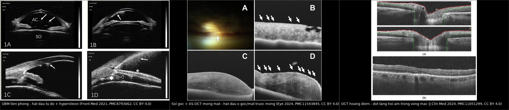
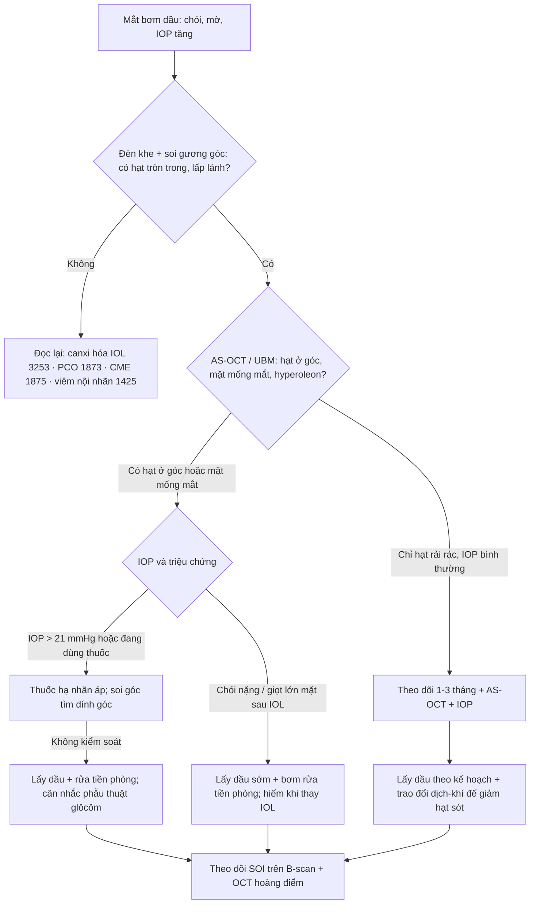
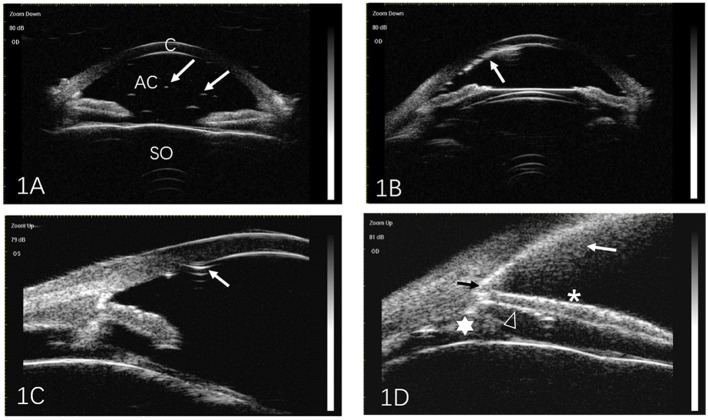
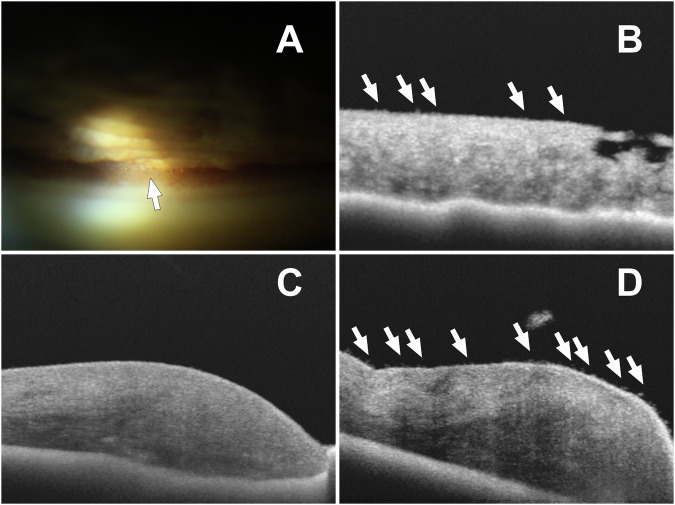
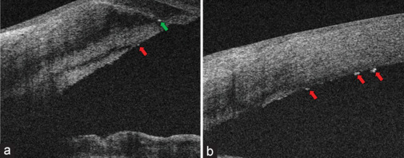
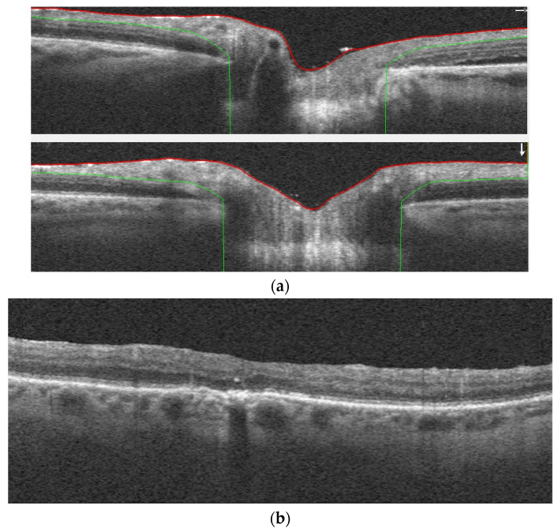

# 3258 — Nhũ tương hóa dầu silicon (silicone oil emulsification): hạt dầu trong tiền phòng, góc, mặt sau IOL và võng mạc / Silicone oil emulsification

**Tags:** `pattern:nhu-tuong-hoa-dau` `pattern:hat-dau-tien-phong` `pattern:hyperoleon` `pattern:hat-dau-mat-sau-iol` `pattern:tang-nhan-ap-sau-bom-dau` `pattern:dot-tang-hoi-am-vong-mac` `vung:mat` `vung:tien-phong` `vung:goc-tien-phong` `vung:mong-mat` `vung:the-thuy-tinh` `vung:giac-mac` `vung:vong-mac` `protocol:den-khe` `protocol:soi-goc` `protocol:AS-OCT` `protocol:UBM` `protocol:OCT` `protocol:B-scan` `protocol:rua-tien-phong` `protocol:lay-dau` `score:UBM-8-dau-hieu` `score:SOI` `incidentaloma:khong`

**Mức chắc chắn (certainty):** tổng hợp y văn (literature synthesis) — dựng từ đoàn hệ và mô hình thực nghiệm: **118 mắt** chụp UBM trước lấy dầu (Front Med 2021, PMC8793062), **38 mắt** đếm hạt bằng Coulter counter (J Ophthalmol 2020, PMC7060885), **101 mắt** định lượng hạt sót bằng B-scan (Eye 2023, PMC10276027), **45 mắt** chụp AS-OCT mặt trước mống mắt (Eye 2024, PMC11543845), **116 bệnh nhân** đa phương thức (Int J Ophthalmol 2025, PMC12207295), mô hình **17 mắt lợn + 15 mắt người** tưới rửa tiền phòng (IOVS 2025, PMC12347274), cùng các tổng quan 2024–2026 (PMC11051299; PMC11232747; DOI 10.1016/j.survophthal.2025.12.001; DOI 10.1186/s40942-026-00847-w). Chỗ chưa đủ chắc ghi **"chưa rõ"**. **Không ghi tên tác giả** — attribution = **tạp chí + năm + PMCID/DOI**.

> **Câu chốt:** mắt **đã cắt dịch kính + bơm dầu silicon**, nay **chói–quầng, mờ nhẹ, nhãn áp (IOP) tăng dần**, đèn khe thấy **hạt tròn, trong, lấp lánh** ở **góc tiền phòng/mặt trước mống mắt/mặt sau IOL**, có khi **"mức dầu" trắng đục (hyperoleon)** ở tiền phòng. Đây là **nhũ tương hóa dầu silicon (silicone oil emulsification)** — dầu bị **phân tán thành giọt 1–2 µm**, **không hồi phục**, **không phải canxi hóa IOL** và **không phải màng bao sau**. Bốn số phải nhớ: **80,8% số giọt chỉ 1–2 µm** (PMC7060885); **100% mắt còn hạt trên UBM trước lấy dầu** (PMC8793062) và **100% còn hạt trên B-scan 10 tuần sau lấy dầu** (PMC10276027); **55,6% có hạt trên mặt trước mống mắt bằng AS-OCT so với 35,6% soi gương góc** (PMC11543845); **nhũ tương dầu làm IOP mắt người in vitro tăng 7,8 → 15,8 mmHg** (PMC12347274).

## 1. Tổng quan bệnh học – cơ chế hình ảnh (TẠI SAO)

### 1.1 Nhũ tương hóa là gì, và vì sao dầu "không tan" lại phân tán được

- Dầu silicon (silicone oil, SO) là **polydimethylsiloxane (PDMS)** — **kỵ nước, không trộn với nước**, chỉ nằm thành một khối trong buồng dịch kính nhờ **sức căng bề mặt (interfacial tension)**.
- **Nhũ tương hóa (emulsification)** là quá trình khối dầu bị **phá vỡ thành các giọt nhỏ (microdroplets)** phân tán trong pha nước. Ba yếu tố vật lý quyết định (PMC11051299; DOI 10.1016/j.survophthal.2025.12.001):
  1. **Lực cắt (shear)** — mắt **vận nhãn nhanh (saccade)** và chuyển động đầu tạo dòng xoáy ở mặt phân cách dầu–nước; chính vì vậy **tập luyện nặng (CrossFit) gây nhũ tương sớm trong 3 tháng** (Retin Cases Brief Rep 2024, PMID 36913668).
  2. **Sức căng bề mặt thấp** — **protein thủy dịch, tàn dư perfluorocarbon (PFCL) và tạp chất giống chất hoạt động bề mặt (surfactant-like)** trong dầu làm giảm sức căng → giọt dễ hình thành và **khó tái hợp (coalesce)** (PMC11051299; DOI 10.1186/s40942-026-00847-w).
  3. **Độ nhớt (viscosity)** — dầu **càng loãng càng dễ nhũ tương**: so sánh 25 mắt, **1.000 cS nhũ tương 66% vs 5.000 cS 7%** (p = 0,0036), IOP tăng **8 vs 4 ca** (p = 0,03) (Ophthalmologica 2026, DOI 10.1159/000551074).
- **Kích thước giọt quyết định số phận:** đếm bằng Multisizer trên dịch rửa sau lấy dầu (38 mắt) cho **1,96 × 10⁶ ± 3,95 × 10⁶ giọt/mL**, và **80,8% (64,23–99,07%) có đường kính 1–2 µm** (PMC7060885). Giọt **1–2 µm** nhỏ hơn cả **lỗ lưới bè** → **đi xuyên qua đường thoát thủy dịch**; giọt lớn bám lại **mặt sau IOL, mặt trước mống mắt, góc tiền phòng**.

### 1.2 Vì sao NHÌN THẤY được — vật lý quang học

- **Chiết suất lệch nhau:** SO có **n ≈ 1,40**, thủy dịch **n ≈ 1,33**. Mỗi giọt dầu là một **thấu kính vi thể** → **tán xạ và khúc xạ ánh sáng**, nên dưới **đèn khe + ánh sáng ngược (retroillumination)** giọt hiện **tròn, trong, lấp lánh như "hạt vàng"**, khác hẳn **tế bào viêm** (mờ, nhỏ, trôi theo dòng) và **hồng cầu** (đỏ, lắng).
- **AS-OCT/UBM:** giọt dầu **tán xạ mạnh hơn thủy dịch** → **đốm tăng hồi âm (hyperreflective)** nằm **trên mặt mống mắt, trong mô đệm giác mạc, hoặc trong võng mạc**; trên **OCT hoàng điểm** là **dot tăng hồi âm** — dễ bị đọc nhầm là **hard exudate/HRF viêm** (PMC11051299 Fig. 2; PMC11232747 Fig. 2).
- **Siêu âm (UBM/B-scan):** mặt phân cách dầu–nước phản xạ mạnh, nên **hyperoleon** (lớp dầu trắng đục nổi trên thủy dịch) cho **dải echo dày**; **giọt sát nội mô** tạo **ảnh giả hình kim (ghost image)** — cạm bẫy đếm thừa tổn thương (PMC8793062 Fig. 1C).

### 1.3 Vì sao lại gây bệnh — ba đích tổn thương

| Đích | Cơ chế | Hình ảnh / hậu quả |
|---|---|---|
| **Lưới bè – góc tiền phòng** | Giọt **bít đường thoát** và gây **viêm góc, dính góc** | IOP tăng; mô hình tưới rửa **mắt người: 7,8 ± 1,3 → 15,8 ± 3,5 mmHg** (+8,0 ± 2,3; p = 0,02) sau **8,6 giờ** (PMC12347274) |
| **Nội mô – giác mạc** | Giọt lắng **mặt sau giác mạc/mô đệm**, phá bơm nội mô | **Bệnh giác mạc do dầu (oil keratopathy)**: phù, mờ, dải canxi hóa; **3,4%** có **"KP giả do dầu"** ở mặt sau giác mạc (PMC12207295); **SS-AS-OCT thấy giọt trong mô đệm + mặt sau** (PMC11232747 Fig. 2) |
| **Võng mạc – hắc mạc** | Giọt **khuếch tán vào các lớp** và **lòng mạch** | **19,8%** có **đốm tăng hồi âm hình cầu** trong võng mạc/RPE/hắc mạc; **3,4%** thấy giọt **di chuyển chậm trong lòng mạch võng mạc** (PMC12207295) |
| **IOL** | Giọt bám **mặt sau optic**, đặc biệt IOL **acrylic kỵ nước** | Thí nghiệm: **độ phủ dầu 8% ± 4%** (Clareon) và **9% ± 4%** (AcrySof), tương đương nhau (J Ophthalmol 2021, DOI 10.1155/2021/1387987); ca **giọt lớn mặt sau IOL** gây **micropsia–méo hình**, gỡ bằng **20G vitrector + cannula 27G**, thị lực về **20/20** (Int Med Case Rep J 2018, PMC6067619) |

### 1.4 Con số nền — tần suất, thời gian, yếu tố nguy cơ

| Đại lượng | Số liệu | Nguồn |
|---|---|---|
| Có hạt dầu trên **UBM trước lấy dầu** | **118/118 (100%)**; điểm UBM **19,99 ± 12,98** (1–36) | PMC8793062 |
| Hạt **sót sau lấy dầu** trên B-scan (~10 tuần) | **101/101 (100%)**; **SOI 4,04% ± 5,16%** (0,06–19,88%) | PMC10276027 |
| Số giọt trong dịch rửa | **1,96 × 10⁶ ± 3,95 × 10⁶/mL**; **80,8%** cỡ **1–2 µm** | PMC7060885 |
| Hạt ở **góc** (soi gương góc) vs **mặt trước mống mắt** (AS-OCT) | **35,6% vs 55,6%**; **OR 13,4** (95% CI 2,18–82,13); độ chính xác **71,0%**, độ nhạy **87,5%** | PMC11543845 |
| Hạt trên **mặt mống mắt** ↔ **IOP tăng sau mổ** | **p = 0,027** | PMC11543845 |
| **Nhũ tương ↔ thời gian lưu dầu** | Nhóm nhũ tương có **thời gian bơm dầu dài hơn** (p < 0,01); trung bình **9,04 ± 11,33 tháng** | PMC12207295 |
| **Khởi phát trung bình** | **13,2 ± 4,8 tháng**; nguy cơ tăng khi lưu **> 6 tháng** | PMC11051299 (tổng quan) |
| **Nguy cơ theo thể dầu** | Dầu **nặng (HSO)** nhũ tương **tới 65%**, có thể **sớm 3 tuần** | PMC11051299 |
| **Giác kính nhân tạo** | **Giả** thể: **80%** có nhũ tương vs **19%** còn thể thủy tinh; **phaco + PPV** cùng lúc làm **điểm nhũ tương cao hơn** (p = 0,006) | PMC11051299 (tổng quan) |
| **Tuổi – giới** | **Trẻ hơn và nam** có điểm nhũ tương cao hơn (p < 0,05); IOP **> 21 mmHg** hoặc đang dùng thuốc hạ nhãn áp cũng có điểm cao hơn | PMC8793062 |
| **Yếu tố nguy cơ sớm** | **Tuổi**, **đai củng mạc (encirclage)**, **thời gian lưu dầu**; **58,0%** có **dầu không đầy (suboptimal fill)** | Indian J Ophthalmol 2026, DOI 10.4103/ijo.ijo_565_25 |
| **Glôcôm sau bơm dầu** | **11–56%** (dẫn trong phần mở đầu) | PMC8793062 |

## 2. Mẫu hình + chẩn đoán phân biệt theo vị trí (gamut)

- **Mẫu hình lõi:** **tiền sử bơm dầu silicon** + **hạt tròn, trong, lấp lánh** ở **tiền phòng/góc/mặt IOL** + **IOP tăng hoặc chói–quầng** + **không đau, không đỏ** (khác viêm nội nhãn). Nếu chỉ có **"mức dịch trắng"** ở tiền phòng thì gọi là **hyperoleon**, không phải mủ.
- **Gamut theo vị trí (location):**
  1. **Tiền phòng/góc:** nhũ tương dầu · giọt dầu **từ bơm tiêm** sau tiêm anti-VEGF · tế bào viêm (TASS/viêm màng bồ đào) · hồng cầu · **mảnh thể thủy tinh** sau chấn thương · **hạt silicon từ van/dẫn lưu**.
  2. **Mặt trước/sau IOL:** **giọt dầu bám** · **canxi hóa IOL** (bài 3253) · **glistenings** · **màng xơ bao sau (PCO)** · **sắc tố**.
  3. **Dịch kính:** **asteroid hyalosis** · giọt dầu từ bơm tiêm · **thoái hóa dịch kính** · tế bào u lymphoma.
  4. **Giác mạc:** **bệnh giác mạc do dầu** · dải canxi hóa · phù nội mô do mổ · **loét nhiễm trùng** (bài 6132).
  5. **Võng mạc:** **giọt dầu trong võng mạc** (dot tăng hồi âm) · hard exudate · **HRF viêm** · **dầu dưới võng mạc**.

### 2.1 Sáu câu hỏi khi đứng trước "hạt lấp lánh trong mắt"

1. **Có tiền sử bơm dầu silicon không?** Không có → nghĩ **giọt dầu bơm tiêm**, **asteroid**, **glistenings**.
2. **Hạt có di động và thay đổi theo tư thế không?** Dầu nhũ tương **di động chậm**, tụ ở **góc thấp** khi ngồi; **asteroid** cố định trong dịch kính.
3. **Hạt nằm ở đâu:** **góc** (soi gương góc/UBM), **mặt mống mắt** (AS-OCT), **mặt sau IOL**, **mô đệm giác mạc**?
4. **IOP bao nhiêu, có dùng thuốc hạ nhãn áp?** IOP **> 21 mmHg** ở mắt bơm dầu = **red flag** cho hạt ở góc (PMC8793062; PMC11543845).
5. **Có hyperoleon/mức dầu ở tiền phòng?** → dầu đã **qua đồng tử**, nguy cơ **glôcôm + bệnh giác mạc** cao.
6. **Thị lực/chói:** **straylight** và **chói khi lái xe** có thể nặng dù **thị lực 20/20**.

## 3. Bảng so sánh phân biệt (ma trận đối chiếu)

| Thực thể (entity) | Hình ảnh điển hình | Chốt vào (rule-in) | Chốt loại (rule-out) | Gợi ý xác nhận |
|---|---|---|---|---|
| **Nhũ tương dầu silicon** | **Hạt tròn, trong, lấp lánh** ở góc/mặt mống mắt/mặt sau IOL; **hyperoleon**; OCT **dot tăng hồi âm** | **Tiền sử bơm dầu** + hạt **di động** + **AS-OCT/UBM** thấy hạt ở góc hoặc mặt mống mắt | **Không có tiền sử dầu** + hạt cố định trong dịch kính → asteroid | Soi gương góc + **AS-OCT** (Se 87,5%); UBM 8 dấu hiệu |
| **Canxi hóa IOL (bài 3253)** | **Mảng trắng đục cố định** trên **mặt trước IOL**, bao sau **trong**; YAG vô hiệu | **IOL hydrophilic** + **mờ tiến triển nhiều năm** + **không có hạt di động** | **Hạt di động + tiền sử dầu** → nhũ tương | Đèn khe ánh sáng ngược; AS-OCT định vị lớp lắng |
| **Glistenings** | **Vi bọng nước trong lòng polymer**, rải đều, **không di chuyển** | **IOL hydrophobic** + hạt **cố định trong optic** | **Hạt ngoài IOL, di động** → dầu | Soi đèn khe; không cần điều trị |
| **Asteroid hyalosis** | **Chuỗi hạt trắng–vàng** bám **sợi dịch kính**, "bầu trời sao" | **Không tiền sử dầu** + hạt **cố định** trong dịch kính | **Hạt tự do ở tiền phòng/góc** → dầu | Siêu âm B: hạt trong dịch kính; đáy mắt vẫn thấy |
| **Giọt dầu từ bơm tiêm (sau tiêm anti-VEGF)** | **Bong bóng nhỏ** trong dịch kính, thường **không triệu chứng** | **Tiêm nội nhãn gần đây** + **không có dầu trong mắt** + hạt **nhỏ, ít** | **Giọt nhiều + IOP tăng + hyperoleon** → nhũ tương | Hỏi lịch sử tiêm; tỷ lệ **71,7%** ở người tiêm (PMC9316661) |
| **Viêm nội nhãn sau tiêm (bài 1425)** | **Mủ tiền phòng, fibrin, đau, đỏ**, giảm thị lực nhanh **3–7 ngày** | **Đau + đỏ + tế bào/fibrin** + cấy dương | **Hạt trong, không đau, không fibrin** → dầu | Cấy dịch kính; **không chọc mù** |
| **Bệnh giác mạc do dầu** | **Phù/mờ giác mạc**, giọt trong **mô đệm/mặt sau**, có thể **dải canxi** | **Tiền sử dầu + dầu tiền phòng** + AS-OCT thấy giọt trong mô đệm | **Giác mạc trong, chỉ hạt ở tiền phòng** → chưa tổn thương nội mô | SS-AS-OCT; đếm tế bào nội mô |
| **Giọt dầu trong võng mạc** | **Dot tăng hồi âm** trong võng mạc/RPE, **19,8%** ca nhũ tương | **Tiền sử dầu + dot tăng hồi âm đơn độc, không phù** | **Dot + phù/HRF lan tỏa** → viêm/thiếu máu | OCT; phân biệt với hard exudate (bờ mềm, kèm phù) |
| **Hyperoleon vs mủ tiền phòng** | **Mức ngang trắng đục** ở tiền phòng | **Tiền sử dầu + không tế bào + không đau** | **Tế bào/fibrin/đau** → mủ (viêm nội nhãn) | Đèn khe; soi tế bào; cấy nếu nghi nhiễm |

*Trái: **UBM** — giọt dầu tự do trong tiền phòng (mũi tên), hyperoleon và ảnh giả hình kim (Front Med 2021, PMC8793062, Fig. 1, **CC BY 4.0**). Giữa: **soi gương góc** thấy hạt ở góc (A) và **AS-OCT** thấy hạt trên mặt trước mống mắt (B), mắt đối bên bình thường (C), mắt bơm dầu (D) (Eye 2024, PMC11543845, Fig. 1, **CC BY 4.0**). Phải: **OCT hoàng điểm** — dot tăng hồi âm trên bờ đĩa thị (a) và trong võng mạc (b) (J Clin Med 2024, PMC11051299, Fig. 2, **CC BY 4.0**). Ảnh ghép letterbox, **không crop, không kéo giãn**.*

## 4. Protocol chụp + hệ phân độ/điểm chuẩn hóa

### 4.1 Trình tự khám "mắt bơm dầu có hạt lấp lánh"

1. **Đèn khe + giãn đồng tử**, **ánh sáng ngược**: hạt **tròn, trong** hay **mảng đục cố định**; hạt ở **mặt trước IOL** (canxi) hay **quanh IOL/tiền phòng** (dầu).
2. **Soi gương góc (gonioscopy)** 360°: hạt ở **góc**, **dính góc**, **tân mạch**; ghi **số giờ cung** bị ảnh hưởng.
3. **AS-OCT tiền đoạn**: hạt trên **mặt trước mống mắt** (Se **87,5%** cho hạt ở góc — PMC11543845) và **mô đệm/mặt sau giác mạc**.
4. **UBM** khi góc bị che hoặc cần **phân độ 8 dấu hiệu** (PMC8793062): hạt tự do trong tiền phòng · hạt sát nội mô/ảnh giả hình kim · **hyperoleon** · **ngấm góc tiền phòng** · **mặt trước mống mắt** · **mặt sau mống mắt** · **thể mi** · hạt trong **mống mắt**. Điểm **1/0** cho mỗi dấu hiệu; trong loạt 118 mắt, tổng điểm **1–36** (trung bình **19,99 ± 12,98**).
5. **B-scan** sau lấy dầu: đo **chỉ số dầu silicon (SOI)** bằng **ImageJ** trên ảnh B-scan, **SOI 4,04% ± 5,16%** (PMC10276027); **SOI cao** ↔ **trục nhãn cầu dài** và **tăng nhãn áp trước lấy dầu**.
6. **OCT hoàng điểm**: **dot tăng hồi âm** (dầu trong võng mạc) — **không nhầm** với **CME** (nang giảm hồi âm, bài 1875).
7. **Chụp rộng/ngoại vi (WF/UWF + navigated SS-OCT)**: "**đảo nổi (floating islands)**" — cụm giọt dầu ở ngoại vi võng mạc, tăng nhanh theo tuần (Oman J Ophthalmol 2022, PMC8979391; PMC11232747).

### 4.2 Phân độ – điểm chuẩn hóa

| Hệ | Đo gì | Ngưỡng / cách dùng |
|---|---|---|
| **UBM 8 dấu hiệu** (PMC8793062) | 8 dấu hiệu tiền đoạn, mỗi dấu **1/0** | Tổng điểm **cao** ↔ **trẻ, nam, IOP > 21 mmHg** — dùng để **theo dõi mức độ**, chưa có ngưỡng can thiệp |
| **SOI** (PMC10276027) | **% diện tích hạt dầu** trên ảnh B-scan | **SOI cao** ↔ **trục nhãn cầu dài** + **tăng nhãn áp trước lấy dầu** → cân nhắc **rửa kỹ/trao đổi dịch–khí lặp** |
| **AS-OCT mặt mống mắt** (PMC11543845) | Có/không hạt trên **mặt trước mống mắt** | **Se 87,5%** cho hạt ở góc; **hạt (+) ↔ IOP tăng (p = 0,027)** |
| **Phân độ lâm sàng** | **Tiền phòng / góc / mặt IOL / giác mạc / võng mạc** | Chưa có hệ phân độ thống nhất quốc tế — **"chưa rõ"** (DOI 10.1016/j.survophthal.2025.12.001) |

### 4.3 Sơ đồ xử trí

### 4.4 Điều trị — nguyên tắc và giới hạn bằng chứng

- **Không có thuốc nào "tan" dầu.** Điều trị là **giảm lượng dầu**: **lấy dầu (SO removal)** ± **rửa tiền phòng** ± **trao đổi dịch–khí**; nghiên cứu 124 ca cho thấy **trao đổi dịch–khí** giảm **hạt dầu sót** và **floaters** (36/32 vs 48/8, p < 0,01) (Ophthalmol Ther 2025, DOI 10.1007/s40123-025-01193-0).
- **Kiểm soát IOP:** thuốc trước, rồi **lấy dầu**, rồi **phẫu thuật glôcôm** nếu góc đã dính — **glôcôm do dầu thường kháng trị** và có thể tiến triển **dù đã lấy dầu** (PMC11051299; DOI 10.1186/s40942-026-00847-w).
- **Giọt lớn mặt sau IOL:** gỡ bằng **vitrector 20G + cannula 27G** đưa giọt ra ngoài trục quang; ca báo cáo về **20/20**, **không cần thay IOL** (PMC6067619). **Thay IOL** chỉ khi giọt **ăn vào vật liệu/kèm canxi hóa** (bài 3253).
- **Bệnh giác mạc do dầu:** điều trị **nội khoa** (dầu bôi trơn, chống viêm nhẹ); **ghép giác mạc** khi mờ đục không hồi phục, nhưng **nguy cơ thải ghép cao nếu còn dầu trong mắt**.
- **Hướng mới:** **F4H5** (perfluorobutylpentane) rửa **tiền phòng** làm **tan hiệu quả tắc nghẽn do nhũ tương** trên mô hình **in vitro** (IOP **15,8 → 10,8 mmHg**, p = 0,06 so với nền) — **chưa có thử nghiệm lâm sàng** (PMC12347274). Sản phẩm dầu **ít tạp chất, độ nhớt cao, phủ bề mặt** đang được nghiên cứu (DOI 10.1016/j.survophthal.2025.12.001).

## 5. Biến thể bình thường và cạm bẫy

- **Hạt dầu từ bơm tiêm (không phải nhũ tương):** **71,7%** mắt sau tiêm anti-VEGF có **giọt silicon trong dịch kính**, **39,5%** than **floaters** nhưng **thường lành tính** (PMC9316661). **Không** gọi là nhũ tương hóa và **không** lấy dầu.
- **Ảnh giả hình kim (ghost image) trên UBM:** giọt sát nội mô tạo **nhiều echo lặp** → **đếm thừa**; đổi góc đầu dò để xác nhận (PMC8793062 Fig. 1C).
- **Hyperoleon bị đọc là mủ tiền phòng:** mức trắng đục nhưng **không tế bào, không fibrin, không đau**; nếu **đau + đỏ + tế bào** thì phải **loại trừ viêm nội nhãn** (bài 1425) trước khi quy cho dầu.
- **Canxi hóa IOL bị đọc là dầu:** canxi **cố định ở mặt trước optic**, **bao sau trong**, **YAG vô hiệu**; dầu **di động**, **quanh IOL/tiền phòng** (bài 3253).
- **Glistenings:** **vi bọng nước trong polymer** của IOL **hydrophobic**, **không di chuyển**, **không liên quan dầu** — **không can thiệp**.
- **Dầu trong võng mạc bị đọc là phù/HRF:** dot **tăng hồi âm đơn độc**, **không phù**, **không đáp ứng corticoid**; phân biệt với **CME** (nang **giảm hồi âm**, bài 1875).
- **Bỏ sót vì "mắt yên":** hạt dầu ở góc có thể **không triệu chứng** nhưng **IOP tăng âm thầm**; đo IOP + soi góc **mỗi lần khám**, không chỉ khi bệnh nhân kêu chói.
- **Ảo ảnh "đã lấy hết dầu":** **100%** còn hạt trên B-scan sau lấy dầu (PMC10276027) — **không hứa** với bệnh nhân là "sạch hoàn toàn".

## 6. Tự lượng giá — Blind Quiz ngay trên trang tĩnh

**Ca 1 — mắt bơm dầu, IOP 28 mmHg, soi góc thấy hạt lấp lánh**

- Gợi ý lâm sàng: nam **34 tuổi**, bong võng mạc đã **PPV + dầu 5.000 cS 11 tháng**, nay **chói và IOP 28 mmHg**; đèn khe thấy **hạt lấp lánh ở góc dưới**.
- Câu hỏi: (1) Dấu hiệu chính trên UBM? (2) Ba chẩn đoán phân biệt? (3) Dấu hiệu nào chốt nguyên nhân tăng nhãn áp?

<b>Bấm để hiện đáp án (findings + chẩn đoán)</b>

- Dấu hiệu: **(A)** giọt dầu **tự do trong tiền phòng** (mũi tên), **(B)** giọt **sát mặt sau giác mạc**, **(C)** **ảnh giả hình kim** treo từ nội mô, **(D)** **hyperoleon** + **ngấm dầu vào góc tiền phòng** (mũi tên đen), **mặt trước/mặt sau mống mắt** (dấu sao/tam giác) và **thể mi** (sao).
- Chẩn đoán: **nhũ tương hóa dầu silicon** gây **tắc đường thoát ở góc** — IOP tăng do giọt **1–2 µm** bít lưới bè, không phải do màng xơ hay PCO.
- Nguồn ảnh: Front Med 2021 (PMC8793062), Fig. 1, **CC BY 4.0**.

**Ca 2 — mắt bơm dầu, mặt mống mắt "lấm tấm"**

- Gợi ý lâm sàng: nữ **58 tuổi**, **PPV + dầu 8 tháng**, **không đau**; soi gương góc **khó thấy rõ góc**, AS-OCT mặt mống mắt có **chấm tăng hồi âm**.
- Câu hỏi: (1) Hai phương pháp có khác nhau về tỷ lệ phát hiện không? (2) Hạt ở mặt mống mắt nói gì về nguy cơ? (3) Bước tiếp theo?

<b>Bấm để hiện đáp án (findings + chẩn đoán)</b>

- Dấu hiệu: **(A)** hạt dầu ở **góc** trên soi gương góc; **(B)** **AS-OCT** thấy hạt **trên mặt trước mống mắt**; **(C)** mắt đối bên **bình thường**; **(D)** mắt bơm dầu có **nhiều hạt**.
- Ý nghĩa: AS-OCT phát hiện **55,6%** so với soi góc **35,6%**; hạt mặt mống mắt **liên quan IOP tăng (p = 0,027)** và **OR 13,4** cho hạt ở góc → dùng **AS-OCT như phương pháp sàng lọc**.
- Nguồn ảnh: Eye (Lond) 2024 (PMC11543845), Fig. 1, **CC BY 4.0**.

**Ca 3 — giác mạc mờ dần ở mắt đã lấy dầu**

- Gợi ý lâm sàng: nam **62 tuổi**, **đã lấy dầu 6 tháng**, nay **mờ mắt tăng dần**, giác mạc **phù nhẹ**, không loét.
- Câu hỏi: (1) Hạt nằm ở lớp nào? (2) Vì sao vẫn còn dầu dù "đã lấy dầu"? (3) Điều trị?

<b>Bấm để hiện đáp án (findings + chẩn đoán)</b>

- Dấu hiệu: **(a)** hạt tăng hồi âm **trong mô đệm** (mũi tên xanh) và **mặt sau giác mạc** (mũi tên đỏ), kèm **đứt nội mô**; **(b)** phóng đại **mặt sau giác mạc** với nhiều hạt.
- Chẩn đoán: **bệnh giác mạc do dầu (silicone oil keratopathy)** — hạt **1–2 µm** đi qua đồng tử, bám nội mô; **lấy dầu không loại bỏ hết hạt** (100% còn hạt trên B-scan — PMC10276027).
- Điều trị: dầu bôi trơn/chống viêm; **ghép giác mạc** chỉ khi mờ đục nặng, tiên lượng kém nếu còn dầu.
- Nguồn ảnh: Saudi J Ophthalmol 2024 (PMC11232747), Fig. 2, **CC BY-NC-SA 4.0**.

**Ca 4 — đốm trắng trên OCT hoàng điểm**

- Gợi ý lâm sàng: nữ **47 tuổi**, **PPV + dầu**, OCT thấy **chấm tăng hồi âm** trên bờ đĩa thị và **trong võng mạc**; không phù hoàng điểm.
- Câu hỏi: (1) Dot tăng hồi âm là gì? (2) Phân biệt với hard exudate/HRF? (3) Có cần tiêm corticoid?

<b>Bấm để hiện đáp án (findings + chẩn đoán)</b>

- Dấu hiệu: **(a)** dot tăng hồi âm **trên bờ đĩa thị**, **(b)** dot **trong các lớp võng mạc** — tương ứng **giọt dầu nhũ tương**.
- Phân biệt: **hard exudate** thường **bờ mềm, kèm phù/rối loạn lipid**; **HRF viêm** kèm **phù/thiếu máu**; **giọt dầu** **đơn độc, không phù, không đáp ứng corticoid**.
- Điều trị: **không tiêm corticoid**; theo dõi và **lấy dầu** theo kế hoạch.
- Nguồn ảnh: J Clin Med 2024 (PMC11051299), Fig. 2, **CC BY 4.0**.

## 7. Câu hỏi nghiên cứu & điểm chưa đồng thuận (tính đến 11/2026)

1. **[Tranh cãi] Ở mắt bơm dầu có hạt nhũ tương ở góc tiền phòng, rửa tiền phòng bằng F4H5 trong lúc lấy dầu có làm giảm IOP lâu dài so với rửa bằng dung dịch cân bằng muối không?**
   - **Đã biết:** mô hình tưới rửa **mắt người** cho thấy nhũ tương dầu làm IOP tăng **7,8 → 15,8 mmHg** và **F4H5 đưa về 10,8 mmHg** (PMC12347274); **trao đổi dịch–khí** khi lấy dầu giảm hạt sót và floaters (DOI 10.1007/s40123-025-01193-0).
   - **Chưa rõ:** chưa có **thử nghiệm lâm sàng** nào đo **IOP 6–12 tháng** sau rửa tiền phòng; **liều/lượng F4H5** và **thời điểm** chưa chuẩn hóa.
   - **Hướng nghiên cứu:** **RCT** ở mắt bơm dầu có hạt ở góc, so **rửa F4H5 + lấy dầu** với **lấy dầu đơn thuần**, outcome **IOP và số thuốc hạ nhãn áp ở 12 tháng**.
   - **Nguồn:** PMC12347274 (2025); DOI 10.1007/s40123-025-01193-0 (2025).

2. **[Khoảng trống] Ngưỡng và nhịp theo dõi AS-OCT/UBM nào phát hiện hạt dầu ở góc TRƯỚC khi IOP tăng, và có làm thay đổi thời điểm lấy dầu không?**
   - **Đã biết:** **AS-OCT** phát hiện hạt mặt mống mắt **55,6%** (soi góc **35,6%**), **Se 87,5%** cho hạt ở góc và **liên quan IOP tăng** (PMC11543845); **UBM 8 dấu hiệu** cho điểm **1–36** nhưng **chưa có ngưỡng can thiệp** (PMC8793062).
   - **Chưa rõ:** **chưa có hệ phân độ thống nhất** cho nhũ tương tiền đoạn, nên **không ai biết điểm nào thì nên lấy dầu sớm** (DOI 10.1016/j.survophthal.2025.12.001).
   - **Hướng nghiên cứu:** **nghiên cứu chẩn đoán tiến cứu** đối chiếu **điểm UBM/AS-OCT** với **IOP tăng trong 12 tháng**, rồi **Delphi** để chốt ngưỡng.
   - **Nguồn:** PMC11543845 (2024); PMC8793062 (2021); DOI 10.1016/j.survophthal.2025.12.001 (2026).

3. **[Khác biệt thực hành] Chọn dầu 1.000 cS hay 5.000 cS khi bơm: giảm nhũ tương bằng dầu đặc hơn có đánh đổi bằng khó bơm/khó lấy và tổn thương võng mạc không?**
   - **Đã biết:** dầu **1.000 cS** nhũ tương **66%** so với **7%** ở **5.000 cS** (p = 0,0036) trong 25 mắt, IOP tăng **8 vs 4 ca** (DOI 10.1159/000551074); tổng quan ghi nhận **không đồng thuận** về liên hệ độ nhớt – nhũ tương và **dầu nặng nhũ tương tới 65%, sớm 3 tuần** (PMC11051299).
   - **Chưa rõ:** **chưa có RCT lớn** so **độ nhớt** với **biến chứng võng mạc (SORVL, mỏng hoàng điểm)**, và **kỹ thuật bơm/lấy** khác nhau giữa các độ nhớt.
   - **Hướng nghiên cứu:** **RCT đa trung tâm** so **1.000 vs 5.000 cS** với outcome **nhũ tương, IOP, thị lực và OCT hoàng điểm 12 tháng**.
   - **Nguồn:** DOI 10.1159/000551074 (2026); PMC11051299 (2024).

## Bài liên quan chéo
- [3253 – IOL canxi hóa: mờ dần sau phaco dù bao TRONG](../3253-iol-canxi-hoa-sau-phaco/lesson.md)
- [1416 – Glôcôm do dầu silicon: cơ chế, yếu tố nguy cơ và xử trí](../1416-glaucom-do-dau-silicone/lesson.md)
- [1410 – Lấy dầu silicon và dầu tồn lưu](../1410-lay-dau-silicone-va-dau-ton-luu/lesson.md)
- [1873 – Đục bao sau thứ phát ở mắt bơm dầu & YAG](../1873-bao-sau-duc-thu-phat-mat-bom-dau-yag/lesson.md)
- [1875 – Phù hoàng điểm dạng nang sau phacovitrectomy trên mắt bơm dầu](../1875-phu-hoang-diem-dang-nang-mat-bom-dau/lesson.md)
- [3252 – Hội chứng bao chết (dead bag syndrome)](../3252-hoi-chung-bao-chet-dead-bag-syndrome/lesson.md)
- [1425 – Viêm nội nhãn sau tiêm nội nhãn](../1425-viem-noi-nhan-sau-tiem-noi-nhan/lesson.md)
- [3256 – Pupilloplasty sau UZS](../3256-pupilloplasty-sau-uzs/lesson.md)

## Ảnh
- `3258_hat-dau-tien-phong_UBM_PMC8793062-Fig1.jpg` — Front Med 2021 (PMC8793062), Fig. 1, **CC BY 4.0**.
- `3258_hat-dau-goc-AS-OCT_PMC11543845-Fig1.jpg` — Eye (Lond) 2024 (PMC11543845), Fig. 1, **CC BY 4.0**.
- `3258_hat-dau-giac-mac_AS-OCT_PMC11232747-Fig2.jpg` — Saudi J Ophthalmol 2024 (PMC11232747), Fig. 2, **CC BY-NC-SA 4.0** (nguyên bản, không cắt/ghép).
- `3258_hat-dau-vong-mac_OCT_PMC11051299-Fig2.jpg` — J Clin Med 2024 (PMC11051299), Fig. 2, **CC BY 4.0**.
- `composite_ba-mat-cat.jpg` — ghép letterbox từ 3 ảnh **CC BY 4.0** ở trên (không crop, không kéo giãn).
- Chi tiết nguồn + giấy phép từng file: `images/CREDITS.md`.

> Không dùng để chẩn đoán độc lập khi chưa có người hướng dẫn.
