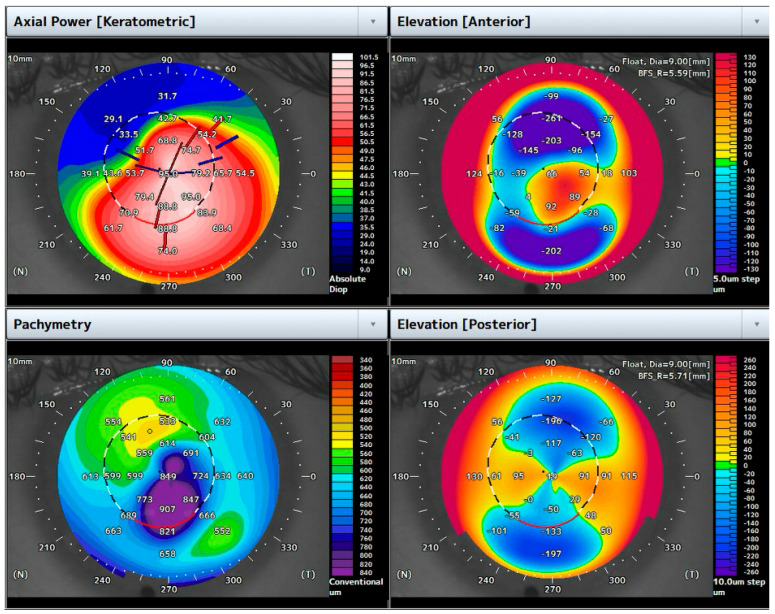
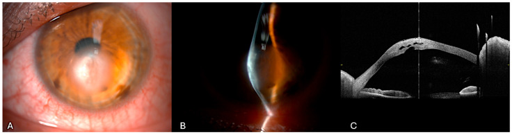
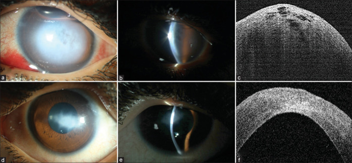
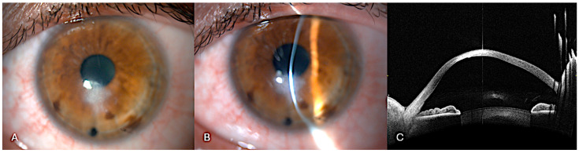
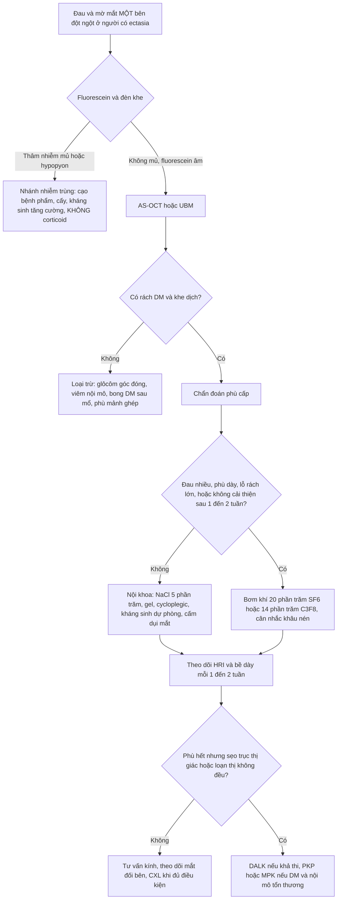
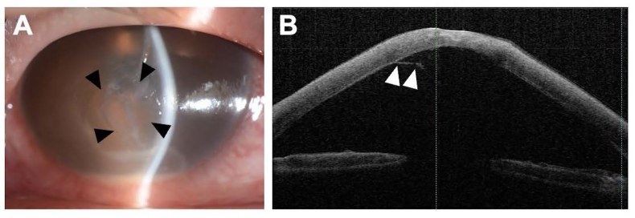

# 3259 — Phù cấp giác mạc trong giác mạc hình chóp / Acute corneal hydrops

**Tags:** `pattern:phu-mo-dem-khu-tru` `pattern:rach-mang-descemet` `pattern:khe-dich-trong-mo-dem` `pattern:mo-giac-mac-cap` `pattern:mat-mot-ben` `pattern:manh-giac-mac-ngoai-vi` `vung:mat` `vung:giac-mac` `vung:mo-dem-sau` `protocol:den-khe` `protocol:AS-OCT` `protocol:UBM` `protocol:pachymetry` `protocol:pneumodescemetopexy` `score:hydrops-resolving-index` `incidentaloma:khong`

**Mức chắc chắn (certainty):** tổng hợp y văn (literature synthesis) — dựng từ một tổng quan hệ thống hoá **75 bài** về xử trí phù cấp (PMC11149508), một loạt can thiệp **6 mắt** có số đo bề dày trước–sau (PMC12383977), một loạt **45 mắt** theo dõi mắt đối bên **4,73 năm** (PMC12097551), một loạt **112 bệnh nhân** về nhiễm trùng kèm (PMC11952767), một đoàn hệ **762 bệnh nhân** keratoconus không ổn định (PMC12136336), một tổng quan 2026 về ghép giác mạc sau phù cấp (PMC12912035) và một ca lâm sàng có ảnh (PMC11661259). Nhóm **không có bệnh nhân của mình**; chỗ chưa đủ chắc ghi **"chưa rõ"**. **Không ghi tên tác giả** — attribution = **tạp chí + năm + PMCID/DOI**.

> **Câu chốt:** bệnh nhân keratoconus (giác mạc hình chóp) đột ngột **đau, chảy nước mắt, sợ ánh sáng, mờ mắt MỘT bên**; đèn khe thấy **mảng phù khu trú tại đỉnh chóp, bờ mờ, KHÔNG có thâm nhiễm mủ**, và **fluorescein âm** trên vùng đục (biểu mô còn nguyên). Nguyên nhân là **rách màng Descemet (DM)** → thuỷ dịch tràn vào mô đệm → **khe dịch trong mô đệm**; trên AS-OCT thấy **DM đứt/gấp cuộn + khoang giảm hồi âm trong mô đệm + giác mạc dày gấp ~1,7–2 lần**. Bốn số phải nhớ: **2,4–3% bệnh nhân keratoconus** (6–11,5% PMD, 11% keratoglobus); **bề dày trung tâm 848 ± 52 µm → 588 ± 47 µm sau 4 tuần** dẫn lưu; **tự lành 5–36 tuần** nếu chỉ điều trị nội khoa, **2–4 tuần** sau bơm khí/dẫn lưu; và **2,7% (3/112) có nhiễm trùng kèm** — nhóm phải nhỏ kháng sinh, **không được chỉ nhỏ corticoid**.

## 1. Tổng quan bệnh học – cơ chế hình ảnh (TẠI SAO)

### 1.1 Rách ở đâu và vì sao lại rách

- **Màng Descemet (Descemet membrane, DM)** là **màng đáy acellular** của nội mô, dày **~8–10 µm** ở người trẻ và **~16 µm** ở người già, thành phần **collagen type IV + laminin**. Khi DM **rách**, hàng rào nội mô–DM mất, **thuỷ dịch tiền phòng (áp lực ~15 mmHg)** bị **chênh áp** đẩy vào mô đệm (PMC11149508).
- Tổn thương **không chỉ ở DM**: trong loạt Bowman-layer transplantation, **0/16 mắt** có bong mảnh ghép DMEK nhưng không rách mô đệm sau lại phát triển phù cấp, trong khi **5/5 mắt** có **thủng mô đệm sau** đều phát triển phù cấp trên AS-OCT. Kết luận: **khiếm khuyết DM đơn thuần không đủ** — phải có **khiếm khuyết mô đệm sau** mới thành phù cấp (PMC11149508).
- **TẠI SAO phù khu trú chứ không lan toả:** chỗ rách nằm ở **đỉnh chóp** — nơi giác mạc **mỏng nhất**, chịu **ứng suất cơ học lớn nhất** và là điểm **chùng của màng Descemet**; dòng thuỷ dịch chỉ vào được **quanh lỗ rách**, nên vùng phù **khu trú**, bờ chuyển tiếp rõ với giác mạc lành.
- **TẠI SAO khởi phát đột ngột:** **dụi mắt** và **áp lực nội nhãn dao động** làm tăng ứng suất lên DM đã mỏng; **85,5%** ca phù cấp có **dụi mắt** so với **67,7%** ca chứng (p < 0,01), và **atopy 48,9% vs 30,4%** (p = 0,0001) trong đoàn hệ 762 bệnh nhân keratoconus không ổn định (PMC12136336). Đây là lý do phải **cấm dụi mắt** ngay từ lần khám đầu.

### 1.2 Vì sao mô đệm ngậm nước và vì sao thành "khe"

- Mô đệm giác mạc = **collagen type I** xếp song song + **keratan sulfate/dermatan sulfate** (glycosaminoglycan ưa nước). Bình thường **swelling pressure** của GAG bị cân bằng bởi **bơm nội mô** và **hàng rào biểu mô**; khi DM rách, **nước tràn vào theo bậc thang áp lực**, GAG **hydrat hoá**, các **bản collagen tách nhau** → hình thành **khe dịch (intrastromal clefts)** (PMC11149508; PMC12383977).
- **Hệ quả định lượng:** bề dày trung tâm từ **848 ± 52 µm** lúc nhập viện còn **588 ± 47 µm** sau 4 tuần (giảm **24,0–38,7%** tuỳ mắt), trong loạt 6 mắt được dẫn lưu + bơm khí (PMC12383977). Bề dày giác mạc bình thường **~540–550 µm**, nên phù cấp làm giác mạc **dày gấp ~1,6–2 lần** và có mắt tới **921 µm**.
- **TẠI SAO thị lực giảm nặng hơn mức "mờ do phù":** ngoài tán xạ do nước, **bề mặt chóp bị biến dạng không đều** gây **loạn thị không đều**; loạt 6 mắt có **BCVA 1,75 ± 0,36 logMAR** lúc đầu, chỉ còn **1,15 ± 0,31 logMAR** sau 4 tuần dù phù đã hết — phần còn lại là **sẹo + loạn thị** (PMC12383977).

### 1.3 Vì sao hình ảnh trông như vậy (vật lý của từng modality)

| Modality | Cái gì phản ánh cái gì | Vì sao |
|---|---|---|
| **Đèn khe** | Mảng **trắng–xám khu trú**, bờ mờ, bề mặt **bóng**, **không có mủ**; có thể thấy **vết rách DM dạng đường tối** hoặc **mảnh DM gấp cuộn** | Nước trong mô đệm **tán xạ ánh sáng** (mất trong suốt); mủ (tế bào viêm) sẽ tạo **đám đặc, vàng–trắng**, khác hẳn |
| **Fluorescein** | **Âm** trên vùng đục (nếu biểu mô còn nguyên); **dương** khi có trợt/loét | Fluorescein chỉ bắt vào **mô đệm khi biểu mô mất**; phù cấp **không làm mất biểu mô** (PMC11661259) |
| **AS-OCT** | **DM đứt / gấp cuộn**, **khe giảm hồi âm** trong mô đệm, **bề dày đo được**, **vị trí và kích thước lỗ rách** | Khe dịch **không phản xạ** → **giảm hồi âm**; mô đệm phù **tăng hồi âm**; DM là **đường tăng hồi âm mảnh** nên thấy rõ chỗ đứt (PMC12383977) |
| **UBM** | Như AS-OCT nhưng **xuyên qua giác mạc rất đục**, đo được **độ sâu bong DM** | Sóng âm **không bị chặn bởi đục giác mạc** như ánh sáng; dùng khi AS-OCT không qua được (PMC11149508) |
| **Bản đồ bề dày (pachymetry)** | **Vùng dày khu trú** đúng đỉnh chóp, ví dụ **849 µm** giữa vùng **600–700 µm** | Bản đồ định lượng **mức ngậm nước** và là mốc theo dõi khách quan |

*Bản đồ axial power, elevation trước/sau và **pachymetry**: vùng **đỉnh chóp** có bề dày **849 µm** (thang 600–849 µm), tương ứng vùng phù; các vùng lân cận **600–700 µm**. Nguồn: Bioengineering (Basel) 2025 (PMC12383977), Fig. 2, **CC BY 4.0**.*

### 1.4 Dịch tễ — con số thật

| Bối cảnh | Tần suất phù cấp | Nguồn |
|---|---|---|
| **Keratoconus (KC)** | **2,4–3%** bệnh nhân; một nghiên cứu quốc gia ước tính **1,43/1.000 bệnh nhân KC** | PMC11149508; PMC12383977 |
| **Pellucid marginal degeneration (PMD)** | **6–11,5%** | PMC11149508 |
| **Keratoglobus (KG)** | **11%** | PMC11149508 |
| **KC không ổn định (đoàn hệ 762 bệnh nhân)** | **113/762 = 14,9%** (128 đợt) — nhóm được theo dõi chặt tại trung tâm chuyên khoa | PMC12136336 |
| **Tuổi** | **5–59 tuổi**; loạt can thiệp có tuổi trung bình **22,5 ± 4,59** | PMC11149508; PMC12383977 |
| **HC nguy cơ cao** | **Down syndrome**, **atopy/viêm kết mạc mùa xuân**, **dụi mắt**, **khởi phát KC sớm**; **chậm phát triển OR 16,42**; **BMI mỗi đơn vị OR 1,05**; **da đen OR 2,10**; **bảo hiểm công OR 2,06** | PMC12136336; PMC12912035 |

- **TẠI SAO Down syndrome/atopy:** cả hai đều đi kèm **dụi mắt mạn** và **ma sát bề mặt**, làm mỏng mô đệm và tăng ứng suất lên DM; loạt 6 mắt có **4/6 atopy nặng**, trong đó **2/6 Down syndrome** (PMC12383977).
- **Biến chứng:** **nhiễm trùng kèm 2,7% (3/112)** (PMC11952767); **thủng giác mạc** khi **nhãn áp cao, dụi mắt liên tục, dùng corticoid** (PMC11149508); **tân mạch, sẹo, glôcôm**; **tái phát bên mắt còn lại** — xem §4.4.

## 2. Mẫu hình + chẩn đoán phân biệt theo vị trí (gamut)

### 2.1 Đọc một "mắt đỏ + giác mạc đục" theo 5 câu hỏi

1. **Một bên, khởi phát trong vài giờ–vài ngày?** Phù cấp **một bên**, đột ngột; phù do suy nội mô/glôcôm thường **hai bên hoặc lan toả**.
2. **Đục khu trú tại đỉnh chóp hay lan toả?** Phù cấp **khu trú đúng nơi giác mạc mỏng/nhô**; phù nội mô **lan từ rìa vào**, phù do glôcôm **toàn bộ**.
3. **Có thâm nhiễm mủ/hypopyon không?** **Không** = phù cấp; **có** = phải loại trừ **viêm giác mạc nhiễm trùng** (kể cả khi đang có phù cấp — 2,7% có đồng thời).
4. **Fluorescein dương hay âm?** **Âm** trên vùng đục = biểu mô còn nguyên → phù cấp; **dương** = trợt/loét.
5. **AS-OCT có rách DM + khe dịch không?** **Có** = chốt; **không** thì tìm **bong DM sau mổ**, **phù nội mô**, **glôcôm**.

### 2.2 Gamut theo bối cảnh (ai bị, ở đâu)

| Nhóm | Thực thể | Gợi ý nhận diện |
|---|---|---|
| **Ectasia có sẵn** | **Keratoconus** (2,4–3%), **PMD** (6–11,5%, tổn thương **vùng dưới**), **keratoglobus** (11%, **toàn bộ**), **ectasia sau LASIK** | Giác mạc mỏng/nhô từ trước; **mắt còn lại có dấu ectasia** (Vogt striae, sẹo đỉnh) |
| **Hội chứng/di truyền** | **Down syndrome**, **Leber congenital amaurosis**, bệnh mô liên kết; **atopy** | Trẻ/chậm phát triển, **dụi mắt**, viêm kết mạc mùa xuân |
| **Sau mổ** | **Sau PKP/DALK** (bong DM tự phát **nhiều thập kỷ** sau ghép), **sau DMEK** (bong mảnh ghép gây phù) | Tiền sử ghép; **đường ghép–mô chủ**, bong mảnh ghép trên AS-OCT |
| **Thủ phạm toàn thân/thuốc** | **Thai kỳ**, **colchicine**, thuốc nhỏ corticoid kéo dài | Bối cảnh thai/thuốc; phù cấp vẫn cần **rách DM** |
| **Nhiễm trùng** | **Viêm giác mạc vi khuẩn/nấm/Acanthamoeba** chồng trên phù cấp | **Thâm nhiễm mủ + hypopyon + fluorescein dương**; **đau nhiều hơn**, tiến triển nhanh |

*Ba khung cùng một mắt: **(A)** đèn khe ánh sáng khuếch tán — **mảng đục trắng–xám khu trú tại đỉnh chóp**, giác mạc xung quanh còn trong; **(B)** khe sáng hẹp — bề mặt **gồ lên**, mô đệm **dày, đục**; **(C)** AS-OCT — **chóp giác mạc nhô**, bề dày tăng mạnh, **nhiều khoang giảm hồi âm (khe dịch)** trong mô đệm. Nguồn: Bioengineering (Basel) 2025 (PMC12383977), Fig. 3, **CC BY 4.0**.*

## 3. Bảng so sánh phân biệt (ma trận đối chiếu)

| Thực thể (entity) | Hình ảnh điển hình | Chốt vào (rule-in) | Chốt loại (rule-out) | Gợi ý xác nhận |
|---|---|---|---|---|
| **Phù cấp trong KC (bài này)** | Đục **khu trú đỉnh chóp**, bề mặt gồ, **không mủ**; AS-OCT: **DM đứt/gấp cuộn + khe giảm hồi âm**, bề dày **~850 µm** | **Một bên + đột ngột + fluorescein âm + AS-OCT có rách DM/khe dịch**; mắt còn lại có ectasia | **Thâm nhiễm mủ/hypopyon** → nhiễm trùng; **phù lan toả + IOP cao** → glôcôm; **tiền sử ghép** → bong mảnh ghép | AS-OCT/UBM; pachymetry; soi đèn khe mắt còn lại |
| **Phù cấp trong PMD/keratoglobus** | PMD: đục **vùng dưới** (giờ 4–8), "chân chim"; KG: **toàn bộ** giác mạc | **Vị trí ngoại vi dưới** (PMD) hoặc **toàn bộ** (KG) + mỏng lan rộng | Đục **trung tâm đỉnh chóp** → KC điển hình | Bản đồ giác mạc: **thang màu "cua càng"** ở PMD; bề dày toàn bộ ở KG |
| **Viêm giác mạc nhiễm trùng** | **Thâm nhiễm trắng–vàng đặc**, bờ mờ, **mủ tiền phòng**, **fluorescein dương**, đau nhiều | **Thâm nhiễm + hypopyon + fluorescein dương**; **atopy nặng** làm tăng nguy cơ (3/3 ca nhiễm kèm đều atopy) | **Fluorescein âm + không mủ + AS-OCT chỉ có khe dịch** → phù cấp đơn thuần | **Cạo giác mạc/nhuộm Gram + cấy TRƯỚC khi nhỏ kháng sinh**; AS-OCT phân biệt thâm nhiễm với khe dịch |
| **Glôcôm góc đóng cấp** | **Phù biểu mô lan toả**, **microcyst**, đồng tử **giãn giữa**, tiền phòng **nông**, **IOP rất cao** | **IOP tăng + tiền phòng nông + phù lan toả**; đau đầu/nôn | **Đục khu trú + tiền phòng sâu + IOP bình thường** → phù cấp | Đo IOP, soi góc; AS-OCT tiền đoạn (độ sâu tiền phòng) |
| **Viêm nội mô (CMV/HSV)** | **Phù khu trú + KPs**, có thể **tăng IOP**, tiền sử ghép/miễn dịch; tái phát | **KPs + phản ứng tiền phòng + tăng IOP**; đáp ứng corticoid nhưng **tái phát khi giảm** | **Không KPs, không phản ứng tiền phòng** → phù cấp | **PCR thuỷ dịch** (CMV/HSV) khi nghi; AS-OCT thấy phù nhưng **không có rách DM** |
| **Bong DM sau phaco/PKP** | **"Đường đôi" (double line)** DM tách khỏi mô đệm sau, thường **vùng rìa/dưới**, phù **kéo dài sau mổ** | **Tiền sử mổ trong vài tuần** + **đường đôi trên AS-OCT** | **Rách DM + khe dịch trong mô đệm + đỉnh chóp** → phù cấp | AS-OCT: đo **chiều cao bong**, vị trí; phân biệt **bong** với **rách** |
| **Phù mảnh ghép sau DMEK/PKP** | **Mảnh ghép mờ**, **dịch ở interface**, đường ghép–mô chủ rõ | **Tiền sử ghép giác mạc** + **dịch interface** + mảnh ghép dày | **Không tiền sử ghép** → không phải | AS-OCT: vị trí dịch **dưới mảnh ghép**, độ dày mảnh ghép |
| **Phù sau phaco/TASS** | **Phù lan toả** xuất hiện **1–3 ngày sau mổ**, có thể **mủ nhẹ**, đau | **Mổ trong 72 giờ** + **phù lan toả** + phản ứng tiền phòng | **Đục khu trú + khởi phát tự nhiên** → phù cấp | Soi đèn khe; cấy thuỷ dịch nếu mủ; AS-OCT không có rách DM |

## 4. Protocol khám/đo + phân độ & ngưỡng quyết định

### 4.1 Thứ tự khám cố định (7 bước)

| Bước | Việc làm | Ghi nhận | Ngưỡng hành động |
|---|---|---|---|
| 1 | **Đèn khe** ánh sáng khuếch tán + khe hẹp | Vị trí/kích thước vùng đục, bề mặt, **có mủ không**, mắt còn lại | **Mủ/hypopyon** → chuyển nhánh nhiễm trùng ngay |
| 2 | **Fluorescein** | Trợt/loét, **Seidel** | **Dương** → loét; **Seidel dương** → **thủng, cấp cứu** |
| 3 | **Đo IOP** | Loại trừ glôcôm góc đóng | **IOP cao + phù lan toả** → xử trí glôcôm trước |
| 4 | **AS-OCT** (hoặc **UBM** nếu quá đục) | **Vị trí/kích thước lỗ rách DM**, **bong DM**, **khe dịch**, **bề dày tại lỗ rách (CT0)** và **cách 2,5 mm (CT2,5)** | **Lỗ rách lớn** → bơm khí đơn thuần **không đủ tamponade**; cân nhắc **khâu nén** |
| 5 | **Pachymetry** | Bề dày trung tâm, bản đồ | Theo dõi **xu hướng**; ghi mốc **µm** |
| 6 | **Soi đèn khe mắt còn lại + bản đồ giác mạc** | Vogt striae, sẹo đỉnh, **Kmax**, bề dày mỏng nhất | **Mắt còn lại có ectasia** → kế hoạch **CXL** |
| 7 | **Hỏi bệnh** | **Dụi mắt**, atopy, Down, thai, colchicine, thuốc nhỏ | **Dụi mắt** → tư vấn + điều trị atopy (không chỉ nhỏ thuốc) |

### 4.2 Chỉ số theo dõi: "hydrops resolving index" (HRI)

- **HRI = CT0 / CT2,5**, trong đó **CT0** = bề dày đo **ngay trên vùng rách DM**, **CT2,5** = **trung bình bề dày ở 4 kinh tuyến cách tâm 2,5 mm**. **HRI tăng dần** = phù đang thoái triển và **sẹo hình thành** (PMC11149508).
- **Vì sao dùng tỉ lệ thay vì một con số tuyệt đối:** bề dày "tuyệt đối" phụ thuộc **giác mạc nền dày/mỏng** của từng người; tỉ lệ **chuẩn hoá theo chính mắt bệnh nhân**, nên so sánh **giữa các lần khám** mới có nghĩa.
- **Ngưỡng thực hành:** bề dày **> 700–800 µm** hoặc **> 2 lần** mắt đối bên = phù nặng, cần theo dõi sát; **giảm < 600 µm** kèm **HRI tăng** = đang lành sẹo. Các ngưỡng này là **mốc thực hành từ loạt can thiệp**, **chưa có thang điểm được validate** — xem mục 7.

### 4.3 Điều trị — so sánh có số

| Biện pháp | Cơ chế | Chỉ định | Kết quả (số) | Hạn chế |
|---|---|---|---|---|
| **Nội khoa** (NaCl 5%, gel bôi trơn, cycloplegic, kháng sinh dự phòng, **cấm dụi mắt**) | **Hút nước thẩm thấu**, giảm co thắt thể mi, phòng nhiễm | **Mặc định ban đầu**, phù nhẹ–vừa, không có nhiễm/thủng | **Tự lành 5–36 tuần**; vẫn để lại **sẹo + loạn thị** | Chậm; **không rút ngắn** được thời gian; **corticoid làm tăng nguy cơ thủng** |
| **Bơm khí tiền phòng (pneumodescemetopexy)**: không khí, **20% SF6**, **14% C3F8** | **Tamponade** mép DM, chặn dòng thuỷ dịch | Phù **không tự cải thiện**, lỗ rách **không quá lớn** | Giải quyết **11,5–28 ngày** (bảng tổng quan); loạt 3D-OCT: **848 → 588 µm trong 4 tuần**, **BCVA 1,75 → 1,15 logMAR** | **Lỗ rách lớn** → khí không áp được; **tăng IOP**, **di lệch khí**, cần **nằm ngửa 1–2 giờ** |
| **Khâu nén (compression sutures)** đủ–hoặc–bán phần | **Ép cơ học** mép DM, giảm khoang dịch | Lỗ rách **lớn**, phù **dày**, thất bại khí đơn thuần | Loạt **full-thickness**: giải quyết **21–28 ngày**; phối hợp khí: **11,5 ± 6,5 ngày**; **tân mạch sâu 17,6% (3/17)**, **Seidel dương 17,6%** | **Thủng**, nhiễm, **loạn thị không đều**, phải **tháo chỉ**; kỹ thuật khó |
| **DALK / PKP sau khi phù đã lành** | Thay mô **sẹo + DM rách** | **Sẹo trục thị giác**, loạn thị không đều, **không dung nạp kính** | Loạt 6 mắt: **4/6** phải **MPK** sau 3 tháng, BCVA cuối **0,68 ± 0,15 logMAR**, loạn thị **2,65 ± 0,75 D** | **DALK khó hơn** vì DM đã rách; **PKP** nguy cơ thải ghép; **chờ sẹo ổn định** |
| **CXL (cross-linking)** | **Tăng liên kết collagen**, làm cứng giác mạc | **Mắt đối bên** đang tiến triển; **sau khi phù lành** ở mắt bệnh | **67%** mắt đối bên tiến triển trong **4,73 năm**; **36%** mắt đủ điều kiện CXL **tụt dưới 400 µm** nếu chờ | **Chưa rõ thời điểm** CXL quanh đợt phù cấp; **không làm khi đang phù** theo thực hành phổ biến |

*Cùng một mắt: **hàng trên (a–c)** ở **1 tuần** sau bơm khí nội tiền phòng — còn **phù mô đệm**, **bóng khí trong tiền phòng**, AS-OCT còn **khe dịch**; **hàng dưới (d–f)** ở **6 tuần** — phù thoái triển, để lại **sẹo nhẹ**, AS-OCT bề dày giảm rõ. Nguồn: Indian J Ophthalmol 2024 (PMC11149508), Fig. 2, **CC BY-NC-SA 4.0**.*

*Bốn tuần sau dẫn lưu + bơm khí: **(A–B)** đèn khe — phù hết, còn **leukoma trung tâm nhỏ**, giác mạc xung quanh trong; **(C)** AS-OCT — bề dày **giảm còn 520 µm**, **DM áp lại phần lớn**, bề mặt vẫn **không đều**. Nguồn: Bioengineering (Basel) 2025 (PMC12383977), Fig. 5, **CC BY 4.0**.*

### 4.4 Sơ đồ quyết định

## 5. Biến thể bình thường và cạm bẫy

1. **Gọi phù cấp là "viêm giác mạc" rồi nhỏ corticoid mạnh** — corticoid **không làm tan nước trong mô đệm**, lại **tăng nguy cơ thủng** và **che dấu nhiễm trùng** (2,7% có nhiễm kèm). Ở bệnh nhân atopy, **nhiễm kèm càng dễ bị bỏ** (cả 3 ca nhiễm trong loạt đều atopy nặng).
2. **Tin vào "fluorescein âm nên chắc chắn lành"** — fluorescein âm chỉ nói **biểu mô còn nguyên**, **không loại trừ** nhiễm trùng mô đệm sâu hay **thủng** (Seidel chỉ dương khi có lỗ thông). Vẫn phải **soi kỹ, đo IOP, AS-OCT**.
3. **Bỏ sót glôcôm góc đóng** vì "đã có phù cấp rồi" — phù cấp **không làm giảm** nguy cơ glôcôm; **IOP cao + tiền phòng nông + phù lan toả** là bộ ba phải đo **trước khi** kết luận.
4. **Cho rằng "giác mạc mỏng thì không thể phù"** — phù cấp xảy ra **chính vì** giác mạc mỏng; bề dày **849 µm** trên nền chóp mỏng vẫn là **tăng gấp ~2 lần**.
5. **Không khám mắt còn lại** — **67%** mắt đối bên **tiến triển** trong **4,73 năm**, **53,3%** tiến triển **cả độ cong và bề dày**; **36%** mắt đủ điều kiện CXL **tụt dưới 400 µm** nếu chỉ theo dõi. Khám mắt lành là **một phần của chẩn đoán phù cấp**, không phải việc phụ.
6. **Hứa "vài tuần là khỏi, thị lực về bình thường"** — tự lành **5–36 tuần**, và **sẹo + loạn thị** có thể cần **ghép giác mạc**; trong loạt 6 mắt, **4/6** vẫn phải **MPK**, BCVA cuối **0,68 logMAR**.
7. **Bơm khí cho mọi ca** — **lỗ rách lớn** thì khí **không tamponade** đủ; cần **khâu nén** hoặc **dẫn lưu có hướng dẫn OCT**. Ngược lại, bơm khí **không cải thiện thị lực cuối** trong nhiều so sánh — lợi ích chính là **rút ngắn thời gian**.
8. **Đo bề dày bằng một lát cắt duy nhất** — phù **không đồng nhất**; phải đo **tại lỗ rách (CT0)** và **cách 2,5 mm (CT2,5)**, tính **HRI**, và đo **lặp lại cùng vị trí**.
9. **Bỏ qua "đục giác mạc sau ghép nhiều năm"** — bong DM **tự phát nhiều thập kỷ sau PKP** có thể giống hệt phù cấp; **tiền sử ghép + đường đôi trên AS-OCT** là chốt.
10. **Không điều trị atopy/dụi mắt** — đây là **yếu tố khởi phát**; không kiểm soát thì **mắt còn lại** và **tái phát** vẫn tiếp diễn.

## 6. Tự lượng giá — Blind Quiz

**Ca 1 — Nam 31 tuổi, keratoconus đã biết, đau và mờ mắt trái đột ngột 2 ngày, không đeo kính tiếp xúc.**

- Gợi ý: tổn thương **một bên**, **khu trú**, giác mạc xung quanh còn trong; không thấy mủ.
- Câu hỏi: (1) Mô tả 3 dấu hiệu chính trên đèn khe và AS-OCT. (2) Ba chẩn đoán phân biệt? (3) Việc đầu tiên phải làm để loại trừ nguyên nhân nguy hiểm hơn?

<b>Bấm để hiện đáp án (findings + chẩn đoán)</b>

- **Dấu hiệu:** **(A)** mảng đục **trắng–xám khu trú tại đỉnh chóp**, bờ mờ, **không có thâm nhiễm mủ**; **(B)** bề mặt **gồ**, mô đệm **dày**; **(C)** AS-OCT: **chóp nhô**, bề dày tăng, **nhiều khoang giảm hồi âm = khe dịch trong mô đệm**.
- **Chẩn đoán:** **phù cấp giác mạc (acute corneal hydrops)** do **rách màng Descemet** — thuỷ dịch vào mô đệm qua lỗ rách.
- **Phân biệt:** **viêm giác mạc nhiễm trùng** (thâm nhiễm mủ, hypopyon, fluorescein dương), **glôcôm góc đóng cấp** (phù lan toả, IOP cao, tiền phòng nông), **bong DM sau mổ** (nếu có tiền sử phaco/ghép).
- **Việc đầu tiên:** **fluorescein + đèn khe tìm thâm nhiễm/hypopyon** và **đo IOP** — loại trừ **nhiễm trùng** và **glôcôm** trước khi yên tâm điều trị nội khoa. Sau đó **AS-OCT** để đo lỗ rách và bề dày.
- **Nguồn ảnh:** Bioengineering (Basel) 2025 (PMC12383977), Fig. 3, **CC BY 4.0**.

**Ca 2 — Bệnh nhân keratoconus, 1 tuần sau bơm khí nội tiền phòng vì phù cấp; nay đỡ đau nhưng vẫn mờ.**

- Gợi ý: hàng trên và hàng dưới là **hai thời điểm khác nhau** của cùng một mắt.
- Câu hỏi: (1) Hàng trên có gì trong tiền phòng? (2) Hàng dưới chứng minh điều gì? (3) Vì sao vẫn còn mờ dù phù đã giảm?

<b>Bấm để hiện đáp án</b>

- **Hàng trên (1 tuần):** còn **phù mô đệm**, thấy **bóng khí trong tiền phòng** (tamponade DM), AS-OCT còn **khe dịch**; đây là **giai đoạn đang lành**, không phải thất bại.
- **Hàng dưới (6 tuần):** phù **thoái triển**, bề mặt bớt gồ, AS-OCT bề dày **giảm rõ** — khí đã **áp mép DM**, dòng thuỷ dịch giảm.
- **Vì sao vẫn mờ:** còn **sẹo mô đệm nông + loạn thị không đều**; thị lực cuối phụ thuộc **vị trí sẹo** so với trục thị giác, không chỉ bề dày. Trong loạt 6 mắt, BCVA chỉ cải từ **1,75 → 1,15 logMAR** dù phù hết.
- **Nguồn ảnh:** Indian J Ophthalmol 2024 (PMC11149508), Fig. 2, **CC BY-NC-SA 4.0**.

**Ca 3 — Nam 46 tuổi, viêm da cơ địa nặng, keratoconus; đau tăng nhanh 3 ngày, mắt đỏ, nhìn rất kém.**

- Gợi ý: vẫn là mắt có phù cấp, nhưng lần này có **thêm** một tổn thương khác.
- Câu hỏi: (1) Ngoài phù, ảnh còn cho thấy gì? (2) Chẩn đoán kép? (3) Vì sao **không** được chỉ nhỏ corticoid?

<b>Bấm để hiện đáp án</b>

- **Ngoài phù:** **(A)** có **thâm nhiễm giác mạc** (vùng đục đặc hơn, bờ không đều) và **mủ tiền phòng (hypopyon)**; **(B)** AS-OCT vẫn thấy **rách DM** (đầu mũi tên) — tức **hai quá trình cùng lúc**.
- **Chẩn đoán kép:** **phù cấp + viêm giác mạc nhiễm trùng** — trong loạt 112 bệnh nhân phù cấp, **3 ca (2,7%)** có đồng thời nhiễm trùng; **cả 3 đều atopy nặng**, tuổi **44–49**, **2/3 cấy dương** (MSCNS, MSSA).
- **Không corticoid:** corticoid **ức chế miễn dịch tại chỗ**, làm **nhiễm trùng bùng phát**, **tăng nguy cơ thủng** (nhất là khi đã có phù cấp), và **che mất dấu hiệu**; ưu tiên **cạo bệnh phẩm + cấy + kháng sinh tăng cường** theo kinh nghiệm, rồi điều chỉnh theo kết quả.
- **Nguồn ảnh:** Am J Ophthalmol Case Rep 2025 (PMC11952767), Fig. 3, **CC BY-NC-ND 4.0** (nguyên bản, không cắt/ghép).

## 7. Câu hỏi nghiên cứu & điểm chưa đồng thuận (tính đến 11/2026)

1. **[Tranh cãi] Ở mắt đối bên chưa có phù cấp nhưng đang tiến triển, nên CXL ngay hay chờ sau khi mắt bị phù cấp lành?**
   - **Đã biết:** **67%** mắt đối bên tiến triển trong **4,73 năm**, **53,3%** tiến triển cả độ cong và bề dày; **36%** mắt đủ điều kiện CXL lúc đầu **tụt dưới 400 µm** trong theo dõi (PMC12097551). CXL là cách duy nhất làm cứng giác mạc, nhưng **thời điểm quanh đợt phù cấp** chưa được chuẩn hoá (PMC11149508).
   - **Chưa rõ:** **có nên CXL ngay trên mắt đang phù** hay chờ **hết phù + sẹo ổn định**; ảnh hưởng của CXL lên **tốc độ lành DM** và **nguy cơ thủng** chưa có RCT.
   - **Hướng nghiên cứu:** RCT/đoàn hệ tiến cứu phân tầng theo **bề dày, lỗ rách DM, mắt đối bên**, outcome **thời gian lành, BCVA, nhu cầu ghép**.
   - **Nguồn:** PMC12097551 (2025); PMC11149508 (2024); PMC13518778 (2026).

2. **[Khoảng trống] Bơm khí/dẫn lưu sớm có làm giảm SẸO và nhu cầu ghép giác mạc, hay chỉ rút ngắn thời gian phù?**
   - **Đã biết:** bơm khí + dẫn lưu giúp phù hết trong **2–4 tuần** (so với **5–36 tuần** nội khoa), bề dày **848 → 588 µm**, nhưng **BCVA cuối không khác biệt có ý nghĩa** trong nhiều so sánh; **4/6 mắt** trong loạt 3D-OCT vẫn phải **MPK** (PMC12383977; PMC11149508).
   - **Chưa rõ:** chưa có **RCT** so sánh **nội khoa vs bơm khí sớm** với outcome **diện tích sẹo, loạn thị, tỷ lệ ghép**; cũng chưa có **thang AS-OCT tiên lượng** thời gian lành (kích thước lỗ rách bao nhiêu thì khí thất bại).
   - **Hướng nghiên cứu:** RCT đa trung tâm, phân tầng theo **kích thước lỗ rách trên AS-OCT**, outcome **sẹo trung tâm, loạn thị, ghép giác mạc ở 12 tháng**.
   - **Nguồn:** PMC12383977 (2025); PMC11149508 (2024); PMC12433542 (2025).

3. **[Khác biệt thực hành] Sau khi phù cấp lành, DALK hay PKP là lựa chọn đầu tay?**
   - **Đã biết:** sau phù cấp, **nhu cầu PKP cao hơn** keratoconus không có phù cấp vì **DM đã rách**; **DALK** giữ nội mô và **ít biến chứng hơn**, nhưng **khó hơn** vì DM không còn nguyên; tổng quan 2026 khuyến nghị **DALK khi khả thi** (PMC12912035).
   - **Chưa rõ:** **tỷ lệ thủng DM trong DALK** và **sống ghép dài hạn** ở mắt đã phù cấp chưa được so sánh đủ; một số trung tâm vẫn chọn **PKP/MPK** vì sẹo lan tới DM.
   - **Hướng nghiên cứu:** đoàn hệ so sánh **DALK vs PKP** ở mắt đã lành phù cấp, outcome **thủng trong mổ, sống ghép 5 năm, BCVA, loạn thị**.
   - **Nguồn:** PMC12912035 (2026); PMC13229636 (2026); PMC12383977 (2025).

## Bài liên quan chéo

- [3254 – Dải canxi hóa giác mạc](../3254-dai-canxi-hoa-giac-mac/lesson.md) (phù giác mạc mạn là nguyên nhân canxi hóa)
- [3255 – Loét giác mạc hình khiên trong VKC](../3255-vkc-loet-giac-mac-hinh-khien/lesson.md) (atopy + loét khiên — phân biệt với phù cấp)
- [3203 – Dọa thủng giác mạc](../3203-de-doa-thung-giac-mac/lesson.md) (biến chứng thủng của phù cấp)
- [3204 – Loét giác mạc do thần kinh](../3204-loet-giac-mac-than-kinh/lesson.md)
- [3201 – Sẹo giác mạc và ghép giác mạc](../3201-seo-giac-mac-ghep/lesson.md) (DALK/PKP sau phù cấp)
- [6132 – Viêm giác mạc do kính tiếp xúc](../6132-viem-giac-mac-kinh-tiep-xuc/lesson.md) (phân biệt nhiễm trùng)
- [3216 – Viêm giác mạc nấm](../3216-viem-giac-mac-nam-soi/lesson.md) (thâm nhiễm + vệ tinh)
- [1456 – Bỏng hóa chất giác mạc](../1456-bong-hoa-chat-mat/lesson.md)
- [3258 – Nhũ tương hóa dầu silicon](../3258-nhu-tuong-hoa-dau-silicone/lesson.md) (phù/đục giác mạc sau bơm dầu)
- [400 – Tổng quan Mắt & thị giác](../400-tong-quan-mat-thi-giac/lesson.md)

## Ảnh

- `images/3259_pachymetry_Topography_PMC12383977-Fig2.jpg` — Bioengineering (Basel) 2025 (PMC12383977), Fig. 2, **CC BY 4.0**.
- `images/3259_hydrops_SlitLamp_PMC12383977-Fig3.jpg` — Bioengineering (Basel) 2025 (PMC12383977), Fig. 3, **CC BY 4.0**.
- `images/3259_sau-4-tuan_SlitLamp_PMC12383977-Fig5.jpg` — Bioengineering (Basel) 2025 (PMC12383977), Fig. 5, **CC BY 4.0**.
- `images/3259_bom-khi_SlitLamp_PMC11149508-Fig2.jpg` — Indian J Ophthalmol 2024 (PMC11149508), Fig. 2, **CC BY-NC-SA 4.0**.
- `images/3259_nhiem-kem_SlitLamp_PMC11952767-Fig3.jpg` — Am J Ophthalmol Case Rep 2025 (PMC11952767), Fig. 3, **CC BY-NC-ND 4.0**.

> Không dùng để chẩn đoán độc lập khi chưa có người hướng dẫn.
