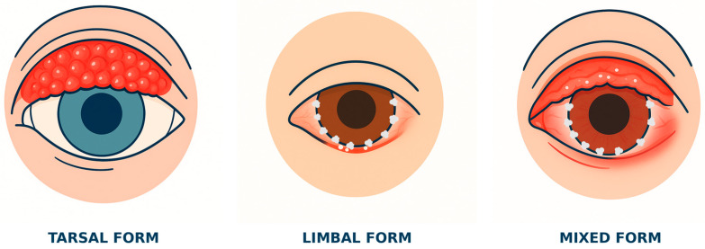
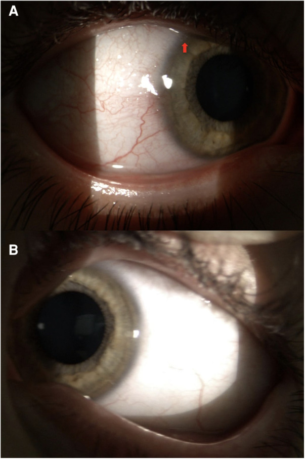
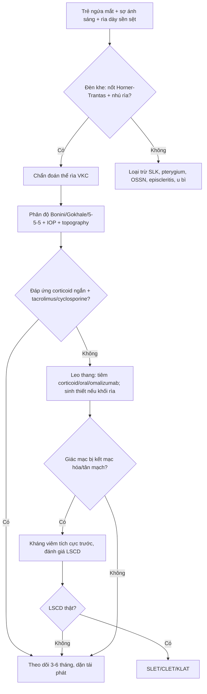
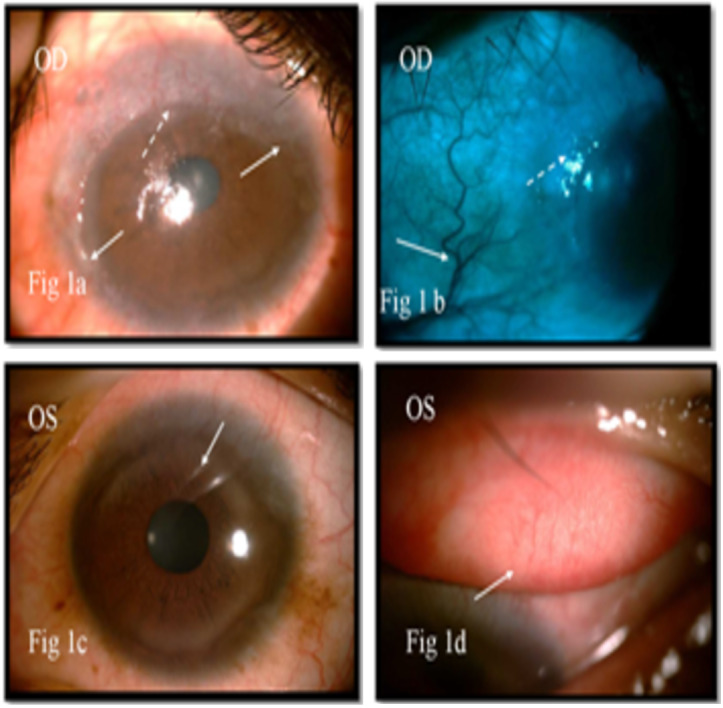
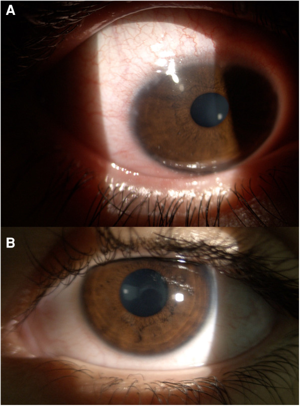
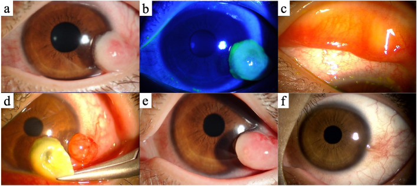
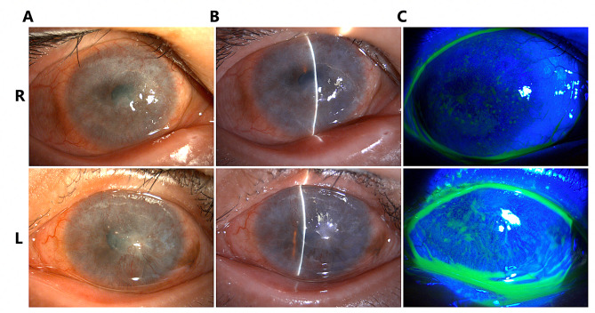
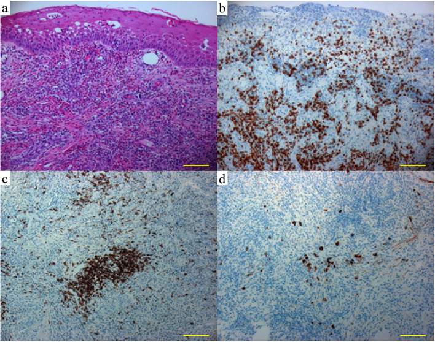

# 3260 — Viêm kết mạc mùa xuân thể rìa / Limbal vernal keratoconjunctivitis: nốt Horner–Trantas, nhú rìa sền sệt và nguy cơ thiếu hụt tế bào gốc rìa

**Tags:** `pattern:viem-ria` `pattern:nhu-ria` `pattern:not-horner-trantas` `pattern:gia-arcus` `pattern:tan-mach-giac-mac` `pattern:mat-mot-ben` `vung:mat` `vung:ket-mac` `vung:giac-mac` `vung:ria-giac-mac` `protocol:den-khe` `protocol:fluorescein` `protocol:AS-OCT` `protocol:IVCM` `protocol:UBM` `protocol:topography` `protocol:IOP` `score:Bonini` `score:Gokhale` `incidentaloma:khong`

**Mức chắc chắn (certainty):** tổng hợp y văn (literature synthesis) — dựng từ **hai ca thể rìa một bên trong cùng gia đình** (PMC10577227), **ca khối rìa có mô học đầy đủ** (PMC8961886), **ca OSSN giả PEH ở VKC mạn** (PMC10880557), **ca VKC giả thiếu hụt tế bào gốc rìa toàn bộ** (PMC13154496), **ba loạt bệnh nhân VKC 132/135/468 ca** (PMC13529053, PMC9773114, PMC3831763), **đoàn hệ 1.096 ca VKC** (PMID 39880668), **nghiên cứu AS-OCT bề dày biểu mô 71 mắt** (PMC10203025), **phân tích gộp tacrolimus 832 bệnh nhân** (PMC12343550), **đoàn hệ cyclosporine A 0,1% ở 101 trẻ** (PMC12534624) và **cập nhật phân độ VKC 2025** (PMC12507153). Nhóm **không có bệnh nhân của mình**; chỗ chưa đủ chắc ghi **"chưa rõ"**. **Không ghi tên tác giả** — attribution = **tạp chí + năm + PMCID/DOI**.

> **Câu chốt:** trẻ **ngứa mắt dữ dội, sợ ánh sáng, chảy nước mắt**, khám thấy **rìa giác mạc dày lên dạng sền sệt** và **các nốt trắng nhỏ (nốt Horner–Trantas)** — đó là **thể rìa của viêm kết mạc mùa xuân (limbal VKC)**, thể **chiếm đa số ở châu Á** (**59,09%** trong 132 ca; **61,5%** trong 135 ca), không phải "viêm kết mạc dị ứng thường". Hai điều quyết định tiên lượng: **(1) rìa là nơi chứa tế bào gốc** — trong **1.096 ca VKC**, **thiếu hụt tế bào gốc rìa (LSCD) 5,29%**, **keratoconus 18,43%**, **glôcôm 10,95%**, **đục thể thủy tinh do corticoid 11,41%**; **(2) khối sền sệt ở rìa** có thể là **tăng sản biểu mô giả ung thư (PEH, lành tính)** hoặc **u tân sinh bề mặt nhãn cầu (OSSN, ác tính)** — phải **soi kỹ mạch nuôi, bờ tổn thương và xâm lấn giác mạc**, sinh thiết khi nghi, nhưng **không mổ ngay mọi khối rìa**.

## 1. Tổng quan bệnh học – cơ chế hình ảnh (TẠI SAO)

### 1.1 Vì sao rìa lại là "điểm nóng" của VKC

- **Giải phẫu:** rìa là **vùng chuyển tiếp** giữa **biểu mô giác mạc** (biểu mô lát tầng, không sừng hóa, trong suốt) và **biểu mô kết mạc** (có **tế bào đài** tiết nhầy). Tại đây có **hàng rào Vogt (palisades of Vogt)** và **tế bào gốc rìa** — nguồn tái tạo biểu mô giác mạc suốt đời. Rìa cũng là nơi **dày đặc mast cell, tế bào tua và mạch máu** nhất của bề mặt nhãn cầu.
- **Cơ chế dị ứng:** VKC là viêm **IgE/Th2** phối hợp **cơ chế không IgE**: **mast cell** giải hạt → histamine, tryptase, leukotriene; **eosinophil** được chiêu mộ bởi **eotaxin**; **Th2** tiết IL-4/IL-5/IL-13; **biểu mô** giải phóng alarmin (TSLP, IL-33) khuếch đại vòng viêm. Vì rìa **phơi nhiễm UV và dị nguyên nhiều nhất**, phản ứng viêm tập trung ở đây.
- **TẠI SAO "sền sệt" (gelatinous):** viêm làm **tăng tính thấm mạch** → **phù mô đệm** + **ứ nhầy (hyaluronic acid, mucin)** + **thâm nhiễm tế bào viêm dày đặc**. Ánh sáng bị **tán xạ không đồng nhất** qua vùng phù–tế bào–nhầy đó, nên rìa **mất trong suốt, trông như thạch** — không phải "mủ".
- **TẠI SAO nốt trắng:** **nốt Horner–Trantas** là **ổ tụ tập eosinophil đang thoái hóa + mảnh xác tế bào biểu mô** (PMC8961886). Protein của hạt eosinophil (**MBP, ECP**) **độc với biểu mô**, nên quanh nốt trắng thường có **trợt chấm nông cạnh rìa (paralimbal punctate keratitis)**.
- **TẠI SAO khối rìa đôi khi thành "u":** viêm mạn + cọ xát lặp lại → **tăng sản biểu mô phản ứng (PEH)** và **mô hạt viêm** (eosinophil, lympho, tương bào, nguyên bào sợi). Khối có thể **4 × 4 × 4 mm**, **màng giả phủ ngoài**, và **mô học lành tính** (PMC8961886). Nhưng **cùng hình thái sền sệt + mạch nuôi** lại có thể là **OSSN** — đây là lý do **không được chẩn đoán bằng mắt thường**.

### 1.2 Vì sao thể rìa đe dọa thị lực — số liệu định lượng

- **Mất tế bào gốc rìa → kết mạc hóa giác mạc:** khi tế bào gốc rìa bị tổn thương mạn, biểu mô kết mạc (có tế bào đài) **mọc lấn qua rìa lên giác mạc** → **kết mạc hóa (conjunctivalization)**, **tân mạch**, **trợt biểu mô tái diễn**, **sẹo**, **pannus**. Đây là **LSCD** — biến chứng **không hồi phục** nếu mất tế bào gốc thật.
- **Tần suất trong thực hành:** đoàn hệ **1.096 ca VKC** (Ấn Độ, 2015–2020) ghi nhận **LSCD 5,29%**, **keratoconus 18,43%**, **glôcôm 10,95%**, **đục thể thủy tinh do corticoid 11,41%**; **52,04%** là thể hỗn hợp (PMID 39880668, DOI 10.1136/bjo-2024-325762). Như vậy **cứ ~19 bệnh nhân VKC có 1 người LSCD** — không phải biến chứng hiếm.
- **Thể rìa chiếm ưu thế ở châu Á:** **59,09%** (78/132) thể rìa, **24,24%** thể hỗn hợp, **16,67%** thể sụn mi trong loạt 132 ca; **nhú rìa 51,52%**, **nốt Horner–Trantas 18,18%**, **giả arcus (pseudogerontoxon) 16,67%** (PMC13529053). Loạt 135 ca Bắc Ấn: **thể rìa 61,5%**, thể sụn mi **28,9%**, thể hỗn hợp **10,4%** (PMC9773114). Loạt 468 ca Nam Ấn: **dày rìa 73%**, **thể rìa đơn thuần 12,6%**, **thể hỗn hợp 72%** (PMC3831763) — tức **phần lớn bệnh nhân có thành phần rìa**, kể cả khi nhú sụn mi là dấu chính.
- **Vì sao thể rìa không được xem là "nhẹ":** tổn thương giác mạc (loét khiên) **gặp nhiều hơn ở thể sụn mi** (PMC12507153), nhưng **thể rìa** mang **viêm rìa 360° (annular limbitis)**, **pannus**, **LSCD** và **khối rìa** — những tổn thương **âm thầm, khó hồi phục**. Trong phân độ **Gokhale**, **viêm rìa vòng + LSCD** nằm trong nhóm **"blinding VKC"** (VKC gây mù).
- **Bằng chứng hình ảnh sớm trên AS-OCT:** **71 mắt VKC** (34 thể sụn mi, 37 thể hỗn hợp; **không có thể rìa đơn thuần**) so với **71 mắt chứng**: **bề dày biểu mô nhỏ nhất (MIN) 45,99 ± 6,52 vs 50,11 ± 1,91 µm** (p < 0,001), **MIN−MAX −11,77 ± 9,38 vs −5,80 ± 1,88 µm** (p < 0,001), **SUP−INF −1,86 ± 2,87 vs −0,76 ± 1,20 µm** (p = 0,008) (PMC10203025). Nghĩa là **mỏng biểu mô khu trú, lệch trên** xuất hiện **trước khi** có tổn thương thị lực rõ — dấu hiệu của **viêm rìa mạn** và **cọ xát**.
- **Giả arcus (pseudogerontoxon):** dải mờ ngoại vi **giống arcus** nhưng **cách rìa một khoảng trong**, gặp ở **16,67%** bệnh nhân VKC (PMC13529053); ở trẻ, đây là **dấu của viêm rìa mạn**, không phải rối loạn lipid — tránh xét nghiệm lipid không cần thiết.

### 1.3 Vì sao đèn khe là "modality chính" — và các công cụ bổ trợ

- **Đèn khe + fluorescein** là **tiêu chuẩn chẩn đoán**: thấy **vị trí, số giờ cung**, **nhú rìa**, **nốt Trantas**, **trợt chấm cạnh rìa**, **pannus**, **màng giả**, **khối rìa**. Không cần CT/MRI cho VKC không biến chứng.
- **AS-OCT bề dày biểu mô (epithelial thickness map):** đo **bề dày trung tâm, vùng trên, vùng dưới, MIN, MAX** trên vòng **5–9 mm**; phát hiện **mỏng khu trú** và **bất đối xứng** (MIN−MAX, SUP−INF). Đây là cách **định lượng "vùng bệnh"** khi đèn khe chỉ thấy "hơi mờ".
- **IVCM (soi đồng tiêu in vivo):** laser **670 nm**, phóng đại **~600×**, trường **0,16 mm²**, phân giải **1 µm ngang / 4 µm dọc** (PMC11529254); thấy **tế bào tua (dendritic cells)**, **thâm nhiễm tế bào viêm**, **nhú và xơ hóa mô đệm**. Hữu ích khi **nghi LSCD**, **theo dõi điều trị**, nhưng **chưa thay thế đèn khe** trong thực hành thường quy.
- **UBM (siêu âm sinh học):** với **khối rìa**, UBM cho biết **độ sâu, xâm lấn mô đệm nông, có/không xâm lấn củng mạc**; trong ca OSSN giả PEH, UBM thấy **khối tăng hồi âm từ 7 đến 2 giờ, không xâm lấn củng mạc** (PMC10880557).
- **Topography/Pentacam + đo nhãn áp:** bắt buộc vì **keratoconus 18,43%** và **glôcôm do corticoid 10,95%** trong loạt 1.096 ca (PMID 39880668).

## 2. Mẫu hình + chẩn đoán phân biệt theo vị trí (gamut)

**Mẫu hình chính:** *rìa dày sền sệt + nốt trắng Horner–Trantas + ngứa theo mùa ở trẻ*; có thể **một bên** (hiếm, 2–3,3%) hoặc **hai bên**; kèm **nhú sụn mi** (thể hỗn hợp).

*Sơ đồ ba thể VKC: thể sụn mi (nhú khổng lồ ở sụn mi trên), thể rìa (nốt/nhú ở rìa, kết mạc cương tụ) và thể hỗn hợp. Nguồn: Children 2025 (PMC12110089), Fig. 1, CC BY 4.0.*

*Thể rìa: **nhú rìa nhỏ** và **nốt Horner–Trantas** (mũi tên đỏ) ở vùng trên–thái dương, kết mạc cương tụ; mắt trái bình thường. Đây là dấu **"chốt vào"** của thể rìa — nhưng nốt có thể thoáng qua, bị che bởi màng giả hoặc mờ đi sau corticoid. Nguồn: Front Pediatr 2023 (PMC10577227), Fig. 2, CC BY 4.0.*

- **Rìa trên (10–2 giờ):** thể rìa VKC (hay gặp nhất), **viêm kết mạc rìa trên (SLK)**, **PEH**, **pterygium sớm**, sẹo sau mổ/xạ.
- **Rìa mũi/thái dương:** **pterygium/pinguecula**, **OSSN**, **u bì rìa (limbal dermoid)**, **viêm củng mạc nốt (nodular episcleritis)**, **PEH**.
- **Rìa 360° (viêm rìa vòng):** **VKC mạn nặng ("blinding VKC")**, **LSCD**, bỏng hóa chất, **loét Mooren** (hiếm), viêm rìa do bệnh hệ thống.
- **Khối khu trú:** **PEH**, **OSSN**, **nhú u (papilloma)**, **u bì**, **Rosai–Dorfman** (rất hiếm), **u hạt do dị vật**.
- **Gợi nhớ "LIMP":** **L**imbal VKC · **I**nflammation (SLK, episcleritis) · **M**ass (PEH, OSSN, papilloma) · **P**terygium/pinguecula.

## 3. Bảng so sánh phân biệt (ma trận đối chiếu)

| Thực thể (entity) | Hình ảnh điển hình | Chốt vào (rule-in) | Chốt loại (rule-out) | Gợi ý xác nhận |
|---|---|---|---|---|
| **VKC thể rìa** | Rìa dày **sền sệt**, **nốt Horner–Trantas trắng–vàng**, **nhú rìa**, trợt chấm cạnh rìa; có thể **một bên**; kèm nhú sụn mi | **Ngứa theo mùa + nốt Trantas + rìa sền sệt + tuổi trẻ**; đáp ứng corticoid ngắn hạn | **Khối đặc có mạch nuôi, không ngứa, một bên cố định** → không chỉ VKC; **rìa bình thường** → loại | Đèn khe + fluorescein; **AS-OCT**; hỏi atopy/dị ứng; **khám mắt đối bên** |
| **SLK (viêm kết mạc rìa trên)** | **Sung huyết kết mạc nhãn cầu 1/3 trên**, nhú mịn, **nhuộm rose bengal/lissamine** ở rìa trên; hai bên; hay kèm bệnh tuyến giáp | **Đau–cộm trên + nhuộm rìa trên + bệnh tuyến giáp** | **Có nốt Trantas + ngứa theo mùa + nhú sụn mi** → VKC | Đèn khe, nhuộm, chức năng tuyến giáp; không có khối rìa thật |
| **Pterygium/pinguecula** | **Khối tam giác xơ–mạch** từ rìa lan lên giác mạc; pinguecula là **nốt vàng ở kết mạc nhãn cầu** | **Hình nêm + hướng lan theo trục ngang + tiền sử nắng/gió/bụi** | **Sền sệt lan tỏa theo chu vi + nốt Trantas + ngứa** → VKC | Đèn khe; AS-OCT xác định độ xâm lấn; không sinh thiết nếu điển hình |
| **OSSN** | **Sền sệt/leukoplakia/nhú**, **mạch nuôi (feeder vessels)**, xâm lấn giác mạc, gặp ở người lớn/UV; có thể **giả PEH** | **Mạch nuôi rõ + bờ không đều + xâm lấn giác mạc + tuổi lớn** | **Trẻ + ngứa theo mùa + Trantas + đáp ứng kháng viêm** không loại trừ hoàn toàn — vẫn **sinh thiết nếu nghi** | **Tế bào học ấn (impression cytology)**, sinh thiết, UBM; **không theo dõi mù** |
| **PEH (tăng sản biểu mô giả ung thư)** | **Khối/nhú rìa lành tính** trong VKC mạn, có thể vài mm đến **4 × 4 × 4 mm**, **màng giả**; mô học **acanthosis, mất cực, màng đáy còn nguyên** | **Tiền sử VKC + khối rìa + mô học lành tính** | **Xâm lấn màng đáy/tế bào loạn sản** → OSSN; **mạch nuôi kiểu nan hoa** → nghi OSSN | **Sinh thiết/cắt bỏ + mô học**; không chẩn đoán bằng hình thái |
| **Viêm củng mạc nốt/episcleritis** | Nốt đỏ **khu trú**, đau, **di động**, mạch máu củng mạc giãn; **blanch với phenylephrine** | **Đau + nốt đỏ + blanch + không có Trantas** | **Sền sệt rìa + nốt trắng + ngứa** → VKC/PEH | Đèn khe, phenylephrine; siêu âm củng mạc nếu nghi viêm củng mạc |
| **U bì rìa (limbal dermoid)** | Khối **bẩm sinh**, vàng–trắng, có thể **lông/keratin**, **ổn định từ nhỏ** | **Có từ nhỏ + không thay đổi + không viêm** | **Khối mới xuất hiện, lớn nhanh, đau/ngứa** → không phải u bì | Đèn khe; AS-OCT; hỏi tiền sử từ nhỏ |
| **LSCD (hậu quả hoặc bệnh riêng)** | **Kết mạc hóa giác mạc**, **tân mạch**, **pannus**, trợt tái diễn, mờ đục; có thể **giả LSCD toàn bộ** | **Kết mạc hóa + tân mạch + tế bào đài trên giác mạc** | **Chỉ viêm rìa, giác mạc còn trong** → chưa LSCD thật; **giả LSCD do viêm** có thể hồi phục | **Test hấp thụ/ấn tế bào**, IVCM, AS-OCT; **điều trị kháng viêm trước khi kết luận không hồi phục** |

## 4. Protocol khám/chụp + hệ phân độ & bậc điều trị

**Bước 1 — hỏi bệnh (quyết định hơn mọi máy):** ngứa **theo mùa hay quanh năm**? sợ ánh sáng? chảy nước mắt? **tiền sử atopy** (hen, viêm mũi dị ứng, chàm)? **thuốc nhỏ trước đó** (corticoid, kháng sinh, kính tiếp xúc)? **một bên hay hai bên**? **thời gian** và **tái phát**.

**Bước 2 — khám đèn khe theo trình tự cố định:**
1. **Ánh sáng khuếch tán:** đỏ rìa, phù kết mạc, **vị trí theo giờ**.
2. **Khe sáng hẹp (narrow beam):** đo **độ dày rìa**, phát hiện **sền sệt**, **nốt Trantas**, **màng giả**, **nhú rìa**.
3. **Fluorescein:** **trợt chấm cạnh rìa**, **loét khiên**, **bề mặt không đều**; ghi **số giờ cung** và **đường kính** tổn thương.
4. **Lộn mi trên:** tìm **nhú gai > 1 mm** (thể hỗn hợp), **lông xiêu**, **dị vật**.
5. **Đo nhãn áp** (trước và trong khi dùng corticoid), **thị lực**, **khúc xạ**; **topography** khi nghi keratoconus.

**Bước 3 — chẩn đoán hình ảnh (khi cần định lượng/trước can thiệp):**
- **AS-OCT bề dày biểu mô:** vòng **5–9 mm**, ghi **CET, SUP, INF, MIN, MAX, MIN−MAX, SUP−INF**. Ở trẻ VKC, **MIN 45,99 vs 50,11 µm** và **MIN−MAX −11,77 vs −5,80 µm** so với chứng (PMC10203025) — dùng để **theo dõi mỏng biểu mô** và **phát hiện bất đối xứng**.
- **IVCM:** khi nghi **LSCD**, cần **đếm tế bào tua/tế bào viêm**, **theo dõi đáp ứng**; thông số: **670 nm, ~600×, 0,16 mm², 1 µm/4 µm** (PMC11529254).
- **UBM:** khối rìa **> 2–3 mm**, nghi **xâm lấn củng mạc** hoặc **OSSN**; đo **độ sâu và bờ**.
- **Topography/Pentacam + đo nhãn áp:** bắt buộc ở **mọi trẻ VKC** vì **keratoconus 18,43%**, **glôcôm 10,95%** (PMID 39880668).

**Bước 4 — phân độ (chọn 1, ghi rõ trong hồ sơ):**

| Hệ phân độ | Nội dung cốt lõi | Dùng để |
|---|---|---|
| **Bonini** | Grade 0 quiescent; 1 nhẹ từng đợt; 2 trung bình (2A từng đợt/2B dai dẳng); 3 nặng (nhú gai/Horner–Trantas, trợt chấm); 4 rất nặng (trợt lan, loét, Trantas viêm); 5 di chứng xơ hóa | Chọn bậc điều trị, ghi nhận **Trantas** là dấu nặng |
| **Gokhale** | Nhẹ → trung bình từng đợt → trung bình mạn → nặng → **"blinding VKC"** (nhú sụn mi khổng lồ, loét khiên, sẹo, **viêm rìa vòng**, **LSCD**) | Nhận diện **thể rìa nặng** và **nguy cơ mù** |
| **5-5-5** | **100 điểm** cho **nhú gai hoạt động, thâm nhiễm rìa sền sệt**, trợt biểu mô, loét khiên; **10 điểm** cho **nốt Horner–Trantas**, viêm bờ mi, phù kết mạc; **1 điểm** cho nhú sụn mi nhẹ, hyperemia, chảy nước mắt | **Thâm nhiễm rìa sền sệt được 100 điểm** — một dấu rìa nhỏ có thể đẩy tổng điểm lên cao |
| **Universal 2025** | Grade I–IV theo **tình trạng giác mạc + tính chu kỳ triệu chứng** (không theo mức hoạt động) | Phân tầng **nguy cơ dài hạn**; xây trên **1.096 ca** |

**Bước 5 — bậc điều trị (thực hành, có số liệu):**

| Bậc | Can thiệp | Số liệu/ngưỡng |
|---|---|---|
| 1 | **Tránh dị nguyên, nước mắt nhân tạo không bảo quản, chườm lạnh** | Nền tảng; không đủ kiểm soát viêm rìa |
| 2 | **Kháng histamine + ổn định mast cell** (ketotifen, olopatadine, epinastine) | Giảm ngứa; **không đủ** khi có **nốt Trantas/khối rìa** |
| 3 | **Corticoid nhẹ–trung bình, nhịp ngắn** (loteprednol, fluorometholone; prednisolone khi nặng) | **Theo dõi IOP mỗi lần khám**: **glôcôm do corticoid 8,89%** (PMC9773114), **glôcôm 10,95%** và **đục thể thủy tinh do corticoid 11,41%** (PMID 39880668) |
| 4 | **Tacrolimus 0,1% nhỏ (hoặc mỡ 0,03%)** | Phân tích gộp **17 nghiên cứu/832 bệnh nhân**: **dấu khách quan SMD −0,70** (95% CI −1,28…−0,13); **nhỏ 0,1%: SMD −1,09** (−1,59…−0,59); **triệu chứng SMD −0,86**; **mỡ 0,03%: RR biến cố 0,16** (PMC12343550) |
| 4b | **Cyclosporine A 0,1% nhũ tương cation (hoặc 1% galenic)** | **101 trẻ**: **17,8%** phải chuyển lên **1%** sau **0,91 ± 0,82 năm**; **tổng điểm ≥ 15** hoặc **điểm dấu ≥ 7** → nguy cơ đáp ứng kém **> 4 lần** (PMC12534624) |
| 5 | **Corticoid tiêm dưới bao Tenon/sụn mi, corticoid uống ngắn ngày, omalizumab** khi kháng trị | Cân nhắc **theo ca**, kiểm soát IOP/đường huyết; **chưa có thử nghiệm so sánh trực tiếp** ở thể rìa |
| 6 | **Can thiệp khối rìa/nhú rìa** | **Không mổ ngay khối rìa chưa chẩn đoán**; **sinh thiết/cắt bỏ** khi **nghi OSSN**, **khối lớn gây cọ xát/chắn trục**, hoặc **không đáp ứng kháng viêm**; gửi **mô học** |
| 7 | **Điều trị LSCD** | **Kháng viêm tích cực trước**; nếu **LSCD thật**: **SLET/CLET** (một bên) hoặc **ghép rìa đồng loại** (hai bên); **giả LSCD do viêm có thể hồi phục** (PMC13154496) |

## 5. Biến thể bình thường và cạm bẫy

- **"Nốt trắng ở rìa = mủ"** — sai. Đó là **nốt Horner–Trantas** (eosinophil thoái hóa + mảnh tế bào); **không cần kháng sinh**, **không nặn/chà**. Kháng sinh đơn thuần không làm mất nốt và làm chậm chẩn đoán.
- **"Giả arcus ở trẻ = rối loạn lipid"** — sai. **Pseudogerontoxon** gặp ở **16,67%** VKC (PMC13529053), là dấu viêm rìa mạn; chỉ xét lipid khi có dấu hệ thống khác.
- **Khối rìa: hai lỗi đối lập** — (1) gọi là "VKC thôi" rồi **theo dõi mù** một **OSSN**; (2) **cắt rộng ngay** một **PEH lành tính**. Cần **tế bào học ấn/sinh thiết** khi khối **có mạch nuôi, bờ không đều, xâm lấn giác mạc, không đáp ứng kháng viêm**; ca OSSN giả PEH có **tổn thương sền sệt 7–2 giờ, xâm lấn giác mạc 3 mm, mạch nuôi rõ, pseudogerontoxon**, được **MMC 0,04% × 2 đợt** rồi **cắt rộng 4 mm + cryo + màng ối** (PMC10880557).
- **"VKC luôn hai bên"** — sai. **VKC một bên 2–3,3%**, và **thể rìa một bên** đã được báo cáo ở **hai anh em** (PMC10577227). Không vì một bên mà loại VKC.
- **"LSCD toàn bộ thì phải ghép ngay"** — không phải lúc nào. Ca **15 tuổi, VKC 7 năm, BCVA đếm ngón tay 50 cm/30 cm**, giác mạc **kết mạc hóa + tân mạch lan tỏa** (giống LSCD toàn bộ) đã **hồi phục** với **loteprednol 0,5% 4 lần/ngày giảm còn 2 lần/ngày + tacrolimus 0,1% 2 lần/ngày**: **4 tháng BCVA 0,4/0,2**, **7 tháng 0,6/0,5**, **màng tân mạch ngoại vi 87/83 µm**; **ngừng thuốc 1 tháng ở tháng 23 → tái phát**, điều trị lại **6 tháng → trong** (PMC13154496). Đây là **"LSCD chức năng"** — **kháng viêm trước, đánh giá lại**, đừng vội ghép.
- **"Thể rìa nhẹ hơn thể sụn mi"** — không đúng hoàn toàn: **loét khiên** gặp nhiều hơn ở thể sụn mi, nhưng **viêm rìa vòng/LSCD** là **biến chứng mù** của thể rìa; **5-5-5** cho **thâm nhiễm rìa sền sệt 100 điểm** — dấu rìa nhỏ có **trọng số lớn**.
- **Bỏ sót glôcôm/cataract do corticoid:** **glôcôm 8,89–10,95%**, **đục thể thủy tinh 11,41%**; **đo IOP mỗi lần khám**, dùng **corticoid nhẹ, ngắn**, không dùng **phối hợp kháng sinh–corticoid** để duy trì dài hạn.
- **AS-OCT mỏng biểu mô bị đọc là keratoconus:** mỏng biểu mô **không đặc hiệu**; phải **topography**, **so sánh hai mắt**, và nhớ nghiên cứu AS-OCT **không có thể rìa đơn thuần** (PMC10203025) — đừng ngoại suy quá mức.
- **Không thấy nốt Trantas không loại trừ VKC thể rìa:** nốt có thể **thoáng qua**, bị **che bởi màng giả**, hoặc **đã điều trị corticoid** trước đó; khám **nhiều lần**, **soi ngược sáng**, hỏi **thuốc đã dùng**.

*Cạm bẫy "khối rìa": tổn thương sền sệt từ 7 đến 2 giờ, có **mạch nuôi**, **xâm lấn giác mạc 3 mm**, kèm **pseudogerontoxon**; tế bào học ấn và mô học xác nhận **OSSN** (không phải PEH lành tính). Nguồn: GMS Ophthalmol Cases 2024 (PMC10880557), Fig. 1, CC BY 4.0.*

## 6. Tự lượng giá — Blind Quiz ngay trên trang tĩnh

**Ca 1 — bé gái 12 tuổi, đỏ–ngứa mắt phải 5 năm, nặng vào mùa hè**

- **Bối cảnh:** ngứa, chảy nước mắt, sợ ánh sáng **mắt phải** từ 7 tuổi; **hen phế quản**; test lẩy da dương tính với mạt bụi, phấn hoa; đã dùng **tobramycin/dexamethasone** nhiều đợt, đỡ rồi tái phát. Mắt trái không triệu chứng.
- **Câu hỏi:** (1) Mô tả dấu hiệu ở rìa mắt phải và so với mắt trái? (2) Vì sao **một bên** không loại trừ VKC? (3) Ba chẩn đoán phân biệt và bước tiếp theo?

<b>Bấm để hiện đáp án (findings + chẩn đoán)</b>

- **Dấu hiệu:** (A) mắt phải **cương tụ vùng cạnh rìa**, **dải nhầy dính**, **thâm nhiễm rìa sền sệt**, **nốt Horner–Trantas**, **trợt chấm nông cạnh rìa 1/3 trên**; (B) mắt trái **chỉ hơi cương tụ**, rìa bình thường.
- **Chẩn đoán:** **VKC thể rìa một bên** — thể rìa đặc trưng bởi **thâm nhiễm sền sệt quanh giác mạc**; VKC một bên chỉ **2–3,3%**, và đây là báo cáo đầu tiên về **thể rìa một bên ở hai anh em** trong cùng gia đình (em trai 7 tuổi cũng bị mắt phải).
- **Phân biệt:** **SLK** (nhuộm rìa trên, bệnh tuyến giáp, không Trantas), **OSSN** (mạch nuôi, tuổi lớn, không ngứa), **viêm kết mạc nhiễm khuẩn** (mủ, một đợt, không tái diễn theo mùa).
- **Xử trí:** tránh dị nguyên + **cyclosporine 1%** (ca này cải thiện rõ ở 1 và 3 tháng); theo dõi **IOP**, **topography**, khám **mắt đối bên**.
- **Nguồn ảnh:** Front Pediatr 2023, Fig. 1, **PMC10577227**, **CC BY 4.0**, nguyên bản.

**Ca 2 — bé trai 12 tuổi, khối ở rìa dưới–thái dương mắt trái**

- **Bối cảnh:** tiền sử **viêm kết mạc dị ứng**, đã dùng **pemirolast** và **corticoid**; ngứa đỡ nhưng **khối trắng đục ở rìa dưới–thái dương** xuất hiện và **lớn dần**; nhú sụn mi **nhẹ**, có **nốt Trantas ở rìa trên**.
- **Câu hỏi:** (1) Khối rìa này lành hay ác? Dấu hiệu nào giúp phân biệt? (2) Vì sao **không** thể chỉ gọi là "VKC" rồi theo dõi? (3) Xử trí và mô học kỳ vọng?

<b>Bấm để hiện đáp án (findings + chẩn đoán)</b>

- **Dấu hiệu:** (a) khối **trắng đục, pha đỏ**, ở **rìa dưới–thái dương**; (b) **fluorescein** không nhuộm giác mạc; (c) **nốt Trantas ở rìa trên** + nhú sụn mi nhẹ; (d) **màng giả** bóc được; (e) sau 1 tháng khối **4 × 4 × 4 mm**; (f) sau cắt, rìa liền.
- **Chẩn đoán:** **khối rìa trong VKC** (tăng sản biểu mô phản ứng/PEH + mô hạt viêm) — mô học: **eosinophil, lympho, tương bào, nguyên bào sợi**, nhiều **TCD3** và **ổ lympho B**; **màng đáy còn nguyên**, không loạn sản.
- **Vì sao không "chỉ VKC":** khối rìa có thể là **OSSN** hoặc **u bì/papilloma**; cần **mô học** để loại ác tính. Ca này **cắt bỏ** vì khối lớn dần và để chẩn đoán.
- **Phân biệt:** **OSSN** (mạch nuôi, xâm lấn, tuổi lớn), **u bì** (có từ nhỏ, lông/keratin), **papilloma**, **viêm củng mạc nốt** (đau, blanch).
- **Nguồn ảnh:** BMC Ophthalmol 2022, Fig. 1, **PMC8961886**, **CC BY 4.0**, nguyên bản; mô học Fig. 2 cùng bài (xem mục 1).

**Ca 3 — nam 15 tuổi, VKC 7 năm, nhìn kém dần hai mắt**

- **Bối cảnh:** ngứa dữ dội + nhìn kém **2 năm**, nặng 6 tháng; **VKC 7 năm không điều trị chuẩn**; **BCVA đếm ngón tay 50 cm (phải)/30 cm (trái)**; giác mạc **kết mạc hóa lan tỏa + tân mạch nông**, đồng tử khó thấy; fluorescein bề mặt **gồ ghề**.
- **Câu hỏi:** (1) Đây có phải **LSCD toàn bộ thật** không? (2) Vì sao **kháng viêm trước** thay vì ghép rìa ngay? (3) Điều gì xảy ra khi ngừng thuốc?

<b>Bấm để hiện đáp án (findings + chẩn đoán)</b>

- **Dấu hiệu:** (A) **kết mạc hóa + tân mạch nông lan tỏa** hai mắt; (B) khe sáng hẹp: **đồng tử mờ, tiền phòng khó thấy**; (C) fluorescein: **bề mặt không đều, gồ ghề**.
- **Chẩn đoán:** **VKC nặng + "LSCD chức năng" giả LSCD toàn bộ** — viêm bề mặt làm biểu mô kết mạc phủ lên giác mạc, nhưng **tế bào gốc rìa chưa mất hoàn toàn**.
- **Điều trị:** **loteprednol 0,5% 4 lần/ngày × 2 tuần → 2 lần/ngày duy trì** + **tacrolimus 0,1% 2 lần/ngày** + nước mắt nhân tạo không bảo quản; **đo IOP hàng tháng**. **4 tháng: BCVA 0,4/0,2**; **7 tháng: 0,6/0,5**, AS-OCT còn **màng tân mạch ngoại vi 87/83 µm** nhưng **trung tâm trong**.
- **Bài học:** **ngừng thuốc 1 tháng ở tháng 23 → tái phát kết mạc hóa**; điều trị lại **6 tháng → hồi phục**. **Không vội ghép rìa** khi còn viêm hoạt động; **duy trì dài hạn** là mấu chốt.
- **Nguồn ảnh:** BMC Ophthalmol 2026, Fig. 1, **PMC13154496**, **CC BY-NC-ND 4.0**, nguyên bản (không cắt/ghép).

**Ảnh minh họa thêm — mô học khối rìa**

- Ảnh: (a) H&E — **thâm nhiễm dày đặc eosinophil, lympho, tương bào, nguyên bào sợi** dưới biểu mô; (b) **CD3** — nhiều T lympho; (c, d) **CD20** — ổ lympho B. Đây là **cơ sở mô học** của cả **nốt Trantas** (eosinophil thoái hóa) lẫn **khối rìa viêm**. Nguồn: BMC Ophthalmol 2022 (PMC8961886), Fig. 2, **CC BY 4.0**, nguyên bản.

## 7. Câu hỏi nghiên cứu & điểm chưa đồng thuận (tính đến 11/2026)

1. **[Tranh cãi] Ở trẻ VKC có khối rìa sền sệt, nên sinh thiết/cắt sớm hay điều trị kháng viêm trước rồi đánh giá lại?**
   - **Đã biết:** khối rìa trong VKC thường là **PEH lành tính** với mô học eosinophil/lympho/tương bào (PMC8961886), nhưng **OSSN có thể giả PEH** — ca 24 tuổi có **mạch nuôi, xâm lấn giác mạc 3 mm**, cần **tế bào học ấn + MMC + cắt rộng + màng ối** (PMC10880557); mặt khác **kháng viêm tích cực** có thể làm **thoái triển giả LSCD** mà không cần mổ (PMC13154496).
   - **Chưa rõ:** **không có nghiên cứu tiến cứu** so sánh **sinh thiết sớm** với **thử kháng viêm 4–8 tuần** ở cùng quần thể; chưa có **tiêu chí hình ảnh** đủ mạnh để loại OSSN mà không cần mô học.
   - **Hướng nghiên cứu:** đoàn hệ tiến cứu **độ chính xác chẩn đoán** của **tế bào học ấn/UBM/AS-OCT** so với mô học, phân tầng theo **mạch nuôi, leukoplakia, xâm lấn giác mạc**.
   - **Nguồn:** PMC8961886 (2022); PMC10880557 (2024); PMC13154496 (2026).

2. **[Khoảng trống] Tỷ lệ và khả năng hồi phục của LSCD ở VKC thể rìa là bao nhiêu?**
   - **Đã biết:** **LSCD 5,29%** trong **1.096 ca VKC** (PMID 39880668; DOI 10.1136/bjo-2024-325762); ca **giả LSCD toàn bộ** hồi phục với kháng viêm (PMC13154496); **ghép biểu mô rìa đồng loại (allogeneic SLET)** đã được dùng cho **LSCD hai bên do VKC mạn** (PMC9019241).
   - **Chưa rõ:** **không có đoàn hệ tiến cứu** phân tầng **thể rìa vs thể sụn mi/hỗn hợp**, không có **định nghĩa thống nhất** "LSCD hồi phục" và **ngưỡng tế bào gốc còn lại** để quyết định ghép.
   - **Hướng nghiên cứu:** đoàn hệ tiến cứu **5 năm** với **IVCM/ấn tế bào** định kỳ, outcome **kết mạc hóa, tân mạch, BCVA, thời gian đến ghép**.
   - **Nguồn:** PMID 39880668 (2025); PMC13154496 (2026); PMC9019241 (2022).

3. **[Khác biệt thực hành] Ở VKC thể rìa, thuốc tiết kiệm corticoid đầu tay nên là tacrolimus 0,1% hay cyclosporine A 0,1% nhũ tương cation?**
   - **Đã biết:** **tacrolimus** giảm dấu khách quan **SMD −0,70**, riêng **nhỏ 0,1%** **SMD −1,09**, **mỡ 0,03%** ít biến cố (**RR 0,16**) (PMC12343550); **cyclosporine A 0,1%** ở **101 trẻ** có **17,8%** phải chuyển lên **1%** sau **0,91 năm**, với **điểm dấu ≥ 7** dự báo đáp ứng kém **> 4 lần** (PMC12534624).
   - **Chưa rõ:** **không có RCT** so sánh trực tiếp hai thuốc ở **cùng thể rìa**, cùng **định nghĩa đáp ứng** và cùng **thời điểm đo**; khác biệt **bào chế** (nhỏ vs mỡ) làm so sánh gián tiếp càng khó.
   - **Hướng nghiên cứu:** RCT **phân tầng theo thể lâm sàng**, outcome **điểm dấu rìa, nốt Trantas, IOP, thời gian đến leo thang**.
   - **Nguồn:** PMC12343550 (2025); PMC12534624 (2025).

## Bài liên quan chéo
- [3255 – Loét giác mạc hình khiên trong VKC](../3255-vkc-loet-giac-mac-hinh-khien/lesson.md) — **cùng bệnh nền**, nhưng **loét khiên** là biến chứng **cơ học ở 1/3 trên**; thể rìa tập trung ở **rìa – tế bào gốc – LSCD**.
- [1451 – VKC + keratoconus ở trẻ](../1451-vkc-keratoconus-cxl/lesson.md) — **keratoconus 18,43%** trong VKC; **kiểm soát viêm và dụi mắt trước–sau CXL**.
- [6132 – Viêm giác mạc do kính tiếp xúc](../6132-viem-giac-mac-kinh-tiep-xuc/lesson.md) — **đỏ rìa + trợt** ở người đeo kính: phân biệt **nhiễm trùng** với **VKC thể rìa**.
- [3216 – Viêm giác mạc do nấm](../3216-viem-giac-mac-nam-soi/lesson.md) — **ổ loét rìa bờ không đều**: nấm/vi khuẩn có **thâm nhiễm mô đệm**, không có **nốt Trantas**.
- [3203 – Đe dọa thủng & thủng giác mạc](../3203-de-doa-thung-giac-mac/lesson.md) — khi **viêm rìa mạn + mô đệm mỏng** tiến tới **descemetocele**.
- [449 – Chấn thương mắt & dị vật nội nhãn](../449-chan-thuong-mat-dich-vat/lesson.md) — **chấn thương** gây **mất thể tích/méo bờ**; không nhầm với **khối rìa viêm**.
- [400 – Tổng quan Mắt & thị giác](../400-tong-quan-mat-thi-giac/lesson.md) — bản đồ chẩn đoán phân biệt của hệ Mắt.

## Ảnh
- `images/3260_ba-the_Schema_PMC12110089-Fig1.jpg` — sơ đồ ba thể VKC, **CC BY 4.0**.
- `images/3260_limbal-vkc_SlitLamp_PMC10577227-Fig1.jpg` — thể rìa một bên (mắt bệnh vs mắt lành), **CC BY 4.0**.
- `images/3260_limbal-vkc_SlitLamp_PMC10577227-Fig2.jpg` — nhú rìa + nốt Horner–Trantas, **CC BY 4.0**.
- `images/3260_limbal-mass_SlitLamp_PMC8961886-Fig1.jpg` — khối rìa qua các lần khám và sau cắt, **CC BY 4.0**.
- `images/3260_limbal-mass_Histology_PMC8961886-Fig2.jpg` — mô học khối rìa (H&E, CD3, CD20), **CC BY 4.0**.
- `images/3260_osnn-gia-PEH_SlitLamp-UBM_PMC10880557-Fig1.jpg` — OSSN giả PEH: tổn thương sền sệt + mạch nuôi, **CC BY 4.0**.
- `images/3260_vkc-gia-LSCD_SlitLamp_PMC13154496-Fig1.jpg` — VKC giả LSCD toàn bộ, **CC BY-NC-ND 4.0** (nguyên bản).
- Chi tiết nguồn/giấy phép từng ảnh: `images/CREDITS.md`.

> Không dùng để chẩn đoán độc lập khi chưa có người hướng dẫn.
