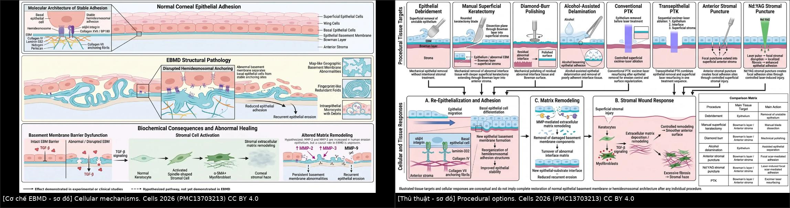
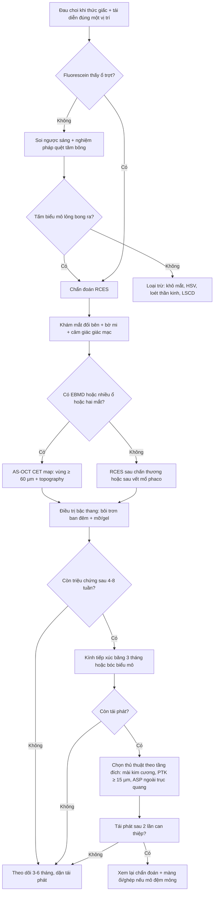
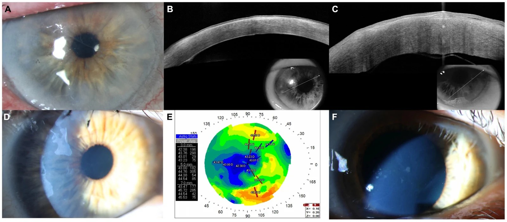
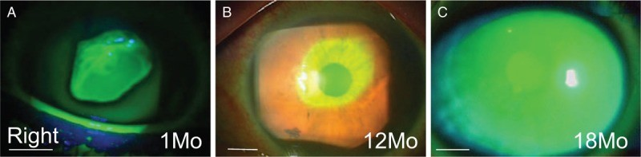
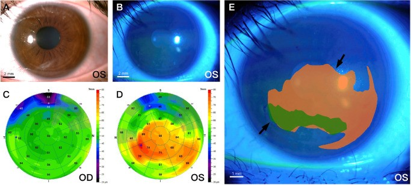
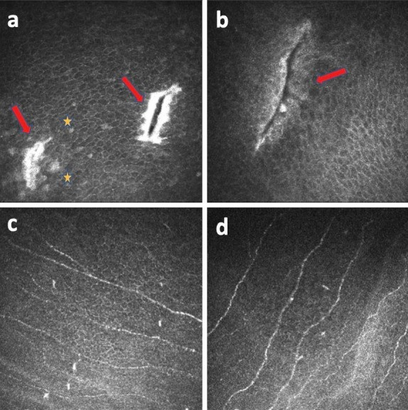

# 3261 — Bong biểu mô giác mạc tái diễn / Recurrent corneal erosion syndrome (RCES)

**Tags:** `pattern:bong-bieu-mo` `pattern:trot-bieu-mo-tai-dien` `pattern:manh-inhien` `pattern:duong-ban-do` `pattern:mat-mot-ben` `pattern:dau-khi-thuc-giac` `vung:mat` `vung:giac-mac` `vung:bieu-mo-giac-mac` `protocol:den-khe` `protocol:fluorescein` `protocol:AS-OCT` `protocol:CET-mapping` `protocol:IVCM` `protocol:topography` `incidentaloma:khong`

**Mức chắc chắn (certainty):** tổng hợp y văn (literature synthesis) — dựng từ một tổng quan cơ chế–điều trị 2026 về RCES trên loạn dưỡng màng đáy (PMC13703213), một nghiên cứu bắt cặp AS-OCT–fluorescein **15 bệnh nhân** (PMC13077718), một phân tích sống còn theo độ sâu PTK **70 mắt** (PMC11724826), một phân tích gộp PTK **700 mắt** (PMC10614516), một loạt **58 mắt** về nghiệm pháp quệt giác mạc (PMC9473707), một đoàn hệ toàn quốc **239.854 bệnh nhân đái tháo đường** (PMC7311018), một khảo sát yếu tố khởi phát **40 bệnh nhân** (PMC12733406) và một loạt IVCM sau chọc mô đệm trước (PMC10711589). Nhóm **không có bệnh nhân của mình**; chỗ chưa đủ chắc ghi **"chưa rõ"**. **Không ghi tên tác giả** — attribution = **tạp chí + năm + PMCID**.

> **Câu chốt:** bệnh nhân **đau như dao cắt ngay khi mở mắt buổi sáng**, chảy nước mắt, sợ ánh sáng, rồi **hết trong vài giờ** — và **lặp lại đúng vị trí đó** nhiều lần trong nhiều tháng–nhiều năm — là **trợt biểu mô tái diễn (recurrent corneal erosion syndrome, RCES)**, không phải "khô mắt". Bốn số phải nhớ: **48,2%** số mắt RCES trong một loạt 58 mắt có **thủ phạm là vết mổ phaco trong giác mạc**; **EBMD + chấn thương xước bề mặt** là hai nguyên nhân hay gặp nhất trong loạt 100 bệnh nhân; **PTK tái phát 18%** (129/700 mắt, 95% CI 13–24%) nhưng **bóc + mài đầu kim cương chỉ 4,1%** (2/49) và **ASP 29,4%** (10/34); và **bề dày biểu mô trung tâm bình thường 52–55 ± 3–4 µm**, nên **vùng ≥ 60 µm trên bản đồ CET** mới là vùng bệnh cần đốt — **diện tích đó lớn hơn vùng fluorescein trung vị 9,26 mm²**.

## 1. Tổng quan bệnh học – cơ chế hình ảnh (TẠI SAO)

### 1.1 Vì sao biểu mô bám được — và vì sao nó bong đúng ở lớp màng đáy

- **Bộ máy bám (adhesion complex)** gồm 4 tầng: **hemidesmosome** của tế bào đáy (**integrin α6β4** + **collagen XVII/BP180**) → **laminin-332** → **màng đáy biểu mô (epithelial basement membrane, EBM)** với mạng **collagen IV** → **sợi neo collagen VII** cắm vào **lớp Bowman/mô đệm trước** (PMC13703213). Mặt phẳng yếu nhất khi bị xé chính là **giữa EBM và Bowman**, nên tổn thương luôn tách ở **cùng một lớp**, không sâu hơn.
- **Trong EBMD (epithelial basement membrane dystrophy)**, EBM **dày lên và xếp nhiều lớp**, ăn lấn **vào trong biểu mô**; xuất hiện **vi nang trong biểu mô** và tế bào đáy **nằm trên một màng đáy dị dạng**, chân hemidesmosome **mất neo** (PMC13703213). Đây là lý do **hình ảnh** có 3 dạng kinh điển: **mảng bản đồ (map)** do **lá màng đáy rộng dưới biểu mô**, **vân tay (fingerprint)** do **nếp gấp màng đáy song song**, **chấm (dot)** do **vi nang**.
- **Vì sao EBMD lại "ẩn" trên đèn khe:** các lá màng đáy chỉ dày **vài µm**, **trong suốt**, chiết suất gần bằng biểu mô; chúng **không cản quang, không bắt fluorescein**. Vì vậy **fluorescein âm** là chuyện thường — nhiều mắt EBMD chỉ lộ ra khi **soi ngược sáng (retroillumination)**, khi **quệt ẩm**, hoặc khi **AS-OCT** đo bề dày biểu mô.
- **Vì sao đau đúng lúc thức giấc:** khi nhắm mắt, **trao đổi nước mắt giảm**, biểu mô **ngậm nước nhẹ**, lực bám **yếu nhất**; ban đêm **mi mắt trượt** (kể cả pha chuyển động mắt nhanh) và **mi trên dính vào biểu mô**; lúc mở mắt, **lực kéo cơ học** bóc cả **tấm biểu mô** ra khỏi EBM → **đau chói tức thì, chảy nước mắt, sợ ánh sáng**, rồi **tái biểu mô hóa nhanh trong vài giờ** (PMC12733406). Triệu chứng **nặng hơn khi mệt và khi lớn tuổi** trong khảo sát 40 bệnh nhân.
- **Vì sao tái phát đúng chỗ:** sau chấn thương xước hoặc sau phẫu thuật, **EBM + hemidesmosome + sợi neo** phải **tái lập trong nhiều tuần đến nhiều tháng**; vùng tổn thương giữ **"điểm yếu" vĩnh viễn** nếu màng mới **không hoàn chỉnh** (PMC13703213). Vì thế RCES sau xước móng tay có thể **tái phát 12 tháng sau** đúng vị trí cũ và **cùng kích thước, cùng hình dạng** (Hình ca 4 dưới đây).

### 1.2 Vì sao "không thấy gì" mà vẫn có bệnh — và số liệu định lượng cốt lõi

- **Trợt "ẩn" (occult erosion):** tấm biểu mô bong **còn dính một phần**, **nhô lên khỏi màng phim nước mắt** nên **không giữ fluorescein** — gọi là **"negative staining"**. Trong loạt **58 mắt**, **nghiệm pháp quệt giác mạc (corneal sweep test, CST)** — quệt đầu tăm bông ẩm lên bề mặt để **bóc tấm biểu mô lỏng** — **cần thiết ở 49/58 mắt (84,5%)**, và phát hiện **34 mắt trợt ẩn** có giác mạc **trông bình thường** (PMC9473707). Đây là **mẹo khám quyết định**: nghi RCES mà fluorescein âm → **quệt bằng tăm bông**, không kết luận "giác mạc bình thường".
- **Vết mổ phaco là "điểm yếu" bị bỏ quên:** cũng trong loạt 58 mắt, **phaco trong giác mạc (clear corneal cataract surgery)** là cơ chế **hay gặp nhất: 28 mắt (48,2%)**; **20 mắt (71,4%)** chỉ **có triệu chứng sau mổ**, và **cả 20 mắt đều trợt đúng trên vết mổ trong giác mạc** (PMC9473707). Vì vậy **hỏi tiền sử mổ phaco** là câu hỏi bắt buộc ở mọi "đau mắt buổi sáng" — kể cả khi mổ đã **nhiều năm**.
- **EBMD là bệnh nền, không phải biến chứng:** trong loạt **100 bệnh nhân RCES**, **chấn thương xước bề mặt** và **EBMD** là **hai nguyên nhân xác định được hay gặp nhất** (PMC13703213). EBMD có thể **hoàn toàn không triệu chứng**, chỉ **mờ thị lực dao động** — hoặc là **"bệ phóng"** cho trợt tái diễn.
- **Đái tháo đường làm tăng nguy cơ:** đoàn hệ toàn quốc Đài Loan **239.854 người ĐTĐ** so với **239.854 người ghép cặp**: tỷ lệ mới mắc RCES **5,87 vs 4,23/10.000 người-năm**, **aHR 1,35 (95% CI 1,24–1,48)** sau hiệu chỉnh tăng huyết áp, rối loạn lipid, bệnh thận mạn và khô mắt (PMC7311018). Con số **4,23/10.000 người-năm** là **ước lượng nền** tốt nhất về gánh nặng cộng đồng của bệnh.
- **Yếu tố khởi phát trong ngày trước cơn:** khảo sát **40 bệnh nhân** — **mệt nhiều 32,5%**, **uống rượu 30%**, **chấn thương 30%**, **hút thuốc 20%**, **vận động mạnh 5%**; triệu chứng **nặng hơn ở người lớn tuổi và khi mệt** (PMC12733406). Cơ chế hợp lý: rượu–mệt → **giảm chớp, giảm tiết nước mắt, tăng ngậm nước biểu mô ban đêm** → lực bám tụt.
- **Vì sao AS-OCT "nhìn thấy" bệnh:** tín hiệu OCT sinh ra từ **chênh chiết suất**. **Màng đáy dày/xơ hóa** và **biểu mô lỏng, phù** tạo **dải tăng hồi âm dưới biểu mô** và **bề mặt không đều**. Trong **18 bệnh nhân** được chụp AS-OCT: **tăng hồi âm mô đệm trước 94,4%**, **phù biểu mô 61,1%**, **bề mặt biểu mô vỡ vụn không đều 50,0%**, **nang trong biểu mô 44,4%**, **màng đáy trong biểu mô 33,3%**, **không xác định được màng đáy 11,1%**; **mờ thị lực và giảm thị lực gắn với việc MẤT hình ảnh màng đáy** trên OCT (PMC12733406).
- **Ngưỡng bề dày biểu mô:** bề dày biểu mô trung tâm bình thường **52–55 ± 3–4 µm**; lấy **≥ 60 µm** (tăng ~10%, tương đương **1,5–2 SD**) làm **ngưỡng "vùng bệnh"** trên bản đồ bề dày biểu mô giác mạc (corneal epithelial thickness, CET) — máy Optovue tô **vàng** đúng vùng này (PMC13077718). Bản đồ quét **đường kính 9 mm**, phân giải **5 µm chiều sâu / 15 µm ngang**.

## 2. Mẫu hình + chẩn đoán phân biệt theo vị trí (gamut)

**Mẫu hình chính:** *trợt biểu mô khu trú, bờ rõ, tái diễn đúng một vùng + đau khi thức giấc + fluorescein có thể ÂM.*

- **Trung tâm / cạnh trung tâm (2–5 mm):** EBMD, di chứng xước móng tay/giấy, sau LASIK/PRK, **loét do kính tiếp xúc**, **loét thần kinh dưỡng**, **viêm giác mạc HSV** (dendrite), **loét nhiễm khuẩn/nấm**.
- **1/3 dưới – cạnh dưới:** chấn thương do dị vật, **hở mi/lagophthalmos**, **bệnh mi–lông mi** (lông xiêu, nối mi), **trợt do ĐTĐ**, **khô mắt nặng**.
- **Trên vết mổ trong giác mạc (sau phaco):** **trợt trên vết mổ** — vị trí **thẳng trên đường rạch**, xuất hiện **nhiều tuần–nhiều năm sau mổ** (PMC9473707).
- **Rìa / chu biên:** **thiếu hụt tế bào gốc rìa (LSCD)**, **pterygium**, **loét rìa** — trợt lan từ rìa vào, có **tân mạch + mờ đục**, không "tái diễn đúng một điểm".
- **Toàn bộ bề mặt / nhiều ổ:** **bỏng hóa chất**, **hội chứng Stevens–Johnson**, **bệnh mắt khô miễn dịch**, **nhiễm trùng lan** — không phải RCES.

## 3. Bảng so sánh phân biệt (ma trận đối chiếu)

| Thực thể (entity) | Hình ảnh điển hình | Chốt vào (rule-in) | Chốt loại (rule-out) | Gợi ý xác nhận |
|---|---|---|---|---|
| **RCES trên EBMD** | **Đường bản đồ/chấm/vân tay** trong biểu mô, **hai mắt**, soi ngược sáng rõ; AS-OCT: **màng đáy dày tăng hồi âm dưới biểu mô**, bề mặt không đều, **CET ≥ 60 µm** từng vùng | **Tái phát nhiều đợt ở NHIỀU vị trí hoặc hai mắt** + đường bản đồ ở **mắt đối bên** + không có chấn thương rõ | **Một ổ duy nhất đúng vết xước cũ**, không có đường bản đồ → loại EBMD | Đèn khe + soi ngược sáng; **AS-OCT CET map**; khám **mắt đối bên** |
| **RCES sau chấn thương xước** | **Một ổ khu trú**, đúng vị trí xước, **cùng kích thước/hình dạng** mỗi lần tái phát; mô đệm dưới có thể **tăng hồi âm khu trú** | **Tiền sử xước móng tay/giấy/dị vật** + tái phát **đúng một chỗ** + mắt đối bên bình thường | **Tổn thương lan rộng, nhiều ổ, hai mắt** → loại | Hỏi kỹ chấn thương; **quệt tăm bông** tìm tấm biểu mô lỏng |
| **RCES trên vết mổ phaco** | Trợt **thẳng trên đường rạch giác mạc trong**, thường **1/3 dưới – cạnh dưới**; vết mổ **mờ nhẹ** | **Tiền sử phaco (kể cả nhiều năm)** + ổ trợt **đúng vết mổ** + đau buổi sáng | **Không có tiền sử mổ** → loại | Đèn khe tìm **vết mổ trong giác mạc**; AS-OCT **vùng mô đệm trước tăng hồi âm** |
| **Loét nhiễm trùng (vi khuẩn/nấm/Acanthamoeba)** | **Thâm nhiễm mô đệm** dưới ổ loét, bờ **không đều**, **mủ tiền phòng** có thể; mờ đục **lan** | **Đau liên tục tăng dần**, **không tự hết trong ngày**, **thâm nhiễm + phản ứng tiền phòng** | **Trợt sạch, hết trong vài giờ, tái diễn đúng chỗ, không thâm nhiễm** → loại | **Cạo/ cấy giác mạc trước khi dùng corticoid**; soi tươi/KOH; IVCM |
| **Loét thần kinh dưỡng (NK)** | Khuyết biểu mô **bờ cuộn, khô**, mô đệm **mờ**, **không đau** | **Giảm cảm giác giác mạc**, tiền sử HSV/VZV/phẫu thuật/mắt khô nặng | **Đau dữ dội từng cơn khi thức giấc + cảm giác bình thường** → loại | **Esthesiometry** (cotton wisp/esthesiometer); IVCM **mật độ sợi thần kinh dưới đáy** |
| **Khô mắt / viêm giác mạc chấm nông (SPK)** | **Nhiều chấm nhuộm fluorescein** rải rác **1/3 dưới**, hai mắt, đối xứng; **TBUT ngắn** | **Khô hai mắt, SPK rải rác**, không có **một ổ khu trú tái diễn** | **Một ổ khu trú, đúng vị trí, một bên** → loại (nhưng có thể **phối hợp**) | TBUT, Schirmer, nghiệm pháp nhuộm; hỏi thuốc/khô miệng |
| **Viêm giác mạc HSV** | **Nhánh (dendrite)** hoặc **loét địa đồ (geographic)**, đầu tận cùng phình; **giảm cảm giác** | **Dendrite bờ nhuộm fluorescein rõ** + tiền sử tái phát HSV | **Không có nhánh, trợt bờ tròn đúng điểm xước** → loại | Nhuộm fluorescein; **PCR dịch ổ loét** nếu nghi; **không dùng corticoid đơn thuần** |
| **Thiếu hụt tế bào gốc rìa (LSCD)** | **Tân mạch + mờ đục từ rìa lan vào**, biểu mô **không đều**, **chấm nhuộm rìa** | **Tổn thương bắt đầu từ rìa**, tiền sử bỏng/ghép/kính tiếp xúc dài | **Trợt trung tâm, rìa bình thường** → loại | Soi rìa 360°, **IVCM rìa**, xét nghiệm LSCD |
| **Bong biểu mô do bọng nước / sau mổ khúc xạ** | **Màng biểu mô nhăn, trượt** khi mi chớp, **vùng đảo** sau LASIK; **AS-OCT** thấy **mặt cắt vạt** | **Tiền sử LASIK/PRK/RK** + **trợt trong vùng vạt**, khởi phát vài tuần–vài tháng sau mổ | **Không tiền sử mổ khúc xạ** → loại | AS-OCT vết vạt; hỏi mổ khúc xạ **kể cả 10–20 năm trước** |

- Ảnh ghép đối chiếu — **cơ chế (trên) và lựa chọn thủ thuật (dưới)** dùng để chọn đúng "tầng đích": bóc/delamination chỉ chạm EBM, còn **mài đầu kim cương/PTK chạm Bowman + mô đệm trước**, và **chọc mô đệm trước tạo sẹo neo khu trú**:

- Ảnh: trên — **bộ máy bám bình thường vs màng đáy nhiều lớp + mất neo hemidesmosome**; dưới — **tầng đích của từng thủ thuật** (bóc biểu mô/alcohol delamination giữ Bowman; mài kim cương/PTK phá Bowman + mô đệm trước; chọc mô đệm tạo sẹo xơ). Nguồn *Cells* 2026 (PMC13703213), **CC BY 4.0**, nguyên bản, ghép bằng `tools/make_composite.py`.

## 4. Protocol khám/chụp + ngưỡng xử trí

**Bước 1 — hỏi bệnh (quyết định hơn mọi máy):** đau **ngay khi thức giấc**? **hết trong ngày**? **tái diễn đúng một chỗ**? tiền sử **xước móng tay/giấy/dị vật**, **phaco**, **LASIK/PRK**, **ĐTĐ**, **HSV**, **kính tiếp xúc**, **nối mi/lông xiêu**, **mệt/rượu** trước cơn.

**Bước 2 — khám đèn khe theo trình tự cố định:**
1. **Fluorescein + ánh sáng cobalt**: tìm **ổ trợt khu trú** và **"negative staining"** (tấm biểu mô nhô, không giữ thuốc).
2. **Soi ngược sáng (retroillumination)** và **khe sáng hẹp quét bề mặt**: tìm **đường bản đồ/chấm/vân tay**, **nếp biểu mô**.
3. **Nghiệm pháp quệt giác mạc (CST)**: tăm bông ẩm quệt **nhẹ** từ trung tâm ra ngoài ở vùng nghi — **tấm biểu mô lỏng bong ra** = dương tính; làm **sau** khi đã chụp ảnh/đo để không phá tổn thương.
4. **Khám mắt đối bên** (EBMD thường hai bên), **bờ mi, lông xiêu, đóng mi không kín**, **TBUT/Schirmer**, **cảm giác giác mạc** (loại loét thần kinh dưỡng).
5. **Đo thị lực + khúc xạ**: EBMD gây **loạn thị không đều, thị lực dao động**.

**Bước 3 — chẩn đoán hình ảnh (khi cần định lượng hoặc trước can thiệp):**

- **AS-OCT bản đồ bề dày biểu mô (CET map, 9 mm):** tìm **vùng ≥ 60 µm** (nền **52–55 ± 3–4 µm**), **dải tăng hồi âm dưới biểu mô**, **bề mặt không đều**, **nang trong biểu mô**. Đây là **công cụ duy nhất đo được "vùng bệnh" rộng hơn vùng fluorescein**: trong 15 bệnh nhân, diện tích theo CET **lớn hơn** fluorescein **trung vị 9,26 mm² (95% CI 5,87–14,42)**, hệ số góc hồi quy **1,631** — dùng để **lập kế hoạch vùng đốt PTK** và **tránh đốt thiếu** (PMC13077718).
- **IVCM (soi đồng tiêu in vivo):** thấy **mật độ/độ phản xạ sợi thần kinh dưới đáy**, **tế bào tua**, **sẹo sau chọc mô đệm**; hữu ích khi **nghi loét thần kinh dưỡng** hoặc **theo dõi lành thương** (PMC10711589).
- **Bản đồ giác mạc (topography):** **loạn thị không đều** do EBMD; bắt buộc **trước khi tính công suất IOL** — EBMD làm **sai số IOL** và **mờ sau mổ**.
- **Không cần CT/MRI.** Siêu âm chỉ dùng khi **không đánh giá được bề mặt** (mủ, phù nặng).

**Bảng ngưỡng xử trí (theo bậc thang, dựa trên bằng chứng hiện có):**

| Bậc | Can thiệp | Ngưỡng/kết quả định lượng |
|---|---|---|
| 1 | **Dầu bôi trơn không chất bảo quản + mỡ/gel ban đêm**, **dung dịch muối 5%** | **5% NaCl mỡ 2 lần/ngày × 30 ngày**: **21/21 mắt** tái biểu mô hóa và hết triệu chứng trong một nghiên cứu **không đối chứng** (PMC13703213) |
| 2 | **Kính tiếp xúc băng (bandage contact lens) 3 tháng** | RCT **29 bệnh nhân**: lành hoàn toàn **71% (BCL) vs 73% (chỉ bôi trơn)** ở 3 tháng, nhưng **triệu chứng hết sớm hơn** ở nhóm BCL (trung bình **5 ngày**) |
| 3 | **Bóc biểu mô (debridement)**, **alcohol delamination** | Tái phát **4,1% (2/49)** trong loạt **bóc + mài đầu kim cương 91 mắt**; **mờ nhẹ tồn tại 14,3% (7/49)** |
| 4 | **Mài đầu kim cương (diamond burr)** hoặc **PTK** | **PTK: tái phát 18% (129/700; 13–24%)** — **chấn thương 17% (9–24)**, **loạn dưỡng 22% (11–32)**; biến chứng **13%** (mờ dưới biểu mô, lệch khúc xạ xa, giảm thị lực có chỉnh) (PMC10614516) |
| 4b | **Độ sâu PTK** | **≥ 15 µm** (trung bình **16,85 ± 3,4 µm**): **17/20 mắt (85%)** không tái phát, sống không triệu chứng **28,1 ± 2,1 tháng**; **< 15 µm** (trung bình **9,26 ± 1,5 µm**) kém hơn rõ (**p = 0,036**) (PMC11724826) |
| 5 | **Chọc mô đệm trước (anterior stromal puncture, ASP)** | **29,4% (10/34)** tái phát — **chỉ đặt NGOÀI trục quang**, tránh **vùng trung tâm 3 mm**; tạo **sẹo xơ neo** tại chỗ |
| 6 | **Ghép màng ối (amnion)** / **ghép giác mạc** | Khi **trợt không lành > 2–4 tuần**, **mô đệm mỏng**, **nguy cơ thủng**, hoặc **EBMD lan tỏa gây mờ trục quang** |

**So sánh 3 thủ thuật hay được chọn (từ bảng tổng hợp của PMC13703213):** **ASP 29,4% (10/34)**, **mài kim cương 9,1% (3/33)**, **PTK 10,0% (3/30)** tái phát — **không có thử nghiệm ngẫu nhiên** so sánh trực tiếp; **thời gian theo dõi trung vị** khác nhau (ASP **189 ngày**, mài **64 ngày**, PTK **542 ngày**), nên **không đọc bảng này như "xếp hạng"**.

## 5. Biến thể bình thường và cạm bẫy

- **"Fluorescein âm = không bệnh"** — sai. **Trợt ẩn** gặp ở **34/58 mắt** trong loạt có CST; tấm biểu mô lỏng **không giữ thuốc**. Nghi lâm sàng → **quệt tăm bông**, **soi ngược sáng**, **AS-OCT**.
- **Đường bản đồ bị đọc thành "khô mắt"** — EBMD **không đau**, **không nhuộm**, lại **hay hai bên**; nếu chỉ điều trị khô mắt thì **trợt vẫn tái phát**. Luôn **soi ngược sáng** và **khám mắt đối bên**.
- **Bỏ sót vết mổ phaco** — 20/20 mắt trong loạt CST **trợt đúng vết mổ trong giác mạc**, có khi **nhiều năm sau mổ**; không hỏi tiền sử là **bỏ chẩn đoán**.
- **Bóc biểu mô quá tay** — bóc rộng, **chà mạnh** làm mất **EBM còn lại**, tăng **mờ dưới biểu mô** (**14,3%** trong loạt bóc + mài kim cương) và **loạn thị**. Chỉ bóc **vùng biểu mô lỏng**, không "đánh bóng" toàn bộ.
- **Đo bề dày biểu mô khi đang phù** — **61,1%** mắt RCES có **phù biểu mô**: số đo **dày giả**, dễ đốt quá sâu. Đo lại khi **hết phù**, và **≥ 60 µm chỉ là ngưỡng gợi ý**, không phải chẩn đoán.
- **Nhầm với loét thần kinh dưỡng** — bệnh nhân **không đau**, bờ loét **cuộn**, **giảm cảm giác**: điều trị **ngược hẳn** (bảo vệ, cenegermin, tránh bóc lặp). **Bắt buộc khám cảm giác** trước khi leo thang thủ thuật.
- **Chẩn đoán "viêm giác mạc do kính tiếp xúc"** khi thực ra **RCES** — kính là **yếu tố làm nặng**, không phải nguyên nhân; cần **ngừng kính + đánh giá EBM**.
- **Đái tháo đường** làm tăng nguy cơ **1,35 lần**: kiểm soát đường huyết và **khám mắt định kỳ** là một phần điều trị.
- **Bẫy "thỏa mãn tìm kiếm"**: thấy ổ trợt là dừng → bỏ sót **EBMD mắt đối bên**, **hở mi**, **lông xiêu**, **loét nhiễm trùng bên dưới** (thâm nhiễm mô đệm!). Luôn **lật mi, khám bờ mi, nhuộm lại sau khi bóc**.
- **Đừng hứa "khỏi hẳn"**: RCES là bệnh **tái phát nhiều năm**, **không có mốc "khỏi"**; tư vấn đúng giúp bệnh nhân **chấp nhận theo dõi** thay vì chạy nhiều nơi.

## 6. Tự lượng giá — Blind Quiz ngay trên trang tĩnh

**Ca 1 — nam 42 tuổi, đau chói mắt phải mỗi sáng, 3 tháng nay**

- **Bối cảnh:** đau **ngay khi mở mắt**, chảy nước mắt, **hết sau 1–2 giờ**; **không chấn thương**, **không đeo kính**; khám thấy **vài đường mảnh cong** trên giác mạc, **fluorescein âm**.
- **Câu hỏi:** (1) Mô tả **ba dạng hình thái** trên ảnh và **cơ chế** của từng dạng? (2) Hai chẩn đoán phân biệt? (3) Vì sao **fluorescein âm** mà vẫn có bệnh?

<b>Bấm để hiện đáp án (findings + chẩn đoán)</b>

- **Dấu hiệu:** (A) **vân tay** — đường mảnh, cong, song song; (D) **mảng bản đồ** — đám mờ bờ không đều; (B, C) **AS-OCT** — **dải tăng hồi âm dưới biểu mô**, **biểu mô dày không đều**, bề mặt gồ ghề; (E) **topography** — loạn thị không đều.
- **Chẩn đoán:** **loạn dưỡng màng đáy biểu mô (EBMD)** — màng đáy **nhiều lớp** tạo **mảng/vân**, **vi nang** tạo **chấm**; **fluorescein âm** vì màng đáy **trong suốt, không bắt thuốc** và biểu mô **chưa bong** ở lần khám này.
- **Phân biệt:** **khô mắt thể chấm nông** (nhiều chấm rải rác, hai mắt) và **loét thần kinh dưỡng** (giảm cảm giác, không đau).
- **Xử trí:** **mỡ/gel ban đêm + dầu bôi trơn không bảo quản**; nếu tái phát nhiều → **AS-OCT CET map**, cân nhắc **PTK ≥ 15 µm** hoặc **mài kim cương**.
- **Nguồn ảnh:** *Cells* 2026, Fig. 1, **PMC13703213**, **CC BY 4.0**, nguyên bản.

**Ca 2 — nam 56 tuổi, tái phát đúng một chỗ sau xước móng tay**

- **Bối cảnh:** **xước móng tay** vào giác mạc; **1 tháng** sau còn **ổ trợt trung tâm**; **12 tháng** sau **tái phát đúng vị trí, cùng kích thước**; sau đó đeo **kính tiếp xúc băng** + bôi trơn.
- **Câu hỏi:** (1) Vì sao tái phát **đúng cùng vị trí và cùng hình dạng**? (2) Hai yếu tố làm **nặng thêm** tình trạng này? (3) Kết cục trên ảnh C nói lên điều gì về **thời gian điều trị**?

<b>Bấm để hiện đáp án (findings + chẩn đoán)</b>

- **Dấu hiệu:** (A) ổ trợt **trung tâm, bờ rõ** sau chấn thương; (B) **12 tháng sau**, ổ trợt **cùng vị trí, cùng dạng**; (C) **sau 12 tháng theo dõi** — giác mạc **liền, không tái phát**.
- **Chẩn đoán:** **RCES sau chấn thương xước** — vùng **EBM + sợi neo chưa tái lập hoàn chỉnh** nên mỗi lần mi mắt kéo ban đêm lại bóc đúng "điểm yếu" đó.
- **Yếu tố làm nặng:** **khô mắt/giảm chớp ban đêm**, **hở mi**, **mệt/rượu**, **ĐTĐ** (aHR **1,35**).
- **Kết cục:** cần **theo dõi ≥ 12 tháng**; "hết triệu chứng" **không đồng nghĩa "hết bệnh**".
- **Nguồn ảnh:** *Medicine (Baltimore)* 2019, Fig. 4, **PMC6494251**, **CC BY-NC-ND 4.0**, nguyên bản.

**Ca 3 — nữ 19 tuổi, đã bóc biểu mô 2 lần ở tuyến trước, vẫn đau buổi sáng**

- **Bối cảnh:** **3 tháng** đau–chảy nước mắt buổi sáng; **đã bóc biểu mô 2 lần**, không đỡ; nay **AS-OCT bản đồ bề dày biểu mô (CET)** cùng ngày với **fluorescein**.
- **Câu hỏi:** (1) Vì sao **bóc biểu mô 2 lần vẫn tái phát**? (2) Bản đồ CET cho thêm thông tin gì so với **fluorescein**? (3) Ngưỡng **60 µm** dựa trên cơ sở nào?

<b>Bấm để hiện đáp án (findings + chẩn đoán)</b>

- **Dấu hiệu:** (A) ảnh ngoài **bề mặt không đều**; (B) fluorescein **vùng nhuộm nhỏ**; (C) mắt lành — **bề dày đều**; (D) mắt bệnh — **vùng vàng ≥ 60 µm lan rộng**; (E) **vùng CET (cam) lớn hơn vùng fluorescein (xanh)**.
- **Chẩn đoán:** **RCES** với **tổn thương EBM lan rộng hơn vùng nhuộm** — bóc biểu mô **chỉ lấy tấm lỏng**, không **tái tạo EBM**, nên tái phát; cần **xử lý "interface"** (PTK/mài kim cương).
- **Ý nghĩa CET:** diện tích tổn thương **lớn hơn fluorescein trung vị 9,26 mm² (95% CI 5,87–14,42)** → **lập kế hoạch vùng đốt** chính xác hơn.
- **Ngưỡng 60 µm:** nền **52–55 ± 3–4 µm**, cộng **~10% / 1,5–2 SD** — **không phải** chẩn đoán tuyệt đối, phải đọc cùng lâm sàng.
- **Nguồn ảnh:** *Transl Vis Sci Technol* 2026, Fig. 2, **PMC13077718**, **CC BY-NC-ND 4.0**, nguyên bản.

**Ảnh minh họa thêm — IVCM ngay sau chọc mô đệm trước**

- Ảnh: (a, b) **đường vào kim** xuyên mô đệm trước, bờ **tăng phản xạ** kèm **vi chấm sáng**; (c, d) **giảm phản xạ, giảm phân nhánh và mảnh hóa sợi thần kinh** dưới đáy. Đây là **cơ sở hình ảnh** của ASP: **sẹo xơ khu trú** neo biểu mô, nhưng **sợi thần kinh bị tổn thương tại chỗ** — lý do **không chọc vào trục quang**. Nguồn *Biomed Eng Lett* 2023 (PMC10711589), **CC BY-NC 4.0**, nguyên bản.

## 7. Câu hỏi nghiên cứu & điểm chưa đồng thuận (tính đến 11/2026)

1. **[Tranh cãi] Ở bệnh nhân RCES do EBMD, thủ thuật nào là lựa chọn đầu tay: PTK, mài đầu kim cương hay chọc mô đệm trước?**
   - **Đã biết:** phân tích gộp PTK **700 mắt** cho tái phát **18% (13–24%)**, cao hơn ở nhóm loạn dưỡng (**22%** so với **17%** sau chấn thương) (PMC10614516); bảng tổng hợp so sánh gián tiếp cho **ASP 29,4%**, mài kim cương **9,1%**, PTK **10,0%**, nhưng **thời gian theo dõi khác nhau** (189 vs 64 vs 542 ngày) (PMC13703213).
   - **Chưa rõ:** **không có RCT** so sánh trực tiếp ba thủ thuật ở **cùng quần thể EBMD**, cùng định nghĩa tái phát và cùng thời điểm đo.
   - **Hướng nghiên cứu:** RCT đa trung tâm với **outcome sống không tái phát** và **mờ dưới biểu mô**; tối thiểu **12 tháng** theo dõi.
   - **Nguồn:** PMC10614516 (2023); PMC13703213 (2026).

2. **[Khoảng trống] Độ sâu đốt PTK tối ưu cho RCES trên EBMD là bao nhiêu?**
   - **Đã biết:** đốt **≥ 15 µm** (trung bình **16,85 ± 3,4 µm**) cho **85% (17/20)** không tái phát, sống không triệu chứng **28,1 ± 2,1 tháng**, tốt hơn **< 15 µm** (trung bình **9,26 ± 1,5 µm**; **p = 0,036**) (PMC11724826).
   - **Chưa rõ:** tổng quan 2026 kết luận **"chưa có độ sâu đốt đặc hiệu cho EBMD"**; **đánh đổi** giữa **đủ sâu để tái tạo interface** và **lệch khúc xạ xa/mờ** chưa được định lượng.
   - **Hướng nghiên cứu:** nghiên cứu **liều–đáp ứng** theo độ sâu, phân tầng **vị trí trục quang vs ngoại vi**, có **topography trước–sau**.
   - **Nguồn:** PMC11724826 (2025); PMC13703213 (2026).

3. **[Khác biệt thực hành] Có nên dùng bản đồ bề dày biểu mô AS-OCT để quyết định vùng đốt ở mọi ca RCES?**
   - **Đã biết:** CET **≥ 60 µm** phát hiện vùng tổn thương **lớn hơn fluorescein trung vị 9,26 mm² (95% CI 5,87–14,42)** trên **15 bệnh nhân**; 9 bệnh nhân được PTK theo bản đồ, **không ca nào tái phát** trong thời gian theo dõi ngắn (PMC13077718).
   - **Chưa rõ:** chưa có **khuyến cáo nào** đưa CET thành tiêu chuẩn; **ngưỡng 60 µm** là **quy ước thực hành** dựa trên nền **52–55 µm**, chưa được xác nhận ở **máy khác** và **quần thể lớn**.
   - **Hướng nghiên cứu:** nghiên cứu **độ chính xác chẩn đoán** đa trung tâm, so **CET-guided PTK vs fluorescein-guided PTK**, outcome **tái phát 12 tháng**.
   - **Nguồn:** PMC13077718 (2026); PMC12733406 (2025).

## Bài liên quan chéo
- [3255 – Loét giác mạc hình khiên trong VKC](../3255-vkc-loet-giac-mac-hinh-khien/lesson.md) — **cùng cơ chế "tổn thương cơ học bề mặt"**, nhưng **loét do nhú gai cọ xát**, không phải **khiếm khuyết bám của EBM**; xử trí khác (bóc mảng + màng ối).
- [3204 – Loét giác mạc do thần kinh dưỡng](../3204-loet-giac-mac-than-kinh/lesson.md) — **chẩn đoán phân biệt bắt buộc**: **không đau**, **giảm cảm giác**, bờ loét cuộn; điều trị **ngược hẳn** RCES.
- [3205 – Loét giác mạc do lạm dụng thuốc tê & độc tính BAK](../3205-loet-giac-mac-do-thuoc-te-bak/lesson.md) — **trợt không lành** ở người **đau mạn**: hỏi kỹ **thuốc nhỏ** trước khi quy cho RCES.
- [3203 – Đe dọa thủng & thủng giác mạc](../3203-de-doa-thung-giac-mac/lesson.md) — khi **trợt tái diễn + mô đệm mỏng** tiến tới **descemetocele/thủng**: chọn keo, màng ối hay ghép.
- [6132 – Viêm giác mạc do kính tiếp xúc](../6132-viem-giac-mac-kinh-tiep-xuc/lesson.md) — **kính tiếp xúc** vừa là **yếu tố nguy cơ**, vừa là **điều trị (băng)**; phân biệt **nhiễm trùng** vs **trợt cơ học**.

## Ảnh
- `images/3261_rce_EBMD_SlitLamp-ASOCT_PMC13703213-Fig1.jpg` — EBMD đa phương thức (đèn khe + AS-OCT + topography), **CC BY 4.0**.
- `images/composite_3261_co-che-va-thu-thuat.jpg` — sơ đồ cơ chế + tầng đích của thủ thuật, **CC BY 4.0** (ghép).
- `images/3261_rce_ASOCT-CET_PMC13077718-Fig2.jpg` — bản đồ bề dày biểu mô vs fluorescein, **CC BY-NC-ND 4.0** (nguyên bản).
- `images/3261_rce_SlitLamp_PMC6494251-Fig4.jpg` — RCES sau xước móng tay, 3 thời điểm, **CC BY-NC-ND 4.0** (nguyên bản).
- `images/3261_rce_IVCM-ASP_PMC10711589-Fig2.jpg` — IVCM sau chọc mô đệm trước, **CC BY-NC 4.0** (nguyên bản).
- Chi tiết nguồn/giấy phép từng ảnh: `images/CREDITS.md`.

> Không dùng để chẩn đoán độc lập khi chưa có người hướng dẫn.
