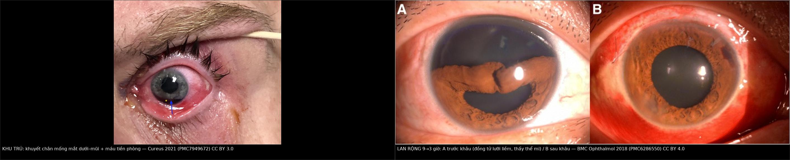
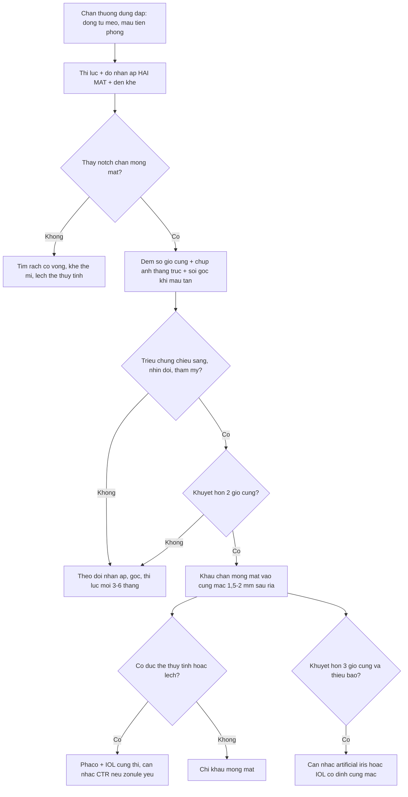
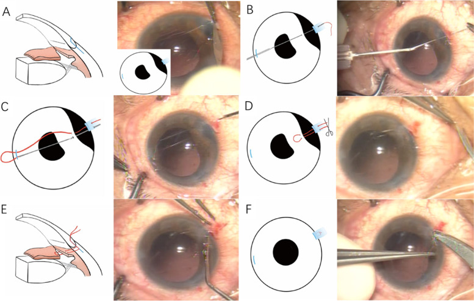
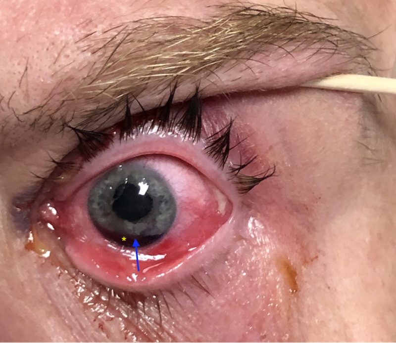
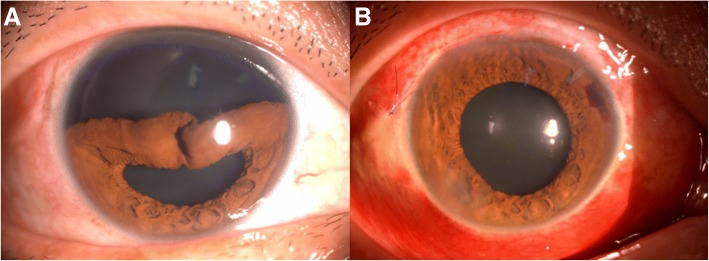
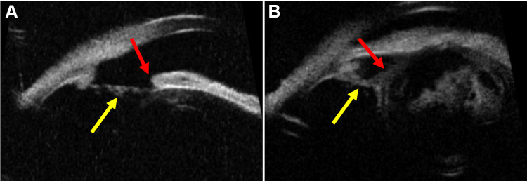

# 3262 — Rách chân mống mắt do chấn thương (iridodialysis): khi nào khâu, khâu kiểu nào / Traumatic iridodialysis

**Tags:** `pattern:khuyet-chan-mong-mat` `pattern:dong-tu-hinh-D` `pattern:notch-dong-tu` `pattern:mat-mot-ben` `pattern:chan-thuong-dung-dap` `pattern:goc-mo-thong` `vung:mat` `vung:the-mi` `vung:goc-tien-phong` `vung:cung-mac` `protocol:den-khe` `protocol:soi-goc` `protocol:AS-OCT` `protocol:UBM-35-50MHz` `protocol:khau-chan-mong-mat` `protocol:phaco` `score:clock-hours`

**Mức chắc chắn (certainty):** tổng hợp y văn (literature synthesis) — dựng từ **1 tổng quan kỹ thuật không nút** (PMC13674913), **2 nghiên cứu hồi cứu có so sánh** (67 mắt, PMC6286550; 51 mắt, PMC9011996), **1 nghiên cứu UBM 143 mắt chấn thương** (PMC8357616), **1 tổng quan tái tạo mống mắt** (PMC11084487) và **1 ca lâm sàng** (PMC7949672). Không có RCT cho iridodialysis; mọi ngưỡng can thiệp đều là **thực hành đồng thuận từ loạt ca**, chỗ suy luận được ghi rõ.

> **Câu chốt:** Rách chân mống mắt là **mống mắt tách khỏi thể mi/củng mạc**, nên **khâu bờ đồng tử không sửa được** — phải khâu **chân mống mắt vào thành củng mạc**. Ba con số quyết định: **(1)** gặp ở **9,3%** chấn thương đụng dập và **0,2%** người mổ đục thể thủy tinh (số liệu thứ cấp, dẫn trong PMC6286550); **(2)** ngưỡng khâu thực hành là **> 2 giờ cung** kèm triệu chứng (glare, nhìn đôi, chói) — **1 giờ cung = 30°** (PMC13674913); **(3)** sau khâu, nhãn áp **không ổn định ở 6,3–8,6%** (có góc rẽ kèm theo) và bong võng mạc **7,4–8,3%** — nên theo dõi nhãn áp và đáy mắt, không chỉ chụp "đồng tử đã tròn" (PMC6286550, PMC9011996).

## 1. Tổng quan bệnh học – cơ chế hình ảnh (TẠI SAO)

### 1.1 Giải phẫu: vì sao rách đúng ở chân mống mắt

- **Chân mống mắt (iris root)** là phần **mỏng và yếu nhất của mô đệm mống mắt** (PMC9114554) và là nơi mống mắt bám vào **thể mi phía trước**, ngay sau **gai củng mạc (scleral spur)**. Bó dọc cơ thể mi chạy từ gai củng mạc ra sau, còn mống mắt "treo" vào thể mi ở đúng mặt phẳng này.
- Vì vậy khi có lực cắt, mặt phẳng tách **tự nhiên** là **giữa chân mống mắt và thể mi** — không phải ở bờ đồng tử. Đây là điểm khác biệt cốt lõi giữa **iridodialysis** (tách chân) và **rách cơ vòng đồng tử** (sphincter tear, rách ở bờ đồng tử).

### 1.2 Vật lý chấn thương: vì sao lực dọc trục lại xé ngang

- Cú đập kín làm **nhãn cầu bị ép theo trục trước–sau trong vài mili giây**: đường kính trước–sau giảm, **xích đạo giãn ra**, rồi nhãn cầu **"bật" trở lại**. Mô mềm nhất chịu **ứng suất cắt** lớn nhất — đó là chân mống mắt.
- Kết quả: một **cung mống mắt bị bong khỏi thể mi**, phần còn dính bị kéo về phía đồng tử → **bờ tự do của mống mắt tạo một dây cung thẳng**, đồng tử mất một cung → **hình chữ D / lưỡi liềm**, có **notch** đúng vị trí khuyết. Vùng bong lộ **thể mi (sẫm màu hơn) và củng mạc (trắng)** — chính là "nền trắng" nhìn thấy trong ảnh lâm sàng.
- Vì là **vết rách hở vào góc tiền phòng**, tiền phòng **thông trực tiếp với khoang trên hắc mạc/bề mặt thể mi** — cơ sở để hiểu vì sao có thể kèm **máu tiền phòng**, **đứt zonule**, và về lâu dài **dính góc (PAS)**.

### 1.3 Vì sao triệu chứng lại là "chói và nhìn đôi một mắt"

- Khuyết chân mống mắt tạo **khẩu độ quang thứ hai** ở ngoại vi: ánh sáng đi qua vùng không có mống mắt chắn, tạo **ảnh phụ lệch trục** → **nhìn đôi một mắt (monocular diplopia)**, **chói (glare)**, **sợ ánh sáng**.
- **Khuyết ở phía trên thường không triệu chứng vì mi trên che**; **khuyết phía dưới và khuyết rộng** là chỉ định mổ chính (PMC13674913, PMC11084487). Đây là lý do **không phải mọi iridodialysis đều cần mổ**.
- Khuyết rộng còn làm **mất phần che của mống mắt trước IOL** → lóa khi nhìn đèn, và về thẩm mỹ **đồng tử méo, không đối xứng**.

### 1.4 Vì sao nhãn áp có thể thấp – bình thường – cao sau cùng một chấn thương

- **Thấp:** nếu kèm **khe thể mi (cyclodialysis cleft)** — thông tiền phòng với khoang trên hắc mạc → tăng thoát dịch, **bong hắc mạc, tiền phòng nông**. Hướng điều trị **ngược hoàn toàn** với iridodialysis (đóng khe, không phải khâu mống mắt).
- **Bình thường:** đa số trường hợp cấp; thể mi có thể **giảm tiết** sau chấn thương nên che lấp tăng trở lực thoát.
- **Cao:** khi có **góc rẽ (angle recession)** hoặc **dính góc** — trong 2 loạt khâu mống mắt, **6,3% và 8,6%** mắt (PMC6286550) cùng **7,4% và 12,5%** mắt (PMC9011996) vẫn **không ổn định nhãn áp vì góc rẽ**. Ở trẻ chấn thương kín, **8,1%** chuyển thành glôcôm, và **toàn bộ** ca glôcôm đều thuộc nhóm **chấn thương kín (15,2%)** (PMC11755633).

### 1.5 Vì sao siêu âm tần số cao (UBM) lại quan trọng

- Chân mống mắt, thể mi và **zonule** nằm **sau mống mắt**, không nhìn trực tiếp được khi **giác mạc đục, máu tiền phòng, đục thể thủy tinh**. **UBM đầu dò 50 MHz** (chế độ high-resolution và angle) nhìn được mặt phẳng góc và chân mống mắt (PMC8357616).
- Trên **143 mắt chấn thương** có môi trường mờ, UBM phát hiện **tổn thương zonule 55,2%** (rách 33,6%, giãn 21,7%), và **vị trí 3–6 giờ cung là thường gặp nhất** (rách 70,83%, giãn 96,77%) — nghĩa là **iridodialysis thường đi kèm đứt zonule**, một thông tin đổi hẳn kế hoạch mổ (PMC8357616).

## 2. Mẫu hình + chẩn đoán phân biệt theo vị trí (gamut)

- **Mẫu hình chính:** **một bên**, sau chấn thương (hoặc sau mổ nội nhãn), **đồng tử méo hình chữ D/lưỡi liềm + notch**, **thấy thể mi/củng mạc ở ngoại vi**, thường kèm **máu tiền phòng**, **đục thể thủy tinh**, **lệch thể thủy tinh**, **dịch kính tiền phòng**.
- **Theo vị trí tổn thương (gamut):**
  - **Chân mống mắt** → iridodialysis do chấn thương, do mổ (phaco/vết mổ giác mạc), bẩm sinh (coloboma điển hình vùng dưới–mũi).
  - **Bờ đồng tử** → rách cơ vòng đồng tử (sphincter tear), rách toàn bộ mống mắt ("expulsive" hiếm).
  - **Thể mi – củng mạc** → khe thể mi (cyclodialysis cleft) với **hạ nhãn áp**.
  - **Toàn bộ mống mắt** → aniridia bẩm sinh (hai bên) hoặc mất mống mắt do chấn thương nặng.
- **Theo thời điểm:**
  - **Cấp (0–7 ngày):** máu tiền phòng, viêm tiền phòng, tăng nhãn áp do máu bít bè, đục thể thủy tinh, lệch thể thủy tinh, dịch kính tiền phòng.
  - **Muộn (tuần–năm):** chói/nhìn đôi kéo dài, **dính góc và glôcôm**, phù hoàng điểm/võng mạc do viêm, co kéo dịch kính nếu có rách bao.

## 3. Bảng so sánh phân biệt (ma trận đối chiếu)

| Thực thể (entity) | Hình ảnh điển hình (đèn khe / soi góc / AS-OCT / UBM) | Chốt vào (rule-in) | Chốt loại (rule-out) | Gợi ý xác nhận |
|---|---|---|---|---|
| **Iridodialysis chấn thương** | **Notch + đồng tử hình D/lưỡi liềm**, bờ mống mắt là **dây cung thẳng**, lộ **thể mi sẫm/củng mạc trắng** ở ngoại vi; máu tiền phòng; soi góc: **chân mống mắt tách, góc mở thông ra thể mi** | **Notch đúng vị trí + bờ tự do hình dây cung + tiền sử chấn thương** | **Mống mắt liên tục tới góc**, không có notch | Đèn khe 2 mắt, soi góc 4 góc phần tư, ảnh chụp thẳng trục |
| **Đứt chân mống mắt do mổ (iatrogenic)** | Cùng hình thái notch nhưng **ngay vết mổ/rìa** sau phaco, ECCE, đặt IOL; **0,2%** người mổ đục thể thủy tinh (dẫn trong PMC6286550) | **Tiền sử mổ nội nhãn + notch sát vết mổ** | Không tiền sử mổ, notch ở vùng đối diện vết mổ | Đọc hồ sơ mổ, soi góc vùng vết mổ |
| **Rách cơ vòng đồng tử (sphincter tear)** | **Bờ đồng tử lởm chởm/răng cưa**, đồng tử **giãn không đều**, **không có notch ở chân mống mắt**, không thấy thể mi ở ngoại vi | **Rách tại bờ đồng tử + chân mống mắt còn dính** | **Chân mống mắt tách, góc thông** | Soi góc: góc bình thường; đèn khe phóng đại bờ đồng tử |
| **Khe thể mi (cyclodialysis cleft)** | **Nhãn áp thấp (thường ≤ 5–6 mmHg)**, tiền phòng nông, **bong hắc mạc**, nếp võng mạc; UBM/AS-OCT: **khe thông tiền phòng – khoang trên hắc mạc** | **Nhãn áp THẤP + bong hắc mạc + thấy khe trên UBM** | **Nhãn áp bình thường/cao**, không bong hắc mạc | UBM 50 MHz, AS-OCT; đo nhãn áp hai mắt |
| **Góc rẽ (angle recession) kèm theo** | Chân mống mắt **lùi ra sau**, **dải thể mi lộ rộng**, góc **sâu hơn mắt bên**; mống mắt **vẫn liên tục** | **Góc sâu bất thường + dải thể mi lộ** ở vùng chấn thương | **Notch + bờ tự do** (đó là iridodialysis) | Soi góc hai mắt; AS-OCT đo khoảng chân mống mắt–gai củng mạc |
| **Coloboma mống mắt bẩm sinh** | Khuyết **vùng dưới–mũi**, bờ **nhẵn, đều**, **hai bên** (thường), **không máu tiền phòng**, không tiền sử chấn thương | **Khuyết dưới–mũi + hai bên + bờ nhẵn** | **Một bên + bờ dây cung + tiền sử chấn thương** | Soi góc, ảnh gia đình, khám mắt bên kia |
| **Aniridia** | **Gần như không còn mống mắt**, hai bên, kèm **giảm sản hoàng điểm, đục thể thủy tinh, glôcôm** | **Hai bên + kèm bất thường hoàng điểm** | Một bên, còn phần lớn mống mắt | Đèn khe, OCT hoàng điểm, khám gia đình |
| **Đứt zonule/lệch thể thủy tinh kèm theo** | Thể thủy tinh **rung (phacodonesis)**, lệch trục, **khe sâu không đều**; UBM: **zonule giãn/đứt 3–6 giờ cung** | **Rung thể thủy tinh + lệch trục + UBM thấy zonule tổn thương** | Thể thủy tinh vững, không lệch | UBM 50 MHz; đánh giá khi đã giãn đồng tử |

*Ảnh ghép: bên trái — khuyết **khu trú** vùng dưới–mũi kèm máu tiền phòng (Cureus 2021, PMC7949672, CC BY 3.0); bên phải — khuyết **lan rộng 9→3 giờ**, đồng tử lưỡi liềm, lộ thể mi trắng (A trước khâu, B sau khâu; BMC Ophthalmology 2018, PMC6286550, CC BY 4.0). Tạo bằng `tools/make_composite.py` (letterbox, không crop).*

## 4. Protocol chụp/khám + hệ phân độ và kỹ thuật khâu

### 4.1 Trình tự khám – quyết định

- **Bắt buộc đo nhãn áp hai mắt** trước mọi can thiệp: nhãn áp **thấp** đổi chẩn đoán sang **khe thể mi** (điều trị ngược), nhãn áp **cao** gợi ý **máu bít bè hoặc góc rẽ**.
- **Soi góc (gonioscopy) sau khi máu tiền phòng tan**, đủ 4 góc phần tư, cả hai mắt: xác nhận chân mống mắt tách, loại trừ khe thể mi, đánh giá góc rẽ và dính góc.
- **AS-OCT tiền phòng** (không tiếp xúc) khi giác mạc còn trong: đo góc, ghi hình notch, so sánh hai mắt. **UBM 50 MHz** khi môi trường mờ hoặc cần xem **zonule/thể mi** phía sau mống mắt (PMC8357616).
- **Siêu âm B / UBM** khi không soi được đáy mắt (đục thể thủy tinh, máu dịch kính) — cùng nguyên tắc "không mổ mù" của bài 1498.
- **Đếm và ghi bằng giờ cung** (1 giờ = 30°) + **chụp ảnh thẳng trục** để so sánh trước–sau; đây là "thước đo" duy nhất để quyết định và theo dõi.

### 4.2 Ngưỡng định lượng phải nhớ

| Thông số | Ngưỡng / giá trị | Ý nghĩa | Nguồn |
|---|---|---|---|
| Iridodialysis trong chấn thương đụng dập | **9,3%** (số liệu thứ cấp) | Không hiếm; phải chủ động tìm notch | PMC6286550 |
| Sau mổ đục thể thủy tinh | **0,2%** | Nghĩ tới khi đồng tử méo sau phaco | PMC6286550 |
| Ngưỡng khâu (thực hành) | **> 2 giờ cung** + triệu chứng/chức năng/thẩm mỹ | Dưới ngưỡng: theo dõi | PMC13674913 |
| Tiêu chuẩn vào loạt nghiên cứu khâu | **> 90°** (PMC6286550) / **> 2 giờ cung** (PMC9011996) | Các loạt chỉ mổ khuyết lớn | PMC6286550, PMC9011996 |
| Kỹ thuật "hangback" | Tốt nhất cho khuyết **< 3 giờ cung** | Chọn kỹ thuật theo độ rộng | PMC11084487 |
| Artificial iris / thiết bị mống mắt nhân tạo | Khuyết **> 3 giờ cung** | Khi khâu không đủ che/phục hồi | PMC11084487 |
| Số chỉ | **≈ 2 mối/góc phần tư**, ~1 mối/giờ cung | Đủ đưa chân mống mắt về gai củng mạc | PMC6286550 |
| Vị trí ra kim | **1,5–2 mm sau rìa (limbus)** | Vào đúng mặt phẳng chân mống mắt | PMC13674913 |
| Tổn thương zonule trên UBM | **55,2%** (rách 33,6%, giãn 21,7%); **3–6 giờ cung** thường nhất | Phải chuẩn bị CTR/đổi kế hoạch | PMC8357616 |
| Nhãn áp không ổn định sau khâu (do góc rẽ) | **6,3% / 8,6%** (2 kỹ thuật) | Theo dõi nhãn áp dài hạn | PMC6286550 |
| Bong võng mạc sau khâu | **7,4% / 8,3%** | Khám đáy mắt sau mổ | PMC9011996 |
| Mất tế bào nội mô | **14,4% / 11,3%** (1 tháng) → **5,3% / 6,5%** (6 tháng) | Hồi phục một phần; ECC trước mổ **2.479 / 2.387/mm²** | PMC6286550 |
| Đứt chỉ 10-0 polypropylene | **0,5–57%** (tổng quan) | Lý do chuyển sang **6-0/7-0** | PMC13674913 |
| Glôcôm sau chấn thương ở trẻ | **8,1%**; chấn thương kín **15,2%** | Theo dõi nhãn áp suốt thời thơ ấu | PMC11755633 |

### 4.3 Kỹ thuật: khâu vào CỦNG MẠC, không khâu bờ đồng tử

- **Nguyên lý chung:** đưa kim xuyên **chân mống mắt** rồi ra **củng mạc 1,5–2 mm sau rìa** (hoặc ngược lại), tạo mối cố định **mống mắt–củng mạc**; nhiều mối dọc theo cung khuyết. **Viscoelastic** giữ tiền phòng và "ủi" mống mắt cho dễ xuyên kim (PMC13674913).
- **Hai hướng tiếp cận:**
  - **Ab-interno:** kim vào tiền phòng qua **paracentesis đối diện điểm giữa khuyết**, xuyên mống mắt từ trước ra sau rồi ra củng mạc → kiểm soát trong nhãn cầu tốt.
  - **Ab-externo:** kim vào **củng mạc 1,5–2 mm sau rìa**, xuyên mống mắt từ sau ra trước → ít thao tác trong tiền phòng, thuận lợi khi **tiền phòng nông**.
- **Chỉ khâu:** kỹ thuật hiện đại dùng **6-0 hoặc 7-0 polypropylene**, đầu kim 26–30 G, **"flange" bằng đốt lạnh** thay nút chỉ (MIKIR). Chỉ 10-0 truyền thống có **tỷ lệ đứt 0,5–57%**, nên các tác giả chuyển sang chỉ lớn hơn (PMC13674913).
- **Kỹ thuật kinh điển vẫn dùng:** **McCannel** (hai kim xuyên qua chân mống mắt, cố định 1 mm sau rìa), **hangback** (< 3 giờ cung, chỉ 10-0, nút trong tiền phòng), **sewing machine**, **cobbler**, **reversed scleral tunnel** (51 mắt: **giảm mạnh xuất huyết dưới kết mạc lan rộng — 1 vs 24 mắt, p = 0,00**; PMC9011996).
- **Kết hợp với phaco/IOL:** trong loạt 67 mắt, **37 mắt (55,2%)** được khâu mống mắt **cùng lúc lấy thể thủy tinh** vì đục thể thủy tinh/lệch thể thủy tinh (PMC6286550). Khi zonule yếu (UBM), cân nhắc **CTR**; khi mất bao nhiều, cân nhắc **IOL cố định củng mạc** và/hoặc **artificial iris**.
- **Sau mổ:** corticoid + kháng sinh + **giãn đồng tử** tại chỗ (viêm tiền phòng sau mổ là chờ đợi được), đo **nhãn áp**, **soi góc** và **khám đáy mắt** trong các lần tái khám (PMC13674913).

*Kỹ thuật "reversed scleral tunnel" (A–F): sơ đồ + ảnh mổ — đường hầm củng mạc đảo, kim xuyên chân mống mắt, kéo chỉ ra ngoài và buộc trong đường hầm (BMC Ophthalmology 2022, PMC9011996, CC BY 4.0).*

## 5. Biến thể bình thường và cạm bẫy

- **Khuyết nhỏ, không triệu chứng** — đặc biệt **khuyết phía trên bị mi che** — là **biến thể "lành tính"**, chỉ theo dõi. Không được mổ vì "thấy khuyết trên ảnh".
- **Máu tiền phòng che lấp notch:** lúc cấp, bờ mống mắt có thể bị máu và fibrin che; **soi góc khi máu đã tan** rồi mới kết luận. Ngược lại, **máu tiền phòng không loại trừ** iridodialysis.
- **Đồng tử giãn do thuốc giãn** làm mất dấu notch → khám lại sau khi hết giãn; ghi ảnh trước khi tra thuốc.
- **Cạm bẫy chết người về mặt kỹ thuật:** **khâu bờ đồng tử (pupilloplasty) không sửa được iridodialysis** — chỉ làm đồng tử nhỏ hơn, còn **chân mống mắt vẫn tách** và vẫn hở góc. Phải khâu **chân mống mắt vào củng mạc** (xem bài 3256 để phân biệt mục tiêu của pupilloplasty).
- **Khâu quá căng:** thiếu máu mống mắt, **co kéo đồng tử (corectopia)**, dịch chuyển lỗ đồng tử, đau; **quá lỏng:** còn notch, chói dai dẳng.
- **Bỏ sót khe thể mi:** nhãn áp thấp + tiền phòng nông sau "khâu mống mắt" là dấu hiệu **khe thể mi chưa đóng** — điều trị là **cyclopexy/atropine**, không phải khâu thêm mống mắt.
- **Bỏ sót đứt zonule/lệch thể thủy tinh:** UBM cho thấy **55,2%** mắt chấn thương có tổn thương zonule; mổ phaco "đơn thuần" trên mắt này dễ **rơi nhân, mất bao** (PMC8357616).
- **Bỏ sót góc rẽ:** nhãn áp có thể bình thường lúc ra viện và **tăng nhiều năm sau**; hẹn theo dõi nhãn áp dài hạn, không chỉ 1 tháng.
- **Lộ chỉ/flange và mòn kết mạc:** lý thuyết có nguy cơ với kỹ thuật không nút; các loạt ngắn **chưa ghi nhận** trong 1 năm, nhưng **cần theo dõi dài hơn** (PMC13674913).
- **Trẻ em:** ưu tiên gây mê toàn thân; luôn hỏi **cơ chế chấn thương** và khám **mắt bên kia**, vì chấn thương kín ở trẻ có nguy cơ glôcôm **15,2%** (PMC11755633).

## 6. Tự lượng giá — Blind Quiz

**Ca 1 — Nam thanh niên, đỏ–đau mắt sau tai nạn**

- Gợi ý lâm sàng: chấn thương do dây bungee bật vào mắt; thị lực giảm, đau, nhìn mờ; nhãn áp đo được 18 mmHg.
- Câu hỏi: (a) Mô tả 2 dấu hiệu chính trong ảnh. (b) Ba chẩn đoán cần loại trừ? (c) Việc phải làm ngay trong buổi khám?

<b>Bấm để hiện đáp án (findings + chẩn đoán)</b>

- **Dấu hiệu:** **khuyết chân mống mắt vùng dưới–mũi** (mũi tên xanh) với **bờ mống mắt hình dây cung**, **đồng tử giãn méo**, và **máu tiền phòng** (dấu hoa thị) — tam chứng của iridodialysis cấp.
- **Chẩn đoán:** **iridodialysis do chấn thương đụng dập kèm máu tiền phòng**.
- **Loại trừ:** **rách cơ vòng đồng tử**, **khe thể mi (nếu nhãn áp thấp)**, **đứt zonule/lệch thể thủy tinh**, **dị vật xuyên thấu**.
- **Phải làm:** đo **nhãn áp hai mắt**, khám đèn khe tìm **tổn thương xuyên thấu**, **soi góc khi máu tan**, **UBM/B-scan** đánh giá zonule và thể thủy tinh; điều trị máu tiền phòng (đầu cao, corticoid, theo dõi nhãn áp).
- **Nguồn ảnh:** Cureus 2021 — **PMC7949672** — Figure 1 — CC BY 3.0.

**Ca 2 — Đồng tử hình lưỡi liềm sau chấn thương bóng**

- Gợi ý lâm sàng: nam 34 tuổi, chấn thương đụng dập mắt phải; đồng tử méo, chói nặng; đục thể thủy tinh độ 2.
- Câu hỏi: (a) Khuyết rộng bao nhiêu giờ cung? (b) Có chỉ định khâu không, vì sao? (c) Vì sao phải khâu vào củng mạc?

<b>Bấm để hiện đáp án (findings + chẩn đoán)</b>

- **Dấu hiệu:** mống mắt bong từ **9 giờ đến 3 giờ** (khoảng **6 giờ cung ≈ 180°**), bờ tự do tạo **hình lưỡi liềm**, vùng bong lộ **thể mi sẫm màu và củng mạc trắng**; sau khâu (B) đồng tử **tròn lại**, mống mắt áp sát góc.
- **Chỉ định:** **có** — khuyết **> 2 giờ cung** kèm **chói/nhìn đôi** và đục thể thủy tinh; loạt này khâu kèm **phaco + IOL**.
- **Vì sao khâu củng mạc:** tổn thương là **tách chân mống mắt khỏi thể mi/củng mạc**; chỉ mối khâu xuyên **chân mống mắt ra củng mạc 1,5–2 mm sau rìa** mới đưa mống mắt về đúng chỗ. Khâu bờ đồng tử chỉ thu nhỏ khẩu độ, **không đóng được góc**.
- **Nguồn ảnh:** BMC Ophthalmology 2018 — **PMC6286550** — Figure 3 — CC BY 4.0.

**Ca 3 — Mắt đục, không soi được góc**

- Gợi ý lâm sàng: nam 63 tuổi, chấn thương đụng dập, **giác mạc đục nhẹ + đục thể thủy tinh**, không đánh giá được zonule bằng đèn khe.
- Câu hỏi: (a) Đây là phương thức gì, tần số bao nhiêu? (b) Hai dấu hiệu được đánh dấu? (c) Thông tin này thay đổi kế hoạch mổ thế nào?

<b>Bấm để hiện đáp án (findings + chẩn đoán)</b>

- **Phương thức:** **UBM (siêu âm sinh hiển vi) đầu dò 50 MHz**, chế độ high-resolution/angle — nhìn được mặt phẳng góc và zonule sau mống mắt.
- **Dấu hiệu:** (A) **mũi tên đỏ = iridodialysis** (chân mống mắt tách, lộ thể mi) và **mũi tên vàng = zonule giãn/mỏng**; hình B là zonule giãn ở mắt giả thủy tinh thể.
- **Thay đổi kế hoạch:** **đứt/giãn zonule** bắt buộc nghĩ tới **CTR**, thay đổi cách xử lý bao và nguy cơ **rơi nhân**; tổn thương zonule gặp ở **55,2%** mắt chấn thương, hay ở **3–6 giờ cung**.
- **Nguồn ảnh:** Clinical Ophthalmology 2021 — **PMC8357616** — Figure 2 — CC BY-NC 3.0.

## 7. Câu hỏi nghiên cứu & điểm chưa đồng thuận (tính đến 11/2026)

1. **[Tranh cãi] Khuyết 2–3 giờ cung KHÔNG triệu chứng có nên khâu dự phòng để tránh dính góc và glôcôm muộn?**
   - **Đã biết:** tổng quan kỹ thuật nêu ngưỡng mổ **> 2 giờ cung** khi có rối loạn chức năng/thẩm mỹ; loạt 67 mắt chỉ mổ khi khuyết **> 90°** kèm triệu chứng, và vẫn có **6,3–8,6%** nhãn áp không ổn định vì góc rẽ (PMC13674913; PMC6286550).
   - **Chưa rõ:** tỷ lệ dính góc/glôcôm muộn theo **số giờ cung** ở nhóm không mổ chưa được đo tiến cứu; không có so sánh **khâu sớm vs theo dõi**.
   - **Hướng nghiên cứu:** đoàn hệ tiến cứu ghi giờ cung + soi góc + nhãn áp định kỳ ≥ 5 năm, phân tầng 2–3 giờ cung.
   - **Nguồn:** PMC13674913; PMC6286550.
2. **[Khoảng trống] Độ bền dài hạn của kỹ thuật khâu không nút ("flanged") chưa có dữ liệu > 1 năm và cỡ mẫu rất nhỏ.**
   - **Đã biết:** 5 nghiên cứu được tổng quan, mỗi nghiên cứu **1–4 mắt**, theo dõi **3 tháng–1 năm**; tác giả ghi nhận **flange nằm trên bề mặt củng mạc** về lý thuyết có nguy cơ **mòn kết mạc** nhưng chưa gặp trong thời gian theo dõi (PMC13674913).
   - **Chưa rõ:** tỷ lệ **lộ chỉ/mòn kết mạc, chùng chỉ, tái tách** sau 2–5 năm; ảnh hưởng của **căng chỉ** lên tưới máu mống mắt.
   - **Hướng nghiên cứu:** registry đa trung tâm, chụp AS-OCT góc định kỳ, báo cáo biến chứng theo thời gian.
   - **Nguồn:** PMC13674913.
3. **[Khác biệt thực hành] Khi khuyết > 3 giờ cung kèm mất bao/đục thể thủy tinh: khâu mống mắt + IOL thường, hay artificial iris + IOL cố định củng mạc?**
   - **Đã biết:** thiết bị mống mắt nhân tạo được đề xuất cho khuyết **> 3 giờ cung**, giảm chói **75–100%** nhưng cần mở lớn/đặt phức tạp (PMC11084487); có ca kết hợp **artificial iris + IOL cố định củng mạc** như một khối duy nhất (PMC11900309).
   - **Chưa rõ:** tiêu chí chọn giữa hai hướng (theo giờ cung, tình trạng bao, zonule, tuổi) chưa được so sánh trực tiếp; chưa có dữ liệu chức năng thị giác dài hạn.
   - **Hướng nghiên cứu:** so sánh tiến cứu hai chiến lược với kết cục **glare score, thị lực tương phản, biến chứng nội mô**.
   - **Nguồn:** PMC11084487; PMC11900309.

## Bài liên quan chéo

- [3256 – Đồng tử giãn cố định sau UZS: pupilloplasty có đáng làm?](../3256-pupilloplasty-sau-uzs/lesson.md)
- [1962 – Rách thể mi, góc rẽ và glôcôm góc rẽ](../1962-rach-the-mi-goc-re/lesson.md)
- [1434 – Hạ nhãn áp & khe thể mi (cyclodialysis cleft)](../1434-ha-nhan-ap-rach-the-mi-sau-quang-dong/lesson.md)
- [1444 – Viêm màng bồ đào sau chấn thương](../1444-viem-mang-bo-dao-sau-chan-thuong/lesson.md)
- [449 – Chấn thương mắt do dị vật](../449-chan-thuong-mat-dich-vat/lesson.md)
- [416 – Dị tật tiền phòng ở trẻ](../416-di-tat-tien-phong-o-tre/lesson.md)
- [1456 – Bỏng hóa chất mắt](../1456-bong-hoa-chat-mat/lesson.md)
- [1442 – Mảnh thể thủy tinh còn sót trong tiền phòng](../1442-manh-the-thuy-tinh-con-sot/lesson.md)

## Ảnh

- Tên file: `3262_iridodialysis_SlitLamp_PMC6286550-Fig3.jpg`, `3262_iridodialysis_SlitLamp_PMC7949672-Fig1.jpg`, `3262_iridodialysis_UBM_PMC8357616-Fig2.jpg`, `3262_iridodialysis_Technique_PMC9011996-Fig1.jpg`, `composite_iridodialysis_khu-tru_vs_lan-rong.jpg`. Nguồn + giấy phép từng ảnh: `images/CREDITS.md`.
- Ảnh đơn giữ **nguyên bản** (không crop); ảnh ghép tạo bằng `tools/make_composite.py` (letterbox nền đen, giữ tỷ lệ).

> Không dùng để chẩn đoán độc lập khi chưa có người hướng dẫn.
