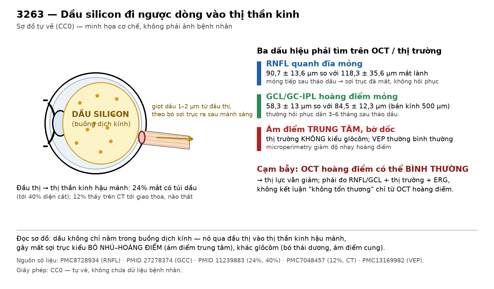
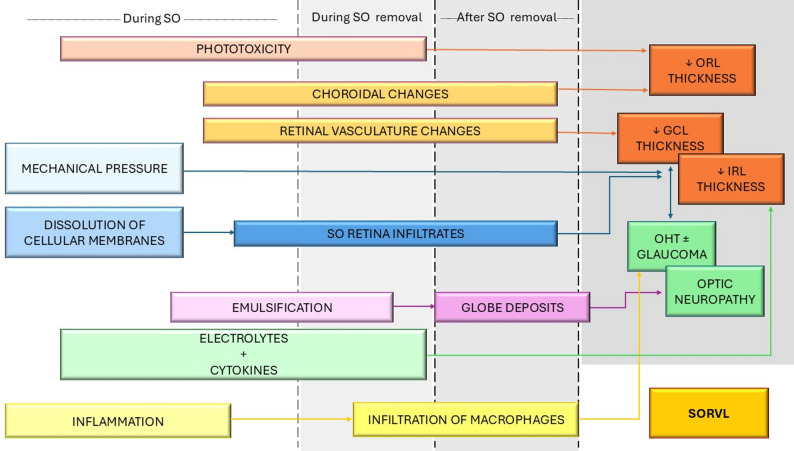
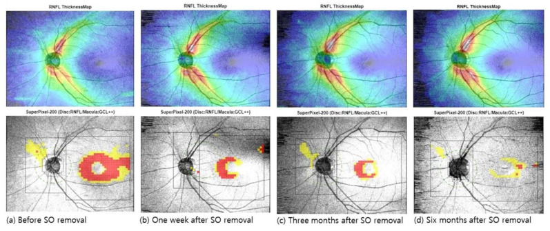
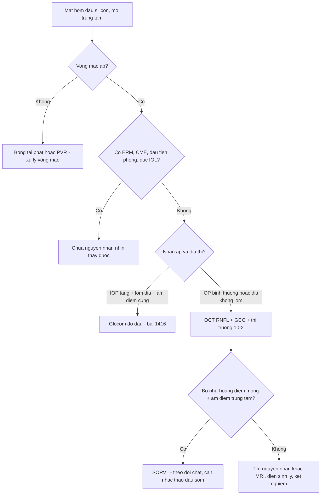
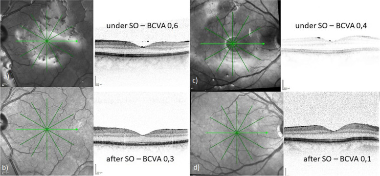

# 3263 — Bệnh thần kinh thị do dầu silicon (silicone oil optic neuropathy / SORVL): mất thị lực trung tâm dù võng mạc áp tốt

**Tags:** `pattern:mo-siet-thi-than-kinh` `pattern:am-diem-trung-tam` `pattern:rnfl-mong` `pattern:gcc-mong` `pattern:mat-mot-ben` `pattern:vong-mac-ap-tot` `vung:mat` `vung:than-kinh-thi` `vung:hoang-diem` `vung:dich-kinh` `protocol:OCT-RNFL` `protocol:OCT-GCC` `protocol:thi-truong` `protocol:ERG` `protocol:VEP` `protocol:CT` `protocol:MRI` `protocol:den-khe` `score:khong-co` `incidentaloma:khong`

**Mức chắc chắn (certainty):** tổng hợp y văn (literature synthesis) — dựng từ: tổng quan hệ thống hóa cơ chế 2026 (**3,3–50%**, Int J Retina Vitreous, PMC13169982); đoàn hệ **22 mắt** bong võng mạc vùng hoàng điểm còn nguyên (**50%** mất thị lực không giải thích, BMC Ophthalmol 2023, PMC9951486); đoàn hệ **15 mắt** (**8/15 = 53%**, GCC **58,3 vs 84,5 µm**, Graefe 2016, PMID 27278374); **33 mắt** chụp OCT phân đoạn lớp (**RNFL 90,7 vs 118,3 µm**, BMC Ophthalmol 2022, PMC8728934); **30 mắt** SS-OCT/OCTA (PMC8619201); phân tích gộp **9 nghiên cứu/491 mắt** (PMID 38815844); mô bệnh **74 mắt** cắt bỏ nhãn cầu (24% có túi dầu trong thị thần kinh sau mảnh sàng, PMID 11239883); **57 bệnh nhân** CT sọ (12% di cư sau mảnh sàng, PMC7048457); tổng quan **69 bệnh nhân** di cư ngoài nhãn cầu (PMID 32748328); **38 mắt** đếm giọt dầu (**80,8% giọt 1–2 µm**, PMC7060885 — kế thừa bài 3258). Chỗ chưa đủ chắc ghi **"chưa rõ"**. **Không ghi tên tác giả** — attribution = **tạp chí + năm + PMCID/DOI**.

> **Câu chốt:** mắt **đã cắt dịch kính + bơm dầu silicon**, võng mạc **áp tốt**, đĩa thị **không lõm**, nhãn áp **có thể bình thường**, nhưng bệnh nhân **mờ trung tâm, ám điểm giữa tầm nhìn** — nghĩ **bệnh thần kinh thị do dầu (silicone oil optic neuropathy, SORVL)**. Ba số phải nhớ: **3,3–50%** mắt bơm dầu mất thị lực không giải thích được (PMC13169982); **24%** mắt cắt bỏ nhãn cầu có **túi dầu trong thị thần kinh sau mảnh sàng**, chiếm **tới 40% diện cắt** (PMID 11239883); **RNFL quanh đĩa 90,7 ± 13,6 µm so với 118,3 ± 35,6 µm** mắt lành và **không hồi phục** sau tháo dầu (PMC8728934, PMC8619201). Đây **không phải glôcôm**, cũng **không phải "mắt lành sau mổ"** — và **OCT hoàng điểm có thể hoàn toàn bình thường**.

*Sơ đồ tự vẽ (CC0) — không phải ảnh bệnh nhân. Số liệu: PMC8728934 (RNFL), PMID 27278374 (GCC), PMID 11239883 (24%/40%), PMC7048457 (12% trên CT).*

## 1. Tổng quan bệnh học – cơ chế hình ảnh (TẠI SAO)

### 1.1 Định nghĩa và tần suất: "mất thị lực không giải thích được" sau một ca mổ thành công

- **SORVL (silicone oil-related visual loss)** = giảm thị lực **> 2 dòng Snellen (Snellen lines)**, **không giải thích được** bằng bệnh võng mạc nền, bong tái phát, nhũ tương hóa, màng trước võng mạc hay phù hoàng điểm (PMC13169982; PMC9951486).
- Tần suất **rất dao động: 3,3%–50%** (PMC13169982). Hai đầu của khoảng này đến từ hai cách chọn bệnh nhân khác nhau:
  - **50% (11/22 mắt)** trong đoàn hệ **chỉ gồm bong võng mạc vùng hoàng điểm còn nguyên (macula-on)** do **rách võng mạc khổng lồ** (20/22 mắt) — tức nhóm "đáng lẽ phải nhìn tốt" (PMC9951486);
  - **53% (8/15 mắt)** ở loạt dùng dầu **5.000 cS**, trong đó **3/15 (20%) mất thị lực vĩnh viễn** (PMID 27278374).
- **Thời điểm:** giảm thị lực trung bình **12 tuần** sau mổ (SD 6,2; khoảng **3–20 tuần**), **9/11 ca xảy ra khi dầu CÒN trong mắt**, 2 ca sau tháo dầu 2 tuần (PMC9951486). Nghĩa là **"chờ tháo dầu rồi xem" là sai** — tổn thương đang tiến triển trong lúc dầu còn đó.
- **Mức mất thị lực:** trung bình **8 dòng** (SD 2,3; khoảng −4 đến −11 dòng); logMAR **0,2 → 1,0** tương đương **20/32 → 20/200** (PMC9951486).

### 1.2 TẠI SAO dầu vào được thị thần kinh: giải phẫu mảnh sàng + bằng chứng mô bệnh

- **Giải phẫu:** sợi trục tế bào hạch tập trung ở **đầu thị (optic nerve head)**, xuyên qua **mảnh sàng (lamina cribrosa)** — một "cửa xương" có lỗ cho bó sợi trục và mạch máu, **không có hàng rào máu–thần kinh kiểu chặt** ở khoang quanh bó sợi. Dầu silicon nằm trong buồng dịch kính **tiếp xúc trực tiếp với đầu thị**, chỉ ngăn bởi mô đệm mỏng và **lớp sợi trục không myelin**.
- **Bằng chứng mô bệnh (đây là chốt cứng):** phân tích **74 mắt cắt bỏ nhãn cầu** sau bơm dầu — **14/74 (24%)** có **túi rỗng quang học (optically empty vacuoles)** trong **thị thần kinh sau mảnh sàng (retrolaminar optic nerve)**; **3 mắt** có **phản ứng viêm dạng u hạt (granulomatous)** quanh dầu; trên cắt nối tiếp, túi dầu lan **tới 9 mm** và chiếm **tới 40% diện cắt ngang** thị thần kinh (PMID 11239883). Tổn thương này được mô tả là **"pseudo-Schnabel's cavernous degeneration"** — hang giả trong thị thần kinh, **khác** hang thật của glôcôm (PMC13169982).
- **TẠI SAO dầu đi được:** ba lực cùng chiều — (1) **chênh áp lực** giữa buồng dịch kính và khoang dưới nhện quanh thị; (2) **chuyển động mắt** tạo dòng và lực cắt ở mặt phân cách dầu–mô; (3) **đại thực bào ăn giọt dầu** rồi di chuyển theo bó sợi trục (PMC13169982). Vì vậy **dầu độ nhớt nào cũng di cư được** — mô bệnh ghi nhận túi dầu **bất kể độ nhớt** (PMC13169982), và di cư **không phụ thuộc nhãn áp** (PMID 17475700: mô hình tử thi cho thấy dầu vào thị thần kinh **thuần bằng lực vật lý**, không cần tăng áp).
- **Hình ảnh học của di cư:** trên **CT sọ không cản quang**, dầu trong đường thị giác **tăng đậm độ rõ** so với mô thần kinh: **đầu thị 69,2 ± 12,4 HU so với 29,8 ± 10,2 HU**; **thị thần kinh sau mảnh sàng 59,9 ± 11,6 so với 30,9 ± 8,6 HU**; **giao thoa thị 74,2 ± 11,0 so với 25,6 ± 6,9 HU**; **dải thị 70,1 ± 4,7 so với 28,7 ± 7,2 HU** (p < 0,001) — gặp ở **7/57 bệnh nhân (12%)**, trong đó **5** ở thị thần kinh sau mảnh sàng, **3** ở giao thoa, **3** ở dải thị, **1** trong não thất bên (PMC7048457). Trên **MRI**, dầu silicon **giảm tín hiệu** trên T1/T2 (không có proton linh động) — tức **MRI "im lặng"**, dễ bỏ sót nếu chỉ nhìn MRI (DOI 10.1007/s11604-016-0587-6).
- **Di cư ra ngoài nhãn cầu không đồng nghĩa có triệu chứng:** tổng quan **69 bệnh nhân** cho thấy di cư sau mảnh sàng (thị thần kinh, giao thoa, khoang dưới nhện, não thất) **thường không triệu chứng**, còn di cư **vào hốc mắt** mới hay có triệu chứng và cần can thiệp (PMID 32748328).

### 1.3 TẠI SAO võng mạc mỏng và TẠI SAO thị lực mất: bốn cơ chế chồng lấn

| Cơ chế | Vì sao (vật lý/sinh học) | Dấu hiệu trên OCT/điện sinh lý |
|---|---|---|
| **1. Mất sợi trục ngược dòng (retrograde axonal loss)** | Dầu chèn ép/viêm bó sợi trục sau mảnh sàng → **ứ chuyển vận sợi trục (axonal transport block)** → tế bào hạch chết ngược dòng | **RNFL quanh đĩa mỏng 90,7 vs 118,3 µm** (PMC8728934); **ppRNFL mỏng tiếp và KHÔNG hồi phục 6 tháng sau tháo dầu** (PMC8619201) |
| **2. Lực cơ học lên hoàng điểm** | Dầu **nhẹ hơn nước (0,97 g/cm³)** nổi lên trên; ở **tư thế nằm sấp** mặt phân cách dầu–dịch **lồi** đè vào vùng hoàng điểm | **GCL/GC-IPL hoàng điểm mỏng 58,3 ± 13 vs 84,5 ± 12,3 µm** (PMID 27278374); **parafovea mỏng rồi hồi phục 3–6 tháng** (PMC8619201) |
| **3. Hòa tan sắc tố bảo vệ + quang độc** | Dầu hòa tan **lutein/zeaxanthin** (chất tan trong mỡ) ở hoàng điểm → giảm "kính lọc xanh" → **ánh sáng xanh gây độc** cho sợi trục/ty thể | **ERG/đa ổ (mfERG) suy giảm chức năng hoàng điểm** dù đáy mắt bình thường; **VEP thường bình thường** (PMC13169982) |
| **4. Giọt dầu nội võng mạc + viêm** | Giọt **1–2 µm** (80,8% số giọt) xuyên qua màng tế bào, gây viêm và **tắc mao mạch cực nhỏ** | **Đốm tăng hồi âm (hyperreflective dots)** trong võng mạc; **mật độ mạch máu giảm** trên OCTA (PMC13169982; PMC7060885) |

*Hình từ Int J Retina Vitreous 2026 (CC BY 4.0, PMC13169982): các nhánh cơ chế (quang độc, thay đổi mạch hắc mạc, lực cơ học, hòa tan màng tế bào, nhũ tương, điện giải/cytokine, viêm) dẫn tới **mỏng lớp trong (IRL)/lớp ngoài (ORL)**, **glôcôm do tăng nhãn áp**, **bệnh thần kinh thị** và cuối cùng là **SORVL**. Điểm cần nhớ: nhiều cơ chế **vẫn tiếp tục sau khi đã tháo dầu**.*

- **Bằng chứng tổng hợp về lớp mỏng:** phân tích gộp **9 nghiên cứu, 491 mắt** — nhóm dầu silicon thị lực kém hơn khí **0,17 logMAR** (KTC 95% 0,06–0,27; p = 0,002), **GCL mỏng hơn 3,70 µm** (−5,87 đến −1,53; p = 0,0008), **IPL mỏng hơn 2,45 µm**, **ONL mỏng hơn 11,74 µm**, trong khi **tỷ lệ áp võng mạc tương đương** (p = 0,89) — tức **cái mất không phải là "dính võng mạc" mà là mô thần kinh** (PMID 38815844).
- **Phản biện trung thực (theo PROMPT_SYNTHESIZER):** **RNFL không nhất quán** — một loạt **47 mắt** lại thấy **RNFL DÀY** cả khi còn dầu và sau tháo dầu, và mắt **có tăng nhãn áp thì dày ít hơn** (PMID 29256738). Vì vậy **"RNFL dày" không loại trừ SORVL**; phải đọc **xu hướng theo thời gian + so mắt lành + kèm GCC**. Bài tổng quan 2026 cũng ghi rõ: **chưa có đồng thuận về thay đổi RNFL**, trong khi **mỏng GCL quanh hoàng điểm** là dấu hiệu được mô tả ở **mọi** loạt (PMC13169982; PMID 32405956).

### 1.4 TẠI SAO ám điểm TRUNG TÂM (và vì sao nó khác glôcôm)

- Bó **nhú–hoàng điểm (papillomacular bundle)** chạy từ hoàng điểm tới **phía thái dương đĩa thị**, chiếm phần lớn sợi trục nhỏ nhất và **nhạy với độc/chèn ép nhất**. Tổn thương bó này → **ám điểm trung tâm hoặc cecocentral**, giảm thị lực **đọc chữ** trong khi thị trường ngoại vi còn.
- **Khác glôcôm:** glôcôm mất **bó thái dương trên/dưới** ở đĩa → **ám điểm cung (arcuate scotoma)**, **bờ dốc tôn trọng kinh tuyến ngang**, kèm **lõm đĩa (cupping)**. Trong SORVL, **lõm đĩa thường KHÔNG có** dù nhiều mắt có glôcôm thứ phát; thị trường **không kiểu glôcôm** (PMC13169982). Đây là **chốt loại glôcôm** quan trọng nhất trên lâm sàng — và là lý do phải **đo thị trường ở mọi mắt bơm dầu bị mờ trung tâm**, không chỉ đo nhãn áp.

## 2. Mẫu hình + chẩn đoán phân biệt theo vị trí (gamut)

### 2.1 Mẫu hình nhận diện (pattern)

**Mắt một bên + đã bơm dầu silicon + võng mạc áp tốt + đĩa thị không lõm + mờ trung tâm/ám điểm trung tâm + OCT hoàng điểm có thể bình thường.**

Ba câu hỏi phải trả lời theo thứ tự:

1. **Có nguyên nhân "nhìn thấy được" không?** (bong tái phát, ERM, CME, dầu tiền phòng/góc, đục IOL/giác mạc, nhũ tương hóa) — nếu có, đó là chẩn đoán khác.
2. **Nhãn áp và đĩa thị:** có **tăng nhãn áp kéo dài + lõm đĩa + ám điểm cung**? → **glôcôm do dầu (bài 1416)**, không phải SORVL.
3. **Có mất sợi trục bó nhú–hoàng điểm?** RNFL quanh đĩa **mỏng**, GCC hoàng điểm **mỏng**, **ám điểm trung tâm**, **ERG suy giảm** → **SORVL**.

### 2.2 Gamut theo vị trí tổn thương (location-based)

| Vị trí | Nhóm nguyên nhân | Vì sao phải phân biệt |
|---|---|---|
| **Thị thần kinh / sợi trục** | **SORVL (bài này)** · glôcôm do dầu (1416) · **NAION/PION** sau mổ · chèn ép (drusen, u, dày màng) · thiếu máu thị do tụt áp | Điều trị khác hẳn: SORVL **không có thuốc**, glôcôm **hạ áp**, NAION **tránh tụt áp** |
| **Hoàng điểm (GCL/OPL)** | Mỏng hoàng điểm sau bong võng mạc · **ERM (1467)** · **CME 14–36%** · lỗ hoàng điểm · dầu nội võng mạc | ERM/CME **chữa được bằng mổ/thuốc**; mỏng do bong **không hồi phục** |
| **Tiền phòng / thể thủy tinh / giác mạc** | **Nhũ tương hóa dầu (3258)** · dầu tiền phòng (1416) · đục IOL/PCO · **bong màng Descemet (3264)** · phù giác mạc do dầu | Nhìn thấy bằng đèn khe — **không được quy cho "thần kinh" khi chưa loại trừ** |
| **Dịch kính / võng mạc** | Bong tái phát · **dầu nhũ tương (3258)** · màng co kéo (PVR) | **Nguyên nhân thường gặp nhất** của "mờ sau mổ" — siêu âm B-scan khi không thấy đáy mắt |
| **Đường thị giác sau mảnh sàng (hiếm)** | Dầu ở giao thoa/dải thị/não thất · bệnh thần kinh thị do thiếu máu thị trước/sau | Thường **không triệu chứng**; CT phát hiện tình cờ (12%) |

## 3. Bảng so sánh phân biệt (ma trận đối chiếu)

| Thực thể (entity) | Hình ảnh điển hình | Chốt vào (rule-in) | Chốt loại (rule-out) | Gợi ý xác nhận |
|---|---|---|---|---|
| **SORVL (bài này)** | Đáy mắt **bình thường**, đĩa **không lõm**; **RNFL/GCC mỏng**; ám điểm **trung tâm** | **Mờ trung tâm > 2 dòng + võng mạc áp + đĩa không lõm + GCC/RNFL mỏng** | **Ám điểm cung + lõm đĩa** → glôcôm; **ERM/CME/bong** → nguyên nhân khác | OCT RNFL + GCC, thị trường 10-2, mfERG; **chẩn đoán loại trừ** |
| **Glôcôm do dầu (1416)** | **IOP tăng 11–56%**, dầu/góc bít bè, **lõm đĩa**, **ám điểm cung** | **IOP tăng kéo dài + lõm đĩa + tổn thương bó thái dương** | Đĩa **không lõm**, ám điểm **trung tâm** → nghĩ SORVL | Nhãn áp nhiều lần/ngày, soi góc, thị trường 24-2 |
| **Mỏng hoàng điểm sau bong võng mạc** | **CFT 254 → 224 → 247 µm**, mỏng toàn bộ lớp | **Tiền sử bong macula-off + mỏng lan tỏa** | Mỏng **khu trú bó nhú–hoàng điểm** → SORVL | So **baseline trước mổ** + mắt lành |
| **ERM (1467)** | Màng tăng phản xạ trên võng mạc, **co kéo**, **giả lỗ** | **Màng thấy rõ + co kéo + méo hình** | Không màng, OCT bình thường → không phải ERM | OCT macula; tỷ lệ **12,3–70,6%** ở mắt bơm dầu |
| **CME** | Nang dịch trong võng mạc, **dày** hoàng điểm | **Dày hoàng điểm + nang** | Hoàng điểm **mỏng** → không phải CME | OCT; tỷ lệ **14–36%** |
| **NAION / PION sau mổ** | Đĩa **phù** (NAION) hoặc đĩa bình thường (PION), **ám điểm trên/dưới** | **Tụt áp kéo dài, thiếu máu, đĩa phù, khiếm khuyết theo chiều ngang** | **Ám điểm trung tâm + mất sợi trục bó nhú–hoàng điểm** → SORVL | Đo huyết áp tư thế, Hb, đĩa thị, thị trường |
| **Chèn ép thị thần kinh** | **MRI: khối/dày màng/drusen**, có thể **lồi đĩa** | **Lồi đĩa + RAPD + khiếm khuyết lan/đường giữa** | MRI bình thường + bó nhú–hoàng điểm → SORVL | MRI hốc mắt **T1 fat-sat sau tiêm** |
| **Bệnh thị thần kinh độc–chuyển hóa** | **Hai bên**, đối xứng, **loạn sắc giác** | **Hai bên + dùng thuốc/thiếu B12 + tăng homocysteine** | **Một bên + tiền sử bơm dầu** → SORVL | B12, folate, homocysteine, thuốc |
| **Bong võng mạc tái phát / PVR** | Võng mạc **không áp**, dịch dưới võng mạc | **Thấy bong/dịch** | Võng mạc **áp phẳng** → loại trừ | B-scan khi đục; OCT khi thấy được |

*Hình từ J Clin Med 2021 (CC BY 4.0, PMC8619201): hàng trên là bản đồ độ dày RNFL, hàng dưới là bản đồ lệch của RNFL quanh đĩa và GCL hoàng điểm. Thông điệp: **GCL hoàng điểm có thể hồi phục**, còn **RNFL quanh đĩa thì không** — đọc theo **xu hướng**, không theo một lần chụp.*

## 4. Protocol chụp + hệ phân độ/điểm chuẩn hóa

### 4.1 Quy trình khám khi mắt bơm dầu bị "mờ không rõ nguyên nhân"

### 4.2 Bộ xét nghiệm tối thiểu (và ngưỡng đọc)

| Bước | Cách làm | Ngưỡng/điểm cần ghi |
|---|---|---|
| **Thị lực + RAPD** | Snellen/logMAR, thử lỗ kim | Giảm **> 2 dòng** mới vào định nghĩa SORVL; RAPD **dương** gợi tổn thương thị thần kinh |
| **Đèn khe** | Tiền phòng, góc, IOL, mặt sau IOL | **Hạt dầu/góc bít** → ưu tiên nguyên nhân tiền phòng (3258/1416) |
| **Nhãn áp** | Đo **nhiều thời điểm**, ghi cả huyết áp | **11–56%** mắt bơm dầu tăng nhãn áp; **IOP bình thường không loại trừ SORVL** |
| **Đáy mắt/soi đĩa** | Đánh giá **lõm đĩa (C/D)**, màu đĩa, mạch | **Không lõm + đĩa hồng** → chống glôcôm |
| **OCT RNFL quanh đĩa** | Vòng 3,4 mm, **so mắt lành + so baseline** | **RNFL mỏng** (90,7 vs 118,3 µm); lưu ý **có thể dày giả** khi có dầu (PMID 29256738) |
| **OCT GCC/GC-IPL** | Vùng hoàng điểm, bản đồ lệch | **Mỏng 58,3 vs 84,5 µm**; **hồi phục 3–6 tháng** sau tháo dầu |
| **Thị trường** | **Humphrey 10-2** (trung tâm) + 24-2 | **Ám điểm trung tâm/cecocentral**, **không kiểu glôcôm** |
| **Điện sinh lý** | **mfERG/ERG**, VEP | **ERG suy giảm chức năng hoàng điểm**; **VEP thường bình thường** |
| **CT sọ không cản quang** | Lát **1,25 mm**, đo HU tại đầu thị/giao thoa | Dầu: **59,9–74,2 HU** so với **25,6–30,9 HU** mô thường; gặp **12%** |
| **MRI hốc mắt** | T1 fat-sat sau tiêm + T2 fat-sat | Dầu **giảm tín hiệu** — dùng để **loại trừ chèn ép/u**, không để "tìm dầu" |

### 4.3 Hệ phân độ/điểm

- **Chưa có hệ phân độ chuẩn hóa cho SORVL** — đây là khoảng trống được nêu thẳng trong tổng quan 2026: thiếu **định nghĩa thống nhất**, thiếu **protocol theo dõi đa phương thức**, thiếu **đồng thuận thời gian lưu dầu an toàn** (PMC13169982). Vì vậy trong bài này **không bịa score**; thay vào đó dùng **3 ngưỡng thực hành**:
  1. **> 2 dòng Snellen** giảm không giải thích được = SORVL;
  2. **GCC mỏng hơn mắt lành** hoặc **mỏng > 5% so baseline** = đang tiến triển (ngưỡng theo dõi nội bộ, chưa có bằng chứng cấp A);
  3. **Thời gian lưu dầu**: các loạt báo tháo dầu trung bình **139 ± 50 ngày** (PMC9951486); khuyến cáo **tháo sớm nhất có thể khi võng mạc ổn định** (PMID 36829157) — **chưa có ngưỡng "an toàn" được chứng minh**.
- **Theo dõi:** khám + OCT **mỗi 3 tháng** khi còn dầu; **3 và 6 tháng sau tháo dầu** (mốc hồi phục GCC); ghi **cùng một máy, cùng protocol** để so được.

## 5. Biến thể bình thường và cạm bẫy

- **"OCT hoàng điểm bình thường" không loại trừ SORVL.** Trong loạt BMC 2023, **một số mắt mất 8 dòng thị lực mà OCT chỉ có thay đổi rất kín đáo ở lớp rối ngoài (OPL/Henle)**, thậm chí **không thay đổi lớp trong/ngoài** (PMC9951486). Bắt buộc đo **RNFL + GCC + thị trường** trước khi kết luận "không có tổn thương".
- **RNFL có thể DÀY, không chỉ mỏng.** Loạt **47 mắt** cho thấy RNFL **dày hơn** mắt lành cả khi còn dầu và sau tháo dầu, dày ít hơn ở mắt tăng nhãn áp (PMID 29256738) — **"dày" là phản ứng, không phải lành**. Đọc **xu hướng**, không đọc một con số.
- **Dầu trong tiền phòng làm nhãn áp tăng và làm nhòe ảnh OCT** — dễ bị quy hết cho glôcôm. Soi góc + AS-OCT mặt mống mắt để tìm hạt dầu (bài 3258/1416).
- **Cạm bẫy CT:** dầu trong thị thần kinh/giao thoa **tăng đậm độ 60–75 HU** — trông như **máu tụ, canxi hóa hay u nhỏ ở giao thoa**. Nếu không hỏi **tiền sử bơm dầu silicon**, báo cáo dễ thành "khối tăng đậm độ giao thoa thị" và dẫn tới MRI/chọc dò vô ích. Ngược lại, **dầu trong não thất** có thể bị đọc là **xuất huyết não thất** (PMC7048457; PMID 40718685).
- **Satisfaction of search:** khi đã thấy ERM hoặc nhũ tương hóa, người đọc dừng lại — trong khi **mất sợi trục vẫn tiếp diễn**; ERM gặp **12,3–70,6%**, CME **14–36%** ở mắt bơm dầu, nên **rất dễ "có sẵn một chẩn đoán"** (PMC13169982).
- **Mắt đối bên không phải "chuẩn vàng" tuyệt đối**: bệnh nhân bong võng mạc thường có mắt kia cận thị nặng, thoái hóa; hãy dùng **baseline trước mổ của chính mắt bệnh** khi có.

## 6. Tự lượng giá — Blind Quiz

**Ca 1 — Nam 63 tuổi, mắt trái bơm dầu 4 tháng sau mổ bong võng mạc; võng mạc áp, nhãn áp 16 mmHg, than mờ trung tâm.**

- Gợi ý lâm sàng: thị lực giảm từ 0,6 xuống 0,3 khi còn dầu, tiếp tục **0,1** sau tháo dầu; đĩa thị hồng, **không lõm**.
- Câu hỏi: (1) Mô tả dấu hiệu trên OCT? (2) Ba chẩn đoán phân biệt? (3) Dấu hiệu nào **chốt loại** glôcôm?

<b>Bấm để hiện đáp án (findings + chẩn đoán)</b>

- **Dấu hiệu:** OCT **không có phù, không có màng, không có dịch dưới võng mạc**; chỉ có **thay đổi kín đáo ở lớp rối ngoài/Henle** (tăng phản xạ) và **mỏng lớp trong**; thị lực **giảm tiếp sau khi đã tháo dầu** — đúng mô tả "OCT gần như bình thường nhưng mất thị lực" của loạt BMC 2023 (PMC9951486).
- **Chẩn đoán:** **SORVL** (bệnh thần kinh thị do dầu) — mất sợi trục bó nhú–hoàng điểm; cơ chế: dầu vào thị thần kinh sau mảnh sàng + lực cơ học/quang độc lên hoàng điểm.
- **Chốt loại glôcôm:** **đĩa thị không lõm**, **ám điểm trung tâm** chứ không phải ám điểm cung, **nhãn áp 16 mmHg**. Cần thêm **OCT RNFL/GCC** và **thị trường 10-2** để xác nhận mất sợi trục.
- Nguồn ảnh: BMC Ophthalmology 2023, CC BY 4.0 (PMC9951486), Hình 3.

**Ca 2 — Nữ 58 tuổi, mắt phải bơm dầu 6 tháng, thị lực 0,5; OCT cho bản đồ lệch đỏ quanh đĩa và vùng hoàng điểm.**

- Gợi ý lâm sàng: không đau, không đỏ, nhãn áp 15–18 mmHg, đĩa thị **C/D 0,3**.
- Câu hỏi: (1) Vùng đỏ trên **bản đồ lệch** nghĩa là gì? (2) Vì sao **GCL hồi phục** mà **RNFL thì không**? (3) Điều này đổi thái độ điều trị thế nào?

<b>Bấm để hiện đáp án (findings + chẩn đoán)</b>

- **Dấu hiệu:** bản đồ lệch hiển thị **vùng mỏng bất thường so với chuẩn** (đỏ) ở **GCL hoàng điểm và RNFL quanh đĩa**; vùng GCL **thu hẹp dần** qua các mốc 1 tuần, 3 tháng, 6 tháng sau tháo dầu, trong khi **RNFL quanh đĩa vẫn mỏng** (PMC8619201).
- **Chẩn đoán:** **SORVL** với **mất sợi trục không hồi phục** quanh đĩa và **mỏng GCL hoàng điểm hồi phục một phần**.
- **Vì sao:** GCL mỏng do **lực cơ học/phù nề thoáng qua** có thể hồi phục khi hết lực; RNFL đã **mất sợi trục thật** (axon loss) thì **không tái sinh** ở người trưởng thành.
- **Đổi thái độ:** **tháo dầu sớm khi võng mạc ổn định**, không chờ "hết năm"; theo dõi **RNFL/GCC 3–6 tháng/lần**; tư vấn trước mổ rằng dầu có thể **mất thị lực trung tâm vĩnh viễn** dù áp võng mạc thành công.
- Nguồn ảnh: J Clin Med 2021, CC BY 4.0 (PMC8619201), Hình 2.

## 7. Câu hỏi nghiên cứu & điểm chưa đồng thuận (tính đến 11/2026)

1. **[Tranh cãi] Ở mắt bong võng mạc vùng hoàng điểm còn nguyên, dầu silicon có gây mất thị lực trung tâm qua độc tính trực tiếp lên sợi trục hay chỉ qua thiếu máu/áp lực?**
   - **Đã biết:** Mô bệnh thấy **24%** mắt có túi dầu trong thị thần kinh sau mảnh sàng, tới **40% diện cắt**; tổn thương sợi trục **không phụ thuộc nhãn áp** trong mô hình tử thi.
   - **Chưa rõ:** Phần đóng góp tương đối của **dầu – áp lực – thiếu máu – quang độc**; chưa có mô hình in vivo phân tách được các yếu tố này.
   - **Hướng nghiên cứu:** Đoàn hệ tiến cứu có **OCT RNFL/GCC + mfERG trước mổ**, phân tầng theo IOP và độ nhớt dầu.
   - **Nguồn:** PMID 11239883 (2001); PMID 17475700 (2007); PMC13169982 (2026).

2. **[Khoảng trống] Ngưỡng mỏng RNFL/GCC nào đủ để chẩn đoán SORVL, và tháo dầu ở mốc nào giảm được mất thị lực?**
   - **Đã biết:** RNFL **90,7 vs 118,3 µm**, GCC **58,3 vs 84,5 µm**; hầu hết loạt tháo dầu quanh **139 ± 50 ngày**; **chưa có hệ phân độ** cho SORVL.
   - **Chưa rõ:** Không có **ngưỡng chẩn đoán**, không có **thử nghiệm ngẫu nhiên** so sánh thời điểm tháo dầu; "tháo sớm" dựa trên khuyến cáo chuyên gia.
   - **Hướng nghiên cứu:** Nghiên cứu **độ chính xác chẩn đoán** (RNFL/GCC so chuẩn mfERG) + RCT/đoàn hệ theo **mốc tháo dầu**.
   - **Nguồn:** PMC8728934 (2022); PMC9951486 (2023); PMC13169982 (2026).

3. **[Khác biệt thực hành] Có nên theo dõi OCT RNFL/GCC định kỳ cho mọi mắt bơm dầu, hay chỉ khi bệnh nhân than mờ?**
   - **Đã biết:** SORVL có thể **khởi phát khi dầu còn trong mắt** (9/11 ca) và **VEP bình thường** nên khám lâm sàng dễ bỏ sót.
   - **Chưa rõ:** Chưa có bằng chứng chi phí–hiệu quả; nhiều nơi chỉ chụp OCT khi có triệu chứng.
   - **Hướng nghiên cứu:** Registry đa trung tâm ghi **OCT + thị trường + mfERG** theo lịch cố định, so với chụp theo triệu chứng.
   - **Nguồn:** PMC9951486 (2023); PMC13169982 (2026); DOI 10.1016/j.survophthal.2025.08.011 (2026).

## Bài liên quan chéo

- [3258 – Nhũ tương hóa dầu silicon: hạt dầu ở tiền phòng/góc, hyperoleon](../3258-nhu-tuong-hoa-dau-silicone/lesson.md) *(đã có)*
- [1416 – Glôcôm do dầu silicon: pupillary block, bít bè, chọn lấy dầu/van](../1416-glaucom-do-dau-silicone/lesson.md) *(đã có)*
- [1410 – Dầu silicon tồn lưu: chỉ định bơm, biến chứng, khi nào lấy dầu](../1410-lay-dau-silicone-va-dau-ton-luu/lesson.md) *(đã có)*
- [1467 – Màng trước võng mạc (ERM): 4 giai đoạn Govetto](../1467-mang-truoc-vong-mac-erm/lesson.md) *(đã có)*
- [442 – Glôcôm trên OCT: RNFL/GCC và cách đọc bản đồ lệch](../442-glaucoma-OCT/lesson.md) *(đã có)*
- [410 – Giải phẫu học mắt trên cắt lớp](../410-giai-phau-hoc-mat/lesson.md) *(đã có)*

## Ảnh

- `3263_benh-than-kinh-thi-dau-silicone_SoDo_CC0.png` — sơ đồ cơ chế **tự vẽ, CC0**.
- `3263_benh-than-kinh-thi-dau-silicone_OCT_JCM-2021.jpg` — J Clin Med 2021, **CC BY 4.0**, PMC8619201, Hình 2.
- `3263_benh-than-kinh-thi-dau-silicone_OCT_BMC-2023.jpg` — BMC Ophthalmol 2023, **CC BY 4.0**, PMC9951486, Hình 3.
- `3263_benh-than-kinh-thi-dau-silicone_SoDo_IJRV-2026.jpg` — Int J Retina Vitreous 2026, **CC BY 4.0**, PMC13169982, Hình 3 (sơ đồ cơ chế theo mốc thời gian).
- Chi tiết nguồn + giấy phép từng ảnh: `images/CREDITS.md`.

> Không dùng để chẩn đoán độc lập khi chưa có người hướng dẫn.
