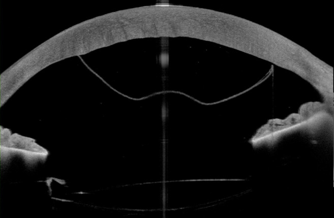
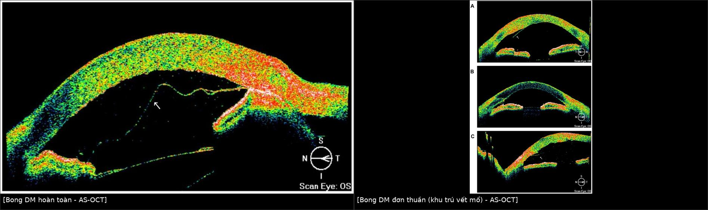
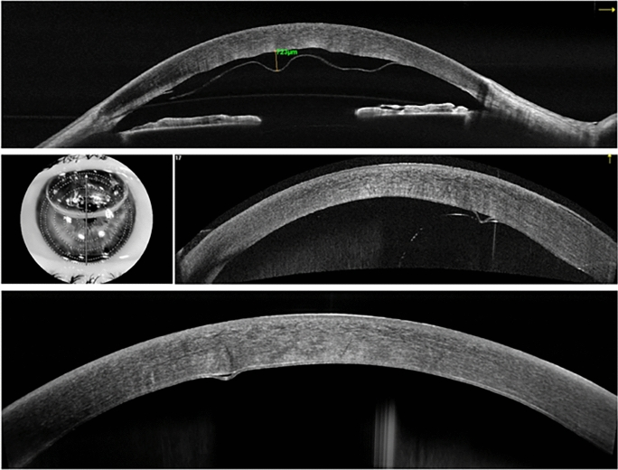
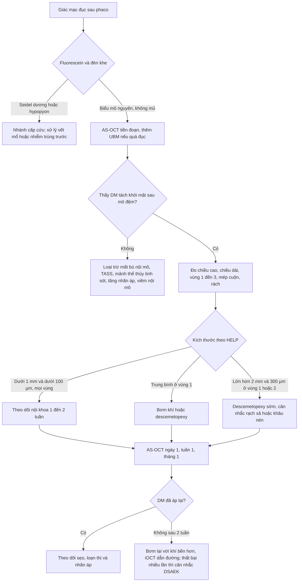
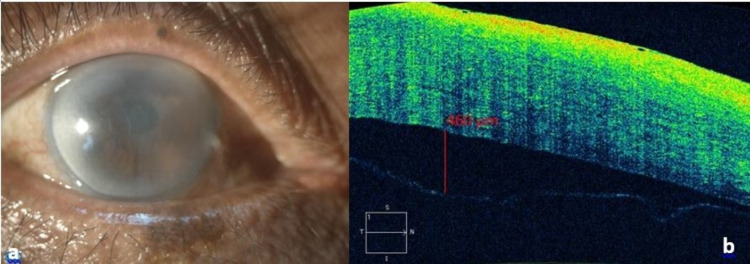

# 3264 — Bong màng Descemet sau phẫu thuật thể thủy tinh / Descemet membrane detachment (DMD) after cataract surgery

**Tags:** `pattern:bong-mang-descemet` `pattern:hai-duong-tren-AS-OCT` `pattern:phu-giac-mac-sau-mo` `pattern:mat-mot-ben` `pattern:mep-dm-cuon` `pattern:mat-dinh-mang-descemet` `vung:mat` `vung:giac-mac` `vung:mo-dem-sau` `vung:tien-phong` `protocol:den-khe` `protocol:AS-OCT` `protocol:pachymetry` `protocol:iOCT` `protocol:pneumodescemetopexy` `score:HELP` `incidentaloma:khong`

**Mức chắc chắn (certainty):** tổng hợp y văn (literature synthesis) — dựng từ một nghiên cứu tiến cứu **179 mắt** chụp OCT trong mổ (PMC13782278), một thử nghiệm ngẫu nhiên **28 mắt** so sánh hai chế độ siêu âm (PMC13557163), một tổng quan về AS-OCT trong DMD (PMC11836178), một nghiên cứu phân loại **26 mắt** (PMC6097261), một loạt **67 mắt** bơm 14% C3F8 (PMC4926564), các loạt ca DMD muộn và DMD phức tạp (PMC9827023; PMC10907463) và một ca có ảnh SS-OCT (PMC11462704). Nhóm **không có bệnh nhân của mình**; chỗ chưa đủ chắc ghi **"chưa rõ"**. **Không ghi tên tác giả** — attribution = **tạp chí + năm + PMCID/DOI**.

> **Câu chốt:** sau phaco "trơn" mà **giác mạc vẫn đục sau 7–10 ngày**, đừng mặc định "phù sau mổ sẽ hết": soi đèn khe có thể **không thấy gì** vì mô đệm đã đục, còn **AS-OCT** cho thấy **màng Descemet (DM) là đường tăng hồi âm thứ hai**, tách khỏi mặt sau mô đệm bằng một **khoang giảm hồi âm** — đó là **bong DM (DMD)**. Bốn số phải nhớ: **0,044–0,5%** sau phaco (nhưng **60,9%** nếu chụp OCT trong mổ); **bong < 1 mm chiều cao, khu trú ngoại vi → tự áp lại** (43/43 mắt planar < 1 góc phần tư); **14% C3F8 áp lại giải phẫu 71,6%**, trong đó **planar 100% (26/26) vs non-planar 53,7% (22/41)**; và **mép DM cuộn (scrolled edge) + bong trung tâm là lý do phải can thiệp**, không phải chờ.

## 1. Tổng quan bệnh học – cơ chế hình ảnh (TẠI SAO)

### 1.1 Màng Descemet là gì và vì sao nó bong đúng ở mặt phẳng đó

- **DM** là **màng đáy không tế bào** của nội mô giác mạc, gồm **lớp dải trước 2–4 µm** và **lớp không dải sau dày thêm theo tuổi** (PMC13557163). Nó **căng** như một tấm màng và **dính vào mô đệm sau** qua một **mặt tiếp giáp DM–mô đệm** — đây là **mặt phẳng yếu nhất** khi có lực xé hoặc dòng dịch.
- Nội mô **bơm nước ra khỏi mô đệm**; khi DM **tách khỏi mô đệm**, các tế bào nội mô đi kèm DM **không còn áp sát mô đệm**, bơm mất tác dụng cục bộ → **nước tích ở mặt tiếp giáp** và **mô đệm ngậm nước**. Vì vậy DMD gây phù **đúng vùng DM đã tách**, không lan theo kiểu "phù toàn bộ do suy bơm".
- **TẠI SAO lại bong trong phaco:** đầu tip/ống hút **tì vào mép sau vết mổ** ở **áp lực thấp**, tạo **lực cắt** tại mặt tiếp giáp DM–mô đệm; **dao cùn**, **vết mổ quá hẹp so với đầu tip**, **góc mổ nông**, **bơm viscoelastic/kháng sinh nhầm dưới mô đệm** đều làm tăng lực này (PMC11836178). Nghiên cứu tiến cứu cho thấy DMD **xuất hiện nhiều nhất ở thì hút–rửa (I/A): 43,1%**, sau đó mới đến **đặt IOL 16,5%** và **phaco 15,6%** (PMC13782278).
- **TẠI SAO có ca xuất hiện muộn (late-onset):** DM có thể **bong dần sau vài ngày–vài tháng** do **dòng dịch tích tụ ở mặt tiếp giáp** và **mất dần lực dính**, dù mổ hoàn toàn êm; loạt 5 bệnh nhân/6 mắt cho thấy **thị lực tốt lúc đầu rồi giảm trong vài ngày đến vài tháng** (PMC9827023).

### 1.2 Vì sao hình ảnh là "hai đường" và vì sao thị lực giảm nhiều hơn mức "hơi mờ"

- Mô đệm trong suốt nhờ **các bản collagen xếp đều, khoảng cách << bước sóng ánh sáng**. Khi ngậm nước, **khoảng cách bản collagen tăng** → tán xạ → **mất trong suốt**; mức tán xạ tỉ lệ với **mức hydrat hóa**, nên **độ dày giác mạc đo được là chỉ số thay thế cho mức phù**.
- Trên **AS-OCT**, **DM là một đường tăng hồi âm mảnh**, mặt sau mô đệm cũng tăng hồi âm; **dịch ở giữa không phản xạ** → thấy **hai đường song song** với **khoảng giảm hồi âm** ở giữa, và **đo được chiều cao tách bằng µm** (PMC11462704; PMC11836178). Khi mép DM **cuộn**, đầu cuộn thành **khối tăng hồi âm dày** ở một đầu — dấu hiệu **non-planar** và là lý do khí khó ép (PMC11836178).
- **TẠI SAO mờ nhiều:** ngoài tán xạ mô đệm, DM tách làm **mặt sau giác mạc không còn nhẵn** → **loạn thị không đều**; ca DMD trung tâm có **BCVA 1,5 logMAR** dù chỉ "phù nhẹ" trên đèn khe (PMC11462704).

### 1.3 Dịch tễ và con số thật

| Bối cảnh | Con số | Nguồn |
|---|---|---|
| DMD **có ý nghĩa lâm sàng** sau phaco | **0,044–0,5%** | PMC11836178 |
| DMD sau **ECCE** | **2,5%** | PMC11836178 |
| DMD **phát hiện bằng OCT trong mổ** (2,65 mm, 179 mắt) | **109/179 = 60,9%** — phần lớn **dưới lâm sàng** | PMC13782278 |
| DMD thấy bằng **video đèn đồng tử đỏ** (28 mắt, so sánh hai mắt) | **100%** | PMC13557163 |
| Diện tích DMD tại vết mổ | **1,33 ± 0,43 mm²** (siêu âm dọc) vs **2,37 ± 0,67 mm²** (xoắn), chênh **1,04 mm²**, p < 0,001 | PMC13557163 |
| Thì đầu tiên phát hiện DMD | **I/A 43,1%**, đặt IOL 16,5%, phaco 15,6%, hydrodissection 12,8% | PMC13782278 |
| Yếu tố nguy cơ **định lượng** | **LOCS III mỗi bậc: aOR 4,20**; **thời gian biến dạng vết mổ khi I/A mỗi giây: aOR 1,23**; mô hình gộp **AUC 0,806** | PMC13782278 |
| Ngưỡng LOCS III ≥ 3 (phân tích thăm dò) | **Se 77,3% · Sp 55,7% · PPV 65,2% · NPV 69,6%** | PMC13782278 |

- **TẠI SAO 60,9% mà chỉ 0,044–0,5% có triệu chứng:** phần lớn DMD **khu trú ở mép vết mổ, chiều cao nhỏ**, mô đệm xung quanh bù được; chỉ khi **bong lan vào trục thị giác** hoặc **mép cuộn không áp lại** mới thành phù đục. Đây là lý do **không được chụp OCT trong mổ rồi can thiệp hàng loạt** — phải dùng **ngưỡng kích thước + vị trí**.
- **Yếu tố nguy cơ khác (định tính, từ tổng quan):** **tiền phòng nông**, **giác mạc đục**, **nhãn áp thấp trong mổ**, **dao cùn**, **vết mổ hẹp/góc nông**, **bơm nhầm dưới mô đệm**, **ít kinh nghiệm**, **loạn dưỡng nội mô Fuchs** (4/16 mắt DMD có bệnh nội mô, 3 mắt Fuchs) (PMC11836178).

### 1.4 Vì sao từng modality nhìn thấy gì

| Modality | Cái gì phản ánh cái gì | Vì sao |
|---|---|---|
| **Đèn khe** | **Phù mô đệm lan/khu trú**, mất chi tiết mống mắt; đôi khi thấy **đường DM** hoặc **mép cuộn** như một nếp | Mô đệm ngậm nước tán xạ; khi phù nặng, **không thể định vị DM** — đây là lý do **chẩn đoán bằng đèn khe bị bỏ sót** (PMC11836178) |
| **AS-OCT** | **Hai đường tăng hồi âm**, khoang giảm hồi âm ở giữa, **chiều cao (µm)**, **chiều dài (mm)**, **vùng**, **mép cuộn** | Dịch **không phản xạ**; DM và mặt sau mô đệm **phản xạ mạnh** → đo trực tiếp hình học của khoang tách (PMC11836178) |
| **UBM** | Như AS-OCT nhưng **xuyên qua giác mạc rất đục**, thấy được **mép cuộn** và **dính vào mống mắt/IOL** | Sóng âm không bị chặn bởi đục giác mạc (PMC11836178; PMC13422910) |
| **Pachymetry** | **Bề dày trung tâm** theo dõi xu hướng | Bề dày ∝ mức ngậm nước; dùng để theo dõi **đáp ứng**, không định vị được DM |
| **Đếm tế bào nội mô** | Mật độ nội mô nền | DMD **không liên quan trực tiếp** số lượng nội mô; ECD thấp làm **khả năng bù kém** và tiên lượng xấu hơn (PMC11836178) |

*AS-OCT độ phân giải cao (quét toàn bộ tiền đoạn): **DM** là đường mảnh **võng sâu vào tiền phòng**, tách khỏi **mặt sau mô đệm**; mô đệm phía trên dày, mất cấu trúc bình thường. Nguồn: GMS Ophthalmol Cases 2024 (PMC11462704), Fig. 2, **CC BY 4.0**.*

## 2. Mẫu hình + chẩn đoán phân biệt theo vị trí (gamut)

### 2.1 Năm câu hỏi đọc một "giác mạc đục sau phaco"

1. **Đục từ ngày nào?** DMD thường **1–10 ngày** (hoặc muộn hơn); phù do **mất bù nội mô** đục **tăng dần theo tuần**; **TASS** đục **12–48 giờ** kèm viêm tiền phòng.
2. **Đục khu trú hay toàn bộ?** DMD **khu trú đúng vùng DM tách**, thường **từ vết mổ lan vào**; TASS **limbus-to-limbus**; mất bù nội mô **lan từ rìa**.
3. **Có thâm nhiễm/mủ/hypopyon không?** Có → nhánh **nhiễm trùng/TASS** trước; DMD **không có mủ** (trừ khi bội nhiễm).
4. **Fluorescein và Seidel?** Biểu mô **nguyên**, Seidel âm ở DMD; dương → **hở vết mổ/thủng**.
5. **AS-OCT có DM tách không?** Có → **đo chiều cao, chiều dài, vùng, mép cuộn**; không → tìm **mất bù nội mô, mảnh thể thủy tinh sót, tăng nhãn áp, viêm nội mô**.

### 2.2 Ba cách phân loại đang dùng (biết để đọc bài và trao đổi với phẫu thuật viên)

| Hệ | Tiêu chí | Ý nghĩa thực hành |
|---|---|---|
| **Mackool–Holtz** | **Planar: tách < 1 mm**; **non-planar: > 1 mm**. Chia tiếp **ngoại vi (trong 3 mm rìa)** vs **phối hợp trung tâm** | Planar nhỏ **thường tự áp**; non-planar **thường cần can thiệp** (PMC11836178) |
| **Guo (AS-OCT, 26 mắt)** | **Simple** < 1/4 diện tích (69,2%; **môi trước 42,3%**, **môi sau 26,9%**), **symmetrical** 1/4–1/2 (19,2%), **complete** > 1/2 (11,5%) | **Môi sau và thể đối xứng** hay bị bỏ sót trên đèn khe; **complete** = nội mô mất chức năng vĩnh viễn (PMC6097261) |
| **Liu (1990)** | **< 1/8** local; **1/8–1/4** mild; **1/4–1/2** moderate; **≥ 1/2** severe; **complete** | Thang **diện tích** — dùng khi không đo được chiều cao (PMC11836178) |
| **HELP (2015)** | **H**eight, **E**xtent, **L**ength, **P**upil; chia **vùng 1 = 5 mm trung tâm**, **vùng 2 = 5–8 mm**, **vùng 3 = > 8 mm** | Hệ **duy nhất có ngưỡng xử trí** — xem §4.2 (DOI 10.1016/j.jcrs.2015.01.020) |

*Trái: **DM bong hoàn toàn**, đường DM **võng tự do** trong tiền phòng, mép **cuộn dày** ở góc trên phải; mô đệm dày, mất chi tiết. Phải: **bong đơn thuần** — đường DM (mũi tên) chỉ tách **sát vết mổ**, phần còn lại **áp mặt sau mô đệm**. Nguồn: Int J Med Sci 2018 (PMC6097261), Fig. 6 và Fig. 4, **CC BY-NC 4.0**; ảnh ghép letterbox.*

### 2.3 Gamut "giác mạc đục sau phẫu thuật thể thủy tinh"

| Nhóm | Thực thể | Gợi ý nhận diện |
|---|---|---|
| **DM tách** | **Planar ngoại vi** (đa số, dưới lâm sàng) | Khu trú ở vết mổ, **< 1 mm**, không vào trục; tự áp |
| | **Non-planar trung tâm** / **mép cuộn** | **> 1 mm**, **đường DM võng vào tiền phòng**, **đầu cuộn tăng hồi âm**; cần can thiệp |
| | **Rhegmatogenous** (có **rách DM**) | Đường DM **lượn sóng tự do** trong tiền phòng, có **lỗ rách**; khí khó giữ, dễ tái bong (PMC11836178; PMC8421232) |
| | **DMD muộn** | Thị lực **tốt lúc đầu**, giảm sau **ngày–tháng**; AS-OCT thấy tách **lan từ ngoại vi** (PMC9827023) |
| | **DMD sau PKP/DALK** | **Nhiều thập kỷ** sau ghép (**24,2 ± 12,9 năm**); có thể **rách DM ở miệng nối ghép–mô chủ** (PMC10907463) |
| **Không do DM** | **Mất bù nội mô / phù giả thể thủy tinh (pseudophakic bullous keratopathy)** | **Không có DM tách**; dày mô đệm lan, **microcyst biểu mô**; ECD rất thấp |
| | **TASS** | **12–48 giờ**, phù **limbus-to-limbus**, tế bào/flare, **màng fibrin/KPs**, có thể **hypopyon**; **không có DM tách** (PMC10841787) |
| | **Mảnh thể thủy tinh sót** | Đục **khu trú**, thấy **mảnh trắng** trong tiền phòng/góc; AS-OCT không có đường DM tách |
| | **Tăng nhãn áp cấp** | Phù **biểu mô lan tỏa**, **microcyst**, tiền phòng nông, **IOP cao** |
| | **Viêm nội mô (CMV/HSV)** | **KPs**, phản ứng tiền phòng, tăng IOP, **tái phát**; AS-OCT **không có DM tách** |

## 3. Bảng so sánh phân biệt (ma trận đối chiếu)

| Thực thể (entity) | Hình ảnh điển hình | Chốt vào (rule-in) | Chốt loại (rule-out) | Gợi ý xác nhận |
|---|---|---|---|---|
| **DMD planar ngoại vi** | Đục **khu trú sát vết mổ**; AS-OCT: tách **< 1 mm**, **< 1 góc phần tư**, phần còn lại áp | **Tách < 1 mm + khu trú ngoại vi + không vào trục** | **Mép cuộn + lan trung tâm** → không còn là planar đơn thuần | AS-OCT; theo dõi **1–2 tuần** (43/43 tự khỏi) |
| **DMD non-planar trung tâm** | Đục **vùng trục**, thị lực giảm mạnh; AS-OCT: **chiều cao > 100 µm**, **dài > 1 mm**, **DM võng** | **Tách > 1 mm hoặc > 100 µm + vùng 1** | **Tách nhỏ ngoại vi, tự áp** → theo dõi | AS-OCT + **HELP**; bơm khí/descemetopexy |
| **DMD có rách (rhegmatogenous)** | Đường DM **lượn sóng**, **mép rách**, có khi **mảnh DM trôi**; khí hay thất bại | **Thấy lỗ rách/mép tự do** | **DM còn liên tục hai đầu** → chỉ bong, không rách | AS-OCT/UBM; cân nhắc **khâu nén** hoặc khí bền |
| **DMD muộn** | Giác mạc **trong lúc đầu**, đục **sau ngày–tháng**; tách **lan từ ngoại vi** | **Mổ êm + khoảng trễ + AS-OCT có tách** | **Đục ngay 12–48 giờ** → TASS/nhiễm | AS-OCT; **không vội mổ lại** nếu còn tự áp được (PMC9827023) |
| **DMD sau PKP/DALK** | **Đường ghép–mô chủ**, đục mảnh ghép/interface, có thể **rách DM ở miệng nối** | **Tiền sử ghép + tách ở miệng nối** | **Không tiền sử ghép** | AS-OCT; **PKP lại** thường là điều trị triệt để (PMC10907463) |
| **Mất bù nội mô** | Phù **lan, dày dần**, **microcyst**, không đau | **Không có DM tách**, ECD rất thấp | **Có đường DM tách** → DMD | AS-OCT + đếm ECD; kế hoạch **DSAEK/DMEK** |
| **TASS** | Phù **limbus-to-limbus** trong **12–48 giờ**, tế bào/flare, fibrin, KPs | **Khởi phát < 48 giờ + phù toàn bộ + không DM tách** | **Đục khu trú + khởi phát sau 1 tuần** → DMD | Soi đèn khe; AS-OCT loại DM tách; **không corticoid đơn thuần khi chưa loại nhiễm** (PMC10841787) |
| **Mảnh thể thủy tinh sót** | Đục **khu trú**, mảnh **tăng hồi âm** trong tiền phòng/góc, viêm nhẹ | **Thấy mảnh + đục đúng vùng** | **Không thấy mảnh, có DM tách** → DMD | Soi góc/AS-OCT; lấy mảnh |

## 4. Protocol khám/đo + phân độ & ngưỡng quyết định

### 4.1 Bảy bước cố định

| Bước | Việc làm | Ghi nhận | Ngưỡng hành động |
|---|---|---|---|
| 1 | **Đèn khe** khuếch tán + khe hẹp | Vị trí/độ lan đục, **mép cuộn**, mủ, mắt còn lại | **Mủ/fibrin** → nhánh TASS/nhiễm |
| 2 | **Fluorescein + Seidel** | Trợt, **hở vết mổ** | **Seidel dương** → xử lý vết mổ trước |
| 3 | **Đo IOP** | Loại trừ tăng nhãn áp | **IOP cao + phù lan** → hạ áp trước |
| 4 | **AS-OCT** (hoặc **UBM** nếu quá đục) | **Chiều cao tối đa (µm)**, **chiều dài (mm)**, **vùng 1/2/3**, **mép cuộn**, **rách** | **Đo theo HELP** — xem §4.2 |
| 5 | **Pachymetry** | Bề dày trung tâm, so với mắt đối bên | Theo dõi **xu hướng**, không dùng đơn độc |
| 6 | **Đếm tế bào nội mô** | ECD nền | **ECD thấp** → ngưỡng can thiệp **thấp hơn**, tiên lượng kém |
| 7 | **Soi góc/phần sau** | Mảnh thể thủy tinh, dính DM vào IOL/mống mắt | **Dính IOL/mống mắt** → khí đơn thuần dễ thất bại (PMC13422910) |

### 4.2 Ngưỡng xử trí theo **HELP** (2015)

| Chiều cao | Chiều dài | Vùng | Xử trí |
|---|---|---|---|
| **< 100 µm** | **< 1,0 mm** | **Bất kỳ** | **Theo dõi** (nội khoa) |
| **100–300 µm** | **1,0–2,0 mm** | **Vùng 1 (5 mm trung tâm)** | **Can thiệp** (bơm khí/descemetopexy) |
| **100–300 µm** | **1,0–2,0 mm** | **Vùng 2–3** | **Theo dõi** |
| **> 300 µm** | **> 2,0 mm** | **Vùng 1–2** | **Can thiệp** |
| **> 300 µm** | **> 2,0 mm** | **Vùng 3** | **Nội khoa** (ưu tiên) |

- Nguồn ngưỡng: **J Cataract Refract Surg 2015** (HELP, DOI 10.1016/j.jcrs.2015.01.020), tóm tắt trong PMC11836178. Đây là **thuật toán từ 161 mắt hồi cứu**, **chưa có RCT** — xem mục 7.
- **Bổ sung thực hành:** **mép cuộn**, **rách DM**, **dính mống mắt/IOL** làm **khí thất bại** dù kích thước "vừa"; khi đó **hạ ngưỡng can thiệp** và chuẩn bị **khâu nén/rạch xả** (PMC11836178; PMC13422910).

### 4.3 Điều trị — so sánh có số

| Biện pháp | Cơ chế | Chỉ định | Kết quả (số) | Hạn chế |
|---|---|---|---|---|
| **Theo dõi** (NaCl 5%, gel, giảm viêm) | **Hút nước thẩm thấu**, chờ DM tự áp | **Planar < 1 mm**, ngoại vi, không vào trục | **43/43 mắt planar < 1 góc phần tư tự khỏi** (PMC11836178); **2/6 mắt DMD muộn tự áp** (PMC9827023) | Chờ **tuần–tháng**; phù kéo dài → **sẹo, loạn thị**; nếu **mép cuộn** thì **không tự áp** |
| **Bơm khí tiền phòng** (không khí, **20% SF6**, **14% C3F8**) | **Tamponade** ép DM vào mô đệm | **Non-planar/trung tâm**, theo HELP | **14% C3F8 (67 mắt): áp giải phẫu 71,6%, cải thiện thị lực 74,6%**; **planar 100% (26/26) vs non-planar 53,7% (22/41)** (PMC4926564) | **Không khí tan nhanh** → tái bong; khí **bền hơn** nhưng **tăng IOP**, cần **nằm ngửa**; **rách lớn** thất bại |
| **Descemetopexy + rạch xả (venting incision)** | **Dẫn dịch** ở mặt tiếp giáp + tamponade | Bong **dày**, **mép cuộn**, khí đơn thuần thất bại | Loạt **5 mắt**: giác mạc trong, **4/5 lên thị lực**; **1/5** chậm trễ không hồi phục (PMC12287622) | **Xì tiền phòng**, **tăng nguy cơ nhiễm**, cần **theo dõi sát ngày 1** |
| **iOCT dẫn đường khi thất bại** | Thấy **viscoelastic sót**, **dính mống mắt/IOL**, **DM cứng** để gỡ đúng chỗ | **Thất bại 1–3 lần** | **16/16** bệnh nhân định vị lại được DM dưới iOCT; BCVA/bề dày/IOP cải thiện (PMC13422910) | Cần **máy iOCT**, thời gian mổ dài hơn |
| **Ghép nội mô (DSAEK/DMEK)** | Thay **nội mô + DM** | **Thất bại nhiều lần**, **mất bù nội mô**, **DMD sau PKP** | DMD muộn: **1/6 mắt** phải ghép nội mô (PMC9827023); DMD phức tạp sau PKP: **PKP lại 13/14 mắt**, BCVA **1,80 ± 0,58 → 0,75 ± 0,69 logMAR** (PMC10907463) | **Nguồn mô**, thải ghép, **không giải quyết được bất thường nền** |

*(a) AS-OCT: **DM tách 732 µm** ở vùng trung tâm, đo bằng caliper. (b) Ảnh chụp tiền phòng có **bóng khí**; AS-OCT bên dưới cho thấy khí ép DM. (c) Sau **10 ngày**: **DM áp lại**, mô đệm mỏng dần. Nguồn: Int Ophthalmol 2025 (PMC11836178), Fig. 3, **CC BY 4.0**.*

### 4.4 Sơ đồ quyết định

## 5. Biến thể bình thường và cạm bẫy

1. **"Mổ êm, giác mạc đục là do phù sau mổ sẽ hết"** — đây là cạm bẫy số một. Đèn khe **không định vị được DM** khi mô đệm đục; DMD **không tự khỏi nếu mép cuộn**. Chỉ cần **một lần AS-OCT** là phân biệt được.
2. **Bỏ sót môi sau vết mổ** — trong 26 mắt, **26,9% (7/26)** bong ở **môi sau**, khó thấy hơn môi trước (**42,3%**); phải quét **qua toàn bộ chiều dài vết mổ**, không chỉ vùng trung tâm (PMC6097261).
3. **Đo chiều cao bằng một lát cắt** — DMD **không đồng nhất**; phải đo **chiều cao tối đa**, **chiều dài**, và **vị trí** so với **trục thị giác**, rồi áp **HELP**; một con số "chiều cao" đơn độc không quyết định.
4. **Nhầm DMD với TASS** rồi **nhỏ corticoid mạnh** — TASS khởi phát **12–48 giờ**, phù **limbus-to-limbus**, có **fibrin/KPs** (PMC10841787); corticoid khi chưa loại nhiễm **che dấu và làm nặng**. AS-OCT giúp **loại DM tách** nhưng **không loại TASS**.
5. **Cho rằng "không thấy DM trên đèn khe = không bong"** — khi phù nặng, **đèn khe thất bại**; các ca trong y văn được chẩn đoán **ngày 5 và ngày 8** nhờ AS-OCT sau khi soi đèn khe không thấy gì (PMC11836178).
6. **Bơm khí cho mọi DMD** — **planar nhỏ tự khỏi 43/43**; bơm khí không cải thiện gì mà thêm **tăng IOP, xì tiền phòng, nhiễm**. Ngược lại, **non-planar chỉ áp 53,7%** với khí → cần **rạch xả/khâu nén** (PMC4926564; PMC12287622).
7. **Quên "DMD muộn"** — bệnh nhân **thấy rõ ngay sau mổ** rồi giảm dần **sau ngày–tháng**; hỏi **mốc thị lực** thay đổi là manh mối; **2/6 mắt tự áp** nên **đừng mổ lại vội** (PMC9827023).
8. **Bỏ qua tiền sử ghép giác mạc** — DMD sau PKP xuất hiện **24,2 ± 12,9 năm** sau ghép, **rách DM ở miệng nối** trong 5 mắt; **bơm khí đơn thuần thường thất bại**, cần **PKP lại** (PMC10907463).
9. **Đặt IOL/mống mắt cọ vào DM mà không kiểm tra** — **dính DM vào mống mắt/IOL** là một trong ba nguyên nhân thất bại của descemetopexy (cùng **viscoelastic sót** và **DM cứng**) — phải **gỡ dính dưới iOCT** (PMC13422910).
10. **Không theo dõi mắt đối bên và vết mổ** — DMD **liên quan trực tiếp vết mổ**; cùng bệnh nhân, mắt thứ hai có **cùng kỹ thuật mổ** nhưng **diện tích DMD khác nhau theo chế độ siêu âm** (**1,33 vs 2,37 mm²**) — ghi nhận để **điều chỉnh kỹ thuật**, không chỉ xử lý hậu quả (PMC13557163).

## 6. Tự lượng giá — Blind Quiz

**Ca 1 — Nam 71 tuổi, 1 tuần sau phaco "phức tạp" (có mô đệm đục ngay sau mổ), thị lực giảm còn 1,5 logMAR, không đau.**

- Gợi ý: đục **lan tỏa**, đèn khe chỉ thấy "giác mạc mờ"; bệnh nhân **không đau**, không mủ.
- Câu hỏi: (1) Đường mảnh võng vào tiền phòng là gì? (2) Vì sao giác mạc đục mà **không có thâm nhiễm**? (3) Hai chẩn đoán phân biệt cần loại trừ trước khi kết luận?

<b>Bấm để hiện đáp án (findings + chẩn đoán)</b>

- **Dấu hiệu:** **DM tách rộng**, võng sâu vào tiền phòng, **hai đường tăng hồi âm** (mặt sau mô đệm và DM) với **khoảng giảm hồi âm** ở giữa; mô đệm phía trên **dày, mất cấu trúc**.
- **Vì sao đục không mủ:** nước tích ở mặt tiếp giáp DM–mô đệm làm **mô đệm ngậm nước → tán xạ**, không có tế bào viêm; nội mô trên mảnh DM **không áp sát** nên **không bơm nước ra được**.
- **Chẩn đoán:** **bong màng Descemet (DMD)**, thể **non-planar/trung tâm**; ca gốc được bơm **bóng khí tiền phòng** và **DM áp lại hoàn toàn** trên SS-OCT (PMC11462704).
- **Phân biệt:** **TASS** (khởi phát 12–48 giờ, phù limbus-to-limbus, fibrin/KPs) và **mất bù nội mô** (không có DM tách, ECD rất thấp); thêm **mảnh thể thủy tinh sót** nếu đục khu trú.
- **Nguồn ảnh:** GMS Ophthalmol Cases 2024 (PMC11462704), Fig. 2, **CC BY 4.0**.

**Ca 2 — Nam 75 tuổi, 3 tuần sau phaco, nhìn mờ tăng dần; đèn khe: giác mạc đục lan tỏa, không mủ, không đau.**

- Gợi ý: ảnh trái là **đèn khe**, ảnh phải là **AS-OCT** cùng mắt; chú ý **con số caliper**.
- Câu hỏi: (1) Đọc chiều cao tách và mô tả mép DM? (2) Vì sao gọi là **rhegmatogenous**? (3) Chọn khí nào và vì sao?

<b>Bấm để hiện đáp án</b>

- **Dấu hiệu:** **(a)** đèn khe — **phù mô đệm lan tỏa**, chỉ còn một vùng ngoại vi dưới–thái dương trong hơn; **(b)** AS-OCT — **DM tách 460 µm** khỏi mô đệm, **mép planar**; tổn thương chiếm **80% diện tích**.
- **Vì sao "rhegmatogenous":** có **rách DM** (mép tự do), nên khoang dịch **thông với tiền phòng**; khí chỉ ép được phần còn dính, dễ **tái bong** nếu khí tan nhanh.
- **Chọn khí:** ca gốc dùng **10% C3F8** (isoexpansile, bền hơn không khí) + **nằm ngửa**; **ngày 5** thị lực **6/9**, giác mạc trong, **DM áp không còn tách**; **2 tuần** bóng khí còn **15%** (PMC8421232). Với **bong 80% + rách**, khí bền hợp lý hơn không khí; nếu thất bại → **rạch xả/khâu nén**.
- **Nguồn ảnh:** Cureus 2021 (PMC8421232), Fig. 1, **CC BY 3.0**.

**Ca 3 — Bệnh nhân sau phaco, AS-OCT đo được chiều cao tách 732 µm ở trung tâm; bơm khí, chụp lại sau 10 ngày.**

- Gợi ý: ba khung **a–b–c** là **ba thời điểm**, không phải ba bệnh nhân.
- Câu hỏi: (1) Khung (a) đo gì và giá trị? (2) Khung (b) chứng minh điều gì? (3) Khung (c) nói gì về kết quả, và tiêu chí nào khiến ca này **phải can thiệp**?

<b>Bấm để hiện đáp án</b>

- **(a)** AS-OCT: **DM tách 732 µm** (caliper), tức **vượt xa ngưỡng 300 µm**; tổn thương ở **vùng trung tâm** → theo **HELP**, đây là chỉ định can thiệp.
- **(b)** Ảnh tiền phòng có **bóng khí**, AS-OCT bên dưới cho thấy **khí ép DM** vào mô đệm — mục tiêu là **tamponade cơ học**, không phải "thuốc tan phù".
- **(c)** Sau **10 ngày**, **DM áp lại**, mô đệm mỏng — khí **hiệu quả**; nhưng nếu **mép cuộn/rách lớn**, khí đơn thuần có thể thất bại và cần **rạch xả**.
- **Nguồn ảnh:** Int Ophthalmol 2025 (PMC11836178), Fig. 3, **CC BY 4.0**.

## 7. Câu hỏi nghiên cứu & điểm chưa đồng thuận (tính đến 11/2026)

1. **[Tranh cãi] Ở mắt DMD phát hiện trên AS-OCT nhưng chưa giảm thị lực, can thiệp sớm có cải thiện thị lực cuối tốt hơn theo dõi?**
   - **Đã biết:** OCT trong mổ phát hiện DMD ở **60,9%** mắt, phần lớn dưới lâm sàng (PMC13782278), trong khi DMD có triệu chứng chỉ **0,044–0,5%** (PMC11836178); **43/43 mắt planar < 1 góc phần tư tự khỏi** không điều trị, còn **14% C3F8** đạt **71,6%** áp giải phẫu và **planar 100% vs non-planar 53,7%** (PMC4926564).
   - **Chưa rõ:** **ngưỡng chiều cao/chiều dài** để can thiệp (HELP) dựa trên **161 mắt hồi cứu**, chưa có RCT; chưa rõ can thiệp sớm có giảm **sẹo/loạn thị** hay chỉ rút ngắn thời gian phù.
   - **Hướng nghiên cứu:** RCT phân tầng theo **chiều cao, vùng, mép cuộn**, outcome **BCVA 6 tháng, loạn thị, nhu cầu ghép**.
   - **Nguồn:** PMC13782278 (2026); PMC4926564 (2016); DOI 10.1016/j.jcrs.2015.01.020 (2015).

2. **[Khoảng trống] DMD khởi phát muộn sau phaco — cơ chế và tỷ lệ thật là bao nhiêu?**
   - **Đã biết:** loạt **6 mắt/5 bệnh nhân** cho thấy DMD xuất hiện **sau ngày–tháng** dù mổ êm, **2 mắt tự áp**, **1 mắt phải ghép nội mô** (PMC9827023); DMD sau PKP có thể xuất hiện **24,2 ± 12,9 năm** sau ghép (PMC10907463).
   - **Chưa rõ:** **tỷ lệ DMD muộn** trong dân số phaco, vai trò của **dòng dịch mặt tiếp giáp**, **tuổi DM**, và **yếu tố nào dự báo tự áp**; chưa có nghiên cứu đoàn hệ lớn.
   - **Hướng nghiên cứu:** đoàn hệ tiến cứu chụp AS-OCT **1 tuần, 1 tháng, 6 tháng** ở mắt phaco êm; phân tích **chiều cao ban đầu** và **thời gian tới chẩn đoán**.
   - **Nguồn:** PMC9827023 (2023); PMC10907463 (2024); PMC11836178 (2025).

3. **[Khác biệt thực hành] Chọn khí nào và có rạch xả kèm không khi descemetopexy?**
   - **Đã biết:** thực hành dùng **không khí**, **20% SF6** hoặc **14% C3F8** (PMC11836178); loạt **67 mắt 14% C3F8** đạt **71,6% áp giải phẫu** (PMC4926564); loạt **5 mắt** phối hợp **rạch xả** cho kết quả tốt, **4/5 lên thị lực** (PMC12287622); **16/16** ca thất bại định vị lại được nhờ **iOCT** (PMC13422910).
   - **Chưa rõ:** **so sánh trực tiếp** không khí vs SF6 vs C3F8 về **tỷ lệ áp, thời gian nằm ngửa, tăng IOP**; và **rạch xả thường quy** có giảm tái bong hay tăng nguy cơ nhiễm/xì.
   - **Hướng nghiên cứu:** RCT so sánh **3 loại tamponade ± rạch xả**, outcome **áp DM ngày 7, BCVA 3 tháng, IOP, biến chứng**.
   - **Nguồn:** PMC4926564 (2016); PMC12287622 (2025); PMC13422910 (2026).

## Bài liên quan chéo

- [3259 – Phù cấp giác mạc trong giác mạc hình chóp](../3259-phu-cap-giac-mac-hydrops/lesson.md) (**rách** DM gây phù cấp — phân biệt với **bong** DM sau mổ)
- [3203 – Đe dọa thủng & thủng giác mạc](../3203-de-doa-thung-giac-mac/lesson.md) (Seidel dương, xử lý vết mổ hở)
- [3201 – Sẹo giác mạc và ghép giác mạc](../3201-seo-giac-mac-ghep/lesson.md) (khi nào DALK/PKP/DSAEK)
- [3204 – Loét giác mạc do thần kinh](../3204-loet-giac-mac-than-kinh/lesson.md) (phù/loét "không đau" sau mổ)
- [6132 – Viêm giác mạc do kính tiếp xúc](../6132-viem-giac-mac-kinh-tiep-xuc/lesson.md) (phân biệt nhiễm trùng)
- [3216 – Viêm giác mạc nấm](../3216-viem-giac-mac-nam-soi/lesson.md) (thâm nhiễm + vệ tinh)
- [3253 – Canxi hóa IOL sau phaco](../3253-iol-canxi-hoa-sau-phaco/lesson.md) (đục sau phaco nhưng **IOL**, không phải giác mạc)
- [1456 – Bỏng hóa chất giác mạc](../1456-bong-hoa-chat-mat/lesson.md)
- [400 – Tổng quan Mắt & thị giác](../400-tong-quan-mat-thi-giac/lesson.md)

## Ảnh

- `images/3264_dmd_AS-OCT_PMC11462704-Fig2.jpg` — GMS Ophthalmol Cases 2024 (PMC11462704), Fig. 2, **CC BY 4.0**.
- `images/3264_dmd-don-thuan_AS-OCT_PMC6097261-Fig4.jpg` — Int J Med Sci 2018 (PMC6097261), Fig. 4, **CC BY-NC 4.0**.
- `images/3264_dmd-hoan-toan_AS-OCT_PMC6097261-Fig6.jpg` — Int J Med Sci 2018 (PMC6097261), Fig. 6, **CC BY-NC 4.0**.
- `images/composite_phan-do-dmd.jpg` — ảnh ghép từ 2 ảnh trên, **CC BY-NC 4.0**.
- `images/3264_bom-khi_AS-OCT_PMC11836178-Fig3.jpg` — Int Ophthalmol 2025 (PMC11836178), Fig. 3, **CC BY 4.0**.
- `images/3264_dmd-80phan-tram_AS-OCT_PMC8421232-Fig1.jpg` — Cureus 2021 (PMC8421232), Fig. 1, **CC BY 3.0**.

> Không dùng để chẩn đoán độc lập khi chưa có người hướng dẫn.
