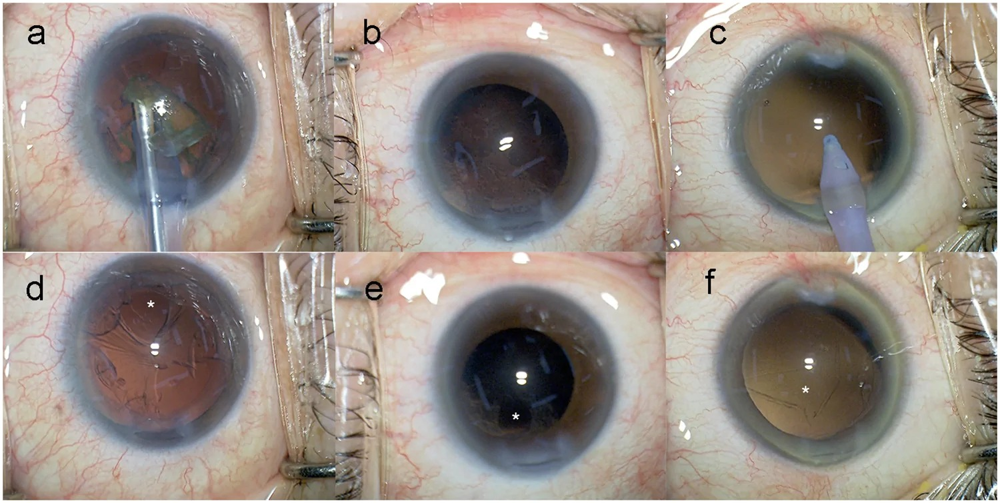
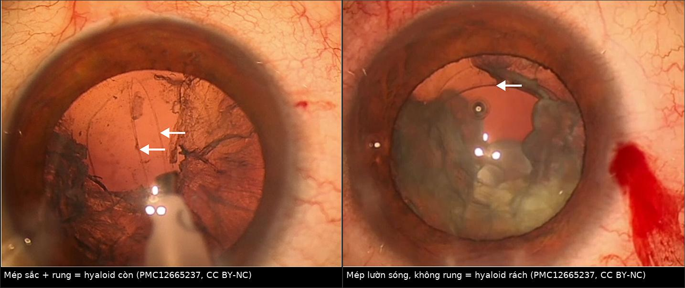
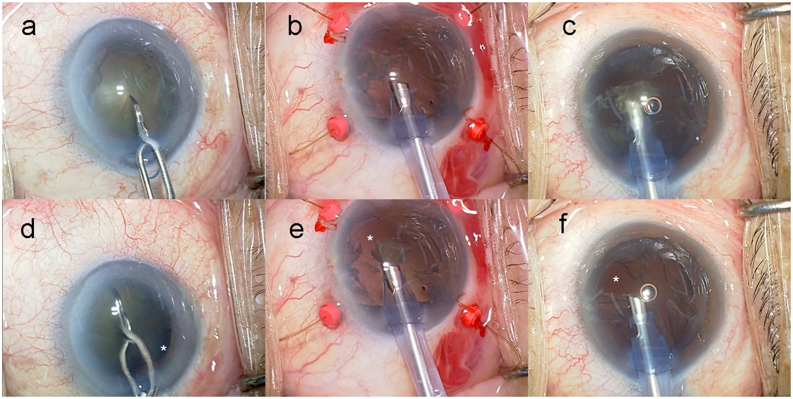
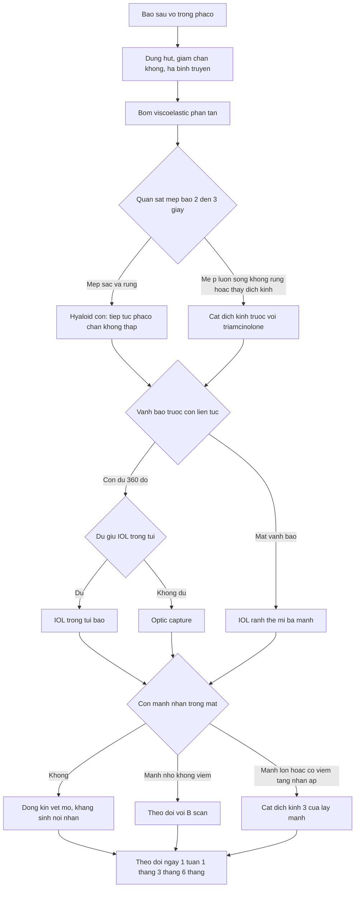
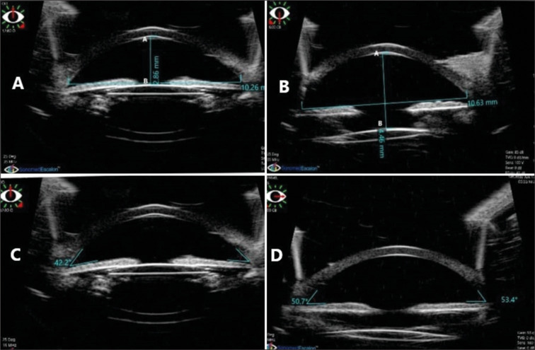
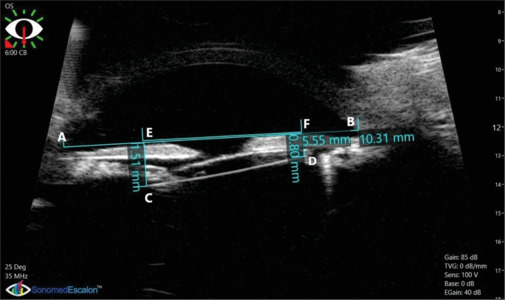
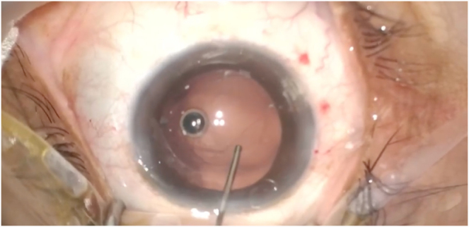
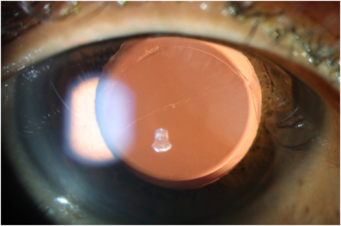

# 3266 — Vỡ bao sau thể thủy tinh trong phaco (posterior capsule rupture, PCR): đặt IOL ở rãnh thể mi hay trong túi bao, và mảnh nhân rơi vào dịch kính

**Tags:** `pattern:vo-bao-sau` `pattern:thoat-dich-kinh` `pattern:manh-nhan-roi` `pattern:mat-mot-ben` `pattern:phu-giac-mac-sau-mo` `pattern:viem-tien-phong` `pattern:iol-nghieng` `vung:mat` `vung:the-thuy-tinh` `vung:bao-sau` `vung:dich-kinh` `vung:tien-phong` `vung:ranh-the-mi` `protocol:anterior-vitrectomy` `protocol:AS-OCT` `protocol:UBM` `protocol:sieu-am-B` `protocol:den-khe` `score:khong-co` `incidentaloma:khong`

**Mức chắc chắn (certainty):** tổng hợp y văn (literature synthesis) — dựng từ: đoàn hệ **1042 mắt** vỡ bao sau tại Moorfields ghi nhận **thì xảy ra + vị trí đặt IOL** (Eye 2025, PMC12446471); đoàn hệ **351 mắt** PCR/27.000 ca ở Brazil (Arq Bras Oftalmol 2025, PMC12997577); đoàn hệ video-verified **3749 mắt** một phẫu thuật viên (Clin Ophthalmol 2026, PMC13738256); đoàn hệ **2719 mắt** Thụy Sĩ (Clin Ophthalmol 2026, PMC13055850); loạt **20 mắt** mô tả **dấu rung mép bao sau (flutter sign)** (Clin Ophthalmol 2025, PMC12665237); nghiên cứu **44 mắt** đo **UBM** so sánh IOL rãnh thể mi với **optic capture** (Indian J Ophthalmol 2025, PMC12707385); tổng quan **50 nghiên cứu** về IOL đặt rãnh thể mi (Ophthalmol Ther 2026, PMC13047016); loạt **36 mắt** và **60 mắt** cắt dịch kính lấy mảnh nhân rơi (PMC6058559; PMC3430058); loạt **79 mắt** bong võng mạc sau cắt dịch kính vì mảnh nhân rơi (PMC4443224); ca IOL một mảnh **trong túi bao dù có PCR** (Int J Surg Case Rep 2026, PMC13166750). Nhóm **không có bệnh nhân của mình**; chỗ chưa đủ chắc ghi **"chưa rõ"**. **Không ghi tên tác giả** — attribution = **tạp chí + năm + PMCID/DOI**.

> **Câu chốt:** bao sau vỡ **không phải một chẩn đoán, mà là một chuỗi ba quyết định trong 10 phút**: (1) **màng hyaloid trước còn hay rách** — quyết định có cắt dịch kính trước hay không; (2) **còn đủ vành bao trước để đặt IOL trong túi/optic capture hay không** — quyết định **rãnh thể mi**; (3) **mảnh nhân còn trong mắt hay đã rơi** — quyết định **cắt dịch kính lấy mảnh ngay hay theo dõi**. Bốn số phải nhớ: PCR gặp **0,43–1,9%** ca phaco (PMC13738256; PMC13055850), **60%** vỡ ở thì **phaco** và **24%** ở thì **hút–rửa** (PMC12446471); trong 1042 mắt vỡ bao sau, IOL được đặt **rãnh thể mi 60%**, **trong túi 11%**, **optic capture 19%**, **bỏ không đặt (aphakia) 8%** (PMC12446471); và **mép bao sau sắc + rung theo dòng chảy = hyaloid còn** → **11/11 mắt** không cần cắt dịch kính, còn **mép lườn sóng, không rung** → **9/9 mắt** phải cắt dịch kính + đặt IOL rãnh thể mi (PMC12665237).

## 1. Tổng quan bệnh học – cơ chế hình ảnh (TẠI SAO)

### 1.1 Bao sau là gì và vì sao nó vỡ đúng ở mặt phẳng đó

- **Bao sau** là **màng collagen không tế bào** (lớp còn lại của biểu mô thể thủy tinh khiếm khuyết), **mỏng nhất ở cực sau** và **không có khả năng tự liền**. Vì **không có tế bào**, bao sau **không sửa chữa** — lỗ vỡ **tồn tại vĩnh viễn**, chỉ được bịt bằng **tổ chức xơ của bao trước + IOL** (đó là lý do đục bao sau thứ phát — PCO — xuất hiện về sau, xem bài 1492).
- **TẠI SAO đúng mặt phẳng đó:** bao sau **bám vào** ba cấu trúc phía sau: **dây chằng Zinn ở xích đạo**, **màng hyaloid trước (anterior hyaloid face)** ở trung tâm (dính qua **khoang Berger**, một khoảng tiềm tàng vài chục µm), và **mô đệm thể thủy tinh đã hút hết**. Khi hút–rửa, chỉ còn **một màng vài µm** giữa **dòng chảy trong tiền phòng** và **dịch kính đặc**. Mọi **chênh áp đột ngột** (giảm áp khi rút tip, bơm viscoelastic quá mạnh, tip tì vào bao) đều dồn vào **cùng một mặt phẳng yếu** — nên vỡ bao sau **luôn khu trú, hình tròn/bầu dục, bờ rõ**, khác với **rách bao trước** (đường đi **theo hướng lực xé**, lan ra xích đạo).
- **Ngưỡng định lượng của "lực làm vỡ" trong thực hành:** vỡ bao sau xảy ra khi **áp lực hút vượt sức bền màng** — nên các yếu tố kỹ thuật đều quy về **chênh áp**: **bình truyền cao** (tăng áp trong mắt nhưng tăng dòng chảy qua lỗ), **chân không cao khi gần cuối thì nhân**, **tip tì vào bao khi hút mảnh nhân cuối**, **đầu hút (I/A) đặt sát bao khi đánh bóng bao sau** (PMC12446471; PMC13738256).
- **Dịch tễ theo thì** (bảng dưới): vỡ **không chỉ xảy ra khi phaco**, mà **24% ở thì hút–rửa** và **4% khi hút viscoelastic sau khi đã đặt IOL** — đây là lý do câu "đã đặt IOL xong là an toàn" **sai**.

| Thì | Tỷ lệ vỡ bao sau (1042 mắt) | Vì sao |
|---|---|---|
| **Phaco** | **621 (60%)** | Chân không cao + mảnh nhân cuối tì vào bao; rách bao trước lan ra sau |
| **Hút–rửa (I/A)** | **248 (24%)** | Đầu hút sát bao, đánh bóng bao sau quá mức, hút cortex dính |
| **Đặt IOL** | **87 (8%)** | Đẩy IOL/haptic qua lỗ bao; mở túi bao bằng viscoelastic |
| **Hút viscoelastic** | **44 (4%)** | Tip chạm bao sau khi IOL đã nằm trong túi |
| **Hydrodissection** | **40 (3%)** | Dòng dịch sau nhân tạo áp lực thủy tĩnh ("hydrodelineation" quá mạnh) |
| **Bơm nước vết mổ** | **2 (0,3%)** | Bơm cân bằng áp làm căng bao |

- Nguồn bảng: **Eye 2025 (PMC12446471)**; đoàn hệ video-verified thứ hai cho phân bố **9/17 ở phaco, 5/17 ở hút–rửa, 2/17 ở phân đoạn nhân** (PMC13738256).

### 1.2 Vì sao nhân và mảnh nhân RƠI xuống dịch kính (vật lý), và vì sao mảnh nhân nguy hiểm

- **Nhân thể thủy tinh đặc hơn dịch kính** (protein crystallin cô đặc): khi mất bao đỡ, nhân **chìm xuống cực dưới** theo trọng lực, **không "lơ lửng"**. Vì vậy **mảnh nhân nhỏ thường nằm ở 6 giờ, dưới võng mạc chu biên**, khuất sau mống mắt — **không thấy khi soi đèn khe ở tư thế ngồi**.
- **Mảnh vỏ mềm (cortical material) thì ngược lại:** nhẹ, **nổi trong dịch kính**, dễ bị hút vào **lỗ vỡ** và **kẹt giữa IOL và bao sau** — đây là "mảnh vỏ" khác hẳn "mảnh nhân" về **nguy cơ và xử trí** (bài 1442).
- **TẠI SAO mảnh nhân gây hại (cơ chế, không phải "vì bẩn"):**
  1. **Protein crystallin là tự kháng nguyên che giấu** — khi ra khỏi bao, hệ miễn dịch gặp lần đầu → **viêm màng bồ đào do phản ứng với thể thủy tinh (phacoanaphylactic / lens-induced uveitis)**, biểu hiện **tế bào tiền phòng, dính mống mắt, màng fibrin** (PMC3430058: **75%** mắt có viêm trước cắt dịch kính).
  2. **Mảnh nhân làm tắc bè củng mạc (trabecular meshwork)** và gây **viêm** → **tăng nhãn áp**: **16,7%** mắt có **IOP > 25 mmHg** lúc trình bày, **11,1%** có **bong võng mạc kèm theo** (PMC6058559); loạt 60 mắt: **50%** IOP cao trước cắt dịch kính (PMC3430058).
  3. **Dịch kính quanh mảnh bị "hóa lỏng" + co kéo** → **bong võng mạc**: **11,4% (9/79 mắt)** bong võng mạc **sau** cắt dịch kính lấy mảnh nhân, và **IOP trước cắt dịch kính cao hơn có ý nghĩa** ở nhóm bong võng mạc (PMC4443224). Đây là con số trả lời câu hỏi hay gặp của gia đình: "lấy mảnh ra là xong chưa?" — **chưa**.
  4. **Viêm mạn → phù hoàng điểm (CME)**: **23,3%** trong 3 tháng đầu, **16,6%** CME mạn (PMC3430058).
- **Vì vậy "mảnh nhân" và "mảnh vỏ" không cùng một bệnh** — mảnh nhân **phải lấy**, trừ trường hợp **mảnh nhỏ, không viêm, nhãn áp bình thường** thì có thể theo dõi sát (chưa có ngưỡng kích thước được chứng minh); mảnh vỏ **chỉ cần rửa/hút**.

### 1.3 Vì sao chọn IOL ở rãnh thể mi hay trong túi bao lại là câu hỏi hình học, không phải câu hỏi "thói quen"

- **Túi bao** nằm **sau mống mắt, trước bao sau**; IOL trong túi **đúng mặt phẳng sinh lý**, **không chạm mống mắt**, **haptic bị bao giữ** → **ít nghiêng, ít di lệch, ít viêm**.
- **Rãnh thể mi (ciliary sulcus)** là **khoảng giữa mống mắt và bao trước**, **đường kính lớn hơn** túi bao; IOL đặt ở đây **gần mống mắt hơn** và **gần góc tiền phòng hơn**. Ba hệ quả vật lý:
  1. **Mặt phẳng IOL ra trước** → **tiền phòng nông hơn** (đo được trên UBM: **3,01 ± 0,25 mm** ở rãnh thể mi so với **3,60 ± 0,59 mm** khi **optic capture**, chênh **0,59 mm**, p < 0,001) (PMC12707385);
  2. **Haptic/đường kính quang học tì vào mặt sau mống mắt** → **cọ xát mống mắt (iris chafing)** → **phân tán sắc tố**, **tăng nhãn áp**, **hội chứng UGH (uveitis–glaucoma–hyphaema)**: nguy cơ này **cao ở IOL một mảnh acrylic** (haptic dày, không gập góc) và **thấp ở IOL ba mảnh** (haptic gập góc 10°) (PMC13047016);
  3. **Không có bao giữ** → **nghiêng và di lệch** (đo trên UBM 6 tháng: nghiêng ngang **1,8° so với 0,83°**, nghiêng dọc **2,16° so với 0,89°** khi so optic capture với rãnh thể mi) — nghiêng này trong nghiên cứu đó **không ảnh hưởng khúc xạ mục tiêu**, nhưng **là lý do không đặt IOL đa tiêu/toric ở rãnh** (PMC12707385; PMC13047016).
- **Vì vậy quy tắc thực hành có cơ sở vật lý:** **còn vành bao trước liên tục quanh 360°** → có thể **đặt trong túi** hoặc **optic capture** (optic chui qua lỗ bao trước, haptic trong rãnh) — **giữ được mặt phẳng sinh lý**; **mất vành bao trước** → **rãnh thể mi**, và **chỉ dùng IOL ba mảnh**.
- **Nhưng "trong túi" không phải lúc nào cũng bắt buộc phải bỏ:** ca EDOF một mảnh **đặt trong túi bao dù có PCR** (vỡ nhỏ, vành bao trước nguyên) đạt **thị lực không kính 0,0 logMAR ngày 13**, **−0,2 ở tuần 6**, **0,0 ở tháng 6**, IOP **10–15 mmHg**, IOL **cân giữa và vững** (PMC13166750). Đây là **dữ liệu một ca**, không phải khuyến cáo — xem mục 7.

### 1.4 Dịch tễ và con số thật

| Bối cảnh | Con số | Nguồn |
|---|---|---|
| PCR trong phaco, hệ thống NHS (Anh) | **0,9%** | PMC12446471 |
| PCR ± thoát dịch kính, trung tâm đại học Thụy Sĩ (**2719 mắt**) | **1,9%** (45 PCR, 7 thoát dịch kính đơn thuần do rách dây chằng) | PMC13055850 |
| PCR, một trung tâm Brazil (**351 mắt**/khoảng 27.000 ca) | **1,3%** | PMC12997577 |
| PCR, một phẫu thuật viên (**3749 mắt**, video-verified) | **0,43% (16 mắt)**; **mảnh nhân rơi 0,08% (3 mắt)** | PMC13738256 |
| Mảnh nhân rơi vào dịch kính | **0,3–1,1%** | PMC6058559 |
| Mảnh nhân rơi — theo kinh nghiệm phẫu thuật viên | **0,2%** (chuyên khoa) so với **0,65%** (học viên) | PMC3430058 |
| Thoát dịch kính khi có PCR (**1042 mắt**) | **80%** | PMC12446471 |
| Rách bao trước kèm PCR | **15%** | PMC12446471 |
| Rách dây chằng Zinn kèm PCR | **5%** | PMC12446471 |
| Mảnh nhân rơi kèm PCR (cùng loạt 1042 mắt) | **12%** | PMC12446471 |
| Hệ số nguy cơ hậu phẫu khi có PCR | **CME ×2,6 · viêm nội nhãn ×21 · bong võng mạc tới ×40** | PMC12446471 (trích dẫn) |
| Biến chứng muộn thực tế của loạt 351 mắt PCR | **phù giác mạc 55,6%** (sớm), **IOP cao 33,3%** (sớm), **IOP cao dai dẳng 11,1%**, **CME 5,1%**, **bong võng mạc 2,5%** (trung bình **9,87 ± 4,31 tháng**) | PMC12997577 |

- **Yếu tố nguy cơ có số:**
  - **Hội chứng giả tróc bao (PXF)**: **OR 2,38** (đa biến, p = 0,013) — yếu tố **duy nhất còn độc lập** trong mô hình Thụy Sĩ (PMC13055850); **RR 2,70** (PMC12997577).
  - **Đục nhân độ ≥ 4 (LOCS III)**: **2,66% (5/188)** so với **0,29% (9/3144)** ở độ 2,0–2,75; độ nhân trung bình ở nhóm có biến chứng **3,06 ± 0,99 so với 2,49 ± 0,57** (PMC13738256).
  - **Dây chằng yếu**: **5,06% (4/79)** so với **0,35% (13/3670)**, **OR 9,70** (95% CI 2,71–29,23) (PMC13738256).
  - **Phải dùng móc kéo mống mắt**: **2,86% (6/210)** so với **0,31% (11/3539)** (PMC13738256).
  - **Đục thủy tinh thể trắng / nhân nâu**: **RR 2,15 / 2,44**; **phẫu thuật viên học viên**: **RR 1,34** (PMC12997577).
  - **Điểm phức tạp trước mổ (Triemli Cataract Score ≥ 3)**: **OR 2,38** đơn biến (p = 0,002), **1,79** đa biến (p = 0,057 — **sát ngưỡng**) (PMC13055850).

### 1.5 Vì sao mỗi modality nhìn thấy gì

| Modality | Thấy gì | Vì sao (vật lý) |
|---|---|---|
| **Đèn khe trong mổ (mikro)** | **Mép bao sau**, **rung hay không rung**, **dịch kính thoát** (dấu "màn the" hoặc **thoát dịch kính ra vết mổ**) | Mép bao **phản xạ ánh sáng mạnh**, mỏng, **di động theo dòng chảy** — **hình thái + động học** là chốt (PMC12665237) |
| **Triamcinolone (KHÔNG phải hình ảnh, nhưng là "thuốc cản quang" của dịch kính)** | **Dịch kính bắt trắng** thành hạt lơ lửng; chỉ rõ **dịch kính còn ở tiền phòng/góc** | Tinh thể steroid **bám sợi collagen dịch kính**, **không bám dịch tiền phòng** → phân biệt "dịch kính" với "thủy dịch" |
| **AS-OCT tiền đoạn** | **Vị trí optic so với bao trước (trước/sau vành bao)**, **khoảng hở giữa IOL và bao**, **dịch kính kẹt** | Ánh sáng phản xạ ở **mặt IOL** và **mặt bao**; khoảng dịch **không phản xạ** |
| **UBM (siêu âm 35–50 MHz)** | **Độ sâu tiền phòng (ACD)**, **góc tiền phòng 4 góc**, **nghiêng/di lệch IOL**, **haptic trong rãnh hay trong túi**, **dịch kính sau IOL** | Sóng âm **xuyên qua mống mắt, IOL, bao** — đo **hình học thật** mà đèn khe không đo được (PMC12707385) |
| **Siêu âm B (10 MHz)** | **Mảnh nhân tăng hồi âm trong dịch kính**, **bong võng mạc**, **xuất huyết dịch kính** | Mô đặc **phản xạ sóng**; dùng khi **không nhìn được đáy mắt** (đục dịch kính, IOL chắn) |
| **CT sọ không cản quang** | **Dầu silicon** tăng đậm độ; **không** dùng để tìm mảnh nhân | Đậm độ của dầu silicon; **không dùng thay B-scan** |

*Sáu khung **(a–f)** của ba ca: **(a–c)** thì phaco/hút–rửa, **(d–f)** ảnh phóng đại tương ứng; **dấu sao (\*)** đánh dấu **vị trí lỗ vỡ bao sau** — ở (e) bao sau vỡ **dù nhân không còn tiếp xúc bao**, ở (f) vỡ trong khi **đánh bóng bao sau** để lấy cortex dính. Đây là lý do **24% vỡ xảy ra ở thì hút–rửa**. Nguồn: Clin Ophthalmol 2026 (PMC13738256), Fig. 2, **CC BY-NC 4.0**.*

## 2. Mẫu hình + chẩn đoán phân biệt theo vị trí (gamut)

### 2.1 Ba câu hỏi phải trả lời NGAY trong mổ (theo thứ tự, không đảo)

1. **Bao sau đã vỡ chưa, và màng hyaloid trước còn không?** → quyết định **có cắt dịch kính trước hay không**.
2. **Còn vành bao trước liên tục không? Còn bao nhiêu?** → quyết định **vị trí IOL**.
3. **Mảnh nhân còn trong mắt không, ở đâu?** → quyết định **lấy ngay hay theo dõi**.

### 2.2 Câu 1 — "dấu rung" (flutter sign) và giới hạn của nó

- **Định nghĩa:** sau khi vỡ bao sau, **giảm chân không về 0, giữ nguyên tip, giảm bình truyền** → quan sát **mép bao sau trong 2–3 giây**:
  - **Mép sắc, rung (flutter) theo dòng chảy** = **màng hyaloid trước còn nguyên**, **không có dịch kính thoát** → **tiếp tục phaco** với **chân không thấp**;
  - **Mép lườn sóng (scalloped), không rung**, kèm **"màn the"** hoặc **dịch kính trồi ra** = **hyaloid rách**, **thoát dịch kính** → **cắt dịch kính trước** rồi mới tiếp.
- **Bằng chứng:** **20 mắt** vỡ bao sau — **11 mắt** rung (hyaloid còn): **0 mắt** cần cắt dịch kính, **5 mắt đặt IOL trong túi**, **6 mắt rãnh thể mi**, **tất cả đạt 20/20**; **9 mắt** không rung: **9/9 phải cắt dịch kính trước + IOL rãnh thể mi**, **3 mắt có mảnh di chuyển ra sau** (2 mảnh nhỏ không can thiệp, **1 mảnh nhân lớn phải mổ lại**), **2 mắt còn 20/30**, **2 mắt tăng nhãn áp thoáng qua**, **không ca nào bong võng mạc hay viêm nội nhãn** (PMC12665237).
- **Giới hạn (phải nói rõ):** đây là **loạt 20 mắt, một trung tâm, quan sát viên không mù**, **chưa có độ nhạy/độ đặc hiệu** được tính — **không phải "xét nghiệm"**. Dấu rung **chỉ dùng khi nhìn thấy mép bao rõ**; nếu **đục giác mạc, máu, hay phù** thì **không kết luận được** → **mặc định là có thoát dịch kính** và cắt dịch kính an toàn.

*Trái: **mép bao sau sắc, rung** theo dòng chảy — **hyaloid trước còn**, không cần cắt dịch kính. Phải: **mép lườn sóng, không rung** — **hyaloid rách**, có **dịch kính trồi** (mũi tên). Nguồn: Clin Ophthalmol 2025 (PMC12665237), Fig. 1 và Fig. 2, **CC BY-NC 4.0**; ảnh ghép letterbox, không crop.*

### 2.3 Câu 3 — gamut "mảnh thể thủy tinh ở đâu"

| Vị trí | Nhận diện | Nguy cơ chính | Xử trí |
|---|---|---|---|
| **Tiền phòng** | Mảnh trắng **di động trong tiền phòng**, thấy rõ khi soi | **Phù giác mạc khu trú**, tăng nhãn áp, viêm | **Lấy ngay** bằng tip/phaco trong tiền phòng (**bài 1442**) |
| **Kẹt giữa IOL và bao sau** | Mảnh **kẹt sau IOL**, thấy khi **soi góc/nghiêng đầu**; AS-OCT thấy **khoảng tăng hồi âm giữa IOL và bao** | Viêm mạn, **phù hoàng điểm**, **tăng nhãn áp** | **Lấy qua vết mổ phụ** nếu không di lệch IOL; **không đẩy IOL** |
| **Sau mống mắt, trên bao sau** | **Không thấy ở tư thế ngồi**, chỉ thấy khi **nghiêng đầu/soi qua đồng tử giãn tối đa** | Bỏ sót → **viêm tái phát** | Cắt dịch kính **trước** (anterior vitrectomy) + lấy qua **lỗ bao** |
| **Dịch kính (rơi)** | **Chìm ở 6 giờ**, có thể **không thấy**; **B-scan** thấy **tăng hồi âm** | Viêm, tăng nhãn áp, **bong võng mạc 11,4%** | **Cắt dịch kính 3 cửa** lấy mảnh (**bảng 4.5**) |
| **Dưới võng mạc** | **Hiếm**; mảnh **đẩy võng mạc lên**, thấy trên **B-scan/CT** | **Bong võng mạc**, mất thị lực | **Mổ dịch kính + lấy mảnh** — **không theo dõi** |

### 2.4 Gamut "viêm / đục / tăng nhãn áp sau phaco có PCR"

| Nhóm | Thời điểm | Dấu chốt |
|---|---|---|
| **Thoát dịch kính không được xử lý hết** | **Ngày 1–3** | **Dịch kính ở tiền phòng**, **dính mống mắt**, **IOL di lệch**, **mép vết mổ hở** |
| **Mảnh nhân/vỏ sót** | **Tuần 1–4** | Viêm **tái phát**, **phù giác mạc khu trú**, **IOP cao**; **B-scan** thấy mảnh |
| **Viêm nội nhãn cấp** | **Ngày 3–7** | **Đau tăng**, **mủ tiền phòng**, **giảm thị lực nhanh** — **cấp cứu** (bài 1425) |
| **TASS** | **12–48 giờ** | Phù **limbus-to-limbus**, **không mủ**, **không đau** (bài 3264) |
| **Bong màng Descemet** | **Ngày 1–10** | Phù **khu trú**, **AS-OCT hai đường** (bài 3264) |
| **IOL rãnh thể mi cọ mống mắt** | **Tháng–năm** | **Phân tán sắc tố**, **teo mống mắt**, **IOP cao**, **UGH** |
| **Bong võng mạc** | **Trung bình ~10 tháng** (2–15) | **Ám điểm/hình màn**, **B-scan**; **2,5%** sau PCR (PMC12997577) |

*Ba ca (**a–c** ảnh trong mổ, **d–f** ảnh phóng đại): (d) **rách dây chằng Zinn** (dấu sao) làm **thể thủy tinh di lệch xuống dưới** và **nhân rơi** dù bao sau nguyên; (e) **vỡ bao sau** khi còn nhân trong bao (dấu sao); (f) vỡ bao sau khi hút nhân cứng. Phân biệt **rơi nhân do rách dây chằng** (không có PCR) với **rơi nhân do vỡ bao sau** là **hai cơ chế khác nhau, hai cách xử trí khác nhau**. Nguồn: Clin Ophthalmol 2026 (PMC13738256), Fig. 1, **CC BY-NC 4.0**.*

## 3. Bảng so sánh phân biệt (ma trận đối chiếu)

| Thực thể (entity) | Hình ảnh điển hình | Chốt vào (rule-in) | Chốt loại (rule-out) | Gợi ý xác nhận |
|---|---|---|---|---|
| **Vỡ bao sau, hyaloid CÒN** | **Mép sắc, rung**, không có "màn the"; tiền phòng **vững** | **Mép sắc + rung theo dòng chảy + không dịch kính ở tiền phòng** | **Mép lườn sóng, mất rung, dịch kính trồi** → hyaloid rách | Quan sát **sau khi giảm chân không**; **triamcinolone** nếu nghi |
| **Vỡ bao sau, hyaloid RÁCH** | **Mép lườn sóng**, **dịch kính** trồi ra vết mổ, **đồng tử co** khi hút | **Thấy dịch kính** (triamcinolone bắt trắng) hoặc **mép mất rung** | **Mép rung + tiền phòng sạch** → hyaloid còn | **Triamcinolone** + **cắt dịch kính trước** |
| **Rách dây chằng Zinn** (không PCR) | **Thể thủy tinh lắc (phacodonesis)**, **lệch trục**, **rãnh đen ở xích đạo**, **nhân rơi** | **Thấy khe hở dây chằng + lệch thể thủy tinh** | **Bao sau liên tục** → không phải PCR | Đèn khe **trước mổ** (phacodonesis), **móc kéo mống mắt** |
| **Mảnh nhân trong dịch kính** | **Chìm 6 giờ**, **B-scan tăng hồi âm**, **viêm + IOP cao** | **Mảnh nhân đặc, rắn, không hút được** hoặc **có viêm/tăng nhãn áp** | **Mảnh vỏ mềm, nhỏ, không viêm** → có thể theo dõi | **B-scan**, đèn khe **nghiêng đầu**, **không nhầm với máu cục** |
| **Mảnh vỏ (cortex) kẹt bao** | **Mảng trắng mềm** giữa IOL và bao; **phù khu trú nhẹ** | **Mềm, dễ hút, không đặc** | **Mảnh rắn, không di chuyển** → mảnh nhân | AS-OCT: **mảng tăng hồi âm mỏng** |
| **IOL trong túi bao** | Optic **sau vành bao trước**; **AS-OCT: optic nằm sau mép bao**; **haptic trong túi** | **Vành bao trước liên tục 360°, optic sau mép bao** | **Optic trước vành bao, haptic ở rãnh** → rãnh thể mi | **AS-OCT/UBM**; **không dựa vào cảm giác khi đẩy IOL** |
| **IOL rãnh thể mi** | **Optic trước bao trước**, **haptic trong rãnh**; **ACD nông hơn** (**3,01 so với 3,60 mm**) | **Optic trước vành bao, haptic tựa rãnh** | **Optic sau vành bao** → trong túi/capture | **UBM** đo **ACD, góc, nghiêng** (PMC12707385) |
| **Optic capture** | **Optic chui qua lỗ bao trước**, **haptic trong rãnh**; **ACD sâu hơn 0,59 mm**, **góc rộng hơn** (**47,09° so với 42,23°**) | **Thấy optic nằm trong lỗ bao**, bờ lỗ bao **ôm quanh optic** | **Optic hoàn toàn trước bao** → rãnh thể mi | **UBM/AS-OCT**; **nghiêng nhiều hơn** (**1,8°/2,16° so với 0,83°/0,89°**) (PMC12707385) |
| **IOL một mảnh acrylic ở rãnh** | **Cọ mống mắt**, **sắc tố ở mặt sau mống mắt**, **IOP cao muộn** | **Thấy sắc tố + teo mống mắt + IOP cao** ở mắt có IOL một mảnh ở rãnh | **IOL ba mảnh, không sắc tố** → ít nguy cơ | **Soi góc**, **AS-OCT**; **tránh đặt ngay từ đầu** (PMC13047016) |
| **TASS** | Phù **limbus-to-limbus 12–48 giờ**, **không mủ** | **Khởi phát < 48 giờ + phù toàn bộ + không đau** | **Viêm khu trú + mủ + đau** → nhiễm | **Không corticoid khi chưa loại nhiễm** (bài 1425) |
| **Viêm nội nhãn** | **Mủ tiền phòng**, **đau**, **thị lực giảm nhanh ngày 3–7** | **Mủ + đau + phản ứng tiền phòng mạnh** | **Không mủ, không đau** → TASS/PCR đơn thuần | **Cấy dịch kính trước kháng sinh** (bài 1425) |

## 4. Protocol mổ + ngưỡng quyết định & phân độ

### 4.1 Bảy bước cố định khi bao sau vỡ (theo thứ tự)

| Bước | Việc làm | Ngưỡng/kỹ thuật | Vì sao |
|---|---|---|---|
| 1 | **DỪNG hút**, **giảm chân không về 0**, **hạ bình truyền** | Bình truyền **thấp nhất còn giữ tiền phòng** | Cắt vòng xoáy **hút thêm dịch kính** vào lỗ vỡ |
| 2 | **Giữ tip tại chỗ**, **bơm viscoelastic dispersive** | **Viscoelastic phân tán (dispersive)** | **Ép dịch kính ra sau** và tạo khoảng làm việc |
| 3 | **Đánh giá mép bao (flutter) + dịch kính** | **Rung = tiếp tục; không rung = cắt dịch kính** | Quyết định can thiệp dịch kính (PMC12665237) |
| 4 | **Cắt dịch kính trước (anterior vitrectomy)** nếu có dịch kính | **Cutter 23–25 G, cắt 300–600 cpm, chân không thấp**, **luôn có infusion**; **triamcinolone** để thấy dịch kính | Bỏ dịch kính ở tiền phòng/góc — **không kéo** |
| 5 | **Đánh giá vành bao trước** | **Vành bao liên tục quanh 360°** = còn túi; **mất vành** = rãnh thể mi | Quyết định vị trí IOL (chưa có ngưỡng mm được chứng minh) |
| 6 | **Đặt IOL** | **Trong túi/capture** nếu vành bao đủ; **rãnh thể mi + IOL ba mảnh** nếu mất vành; **bỏ trống (aphakia)** nếu bao–dây chằng quá yếu | Tránh **UGH, nghiêng, viêm** |
| 7 | **Đóng kín vết mổ + kháng sinh nội nhãn** | **Kiểm tra kín nước** (Seidel), **không để hở** | Hở vết mổ = **đường vào viêm nội nhãn** |

### 4.2 Ngưỡng chọn vị trí IOL (bảng quyết định)

| Tình trạng bao/dây chằng | Vị trí IOL | Loại IOL | Ghi chú |
|---|---|---|---|
| PCR nhỏ, **vành bao trước nguyên 360°** | **Trong túi bao** | Bất kỳ (kể cả **EDOF/một mảnh**) | Ca báo cáo: **thị lực 0,0 logMAR tháng 6** (PMC13166750); **11%** mắt PCR vẫn đặt trong túi (PMC12446471) |
| PCR, **vành bao còn nhưng không đủ giữ IOL** | **Optic capture** (optic qua lỗ bao trước, haptic rãnh) | **Ba mảnh** (hoặc một mảnh nếu hình học phù hợp) | **19%** mắt PCR được đặt kiểu này (PMC12446471); **ACD sâu hơn, góc rộng hơn, nghiêng nhiều hơn** (PMC12707385) |
| PCR, **mất vành bao trước** | **Rãnh thể mi** | **Ba mảnh (haptic gập góc 10°) hoặc PMMA một mảnh** | **60%** mắt PCR (PMC12446471); **tránh IOL một mảnh acrylic** (UGH, sắc tố, cọ mống mắt) (PMC13047016) |
| **Rách dây chằng rộng, bao–dây chằng yếu** | **Rãnh thể mi ± vòng căng bao (CTR)** hoặc **cố định củng mạc** | **Ba mảnh** | Không đặt IOL đa tiêu/toric ở rãnh (PMC13047016) |
| **Không đủ bao và không đủ rãnh** | **Bỏ trống (aphakia)**, đặt IOL **thì hai** | — | **8%** mắt PCR bị bỏ trống; tăng lên **19,4%** nếu có rách bao trước (PMC12446471) |

### 4.3 Theo dõi hậu phẫu — lịch và ngưỡng

| Thời điểm | Việc làm | Ngưỡng hành động |
|---|---|---|
| **Ngày 1** | Đèn khe: **mép vết mổ**, **tiền phòng**, **dịch kính**, **IOL vị trí**, **Seidel** | **Hở vết mổ/dịch kính tiền phòng** → xử lý ngay |
| **Tuần 1** | **IOP**, **phù giác mạc**, **viêm** | **IOP > 25 mmHg** hoặc **viêm tăng** → tìm **mảnh sót** (**B-scan**) |
| **Tháng 1** | **IOL vị trí (AS-OCT/UBM nếu nghiêng)**, **soi góc tìm sắc tố**, **đáy mắt giãn đồng tử** | **Sắc tố + IOP cao** → nghi **UGH** |
| **Tháng 3** | **OCT hoàng điểm** (CME), **đáy mắt** | **CME** → điều trị chống viêm; **rách võng mạc** → laser |
| **Tháng 6–12** | **Đáy mắt**, **IOP**, khúc xạ | **Bong võng mạc** hay gặp **trung bình 9,87 ± 4,31 tháng** (2–15) (PMC12997577) |

- **Tần suất biến chứng để tư vấn:** phù giác mạc **55,6%**, IOP cao sớm **33,3%**, IOP cao dai dẳng **11,1%**, CME **5,1%**, bong võng mạc **2,5%**; thị lực **1,31 ± 0,84 → 0,51 ± 0,56 logMAR** sau 1 năm (PMC12997577).

### 4.4 Sơ đồ quyết định

### 4.5 Mảnh nhân rơi — khi nào cắt dịch kính, và kết quả có số

| Tiêu chí | Khuyến nghị | Bằng chứng |
|---|---|---|
| **Mảnh lớn, nhân cứng, có viêm hoặc IOP cao** | **Cắt dịch kính 3 cửa lấy mảnh** | **16,7%** mắt có IOP > 25 mmHg, **11,1%** có bong võng mạc lúc trình bày; BCVA **1,04 ± 0,24 → 0,46 ± 0,18 logMAR** sau cắt dịch kính (PMC6058559) |
| **Mảnh nhỏ, không viêm, IOP bình thường** | **Theo dõi sát** với **B-scan + IOP + OCT** | Trong loạt flutter: **2/3 mảnh nhỏ "không đáng kể", không can thiệp** (PMC12665237) |
| **Có IOL trong túi/ rãnh đã đặt khi mảnh rơi** | **Cân nhắc tháo IOL** nếu cản trở lấy mảnh | **Đặt IOL ngay lúc phaco biến chứng → kết cục thị lực xấu hơn** (p = 0,041) (PMC6058559) |
| **Thời điểm cắt dịch kính** | **Chưa thống nhất** — xem mục 7 | Sớm (**< 1 tuần**): viêm **18% so với 67,5%**, IOP cao **20% so với 52%**, bong võng mạc **1 so với 5**, thị lực cuối **20/50 so với 20/200** (PMC3430058) — nhưng loạt 36 mắt lại **không thấy thời điểm liên quan kết cục** (PMC6058559) |
| **Nguy cơ sau cắt dịch kính** | **Bong võng mạc 11,4% (9/79)**, hay gặp hơn nếu **IOP trước mổ cao** | PMC4443224 |
| **Lấy mảnh bằng gì** | **Cutter + phacofragmatome**, hoặc **đẩy ra tiền phòng rồi lấy qua vết mổ** | Loạt 36 mắt: **cả 3 cách đều dùng được**, **đường lấy không ảnh hưởng thị lực** (PMC6058559) |

*UBM 35 MHz, cùng một loại IOL ba mảnh. **(A, C)** IOL **rãnh thể mi**: **ACD 2,96 mm**, góc **42,2°**. **(B, D)** **optic capture**: **ACD 3,80 mm**, góc **50,7° / 53,4°** — tiền phòng sâu hơn và góc rộng hơn rõ rệt. Đây là **cái được** của optic capture; **cái mất** là **nghiêng nhiều hơn** (hình dưới). Nguồn: Indian J Ophthalmol 2025 (PMC12707385), Fig. 2, **CC BY-NC-ND 4.0** (nguyên bản, không chỉnh sửa).*

*UBM: **một bờ optic nằm trong rãnh thể mi, bờ đối diện chui dưới vành bao trước** → **trục optic nghiêng**. Nghiêng ngang **1,8° so với 0,83°** và nghiêng dọc **2,16° so với 0,89°** khi so optic capture với rãnh thể mi; **không ảnh hưởng khúc xạ mục tiêu** trong nghiên cứu này nhưng **là lý do không đặt IOL đa tiêu/toric ở rãnh**. Nguồn: Indian J Ophthalmol 2025 (PMC12707385), Fig. 4, **CC BY-NC-ND 4.0** (nguyên bản).*

## 5. Biến thể bình thường và cạm bẫy

1. **"Mép bao trông sắc là hyaloid còn"** — chỉ đúng khi **mép RUNG**. Mép **sắc nhưng đứng yên** (do **dòng chảy đã ngừng**, **chân không còn**) **không chứng minh hyaloid còn**; phải **tạo dòng chảy nhẹ** rồi quan sát lại, và nếu nghi ngờ → **triamcinolone**.
2. **"Đã đặt IOL xong là hết nguy cơ"** — **4%** vỡ bao sau xảy ra **khi hút viscoelastic sau khi IOL đã nằm trong túi** (PMC12446471). Tip **không được chạm** bao sau khi đã đặt IOL.
3. **Bỏ sót vỡ bao sau ở thì hút–rửa** — **24%** ca vỡ xảy ra ở thì này, thường **không có tiếng "bụp"**, chỉ thấy **đồng tử đột ngột co lại** hoặc **tiền phòng sâu bất thường** (dịch kính vào tiền phòng làm **mất cân bằng áp**). **Đồng tử co đột ngột khi hút = dấu hiệu dịch kính**, không phải "ánh sáng mổ".
4. **Nhầm mảnh vỏ với mảnh nhân** — mảnh vỏ **mềm, trắng, dễ hút**; mảnh nhân **rắn, vàng, không hút được**. Đặt IOL **chồng lên mảnh nhân** kẹt giữa IOL và bao → **viêm mạn, phù hoàng điểm**.
5. **Không thấy mảnh nhân vì bệnh nhân ngồi** — mảnh **chìm ở 6 giờ sau mống mắt**. Phải **giãn đồng tử tối đa + nghiêng đầu + soi góc**, và **B-scan** nếu không nhìn được.
6. **Đặt IOL một mảnh acrylic vào rãnh thể mi** — **chống chỉ định** theo ASCRS và các hướng dẫn châu Âu: nguy cơ **cọ mống mắt, phân tán sắc tố, UGH, tăng nhãn áp**. IOL ba mảnh có **CME 1–8%, sắc tố 0–12%, tăng IOP 1–9%** (PMC13047016).
7. **Đặt IOL trong túi "cho đẹp" khi vành bao đã mất** — IOL sẽ **nghiêng, trượt ra sau**, và **không thể lấy lại dễ dàng**; **bỏ trống (aphakia)** an toàn hơn **đặt sai chỗ** (8% mắt PCR được bỏ trống, 19,4% nếu có rách bao trước — PMC12446471).
8. **Rách bao trước + PCR** — **15%** ca PCR có rách bao trước; nhóm này **vỡ sớm hơn** (hydrodissection **8,4% so với 3,0%**, phaco **71,0% so với 57,5%**) và **ít được đặt IOL trong túi** (**4,5% so với 12,4%**), **optic capture ít hơn** (**3,9% so với 20,7%**) (PMC12446471). Thấy rách bao trước → **hạ ngưỡng** chuẩn bị kịch bản PCR.
9. **Cho rằng "mảnh nhân nhỏ thì vô hại"** — mảnh nhỏ vẫn gây **viêm, dính, tăng nhãn áp**; tiêu chuẩn theo dõi là **không viêm + IOP bình thường + mảnh nhỏ, không di chuyển** (chưa có ngưỡng mm được chứng minh), không phải "nhỏ là bỏ".
10. **Không chụp B-scan trước khi đóng mổ khi không thấy đáy mắt** — nếu **không quan sát được võng mạc** (đục dịch kính, máu), **B-scan tại bàn mổ hoặc ngay sau mổ** là cách duy nhất loại **mảnh nhân + bong võng mạc**.
11. **Hở vết mổ "nhỏ"** — mọi vết mổ **phải kín nước**; hở = **đường vào viêm nội nhãn**, và nguy cơ viêm nội nhãn **tăng ×21** khi có PCR (PMC12446471). **Không khâu vội rồi bỏ qua** kiểm tra Seidel.

*Vỡ bao sau **sau khi phaco xong**, **trước khi đặt IOL**; **vành bao trước còn nguyên** — chính là điều kiện để ca này **vẫn đặt IOL một mảnh trong túi bao**. Nguồn: Int J Surg Case Rep 2026 (PMC13166750), Fig. 1, **CC BY 4.0**.*

*Tuần 6: **IOL trong túi bao, cân giữa, vững**, không nghiêng; thị lực **−0,2 logMAR**, IOP **10 mmHg** ở tuần 6 và **0,0 logMAR**, IOP **15 mmHg** ở tháng 6. **Một ca**, không phải khuyến cáo — xem mục 7. Nguồn: Int J Surg Case Rep 2026 (PMC13166750), Fig. 2, **CC BY 4.0**.*

## 6. Tự lượng giá — Blind Quiz

**Ca 1 — Nam 72 tuổi, phaco mắt phải, đục nhân độ 3. Trong thì hút–rửa, đồng tử đột ngột co lại, tiền phòng sâu hơn; phẫu thuật viên giảm chân không và chụp ảnh mép bao sau.**

- Gợi ý: hai ảnh là **hai mắt khác nhau**, cùng thì hút–rửa.
- Câu hỏi: (1) Ảnh nào là **hyaloid còn**, ảnh nào **hyaloid rách**? (2) Dấu hiệu **động học** nào quyết định, không phải hình thái tĩnh? (3) Nếu chọn sai, hậu quả **ngay trong mổ** là gì?

<b>Bấm để hiện đáp án (findings + chẩn đoán)</b>

- **Dấu hiệu:** trái — **mép bao sau sắc, rung (flutter)** theo dòng chảy, **không có "màn the"**, tiền phòng vững → **hyaloid trước còn**. Phải — **mép lườn sóng (scalloped), không rung**, có **dịch kính trồi** (mũi tên) → **hyaloid rách**.
- **Động học là chốt:** cùng một "mép sắc" nhưng nếu **không rung** thì **không chứng minh** hyaloid còn; phải **tạo dòng chảy nhẹ** rồi quan sát.
- **Chẩn đoán:** **vỡ bao sau (PCR)** — nhánh **hyaloid còn** (tiếp tục phaco chân không thấp, có thể đặt IOL trong túi) so với **hyaloid rách** (phải **cắt dịch kính trước**, IOL **rãnh thể mi**).
- **Nếu chọn sai:** tiếp tục phaco khi hyaloid đã rách → **hút dịch kính vào tip**, **co kéo dịch kính** → **bong võng mạc** và **mảnh nhân rơi sâu hơn**; loạt 20 mắt: **9/9** ca không rung phải cắt dịch kính, **3 ca có mảnh di chuyển ra sau** (PMC12665237).
- **Nguồn ảnh:** Clin Ophthalmol 2025 (PMC12665237), Fig. 1–2, **CC BY-NC 4.0** (ảnh ghép letterbox).

**Ca 2 — Nữ 68 tuổi, 4 tuần sau phaco có PCR. Thị lực 20/200, IOP 28 mmHg, tiền phòng có tế bào; B-scan thấy hình tăng hồi âm ở 6 giờ. Được cắt dịch kính lấy mảnh nhân; 6 tháng sau UBM được chụp để kiểm tra IOL.**

- Gợi ý: hai cột là **hai cách đặt IOL khác nhau**, không phải hai bệnh nhân cùng cách.
- Câu hỏi: (1) Đọc **ACD** và **góc tiền phòng** ở hai cột? (2) Cột nào là **optic capture**, cột nào **rãnh thể mi** — dựa vào **haptic**? (3) Vì sao **ACD sâu hơn** lại quan trọng ở mắt đã cắt dịch kính?

<b>Bấm để hiện đáp án</b>

- **Số đo:** **(A, C)** ACD **2,96 mm**, góc **42,2°**; **(B, D)** ACD **3,80 mm**, góc **50,7°/53,4°**.
- **Cột nào là gì:** **(A, C) = rãnh thể mi** (haptic tựa rãnh, optic **trước** vành bao, tiền phòng nông); **(B, D) = optic capture** (haptic trong rãnh, **optic chui qua lỗ bao trước**, tiền phòng sâu hơn **0,59 mm**).
- **Vì sao ACD quan trọng:** mắt **đã cắt dịch kính** có **ít đệm dịch kính**, **dễ tăng nhãn áp** và **dễ tổn thương nội mô** khi tiền phòng nông; ACD sâu hơn + góc rộng hơn (góc **47,09° so với 42,23°** ở góc thái dương, p = 0,001) **giảm nguy cơ** này, nhưng **nghiêng nhiều hơn** (**1,8°/2,16° so với 0,83°/0,89°**) (PMC12707385).
- **Nguồn ảnh:** Indian J Ophthalmol 2025 (PMC12707385), Fig. 2, **CC BY-NC-ND 4.0** (nguyên bản).

**Ca 3 — Nữ 64 tuổi, phaco + đặt IOL một mảnh EDOF. Trong mổ thấy vỡ bao sau nhỏ sau khi phaco xong, vành bao trước còn nguyên 360°. Ảnh trái chụp ngay sau khi phát hiện vỡ; ảnh phải chụp tuần 6.**

- Gợi ý: **vành bao trước** là yếu tố quyết định, không phải kích thước lỗ bao sau.
- Câu hỏi: (1) Vì sao ca này **có thể** đặt IOL trong túi bao? (2) Điều kiện nào **phải có** để làm vậy? (3) Nếu vành bao trước đã mất, phương án nào và **loại IOL nào**?

<b>Bấm để hiện đáp án</b>

- **Dấu hiệu:** ảnh trái — **lỗ vỡ bao sau** nhỏ, **vành bao trước nguyên**, **không có dịch kính trồi**; ảnh phải (tuần 6) — **IOL một mảnh trong túi bao, cân giữa**, bao trước **ôm quanh optic**.
- **Vì sao được:** bao trước còn **360°** giữ được **optic + haptic trong túi**, mặt phẳng sinh lý, **không chạm mống mắt**.
- **Điều kiện bắt buộc:** **hyaloid còn** (không cắt dịch kính), **vành bao trước liên tục**, **lỗ vỡ nhỏ và không lan ra xích đạo**, **không còn mảnh nhân trong túi**.
- **Nếu mất vành bao trước:** **IOL rãnh thể mi, loại ba mảnh** (haptic gập góc); **tránh IOL một mảnh acrylic** (UGH, sắc tố, cọ mống mắt) (PMC13047016).
- **Số liệu ca:** ngày 13 **0,0 logMAR**, tuần 6 **−0,2**, tháng 6 **0,0**; IOP **10–15 mmHg** (PMC13166750) — **một ca**, không đủ để đổi thực hành.
- **Nguồn ảnh:** Int J Surg Case Rep 2026 (PMC13166750), Fig. 1–2, **CC BY 4.0**.

## 7. Câu hỏi nghiên cứu & điểm chưa đồng thuận (tính đến 11/2026)

1. **[Tranh cãi] Ở mắt phaco vỡ bao sau có mảnh nhân rơi, cắt dịch kính lấy mảnh SỚM (< 1 tuần) có cải thiện thị lực và giảm bong võng mạc so với cắt muộn?**
   - **Đã biết:** loạt **60 mắt** cho thấy nhóm sớm (< 1 tuần) có **viêm 18% so với 67,5%** (p = 0,0005), **IOP cao 20% so với 52%** (p < 0,001), **bong võng mạc 1 so với 5 mắt**, thị lực cuối **20/50 so với 20/200** (p < 0,001) (PMC3430058). Ngược lại, loạt **36 mắt** (khoảng cách tới cắt dịch kính **11,4 ± 9,2 ngày**, 1–45) **không thấy thời điểm cắt dịch kính liên quan kết cục thị lực**; yếu tố dự báo xấu là **thị lực trước cắt dịch kính kém** và **đặt IOL ngay khi phaco biến chứng** (PMC6058559).
   - **Chưa rõ:** cả hai đều **hồi cứu, không ngẫu nhiên**, **chọn bệnh nhân khác nhau** (nhóm "sớm" có thể đã nặng hơn hoặc nhẹ hơn); **chưa có ngưỡng thời gian** nào được chứng minh; **chưa rõ** có nên cắt dịch kính **ngay trong cùng cuộc mổ** hay chuyển tuyến.
   - **Hướng nghiên cứu:** RCT/đoàn hệ tiến cứu phân tầng theo **kích thước mảnh, IOP lúc phát hiện, viêm**, với outcome **BCVA 6 tháng, bong võng mạc, CME, số lần mổ**.
   - **Nguồn:** PMC3430058 (2011); PMC6058559 (2018); PMC4443224 (2015).

2. **[Tranh cãi] Sau vỡ bao sau, đặt IOL ở RÃNH THỂ MI hay OPTIC CAPTURE cho kết cục tốt hơn?**
   - **Đã biết:** optic capture cho **tiền phòng sâu hơn 0,59 mm** và **góc rộng hơn** (**47,09° so với 42,23°**, p = 0,001) nhưng **nghiêng nhiều hơn** (**1,8°/2,16° so với 0,83°/0,89°**), **không ảnh hưởng khúc xạ mục tiêu** trong **44 mắt trẻ** (PMC12707385); trong thực hành Moorfields, **19%** mắt PCR được đặt optic capture so với **60%** rãnh thể mi (PMC12446471); tổng quan 50 nghiên cứu ghi nhận **thiếu dữ liệu tiến cứu** và kết quả **phụ thuộc thiết kế IOL** (PMC13047016).
   - **Chưa rõ:** **không có RCT** so sánh trực tiếp hai cách ở **người lớn sau PCR** với outcome **nghiêng IOL đo khách quan, sắc tố mống mắt, IOP dài hạn, khúc xạ**; **chưa rõ** ngưỡng **kích thước lỗ bao trước** để capture an toàn (nghiên cứu trên dùng lỗ **≤ 5,0 mm**, đối tượng **1–3 tuổi**).
   - **Hướng nghiên cứu:** đoàn hệ tiến cứu người lớn sau PCR, đo **UBM/AS-OCT 1–6–12 tháng**, outcome **nghiêng (°), ACD, sắc tố, IOP, BCVA**.
   - **Nguồn:** PMC12707385 (2025); PMC12446471 (2025); PMC13047016 (2026).

3. **[Khác biệt thực hành] Có nên đặt IOL MỘT MẢNH trong TÚI BAO khi đã có vỡ bao sau nhỏ?**
   - **Đã biết:** **11%** mắt PCR trong thực hành Moorfields vẫn được đặt IOL trong túi (PMC12446471); ca EDOF một mảnh trong túi dù có PCR đạt **0,0 logMAR tháng 6**, IOL vững (PMC13166750); ngược lại, **đặt IOL ngay khi phaco biến chứng** gắn với **kết cục thị lực xấu hơn** (p = 0,041) (PMC6058559), và tổng quan về IOL rãnh thể mi **chống chỉ định** IOL một mảnh acrylic ở **rãnh** (PMC13047016).
   - **Chưa rõ:** **tiêu chuẩn chọn** (kích thước lỗ, vị trí lỗ so với trục, độ lan ra xích đạo, còn mảnh nhân hay không) **chưa được định lượng**; **chưa rõ** nguy cơ **di lệch muộn** và **PCO** của IOL một mảnh trong bao bị vỡ; bằng chứng hiện có là **báo cáo ca**, không phải đoàn hệ.
   - **Hướng nghiên cứu:** registry đa trung tâm ghi **kích thước/vị trí lỗ bao sau + loại IOL + vị trí đặt**, outcome **di lệch, PCO, BCVA 1 năm**.
   - **Nguồn:** PMC13166750 (2026); PMC12446471 (2025); PMC13047016 (2026).

## Bài liên quan chéo

- [1442 – Mảnh thể thủy tinh sót ở tiền phòng](../1442-manh-the-thuy-tinh-con-sot/lesson.md) (mảnh **vỏ/nhân** trong tiền phòng — phù khu trú, UBM/AS-OCT)
- [3264 – Bong màng Descemet sau phaco](../3264-bong-mang-descemet-sau-phaco/lesson.md) (giác mạc đục sau mổ **không có** mủ: phù khu trú + AS-OCT)
- [1425 – Viêm nội nhãn sau tiêm nội nhãn](../1425-viem-noi-nhan-sau-tiem-noi-nhan/lesson.md) (mủ + đau ngày 3–7 — **cấp cứu**)
- [1492 – Đục bao sau (PCO) sau phacovitrectomy và YAG](../1492-duc-bao-sau-iol-yag-sau-cat-dich-kinh/lesson.md) (hệ quả muộn của bao sau; **YAG ở mắt đã cắt dịch kính**)
- [3252 – Hội chứng bao chết (dead bag syndrome)](../3252-hoi-chung-bao-chet-dead-bag-syndrome/lesson.md) (bao **không co, không dính** → IOL di lệch muộn)
- [3253 – Canxi hóa IOL sau phaco](../3253-iol-canxi-hoa-sau-phaco/lesson.md) (IOL đục **sau** mổ — khác mảnh nhân)
- [3251 – Urrets–Zavalia sau ICL phakic](../3251-urrets-zavalia-sau-icl-phakic-iol/lesson.md) (biến chứng **mống mắt** sau phẫu thuật nội nhãn)
- [6210 – Bong võng mạc sau mổ đục thể thủy tinh bẩm sinh](../6210-bong-vong-mac-sau-mo-duc-thuy-tinh-bam-sinh/lesson.md) (bong võng mạc **sau** mổ thể thủy tinh ở trẻ)
- [6213 – Đục thể thủy tinh do chấn thương ở trẻ](../6213-duc-thuy-tinh-chan-thuong-tre/lesson.md) (bao–dây chằng yếu, nguy cơ PCR cao)
- [400 – Tổng quan Mắt & thị giác](../400-tong-quan-mat-thi-giac/lesson.md)

## Ảnh

- `images/3266_vo-bao-sau_Mo-phaco_PMC13738256-Fig2.jpg` — Clin Ophthalmol 2026 (PMC13738256), Fig. 2, **CC BY-NC 4.0**.
- `images/3266_zonule-nhan-roi_Mo-phaco_PMC13738256-Fig1.jpg` — Clin Ophthalmol 2026 (PMC13738256), Fig. 1, **CC BY-NC 4.0**.
- `images/3266_flutter-con-hyaloid_Mo-phaco_PMC12665237-Fig1.jpg` — Clin Ophthalmol 2025 (PMC12665237), Fig. 1, **CC BY-NC 4.0**.
- `images/3266_khong-flutter-mat-hyaloid_Mo-phaco_PMC12665237-Fig2.jpg` — Clin Ophthalmol 2025 (PMC12665237), Fig. 2, **CC BY-NC 4.0**.
- `images/composite_flutter-vs-khong-flutter.jpg` — ảnh ghép từ 2 ảnh trên bằng `tools/make_composite.py`, **CC BY-NC 4.0** (letterbox, không crop).
- `images/3266_ubm-ranh-mi-vs-capture_UBM_PMC12707385-Fig2.jpg` — Indian J Ophthalmol 2025 (PMC12707385), Fig. 2, **CC BY-NC-ND 4.0** (nguyên bản).
- `images/3266_ubm-iol-nghieng_UBM_PMC12707385-Fig4.jpg` — Indian J Ophthalmol 2025 (PMC12707385), Fig. 4, **CC BY-NC-ND 4.0** (nguyên bản).
- `images/3266_vo-bao-sau-truoc-dat-iol_Mo-phaco_PMC13166750-Fig1.jpg` — Int J Surg Case Rep 2026 (PMC13166750), Fig. 1, **CC BY 4.0**.
- `images/3266_iol-trong-tui-tuan6_Mo-phaco_PMC13166750-Fig2.jpg` — Int J Surg Case Rep 2026 (PMC13166750), Fig. 2, **CC BY 4.0**.

> Không dùng để chẩn đoán độc lập khi chưa có người hướng dẫn.
