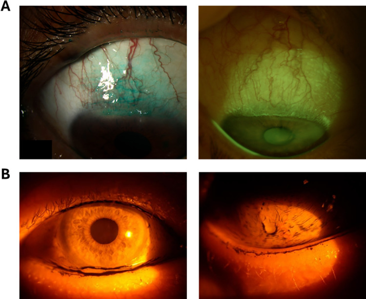
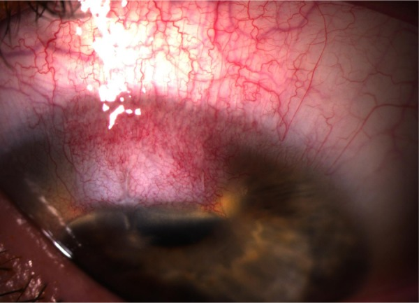
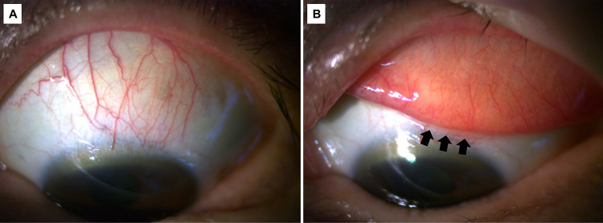
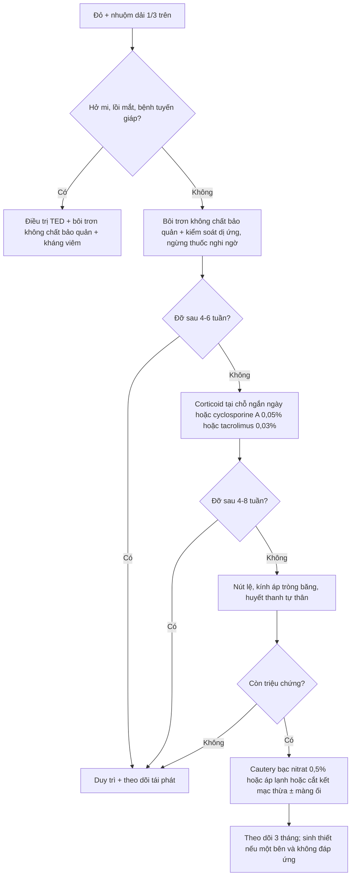
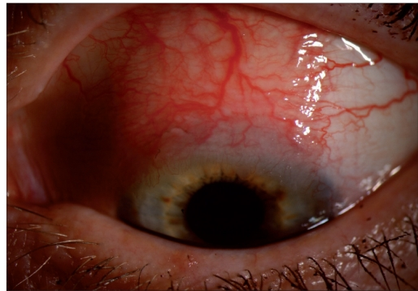

# 3267 — Viêm kết mạc rìa trên / Superior limbic keratoconjunctivitis (SLK): “đỏ 1/3 trên” + nhuộm rìa trên, không phải viêm kết mạc mùa xuân

**Tags:** `pattern:do-1-3-tren` `pattern:nhuom-ria-tren` `pattern:chi-khau-nhay` `pattern:pannus` `pattern:cuong-tu-ket-mac` `pattern:mat-mot-ben` `vung:mat` `vung:ket-mac` `vung:ria-giac-mac` `vung:giac-mac` `vung:mi` `protocol:den-khe` `protocol:fluorescein` `protocol:rose-bengal` `protocol:lissamine-green` `protocol:TBUT` `protocol:Schirmer` `protocol:AS-OCT` `protocol:IVCM` `protocol:impression-cytology` `protocol:noi-soi-mi` `score:SSI` `incidentaloma:khong`

**Mức chắc chắn (certainty):** tổng hợp y văn (literature synthesis) — dựng từ **loạt 236 bệnh nhân/459 mắt** Trung Quốc (PMID 35113250), **319 bệnh nhân/638 mắt bệnh tuyến giáp** Nhật (PMID 36083323), **hai đoàn hệ metabolomics dịch lệ** (PMC8804220, PMC12663892), **loạt 26 mắt SLK-like sau ghép chống vật chủ** (PMC5554073), các **loạt điều trị** (cắt kết mạc 16 mắt — PMID 20539210; cyclosporine A 7 bệnh nhân — PMID 18216575; áp lạnh 7 mắt — PMID 18835475; rebamipide 33 mắt — PMID 24412123) và **hai ca nguyên văn** dùng cho quiz (PMC4362972, PMC10124569, kèm ca OSSN giả SLK — PMC3085160). Nhóm **không có bệnh nhân của mình**; chỗ chưa đủ chắc ghi **“chưa rõ”**. **Không ghi tên tác giả** — attribution = **tạp chí + năm + PMCID/PMID**.

> **Câu chốt:** bệnh nhân **trung niên, nữ nhiều hơn nam**, than **cộm–rát–sợ ánh sáng**, khám thấy **cương tụ và nhuộm bắt màu đúng dải 1/3 trên** của kết mạc nhãn cầu và rìa trên, kèm **chỉ khâu nhầy (filaments)** và **pannus** — đó là **viêm kết mạc rìa trên (SLK)**, một bệnh **cơ học–viêm mạn**, **không ngứa theo mùa** và **không có nốt Horner–Trantas** như VKC. Ba điều quyết định xử trí: **(1)** SLK gặp ở **31,0% số mắt bệnh tuyến giáp** (198/638 mắt) và **≥ 1/3 ca SLK liên quan bệnh tuyến giáp**; **(2)** dấu hiệu **rẻ nhất và nhạy nhất là nhuộm lissamine green/rose bengal 1/3 trên** — **98%** số mắt trong loạt 459 mắt có nhuộm rìa/kết mạc trên; **(3)** **tổn thương “giống SLK” mà MỘT BÊN và KHÔNG đáp ứng corticoid phải sinh thiết** — đã có **OSSN giả SLK** bị điều trị corticoid **10 tháng**.

## 1. Tổng quan bệnh học – cơ chế hình ảnh (TẠI SAO)

### 1.1 Cơ chế: “ba vòng xoáy” cọ xát – khô – viêm

- **Giải phẫu tạo ra bệnh:** mỗi lần chớp mắt, **kết mạc sụn mi trên** trượt trên **kết mạc nhãn cầu 1/3 trên** và **rìa trên**. Đây là vùng **phim nước mắt mỏng nhất** (xa bờ mi dưới, chịu lực “gạt” của bờ mi trên) và là nơi **tế bào đài (goblet cell)** tập trung để tiết mucin bôi trơn. Khi **mất tế bào đài**, lớp mucin mỏng đi → **hệ số ma sát tăng** → **vi chấn thương lặp lại** đúng dải 1/3 trên. Đây là **cơ chế cơ học** được mô tả từ 2000 (PMID 10981793) và vẫn là trục chính của các tổng quan 2023–2026 (PMID 37011726; PMID 40445593).
- **Vòng xoáy viêm:** vi chấn thương → giải phóng **alarmin (TSLP)** và **stem cell factor**, hoạt hóa **mast cell** và **nguyên bào sợi**; **MMP-1/MMP-3** phá mô đệm; **COX-2** tăng tổng hợp prostaglandin. Mô học SLK điển hình: **tăng sản (acanthosis) biểu mô, MẤT tế bào đài**, thâm nhiễm lympho–tương bào, và **giãn mạch bạch huyết ở 93% số mắt** (22 mắt — PMID 29346129). Chính **mất tế bào đài** làm mucin giảm, khép kín vòng xoáy **khô → cọ xát → viêm → khô**.
- **Vì sao bệnh tuyến giáp là “bệnh nền” hay gặp:** trong bệnh mắt tuyến giáp (thyroid eye disease, TED), **hở mi (lid retraction, lid lag)** và **lồi mắt** làm **tăng diện tích kết mạc nhãn cầu trên phơi nhiễm** và **tăng lực cọ xát** khi chớp; đồng thời **bất đồng vận mi–nhãn cầu (oculopalpebral asynergy)** làm bờ mi trượt lệch. Trong **638 mắt TED**, SLK có ở **198 mắt (31,0%)** của **121/319 bệnh nhân**; **hút thuốc OR 1,785** và **dấu Graefe OR 2,912** là yếu tố nguy cơ độc lập (PMID 36083323). Tổng quan ca Graves ghi nhận **≥ 1/3 ca SLK liên quan bệnh mắt tuyến giáp** (PMC4362972).
- **Vì sao nữ nhiều hơn:** đoàn hệ dịch lệ **24 bệnh nhân SLK** có **83,33% nữ**, tuổi trung bình **40,13 ± 14,55** (PMC8804220); tổng quan 2026 mô tả SLK chủ yếu ở **nữ trung niên**, kèm **khô mắt, TED và bệnh ghép chống vật chủ (GVHD)** (PMID 40445593). Cơ chế khác biệt giới **chưa rõ** — có thể do khô mắt và bệnh tự miễn nền phân bố theo giới, không phải yếu tố bản chất của SLK.
- **Vì sao tái phát:** SLK là bệnh **đợt cấp–lui (relapsing-remitting)**; sau khi ngừng corticoid, viêm quay lại nhanh — ca nguyên văn tái phát **1 tuần** sau ngừng dexamethasone (PMC4362972), và **50% (3/6)** bệnh nhân tái phát **3 tháng** sau ngừng cyclosporine A 0,05% (PMID 18216575).

### 1.2 Vì sao nhuộm đúng “dải 1/3 trên” — vật lý của ba thuốc nhuộm

- **Fluorescein** (hấp thụ cực đại **~490 nm**, phát xạ **~520 nm**) **không nhuộm** biểu mô kết mạc lành; nó **đọng** ở chỗ **mất biểu mô**, **rò biểu mô** và **bám vào sợi nhầy**. Vì vậy fluorescein giỏi phát hiện **chỉ khâu nhầy (filaments)** và **trợt biểu mô**, nhưng **có thể bỏ sót** biểu mô “còn nguyên nhưng đã chết”.
- **Rose bengal** (hấp thụ **~540 nm**) là **thuốc nhuộm sống (vital dye)**: nó vào **tế bào chết/yếu** và **bám mucin**. Vì vậy rose bengal **nhuộm đậm dải kết mạc trên bị vi chấn thương dù bề mặt chưa trợt**. Nhược điểm: **độc tế bào** và **rát**; **không trộn được với fluorescein** vì **ánh sáng/pha màu giao thoa** (bảng so sánh: PMC12271041).
- **Lissamine green (LG)** (hấp thụ **~624–635 nm**) nhuộm **cùng nhóm tế bào chết/yếu** nhưng **dung nạp tốt hơn rose bengal**, **hợp với fluorescein**, và có **dạng dung dịch liều đơn nhỏ 10 µL** giúp chuẩn hóa lượng thuốc (PMC12271041). Đây là lý do **LG 1% + fluorescein** là cặp nhuộm đầu tay 2025–2026.
- **Suy luận hình ảnh:** dải nhuộm **cao đúng 1/3 trên**, **bờ dưới tương đối ngang** theo viền mi trên, **kèm cương tụ cùng vùng** = **tổn thương do cọ xát**, không phải viêm toàn bộ kết mạc. Nếu nhuộm **lan xuống 1/3 dưới** hoặc **thành chấm rải rác toàn bộ**, nghĩ **khô mắt/TED/medicamentosa** hơn là SLK đơn thuần.

### 1.3 Vì sao có “chỉ khâu nhầy” và “pannus” — không phải hai bệnh riêng

- **Chỉ khâu nhầy (filaments):** sợi **mucin đặc + tế bào biểu mô bong** neo ở **rìa trên/giác mạc trên**. Vì mucin mất cân bằng (mất tế bào đài) và biểu mô bị cọ xát, các sợi này **dính chặt** và **giật khi chớp** → triệu chứng **cộm–rát tăng khi liếc/chớp**. Trên đèn khe: **sợi trắng xám**, **fluorescein bắt màu**, thường **< 5 mm**, ở **1/3 trên**.
- **Pannus:** viêm mạn ở rìa kích thích **mạch máu từ cung mạch rìa** mọc vào **giác mạc nông**, tạo **dải mạch máu + mờ đục nông** chạy song song bờ mi. Ca Graves nguyên văn có **pannus lan 5 mm** vào giác mạc trên — mức **hiếm gặp** nhưng cho thấy SLK không điều trị có thể **xơ hóa và tân mạch giác mạc** (PMC4362972). Pannus **không đặc hiệu**: còn gặp ở **LSCD, OSSN, bỏng hóa chất, viêm giác mạc do Herpes**.
- **Hệ quả muộn:** vi chấn thương lặp lại lên **tế bào gốc rìa** → **thiếu hụt tế bào gốc rìa (LSCD)**. Trong **26 mắt SLK-like sau ghép chống vật chủ**, **3 mắt (2 bệnh nhân)** tiến triển **LSCD thực sự + pannus**, một người phải **mổ tạo hình nhiều lần**; **23/26 mắt** hồi phục khi điều trị sớm (PMC5554073). Đây là lý do SLK **không được xem là “đỏ mắt lành tính”** ở người có khô mắt nặng/GVHD.

### 1.4 Số liệu định lượng dùng trong bài

- **Loạt 236 bệnh nhân/459 mắt SLK (Trung Quốc, 2016–2019):** khô mắt là than phiền phổ biến nhất **59,3%**; **nhuộm rìa/kết mạc trên 98%**, **biến đổi kết mạc sụn mi trên 85,2%**, **cương tụ kết mạc nhãn cầu trên 80,8%**, **nhuộm giác mạc ~63%**, **nhão kết mạc nhãn cầu trên (superior conjunctivochalasis) 41,6%**; **nhuộm 1/3 dưới** gặp ở **163 mắt/84 bệnh nhân (36%)** và nhóm này có **điểm SSI cao hơn** (p = 0,013) (PMID 35113250).
- **638 mắt TED:** SLK **31,0%** (198 mắt); tuổi trẻ hơn **OR 0,977/mỗi năm** (p = 0,006), **hút thuốc OR 1,785** (p = 0,009), **Graefe OR 2,912** (PMID 36083323).
- **Điều trị:** rebamipide 2% → **84,8% (28/33 mắt)** hết SLK sau **4 tuần** (PMID 24412123); cắt kết mạc **16 mắt/9 bệnh nhân**, theo dõi **46 tháng (1,5–6 năm)**, **tất cả** mắt cắt kết mạc đơn thuần **hết triệu chứng**, **1/8** mắt kèm màng ối tái phát sau **2 năm** (PMID 20539210); áp lạnh nitơ lỏng **7 mắt/4 bệnh nhân**, hết trong **2 tuần**, **3/7 mắt** tái phát, áp lạnh lần hai ở **3 tháng** thành công (PMID 18835475).
- **Sinh học dịch lệ:** **24 SLK vs 18 chứng** — **179 chất chuyển hóa** giữ lại, **133** định danh, **50** thay đổi (**31 tăng/19 giảm**), đường **chuyển hóa acid linoleic** thay đổi mạnh nhất (PMC8804220); **20 SLK vs 21 khô mắt vs 15 chứng** — **274 chất chuyển hóa**, **23** khác biệt có ý nghĩa, **sPLA2 tăng** ở SLK (PMC12663892).

## 2. Mẫu hình + chẩn đoán phân biệt theo vị trí (gamut)

**Mẫu hình chính:** *người trung niên, nữ, cộm–rát–sợ ánh sáng, đỏ và nhuộm bắt màu dải 1/3 trên, hai bên (thường không đối xứng), kèm chỉ khâu nhầy ± pannus ± nhão kết mạc trên.*

*Hai kiểu “bắt màu 1/3 trên”. **(A) SLK:** nhuộm lissamine green thành **dải xanh đậm** đúng kết mạc nhãn cầu trên + rìa trên (trái), tương ứng vùng **fluorescein** (phải) — tổn thương **do cọ xát**, bờ dưới theo viền mi trên. **(B) Nhão kết mạc + bờ mi không đều** (ảnh dưới kính đỏ): nhuộm cho thấy **nếp kết mạc thừa**, **không tạo dải sát rìa trên** như SLK. Phân biệt bằng **vị trí nhuộm + nếp gấp + nghiệm pháp liếc xuống**. Nguồn: Ophthalmol Ther 2025 (PMC12271041), Fig. 2, CC BY-NC 4.0.*

- **Kết mạc nhãn cầu trên/rìa trên:** **SLK** (cơ học, hai bên), **SLK-like trong GVHD thể mắt** (khô nặng, có tiền sử ghép), **OSSN** (một bên, mảng trắng sùi, mạch nuôi), **pterygium sớm** (hình nêm, thường phía mũi), **viêm củng mạc nốt** (nốt đỏ, đau sâu, không nhuộm), **medicamentosa** (brimonidine, NSAID nhỏ mắt, chất bảo quản).
- **Kết mạc sụn mi trên:** **SLK** (phản ứng nhú mịn), **VKC** (nhú gai lớn > 1 mm, ngứa theo mùa), **viêm kết mạc do vi khuẩn** (mủ, dính), **hội chứng mi mềm nhũn (floppy eyelid)** (cọ xát khi ngủ).
- **Giác mạc 1/3 trên:** **viêm giác mạc sợi (filamentary keratitis)**, **loét khiên trong VKC** (bầu dục, đau nhiều), **pannus** (SLK mạn, LSCD, Herpes), **dellen** (cạnh khối rìa).

*SLK lan rộng: **cương tụ mạnh kết mạc nhãn cầu trên** và **pannus mạch máu lan 5 mm** vào giác mạc trên ở bệnh nhân Graves đã kiểm soát. Pannus cho thấy tổn thương **đã mạn**, không còn là “đỏ mắt đơn thuần”. Nguồn: Clin Ophthalmol 2015 (PMC4362972), Fig. 1, CC BY-NC 3.0.*

## 3. Bảng so sánh phân biệt (ma trận đối chiếu)

| Thực thể (entity) | Hình ảnh điển hình (đèn khe/nhuộm) | Chốt vào (rule-in) | Chốt loại (rule-out) | Gợi ý xác nhận |
|---|---|---|---|---|
| **SLK** | Dải cương tụ + **nhuộm LG/rose bengal 1/3 trên**; **chỉ khâu nhầy**; nhú sụn mi mịn; pannus muộn | **Nhuộm đúng dải 1/3 trên**, hai bên, **cộm–rát**, tuổi trung niên, có bệnh tuyến giáp/khô mắt | **Không ngứa theo mùa**, **không nốt Trantas**, **không mủ** | Đèn khe + LG 1% + fluorescein; TBUT/Schirmer; TSH/FT4/TRAb |
| **VKC thể rìa (3260)** | Rìa **dày sền sệt**, **nốt Horner–Trantas trắng**, nhú gai lớn ở sụn mi trên | **Ngứa dữ dội theo mùa**, trẻ, tiền sử atopy; nốt Trantas | **Không nhuộm thành dải trên đơn thuần**; có nhú gai > 1 mm | Soi đảo mi trên; hỏi mùa/dị ứng; thử kháng viêm–kháng dị ứng |
| **OSSN** | Mảng **trắng sùi/leukoplakia** ở rìa, **mạch nuôi rõ**, có thể xâm lấn giác mạc | **Một bên**, **không đáp ứng corticoid**, bề mặt nhám, mạch nuôi | **Không có dải nhuộm đối xứng hai bên**; không đáp ứng steroid | **Sinh thiết/tế bào học ấn** — không chờ thêm |
| **Pterygium/pinguecula** | Khối **hình nêm** từ rìa vào giác mạc, thường **phía mũi**; pinguecula vàng ở kết mạc | **Đầu pterygium dính giác mạc**, hình nêm, tiến triển chậm | **Không nhuộm rìa trên kiểu SLK**, không chỉ khâu nhầy | Đèn khe; chụp ảnh theo dõi; AS-OCT nếu cần |
| **Viêm củng mạc nốt** | **Nốt đỏ tím**, đau sâu, **không di động** với củng mạc; mạch xuyên tâm | **Đau sâu + nốt khu trú**, nghiệm pháp phenylephrine 10% **không co mạch** | **Không nhuộm dải kết mạc trên**; không chỉ khâu nhầy | Đèn khe; loại trừ bệnh hệ thống (RA, GPA) |
| **Nhão kết mạc (conjunctivochalasis)** | **Nếp kết mạc thừa** ở rìa dưới nhiều hơn, **nhuộm vài điểm**, thay đổi khi liếc xuống | **Nếp gấp rõ**, chảy nước mắt, nhuộm **1/3 dưới** nhiều hơn | **Nhuộm không thành dải rìa trên**; không pannus | Nghiệm pháp liếc xuống; AS-OCT bề mặt |
| **Medicamentosa (brimonidine/NSAID)** | Đỏ + nhuộm **hai bên**, thường **1/3 dưới**, có **tiền sử thuốc** | **Hết sau ngừng thuốc 2–4 tuần**, tái phát khi dùng lại | **Không có dải nhuộm trên đơn thuần**; không chỉ khâu nhầy | Ngừng thuốc nghi ngờ; hỏi kỹ đơn thuốc |
| **SLK-like trong GVHD thể mắt** | Khô nặng + **nhuộm trên + pannus**, có thể **LSCD** | **Tiền sử ghép tế bào gốc/tủy**, khô nặng, nhuộm trên | **Không có tiền sử ghép** thì ít nghĩ; nhưng vẫn có thể | Hỏi tiền sử ghép; Schirmer; hội chẩn ghép |

*Cùng bệnh nhân SLK: **(A)** cương tụ khu trú kết mạc nhãn cầu trên; **(B)** **nếp kết mạc thừa (mũi tên)** ở 1/3 trên — vừa là **dấu hiệu**, vừa là **yếu tố làm nặng cọ xát**. Đây là lý do phải **đảo mi và cho bệnh nhân liếc xuống** khi khám. Nguồn: Clin Optom 2023 (PMC10124569), Fig. 1, CC BY-NC 3.0.*

## 4. Protocol khám + hệ phân độ & bậc điều trị

**Trình tự khám (quan trọng: nhuộm SAU khi đã xem và chụp ảnh):**

1. **Hỏi bệnh:** thuốc nhỏ mắt đang dùng (brimonidine, NSAID, chất bảo quản), **bệnh tuyến giáp** (Basedow, thuốc kháng giáp, I-131), **khô mắt**, **dị ứng**, **ghép tạng/tế bào gốc**, **ngáy/ngủ úp mặt**, **tiền sử mổ mi** (SLK sau treo mi — PMID 35123945).
2. **Đèn khe trước nhuộm:** cương tụ theo vùng, **nhú sụn mi trên** (đảo mi!), **nếp kết mạc thừa**, **pannus**, **chỉ khâu nhầy**; đo **MRD1**, tìm **lid lag/Graefe**, **lồi mắt** (Hertel) nếu nghi TED.
3. **Nhuộm:** **fluorescein** (đánh giá TBUT, trợt, chỉ khâu nhầy) rồi **lissamine green 1%** (10 µL dạng liều đơn) — **không dùng rose bengal cùng fluorescein** vì giao thoa màu (PMC12271041). Ghi **vị trí theo giờ**, **chiều cao dải nhuộm**, **hai bên**.
4. **Định lượng khô mắt:** **TBUT < 10 giây** = bất thường; **Schirmer I < 5 mm/5 phút** = khô nặng, **5–10 mm** = trung bình (TFOS DEWS II 2017, DOI 10.1016/j.jtos.2017.05.008). Đo **chiều cao thực môn lệ (tear meniscus height)**.
5. **Hình ảnh bổ trợ khi cần:** **AS-OCT** đo bề dày biểu mô kết mạc/nếp gấp và loại trừ xâm lấn; **IVCM** (670 nm, ~600×) đếm **tế bào đài, tế bào tua**; **tế bào học ấn (impression cytology)** — SLK cho **dị sản vảy nặng + giảm tế bào đài**, và **không cải thiện sau mổ** ở loạt 16 mắt (PMID 20539210).
6. **Nội tiết:** **TSH, FT4, TRAb** khi có hở mi/lồi mắt/rối loạn tuyến giáp; **CT/MRI hốc mắt** nếu nghi TED hoặc khối. **Không chụp CT thường quy cho SLK đơn thuần.**

**Hệ phân độ:** **SSI (SLK scale index)** gộp **5 dấu hiệu chính** — (1) nhuộm rìa/kết mạc trên, (2) biến đổi kết mạc sụn mi trên, (3) cương tụ kết mạc nhãn cầu trên, (4) nhuộm giác mạc, (5) nhão kết mạc nhãn cầu trên (PMID 35113250). Trong loạt 459 mắt, **chỉ nhuộm rìa/kết mạc trên tăng dần theo mức nặng**; **ngưỡng điểm để quyết định mổ chưa được chuẩn hóa** — ghi **“chưa rõ”**.

**Bậc điều trị — số liệu để tư vấn:**

| Bậc | Can thiệp | Kết quả định lượng | Lưu ý |
|---|---|---|---|
| 1 | Bôi trơn không chất bảo quản, vệ sinh mi, ngừng thuốc kích thích | Giảm cọ xát; **không có RCT** so với giả dược | Nền tảng cho mọi bậc; điều trị **nguyên nhân cơ học** |
| 2 | Corticoid tại chỗ **ngắn ngày, taper** | Ca Graves: hết triệu chứng **2 tuần**, **tái phát sau 1 tuần ngừng** (PMC4362972) | Theo dõi **nhãn áp**; không dùng kéo dài |
| 2 | **Cyclosporine A 0,05%** 4 lần/ngày | **7 bệnh nhân** đỡ rõ sau **2 tuần**; **50% (3/6)** tái phát sau **3 tháng** ngừng (PMID 18216575) | Dùng dài hạn để giảm phụ thuộc corticoid |
| 2 | **Tacrolimus 0,03% mỡ** 2 lần/ngày | **2 ca**: hết dấu hiệu sau **4 tuần** (PMID 23770977) | Lựa chọn khi không dung nạp corticoid |
| 2 | **Rebamipide 2%** (bệnh tuyến giáp) | **84,8% (28/33 mắt)** hết SLK sau **4 tuần** (PMID 24412123) | Chỉ có ở một số nước |
| 3 | **Nút lệ / kính áp tròng băng / huyết thanh tự thân** | Ca đơn lẻ hồi phục (PMC10124569); **13/26 mắt** trong GVHD dùng kính trị liệu (PMC5554073) | Cẩn thận nhiễm khuẩn khi kính băng |
| 4 | **Cautery bạc nitrat 0,5%** hoặc **áp lạnh nitơ lỏng** | Áp lạnh: **7 mắt**, hết trong **2 tuần**, **3/7** tái phát (PMID 18835475) | Tránh ở mắt đang nhiễm; có thể để sẹo |
| 4 | **Cắt kết mạc thừa ± màng ối** | **16 mắt/9 bệnh nhân**, **46 tháng**: cắt đơn thuần **hết triệu chứng toàn bộ**; **1/8** kèm màng ối tái phát sau **2 năm** (PMID 20539210) | Chọn khi **nhão kết mạc rõ**; mô học **thâm nhiễm dày → ít đỡ** (p = 0,013) |

## 5. Biến thể bình thường và cạm bẫy

- **“Đỏ 1/3 trên” ở người trẻ = nghĩ VKC trước, SLK sau:** SLK ở trẻ **hiếm** (ca báo 2013 — PMID 23791418); trẻ ngứa nhiều, có nhú gai lớn/nốt Trantas → **VKC thể rìa** (3260). Điều trị SLK bằng corticoid kéo dài ở trẻ **dễ tăng nhãn áp** và **che dấu VKC/OSSN**.
- **SLK một bên, không đáp ứng corticoid = OSSN cho đến khi chứng minh ngược lại:** ca **62 tuổi** được điều trị “SLK” bằng corticoid **10 tháng** trước khi sinh thiết ra **OSSN loạn sản trung bình–nặng** (PMC3085160). **Không có dấu hiệu nào trên đèn khe loại trừ OSSN** — chỉ **mô học** mới loại.

*Ca **OSSN giả SLK**: tổn thương **dày, cương tụ mạnh kết mạc trên**, **mạch máu nổi rõ** — nhìn bằng mắt thường **rất giống SLK**. Chốt loại: **một bên + không đáp ứng corticoid 10 tháng** → **sinh thiết**. Nguồn: Middle East Afr J Ophthalmol 2011 (PMC3085160), Fig. 1a, CC BY 2.0.*

- **Nhão kết mạc không phải SLK:** cả hai đều nhuộm 1/3 trên, nhưng **nhão kết mạc** có **nếp gấp di động**, nhuộm **nhiều ở 1/3 dưới**, và **tăng khi liếc xuống**; SLK có **dải nhuộm sát rìa** và **chỉ khâu nhầy**. Trong loạt 459 mắt, **41,6%** SLK có nhão kết mạc kèm — tức **hai bệnh có thể cùng tồn tại**, không loại trừ nhau.
- **GVHD thể mắt là “SLK-like”:** bệnh nhân ghép tế bào gốc có **khô nặng + nhuộm trên + pannus**; **23/26 mắt hồi phục** khi điều trị sớm, nhưng **3 mắt** đã **LSCD thật** (PMC5554073). Nếu chỉ nhìn “SLK” mà bỏ tiền sử ghép → **bỏ sót LSCD**.
- **Sau treo mi/mổ mi:** SLK có thể **khởi phát sau phẫu thuật treo mi** do thay đổi tương quan mi–nhãn cầu (PMID 35123945) — hỏi **tiền sử mổ** khi “đỏ 1/3 trên” xuất hiện sau mổ.
- **Cạm bẫy điều trị:** **corticoid làm đỡ nhanh rồi tái phát ngay** (1 tuần — PMC4362972), nên **không được kết luận “khỏi”** khi mới hết đỏ; phải **taper** và **duy trì bôi trơn**. **Bạc nitrat/cautery quá tay** có thể gây **sẹo, dính mi–nhãn cầu** — chỉ làm khi đã loại OSSN.

## 6. Tự lượng giá — Blind Quiz ngay trên trang tĩnh

**Ca 1 — Đỏ mắt ở người bệnh tuyến giáp**

- Gợi ý lâm sàng: nữ **51 tuổi**, Graves đã kiểm soát, **đau mắt phải**, thị lực **20/30**; không có nhú sụn mi, không chỉ khâu nhầy.
- Câu hỏi: Dấu hiệu chính? Vì sao **không nghĩ OSSN** ở ca này? Yếu tố cơ học nào giải thích vị trí tổn thương?

<b>Bấm để hiện đáp án (findings + chẩn đoán)</b>

- Dấu hiệu: **cương tụ kết mạc nhãn cầu trên** + **pannus mạch máu lan 5 mm** vào giác mạc trên; **không** nhú sụn mi, **không** chỉ khâu nhầy, **không** mủ.
- Chẩn đoán: **SLK lan rộng trên nền bệnh mắt tuyến giáp** — hở mi/lồi mắt làm tăng cọ xát và phơi nhiễm 1/3 trên. Đáp ứng với **dexamethasone** rồi **tái phát sau 1 tuần ngừng** — đúng diễn tiến viêm mạn.
- Vì sao nghĩ SLK hơn OSSN: bệnh cảnh **Graves đã kiểm soát**, tổn thương **đáp ứng nhanh với dexamethasone** (hết triệu chứng sau 2 tuần), **không có leukoplakia/mảng sùi/mạch nuôi dạng khối**. Tuy vậy ca này **MỘT bên**, và **pannus đơn độc không loại OSSN** — nếu không đáp ứng corticoid sau 4–6 tuần thì **bắt buộc sinh thiết**.
- Nguồn ảnh: Clin Ophthalmol 2015 (PMC4362972), Fig. 1, CC BY-NC 3.0.

**Ca 2 — Đỏ mắt một bên kéo dài, đã dùng nhiều thuốc**

- Gợi ý lâm sàng: nữ **60 tuổi**, **đỏ mắt trái tái diễn mạn**, không đáp ứng corticoid và cyclosporine 0,1%; kèm khô mắt và rối loạn tuyến Meibomius.
- Câu hỏi: Hai dấu hiệu trong ảnh? Vì sao **một bên** vẫn có thể là SLK? Yếu tố nào cần xử lý ngoài thuốc?

<b>Bấm để hiện đáp án (findings + chẩn đoán)</b>

- Dấu hiệu: **(A)** cương tụ khu trú kết mạc nhãn cầu trên; **(B)** **nếp kết mạc thừa** ở 1/3 trên (mũi tên) — vừa là dấu hiệu, vừa là **nguồn cọ xát**.
- Chẩn đoán: **SLK một bên + nhão kết mạc + khô mắt/Meibomius**. SLK thường hai bên nhưng **không đối xứng**; một bên không loại trừ, nhưng **buộc phải loại OSSN** nếu không đáp ứng.
- Xử lý ngoài thuốc: **kính áp tròng băng mềm + huyết thanh tự thân**, điều trị **rối loạn tuyến Meibomius** (ánh sáng xung cường độ cao trong ca gốc); kiểm soát **nếp kết mạc thừa** nếu cọ xát tiếp diễn.
- Nguồn ảnh: Clin Optom 2023 (PMC10124569), Fig. 1, CC BY-NC 3.0.

**Ca 3 — “SLK” điều trị 10 tháng không khỏi**

- Gợi ý lâm sàng: nữ **62 tuổi**, **cộm–rát–sợ ánh sáng–giảm thị lực mắt trái**, được chẩn đoán SLK và dùng **corticoid ngắt quãng 10 tháng**, không đỡ.
- Câu hỏi: Dấu hiệu nào khiến phải **sinh thiết ngay**? Chẩn đoán mô học là gì? Bài học lớn nhất?

<b>Bấm để hiện đáp án (findings + chẩn đoán)</b>

- Dấu hiệu: **mảng dày, cương tụ mạnh kết mạc nhãn cầu trên**, **mạch máu nổi rõ**, bề mặt không đều; **một bên**; **không đáp ứng corticoid**.
- Chẩn đoán: **OSSN (u tân sinh bề mặt nhãn cầu) giả SLK**, mô học **loạn sản trung bình–nặng**; điều trị **cắt bỏ + sinh thiết lạnh**.
- Bài học: **“SLK” một bên, dai dẳng, không đáp ứng corticoid = sinh thiết**; corticoid kéo dài có thể **che dấu và làm nặng OSSN**.
- Nguồn ảnh: Middle East Afr J Ophthalmol 2011 (PMC3085160), Fig. 1a, CC BY 2.0.

**Ca 4 — Hai kiểu nhuộm 1/3 trên**

- Gợi ý lâm sàng: hai bệnh nhân cùng **cộm–rát và đỏ 1/3 trên**; ảnh trên là **lissamine green** (trái) và **fluorescein** (phải) của cùng một mắt.
- Câu hỏi: Hàng **A** và hàng **B** khác nhau ở **hình dạng – vị trí nhuộm** thế nào? Hàng nào là SLK?

<b>Bấm để hiện đáp án (findings + chẩn đoán)</b>

- Hàng **A**: nhuộm **thành dải liên tục sát rìa trên**, bờ dưới theo viền mi trên, có **cương tụ cùng vùng** → **SLK**.
- Hàng **B**: **nếp kết mạc thừa + bờ mi không đều**, nhuộm **không thành dải sát rìa** → **nhão kết mạc**, không phải SLK.
- Chốt: **vị trí + hình dạng dải nhuộm** quan trọng hơn cường độ; **cho liếc xuống** để phân biệt.
- Nguồn ảnh: Ophthalmol Ther 2025 (PMC12271041), Fig. 2, CC BY-NC 4.0.

## 7. Câu hỏi nghiên cứu & điểm chưa đồng thuận (tính đến 11/2026)

1. **[Tranh cãi] Ở SLK mức trung bình, corticoid tại chỗ ngắn ngày hay thuốc ức chế miễn dịch tại chỗ (cyclosporine A 0,05%/tacrolimus 0,03%) nên là bậc hai đầu tay?**
   - **Đã biết:** cyclosporine A 0,05% cải thiện rõ sau **2 tuần** ở **7 bệnh nhân** nhưng **50% (3/6)** tái phát sau **3 tháng** ngừng (PMID 18216575); tacrolimus 0,03% làm hết dấu hiệu ở **2 ca** sau **4 tuần** (PMID 23770977); tổng quan 2026 vẫn xếp corticoid và ức chế miễn dịch **cùng bậc** (PMID 40445593).
   - **Chưa rõ:** **không có RCT** so sánh trực tiếp hai nhóm ở cùng định nghĩa đáp ứng, cùng thời điểm đo; tỉ lệ tái phát **dài hạn** của mỗi thuốc **chưa rõ**.
   - **Hướng nghiên cứu:** RCT phân tầng theo **có/không TED**, outcome **thời gian đến tái phát, điểm SSI, nhãn áp, thời gian dùng corticoid**.
   - **Nguồn:** PMID 18216575 (2008), DOI 10.1097/ico.0b013e318033bd25; PMID 23770977 (2013), DOI 10.1097/ico.0b013e318295e6b9; PMID 40445593 (2026), DOI 10.1080/08820538.2025.2512750.

2. **[Khoảng trống] SLK và khô mắt có phải hai thực thể tách biệt — và dấu ấn dịch lệ (sPLA2, metabolomics) có đủ để chẩn đoán phân biệt trên lâm sàng?**
   - **Đã biết:** **20 SLK vs 21 khô mắt vs 15 chứng** cho **274 chất chuyển hóa**, **23 chất khác biệt**, **sPLA2 tăng** ở SLK (PMC12663892); đoàn hệ **24 SLK vs 18 chứng** cho **50/133 chất thay đổi**, mạnh nhất là **acid linoleic** (PMC8804220); **36%** mắt SLK còn nhuộm **1/3 dưới** (PMID 35113250).
   - **Chưa rõ:** **không có ngưỡng xét nghiệm** được xác nhận độc lập; chưa rõ **sPLA2/metabolomics** thay đổi thế nào khi **SLK kèm TED/GVHD**; chi phí và khả năng áp dụng **chưa rõ**.
   - **Hướng nghiên cứu:** nghiên cứu **độ chính xác chẩn đoán** tiến cứu, so **metabolomics/sPLA2** với **đèn khe + LG** làm chuẩn, phân tầng TED/GVHD.
   - **Nguồn:** PMC12663892 (2025); PMC8804220 (2022); PMID 35113250 (2022).

3. **[Khác biệt thực hành] SLK kháng trị nên cắt kết mạc thừa, áp lạnh, hay cautery bạc nitrat — và có cần kèm màng ối?**
   - **Đã biết:** cắt kết mạc **16 mắt/9 bệnh nhân**, theo dõi **46 tháng**, cắt đơn thuần **hết triệu chứng toàn bộ**, **1/8** mắt kèm màng ối tái phát sau **2 năm**, tế bào học **không cải thiện dị sản vảy** (PMID 20539210); áp lạnh **7 mắt** hết trong **2 tuần**, **3/7** tái phát (PMID 18835475); tổng quan 2026 vẫn liệt kê **cả ba** là lựa chọn cho ca kháng trị (PMID 40445593).
   - **Chưa rõ:** **không có thử nghiệm đầu–đối–đầu**; tiêu chí chọn bệnh nhân cho từng phẫu thuật **chưa thống nhất**; lợi ích của **màng ối** chưa được chứng minh.
   - **Hướng nghiên cứu:** registry đa trung tâm ghi **loại phẫu thuật, mức nhão kết mạc, mô học, tái phát 2 năm**; RCT màng ối so với không màng ối.
   - **Nguồn:** PMID 20539210 (2010), DOI 10.1097/ico.0b013e3181d1d1cc; PMID 18835475 (2009), DOI 10.1016/j.ajo.2008.07.047; PMID 40445593 (2026), DOI 10.1080/08820538.2025.2512750.

## Bài liên quan chéo
- [3260 – VKC thể rìa: rìa sền sệt + nốt Horner–Trantas](../3260-viem-ket-mac-mua-xuan-the-ria/lesson.md)
- [3255 – Loét giác mạc hình khiên trong VKC](../3255-vkc-loet-giac-mac-hinh-khien/lesson.md)
- [6132 – Viêm giác mạc nhiễm khuẩn liên quan kính tiếp xúc](../6132-viem-giac-mac-kinh-tiep-xuc/lesson.md)
- [421 – Bệnh mắt tuyến giáp (Graves orbitopathy)](../421-loi-mat-Graves/lesson.md)
- [1470 – Khô mắt do xạ ở trẻ](../1470-kho-mat-do-xa-o-tre/lesson.md)
- [3216 – Viêm giác mạc do nấm](../3216-viem-giac-mac-nam-soi/lesson.md)

## Ảnh
- `images/3267_slk_LissamineGreen_PMC12271041-Fig2.jpg` — lissamine green/fluorescein: SLK vs nhão kết mạc.
- `images/3267_slk_SlitLamp-Pannus_PMC4362972-Fig1.jpg` — SLK lan rộng + pannus 5 mm (Graves).
- `images/3267_slk_RedundantFolds_PMC10124569-Fig1.jpg` — cương tụ khu trú + nếp kết mạc thừa.
- `images/3267_osnn-gia-slk_SlitLamp_PMC3085160-Fig1a.jpg` — OSSN giả SLK.
- Nguồn + giấy phép từng ảnh: `images/CREDITS.md`; danh sách bài gốc: `sources.md`.

> Không dùng để chẩn đoán độc lập khi chưa có người hướng dẫn.
