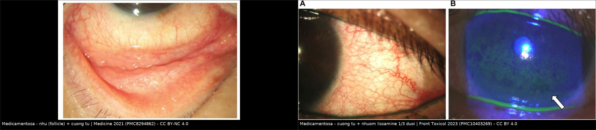
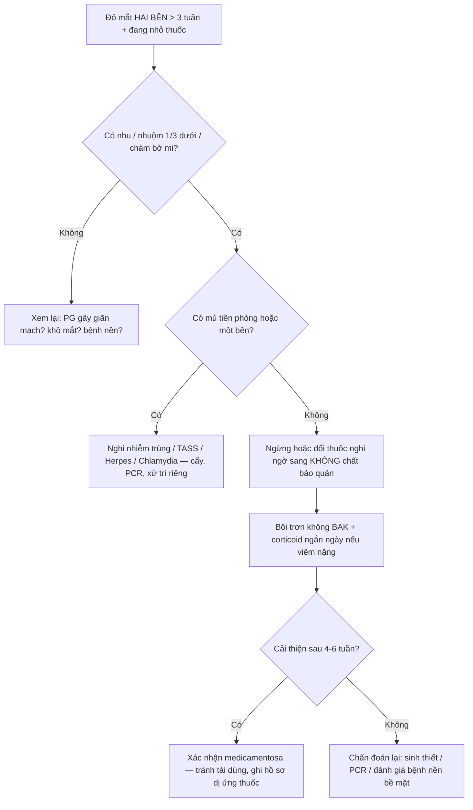
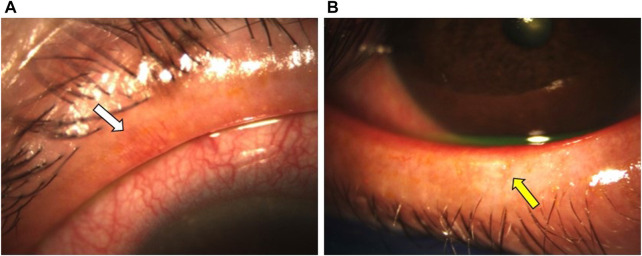
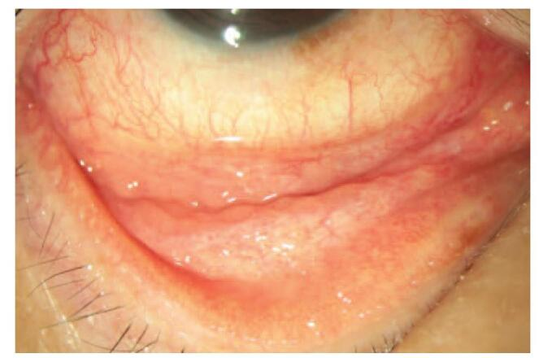
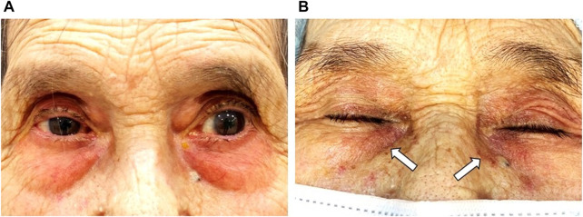
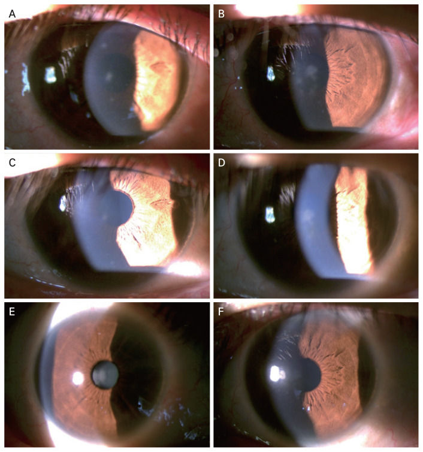

# 3268 — Viêm kết mạc do thuốc nhỏ mắt / Conjunctivitis medicamentosa: “đỏ mắt hai bên dai dẳng” + nhuộm 1/3 dưới, khỏi sau khi ngừng thuốc

**Tags:** `pattern:do-mat-hai-ben` `pattern:nhuom-1-3-duoi` `pattern:nhu-ket-mac` `pattern:viem-bo-mi` `pattern:phu-mi` `pattern:giam-sau-ngung-thuoc` `pattern:cuong-tu-ket-mac` `vung:mat` `vung:ket-mac` `vung:giac-mac` `vung:mi` `protocol:den-khe` `protocol:fluorescein` `protocol:lissamine-green` `protocol:TBUT` `protocol:Schirmer` `protocol:meibography` `protocol:patch-test` `score:khong` `incidentaloma:khong`

**Mức chắc chắn (certainty):** tổng hợp y văn (literature synthesis) — dựng từ **đoàn hệ 2.850 người dùng brimonidine** (dị ứng **5,5%**, khởi phát trung vị **32 tuần** — PLoS One 2025, PMC12129204), **loạt 292 bệnh nhân dị ứng brimonidine** (trung vị **196 ngày**, nhãn áp tăng **9,2%** ở nhóm đơn trị — Medicine 2021, PMC8294862), **loạt 5 ca brimonidine 0,15%** (Cureus 2025, PMC12831947), **ca bệnh viêm giác mạc dưới biểu mô do brimonidine** (KJO 2026, PMC13078932), **tổng quan độc tính bề mặt do thuốc hạ nhãn áp kèm 4 ảnh bệnh nhân** (Front Toxicol 2023, PMC10403269), **tổng quan dị ứng mắt theo phân loại EAACI 2023** (Allergy Asthma Immunol Res 2026, PMC12865169), **phân tích gộp mạng lưới bimatoprost không chất bảo quản** (Eur J Ophthalmol 2026, PMC13490672) và **tổng quan latanoprost có/không BAK** (Clin Ophthalmol 2026, PMC13225004). Nhóm **không có bệnh nhân của mình**; chỗ chưa đủ chắc ghi **“chưa rõ”**. **Không ghi tên tác giả** — attribution = **tạp chí + năm + PMCID/PMID**.

> **Câu chốt:** người bệnh **đang nhỏ thuốc** (hạ nhãn áp, dị ứng, “thuốc đỏ mắt” mua tự do) than **đỏ–cộm–rát hai bên kéo dài hàng tuần đến hàng tháng**, khám thấy **cương tụ + nhuộm bắt màu dải 1/3 DƯỚI**, có thể **nhu (follicle) ở kết mạc sụn mi**, **chàm bờ mi**, và **khỏi sau khi ngừng đúng thuốc** — đó là **viêm kết mạc do thuốc (medicamentosa)**, một **chẩn đoán loại trừ bằng can thiệp**: ngừng thuốc là “test chẩn đoán”. Ba điều quyết định: **(1)** dị ứng brimonidine gặp ở **5,5% (157/2.850)**, trung vị **32 tuần** sau khi bắt đầu, **75% trong năm đầu** nhưng có ca tới **1.376 ngày**; **(2)** nhãn áp **TĂNG** đúng lúc dị ứng (**+1,25 mmHg, +9,2%** ở nhóm đơn trị) nên “đỏ mắt” không phải chuyện thẩm mỹ mà là **mất kiểm soát nhãn áp**; **(3)** điều trị đúng là **ngừng/đổi sang công thức không chất bảo quản**, **không** leo thang corticoid — dị ứng do thuốc bị gọi nhầm là “viêm” rồi nhỏ corticoid kéo dài là đường tới **glôcôm do corticoid**.

## 1. Tổng quan bệnh học – cơ chế hình ảnh (TẠI SAO)

### 1.1 Một cái tên, ba cơ chế hoàn toàn khác nhau

“Medicamentosa” **không phải một bệnh** mà là **tổn thương bề mặt nhãn cầu do chính thuốc nhỏ mắt**, gồm ba cơ chế chồng lấp:

1. **Quá mẫn muộn type IV với hoạt chất** — điển hình là **brimonidine** và **apraclonidine** (đồng vận α2). Đây là **viêm kết mạc nhu (follicular) dị ứng**, khởi phát sau **nhiều tuần đến nhiều tháng**; phân loại EAACI 2023 xếp **viêm kết mạc–mi tiếp xúc (contact blepharoconjunctivitis)** vào **type IVa** (PMC12865169).
2. **Độc tế bào trực tiếp của chất bảo quản/tá dược** — chủ yếu **benzalkonium chloride (BAK)**: phá tight junction, ức chế tăng sinh biểu mô, **giảm mật độ tế bào đài (goblet cell)**, **dị sản vảy (squamous metaplasia)**, tăng **HLA-DR**, mất cân bằng **MMP/TIMP** (PMC10403269). Đây là **bệnh bề mặt (ocular surface disease) do thuốc**, không phải dị ứng.
3. **Loạn nhịp mạch do thuốc co mạch** — **phenylephrine, tetrahydrozoline** (α1) và **naphazoline, oxymetazoline** (α1/α2): giảm đỏ **ngắn hạn** rồi **tachyphylaxis + đỏ bật lại (rebound)** khi hết tác dụng (PMC12976222).

Ba cơ chế này **khác nhau về thời gian, vị trí tổn thương và điều trị** — gộp chúng thành “viêm kết mạc dị ứng” là nguồn gốc của việc **leo thang corticoid vô ích**.

### 1.2 Vì sao tổn thương nằm ở dải 1/3 DƯỚI — vật lý của giọt thuốc và phim nước mắt

- **Giọt thuốc đi xuống:** sau khi nhỏ, thuốc **đọng ở túi kết mạc dưới (inferior fornix)** — nơi **sức chứa lớn nhất** và **thời gian lưu lâu nhất**; một phần tràn ra bờ mi dưới rồi chảy xuống má. Vì vậy **nồng độ và thời gian tiếp xúc** của hoạt chất + BAK **cao nhất ở kết mạc sụn mi dưới và 1/3 dưới giác mạc**. Đây là lý do **nhuộm và cương tụ khu trú dải dưới** — ngược hẳn với **SLK**, nơi tổn thương do **cọ xát bờ mi trên** nên nằm ở **1/3 trên** (bài 3267; nhuộm rìa trên **98%** trong 459 mắt — PMID 35113250).
- **Vật lý thuốc nhuộm:** **fluorescein** (hấp thụ **~490 nm**, phát xạ **~520 nm**) chỉ bắt màu chỗ **mất biểu mô** hoặc **sợi nhầy**; **lissamine green** (hấp thụ **~630 nm**) nhuộm **tế bào chết/yếu** dù bề mặt chưa trợt. Vì vậy **nhuộm dải dưới bằng lissamine green** xuất hiện **trước** khi có trợt thấy được bằng fluorescein — đúng với tổn thương **độc tế bào lan toả** của BAK.
- **Phim nước mắt mỏng ở 1/3 dưới** khi có **hở mi/khô mắt**: thuốc có BAK vừa **gây khô** vừa **bám lâu hơn** ở vùng phim nước mắt mỏng → vòng xoáy **khô → nồng độ thuốc cao hơn → tổn thương nhiều hơn**. Vì vậy medicamentosa **hiếm khi đứng một mình**: nó thường **chồng lên khô mắt và viêm bờ mi** — và điều đó giải thích vì sao **chỉ ngừng thuốc chưa đủ** ở một số bệnh nhân.

### 1.3 Vì sao khởi phát MUỘN hàng tháng — sinh học của quá mẫn type IV

- Quá mẫn type IV cần **pha cảm ứng (sensitization)**: hapten (brimonidine hoặc chất chuyển hoá) gắn protein → trình diện qua **tế bào Langerhans/kết mạc** → tạo **tế bào T nhớ**; khi tái phơi nhiễm, tế bào T **triệu tập lympho–đại thực bào**, giải phóng IFN-γ, tạo **nhu (follicle)** và **phù kết mạc**. Toàn bộ quá trình này **tính bằng tuần đến tháng**, không phải vài giờ như phản ứng IgE.
- **Số liệu:** dị ứng brimonidine **5,5% (157/2.850 người)**, khởi phát **trung vị 32 tuần (IQR 15–72)** (PMC12129204). Loạt 292 ca: **trung vị 196 ngày**, trung bình **266,6 ngày (9–1.376)**, **21% trong 120 ngày**, đỉnh **60–120 ngày**, **~75% trong năm đầu**, **< 5% sau 2 năm** (PMC8294862). Y văn phương Tây ghi nhận tỉ lệ **4,7–25%** và khoảng **6–9 tháng** — nhưng biên độ từng ca rất rộng (**14 ngày đến 12 tháng**).
- **Vì sao khó nghĩ tới:** bệnh nhân đã dùng thuốc **nhiều tháng “không sao”**, nên cả bác sĩ và bệnh nhân đều quy đỏ mắt cho **dị ứng mùa, khô mắt, viêm kết mạc nhiễm khuẩn nhẹ** — và **tăng số lần nhỏ** thay vì ngừng.
- **Loạt 5 ca brimonidine 0,15% (Alphagan P)** cho thấy **9–16 tháng** mới xuất hiện, **ngứa KHÔNG nổi bật**, thay vào đó là **đỏ–sưng–“gồ ghề” (bumpy chemosis)**; **không ca nào tự ngừng thuốc**, và **tất cả cải thiện rõ sau khi ngừng** (PMC12831947). Đây là cạm bẫy lớn: **thiếu ngứa không loại trừ dị ứng thuốc**, khác với viêm kết mạc dị ứng IgE (ngứa là triệu chứng chính).

### 1.4 Vì sao nhãn áp TĂNG đúng lúc “đỏ mắt” — hai cơ chế cùng lúc

- Trong **225 mắt** theo dõi liên tục cùng phác đồ, nhãn áp từ **14,39 ± 3,64** lên **15,20 ± 4,04 mmHg** khi dị ứng xuất hiện: **+0,81 mmHg (+5,6%), p < 0,001**. Ở nhóm **đơn trị brimonidine** (139 mắt): **13,62 → 14,87 mmHg**, **+1,25 mmHg (+9,2%), p < 0,001**; nhóm phối hợp **không đổi** (+0,10 mmHg, p = 0,786) (PMC8294862).
- Cơ chế được đề xuất: **viêm làm tăng lưu lượng máu kết mạc/thượng củng mạc** và có thể **giảm hiệu quả hấp thu thuốc**; đồng thời **bệnh nhân giảm tuân thủ** vì rát. Hệ quả thực hành: khi thấy “đỏ mắt + nhãn áp xấu đi”, phải nghĩ **dị ứng thuốc** trước khi tăng thêm thuốc hạ nhãn áp.

### 1.5 Chất bảo quản: vì sao “đổi sang không BAK” là can thiệp, không phải mẹo

- BAK gây **mất tế bào đài**, **dị sản vảy**, **chậm liền biểu mô** (giảm tế bào Ki-67, mất tổ chức actin — PMC10403269). Mật độ tế bào đài có thể **tăng tạm 1 tháng** rồi **về baseline sau 6 tháng** khi dùng latanoprost có BAK — nghĩa là **tác dụng có lợi của prostaglandin bị chất bảo quản “xoá” dần** (PMC10403269).
- **Bằng chứng định lượng:** phân tích gộp mạng lưới **4 RCT** — bimatoprost **0,01% không chất bảo quản** so với công thức có bảo quản/nồng độ cao hơn: **không cương tụ 57,3% vs 43,6%**; **cương tụ nặng lên 18,3% vs 30,4%**; **cương tụ ghi nhận là biến cố bất lợi 28,6% vs 37,4%** (PMC13490672). Latanoprost không BAK **không thua kém** về hạ nhãn áp (**404 bệnh nhân**) và **ít cương tụ hơn** ở ngày 42 và 84 (PMID 24895141).
- **Nhưng không phải mọi “đỏ” đều do BAK:** cương tụ do **prostaglandin** là **giãn mạch dược lý**, không phải dị ứng — tần suất **bimatoprost 40%, travoprost 39%, latanoprost 28%** (phân tích gộp dẫn trong PMC10403269). Đặc điểm phân biệt: **không nhuộm, không nhu, không ngứa, không chàm mi**; đỏ **xuất hiện sớm sau khi bắt đầu** và **ổn định**, không tăng dần.

### 1.6 Số liệu định lượng dùng trong bài

- **Dị ứng brimonidine:** **5,5% (157/2.850)**; trung vị **32 tuần (IQR 15–72)**; **đỏ mắt 73,8%**, **ngứa 50,0%**; **98,7%** ngừng thuốc; triệu chứng–dấu hiệu cải thiện sau **trung vị 5,5 tuần**; **dùng corticoid đồng thời OR 0,18 (0,04–0,87)**, **nước mắt nhân tạo OR 3,07 (1,36–6,93)**, **tafluprost OR 3,63 (1,04–12,63)** (PMC12129204).
- **Thời gian tới dị ứng:** trung vị **196 ngày**, đỉnh **60–120 ngày**, dài nhất **1.376 ngày**; **BAK không đổi thời điểm** (285,3 vs 251 ngày, p = 0,318) (PMC8294862).
- **Brimonidine 0,2% có BAK vs brimonidine Purite 0,15%** (86 người, crossover): dị ứng **nhiều và nặng hơn** ở công thức 0,2% (**p < 0,001**) (PMID 17900227).
- **Phơi nhiễm BAK dài hạn trong ca thực:** **latanoprost 0,005% + BAK trong 7 năm**; **bimatoprost 0,03% + BAK ≥ 10 năm** phối hợp timolol 0,5%/dorzolamide 2% — tổn thương **bờ mi, tuyến Meibomius, da quanh mắt** (PMC10403269).

## 2. Mẫu hình + chẩn đoán phân biệt theo vị trí (gamut)

**Mẫu hình chính:** *người trưởng thành (thường trung niên–cao tuổi) đang dùng ≥ 1 thuốc nhỏ mắt, đỏ–cộm–rát HAI BÊN kéo dài nhiều tuần đến nhiều tháng, nhuộm bắt màu dải 1/3 dưới ± nhu ở kết mạc sụn mi ± chàm bờ mi, không đáp ứng (hoặc nặng lên) khi tăng thuốc, và khỏi sau khi ngừng đúng thuốc.*

*Hai mặt của cùng một bệnh cảnh “đỏ mắt do thuốc”. **Trái:** **nhu (follicle) li ti + cương tụ** trên kết mạc sụn mi — hình thái của **quá mẫn type IV** với hoạt chất (brimonidine). **Phải:** **cương tụ lan + nhuộm lissamine green** ở **1/3 dưới** giác mạc/kết mạc (mũi tên) — hình thái của **tổn thương bề mặt do chất bảo quản**. Cùng một bệnh nhân có thể có cả hai. Nguồn: Medicine 2021 (PMC8294862) Fig. 1, CC BY-NC 4.0; Front Toxicol 2023 (PMC10403269) Fig. 6, CC BY 4.0.*

- **Kết mạc sụn mi dưới (nhu):** **medicamentosa** (brimonidine, apraclonidine, neomycin, atropine), **viêm kết mạc do virus** (adenovirus, thường một bên rồi lan), **viêm kết mạc do Chlamydia** (nhu lớn, mạn), **molluscum/viêm bờ mi**, **hội chứng Reiter**.
- **Kết mạc nhãn cầu 1/3 dưới (nhuộm):** **medicamentosa do BAK**, **khô mắt**, **viêm bờ mi – rối loạn tuyến Meibomius**, **hở mi/lagophthalmos**, **SLK** (36% ca SLK cũng nhuộm 1/3 dưới — PMID 35113250).
- **Bờ mi và da quanh mắt:** **chàm tiếp xúc dị ứng (type IVa)** do thuốc nhỏ, **viêm bờ mi do Demodex/tụ cầu**, **dermatitis seborrheic**, **chắp/lẹo**, **nhiễm Herpes zoster**.
- **Giác mạc nông:** **viêm giác mạc dưới biểu mô do thuốc** (brimonidine — PMC13078932), **viêm giác mạc sợi**, **viêm giác mạc do Herpes** (dendrite), **loét do kính tiếp xúc** (bài 6132), **loét do Acanthamoeba** (bài 1472).
- **Tiền phòng (khi có mủ):** **TASS** (12–48 giờ sau mổ, phù lan limbus-to-limbus), **viêm nội nhãn** (đau nhiều, giảm thị lực nhanh) — khác hoàn toàn medicamentosa **hai bên, không mủ, khởi phát hàng tuần**.

## 3. Bảng so sánh phân biệt (ma trận đối chiếu)

| Thực thể (entity) | Hình ảnh điển hình (đèn khe/nhuộm/meibography) | Chốt vào (rule-in) | Chốt loại (rule-out) | Gợi ý xác nhận |
|---|---|---|---|---|
| **Medicamentosa – dị ứng hoạt chất (brimonidine, apraclonidine)** | Nhu li ti **kết mạc sụn mi dưới**, cương tụ, phù nhẹ “gồ ghề”; có thể **viêm giác mạc dưới biểu mô** | **Hai bên**, đang dùng thuốc **≥ 4–8 tuần**, **nhu + cương tụ**, **khỏi sau ngừng 2–6 tuần** | Không nhu, không cải thiện sau ngừng 6 tuần; một bên; có mủ | Bảng thuốc + ngừng thử; patch test khi cần tái dùng |
| **Medicamentosa – độc chất bảo quản (BAK)** | **Nhuộm dải 1/3 dưới** (lissamine green sớm hơn fluorescein), cương tụ, **TBUT ngắn**, bờ mi đỏ, **mất tuyến Meibomius** | Dùng thuốc **có BAK nhiều năm**, nhuộm dưới, khô mắt, **cải thiện khi đổi sang không BAK** | Nhuộm khu trú một ổ, dendrite, dị vật | TBUT, Schirmer, meibography; đổi công thức không BAK |
| **Medicamentosa – co mạch α1 (rebound)** | Đỏ **tăng dần** khi hết thuốc, **nhạt đi ngay sau nhỏ** rồi đỏ lại mạnh hơn; không nhuộm | Tiền sử **thuốc “đỏ mắt” mua tự do** nhiều lần/ngày, **tachyphylaxis** | Không dùng co mạch; đỏ không theo chu kỳ giọt | Bảng thuốc OTC; ngừng 1–2 tuần |
| **Cương tụ do prostaglandin (không dị ứng)** | Đỏ lan **kết mạc nhãn cầu**, **không nhu**, **không nhu**, thường **một phần ba dưới** | Bắt đầu **sớm** sau khởi trị PG, **ổn định**, không ngứa | Có nhu/nhuộm/chàm mi; nặng dần | Đổi PG/giảm nồng độ; theo dõi 4 tuần |
| **SLK (bài 3267)** | **Nhuộm + cương tụ dải 1/3 TRÊN**, chỉ khâu nhầy, pannus; sụn mi trên nhú mịn | Đau rát **1/3 trên**, liên quan **bệnh tuyến giáp/hở mi**, **không ngứa theo mùa** | Nhuộm **1/3 dưới**, không có chỉ khâu nhầy, không pannus | Nhuộm lissamine/rose bengal; đánh giá tuyến giáp |
| **Khô mắt / viêm bờ mi – Meibomius** | Nhuộm **1/3 dưới** + bờ mi đỏ, **TBUT < 10 giây**, bọt tuyến Meibomius | Khô mắt mạn, TBUT ngắn, **cải thiện với bôi trơn không BAK** | Không đáp ứng bôi trơn; có nhu lớn; một bên | TBUT, Schirmer, meibography |
| **Viêm kết mạc dị ứng (SAC/VKC)** | **Ngứa nhiều**, phù mi, **nhú gai lớn** ở sụn mi trên (VKC), tiết nhầy dính | **Ngứa là triệu chứng chính**, theo mùa/dị nguyên, **nhu ở sụn mi trên** | **Không ngứa**, nhu ở **sụn mi dưới**, khởi phát muộn sau nhiều tháng dùng thuốc | Hỏi dị nguyên; đáp ứng kháng histamine |
| **Viêm kết mạc do virus (adeno)** | Nhu **một bên** rồi lan, **hạch trước tai**, tiết nước, có thể **giả màng** | Khởi phát **cấp vài ngày**, **hạch**, **một bên** | Hai bên, kéo dài hàng tháng, không hạch | PCR adenovirus nếu cần |
| **Viêm kết mạc do Chlamydia** | Nhu **lớn**, mạn, **một bên**, có thể kèm **viêm giác mạc rìa** | Nhu lớn mạn, tiền sử phơi nhiễm sinh dục, **hạch** | Nhu nhỏ hai bên, khởi phát sau thuốc | PCR/NAAT Chlamydia |
| **Viêm giác mạc–kết mạc Herpes** | **Dendrite** bắt màu fluorescein, **giảm cảm giác giác mạc**, một bên | Dendrite thật, một bên, giảm cảm giác | Không dendrite, hai bên, cảm giác bình thường | Nhuộm fluorescein; PCR HSV |
| **TASS / viêm nội nhãn sau mổ hoặc tiêm** | Phù giác mạc lan, **mủ tiền phòng**, dính đồng tử; TASS **12–48 giờ** | Sau thủ thuật **< 1 tuần**, **một mắt**, mủ | Hai bên, **không mủ**, khởi phát > 4 tuần sau thay thuốc | Soi đèn khe; cấy dịch kính nếu nghi nhiễm |

## 4. Protocol khám + hệ phân độ/điểm chuẩn hóa

### 4.1 Trình tự khám (5 bước, khoảng 10 phút)

1. **Bảng thuốc (bắt buộc):** liệt kê **mọi** thuốc nhỏ mắt — kê đơn **và** mua tự do, **nước mắt nhân tạo**, thuốc “làm trắng mắt”, thuốc của người nhà dùng chung; ghi **ngày bắt đầu từng thuốc**, **số lần/ngày**, **có/không chất bảo quản**. Đây là bước **quyết định** — không có bảng thuốc thì không thể chẩn đoán.
2. **Bờ mi và da:** đỏ, vảy, telangiectasia, **tuyến Meibomius bị bít**, chàm da quanh mắt (xem ảnh mục 5).
3. **Lộn mi trên và dưới:** đếm **nhu** ở **sụn mi dưới** (nơi thuốc đọng) và **sụn mi trên** (nơi VKC/nhú gai); đánh giá nhão kết mạc.
4. **Nhuộm kép:** **fluorescein** (trợt biểu mô, sợi nhầy) rồi **lissamine green** (tế bào chết/yếu) — ghi **vị trí dải** (1/3 trên hay 1/3 dưới) và **mức độ** theo ảnh chuẩn của phòng khám (0–4).
5. **Định lượng bề mặt:** **TBUT** (ngưỡng bất thường **< 10 giây** — trong nghiên cứu chuyển sang thuốc không BAK, tỉ lệ TBUT > 10 giây tăng từ **7,5% lên 52,5%** sau 6 tháng, p < 0,001 — PMC12327549), **Schirmer I**, **meibography** nếu có.

### 4.2 “Test chẩn đoán” bằng ngừng thuốc — nguyên tắc và ngưỡng thời gian

- **Ngừng đúng thuốc nghi ngờ** (hoặc đổi sang **công thức không chất bảo quản** nếu không thể ngừng nhóm thuốc đó). **Không ngừng toàn bộ** thuốc hạ nhãn áp cùng lúc ở người có tổn thương thị trường — nhãn áp có thể tăng nhanh.
- **Mốc đánh giá:** **2 tuần** (bắt đầu giảm đỏ), **4 tuần** (phần lớn cải thiện), **6–8 tuần** (kết luận). Dữ liệu đoàn hệ: cải thiện sau **trung vị 5,5 tuần** kể từ khi ngừng (PMC12129204); loạt 5 ca cải thiện **rõ rệt** sau ngừng (PMC12831947); ca viêm giác mạc dưới biểu mô cải thiện **sau 4 ngày** (PMC13078932).
- **Không cải thiện sau 4–6 tuần** → chẩn đoán sai: tìm **một bên/khối/u**, **Herpes**, **Chlamydia**, **bệnh bề mặt do bệnh nền** (ghép chống vật chủ, tuyến giáp), hoặc **nguồn phơi nhiễm chưa cắt** (nước mắt nhân tạo có BAK, thuốc của người nhà).
- **Patch test** chỉ dùng khi **cần tái dùng** một thuốc quan trọng (ví dụ thuốc hạ nhãn áp không thay thế được); **patch test âm không loại trừ** — đã ghi nhận ca chàm mạn với patch test âm do phản ứng chéo qua chất chuyển hoá chung (PMC10403269).

### 4.3 Sơ đồ xử trí

### 4.4 Ngưỡng điều trị và theo dõi

- **Bôi trơn không chất bảo quản** là nền tảng; **corticoid tại chỗ ngắn ngày** (ví dụ 1–2 tuần) chỉ khi viêm nặng, **luôn kèm kế hoạch ngừng** vì **corticoid kéo dài gây glôcôm, đục thể thủy tinh, làm nặng Herpes**.
- **Kháng histamine tại chỗ** nếu **ngứa** là triệu chứng chính; **không dùng co mạch α1** (gây rebound).
- **Theo dõi nhãn áp** ở mọi lần tái khám trong 6–8 tuần đầu: dị ứng brimonidine làm nhãn áp tăng **+5,6%** (đơn trị **+9,2%**) (PMC8294862).
- **Ghi hồ sơ dị ứng thuốc** (tên hoạt chất + chất bảo quản) — tránh tái kê và tránh “thử lại” không cần thiết.

## 5. Biến thể bình thường và cạm bẫy

- **“Không ngứa” không loại trừ dị ứng thuốc:** trong 5 ca brimonidine 0,15%, **ngứa không nổi bật**, dấu hiệu chính là **đỏ–sưng–gồ ghề** (PMC12831947). Ngứa dữ dội là đặc trưng của **IgE (SAC/VKC)**, không phải type IV.
- **“Đỏ hai bên” không đồng nghĩa lành tính:** chính vì hai bên nên dễ bị coi là “dị ứng thời tiết” và **tăng corticoid**. Corticoid che dấu viêm, gây **glôcôm do corticoid**, và làm **Herpes bùng phát**.
- **Đừng quên chất bảo quản trong “nước mắt nhân tạo”:** bệnh nhân thường không coi nước mắt nhân tạo là “thuốc”; lọ **đa liều có BAK** dùng 4–6 lần/ngày có thể duy trì tổn thương dù đã đổi thuốc hạ nhãn áp.
- **Nhu ở người trẻ/không dùng thuốc:** nghĩ **virus, Chlamydia, molluscum, Reiter** — không gán cho medicamentosa khi không có phơi nhiễm thuốc.
- **Nhuộm 1/3 dưới không đặc hiệu:** còn gặp ở **khô mắt, viêm bờ mi, hở mi, SLK (36%)**; chốt chẩn đoán là **bảng thuốc + hồi phục sau ngừng**, không phải riêng hình thái nhuộm.
- **Cương tụ do prostaglandin ≠ dị ứng:** **bimatoprost 40%, travoprost 39%, latanoprost 28%** (PMC10403269) — đỏ nhưng **không nhu, không nhu, không nhuộm**; đổi thuốc vì “dị ứng” là can thiệp sai.
- **Đừng ngừng tất cả thuốc hạ nhãn áp:** nguy cơ tăng nhãn áp cấp; giữ thuốc thiết yếu, chỉ đổi **công thức** hoặc **hoạt chất** nghi ngờ, và theo dõi nhãn áp.
- **Rebound do thuốc làm trắng mắt:** α1 (**phenylephrine, tetrahydrozoline**) và α1/α2 (**naphazoline, oxymetazoline**) gây **tachyphylaxis + đỏ bật lại**; ngược lại **brimonidine 0,025%** (nồng độ thẩm mỹ) **không tachyphylaxis trong 29 ngày** và ít rebound — nhưng **chưa có dữ liệu dài hạn** (PMC12976222). Đây là lý do **không được suy từ “brimonidine 0,2% gây dị ứng” sang “mọi brimonidine đều gây dị ứng”**.

*Bệnh cảnh **bệnh bề mặt do chất bảo quản** (không phải dị ứng cấp): bờ mi đỏ, **telangiectasia** (mũi tên trắng), **tuyến Meibomius bị bít** (mũi tên vàng) sau **7 năm** dùng **latanoprost 0,005% có BAK**. Đây là hình thái **mạn** — bệnh nhân thường chỉ than khô–rát, không “đỏ rực”; nếu chỉ nhìn kết mạc sẽ bỏ sót. Nguồn: Front Toxicol 2023 (PMC10403269), Fig. 4, CC BY 4.0.*

## 6. Tự lượng giá — Blind Quiz ngay trên trang tĩnh

**Ca 1 — “đỏ mắt 5 tháng, không ngứa”**

- Gợi ý lâm sàng: nữ 58 tuổi, glôcôm góc mở, dùng brimonidine 0,15% **5 tháng**; đỏ–cộm hai bên, **không ngứa nhiều**, nhãn áp từ 14 lên 15 mmHg.
- Câu hỏi: Dấu hiệu chính ở kết mạc sụn mi dưới? Ba chẩn đoán phân biệt? Dấu hiệu nào chốt chẩn đoán?

<b>Bấm để hiện đáp án (findings + chẩn đoán)</b>

- Dấu hiệu (findings): **nhu (follicle) li ti** rải trên **kết mạc sụn mi dưới** kèm **cương tụ**; không có mủ, không dendrite, không nhuộm dải trên.
- Chẩn đoán (diagnosis): **viêm kết mạc nhu dị ứng do brimonidine (medicamentosa type IV)** — vì nhu xuất hiện **sau nhiều tháng** dùng thuốc, **hai bên**, và **khỏi sau ngừng**; sinh bệnh học là **quá mẫn muộn type IV**, không phải IgE nên **ngứa ít**.
- Phản biện: nhu đơn thuần **không đặc hiệu** — nếu một bên, có hạch, hoặc không cải thiện sau 6 tuần ngừng thuốc thì phải loại **virus/Chlamydia/u**.
- Nguồn ảnh: Medicine 2021 (PMC8294862), Fig. 1, CC BY-NC 4.0.

**Ca 2 — “mi sưng đỏ 10 năm dùng thuốc”**

- Gợi ý lâm sàng: nữ 91 tuổi, glôcôm góc đóng mạn, dùng **bimatoprost 0,03% có BAK** + **timolol 0,5%/dorzolamide 2%** ít nhất **10 năm**; đỏ–rát–chảy nước mắt, da quanh mắt đỏ và dày.
- Câu hỏi: Tổn thương ở đâu? Vì sao đây là **chàm tiếp xúc dị ứng** chứ không chỉ là “khô mắt”? Điều gì xảy ra sau 4 tuần đổi thuốc?

<b>Bấm để hiện đáp án (findings + chẩn đoán)</b>

- Dấu hiệu (findings): **(A)** đỏ da quanh hốc mắt và bờ mi lan rộng, da khô–dày; **(B)** sau **4 tuần** bôi trơn + **thuốc hạ nhãn áp không chất bảo quản**, đỏ giảm rõ nhưng còn **tăng sắc tố** (mũi tên).
- Chẩn đoán (diagnosis): **chàm tiếp xúc dị ứng (type IVa) do thuốc nhỏ mắt có BAK** — tổn thương **da + bờ mi** (không chỉ kết mạc) và **hồi phục khi loại chất bảo quản**; **nhiều năm** phơi nhiễm giải thích hình thái mạn.
- Ghi chú: **patch test có thể âm** dù lâm sàng điển hình — đừng dùng patch test âm để loại trừ.
- Nguồn ảnh: Front Toxicol 2023 (PMC10403269), Fig. 3, CC BY 4.0.

**Ca 3 — “đau nhẹ + nhìn mờ sau 6 tháng brimonidine”**

- Gợi ý lâm sàng: bệnh nhân dùng brimonidine **6 tháng**, hai mắt đỏ–cộm, **đau nhẹ**, thị lực giảm; đèn khe thấy **nhiều ổ mờ dưới biểu mô giác mạc**.
- Câu hỏi: Chẩn đoán? Vì sao **không** dùng corticoid kéo dài? Diễn tiến mong đợi sau khi ngừng thuốc?

<b>Bấm để hiện đáp án (findings + chẩn đoán)</b>

- Dấu hiệu (findings): **nhiều nốt mờ dưới biểu mô (subepithelial infiltrates)** hai bên (A, B); **4 ngày sau ngừng brimonidine** (C, D) các nốt **cải thiện rõ**; (E, F) gần hết.
- Chẩn đoán (diagnosis): **viêm giác mạc–kết mạc do brimonidine với thâm nhiễm dưới biểu mô** — biến thể **nặng hơn** của cùng quá mẫn type IV; chẩn đoán xác nhận bằng **hồi phục sau ngừng**, không cần sinh thiết.
- Vì sao không corticoid kéo dài: che dấu và làm chậm nhận diện nguyên nhân, nguy cơ **glôcôm do corticoid** và **Herpes**; corticoid chỉ dùng **ngắn ngày** khi viêm nặng.
- Nguồn ảnh: Korean J Ophthalmol 2026 (PMC13078932), Fig. 1, CC BY-NC 4.0.

## 7. Câu hỏi nghiên cứu & điểm chưa đồng thuận (tính đến 11/2026)

1. **[Tranh cãi] Ở bệnh nhân glôcôm dùng prostaglandin, chuyển sang công thức KHÔNG chất bảo quản có giảm cương tụ và tổn thương bề mặt so với giữ BAK không?**
   - **Đã biết:** phân tích gộp mạng lưới 4 RCT: bimatoprost 0,01% không bảo quản — **không cương tụ 57,3% vs 43,6%**, nặng lên **18,3% vs 30,4%** (PMC13490672); nhưng phân tích gộp BAK so với không BAK **không** thấy khác biệt về cương tụ/TBUT (PMID 38037546).
   - **Chưa rõ:** khác biệt do **cách đo cương tụ, thời gian theo dõi và định nghĩa outcome** hay do bản chất công thức.
   - **Hướng nghiên cứu:** RCT ≥ 12 tháng với **chấm điểm ảnh chuẩn hoá** và cùng một ngưỡng TBUT.
   - **Nguồn:** PMC13490672 (2026); PMID 38037546 (2023).

2. **[Khoảng trống] Tiêu chuẩn chẩn đoán “conjunctivitis medicamentosa” chưa được đồng thuận.**
   - **Đã biết:** EAACI 2023 xếp **viêm kết mạc–mi tiếp xúc** vào **type IVa**, nhưng chưa có tiêu chí lâm sàng/ngưỡng thời gian (PMC12865169); thực hành hiện dựa vào **hồi phục sau ngừng thuốc**, trong khi **patch test âm** vẫn gặp (PMC10403269).
   - **Chưa rõ:** tiêu chuẩn tối thiểu (thời gian phơi nhiễm, vị trí nhuộm, vai trò patch test) để chẩn đoán **chắc chắn**.
   - **Hướng nghiên cứu:** đồng thuận Delphi + nghiên cứu **diagnostic accuracy** so với “ngừng thuốc là chuẩn vàng”.
   - **Nguồn:** PMC12865169 (2026); PMC10403269 (2023).

3. **[Khác biệt thực hành] Ngừng ngay thuốc nghi ngờ hay dùng corticoid che phủ rồi tiếp tục?**
   - **Đã biết:** đoàn hệ **2.850 người** — dùng corticoid đồng thời gắn với **giảm** dị ứng brimonidine (**OR 0,18; 0,04–0,87**) (PMC12129204), nhưng corticoid kéo dài gây **glôcôm do corticoid**; nơi khác dùng **skin test** để chọn thuốc thay thế trước khi tái dùng (PMC12459914).
   - **Chưa rõ:** lợi ích của corticoid che phủ có **thật** hay chỉ là **yếu tố nhiễu** (người dùng corticoid vốn ít viêm hơn).
   - **Hướng nghiên cứu:** so sánh **ngừng ngay vs che phủ corticoid ngắn** trên cùng phác đồ, outcome là **thời gian hồi phục và nhãn áp**.
   - **Nguồn:** PMC12129204 (2025); PMC12459914 (2025).

## Bài liên quan chéo
- [3267 – Viêm kết mạc rìa trên (SLK): **nhuộm 1/3 TRÊN** + chỉ khâu nhầy ± pannus](../3267-viem-ket-mac-ria-tren/lesson.md)
- [3260 – VKC thể rìa: **rìa sền sệt + nốt Horner–Trantas + ngứa theo mùa**](../3260-viem-ket-mac-mua-xuan-the-ria/lesson.md)
- [6132 – Viêm giác mạc nhiễm khuẩn liên quan kính tiếp xúc](../6132-viem-giac-mac-kinh-tiep-xuc/lesson.md)
- [1472 – Viêm giác mạc do Acanthamoeba](../1472-viem-giac-mac-acanthamoeba/lesson.md)
- [1456 – Bỏng hóa chất mắt](../1456-bong-hoa-chat-mat/lesson.md)
- [1508 – Hội chứng mống mắt đàn hồi (IFIS): thuốc uống α1 và phẫu thuật](../1508-hoi-chung-mong-mat-dan-hoi-ifis/lesson.md)

## Ảnh
- 5 ảnh + 1 ảnh ghép, tải từ **PubMed Central** (open access); nguồn + giấy phép từng ảnh trong `images/CREDITS.md`.
- Tên file: `3268_medicamentosa_<Modal>_<PMCID>-Fig<N>.jpg`; ảnh ghép tạo bằng `tools/make_composite.py` (letterbox nền đen, không crop/kéo giãn).

> Không dùng để chẩn đoán độc lập khi chưa có người hướng dẫn.
