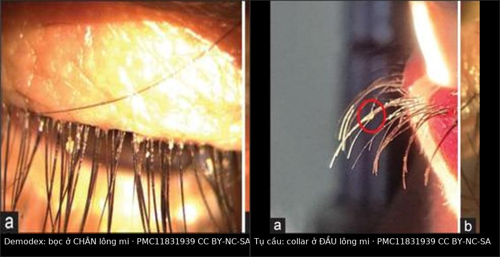
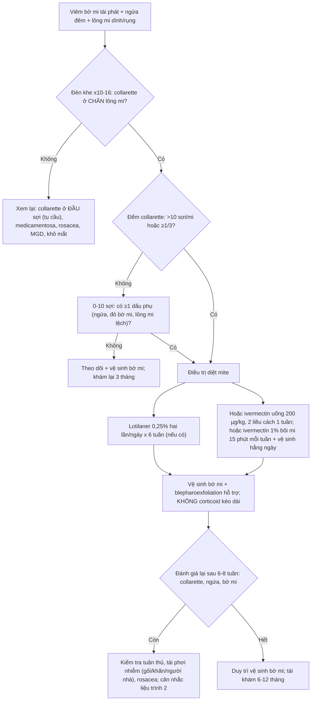
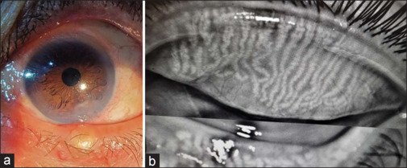
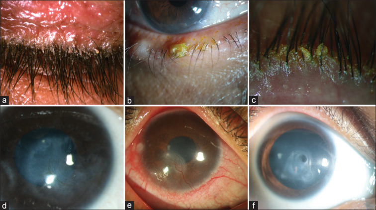
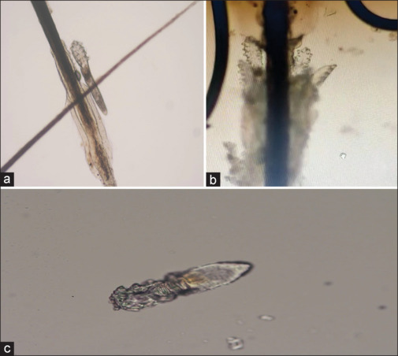

# 3269 — Viêm bờ mi do Demodex / Demodex blepharitis: “collarette” ở chân lông mi — nguyên nhân hay bị bỏ sót của viêm bờ mi tái phát

**Tags:** `pattern:collarette-chan-long-mi` `pattern:bo-mi-tai-phat` `pattern:ngua-dem` `pattern:mat-tuyen-meibomius` `pattern:do-bo-mi` `pattern:mat-long-mi` `vung:mat` `vung:mi` `vung:long-mi` `vung:giac-mac` `protocol:den-khe` `protocol:meibography` `protocol:IVCM` `protocol:epilation-demodex` `protocol:ROT` `protocol:CDR-LET` `score:collarette-0-4` `incidentaloma:khong`

**Mức chắc chắn (certainty):** tổng hợp y văn (literature synthesis) — dựng từ **nghiên cứu Eos ở 6 nước châu Âu** (804 bệnh nhân, **54% có collarette**, **32% có > 10 collarette/mi** — Eye 2026, PMC12830680), **phân tích gộp 2 thử nghiệm then chốt Saturn-1/2** (833 bệnh nhân, lotilaner 0,25% — Ophthalmol Ther 2025, PMC11825414), **tổng quan hệ thống + phân tích gộp 9 RCT** (1.513 bệnh nhân, lotilaner so với TTO — Front Ophthalmol 2026, PMC13713378), **đồng thuận DEPTH 2025 của 15 chuyên gia** (PMC12183565), **tổng quan “Demodex and the eye”** (Indian J Ophthalmol 2025, PMC11831939), **ca lâm sàng – hình ảnh viêm giác mạc–kết mạc do Demodex** (Indian J Ophthalmol 2024, PMC11329816), **nghiên cứu meibography mất tuyến KHÔNG ĐỀU** (J Clin Med 2022, PMC9457096), **tổng quan dược trị** (Pharmacy 2025, PMC12567107) và **tổng quan điều trị ivermectin** (Eye Contact Lens 2026, PMC13623070). Nhóm **không có bệnh nhân của mình**; chỗ chưa đủ chắc ghi **“chưa rõ”**. **Không ghi tên tác giả** — attribution = **tạp chí + năm + PMCID/DOI**.

> **Câu chốt:** người bệnh (thường **trên 50 tuổi**, hay **đã điều trị “viêm bờ mi – khô mắt” nhiều đợt mà vẫn tái phát**) than **ngứa – rát – cộm – chảy nước mắt**, **ngứa nặng về đêm và sáng sớm**, **lông mi dính – rụng – mọc lệch**; đèn khe thấy **bọc sừng dạng ống (collarette) quấn quanh CHÂN lông mi**, đếm được **theo số sợi lông mi có collarette**. Đó là **viêm bờ mi do Demodex (Demodex blepharitis, DB)** — chẩn đoán **bằng mắt, không cần nhổ lông mi** khi đã thấy collarette. Ba điều quyết định: **(1)** đây là bệnh **rất phổ biến và bị bỏ sót** — **54% (409/754)** người đến khám mắt ở châu Âu có collarette, **32%** có **> 10 collarette/mi**, và tỉ lệ **tăng theo tuổi: 30% ở < 20 tuổi → 62% ở ≥ 70 tuổi**; **(2)** **collarette là dấu hiệu đặc hiệu** — không có collarette **không** loại trừ hoàn toàn (lid hygiene tốt che mất), nhưng **có collarette ở chân lông mi** thì gần như chắc chắn là Demodex; **(3)** điều trị đúng **giảm được ký sinh trùng và tổn thương bờ mi** — lotilaner 0,25% trong **6 tuần** đưa **49,8% vs 9,9%** về **0–2 collarette**, **diệt sạch mite 60,2% vs 16,1%** (PMC11825414), trong khi **TTO (tea tree oil)** trong phân tích gộp **không khác giả dược** về mật độ/diệt mite (PMC13713378) và **không có tác dụng diệt mite dưới nồng độ 50%** (PMC11831939).

## 1. Tổng quan bệnh học – cơ chế hình ảnh (TẠI SAO)

### 1.1 Hai loài, hai tầng giải phẫu — vì sao “một bệnh” lại có hai mặt lâm sàng

- **Demodex folliculorum (DF)** dài **0,3–0,4 mm**, sống **trong nang lông mi**, ăn biểu mô nang và **đẻ trứng vào lớp lót nang**; **Demodex brevis** chỉ **0,15–0,2 mm**, chui **sâu vào tuyến bã và tuyến Meibomius** (PMC11831939). Cả hai có **8 chân ngắn (4 đôi)**, tuổi thọ **~2–3 tuần**, và **bò ra ngoài vào ban đêm** để giao phối – đẻ trứng; xác và phân của mite **trở thành một phần mảnh vụn lông mi mỗi 14–18 ngày** (PMC11831939).
- **Hệ quả giải phẫu:** DF gây bệnh **ở bờ mi TRƯỚC/nang lông mi** (collarette, lông mi lệch – rụng – mọc chen), còn **D. brevis** gây bệnh **ở bờ mi SAU/tuyến Meibomius** (viêm bờ mi sau, mất tuyến, viêm giác mạc). Vì **D. brevis nằm gần giác mạc hơn**, đây được cho là **tác nhân chính của viêm giác mạc do Demodex** (PMC11831939). Một bệnh nhân có thể có **cả hai** — và đó là lý do khám phải **lộn mi, soi cả bờ trước lẫn bờ sau**.
- **Lây qua da–da** (skin-to-skin), nên **bệnh nhân thường có rosacea/viêm da mặt kèm**, và **người trong nhà** cũng có thể bị (PMC11831939).

### 1.2 TẠI SAO collarette lại nằm ở CHÂN lông mi — vật lý của keratin, chitin và dòng chảy tuyến

- Mite **cắn – ăn lớp lót nang** để đẻ trứng → **giãn nang, tăng sừng hóa quanh nang (hyperkeratinization)**; chất tiết tuyến bã + **xác chitin** + tế bào sừng bong **bị “xi măng hóa”** thành **vòng sừng dạng ống (cylindrical sleeve)** quanh **điểm lông mi xuyên qua bờ mi** (PMC11831939).
- Vị trí **chân lông mi** là nơi **duy nhất** hội đủ ba điều kiện: **(1)** có nang lông (nơi mite cư trú), **(2)** có dòng bã + tế bào sừng bong ra, **(3)** có **ma sát mi – nhãn cầu** khi chớp để “đùn” khối sừng ra thành ống. Vì vậy collarette **ôm sát chân lông mi và trượt theo sợi lông** — khác hẳn **collar của tụ cầu nằm ở ĐẦU sợi lông mi** (mục 5).
- **Collarette không phải “gàu”: gàu bong tự do**, còn collarette **dính chặt, phải gắp/tuốt mới bong**, và **gắp xong vẫn còn gốc dính ở bờ mi** — đây là lý do **chà bờ mi đơn thuần không khỏi**.
- **Dấu phụ “lông mi phồng gốc” (lash pouting)**: viêm dưới da làm **phì đại nang**, lông mi **không mọc ra được bình thường** → **gốc lông phồng**. Dấu này **đặc hiệu cho demodicosis** và hữu ích khi **bệnh nhân vệ sinh bờ mi tốt nên collarette ít** (PMC11831939).

### 1.3 TẠI SAO ngứa về ĐÊM và SÁNG SỚM

- Mite **sợ ánh sáng** và **bò ra ngoài vào ban đêm** để giao phối – đẻ trứng (PMC11831939); ban ngày chúng **ẩn trong nang/tuyến**. Vì vậy **ngứa – rát – dính mi nặng nhất khi thức giấc**, và **triệu chứng ban ngày có thể rất nghèo nàn** — bệnh nhân thường được chẩn đoán “khô mắt” và chỉ được cho nước mắt nhân tạo.
- Cơ chế ngứa **không phải IgE**: đây là **viêm qua trung gian tế bào + men ký sinh** — **IL-1β, IL-17, MMP-9** tăng trong nước mắt, làm **rối loạn hàng rào biểu mô giác mạc** (PMC11831939). Vì vậy **kháng histamine không đỡ**, và **corticoid chỉ che triệu chứng**.

### 1.4 TẠI SAO meibography mất tuyến KHÔNG ĐỀU — điểm tinh tế dễ bỏ

- Trong **158 mắt** (66 MGD có Demodex, 49 MGD không Demodex, 43 chứng), **meibograde (mức mất tuyến tổng thể) KHÔNG khác nhau** giữa nhóm có và không Demodex (p = 0,547 ở mi trên); cái khác là **độ KHÔNG ĐỀU (uneven atrophy score, UAS)** — **cao hơn rõ ở nhóm Demodex+**, nhất là **mi trên** (PMC9457096).
- Nghĩa là: **nhìn “mất tuyến nhiều hay ít” sẽ bỏ sót Demodex**; phải nhìn **mảng mất tuyến rải rác, không theo thùy, lệch giữa các vùng** — tương ứng **ổ mite + tắc ống tuyến cục bộ**. UAS còn **tương quan thuận với OSDI (r = 0,209)**, **điểm bờ mi (r = 0,287)**, **meibograde (r = 0,356)** và **nghịch với TBUT (r = −0,248)**.

### 1.5 TẠI SAO corticoid kéo dài làm NẶNG, và vì sao phải hỏi rosacea

- **Corticoid tại chỗ/toàn thân là yếu tố nguy cơ của demodicosis** (cùng với **đái tháo đường, nghiện rượu, hút thuốc, phơi nắng, suy giảm miễn dịch**) (PMC12567107): corticoid **ức chế miễn dịch tại chỗ** và làm **mỏng biểu mô**, tạo điều kiện mite **tăng sinh**, đồng thời **che viêm** nên bệnh nhân “đỡ” rồi **bùng lại nặng hơn** khi ngừng — vòng xoáy **corticoid → mite tăng → viêm → corticoid**.
- **Rosacea và Demodex gắn chặt:** phân tích gộp **1.513 bệnh nhân** cho thấy rosacea thể **đỏ–giãn mạch** hoặc **sẩn mủ** có **nguy cơ nhiễm Demodex cao gấp 9 lần** (PMC11831939). Vì vậy **khám bờ mi ở người rosacea** là bắt buộc, và **điều trị mite có thể cải thiện cả da mặt**.

### 1.6 Số liệu định lượng dùng trong bài

| Đại lượng | Số liệu | Nguồn |
|---|---|---|
| Tỉ lệ có collarette ở phòng khám mắt châu Âu (6 nước) | **54% (409/754; KTC 95% 51–58)**; **> 10 collarette/mi: 32% (257/804)** | PMC12830680 (2026) |
| Theo tuổi (Eos) | **30% (< 20 tuổi) → 62% (≥ 70 tuổi)**; dao động theo nước **36% (Đức) – 66% (Anh/Bỉ)** | PMC12830680 (2026) |
| Tỉ lệ ở Mỹ / Nhật | **57,7%** người đến khám mắt (Mỹ); **66%** (Nhật) | doi:10.2147/OPTH.S354692 (2022) / PMC12830680 |
| Người > 60 tuổi / > 70 tuổi | **> 80% / tới 100%** | PMC12567107 (2025) |
| Người đeo kính tiếp xúc | **51%** có mite | PMC11831939 (2025) |
| Rosacea | **OR ~9** (phân tích gộp 1.513 bệnh nhân) | PMC11831939 (2025) |
| Lotilaner 0,25% × 6 tuần (gộp Saturn-1/2, n = 833) | **0–2 collarette: 49,8% vs 9,9%**; **≤ 10 collarette: 85,1% vs 28,0%**; **diệt mite: 60,2% vs 16,1%**; **hết đỏ mi: 24,9% vs 7,9%** (tất cả p < 0,0001); **92%** thấy thuốc dễ chịu | PMC11825414 (2025) |
| Phân tích gộp 9 RCT (1.513 bệnh nhân) | **mật độ mite −1,29 mite/sợi**; **diệt mite OR 4,70 (2–4 tuần) và 9,60 (6–8 tuần)**; **0–2 collarette OR 8,39 / 9,67**; **hết đỏ mi OR 3,91**; **TTO: không khác giả dược** | PMC13713378 (2026) |
| Tái phát sau ivermectin / metronidazole | **62,7% / 68,4% trong 36 tuần** | PMC11831939 (2025) |
| TTO | **không diệt mite dưới 50%**; terpinen-4-ol **1% đã độc tế bào biểu mô tuyến Meibomius** (thay đổi sau **15 phút**, chết sau **90 phút**) | PMC11831939 (2025) |
| Dầu gội trẻ em (baby shampoo) | DF sống **> 150 phút** trong baby shampoo 50%, **số lượng không đổi sau 350 ngày** | PMC11831939 (2025) |
| Meibography | **meibograde không khác**; **UAS cao hơn** ở Demodex+ (mi trên); UAS **7–9** gặp nhiều hơn, **UAS 10–12 không có ở nhóm chứng** | PMC9457096 (2022) |

## 2. Mẫu hình + chẩn đoán phân biệt theo vị trí (gamut)

**Mẫu hình chính:** *người trưởng thành (thường > 50 tuổi, hay có rosacea/đái tháo đường/đang dùng corticoid) với **viêm bờ mi tái phát nhiều đợt**, **ngứa về đêm – sáng sớm**, **lông mi dính – rụng – mọc lệch**, **collarette quấn chân lông mi** đếm được theo sợi, **bờ mi sau đỏ – tắc tuyến Meibomius**, và **meibography mất tuyến không đều**.*

*Hai hình thái **nhìn rất giống nhau** nhưng khác bản chất. **Trái:** bọc sừng dạng ống **ôm sát CHÂN lông mi**, chạy dọc sợi lông như “vỏ bọc” — Demodex. **Phải:** cục sừng **ở ĐẦU sợi lông mi** (vòng đỏ), sợi lông vẫn sạch ở chân — **collarette của tụ cầu (staphylococcal)**. Nguồn: Indian J Ophthalmol 2025 (PMC11831939), Fig. 1a và Fig. 5a, CC BY-NC-SA 4.0; ảnh ghép letterbox, không crop nội dung.*

- **Bờ mi trước – nang lông mi (pattern: collarette, lông mi lệch/rụng):** **DB do D. folliculorum**, **viêm bờ mi do tụ cầu** (collarette ở **đầu** sợi, vảy vàng khô), **viêm bờ mi do tụ cầu – bã nhờn (seborrheic)**, **viêm da tiếp xúc** (đỏ da, ngứa, có yếu tố tiếp xúc), **viêm nang lông mi (folliculitis)** do tụ cầu/Herpes, **u bờ mi (BCC/SCC) giả viêm bờ mi một bên**, **trichiasis/entropion**.
- **Bờ mi sau – tuyến Meibomius (pattern: mất tuyến không đều, meibum đục):** **DB do D. brevis**, **MGD do nguyên nhân khác (tuổi, kính tiếp xúc, isotretinoin)**, **rosacea thể mắt**, **viêm bờ mi sau do tụ cầu**, **viêm da dầu**, **hội chứng Sjögren/khô mắt**.
- **Giác mạc (pattern: viêm giác mạc bờ dưới, sẹo, tân mạch, giả Herpes):** **viêm giác mạc do Demodex (D. brevis)**, **viêm giác mạc do Herpes simplex** (dendrite, một bên), **viêm giác mạc do tụ cầu (catarrhal infiltrate)**, **viêm giác mạc rìa trên SLK**, **loét do kính tiếp xúc (bài 6132)**, **viêm giác mạc do Acanthamoeba (bài 1472)**.
- **Kết mạc (pattern: cương tụ + nhuộm 1/3 dưới):** **DB**, **khô mắt**, **medicamentosa (bài 3268)**, **viêm kết mạc dị ứng (SAC/VKC – bài 3260)**, **viêm kết mạc do virus/Chlamydia**.
- **Mi và da quanh mắt (pattern: chắp/lẹo tái phát, đỏ da):** **DB (chắp – lẹo tái phát do phản ứng dị vật chitin)**, **rosacea**, **viêm da dầu**, **viêm da tiếp xúc**, **Herpes zoster**, **chalazion đơn thuần**.

## 3. Bảng so sánh phân biệt (ma trận đối chiếu)

| Thực thể (entity) | Hình ảnh điển hình (đèn khe/meibography/nhuộm) | Chốt vào (rule-in) | Chốt loại (rule-out) | Gợi ý xác nhận |
|---|---|---|---|---|
| **Viêm bờ mi do Demodex (DF + D. brevis)** | **Collarette dạng ống ở CHÂN lông mi**, bờ mi trước đỏ, **lông mi lệch/rụng**, gốc lông phồng; bờ sau đỏ, meibum đục; **mất tuyến KHÔNG đều** | **Collarette ở chân lông mi** (đếm theo sợi) ± **ngứa đêm** ± **> 10 collarette/mi**; **meibography UAS cao** | Không collarette **và** không dấu bờ mi (nhưng **lid hygiene tốt có thể làm mất collarette** — không loại trừ tuyệt đối) | Đèn khe **×10–16**, bệnh nhân **nhìn xuống** cho mi trên; meibography; IVCM nếu cần |
| **Viêm bờ mi do tụ cầu** | **Collarette ở ĐẦU sợi lông mi**, vảy vàng khô, **loét bờ mi**, mất lông mi từng vùng | **Collarette ở đầu sợi**, vảy khô, đáp ứng kháng sinh/kháng khuẩn | Collarette **ôm chân** lông mi, ngứa về đêm | Nhuộm Gram/cấy bờ mi khi tái phát |
| **MGD / rosacea thể mắt** | Bờ mi sau đỏ, **meibum đặc – đục**, giãn mạch bờ mi, **mất tuyến theo thùy tương đối đều** | **Meibum đặc + giãn mạch bờ mi**; rosacea da mặt | **Mất tuyến không đều (UAS cao) + collarette** → nghĩ Demodex | Meibography, OSDI, khám da mặt |
| **Viêm bờ mi bã nhờn (seborrheic)** | Vảy **nhờn, vàng, dính**, lan cả chân mày/tai, **không loét** | Vảy nhờn lan rộng + viêm da đầu | Collarette dạng ống **khu trú ở chân lông mi**; mất tuyến không đều | Khám da đầu/mặt; đáp ứng dầu gội chống nấm |
| **Medicamentosa (bài 3268)** | **Đỏ hai bên + nhuộm dải 1/3 DƯỚI** ± nhu, ± chàm mi; **đang nhỏ thuốc** | Bảng thuốc + **khỏi sau ngừng thuốc 2–6 tuần** | Không liên quan thuốc; có **collarette** | Ngừng thuốc thử; patch test khi cần |
| **Viêm kết mạc dị ứng / VKC (bài 3260)** | **Ngứa nhiều**, phù mi, **nhú gai lớn sụn mi trên**, tiết nhầy dính | Ngứa là triệu chứng chính, theo mùa/dị nguyên | **Ngứa về đêm + collarette ở chân lông mi**; không nhú gai lớn | Hỏi dị nguyên; đáp ứng kháng histamine |
| **Viêm giác mạc do Herpes simplex** | **Dendrite** bắt màu fluorescein, **giảm cảm giác giác mạc**, **một bên** | Dendrite thật, một bên, giảm cảm giác | **Hai bên + collarette + không dendrite**; **không đáp ứng kháng virus** | Nhuộm fluorescein; PCR HSV |
| **Viêm giác mạc do Demodex (D. brevis)** | **Thâm nhiễm bờ dưới/rìa dưới**, **tân mạch nông**, sẹo, có thể **giả Herpes** | Collarette + bờ mi sau bệnh + **thâm nhiễm/giả Herpes bờ dưới** | Không collarette, không bệnh bờ mi; đáp ứng kháng virus | Soi bờ mi trước/sau, IVCM, thử điều trị mite |
| **Loét giác mạc do kính tiếp xúc (bài 6132)** | Ổ loét **đặc**, thâm nhiễm, có thể mủ tiền phòng | Đeo kính, đau nhiều, ổ loét khu trú | Collarette + bệnh bờ mi **hai bên**, không ổ loét | Cạo giác mạc cấy; ngừng kính |
| **Chalazion / lẹo tái phát** | Khối bờ mi khu trú, **không đau (chắp) / đau (lẹo)** | Khối khu trú + bờ mi viêm | Chắp **tái phát nhiều lần ở nhiều vị trí** → tìm Demodex | Khám collarette; meibography; sinh thiết nếu một bên dai dẳng |

## 4. Protocol khám + hệ phân độ/điểm chuẩn hóa

### 4.1 Trình tự khám (5 bước, ~5–10 phút)

1. **Nhìn – đếm collarette (bước quyết định):** bệnh nhân **nhìn xuống** để lộ **bờ mi trên** (nơi collarette rõ nhất), đèn khe **×10–16**, khám **từng mi riêng**; đếm **số sợi lông mi có collarette** ở mỗi mi. **Không cần nhổ lông mi** khi đã thấy collarette — **đồng thuận DEPTH 15/15** xác nhận collarette là **dấu hiệu đặc hiệu** nên có thể bỏ nhổ lông mi (PMC12183565, PMC11831939).
2. **Bờ mi sau + tuyến Meibomius:** ấn nhẹ bờ mi, ghi **chất tiết đục/đặc**, giãn mạch bờ mi, **tắc lỗ tuyến**; tìm **lông mi phồng gốc (lash pouting)** — dấu đặc hiệu khi collarette ít (PMC11831939).
3. **Lông mi:** hướng mọc, **lông mi lệch (trichiasis/madarosis)**, dính mi sáng, mảnh vụn.
4. **Meibography:** đánh giá **mất tuyến** và đặc biệt **độ không đều (UAS)** — mất tuyến **rải rác, không theo thùy, lệch giữa các vùng**, nhất là **mi trên**; **meibograde tổng thể bình thường không loại trừ** (PMC9457096).
5. **Giác mạc – kết mạc:** nhuộm **fluorescein** (tổn thương biểu mô) ± **lissamine green**; tìm **thâm nhiễm/tân mạch bờ dưới**, **loét khiên**, **sẹo**; loại **dendrite** và **ổ loét do kính**.

### 4.2 Đếm mite khi cần (không bắt buộc): epilation – ROT – CDR/LET – IVCM

- **Nhổ lông mi (epilation):** chọn **2 lông mi có collarette mỗi mi**, đặt lên lam, nhỏ **20 µL nước muối** để mite bò ra; nếu collarette đặc, nhỏ **cồn 100% hoặc fluorescein 0,25%** và **chờ tới 20 phút** cho mite di chuyển ra khỏi bọc (PMC11831939). **Mật độ mite = số mite/sợi**; **diệt sạch = 0 mite/sợi** (PMC11825414).
- **Không xâm lấn (thay thế nhổ lông):** **ROT** — xoay sợi lông **30 giây**, soi điểm xuyên qua bờ mi tìm **đuôi mite hình điếu xì gà**; **CDR** — gắp bỏ collarette rồi đếm đuôi mite; **LET** — kéo lông mi sang hai bên **30 giây**; đếm trung bình trên **8 sợi** (2 sợi/mi) (PMC11831939).
- **IVCM (in vivo confocal microscopy):** thấy **toàn bộ nang lông và tuyến Meibomius**, **tăng phát hiện ấu trùng và D. brevis**; tuy nhiên **so với nhổ lông mi cho kết quả khác nhau giữa các nghiên cứu** → **chưa có chuẩn vàng thống nhất** (PMC11831939, mục 7).

### 4.3 Thang điểm collarette (0–4) — dùng để chọn ngưỡng điều trị và theo dõi

| Độ | Số sợi lông mi có collarette / mỗi mi | Ý nghĩa thực hành |
|---|---|---|
| **0** | **0–2 sợi** | Nhẹ; **cần ≥ 1 dấu phụ** (ngứa, đỏ bờ mi) mới điều trị (DEPTH) |
| **1** | **3–10 sợi** | Nhẹ–trung bình; **cần ≥ 1 dấu phụ** |
| **2** | **> 10 sợi đến < 1/3** | **Điều trị dù không có dấu phụ** (DEPTH 12/15) |
| **3** | **≥ 1/3 đến < 2/3** | **Điều trị** (DEPTH 15/15) |
| **4** | **≥ 2/3** | **Điều trị** (DEPTH 15/15) |

- **Cạm bẫy của thang điểm:** “**grade 0**” **không phải là 0 collarette** mà là **0–2 sợi** — đây chính là tiêu chí chính của thử nghiệm lotilaner (PMC11825414, PMC12183565).
- **Ngưỡng của Eos (thực hành châu Âu):** **có collarette + có triệu chứng → điều trị**; **> 10 collarette/mi → điều trị kể cả không triệu chứng** (PMC12830680).

### 4.4 Sơ đồ xử trí

### 4.5 Ngưỡng điều trị và theo dõi

- **Mục tiêu là GIẢM tải mite, không phải diệt tuyệt đối** — quần thể mite **không thể loại trừ hoàn toàn** (PMC11831939); vì vậy **đích theo dõi là collarette + triệu chứng**, không phải “0 mite”.
- **Lotilaner 0,25%** (nhỏ **hai lần/ngày × 6 tuần**): **thuốc duy nhất được FDA phê duyệt** cho DB; gộp 833 bệnh nhân cho **0–2 collarette 49,8% vs 9,9%**, **diệt mite 60,2% vs 16,1%**, **hết đỏ mi 24,9% vs 7,9%**, **không có biến cố bất lợi mắt nghiêm trọng**, **92%** thấy dễ chịu (PMC11825414). **DEPTH: 14/15 chọn lotilaner là điều trị đầu tay**, **15/15** khi có rosacea mặt (PMC12183565).
- **Ivermectin uống:** **200 µg/kg**, thường **2 liều cách 1 tuần** (PMC13623070); hiệu quả nhưng **tái phát tới 62,7% trong 36 tuần** (PMC11831939) → phải **kèm vệ sinh bờ mi** và theo dõi.
- **Ivermectin 1% bôi mi** (off-label): **15 phút, mỗi tuần**, kèm vệ sinh hằng ngày — cải thiện triệu chứng và dấu hiệu (PMC11831939).
- **TTO/terpinen-4-ol:** **không diệt mite dưới 50%**; nồng độ cao gây **kích ứng**, còn **1% đã độc tế bào biểu mô tuyến Meibomius** (thay đổi sau **15 phút**, chết sau **90 phút**) → **không dùng như “chữa khỏi”**, và **kiểm tra tuyến Meibomius trước – trong khi dùng** (PMC11831939).
- **Hỗ trợ cơ học:** **blepharoexfoliation** (DEPTH **13/15** chọn làm phụ trợ, nhưng **phải ghép với thuốc diệt mite**) (PMC12183565); **IPL** hỗ trợ MGD/rosacea nhưng **chưa có bằng chứng RCT mạnh riêng cho DB**.
- **KHÔNG dùng corticoid dài hạn** để “kiểm soát viêm bờ mi”: corticoid là **yếu tố nguy cơ demodicosis**, che dấu bệnh và gây **glôcôm/đục thể thủy tinh** (PMC12567107).

## 5. Biến thể bình thường và cạm bẫy

- **Collar của tụ cầu nằm ở ĐẦU sợi lông mi, không ở chân** — nhìn kỹ vị trí là phân biệt được **trước khi cấy**; điều trị kháng khuẩn ở ca Demodex sẽ **tái phát** (PMC11831939 Fig. 5).
- **“Không thấy collarette” không loại trừ Demodex:** bệnh nhân **vệ sinh bờ mi tốt** có thể **gắp hết collarette** nhưng vẫn **tải mite cao** — tìm **lông mi phồng gốc**, **bờ mi sau bệnh**, **meibography mất tuyến không đều** (PMC11831939).
- **Meibograde bình thường không loại trừ:** mất tuyến **tổng thể** ở Demodex+ **không khác** nhóm không Demodex; chỉ **độ không đều (UAS)** khác (PMC9457096).
- **Baby shampoo KHÔNG diệt mite:** DF sống **> 150 phút** trong baby shampoo 50% và **số lượng không đổi sau 350 ngày** — “vệ sinh bờ mi bằng dầu gội trẻ em” là **thói quen sai** còn phổ biến (PMC11831939).
- **Povidone-iodine 10%/cồn không hiệu quả** tại bờ mi (PMC11831939); **không dùng** thay thế thuốc diệt mite.
- **Demodex viêm giác mạc giả Herpes:** trong một loạt, **tất cả ca viêm giác mạc do Demodex từng bị chẩn đoán viêm do virus** và **không đáp ứng kháng virus** — nếu “Herpes” **hai bên**, **không dendrite**, **có collarette**, phải **soi bờ mi** và **thử điều trị mite** (PMC11831939).
- **Chắp/lẹo tái phát ở trẻ:** Demodex có liên quan **chalazion ở trẻ**; chắp **tái phát nhiều vị trí** ở người lớn cũng là gợi ý (PMC11831939, PMC12567107).
- **Đừng nhầm “đỏ bờ mi” với dị ứng:** DB gây **ngứa về đêm**, **không theo mùa**, **không đáp ứng kháng histamine**; còn **VKC/SAC** ngứa ban ngày, theo mùa, có **nhú gai lớn** (bài 3260).
- **Không điều trị “mọi người có mite”:** mite là **commensal** ở nhiều người; **chỉ điều trị khi có collarette + triệu chứng**, hoặc **> 10 collarette/mi** (PMC12830680) — tránh lạm dụng thuốc và chi phí.
- **Tái phơi nhiễm:** mite lây **da–da**, nên **gối – khăn – trang điểm – người nhà** có thể là nguồn; tái phát sớm sau điều trị đúng thường do **nguồn này** hoặc **rosacea chưa kiểm soát**.

*Mặt **bờ mi sau** của cùng bệnh: **(a)** chắp mi dưới, cương tụ kết mạc bờ dưới và **thâm nhiễm giác mạc vô khuẩn**; **(b)** meibography cho thấy **tuyến Meibomius bị tắc đúng vị trí chắp** (mất tuyến khu trú). Chắp **tái phát + thâm nhiễm bờ dưới** ở người có collarette là **DB có biến chứng**, không phải “chắp đơn thuần”. Nguồn: Indian J Ophthalmol 2025 (PMC11831939), Fig. 6, CC BY-NC-SA 4.0.*

## 6. Tự lượng giá — Blind Quiz ngay trên trang tĩnh

**Ca 1 — “viêm bờ mi 3 năm, đã dùng 4 đợt kháng sinh – corticoid”**

- Gợi ý lâm sàng: nam 62 tuổi, **ngứa – rát hai bên** nặng về đêm, **lông mi dính khi ngủ dậy**, đã được chẩn đoán “viêm bờ mi – khô mắt”, dùng kháng sinh bờ mi và corticoid ngắn đợt; nay **nhìn mờ nhẹ mắt phải**.
- Câu hỏi: Mô tả tổn thương ở **(a–c)**? Ba chẩn đoán phân biệt? Vì sao **không** phải Herpes dù có thâm nhiễm giác mạc?

<b>Bấm để hiện đáp án (findings + chẩn đoán)</b>

- Dấu hiệu (findings): **(a–c)** bọc sừng vàng **quấn quanh chân lông mi** dọc bờ mi, bờ mi **đỏ – trợt**; **(d–f)** giác mạc có **vùng mờ đục nông lan rộng kèm tân mạch nông** (d), **sẹo kèm bó mạch** (e), **sẹo + đục khu trú** (f).
- Chẩn đoán (diagnosis): **viêm bờ mi – kết mạc – giác mạc do Demodex** — collarette ở chân lông mi là **dấu hiệu đặc hiệu**; tổn thương giác mạc là **biến chứng bờ dưới** do **D. brevis** và phản ứng IL-17/MMP-9.
- Vì sao không Herpes: **hai bên**, **không dendrite**, **có collarette**, và **không đáp ứng kháng virus** — theo y văn, ca viêm giác mạc do Demodex **thường bị chẩn đoán nhầm là do virus** (PMC11831939).
- Nguồn ảnh: Indian J Ophthalmol 2024 (PMC11329816), Fig. 1, CC BY-NC-SA 4.0.

**Ca 2 — “vảy ở lông mi: chân hay đầu?”**

- Gợi ý lâm sàng: hai bệnh nhân cùng **đỏ bờ mi + vảy lông mi**; một người **ngứa về đêm**, người kia **vảy vàng khô, không ngứa nhiều**.
- Câu hỏi: Ảnh nào là **Demodex**, ảnh nào là **tụ cầu**? Dấu hiệu nào quyết định? Có cần nhổ lông mi không?

<b>Bấm để hiện đáp án (findings + chẩn đoán)</b>

- Dấu hiệu (findings): **trái** — bọc sừng dạng ống **ôm sát chân lông mi**, chạy dọc sợi lông; **phải** — cục sừng **ở đầu sợi lông mi** (vòng đỏ), chân lông sạch.
- Chẩn đoán (diagnosis): **trái = Demodex blepharitis**; **phải = collarette của tụ cầu**. Vị trí **chân vs đầu** là chốt; Demodex còn kèm **ngứa đêm, lông mi lệch, bờ mi sau bệnh**.
- Không cần nhổ lông mi khi đã thấy collarette ở chân (DEPTH 15/15) — nhưng nếu **collarette ít do vệ sinh tốt**, tìm **lông mi phồng gốc** hoặc làm **ROT/CDR/LET**.
- Nguồn ảnh: Indian J Ophthalmol 2025 (PMC11831939), Fig. 1a + Fig. 5a, CC BY-NC-SA 4.0; ảnh ghép letterbox.

**Ca 3 — “soi lông mi: hai loài, hai bệnh cảnh”**

- Gợi ý lâm sàng: bệnh nhân nữ 55 tuổi, **ngứa mi + khô mắt** nhiều năm, bờ mi có collarette; bác sĩ nhổ lông mi soi tươi.
- Câu hỏi: **Hình nào là D. folliculorum, hình nào là D. brevis**? Loài nào gây **viêm giác mạc**? Vì sao?

<b>Bấm để hiện đáp án (findings + chẩn đoán)</b>

- Dấu hiệu (findings): **(a, b)** lông mi có **mite thân dài** bám ở nang — **D. folliculorum**; **(c)** mite **thân ngắn, mập** — **D. brevis**.
- Chẩn đoán (diagnosis): **D. folliculorum** dài **0,3–0,4 mm** sống trong **nang lông mi** → collarette, lông mi lệch/rụng; **D. brevis** chỉ **0,15–0,2 mm** sống **sâu trong tuyến Meibomius/tuyến bã** → **MGD, mất tuyến**, và vì **gần giác mạc hơn** nên được cho là **tác nhân chính của viêm giác mạc** do Demodex.
- Hệ quả: một bệnh nhân có thể **có cả hai** → khám **cả bờ trước và bờ sau**, và **điều trị phải diệt mite ở cả hai tầng** (vệ sinh bờ mi + thuốc diệt mite).
- Nguồn ảnh: Indian J Ophthalmol 2024 (PMC11329816), Fig. 2, CC BY-NC-SA 4.0.

## 7. Câu hỏi nghiên cứu & điểm chưa đồng thuận (tính đến 11/2026)

1. **[Tranh cãi] Ở bệnh nhân viêm bờ mi do Demodex, TTO/terpinen-4-ol có diệt được mite và cải thiện collarette tốt hơn giả dược không?**
   - **Đã biết:** phân tích gộp 9 RCT (1.513 bệnh nhân): **TTO không khác biệt có ý nghĩa** so với sham về **mật độ mite** và **diệt mite**, trong khi lotilaner 0,25% đạt **OR 4,70–9,60** (PMC13713378); một tổng quan vẫn gọi TTO là “điều trị hiệu quả nhất” theo y văn cũ (PMC11831939), và TTO **không diệt mite dưới 50%**.
   - **Chưa rõ:** khác biệt do **nồng độ/ công thức/ thời gian dùng/ sham** hay do **TTO thực sự kém**; và **độc tính trên tuyến Meibomius** (1% T4O) ảnh hưởng kết cục dài hạn ra sao.
   - **Hướng nghiên cứu:** RCT **cùng nồng độ chuẩn hóa (T4O 2,5–5%)**, cùng **sham**, outcome **mật độ mite + collarette + tuyến Meibomius trên meibography**.
   - **Nguồn:** PMC13713378 (2026); PMC11831939 (2025).

2. **[Khác biệt thực hành] Ngưỡng collarette nào đủ để điều trị — “có collarette + triệu chứng” hay “> 10 collarette/mi kể cả không triệu chứng”?**
   - **Đã biết:** đồng thuận DEPTH: **Grade 2 (> 10 sợi/mi) trở lên điều trị dù không có dấu phụ**, Grade 0–1 cần **≥ 1 dấu phụ** (PMC12183565); nghiên cứu Eos lại khuyến nghị **có collarette + có triệu chứng → điều trị**, **> 10 collarette/mi → điều trị dù không triệu chứng** (PMC12830680).
   - **Chưa rõ:** **điều trị Grade 0–1 không triệu chứng** có lợi hay chỉ **tăng chi phí và phơi nhiễm thuốc**; và **ngưỡng này có giá trị tiên đoán** cho tiến triển MGD/viêm giác mạc hay không.
   - **Hướng nghiên cứu:** đoàn hệ tiến cứu **theo ngưỡng collarette**, outcome **tiến triển viêm giác mạc/MGD sau 12–24 tháng**.
   - **Nguồn:** PMC12183565 (2025); PMC12830680 (2026).

3. **[Khoảng trống] Chưa có chuẩn vàng và ngưỡng “mật độ mite” thống nhất để chẩn đoán và theo dõi DB.**
   - **Đã biết:** **kỹ thuật nhổ lông mi rất khác nhau giữa các nghiên cứu** (số sợi, dung môi, thời gian chờ), IVCM **phát hiện nhiều ấu trùng và D. brevis hơn** nhưng **so với nhổ lông mi cho kết quả không nhất quán** (PMC11831939); phân tích gộp buộc **chuẩn hóa về “mite/sợi”** để gộp số liệu (PMC13713378).
   - **Chưa rõ:** **ngưỡng mật độ** phân biệt **commensal** với **bệnh**, và **giá trị của IVCM** trong theo dõi đáp ứng điều trị.
   - **Hướng nghiên cứu:** nghiên cứu **diagnostic accuracy** so với **collarette làm chuẩn lâm sàng**, kèm **IVCM định lượng** và **kết cục dài hạn**.
   - **Nguồn:** PMC11831939 (2025); PMC13713378 (2026).

## Bài liên quan chéo
- [3268 – Viêm kết mạc do thuốc nhỏ mắt (medicamentosa): **đỏ hai bên + nhuộm 1/3 dưới, khỏi sau ngừng thuốc**](../3268-vien-ket-mac-do-thuoc-nho-mat/lesson.md) — hàng phân biệt sát nhất của “đỏ bờ mi – kết mạc dai dẳng”
- [3267 – Viêm kết mạc rìa trên (SLK): **nhuộm dải 1/3 TRÊN + chỉ khâu nhầy**](../3267-viem-ket-mac-ria-tren/lesson.md)
- [3260 – Viêm kết mạc mùa xuân thể rìa: **nhú gai lớn + nốt Horner–Trantas + ngứa theo mùa**](../3260-viem-ket-mac-mua-xuan-the-ria/lesson.md)
- [6132 – Viêm giác mạc nhiễm khuẩn liên quan kính tiếp xúc](../6132-viem-giac-mac-kinh-tiep-xuc/lesson.md)
- [1472 – Viêm giác mạc do Acanthamoeba](../1472-viem-giac-mac-acanthamoeba/lesson.md)
- [1456 – Bỏng hóa chất mắt](../1456-bong-hoa-chat-mat/lesson.md)
- [400 – Tổng quan Mắt & thị giác](../400-tong-quan-mat-thi-giac/lesson.md)

## Ảnh
- 5 ảnh + 1 ảnh ghép, tải từ **PubMed Central** (open access, CC BY-NC-SA 4.0); nguồn + giấy phép từng ảnh trong `images/CREDITS.md`.
- Tên file: `3269_demodex_<Modal>_<PMCID>-Fig<N>.jpg`; ảnh ghép tạo bằng `tools/make_composite.py` (letterbox nền đen, không crop/kéo giãn nội dung ảnh).

> Không dùng để chẩn đoán độc lập khi chưa có người hướng dẫn.
