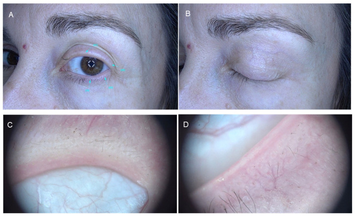
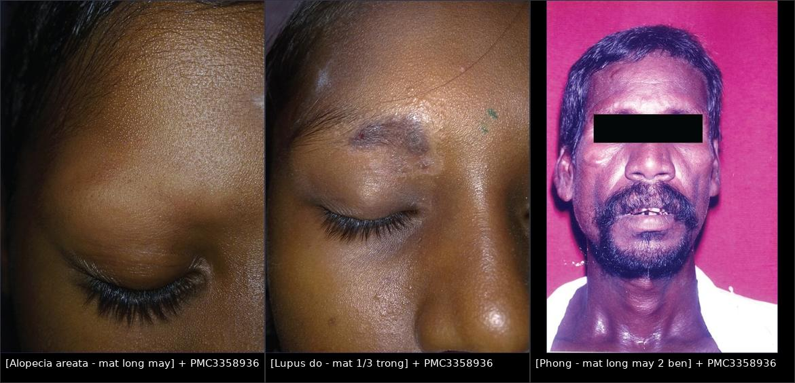
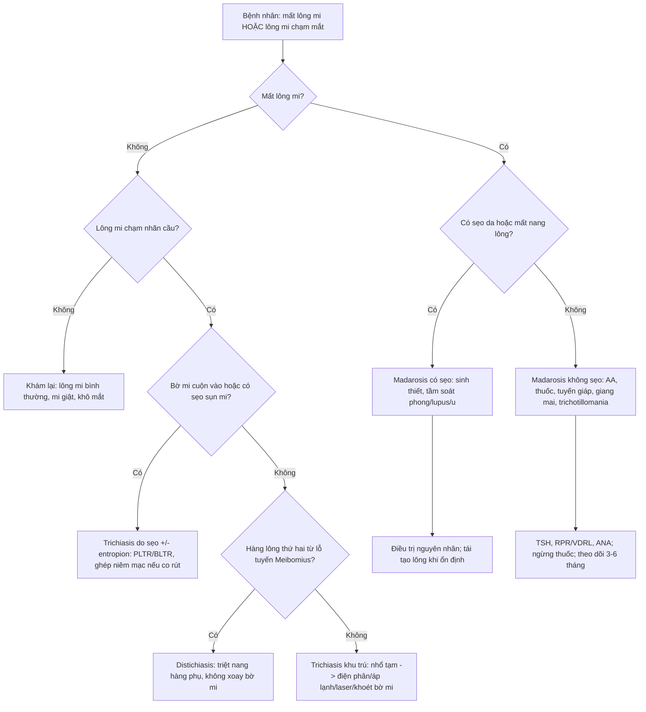
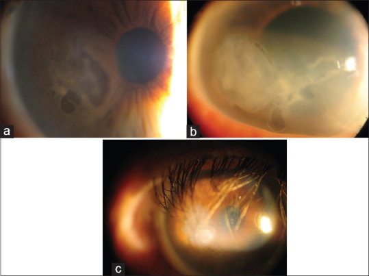
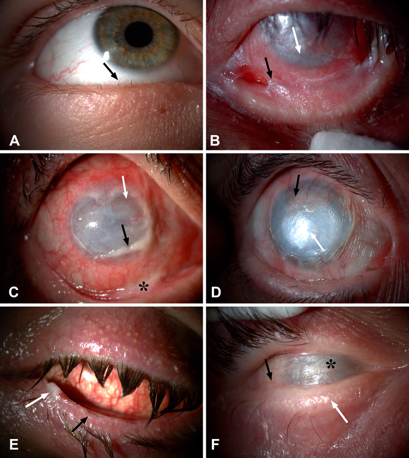
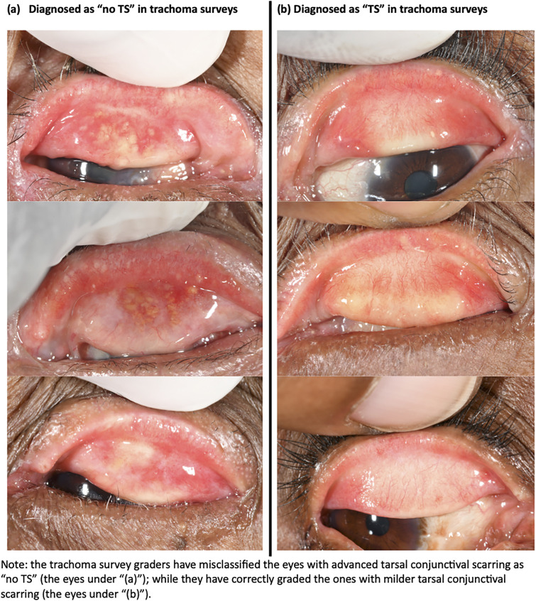

# 3270 — Rụng lông mi (madarosis) và lông mi mọc lệch (trichiasis): hai dấu hiệu bờ mi, hai con đường chẩn đoán

**Tags:** `pattern:mat-long-mi` `pattern:madarosis` `pattern:trichiasis` `pattern:long-mi-moc-lech` `pattern:seo-ket-mac-sun-mi` `pattern:quem-mi` `pattern:ton-thuong-giac-mac` `vung:mat` `vung:mi` `vung:long-mi` `vung:giac-mac` `protocol:den-khe` `protocol:lot-mi` `protocol:nhuom-fluorescein` `protocol:trichoscopy` `protocol:AS-OCT` `protocol:meibography` `score:WHOTT` `incidentaloma:khong`

**Mức chắc chắn (certainty):** tổng hợp y văn (literature synthesis) — dựng từ **tổng quan madarosis** (Int J Trichology 2012, PMC3358936; **CC BY-NC-SA 3.0**), **nghiên cứu dịch tễ bờ mi ở người ≥ 60 tuổi** (Tehran Geriatric Eye Study, BMC Ophthalmol 2026, PMC13295570), **ca trichiasis khu trú gây phù – sẹo giác mạc toàn chiều dày** (Middle East Afr J Ophthalmol 2017, PMC5793455), **nghiên cứu quan sát đa quốc gia về trichiasis có/không sẹo sụn mi** (PLOS Glob Public Health 2025, PMC12539719), **tổng quan di chứng mắt SJS/TEN** (Ophthalmol Ther 2023, PMC10157599) và **loạt 96 mắt SJS/TEN mạn** (Ophthalmol Ther 2024, PMC11039596), **tổng quan madarosis trong alopecia areata** (J Clin Med 2025, PMC12693123), **thử nghiệm FLAME** (Lancet Glob Health 2026, PMC13034013), **so sánh PLTR – BLTR** (PLoS Negl Trop Dis 2025, PMC12331057), **phân tích gộp laser argon** (Indian J Ophthalmol 2026, PMC13614734), **hướng dẫn WHO 2024** (Community Eye Health 2024, PMC11921252) và **tờ thông tin trachoma của WHO 11/2026**. Nhóm **không có bệnh nhân của mình**; chỗ chưa đủ chắc ghi **“chưa rõ”**. **Không ghi tên tác giả** — attribution = **tạp chí + năm + PMCID/DOI** (xem `images/CREDITS.md`).

> **Câu chốt:** hai bệnh nhân đến với hai câu rất khác nhau — *“lông mi tôi rụng dần”* và *“mắt tôi cộm như có sợi lông chọc”*. Cả hai đều là **bệnh của bờ mi**, nhưng đi theo **hai trục quyết định**: **(1) mất lông mi (madarosis)** — phải phân biệt **có sẹo (nang lông bị phá hủy, không mọc lại)** với **không sẹo (chu kỳ lông bị ngắt, còn hồi phục)**, vì trục này quyết định **không chờ vô ích** và **tầm soát toàn thân** (phong, lupus, giang mai, tuyến giáp, thuốc); **(2) lông mi mọc lệch (trichiasis)** — phải phân biệt **trichiasis thật** với **quặm mi (entropion)**, **song hàng lông mi (distichiasis)** và **mi phụ ở trẻ (epiblepharon)**, vì mỗi thực thể có **phẫu thuật khác nhau**. Điều tối quan trọng: **một sợi lông mi chạm giác mạc là đủ gây phù – sẹo – mất nội mô**, và **nhổ lông mi chỉ là biện pháp tạm** — lông mọc lại sau **8–10 tuần** (PMC3358936). Ở người ≥ 60 tuổi, **madarosis gặp 7,8%** và **trichiasis 2,45%**, trong khi **entropion chỉ 0,23%** (PMC13295570) — nghĩa là **phần lớn trichiasis không phải do quặm mi**, và đừng chờ thấy quặm mới điều trị.

## 1. Tổng quan bệnh học – cơ chế hình ảnh (TẠI SAO)

### 1.1 Giải phẫu và chu kỳ lông mi — vì sao nhổ lông mi không bao giờ là điều trị

- Lông mi mọc thành **2–3 hàng**, sợi **ngắn, dày, cong**, cắm **chéo ra trước cơ mi**; lông mi trên cong lên, lông mi dưới cong xuống để **không đan vào nhau khi nhắm mắt** (PMC3358936). Nang lông mi nằm **nông trong bờ mi trước**, ngay cạnh **lỗ tuyến Meibomius** ở bờ sau — vì vậy **một tổn thương ở bờ mi có thể vừa làm rụng lông, vừa làm lông đổi hướng**.
- Lông mi **dài 0,15 mm/ngày**, tồn tại **5–6 tháng** rồi rụng; **sau khi nhổ, lông mới mọc lại trong khoảng 8–10 tuần** (PMC3358936). Con số này giải thích toàn bộ thực hành: **nhổ lông chỉ “sạch” được 2 tháng**, bệnh nhân tưởng đã khỏi rồi tái phát, và mỗi lần nhổ lại là một lần **chấn thương thêm nang lông** — trong khi **nguyên nhân cơ học (sẹo co kéo, quặm) vẫn còn nguyên**.

### 1.2 TẠI SAO một sợi lông mi phá được giác mạc — vật lý của ma sát lặp lại

- Sợi lông mi là **sợi keratin cứng**, đầu vát; mỗi lần chớp, bờ mi **trượt qua biểu mô giác mạc** với lực tiếp tuyến. Người bình thường chớp **15–20 lần/phút**, tức **hàng chục nghìn lần/ngày** — một sợi lông chạm sẽ **cào biểu mô lặp lại** đúng một vùng.
- Biểu mô giác mạc chỉ dày khoảng **50 µm** và **không có mạch máu**; tổn thương lặp lại gây **trợt biểu mô điểm**, **rối loạn màng phim nước mắt**, rồi **thâm nhiễm – loét – tân mạch – sẹo**. Vì **bơm nội mô** phải bù nước cho toàn bộ nhu mô, một vùng **mất nội mô khu trú** sẽ biểu hiện bằng **phù toàn chiều dày đúng vùng đó** — đây chính là cơ chế ca **trichiasis khu trú gây phù toàn chiều dày, mất nội mô lan tỏa và cuối cùng phải ghép giác mạc xuyên** ở người 66 tuổi (PMC5793455).
- Hệ quả thực hành: **phù giác mạc khu trú mà không có viêm mủ tiền phòng, không có thể bệnh nội mô** ở người có lông mi chạm → **nghĩ trichiasis trước khi nghĩ Herpes**. Trong ca trên, **xét nghiệm dịch tiền phòng âm tính HSV/CMV/VZV**, và **ghép giác mạc chỉ thành công sau khi sửa bờ mi** (PMC5793455).

### 1.3 TẠI SAO mất lông mi: hai cơ chế, hai tiên lượng

- **Không sẹo (non-scarring):** nang lông **còn nguyên**, nhưng chu kỳ bị đẩy sang **catagen/telogen** hoặc bị ức chế **anagen** → lông rụng nhưng **mọc lại** khi loại bỏ nguyên nhân. Nguyên nhân: **alopecia areata**, **thuốc (taxane, retinoid, heparin, thuốc chống động kinh…)**, **tuyến giáp**, **giang mai thứ phát**, **trichotillomania** (PMC3358936; PMC12693123).
- **Có sẹo (scarring):** **nang lông bị phá hủy** bởi thâm nhiễm viêm/Histiocyte, xơ hóa, bỏng, xạ, hoặc u xâm lấn → **không mọc lại**. Nguyên nhân: **phong (leprosy)**, **lupus đĩa (discoid lupus)**, **bỏng/xạ**, **viêm bờ mi mạn nặng**, **herpes zoster**, **u bờ mi** (PMC3358936).
- **Viêm bờ mi mạn là nguyên nhân phổ biến nhất của madarosis** (PMC3358936) — trong đó **Demodex** là nguyên nhân hay bị bỏ sót, với **collarette ở chân lông mi** và **lông mi rụng/lệch** (bài 3269). Điều này quan trọng vì **điều trị được**: diệt mite + vệ sinh bờ mi có thể **giảm rụng và cải thiện lông mi**, khác hẳn madarosis do sẹo.

*Madarosis **không sẹo** trong **alopecia areata**: **(A)** mất lông mi **từng vùng** ở mi trên và dưới (đầu mũi tên), không có sẹo hay teo bờ mi; **(C, D)** soi da (trichoscopy) cho thấy **nang lông rỗng/giảm mật độ** nhưng **không xơ hóa**. Vì nang còn, lông **có thể mọc lại** — khác hẳn madarosis có sẹo. Nguồn: J Clin Med 2025 (PMC12693123), Fig. 1, CC BY 4.0.*

- **TẠI SAO mất lông mày 1/3 ngoài trong bệnh tuyến giáp (dấu Hertoghe/Queen Anne):** mật độ lông mày **vốn đã thưa ở 1/3 ngoài**, nên khi có **rối loạn chu kỳ lông lan tỏa**, vùng thưa nhất **lộ rõ đầu tiên** — không phải vì tuyến giáp “chọn” đuôi lông mày (PMC3358936).
- **TẠI SAO phong gây mất lông mày hai bên:** thâm nhiễm **tế bào histiocyte** vào nang lông → phá hủy nang; xảy ra ở **thể đa khuẩn (multibacillary)** sau **ít nhất 5–10 năm không điều trị**, và **76%** bệnh nhân thể đa khuẩn có madarosis (PMC3358936). **Không có madarosis** là dấu tiên lượng tốt ở ca bệnh lâu năm.

### 1.4 TẠI SAO sẹo kết mạc sụn mi lại làm lông mi “quay ngược”

- Trong **trachoma**, **SJS/TEN**, **viêm kết mạc dính (mucous membrane pemphigoid)** và **bỏng hóa chất**, viêm lặp lại → **xơ hóa kết mạc sụn mi** → **sẹo co rút** kéo **bờ mi sau** vào trong. Sợi lông mi **vẫn mọc từ nang ở vị trí bình thường**, nhưng **bờ mi đã xoay vào trong**, nên đầu lông **chúc vào giác mạc** — đó là **trichiasis do sẹo**, thường kèm **entropion** nhưng **không phải lúc nào cũng có** (WHO 2024, PMC11921252).
- Vì cơ chế là **co cơ học của sẹo**, **thuốc chống viêm không sửa được hướng sợi lông**: thử nghiệm FLAME ở **2.410 người / 3.235 mắt** cho **13,4% vs 13,4%** tái phát trichiasis sau mổ giữa **fluorometholone 0,1% × 28 ngày** và giả dược (PMC13034013). Đây là bằng chứng mạnh để **không hứa “uống/nhỏ thuốc là hết”** và để **phẫu thuật đúng trục**.
- **TẠI SAO sẹo sụn mi bị đọc sót:** nghiên cứu đa quốc gia (Ethiopia, Uganda, Nigeria) cho thấy trong số mắt được phân loại **“không có sẹo sụn mi”** khi khám thực địa, **92,8% / 67,9% / 90,1%** vẫn có sẹo khi chuyên gia đọc ảnh; **69,6% (174/250)** trong nhóm đọc sót có **sẹo lan rộng ≥ 1/3 kết mạc sụn mi trên**, và nhóm có sẹo **nặng hơn về entropion, trichiasis, viêm kết mạc và đục giác mạc** (PMC12539719).

### 1.5 TẠI SAO SJS/TEN để lại trichiasis nhiều đến vậy

- SJS/TEN gây **hoại tử và bong biểu mô** ở bờ mi và kết mạc; khi tái biểu mô hóa, **sẹo co rút + sừng hóa bờ mi** làm **bờ mi dày, sắc, lông mi đổi hướng**, đồng thời **tuyến Meibomius bị phá hủy** → **khô mắt nặng** cộng thêm **ma sát cơ học** (PMC10157599).
- Trong **96 mắt / 48 bệnh nhân** SJS/TEN mạn tại một trung tâm, **trichiasis/distichiasis gặp ở 46,3% số mắt**, sau **symblepharon 47,5%**, **tân mạch giác mạc 38,8%**, **sẹo giác mạc 36,3%** (PMC11039596). Vì vậy ở bệnh nhân SJS, **phải lộn mi khám toàn bộ bờ mi và cùng đồ**, không chỉ nhìn giác mạc.

### 1.6 Số liệu định lượng dùng trong bài

| Đại lượng | Số liệu | Nguồn |
|---|---|---|
| Madarosis / trichiasis / entropion ở người ≥ 60 tuổi | **7,8% / 2,45% / 0,23%** (3.267 người; Iran) | PMC13295570 (2026) |
| Gánh nặng trachoma toàn cầu | **1,9 triệu** người mù/giảm thị lực; **92 triệu** sống trong vùng lưu hành; **98.829** ca mổ trichiasis năm 2025 | WHO fact sheet 11/2026 |
| Ngưỡng loại trừ trachoma | Trichiasis **“không được hệ thống y tế biết” < 0,2%** ở người **≥ 15 tuổi** | WHO 2026; PMC11921252 |
| Trichiasis/distichiasis ở SJS/TEN mạn | **46,3%** số mắt (37/80 mắt có dữ liệu) | PMC11039596 (2024) |
| Madarosis trong phong thể đa khuẩn | **76%**; xuất hiện sau **5–10 năm** không điều trị | PMC3358936 (2012) |
| Tái phát sau mổ trichiasis do trachoma (1 năm) | **PLTR 8,2%** vs **BLTR 21,4%**; **aOR 0,27 (0,19–0,39)** | PMC12331057 (2025) |
| Tỉ lệ trichiasis sau mổ trong cộng đồng (Ethiopia) | **23,8% (KTC 95% 19,9–27,8)** | PMC11132444 (2024) |
| Fluorometholone quanh mổ TT | **13,4% vs 13,4%** tái phát (2.410 người/3.235 mắt) | PMC13034013 (2026) |
| Laser argon điều trị trichiasis | Tái phát **4,1%** chung; **35,8%** nếu chỉ **1 lần**; biến chứng mi **0,1%** (20 nghiên cứu, 1.044 bệnh nhân) | PMC13614734 (2026) |
| Sinh trưởng lông mi | **0,15 mm/ngày**; tồn tại **5–6 tháng**; mọc lại sau nhổ **8–10 tuần** | PMC3358936 (2012) |
| Sẹo sụn mi bị đọc sót khi khám thực địa | **69,6%** (174/250) có sẹo lan rộng **≥ 1/3** kết mạc sụn mi | PMC12539719 (2025) |

## 2. Mẫu hình + chẩn đoán phân biệt theo vị trí (gamut)

**Mẫu hình A — mất lông mi/lông mày (madarosis):** *bờ mi không đỏ cấp, không đau, lông mi thưa dần theo vùng hoặc lan tỏa; hỏi kỹ sẹo bờ mi, thuốc, bệnh da, phong, tuyến giáp.*

*Ba bệnh cảnh **cùng là mất lông mày** nhưng khác cơ chế. **Trái:** mất **toàn bộ lông mày** kiểu **alopecia areata** — da trơn, **không sẹo**, nang lông còn → **có thể hồi phục**. **Giữa:** mất lông mày **1/3 trong kèm mảng đỏ – sẹo** kiểu **lupus đĩa** — nang lông bị phá hủy → **không mọc lại**, cần sinh thiết. **Phải:** mất lông mày **hai bên, lan tỏa** ở bệnh phong thể **lepromatous** — thâm nhiễm histiocyte phá nang lông, thường sau **5–10 năm** bệnh không điều trị. Nguồn: Int J Trichology 2012 (PMC3358936), Fig. 2–4, CC BY-NC-SA 3.0; ảnh ghép letterbox, không crop nội dung.*

- **Khu trú + có sẹo:** **u bờ mi (BCC/SCC/carcinoma tuyến bã)**, **lupus đĩa**, **herpes zoster ophthalmicus**, **bỏng/xạ**, **viêm bờ mi mạn**, **phong thể củ (tuberculoid)**.
- **Lan tỏa + không sẹo:** **alopecia areata** (mảng, đối xứng), **thuốc (taxane, retinoid, heparin, chống động kinh)**, **tuyến giáp**, **giang mai thứ phát** (“moth-eaten”), **trichotillomania**, **thiếu dinh dưỡng/nhiễm độc**.
- **Lan tỏa + có sẹo:** **phong thể đa khuẩn**, **lupus đĩa lan rộng**, **xạ trị vùng mắt**, **bỏng hóa chất toàn bờ mi**, **viêm da dầu/viêm bờ mi rất mạn**.

**Mẫu hình B — lông mi chạm nhãn cầu (trichiasis):** *cộm – chảy nước mắt – sợ ánh sáng, thường một vùng bờ mi; phải lộn mi, đếm sợi chạm, tìm sẹo sụn mi và tổn thương giác mạc.*

- **Có sẹo sụn mi ± entropion:** **trachoma**, **SJS/TEN**, **viêm kết mạc dính (MMP)**, **bỏng hóa chất/nhiệt**, **xạ trị**, **phẫu thuật mi cũ**.
- **Không sẹo sụn mi, khu trú:** **trichiasis nguyên phát/không rõ nguyên nhân** (hay ở người già), **sau chắp/lẹo**, **sau chấn thương nhỏ**, **viêm bờ mi khu trú**.
- **Hàng lông thứ hai từ lỗ tuyến Meibomius:** **distichiasis** (bẩm sinh, có thể kèm **phù bạch mạch – distichiasis/FOXC2**, hoặc mắc phải sau viêm mạn).
- **Trẻ, mi dưới, nếp da thừa trùm bờ mi:** **epiblepharon** (mi phụ) — thường gặp ở trẻ Đông Á, **không phải trachoma**.
- **Bờ mi cuộn vào toàn bộ, không thấy bờ mi:** **entropion** — có thể do tuổi (co thắt/giãn cân mi) hoặc sẹo.

## 3. Bảng so sánh phân biệt (ma trận đối chiếu)

| Thực thể (entity) | Hình ảnh điển hình (đèn khe/soi bờ mi) | Chốt vào (rule-in) | Chốt loại (rule-out) | Gợi ý xác nhận |
|---|---|---|---|---|
| **Trichiasis do sẹo (trachoma/SJS/MMP/bỏng)** | Sẹo trắng **kết mạc sụn mi trên**, bờ mi dày – xoay vào, lông mi chúc giác mạc, có thể **sừng hóa bờ mi** | **Sẹo sụn mi + lông mi chạm nhãn cầu**; tiền sử trachoma/SJS/bỏng | Bờ mi **không sẹo**, hàng lông thứ hai từ lỗ tuyến → nghĩ distichiasis | Lộn mi, chụp ảnh sẹo; nhuộm fluorescein; đánh giá cùng đồ |
| **Trichiasis khu trú không sẹo** | Vài sợi lông **mọc ngược đúng một điểm**, bờ mi còn mềm, không sẹo sụn mi | **Đếm được sợi chạm**, không sẹo sụn mi, không entropion | Sẹo co kéo toàn bờ mi; hàng lông thứ hai | Soi đèn khe ×10–16; chụp ảnh trước–sau nhổ |
| **Entropion** | **Toàn bộ/phần bờ mi cuộn vào, không nhìn thấy bờ mi**, lông mi cả hàng chúc vào | **Bờ mi không thấy khi nhìn thẳng**, kèm co thắt mi | Bờ mi còn thấy rõ, chỉ vài sợi lệch → trichiasis | Kéo nhẹ bờ mi; đánh giá laxity; chụp ảnh |
| **Distichiasis** | **Hàng lông thứ hai mọc từ lỗ tuyến Meibomius**, lông mảnh, có thể sát bờ mi sau | **Hàng lông phụ từ lỗ tuyến**, thường hai bên; bẩm sinh hoặc sau viêm mạn | Chỉ một vài sợi lệch từ hàng lông bình thường; có sẹo sụn mi | Soi bờ mi sau; hỏi phù chi/tiền sử gia đình (FOXC2) |
| **Epiblepharon (mi phụ)** | Trẻ **Đông Á**, nếp da + cơ **trùm bờ mi dưới**, lông mi chúc vào giác mạc khi nhìn xuống | **Nếp da trùm bờ mi**, bờ mi không cuộn vào thật, thường **tự cải thiện theo tuổi** | Bờ mi cuộn vào toàn bộ (entropion); sẹo sụn mi; hàng lông phụ | Khám trẻ, cho nhìn xuống; theo dõi 3–6 tháng |
| **Madarosis không sẹo (AA/thuốc/tuyến giáp/giang mai)** | Mảng rụng **nhẵn, không sẹo**, da bình thường; lông mi thưa từng vùng | **Không sẹo + không phá nang**; có yếu tố thuốc/bệnh nội tiết/giang mai | **Có sẹo, da teo, mất nang** → madarosis có sẹo | Trichoscopy: **yellow dots**, tóc dấu chấm than (AA); TSH; RPR/VDRL |
| **Madarosis có sẹo (phong/DLE/bỏng/xạ)** | Da **teo – mất nang – mảng đỏ/giảm sắc tố**, mất lông mày **1/3 trong** (DLE) hoặc **hai bên lan tỏa** (phong) | **Sẹo + mất nang lông**; đặc điểm da định hướng | Da trơn, nang còn, rụng từng mảng → không sẹo | Sinh thiết da; phết da tìm trực khuẩn phong; ANA |
| **Viêm bờ mi mạn/Demodex** | **Collarette dạng ống ở chân lông mi**, bờ mi đỏ, **lông mi rụng/lệch**, meibum đục | **Collarette + bờ mi viêm**; ngứa về đêm | Không collarette, không viêm bờ mi; rụng lan tỏa nhẵn | Đèn khe ×10–16; meibography; điều trị mite (bài 3269) |
| **U bờ mi (BCC/SCC/carcinoma tuyến bã)** | **Nốt – loét – mất lông mi khu trú**, bờ mi dày; carcinoma tuyến bã **giả chắp tái phát** | **Mất lông mi khu trú + khối/loét bờ mi**; **chắp tái phát cùng vị trí** | Rụng lan tỏa hai bên, da bình thường | Sinh thiết **bắt buộc**; không nạo chắp tái phát mà không xét nghiệm |
| **Trichomegaly (prostaglandin/TKI)** | Lông mi **dài – rậm – cong bất thường**, có thể chạm giác mạc | **Thuốc nhỏ prostaglandin** hoặc **ức chế kinase**; lông mi dài rõ | Lông mi **thưa/rụng** → madarosis; hàng lông phụ → distichiasis | Hỏi thuốc; chụp ảnh so sánh hai bên |

## 4. Protocol khám + hệ phân độ/điểm chuẩn hóa

### 4.1 Trình tự khám bờ mi (6 bước, ~5–10 phút)

1. **Nhìn thẳng – đếm lông mi chạm:** đèn khe **×10–16**, cho bệnh nhân **nhìn xuống** để lộ bờ mi trên; đếm **số sợi chạm nhãn cầu** ở mỗi mi, ghi vị trí (góc trong/giữa/ngoài). **Không chỉ nhìn “có quặm hay không”** — WHO 2024 định nghĩa trichiasis do trachoma là **≥ 1 sợi lông mi trên chạm nhãn cầu HOẶC có bằng chứng nhổ lông mi gần đây** (PMC11921252).
2. **Lộn mi (eversion):** bắt buộc với mọi nghi ngờ trichiasis; tìm **sẹo trắng kết mạc sụn mi**, **mảng xơ ≥ 1/3**, **co rút cùng đồ**. Nếu chỉ khám bờ mi mà không lộn, sẽ bỏ sót **69,6%** ca sẹo lan rộng (PMC12539719).
3. **Bờ mi trước – nang lông:** tìm **collarette**, **vảy**, **lông mi lệch/rụng**, **gốc lông phồng**; ghi **hướng sợi** và **có sẹo da** hay không.
4. **Bờ mi sau – tuyến Meibomius:** ấn bờ mi, ghi **meibum đục/đặc**, **tắc lỗ tuyến**, **sừng hóa bờ mi** (đặc biệt SJS).
5. **Giác mạc – kết mạc:** nhuộm **fluorescein** tìm **trợt điểm – loét – sẹo**, **tân mạch**, **symblepharon**; đo **độ dày giác mạc/AS-OCT** nếu có phù khu trú; **soi nội mô** nếu nghi mất nội mô (PMC5793455).
6. **Soi da vùng lông (trichoscopy/dermoscopy):** **yellow dots** (nang rỗng), **tóc dấu chấm than** (alopecia areata), **nang bít sừng/đỏ quanh nang** (lupus đĩa), **mất nang + sẹo** (madarosis có sẹo) — giúp quyết định **sinh thiết hay theo dõi** (PMC3358936; PMC12693123).

### 4.2 Định nghĩa và chỉ định mổ theo WHO 2024

- **Trichiasis do trachoma (TT):** **≥ 1 sợi lông mi ở mi trên chạm nhãn cầu**, **hoặc** **bằng chứng nhổ lông mi gần đây** ở mi trên (PMC11921252).
- **Entropion:** **một phần hoặc toàn bộ bờ mi cuộn vào trong và không nhìn thấy được**; **không phải mọi mắt TT đều có entropion**, nhưng **có entropion là chỉ định mổ** (PMC11921252).
- **Chỉ định mổ ở cộng đồng:** **≥ 1 lông mi trên chạm giác mạc khi nhìn thẳng** kèm **entropion**, **hoặc có tổn thương giác mạc do TT**, **hoặc bệnh nhân rất khó chịu** (PMC11921252).
- **Mục tiêu loại trừ:** giảm **TT “không được hệ thống y tế biết” xuống < 0,2%** ở người **≥ 15 tuổi** vào **2030** (WHO 2026).

### 4.3 Phân tầng xử trí theo cơ chế

| Tình huống | Xử trí ban đầu | Điều trị triệt để | Theo dõi |
|---|---|---|---|
| **Trichiasis khu trú, 1–5 sợi, không sẹo** | **Nhổ lông** (tạm; mọc lại **8–10 tuần**) + nước mắt nhân tạo | **Điện phân / áp lạnh / laser argon** đúng nang; **khoét bờ mi** nếu tái phát | 6–8 tuần; chụp ảnh đếm sợi |
| **Trichiasis do sẹo ± entropion** | Bôi trơn, xử lý viêm bờ mi; **không hứa thuốc chống viêm làm hết lệch** (FLAME âm) | **PLTR hoặc BLTR** (xoay bờ mi ra ngoài); **ghép niêm mạc** nếu thiếu niêm mạc – co rút nặng | 1 ngày, 6 tuần, 6–12 tháng; tái phát **8,2% (PLTR) – 21,4% (BLTR)** |
| **Distichiasis** | Nhổ tạm nếu ít | **Triệt nang hàng lông phụ** (áp lạnh/laser/phẫu thuật cắt bờ mi sau); **không xoay bờ mi** | 3–6 tháng; tái phát tùy phương pháp |
| **Epiblepharon ở trẻ** | **Theo dõi + bôi trơn**; đa số cải thiện khi lớn | Mổ **tạo hình bờ mi dưới** nếu trợt giác mạc kéo dài/loạn thị | 3–6 tháng/lần đến khi hết |
| **Madarosis không sẹo** | Ngừng thuốc nghi ngờ; điều trị bệnh nền | **Theo dõi 3–6 tháng**; điều trị AA theo chuyên khoa da | Đánh giá lại mật độ lông; chụp ảnh chuẩn hóa |
| **Madarosis có sẹo** | **Sinh thiết** nếu chưa rõ; tầm soát phong/lupus | Điều trị nguyên nhân; **tái tạo lông** (ghép nang lông) khi bệnh ổn định | Tùy bệnh nền |

### 4.4 Điều trị trichiasis: con số để tư vấn

- **Nhổ lông:** chỉ tạm; lông mọc lại **8–10 tuần**; nhổ lặp lại **không sửa được hướng nang** và có thể gây **viêm nang – sẹo thêm** (PMC3358936).
- **Laser argon:** phân tích gộp **20 nghiên cứu / 1.044 bệnh nhân** — tái phát **4,1% (KTC 95% 2,7–5,5)** sau nhiều lần, nhưng **35,8% (25,9–45,7)** nếu **chỉ 1 lần**; biến chứng mi **0,1%**, đau **0,0%** (PMC13614734). Kết luận thực hành: **hiệu quả nhưng cần nhiều lần**, và **phải hẹn theo dõi**.
- **Phẫu thuật TT:** trong thực hành thực địa Ethiopia, **PLTR (855 mắt) tái phát 8,2%** so với **BLTR (678 mắt) 21,4%** sau 1 năm, **aOR 0,27**; biến chứng tương đương (PMC12331057). WHO vẫn công nhận **cả hai kỹ thuật**, và một thử nghiệm khác cho rằng **BLTR vẫn phù hợp với phẫu thuật viên đã được đào tạo BLTR** (PMC11921252).
- **Chống viêm quanh mổ:** **không giảm tái phát** — **13,4% vs 13,4%**, không khác biệt, không hiệu quả về chi phí (PMC13034013). Đừng dùng corticoid kéo dài để “phòng tái phát”.

### 4.5 Sơ đồ xử trí

## 5. Biến thể bình thường và cạm bẫy

- **Không phải mọi trichiasis đều có entropion:** WHO 2024 ghi rõ **không phải mọi mắt TT có entropion**, và ở người ≥ 60 tuổi **trichiasis 2,45%** gấp **hơn 10 lần** entropion **0,23%** (PMC11921252; PMC13295570). Chờ thấy quặm mới xử trí = **bỏ sót phần lớn**.
- **“Đã nhổ lông rồi” không loại trừ trichiasis:** định nghĩa WHO **tính cả bằng chứng nhổ lông gần đây**; hỏi bệnh nhân, tìm **sợi lông gãy/ngắn không đều** ở bờ mi (PMC11921252).
- **Distichiasis ≠ trichiasis:** hàng lông **mọc từ lỗ tuyến Meibomius**, có thể bẩm sinh (kèm **phù bạch mạch – distichiasis/FOXC2**) hoặc mắc phải sau viêm mạn (PMC13615870; PMC13391077). Xoay bờ mi như trichiasis sẽ **không giải quyết hàng lông phụ**.
- **Epiblepharon ở trẻ không phải trachoma:** nếp da/cơ trùm bờ mi dưới, hay gặp ở trẻ **Đông Á**, thường **cải thiện theo tuổi**; mổ khi có **trợt giác mạc/loạn thị** kéo dài (PMC13072997).
- **Chắp tái phát cùng một chỗ = cảnh báo carcinoma tuyến bã:** madarosis kèm khối bờ mi **tái phát** giúp phân biệt với chắp đơn thuần; **phải sinh thiết**, không nạo lặp (PMC3358936).
- **Xạ trị 50–60 Gy có thể làm mất lông vĩnh viễn:** dưới ngưỡng này thường hồi phục; đừng hứa “sẽ mọc lại” khi bệnh nhân đã xạ liều cao (PMC3358936).
- **Madarosis do thuốc thường hồi phục:** taxane/retinoid/kháng đông gây **telogen effluvium**; đánh giá lại sau **3–6 tháng** sau khi ngừng/đổi thuốc, tránh can thiệp tái tạo quá sớm (PMC3358936).
- **Đừng quy mọi mất lông mi cho “tuổi già”:** ở người già, **7,8% có madarosis** nhưng nguyên nhân **điều trị được** (viêm bờ mi/Demodex, thuốc, tuyến giáp) chiếm phần lớn; khám bờ mi trước khi kết luận (PMC13295570; bài 3269).
- **Phù giác mạc khu trú + lông mi chạm:** đừng chỉ nhỏ corticoid/kháng virus; **xử lý bờ mi** là điều trị nguyên nhân, nếu không **ghép giác mạc sẽ thất bại** vì lông tiếp tục cào (PMC5793455).
- **Sẹo sụn mi rất dễ đọc sót:** lộn mi và chụp ảnh; **69,6%** ca đọc “không sẹo” có sẹo lan rộng khi chuyên gia đọc lại (PMC12539719).

## 6. Tự lượng giá — Blind Quiz ngay trên trang tĩnh

**Ca 1 — “phù giác mạc khu trú, điều trị Herpes mãi không khỏi”**

- Gợi ý lâm sàng (clinical context): nam **66 tuổi**, được gửi đến vì **trichiasis mi trên mắt phải** đúng vùng **phù giác mạc toàn chiều dày**; **không có thể bệnh nội mô, không có tủa KP**; đã dùng **corticoid + acyclovir**, chọc dò tiền phòng **âm tính HSV/CMV/VZV**.
- Câu hỏi: Mô tả **(a–c)**? Vì sao **phù toàn chiều dày lại khu trú đúng một vùng**? Nên điều trị gì **trước** khi nghĩ đến ghép giác mạc?

<b>Bấm để hiện đáp án (findings + chẩn đoán)</b>

- Dấu hiệu (findings): **(a)** vùng phù **toàn chiều dày** giới hạn rõ, nhu mô mờ, **không thấy tủa KP**; **(b)** phù lan rộng + **sẹo nhu mô**; **(c)** **lông mi chúc vào giác mạc** đúng vùng tổn thương, kèm **đục giác mạc**.
- Chẩn đoán (diagnosis): **trichiasis khu trú gây chấn thương cơ học mạn** → **mất nội mô khu trú** → **phù toàn chiều dày** → sẹo. Vì **bơm nội mô bị hỏng đúng vùng** lông mi cào, nhu mô **không thể khử nước**, nên phù **khu trú** chứ không lan tỏa như thể bệnh nội mô.
- Xử trí: **nhổ lông + sửa bờ mi triệt để trước**, rồi mới **ghép giác mạc xuyên**; nếu ghép khi lông còn chạm, mảnh ghép sẽ **tiếp tục bị cào** (PMC5793455).
- Nguồn ảnh: Middle East Afr J Ophthalmol 2017 (PMC5793455), Fig. 1, CC BY-NC-SA 3.0.

**Ca 2 — “mắt dính, bờ mi sắc, lông mi chọc”**

- Gợi ý lâm sàng: nữ **32 tuổi**, tiền sử **SJS do thuốc** 6 năm trước; nay **khô mắt nặng, sợ ánh sáng, cộm**, nhìn mờ dần; bờ mi **dày, sắc**, có **dính mi – kết mạc**.
- Câu hỏi: Kể **ba cơ chế** cùng gây tổn thương giác mạc ở ảnh này? Vì sao **nhổ lông đơn thuần không đủ**? Kế hoạch can thiệp nên bắt đầu từ đâu?

<b>Bấm để hiện đáp án (findings + chẩn đoán)</b>

- Dấu hiệu (findings): **(A)** **trichiasis** — lông mi chúc vào nhãn cầu; **(B)** **symblepharon** + **sừng hóa giác mạc** (mũi tên trắng); **(C, D)** **kết mạc hóa giác mạc + tân mạch**; **(E)** **sừng hóa bờ mi** (mũi tên trắng) + lông mi lệch; **(F)** **phá hủy tuyến Meibomius** + sừng hóa bờ mi.
- Chẩn đoán (diagnosis): **di chứng mắt SJS/TEN mạn**. Ba cơ chế: **(1) ma sát do trichiasis**, **(2) sừng hóa bờ mi** như “giấy nhám” cọ giác mạc, **(3) phá hủy tuyến Meibomius + thiếu niêm mạc** gây khô và viêm mạn.
- Vì sao nhổ lông không đủ: lông **mọc lại sau 8–10 tuần**, còn **bờ mi sừng hóa và co rút** vẫn tiếp tục cào; cần **sửa bờ mi/ghép niêm mạc**, **bôi trơn không chất bảo quản**, cân nhắc **kính tiếp xúc cứng (scleral lens)** và **kiểm soát viêm** trước khi nghĩ đến **ghép giác mạc** (PMC10157599; PMC11039596).
- Nguồn ảnh: Ophthalmol Ther 2023 (PMC10157599), Fig. 2, CC BY-NC 4.0.

**Ca 3 — “ba bệnh nhân, ba kiểu mất lông mày”**

- Gợi ý lâm sàng: **(1)** nữ 28 tuổi, mất lông mày **từng mảng**, da đầu có mảng rụng tóc; **(2)** nữ 41 tuổi, mất lông mày **1/3 trong**, vùng da **đỏ – teo**, có **sẹo**; **(3)** nam 55 tuổi, mất lông mày **hai bên lan tỏa**, da mặt dày, **mất cảm giác** ở vùng da tổn thương.
- Câu hỏi: Trường hợp nào **có sẹo**? Trường hợp nào **cần sinh thiết ngay**? Xét nghiệm nào cần làm cho từng người?

<b>Bấm để hiện đáp án (findings + chẩn đoán)</b>

- Dấu hiệu (findings): **(1)** da **nhẵn, không sẹo**, mất lông mày **từng mảng** → **alopecia areata** (không sẹo); **(2)** mất **1/3 trong**, da **đỏ – teo – sẹo** → **lupus đĩa** (có sẹo); **(3)** mất **hai bên lan tỏa**, da dày, **mất cảm giác** → **phong thể lepromatous** (có sẹo).
- Chẩn đoán và xử trí: **(1)** alopecia areata — **không sinh thiết**, theo dõi/điều trị chuyên khoa da, lông **có thể mọc lại**; **(2)** lupus đĩa — **sinh thiết da**, ANA, chống nắng, điều trị lupus; **(3)** phong — **phết da/ sinh thiết tìm trực khuẩn**, điều trị **đa hóa trị liệu (MDT)**, tầm soát tiếp xúc.
- Điểm chốt: **có sẹo hay không** quyết định **tiên lượng mọc lại** và **có cần sinh thiết**; **mất lông mày hai bên + mất cảm giác** ở vùng da là **red flag của phong** (PMC3358936).
- Nguồn ảnh: Int J Trichology 2012 (PMC3358936), Fig. 2–4, CC BY-NC-SA 3.0; ảnh ghép letterbox.

**Ca 4 — “sẹo sụn mi: đọc thực địa và đọc chuyên gia”**

- Gợi ý lâm sàng: hai mắt **cùng bị trichiasis** trong khảo sát trachoma; **mắt (a)** được phân loại **“không sẹo sụn mi”**, **mắt (b)** được phân loại **“có sẹo”**.
- Câu hỏi: Nhìn ảnh, mắt nào **thực sự có sẹo lan rộng**? Vì sao phân loại sai lại **quan trọng cho điều trị**?

<b>Bấm để hiện đáp án (findings + chẩn đoán)</b>

- Dấu hiệu (findings): cả hai đều có **sẹo trắng kết mạc sụn mi trên**; mắt **(a)** có **mảng sẹo rộng, dày, co kéo** — thực chất **nặng hơn** mắt (b) nhưng bị xếp “không sẹo”.
- Chẩn đoán (diagnosis): **trichiasis kèm sẹo sụn mi (trachomatous scarring)**. Trong nghiên cứu, **92,8%** mắt Ethiopia được xếp “không sẹo” vẫn có sẹo khi chuyên gia đọc ảnh; **69,6%** trong nhóm đọc sót có **sẹo ≥ 1/3**; nhóm có sẹo **nặng hơn về entropion, trichiasis, viêm và đục giác mạc** (PMC12539719).
- Vì sao quan trọng: **sẹo lan rộng dự báo tái phát và mức độ nặng**, quyết định **mổ xoay bờ mi** thay vì chỉ nhổ lông; đọc sót dẫn tới **điều trị không đủ**.
- Nguồn ảnh: PLOS Glob Public Health 2025 (PMC12539719), Fig. 2, CC BY 4.0.

## 7. Câu hỏi nghiên cứu & điểm chưa đồng thuận (tính đến 11/2026)

1. **[Tranh cãi] Ở bệnh nhân mổ trichiasis do trachoma, chống viêm quanh mổ có giảm tái phát so với giả dược không?**
   - **Đã biết:** FLAME (2.410 người/3.235 mắt) cho **13,4% vs 13,4%** tái phát sau 12 tháng với fluorometholone 0,1% × 28 ngày; không hiệu quả về chi phí (PMC13034013). Trước đó, tái phát được cho là do **viêm và sẹo tiến triển** (PMC12331057).
   - **Chưa rõ:** liệu **thuốc chống viêm mạnh hơn/kéo dài hơn** hoặc **điều trị viêm kết mạc trước mổ** có lợi ở nhóm **sẹo nặng** hay không.
   - **Hướng nghiên cứu:** RCT phân tầng theo **mức sẹo sụn mi** và **kinh nghiệm phẫu thuật viên**, outcome **tái phát 12 tháng**.
   - **Nguồn:** PMC13034013 (2026); PMC12331057 (2025).

2. **[Khác biệt thực hành] PLTR hay BLTR là lựa chọn đầu tay cho trichiasis do trachoma?**
   - **Đã biết:** thực hành thực địa cho **8,2% vs 21,4%** tái phát sau 1 năm (aOR 0,27) nghiêng về **PLTR** (PMC12331057); WHO 2024 công nhận **cả hai**, và một thử nghiệm khác cho rằng **BLTR vẫn phù hợp với phẫu thuật viên đã đào tạo BLTR** (PMC11921252).
   - **Chưa rõ:** kết quả phụ thuộc **tay nghề – ca mổ – theo dõi** đến mức nào; **chi phí đào tạo lại** có đáng so với lợi ích.
   - **Hướng nghiên cứu:** **cluster RCT** theo cơ sở/đào tạo, outcome **tái phát + biến chứng + chi phí**.
   - **Nguồn:** PMC12331057 (2025); PMC11921252 (2024).

3. **[Khoảng trống] Trichiasis KHÔNG do trachoma (SJS, khu trú, distichiasis) chưa có thử nghiệm so sánh các phương pháp triệt nang.**
   - **Đã biết:** laser argon tái phát **4,1%** chung nhưng **35,8%** sau **1 lần** (PMC13614734); trichiasis/distichiasis gặp **46,3%** mắt SJS/TEN mạn (PMC11039596), nhưng bằng chứng điều trị chủ yếu từ **trachoma**.
   - **Chưa rõ:** **nhổ + theo dõi**, **áp lạnh**, **laser** hay **khoét bờ mi** tốt nhất cho **từng cơ chế**; ngưỡng **số sợi** để chọn can thiệp.
   - **Hướng nghiên cứu:** RCT **theo cơ chế** (sẹo vs không sẹo), outcome **tái phát – tổn thương giác mạc – chất lượng sống**.
   - **Nguồn:** PMC13614734 (2026); PMC11039596 (2024).

## Bài liên quan chéo
- [3269 – Viêm bờ mi do Demodex: **collarette ở chân lông mi + lông mi rụng/lệch**](../3269-vien-bo-mi-demodex/lesson.md) — nguyên nhân điều trị được của madarosis/trichiasis
- [3262 – Rách chân mống mắt (iridodialysis): **chấn thương kín gây chói và glôcôm muộn**](../3262-rach-chan-mong-mat-iridodialysis/lesson.md)
- [6132 – Viêm giác mạc nhiễm khuẩn liên quan kính tiếp xúc](../6132-viem-giac-mac-kinh-tiep-xuc/lesson.md)
- [1472 – Viêm giác mạc do Acanthamoeba](../1472-viem-giac-mac-acanthamoeba/lesson.md)
- [1456 – Bỏng hóa chất mắt](../1456-bong-hoa-chat-mat/lesson.md)
- [3267 – Viêm kết mạc rìa trên (SLK): **nhuộm dải 1/3 trên**](../3267-viem-ket-mac-ria-tren/lesson.md)
- [3268 – Viêm kết mạc do thuốc nhỏ mắt (medicamentosa)](../3268-vien-ket-mac-do-thuoc-nho-mat/lesson.md)
- [3260 – Viêm kết mạc mùa xuân thể rìa](../3260-viem-ket-mac-mua-xuan-the-ria/lesson.md)
- [400 – Tổng quan Mắt & thị giác](../400-tong-quan-mat-thi-giac/lesson.md)

## Ảnh
- **6 ảnh nguồn + 1 ảnh ghép**, tải từ **PubMed Central** (open access); giấy phép từng ảnh: **CC BY-NC-SA 3.0** (PMC3358936, PMC5793455), **CC BY 4.0** (PMC12539719, PMC12693123), **CC BY-NC 4.0** (PMC10157599). Chi tiết trong `images/CREDITS.md`.
- Tên file: `3270_<chủ đề>_<Modality>_<PMCID>-Fig<N>.jpg`; ảnh ghép tạo bằng `tools/make_composite.py` (letterbox nền đen, **không crop/kéo giãn** nội dung).
- Không dùng ảnh từ nguồn không rõ giấy phép hoặc trang có bản quyền.

> Không dùng để chẩn đoán độc lập khi chưa có người hướng dẫn.
