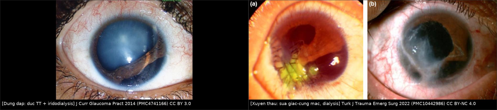
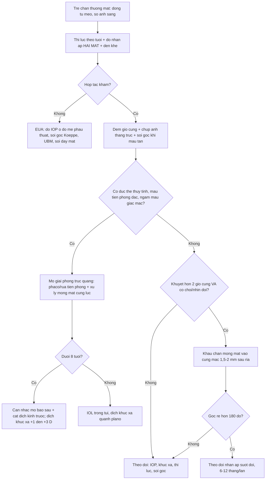
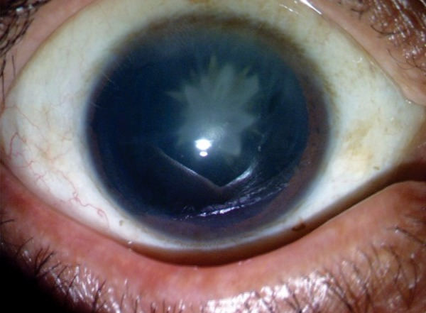
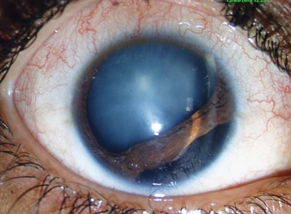
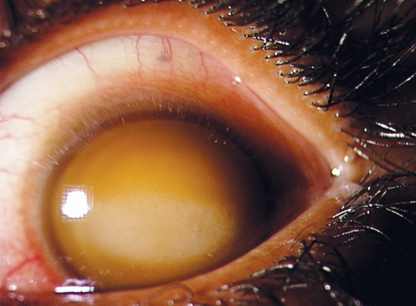
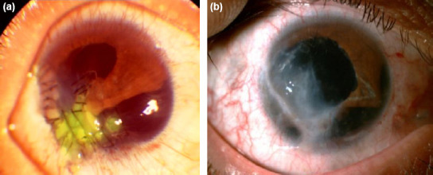
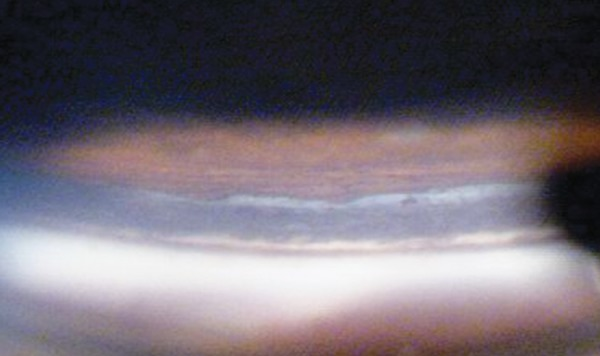

# 3271 — Iridodialysis ở trẻ em: khi nào khâu, khi nào chờ — và vì sao nhãn áp phải theo suốt thời thơ ấu / Pediatric iridodialysis

**Tags:** `pattern:khuyet-chan-mong-mat` `pattern:dong-tu-hinh-D` `pattern:notch-dong-tu` `pattern:mat-mot-ben` `pattern:chan-thuong-dung-dap` `pattern:goc-mo-thong` `pattern:duc-the-thuy-tinh` `pattern:goc-re` `pattern:ngam-mau-giac-mac` `vung:mat` `vung:the-mi` `vung:goc-tien-phong` `vung:the-thuy-tinh` `protocol:den-khe` `protocol:soi-goc` `protocol:AS-OCT` `protocol:UBM` `protocol:EUA` `protocol:khau-chan-mong-mat` `protocol:do-nhan-ap` `score:clock-hours`

**Mức chắc chắn (certainty):** tổng hợp y văn (literature synthesis) — phần **dịch tễ – nhãn áp – nhược thị** dựng từ các đoàn hệ nhi khoa có số liệu (**117 mắt pháo hoa ở trẻ**, PMC8993825; **62 mắt nghi glôcôm sau chấn thương**, PMC11755633; **305 mắt máu tiền phòng kín**, Bowe 2022; **196 mắt máu tiền phòng 3 trung tâm**, 2026; **60 trẻ glôcôm sau chấn thương**, PMC4741166; **61 mắt đục thể thủy tinh chấn thương**, PMC9063203; **106 trẻ**, Yardley 2018). Phần **kỹ thuật khâu và ngưỡng khâu** lấy từ người lớn/loạt hỗn hợp (tổng quan MIKIR, PMC13674913) và **một kỹ thuật dành riêng cho trẻ** (Brown 1998). **Không có RCT riêng cho iridodialysis ở trẻ** — mọi ngưỡng "khâu sớm hay chờ" trong bài là **thực hành đồng thuận + suy luận**, được ghi rõ tại chỗ; nhóm **không có bệnh nhân của mình**. **Không ghi tên tác giả** — attribution = **tạp chí + năm + PMCID/DOI**.

> **Câu chốt:** Ở người lớn, câu hỏi của iridodialysis là *"khuyết mấy giờ cung thì khâu"*. Ở trẻ, câu hỏi đúng là *"mắt này có đang bị tước mất hình ảnh tốt trong thời kỳ nhạy cảm không"* — vì **khuyết mống mắt chỉ gây chói/nhìn đôi, còn đục thể thủy tinh, máu tiền phòng và ngấm máu giác mạc mới gây nhược thị**. Bốn con số phải thuộc: **(1)** iridodialysis có ở **10,3%** mắt trẻ bị chấn thương pháo hoa (12/117; trung vị 9 tuổi) và **36,4%** mắt bị tên lửa chai (4/11), trong khi súng airsoft chỉ **6,3%** (2/32) (PMC8993825; Khan 2011; Shazly 2012); **(2)** sau chấn thương kín ở trẻ, **8,1%** mắt nghi glôcôm chuyển thành glôcôm, và **toàn bộ** nằm trong nhóm chấn thương kín (**15,2%**); **(3)** **iridodialysis là yếu tố dự báo tăng nhãn áp MUỘN** (p = 0,007) sau máu tiền phòng kín ở trẻ — nên hẹn theo dõi **qua 28 ngày**, không chỉ 1 tuần (Bowe 2022); **(4)** nhược thị sau mổ đục thể thủy tinh chấn thương ở trẻ gặp **51–57,6%**, và nhược thị làm thị lực cuối xấu hơn **OR 2,4** (PMC9063203; Yardley 2018). Vì vậy: **khâu mống mắt khi khuyết > 2 giờ cung + triệu chứng, hoặc khâu cùng lúc với phẫu thuật trục quang**; **dưới ngưỡng thì theo dõi — nhưng theo dõi nhãn áp, khúc xạ và thị lực, không phải "theo dõi cái lỗ".**

## 1. Tổng quan bệnh học – cơ chế hình ảnh (TẠI SAO)

### 1.1 Vì sao chấn thương đụng dập lại xé đúng chân mống mắt

- **Chân mống mắt (iris root)** là phần **mỏng nhất của mô đệm mống mắt**, nơi mống mắt treo vào **thể mi phía trước** ngay sau **gai củng mạc (scleral spur)**. Khi nhãn cầu bị ép theo trục trước–sau trong vài mili giây, **xích đạo giãn ra** rồi nhãn cầu bật lại; mô mềm nhất chịu **ứng suất cắt** lớn nhất — mặt phẳng tách tự nhiên là **giữa chân mống mắt và thể mi** (PMC13674913).
- Hệ quả hình ảnh: một cung mống mắt bong khỏi thành, phần còn dính bị kéo về đồng tử → **bờ tự do thành dây cung thẳng**, đồng tử mất một cung (**hình chữ D/lưỡi liềm**, có **notch**), vùng bong lộ **thể mi sẫm màu và củng mạc trắng**. Đây là lý do **khâu bờ đồng tử (pupilloplasty) không sửa được** iridodialysis — mục tiêu phải là **đưa chân mống mắt về củng mạc**.
- **1 giờ cung = 30°**; khuyết **9→3 giờ = 180°**. Con số giờ cung là "thước đo" duy nhất để so sánh giữa các lần khám và giữa các phẫu thuật viên (PMC13674913).

### 1.2 Trẻ khác người lớn ở ba điểm vật lý – sinh lý

1. **Củng mạc mỏng và đàn hồi hơn**: chỉ khâu xuyên củng mạc dễ **ăn mòn qua củng mạc/kết mạc** theo thời gian, mà mối khâu ở trẻ phải tồn tại **nhiều thập kỷ**. Đó là lý do kỹ thuật ở trẻ dùng **đường hầm củng mạc (scleral tunnel)** và chỉ **10-0 polypropylene hai đầu kim**, hạn chế thao tác trên củng mạc (Brown 1998, DOI 10.1016/s1091-8531(98)90041-6).
2. **Nhãn cầu đang lớn**: trục nhãn cầu tăng nhanh trong những năm đầu, nên **công suất IOL đặt ở trẻ phải "dư cận thị" có chủ đích** (đích khúc xạ **+3 D ở 2–4 tuổi, +2 D ở 4–6 tuổi, +1 D ở 6–8 tuổi, plano sau 8 tuổi** trong loạt 61 mắt) — nếu không, trẻ sẽ cận thị nặng khi lớn (PMC9063203).
3. **Hệ thị giác còn trong thời kỳ nhạy cảm**: hình ảnh mờ **kéo dài hàng tuần–hàng tháng** không chỉ làm "nhìn kém tạm thời" mà còn **tái tổ chức vỏ não thị giác** — đó là **nhược thị do tước đoạt (deprivation amblyopia)**. Ở trẻ **< 3–4 tuổi**, IOP sinh lý cũng **thấp hơn người lớn** (Pensiero 1992), nên ngưỡng "21 mmHg" của người lớn không thể áp nguyên xi.

### 1.3 Vì sao "chói" không phải là cơ chế nhược thị chính — và vì sao vẫn phải khâu

- Khuyết chân mống mắt tạo **khẩu độ quang thứ hai ở ngoại vi**: ánh sáng vào mắt qua vùng không có mống mắt chắn, tạo **ảnh phụ lệch trục** → **nhìn đôi một mắt**, **chói (glare)**, **sợ ánh sáng**. Triệu chứng này **thay đổi theo hướng nhìn và kích thước đồng tử**, nên trẻ thường **không mô tả được** và chỉ **nheo mắt, nghiêng đầu, tránh ánh sáng**.
- Nhược thị thực sự trong bệnh cảnh này đến từ **ba nguồn khác**: **(a) mất trục quang** do **đục thể thủy tinh**, **máu tiền phòng đặc**, **ngấm máu giác mạc**, **màng đồng tử**; **(b) lệch khúc xạ hai mắt** sau chấn thương/mổ (cầu một mắt **1,6 D** trong chấn thương xuyên thấu so với **0,8 D** ở chấn thương kín; PMC9063203 dẫn Khokhar 2014); **(c) lác/ức chế do mất phối hợp hai mắt** — **lác 22%** trong loạt đục thể thủy tinh chấn thương (PMC9063203).
- Vì vậy **khâu mống mắt ở trẻ có hai mục tiêu khác nhau**: **(1) mục tiêu quang học** — mở lại trục quang và giảm chói để trẻ **chịu đeo kính, chịu bịt mắt, chịu phối hợp hai mắt**; **(2) mục tiêu giải phẫu** — đóng vùng hở góc, giảm nguy cơ **dính góc (PAS)** về sau. Không có bằng chứng rằng **bản thân khuyết mống mắt không đục thể thủy tinh** gây nhược thị — đây là **khoảng trống** (xem mục 7).

### 1.4 Vì sao nhãn áp là biến số nguy hiểm nhất, và vì sao nó "im lặng"

- Cùng một cú đập, **góc rẽ (angle recession)** xuất hiện ở **20–94%** mắt chấn thương; **5–20%** người có góc rẽ tiến triển glôcôm, và nguy cơ tăng khi **góc rẽ > 180°** (PMC4741166). Ở trẻ, **62 mắt** nghi glôcôm sau chấn thương: **8,1%** chuyển glôcôm, **tất cả đều thuộc chấn thương kín (15,2%)**; **36,4%** mắt chấn thương kín phải dùng thuốc hạ nhãn áp so với **10,3%** mắt chấn thương hở (p = 0,017) (PMC11755633).
- **Iridodialysis là dấu hiệu dự báo tăng nhãn áp muộn**: trong **305 mắt** trẻ bị chấn thương kín + máu tiền phòng, tăng nhãn áp gặp **39%**; **tổn thương đồng tử** dự báo giai đoạn cấp, còn **iridodialysis (p = 0,007) và đục thể thủy tinh (p < 0,001) dự báo giai đoạn MUỘN (> 28 ngày)** (Bowe 2022, DOI 10.1016/j.ajo.2021.04.033). Nghĩa là: **mắt có iridodialysis không được "ra viện khi nhãn áp bình thường"**.
- Cơ chế "im lặng": sau chấn thương, **thể mi giảm tiết** có thể che lấp tăng trở lực thoát → nhãn áp **bình thường hoặc thấp** trong nhiều tuần–nhiều năm; khi thể mi hồi phục hoặc vùng bè xơ hóa, nhãn áp mới tăng. Vì vậy **một lần đo bình thường không phải bằng chứng an toàn** (PMC4741166; PMC11755633).

### 1.5 Vì sao đo nhãn áp ở trẻ lại dễ sai — vật lý của thuốc mê và đầu dò

- **Thuốc mê hô hấp làm GIẢM nhãn áp tới ~4 mmHg** sau khởi mê; **đặt nội khí quản làm TĂNG nhãn áp 2–5 phút**; **mặt nạ không vừa** có thể **đè lên hốc mắt** và làm nhãn áp tăng giả. Vì thế quy ước là **đo nhãn áp ngay khi trẻ ở độ mê phẫu thuật (plane 2), trước khi đặt dụng cụ đường thở** (PMC10752321).
- **Đầu dò khác nhau cho số khác nhau**: ở **157 mắt trẻ**, Goldmann **17,3 ± 5,5 mmHg**, pneumotonometer **18,8 ± 5,5**, rebound **20,4 ± 6,0**; rebound **cao hơn Goldmann +3,1 ± 3,5 mmHg**, và sai lệch tăng **2,35 mmHg cho mỗi 100 µm bề dày giác mạc** (J AAPOS 2026, PMID 42858878). Vì vậy: **không so nhãn áp đo bằng hai loại máy khác nhau**, và phải **ghi loại máy + bề dày giác mạc** vào hồ sơ.
- **Máu tiền phòng làm nhãn áp khó đo và dễ bỏ sót tăng nhãn áp**: trong **196 mắt** trẻ, tăng nhãn áp gặp **47,4%**; nguy cơ đến ngày 3 là **25% / 24,7% / 53,8% / 68,7% / 77,8%** theo độ 0–4 của máu tiền phòng; **hồng cầu hình liềm AOR 29,9**, **máu tiền phòng che đồng tử AOR 6,6**, **thị lực < 20/200 AOR 4,0**; mù xảy ra **13,9%** ở nhóm tăng nhãn áp phải mổ so với **2,9%** ở nhóm không tăng (J Pediatr 2026, PMID 42749213).

## 2. Mẫu hình + chẩn đoán phân biệt theo vị trí (gamut)

- **Mẫu hình chính:** trẻ (thường **6–10 tuổi**, nam nhiều hơn) sau **chấn thương kín** hoặc **dị vật/xuyên thấu**; **một mắt**; **đồng tử méo hình chữ D/lưỡi liềm + notch**; thấy **thể mi/củng mạc trắng ở ngoại vi**; thường kèm **máu tiền phòng**, **đục thể thủy tinh**, **lệch thể thủy tinh**, **dịch kính tiền phòng**; trẻ có thể **không than chói** mà chỉ **nheo mắt/nghiêng đầu**.
- **Theo vị trí tổn thương:**
  - **Chân mống mắt** → iridodialysis do chấn thương; đứt chân do mổ (phaco/vết mổ); **coloboma bẩm sinh** (hai bên, vùng dưới–mũi).
  - **Bờ đồng tử** → **rách cơ vòng đồng tử** (bờ lởm chởm, chân mống mắt còn dính).
  - **Thể mi – củng mạc** → **khe thể mi** (nhãn áp thấp, tiền phòng nông, bong hắc mạc).
  - **Góc tiền phòng** → **góc rẽ** (chân mống mắt lùi ra sau, dải thể mi lộ rộng, mống mắt liên tục).
  - **Thể thủy tinh** → đục thể thủy tinh, **lệch/trật**, đứt zonule (rung thể thủy tinh, khe sâu không đều).
  - **Giác mạc** → **ngấm máu giác mạc** sau máu tiền phòng toàn bộ (màu hổ phách, không phải đục thể thủy tinh).
- **Theo tuổi (quyết định cách khám và cách theo dõi):**
  - **< 3 tuổi**: té ngã, đồ chơi, bạo hành; **không đo được thị lực** → **EUA**; **nhược thị tiến triển nhanh nhất**, ưu tiên **giải phóng trục quang sớm**.
  - **3–7 tuổi**: sân chơi, súng đồ chơi, pháo; **đỉnh nhược thị**; bắt đầu đo thị lực bằng **Lea symbols/HOTV**.
  - **7–18 tuổi**: thể thao, airsoft, pháo; hợp tác đo thị lực/khúc xạ; vẫn phải theo dõi nhãn áp **suốt đời** vì góc rẽ.
- **Red flag trong 24 giờ đầu:** **tiền sử vật sắc nhọn** (dù chỉ "que kem"), **nhãn áp thấp ≤ 6 mmHg**, **tiền phòng nông**, **máu tiền phòng toàn bộ**, **đồng tử không tròn sau khi máu tan**, **giác mạc ám màu**, **APD (afferent pupillary defect)**, **không thấy đáy mắt**.

## 3. Bảng so sánh phân biệt (ma trận đối chiếu)

| Thực thể (entity) | Hình ảnh điển hình (đèn khe / soi góc / AS-OCT / UBM) | Chốt vào (rule-in) | Chốt loại (rule-out) | Gợi ý xác nhận |
|---|---|---|---|---|
| **Iridodialysis chấn thương ở trẻ** | **Notch + đồng tử hình D/lưỡi liềm**, bờ tự do **dây cung thẳng**, lộ **thể mi sẫm/củng mạc trắng**; máu tiền phòng; soi góc: **chân mống mắt tách, góc thông ra thể mi** | **Notch đúng vị trí + bờ dây cung + tiền sử chấn thương (kể cả không có người chứng kiến)** | **Mống mắt liên tục tới góc**, không notch | Đèn khe 2 mắt, **soi góc khi máu tan**, ảnh thẳng trục, **EUA nếu không hợp tác** |
| **Đứt chân mống mắt do mổ (iatrogenic)** | Cùng hình thái notch nhưng **sát vết mổ/rìa**, sau phaco/ECCE/IOL; có thể gặp sau **đường hầm củng mạc** ở trẻ | **Tiền sử mổ nội nhãn + notch sát vết mổ** | Không tiền sử mổ, notch đối diện vết mổ | Đọc hồ sơ mổ; soi góc vùng vết mổ |
| **Rách cơ vòng đồng tử** | **Bờ đồng tử lởm chởm/răng cưa**, đồng tử giãn không đều, **không notch ở chân**, không lộ thể mi | **Rách tại bờ đồng tử + chân mống mắt còn dính** | **Chân mống mắt tách, góc thông** | Soi góc bình thường; đèn khe phóng đại bờ đồng tử |
| **Khe thể mi (cyclodialysis cleft)** | **Nhãn áp thấp (≤ 5–6 mmHg)**, tiền phòng nông, **bong hắc mạc**, nếp võng mạc; UBM/AS-OCT: **khe thông tiền phòng–khoang trên hắc mạc** | **Nhãn áp THẤP + bong hắc mạc + khe trên UBM** | **Nhãn áp bình thường/cao**, không bong hắc mạc | UBM 50 MHz, AS-OCT; đo nhãn áp hai mắt cùng máy |
| **Góc rẽ (angle recession)** | Chân mống mắt **lùi ra sau**, **dải thể mi lộ rộng**, góc **sâu hơn mắt bên**; mống mắt **vẫn liên tục**; AS-OCT: khoảng **chân mống mắt–gai củng mạc ~0,4 mm** (bình thường **0,15 mm**) | **Góc sâu bất thường + dải thể mi lộ** ở vùng chấn thương | **Notch + bờ tự do** (đó là iridodialysis) | Soi góc hai mắt; AS-OCT/UBM; theo dõi nhãn áp nhiều năm |
| **Coloboma mống mắt bẩm sinh** | Khuyết **vùng dưới–mũi**, bờ **nhẵn đều**, **hai bên** (thường), **không máu tiền phòng**, không tiền sử chấn thương | **Khuyết dưới–mũi + hai bên + bờ nhẵn** | **Một bên + bờ dây cung + tiền sử chấn thương** | Khám mắt bên kia, ảnh gia đình; soi góc |
| **Aniridia** | **Gần như không còn mống mắt**, hai bên, kèm **giảm sản hoàng điểm, đục thể thủy tinh, glôcôm** | **Hai bên + bất thường hoàng điểm** | Một bên, còn phần lớn mống mắt | Đèn khe, OCT hoàng điểm, khám gia đình |
| **Đục thể thủy tinh do chấn thương** | Đục **khu trú hình hoa thị (rosette)** hoặc toàn bộ; có thể kèm **vỡ bao trước**; đồng tử trắng | **Đục + tiền sử chấn thương + đồng tử trắng/xám** | **Đồng tử đen, không đục** | Đèn khe sau giãn đồng tử; **soi đáy mắt/UBM**; xem bài 6213 |
| **Ngấm máu giác mạc (corneal blood staining)** | Giác mạc **màu hổ phách/vàng nâu** lan từ nhu mô, sau **máu tiền phòng toàn bộ** kéo dài; không có mủ | **Màu hổ phách + tiền sử máu tiền phòng đặc** | **Giác mạc trong**, chỉ đồng tử trắng (đục thể thủy tinh) | Đèn khe: màu nhu mô; AS-OCT; theo dõi nhiều tháng |
| **Đứt zonule/lệch thể thủy tinh** | **Rung thể thủy tinh (phacodonesis)**, lệch trục, **khe sâu không đều**; UBM: zonule giãn/đứt | **Rung + lệch trục + UBM thấy zonule tổn thương** | Thể thủy tinh vững, không lệch | UBM 50 MHz sau giãn đồng tử |

*Ảnh ghép: bên trái — **chấn thương kín** ở trẻ gây **đục thể thủy tinh toàn bộ + iridodialysis** (dải mống mắt băng ngang đồng tử); bên phải — **chấn thương xuyên thấu** ở trẻ: (a) sau khâu củng mạc–giác mạc, (b) sau lấy thể thủy tinh + IOL cố định củng mạc, còn khuyết mống mắt. Tạo bằng `tools/make_composite.py` (letterbox, không crop). Nguồn: J Curr Glaucoma Pract 2014 (PMC4741166, CC BY 3.0) và Turk J Trauma Emerg Surg 2022 (PMC10442986, CC BY-NC 4.0).*

## 4. Protocol khám + ngưỡng quyết định + hệ theo dõi

### 4.1 Trình tự khám trẻ có iridodialysis

### 4.2 Ngưỡng định lượng phải nhớ

| Thông số | Ngưỡng / giá trị | Ý nghĩa | Nguồn |
|---|---|---|---|
| Iridodialysis ở trẻ bị pháo hoa | **10,3%** (12/117 mắt), trung vị **9 tuổi** | Không hiếm; chủ động tìm notch | PMC8993825 |
| Tên lửa chai ở trẻ | **4/11 mắt (36,4%)** có iridodialysis | Tổn thương nặng, thị lực cuối **≤ 20/200 ở 6/10** | Khan 2011, PMID 21220620 |
| Súng airsoft ở trẻ | **2/32 (6,3%)** iridodialysis; **máu tiền phòng 75%** | Dấu chấn thương kín điển hình | Shazly 2012, PMID 21261240 |
| Ngưỡng khâu (người lớn, áp dụng cho trẻ có triệu chứng) | **> 2 giờ cung** (1 giờ = **30°**) + chói/nhìn đôi/thẩm mỹ | Dưới ngưỡng: theo dõi | PMC13674913 |
| Tiêu chuẩn vào loạt khâu người lớn | **> 90°** / **> 2 giờ cung** | Các loạt chỉ mổ khuyết lớn | PMC6286550; PMC9011996 |
| Kỹ thuật cho trẻ | **Đường hầm củng mạc + 10-0 polypropylene hai đầu kim**; lo ngại **ăn mòn chỉ muộn** | Củng mạc trẻ mỏng, đàn hồi; mối khâu phải bền nhiều thập kỷ | Brown 1998, DOI 10.1016/s1091-8531(98)90041-6 |
| Chuyển sang **artificial iris** | Khuyết **> 3 giờ cung**, thiếu bao/không đủ mô mống mắt | Cân nhắc ở trẻ **lớn** (loạt trẻ: tuổi đặt **9,5** (7,7–12,7)) | PMC11084487; DOI 10.1016/j.jaapos.2007.11.014 |
| Biến chứng artificial iris ở trẻ (5 mắt) | **Mất nội mô 42%** so với mắt lành; **lệch IOL 2/5**; **viêm màng bồ đào + glôcôm 1/5**; **bong võng mạc 1/5** | Không phải lựa chọn "nhẹ nhàng" | DOI 10.1016/j.jaapos.2007.11.014 |
| Nhược thị sau đục thể thủy tinh chấn thương | **51%** (57 trẻ) và **57,6%** (61 mắt); **lác 22%** | Phải sàng lọc và điều trị chủ động | DOI 10.5301/ejo.5000342; PMC9063203 |
| Nhược thị → thị lực cuối | **OR 2,4** (p = 0,04) xấu hơn; **tuổi < 5** → khúc xạ xấu hơn **OR 2,88** | Nhược thị là yếu tố tiên lượng, không phải "biến chứng phụ" | Yardley 2018, DOI 10.1016/j.jcrs.2017.09.033 |
| Glôcôm sau chấn thương ở trẻ | **8,1%** chung; **15,2%** ở chấn thương kín; **36,4%** chấn thương kín cần thuốc hạ IOP | Theo dõi dài hạn, đặc biệt chấn thương kín | PMC11755633 |
| Tăng nhãn áp MUỘN sau máu tiền phòng | **iridodialysis p = 0,007**; đục thể thủy tinh **p < 0,001** | Hẹn khám **sau 28 ngày** và lâu hơn | Bowe 2022, DOI 10.1016/j.ajo.2021.04.033 |
| Tăng nhãn áp theo độ máu tiền phòng (ngày 3) | **25% / 24,7% / 53,8% / 68,7% / 77,8%** (độ 0–4); hồng cầu liềm **AOR 29,9** | Phân tầng nguy cơ ngay từ cấp cứu | J Pediatr 2026, PMID 42749213 |
| Nhãn áp dưới mê | Khí mê **giảm tới 4 mmHg**; đặt nội khí quản **tăng 2–5 phút**; đo ở **plane 2** | Đo đúng thời điểm, ghi loại máy | PMC10752321 |
| Sai lệch đầu dò ở trẻ | Rebound **+3,1 ± 3,5 mmHg** so với Goldmann; **+2,35 mmHg/100 µm CCT** | Không trộn máy khi theo dõi | PMID 42858878 |
| Đích khúc xạ IOL theo tuổi | **+3 D (2–4 tuổi) · +2 D (4–6) · +1 D (6–8) · plano (> 8)** | Tránh cận thị nặng khi trưởng thành | PMC9063203 |
| Đục bao sau nếu KHÔNG mở bao sau + cắt dịch kính trước | **100%** (13/13 mắt) phải YAG | Ở trẻ < 8 tuổi nên làm **PC + AV** cùng lúc | PMC9063203 |

### 4.3 Quyết định "khâu sớm hay chờ" — khung thực hành cho trẻ

1. **Có chỉ định giải phóng trục quang (ưu tiên số 1):** đục thể thủy tinh trong trục, máu tiền phòng đặc không tan, ngấm máu giác mạc, màng đồng tử. **Mổ trong ngày–vài tuần**, không chờ "máu tan hết"; nếu đã mổ, **khâu mống mắt cùng lúc** để giảm số lần gây mê. Cơ sở: **nhược thị 51–57,6%**, thị lực tốt hơn khi **PC + AV** (PMC9063203), và trục quang mờ là yếu tố tiên lượng xấu (Yardley 2018).
2. **Khuyết > 2 giờ cung + chói/nhìn đôi rõ hoặc ảnh hưởng sinh hoạt/học tập:** **khâu chân mống mắt vào củng mạc 1,5–2 mm sau rìa**, nhiều mối dọc cung; ở trẻ dùng **đường hầm củng mạc** và chỉ **10-0** (Brown 1998; PMC13674913).
3. **Khuyết ≤ 2 giờ cung, không triệu chứng, trục quang trong:** **theo dõi** — nhưng theo dõi **nhãn áp, khúc xạ, thị lực hai mắt, soi góc**, không chỉ chụp lại "cái notch". Ở trẻ **không mô tả được chói**, nên **quyết định dựa trên khúc xạ – thị lực – phối hợp hai mắt**, không dựa trên lời than.
4. **Khuyết rất rộng > 3 giờ cung + thiếu mô/không còn bao:** cân nhắc **artificial iris** — nhưng ở trẻ đây là can thiệp **nguy cơ cao** (mất nội mô **42%**, lệch IOL **2/5**) và thường **hoãn đến khi trẻ lớn** (loạt trẻ đặt ở **9,5 tuổi**). Đây là **suy luận từ loạt nhỏ**, không phải ngưỡng đã được chứng minh.
5. **Luôn khám mắt bên kia và hỏi cơ chế:** trẻ có thể **không khai** vì sợ/không nhớ; **chấn thương do bạo hành** phải được nghĩ tới khi cơ chế không khớp tổn thương.

### 4.4 Lịch theo dõi đề xuất (suy luận từ dữ liệu trên — chưa có thử nghiệm)

| Thời điểm | Việc phải làm | Vì sao |
|---|---|---|
| **Ngày 1–3** | Nhãn áp, tiền phòng, thị lực, soi đáy mắt nếu được | Tăng nhãn áp cấp do máu/clot; nguy cơ **25–78%** theo độ máu |
| **Tuần 2** | Nhãn áp, thị lực, khúc xạ thô | Giai đoạn cấp của tăng nhãn áp |
| **Ngày 28** | Nhãn áp + soi góc khi máu tan | **Iridodialysis dự báo tăng nhãn áp muộn** (p = 0,007) |
| **3 và 6 tháng** | Khúc xạ, thị lực hai mắt, nhãn áp, soi góc | Bắt đầu **nhược thị do lệch khúc xạ**; **góc rẽ** |
| **Mỗi 6 tháng đến 8 tuổi** | Thị lực, khúc xạ, phối hợp hai mắt, nhãn áp | **Thời kỳ nhạy cảm nhược thị**; điều trị bịt mắt/atropine |
| **Hằng năm, suốt đời** | Nhãn áp, soi góc, OCT RNFL/GCC khi hợp tác | **Góc rẽ** có thể gây glôcôm **nhiều năm sau** |

### 4.5 Điều trị nhược thị — phần không thể tách khỏi "khâu mống mắt"

- **Sửa khúc xạ trước, bịt mắt sau**: với nhược thị khúc xạ một bên, **kính đơn thuần** đã cải thiện thị lực (MD **−0,11 logMAR**, sát ngưỡng ý nghĩa); **kính + bịt mắt** tốt hơn không điều trị (MD **−0,20**, có ý nghĩa) (Cochrane, DOI 10.1002/14651858.CD005137.pub2).
- **Liều bịt mắt**: nhược thị **trung bình** — **2 giờ/ngày tương đương 6 giờ/ngày** (MD 0,01; KTC −0,06 đến 0,08); nhược thị **nặng** — **6 giờ tương đương bịt toàn thời gian** (MD 0,03). Nghĩa là **không cần bịt 24/24** để đạt kết quả, và **tuân thủ** quan trọng hơn số giờ (Cochrane 2008).

*Đục thể thủy tinh **hình hoa thị (rosette)** sau chấn thương kín ở trẻ, kèm một khuyết mống mắt nhỏ ở phía dưới — đây là dạng đục **khu trú trong trục quang** vẫn đủ gây tước đoạt thị lực. Nguồn: J Curr Glaucoma Pract 2014 (PMC4741166, Fig. 1), CC BY 3.0.*

- **Trong loạt đục thể thủy tinh chấn thương**, nhược thị được điều trị theo tuổi: **1 giờ/ngày mỗi tháng tuổi đến 8 tháng**, sau đó **50% giờ thức**; **3–7 tuổi nhược thị nặng 6 giờ/ngày**, **trung bình 2 giờ/ngày**; **7–15 tuổi 2 giờ/ngày kèm hoạt động nhìn gần** (PMC9063203).
- **Điều trị nhược thị chỉ hiệu quả khi trục quang trong và khúc xạ đúng** — vì vậy **khâu mống mắt/đặt IOL/điều chỉnh kính** là **tiền đề**, không phải "việc làm thêm".

## 5. Biến thể bình thường và cạm bẫy

- **"Không có ai chứng kiến chấn thương" ≠ không có chấn thương.** Trẻ nhỏ có thể bị ngã/té mà người lớn không thấy; **coloboma bẩm sinh** là chẩn đoán phân biệt, nhưng **không được mặc định** khi tổn thương **một bên, bờ dây cung, có máu tiền phòng**. Ngược lại, coloboma **hai bên, dưới–mũi, bờ nhẵn** thì **không mổ**.
- **Ngấm máu giác mạc bị gọi nhầm là "đục thể thủy tinh":** màu **hổ phách/vàng nâu lan trong nhu mô**, đồng tử có thể còn đen; **không mổ thể thủy tinh** chỉ vì "giác mạc đục". Ngấm máu mờ dần trong nhiều tháng nhưng **gây tước đoạt thị lực** — cần theo dõi nhược thị song song.
- **Nhãn áp "bình thường" dưới mê không loại trừ glôcôm:** khí mê **hạ IOP tới 4 mmHg**; đo ở **plane 2**, trước khi đặt đường thở; ghi **loại máy** vì rebound đọc cao hơn Goldmann **+3,1 mmHg** và **CCT** làm lệch **2,35 mmHg/100 µm** (PMC10752321; PMID 42858878).
- **Tăng nhãn áp muộn bị bỏ qua vì "đã khám 1 tháng bình thường":** iridodialysis dự báo tăng nhãn áp **sau 28 ngày**; hẹn **3–6 tháng và hằng năm**, đặc biệt khi **góc rẽ > 180°** (Bowe 2022; PMC4741166).
- **Trẻ không than chói:** dấu hiệu thay thế là **nheo mắt, nghiêng đầu, tránh ánh sáng, kết quả học tập giảm**; hỏi **giáo viên/phụ huynh**, không chỉ hỏi trẻ.
- **Bỏ sót đứt zonule/lệch thể thủy tinh:** mổ phaco "đơn thuần" trên mắt có zonule yếu dễ **rơi nhân, mất bao**; **UBM 35–50 MHz** khi giác mạc đục/đồng tử nhỏ (PMC13674913; bài 6213).
- **Bỏ sót tổn thương xuyên thấu:** một "vết xước nhỏ" ở giác mạc/củng mạc có thể là **đường vào của dị vật**; **Seidel, tiền phòng nông, nhãn áp thấp** là dấu hiệu; **CT/B-scan** khi không thấy đáy mắt.
- **Cạm bẫy "khâu cho tròn đồng tử":** khâu bờ đồng tử chỉ làm **đồng tử nhỏ hơn**, không đóng góc, không sửa chân mống mắt; ở trẻ còn **tăng nguy cơ mất nội mô** và **co kéo**. Mục tiêu là **chân mống mắt → củng mạc**, không phải hình dáng đồng tử.
- **Không dùng corticoid kéo dài để "chống viêm" ở trẻ có giác mạc mỏng/khâu**: corticoid làm chậm lành và tăng nguy cơ **tan mô** khi có nhiễm; dùng **liều ngắn, giảm nhanh**, kèm kháng sinh khi có chỉ định.

## 6. Tự lượng giá — Blind Quiz

**Ca 1 — Bé trai 7 tuổi, mắt phải đỏ–mờ sau khi bị bóng tennis đập vào mắt**

- Gợi ý lâm sàng: không đau nhiều, không nôn; mẹ thấy "con đồng tử méo từ hôm qua"; nhãn áp 16 mmHg.
- Câu hỏi: (a) Hai dấu hiệu chính trong ảnh? (b) Vì sao **không được** chỉ theo dõi "cho máu tan"? (c) Hai việc phải làm trong cùng buổi khám?

<b>Bấm để hiện đáp án (findings + chẩn đoán)</b>

- **Dấu hiệu:** **đục thể thủy tinh toàn bộ** (đồng tử trắng xám) + **iridodialysis** với **dải mống mắt băng ngang đồng tử** và vùng lộ thể mi ở ngoại vi; không thấy máu tiền phòng đáng kể.
- **Chẩn đoán:** **đục thể thủy tinh do chấn thương kín + iridodialysis** ở trẻ.
- **Vì sao không chờ:** trục quang đã mờ **hoàn toàn**; ở trẻ **< 8 tuổi** đây là **tước đoạt thị lực** trong thời kỳ nhạy cảm — chờ "máu tan" không giải quyết đục thể thủy tinh và làm tăng nguy cơ **nhược thị** (nhược thị sau mổ đục thể thủy tinh chấn thương **51–57,6%**).
- **Phải làm:** **đo nhãn áp hai mắt**, **khám mắt bên kia**, **soi góc khi máu tan/UBM** đánh giá zonule, **EUA nếu không hợp tác**; tư vấn **mổ thể thủy tinh + khâu mống mắt cùng lúc** và **nhược thị sau mổ**.
- **Nguồn ảnh:** J Curr Glaucoma Pract 2014 — **PMC4741166** — Fig. 2 — CC BY 3.0.

**Ca 2 — Bé gái 5 tuổi, mắt trái "vàng" sau chấn thương 3 tuần**

- Gợi ý lâm sàng: trước đó có **máu tiền phòng toàn bộ**, đã điều trị nội khoa; nay đau ít nhưng **nhìn rất kém**, không thấy đồng tử rõ.
- Câu hỏi: (a) Màu hổ phách nằm ở lớp nào? (b) Chẩn đoán? (c) Vì sao trẻ này vẫn phải theo dõi **nhược thị** dù "máu đã tan"?

<b>Bấm để hiện đáp án (findings + chẩn đoán)</b>

- **Dấu hiệu:** **giác mạc ám màu hổ phách/vàng nâu lan tỏa trong nhu mô**, bề mặt còn bóng; **không mủ**, **không thấy đồng tử rõ** vì nhu mô đục.
- **Chẩn đoán:** **ngấm máu giác mạc (corneal blood staining)** sau **máu tiền phòng toàn bộ** kéo dài — hemoglobin thấm vào nhu mô qua nội mô tổn thương.
- **Vì sao theo dõi nhược thị:** dù tiền phòng đã sạch, **trục quang vẫn mờ trong nhiều tháng**; ở trẻ 5 tuổi đây là **tước đoạt thị lực** — phải **đo thị lực/khúc xạ định kỳ**, điều trị nhược thị khi trục quang cải thiện, và **không mổ thể thủy tinh** nếu thể thủy tinh còn trong.
- **Phải làm:** đo **nhãn áp** (nguy cơ tăng muộn), **soi góc**, **đánh giá thể thủy tinh/đáy mắt**; giải thích rằng **màu sẽ mờ dần trong nhiều tháng** nhưng cần theo dõi.
- **Nguồn ảnh:** J Curr Glaucoma Pract 2014 — **PMC4741166** — Fig. 3 — CC BY 3.0.

**Ca 3 — Bé trai 9 tuổi, mắt phải sau tai nạn dao lam 2 tuần**

- Gợi ý lâm sàng: đã khâu củng mạc–giác mạc thì đầu; nay **đồng tử méo**, **nhìn mờ**, **nhãn áp 14 mmHg**; không thấy đáy mắt vì đục thể thủy tinh.
- Câu hỏi: (a) Mô tả tổn thương mống mắt ở (a) và (b). (b) Vì sao phải **khâu mống mắt cùng lúc** với lấy thể thủy tinh? (c) Theo dõi gì sau mổ?

<b>Bấm để hiện đáp án (findings + chẩn đoán)</b>

- **Dấu hiệu:** (a) sau khâu, **mống mắt rách/bong rộng**, đồng tử méo, **dính vào vết mổ**; (b) sau lấy thể thủy tinh + **IOL cố định củng mạc**, vẫn còn **khuyết mống mắt lớn** và mô mống mắt co kéo.
- **Chẩn đoán:** **iridodialysis + đục thể thủy tinh sau chấn thương xuyên thấu** ở trẻ.
- **Vì sao khâu cùng lúc:** giảm **số lần gây mê** (quan trọng ở trẻ), mở lại **trục quang** để tập nhìn/đeo kính sớm, và giảm **chói/nhìn đôi** — nhưng ở trẻ **không được hy sinh mô mống mắt**; nếu thiếu mô nhiều, cân nhắc **artificial iris** nhưng biết **mất nội mô 42%** và **lệch IOL 2/5** trong loạt trẻ.
- **Theo dõi:** **nhãn áp** (góc rẽ, dính góc), **khúc xạ/thị lực hai mắt**, **nhược thị** (bịt mắt/atropine), **đục bao sau** (ở trẻ < 8 tuổi làm **PC + AV**), **bong võng mạc**.
- **Nguồn ảnh:** Turk J Trauma Emerg Surg 2022 — **PMC10442986** — Fig. 6 — CC BY-NC 4.0.

**Ca 4 (ảnh soi góc) — Bé trai 12 tuổi tái khám sau chấn thương kín 6 tháng, nhãn áp 22 mmHg**

- Gợi ý lâm sàng: mắt đã hết đỏ, không đau; **không có tiền sử glôcôm**; mắt bên kia nhãn áp 14 mmHg.
- Câu hỏi: (a) Đây là phương pháp gì? (b) Dấu hiệu chính? (c) Vì sao nhãn áp có thể tăng **nhiều năm** sau chấn thương?

<b>Bấm để hiện đáp án (findings + chẩn đoán)</b>

- **Phương pháp:** **soi góc (gonioscopy)** — ở trẻ nhỏ làm dưới gây mê với **kính Koeppe**.
- **Dấu hiệu:** **dải thể mi lộ rộng** (vùng sáng giữa chân mống mắt và gai củng mạc), chân mống mắt **lùi ra sau**, mống mắt **liên tục** — **góc rẽ (angle recession)**, không phải iridodialysis (không có notch/bờ tự do).
- **Vì sao tăng muộn:** vùng bè bị **xơ hóa tiến triển** nhiều năm; giai đoạn đầu **thể mi giảm tiết** che lấp tăng trở lực. Góc rẽ gặp **20–94%** sau chấn thương, **5–20%** tiến triển glôcôm, nguy cơ cao khi **> 180°**.
- **Phải làm:** theo dõi **nhãn áp hằng năm suốt đời**, **OCT RNFL/GCC** khi hợp tác; điều trị như **glôcôm góc mở thứ phát** (thuốc → laser → phẫu thuật).
- **Nguồn ảnh:** J Curr Glaucoma Pract 2014 — **PMC4741166** — Fig. 4 — CC BY 3.0.

## 7. Câu hỏi nghiên cứu & điểm chưa đồng thuận (tính đến 11/2026)

1. **[Tranh cãi] Ở trẻ có iridodialysis > 2 giờ cung nhưng không than chói, khâu sớm có giảm nhược thị và chói kéo dài so với theo dõi không?**
   - **Đã biết:** ngưỡng **> 2 giờ cung + triệu chứng** là thực hành đồng thuận ở người lớn; các loạt nhi khoa chỉ báo **tần suất** iridodialysis (**10,3%** pháo hoa; **36,4%** tên lửa chai) chứ không so sánh hai chiến lược (PMC13674913; PMC8993825).
   - **Chưa rõ:** trẻ **không mô tả được chói**, nên "có triệu chứng" là tiêu chí **không đo được**; chưa biết khuyết bao nhiêu giờ cung thì **ảnh hưởng thật** đến thị lực tương phản/học tập.
   - **Hướng nghiên cứu:** đoàn hệ tiến cứu ghi **giờ cung + thị lực tương phản + khúc xạ + kết cục nhược thị**, phân tầng theo tuổi và theo có/không đục thể thủy tinh.
   - **Nguồn:** PMC13674913; PMC8993825; DOI 10.1016/j.jcrs.2017.09.033.

2. **[Khoảng trống] Nhược thị trong mắt có iridodialysis đơn thuần (không đục thể thủy tinh, không máu) do đâu — khuyết mống mắt, lệch khúc xạ hay mất phối hợp hai mắt?**
   - **Đã biết:** nhược thị sau đục thể thủy tinh chấn thương rất cao (**51–57,6%**) và làm thị lực cuối xấu hơn **OR 2,4**; lác gặp **22%** (PMC9063203; DOI 10.1016/j.jcrs.2017.09.033).
   - **Chưa rõ:** chưa có nghiên cứu tách riêng **ảnh hưởng của khuyết mống mắt** lên **nhạy cảm tương phản/chói** ở trẻ, và chưa rõ ngưỡng khuyết gây **lệch khúc xạ** đủ để gây nhược thị.
   - **Hướng nghiên cứu:** đo **thị lực tương phản, glare testing, khúc xạ chu toàn** trước–sau khâu ở trẻ, so với mắt bên; đối chiếu **OCT hoàng điểm** và **phối hợp hai mắt**.
   - **Nguồn:** PMC9063203; PMC10442986; DOI 10.1016/j.jcrs.2017.09.033.

3. **[Khác biệt thực hành] Khuyết rất rộng ở trẻ: khâu mống mắt + IOL thường, hay artificial iris + IOL cố định củng mạc — và làm ở tuổi nào?**
   - **Đã biết:** artificial iris được đề xuất cho khuyết **> 3 giờ cung** ở người lớn; loạt **5 trẻ** đặt ở tuổi **9,5** (7,7–12,7) có **mất nội mô 42%**, **lệch IOL 2/5**, **viêm màng bồ đào + glôcôm 1/5** (PMC11084487; DOI 10.1016/j.jaapos.2007.11.014).
   - **Chưa rõ:** chưa có so sánh trực tiếp **khâu vs artificial iris** ở trẻ; chưa rõ **tuổi tối thiểu** và ảnh hưởng của **nhãn cầu đang lớn** lên độ bền của thiết bị.
   - **Hướng nghiên cứu:** registry đa trung tâm ghi **tuổi, giờ cung, tình trạng bao/zonule, ECD, thị lực tương phản, biến chứng**, theo dõi ≥ 5 năm.
   - **Nguồn:** DOI 10.1016/j.jaapos.2007.11.014; PMC11084487; PMC13674913.

## Bài liên quan chéo

- [3262 – Rách chân mống mắt do chấn thương (iridodialysis) — người lớn](../3262-rach-chan-mong-mat-iridodialysis/lesson.md)
- [6213 – Đục thể thủy tinh do chấn thương ở trẻ](../6213-duc-thuy-tinh-chan-thuong-tre/lesson.md)
- [6211 – Đục trục quang (VAO) sau mổ đục thể thủy tinh bẩm sinh](../6211-duc-truc-quang-vao-sau-mo-duc-thuy-tinh-bam-sinh/lesson.md)
- [6210 – Bong võng mạc sau mổ đục thể thủy tinh bẩm sinh](../6210-bong-vong-mac-sau-mo-duc-thuy-tinh-bam-sinh/lesson.md)
- [1962 – Rách thể mi, góc rẽ và glôcôm góc rẽ](../1962-rach-the-mi-goc-re/lesson.md)
- [1434 – Hạ nhãn áp & khe thể mi (cyclodialysis cleft)](../1434-ha-nhan-ap-rach-the-mi-sau-quang-dong/lesson.md)
- [1444 – Viêm màng bồ đào sau chấn thương](../1444-viem-mang-bo-dao-sau-chan-thuong/lesson.md)
- [416 – Dị tật tiền phòng ở trẻ](../416-di-tat-tien-phong-o-tre/lesson.md)
- [1442 – Mảnh thể thủy tinh còn sót trong tiền phòng](../1442-manh-the-thuy-tinh-con-sot/lesson.md)
- [3256 – Đồng tử giãn cố định sau UZS: pupilloplasty có đáng làm?](../3256-pupilloplasty-sau-uzs/lesson.md)

## Ảnh

- Tên file: `3271_iridodialysis_CataractChild_PMC4741166-Fig2.jpg`, `3271_cataract_RosetteChild_PMC4741166-Fig1.jpg`, `3271_angle-recession_Gonioscopy_PMC4741166-Fig4.jpg`, `3271_hyphema_BloodStaining_PMC4741166-Fig3.jpg`, `3271_iridodialysis_CorneoscleralChild_PMC10442986-Fig6.jpg`, `composite_iridodialysis_tre-em_dung-dap_vs_xuyen-thau.jpg`. Nguồn + giấy phép từng ảnh: `images/CREDITS.md`.
- Ảnh đơn giữ **nguyên bản** (không crop); ảnh ghép tạo bằng `tools/make_composite.py` (letterbox nền đen, giữ tỷ lệ).

> Không dùng để chẩn đoán độc lập khi chưa có người hướng dẫn.
