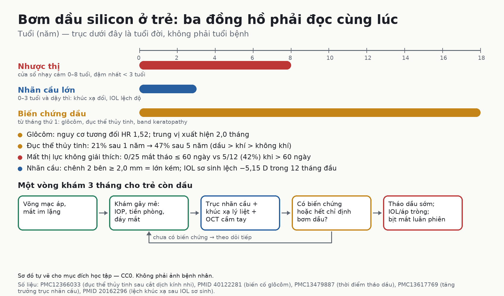
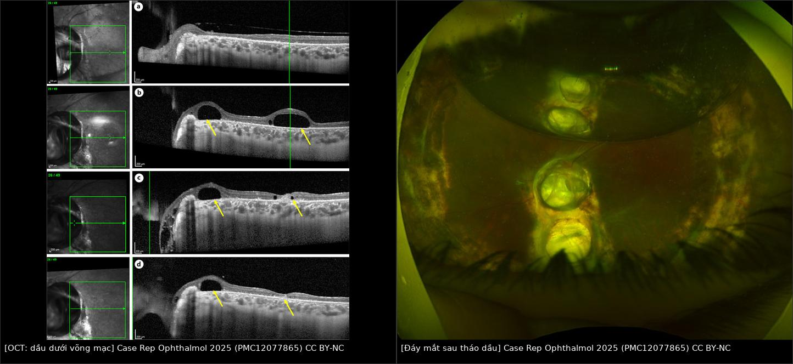
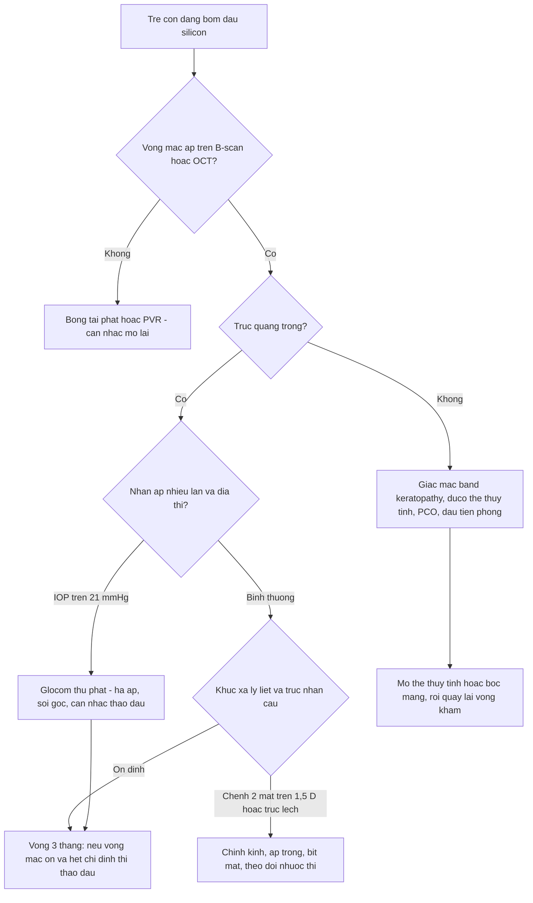
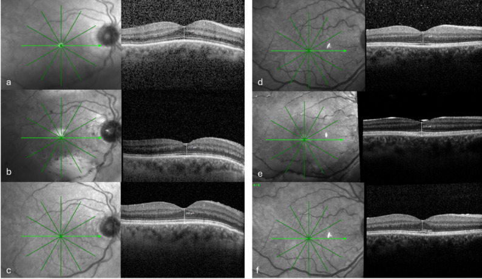
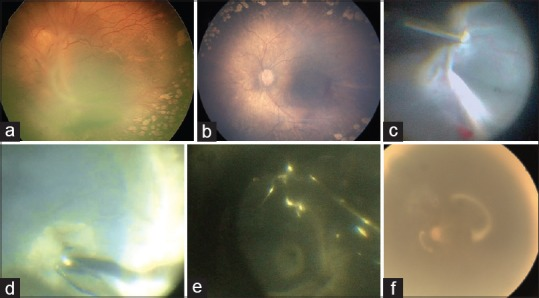
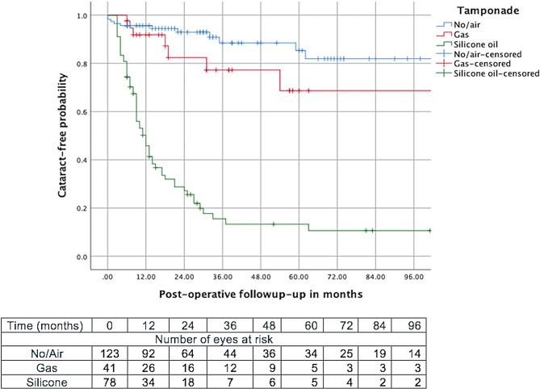

# 3272 — Bơm dầu silicon ở trẻ em: lưu bao lâu, mất thị lực thầm lặng, và nhược thị

**Tags:** `pattern:mo-mat-tien-trien` `pattern:amblyopia` `pattern:duc-the-thuy-tinh` `pattern:tang-nhan-ap` `pattern:vong-mac-ap` `vung:mat` `vung:dich-kinh` `vung:the-thuy-tinh` `vung:than-kinh-thi` `vung:nhi` `protocol:OCT-cam-tay` `protocol:khuc-xa-ly-liet` `protocol:do-truc-nhan-cau` `protocol:kham-gay-me` `protocol:sieu-am-B` `protocol:IOP` `score:khong-co` `incidentaloma:khong`

**Mức chắc chắn (certainty):** tổng hợp y văn (literature synthesis) — dựng từ: đoàn hệ đa trung tâm **205 bệnh nhân/211 mắt ≤ 16 tuổi** bơm dầu 1.000 cSt (Ophthalmology 1999, PMID 10406629); đoàn hệ **186 trẻ** về biến cố glôcôm sau mổ dịch kính nhi (Ophthalmol Glaucoma 2025, PMID 40122281); **242 mắt < 18 tuổi** sau cắt dịch kính giữ thể thủy tinh (Int J Retina Vitreous 2025, PMC12366033); loạt **60 mắt 6–15 tuổi** (Eur J Ophthalmol 1999, PMID 10544979); **22 mắt nhi** dùng dầu nặng Densiron (Int Ophthalmol 2021, PMID 33165653); **20 mắt** bong võng mạc kèm glôcôm bẩm sinh (J Fr Ophtalmol 2025, PMID 40086265); **58 mắt PFV** theo dõi tăng trưởng trục nhãn cầu (BMC Ophthalmol 2026, PMC13617769); **26 mắt** đặt IOL ở nhũ nhi 6–12 tháng (Graefes Arch Clin Exp Ophthalmol 2010, PMID 20162296); dữ liệu thời điểm tháo dầu ở **người lớn** (BMC Ophthalmol 2026, PMC13479887; RCT 66 mắt, Int J Retina Vitreous 2026, PMC13019722); cơ chế mất thị lực do dầu kế thừa bài **3263** (PMC13169982, PMC8728934, PMID 11239883). Chỗ chưa có dữ liệu nhi khoa ghi thẳng là **"chưa có dữ liệu ở trẻ"**, không suy diễn thành số. **Không ghi tên tác giả** — attribution = **tạp chí + năm + PMCID/PMID**.

> **Câu chốt:** trẻ bơm dầu silicon **không giống người lớn thu nhỏ**. Ở trẻ có **ba đồng hồ chạy song song**: (1) **nhược thị** — cửa sổ nhạy cảm tính bằng **năm**, mất thị lực có thể vĩnh viễn dù võng mạc áp; (2) **nhãn cầu đang lớn** — trục nhãn cầu và khúc xạ đổi liên tục, IOL đặt hôm nay sẽ lệch độ; (3) **biến chứng của dầu** — **glôcôm trung vị 2,0 tháng** (HR **1,52**), **đục thể thủy tinh 21% sau 1 năm → 47% sau 5 năm**, band keratopathy **21–44%**. Vì vậy câu hỏi không phải *"để dầu bao lâu cho chắc"* mà là **"đã đủ chỉ định chưa, và ai đang theo dõi ba đồng hồ đó"**. Ba số phải nhớ: **0/25 mắt tháo dầu ≤ 60 ngày mất thị lực không giải thích được, so với 5/12 (42%) khi > 60 ngày** (PMC13479887); **33,1% trẻ phải mổ thể thủy tinh sau cắt dịch kính, 21% trong năm đầu** (PMC12366033); **võng mạc áp chỉ 33% ở nhóm ROP sau 6 tháng** (PMID 10406629).

*Sơ đồ tự vẽ (CC0) — không phải ảnh bệnh nhân. Số liệu: PMC12366033 (đục thể thủy tinh), PMID 40122281 (glôcôm), PMC13479887 (thời điểm tháo dầu), PMC13617769 (trục nhãn cầu), PMID 20162296 (lệch khúc xạ sau IOL nhũ nhi).*

## 1. Tổng quan bệnh học – cơ chế hình ảnh (TẠI SAO)

### 1.1 Ba đồng hồ, không phải một

| Đồng hồ | Chạy từ đâu | Vì sao ở trẻ khác người lớn | Số đo phải theo |
|---|---|---|---|
| **Nhược thị** | Từ lúc trẻ bắt đầu nhìn (vài tháng tuổi) | Vỏ não thị giác cần **ảnh nét, đối xứng** trong cửa sổ nhạy cảm; **mất ảnh một bên dù chỉ vài tuần–vài tháng** có thể để lại **ám điểm/giảm thị lực vĩnh viễn**, trong khi người lớn chỉ "mờ tạm" | **Thị lực theo tuổi, hành vi cố định nhìn, khúc xạ hai mắt** — không phải "trẻ không kêu" |
| **Nhãn cầu lớn** | **18 tháng đầu** rồi dậy thì | Trục nhãn cầu tăng nhanh, **giác–thể thủy tinh–võng mạc đổi khoảng cách**; IOL có công suất cố định → **lệch khúc xạ**, còn mắt không IOL → **viễn thị cao** | **Trục nhãn cầu (A-scan), khúc xạ lý liệt, chênh hai mắt** |
| **Biến chứng dầu** | **Tháng thứ 1 sau bơm** | Buồng dịch kính nhỏ → cùng thể tích dầu **chiếm tỷ lệ lớn hơn**, mặt phân cách dầu–dịch **sát thể thủy tinh/góc tiền phòng** hơn; dầu nhũ tương hóa nhanh hơn ở mắt nhỏ, viêm | **Nhãn áp, tiền phòng, thể thủy tinh, giác mạc, đáy mắt** mỗi lần khám |

- **Vì sao nhược thị nặng hơn ở trẻ nhỏ:** kinh điển — **nhược thị do che kín (deprivation amblyopia)** xuất hiện khi ảnh võng mạc bị chặn **trong giai đoạn nhạy cảm**, và mức nặng phụ thuộc **tuổi khởi phát + thời gian che**. Tổng quan 2020 về nhược thị nhấn mạnh: điều trị kinh điển **giới hạn trong giai đoạn nhạy cảm**, dù còn một mức độ dẻo dai thần kinh sau đó (Vision Res 2020, PMC7487000); tổng quan thực hành nhấn mạnh **thành công giảm dần khi tuổi tăng**, nên phát hiện–điều trị phải **càng sớm càng tốt** (Korean J Ophthalmol 2019, PMC6911788).
- **Hệ quả lâm sàng:** ở trẻ bơm dầu, **"võng mạc áp" là điều kiện cần, không phải đích cuối**. Đích cuối là **ảnh nét trên võng mạc hai bên trong cửa sổ nhạy cảm** — nghĩa là phải xử lý đồng thời **dầu, thể thủy tinh, khúc xạ và bịt mắt**.

### 1.2 TẠI SAO dầu silicon gây tổn thương: vật lý + mô bệnh

- **Vật lý cơ bản:** dầu silicon **nhẹ hơn nước (≈ 0,97 g/cm³)** nên **nổi lên trên**, tạo mặt phân cách với dịch võng mạc; độ nhớt thường dùng **1.000 cSt** (có loại 5.000 cSt và dầu nặng pha F6H8). Trong mắt trẻ **nhỏ hơn**, cùng thể tích dầu cho **bong bóng tương đối lớn hơn** → mặt phân cách **gần thể thủy tinh và góc tiền phòng** hơn, dễ **chạm nội mô giác mạc** ở mắt không còn thể thủy tinh.
- **Nhũ tương hóa và tắc bè:** dầu bị **lực cắt khi mắt chuyển động** phân thành **giọt 1–2 µm** (đếm giọt: **80,8% số giọt ở 1–2 µm**, PMC7060885 — kế thừa bài 3258); giọt dầu **bít lỗ bè** và gây viêm → **tăng nhãn áp**. Đây là lý do **nhãn áp có thể tăng dù tháo dầu muộn**, và **không có ngưỡng "an toàn"** cho thời gian lưu.
- **Giác mạc:** mô bệnh **25 mẫu mắt bơm dầu** cho thấy **mất tế bào nội mô 90%** và **band keratopathy 83%**; tổn thương nặng hơn khi dầu lưu **> 60 tháng** (Zhonghua Yan Ke Za Zhi 2005, PMID 15774111). Cơ chế: dầu **tiếp xúc trực tiếp nội mô** + **hạ nhãn áp** → canxi lắng **lớp Bowman** → dải trắng ngang giác mạc, **mờ dần từ rìa vào trung tâm**.
- **Thể thủy tinh:** dầu **ngăn cách thể thủy tinh khỏi thủy dịch** → thiếu dinh dưỡng + tiếp xúc trực tiếp → **đục thể thủy tinh dưới bao sau (PSC)**. Ở trẻ, **bao sau đàn hồi, tế bào biểu mô hoạt động mạnh** → **đục trục quang (VAO)/PCO nhanh** sau khi đã lấy thể thủy tinh.
- **Thị thần kinh:** dầu đi **ngược dòng qua mảnh sàng** vào thị thần kinh sau mảnh sàng — **24% mắt cắt bỏ nhãn cầu** có túi dầu trong thị thần kinh, chiếm **tới 40% diện cắt ngang** (PMID 11239883). Đây là cơ chế **mất thị lực trung tâm không giải thích được (SORVL)** — chi tiết ở bài **3263**.

### 1.3 Kết cục thực tế ở trẻ: số của đoàn hệ lớn nhất

Đoàn hệ **tiến cứu, đa trung tâm, 211 mắt ≤ 16 tuổi**, dầu **1.000 cSt**, đánh giá lúc **6 tháng** (PMID 10406629):

| Nhóm bệnh | Võng mạc áp hoàn toàn | Hoàng điểm áp | Thị lực đi lại được (≥ 4/200) | Đục giác mạc | Hạ nhãn áp ≤ 5 mmHg | Nhũ tương hóa |
|---|---|---|---|---|---|---|
| Chấn thương (n = 76) | **57%** | 79% | 25% | **33%** | 12% | 5% |
| PVR (n = 38) | **63%** | 87% | 47% | 21% | 8% | 3% |
| Rách võng mạc khổng lồ (n = 34) | **68%** | 76% | 56% | **44%** | 6% | 9% |
| **ROP (n = 18)** | **33%** | **44%** | **22%** | 28% | 11% | 6% |

- **Tăng nhãn áp ≥ 30 mmHg chỉ 0–4%** trong 6 tháng đầu — nghĩa là **nhãn áp không tăng sớm không có nghĩa là an toàn**; biến cố glôcôm thường **xuất hiện muộn và âm thầm**.
- **Nhóm ROP là nhóm xấu nhất**: võng mạc áp **33%**, hoàng điểm áp **44%**, thị lực đi lại được **22%**. Vì vậy ở ROP, **mục tiêu thực tế** thường là **giữ nhãn cầu + một phần thị lực**, không phải "nhìn 10/10".
- Loạt **60 mắt 6–15 tuổi** (Eur J Ophthalmol 1999, PMID 10544979): dầu dùng ở **65%**, **63% được tháo dầu**, **85% trong số đó giữ được võng mạc áp** → **nguy cơ bong tái phát sau tháo dầu ≈ 15%**, thấp hơn con số **25,3%** ở người lớn (Br J Ophthalmol 2001, PMC1723734), nhưng **không bằng 0**. Kết luận của chính bài này: ở trẻ **"tháo dầu đúng lúc là thiết yếu để giữ chức năng mắt"** vì tuổi thọ còn dài.

### 1.4 TẠI SAO dầu ở trẻ "đắt" hơn: ba biến chứng có số

- **Glôcôm/biến cố liên quan glôcôm (GRAE):** **186 trẻ 0–18 tuổi**, **34,4% có dầu**, **54,8% có GRAE**; **trung vị thời gian tới biến cố 2,0 tháng** ở nhóm có dầu so với **25,3 tháng** ở nhóm không dầu; **HR hiệu chỉnh 1,52 (KTC 95% 1,01–2,28; p = 0,043)** (Ophthalmol Glaucoma 2025, PMID 40122281). Định nghĩa GRAE: **IOP > 21 mmHg**, bắt đầu thuốc hạ áp, phẫu thuật hạ áp, hoặc chẩn đoán glôcôm trẻ em.
- **Đục thể thủy tinh:** **242 mắt < 18 tuổi**, cắt dịch kính giữ thể thủy tinh: **33,1% phải mổ thể thủy tinh**, trung vị **17,0 ± 22,0 tháng**; **PSC 76,3%**; nguy cơ **21% sau 1 năm → 47% sau 5 năm**; loại tamponade liên quan có ý nghĩa (**p < 0,001**), đường cong Kaplan–Meier của nhóm dầu **tụt còn ≈ 10–15% không đục ở mốc 3 năm** (PMC12366033). Nhiều cuộc mổ là yếu tố nguy cơ độc lập (**OR 2,7**).
- **Band keratopathy:** **21–44%** mắt trẻ trong đoàn hệ 1999 (PMID 10406629), tăng theo thời gian lưu; mô bệnh người cho thấy **83%** có band keratopathy (PMID 15774111). Đây là biến chứng **nhìn thấy bằng đèn khe**, nhưng **chỉ chặn ánh sáng khi đã vào trung tâm** — nếu chờ "trẻ kêu mờ" thì đã muộn.

## 2. Mẫu hình + chẩn đoán phân biệt theo vị trí (gamut)

### 2.1 Mẫu hình nhận diện

**Trẻ đã bơm dầu silicon (thường sau bong võng mạc chấn thương, ROP, PFV, bệnh võng mạc di truyền) + mắt "im lặng" + thị lực/hành vi nhìn kém hơn mong đợi + đáy mắt có thể áp tốt.** Khi đó phải trả lời **5 câu theo thứ tự**, không được nhảy tới "nhược thị":

1. **Võng mạc có thật sự áp?** (siêu âm B khi không thấy đáy mắt; OCT khi thấy) — bong tái phát/PVR là nguyên nhân **thường gặp nhất** của "mờ sau mổ".
2. **Trục quang có trong?** — đục thể thủy tinh/PCO/VAO, dầu tiền phòng, band keratopathy trung tâm. Trẻ nhỏ **không đo được thị lực**, nên **mờ trục quang là chẩn đoán hình ảnh**.
3. **Nhãn áp có cao?** — đo **nhiều lần, nhiều thời điểm**, kể cả dưới gây mê (gây mê làm nhãn áp thấp giả).
4. **Có mất sợi trục thị thần kinh?** — SORVL (bài 3263).
5. **Có yếu tố khúc xạ/nhược thị?** — khúc xạ lý liệt hai mắt, chênh **≥ 1,5 D**, loạn thị, viễn thị cao; hành vi nhìn, rung giật nhãn cầu.

### 2.2 Gamut theo vị trí tổn thương

| Vị trí | Nhóm nguyên nhân | Vì sao phải phân biệt |
|---|---|---|
| **Giác mạc** | **Band keratopathy** do dầu (bài này) · phù giác mạc do dầu/hạ nhãn áp · loét do phơi nhiễm · đục giác mạc bẩm sinh | Band keratopathy **chữa được bằng EDTA** nếu chưa vào trung tâm; nhầm với "khô mắt" thì bỏ mất cửa sổ |
| **Tiền phòng/góc** | **Dầu tiền phòng, pupillary block** (bài 1416) · dính góc sau viêm · dầu nhũ tương (3258) | Cần **soi góc/AS-OCT**; dầu ở tiền phòng là chỉ định **lấy dầu/lấy màng**, không phải tăng thuốc đơn thuần |
| **Thể thủy tinh** | **Đục PSC do dầu** (bài này) · **PCO/VAO sau lensectomy** (6211) · đục do chấn thương (6213) · đục do xạ (6214) | Quyết định **mổ thể thủy tinh + IOL/áp tròng** và **thời điểm so với tháo dầu** |
| **Dịch kính/võng mạc** | **Bong tái phát/PVR** · **dầu dưới võng mạc** (bài này) · lỗ hoàng điểm · màng trước võng mạc (1467) | Dầu dưới võng mạc **không tự hết**, có thể gây **tăng nhãn áp và phá hủy hoàng điểm**; cần **tháo dầu + dẫn lưu** |
| **Thị thần kinh** | **SORVL (3263)** · glôcôm (1416) · chèn ép do dầu quanh thị · NAION/PION sau mổ | Điều trị khác hẳn: SORVL **không có thuốc**, glôcôm **hạ áp**, chèn ép **tháo dầu** |
| **Não/thị giác** | **Nhược thị do che/khúc xạ** · tổn thương thị giác trung ương ở trẻ non · rung giật nhãn cầu | Đây là nguyên nhân **"không thấy gì trên đáy mắt"**; bỏ sót = mất thị lực **vĩnh viễn** dù mắt "đẹp" |

## 3. Bảng so sánh phân biệt (ma trận đối chiếu)

| Thực thể (entity) | Hình ảnh điển hình | Chốt vào (rule-in) | Chốt loại (rule-out) | Gợi ý xác nhận |
|---|---|---|---|---|
| **Đục thể thủy tinh do dầu** | Đục **dưới bao sau**, tiến triển vài tháng; đồng tử trắng/xám; đáy mắt mờ dần | **Tiền sử dầu + đục PSC mới + trục quang mờ** | Đáy mắt **rõ, đồng tử đen** → không phải nguyên nhân chính | Đèn khe; siêu âm B để loại bong; theo dõi ảnh đáy mắt mỗi 3 tháng |
| **PCO/VAO sau lensectomy** | Màng sau bao dày, **trục quang trắng**, có thể co kéo | **Đã lấy thể thủy tinh + màng sau bao + giảm hành vi nhìn** | Màng **ngoài trục quang**, đáy mắt còn rõ → theo dõi | Đèn khe/ảnh chụp sau cực; YAG ở trẻ lớn, phẫu thuật ở trẻ nhỏ |
| **Glôcôm thứ phát** | **IOP > 21 mmHg** (nhiều lần), dầu/góc bít, có thể **giãn nhãn cầu** ở trẻ nhỏ | **IOP tăng + giác mạc to/đục + lõm đĩa tiến triển** | IOP **bình thường nhiều lần + đĩa không lõm** → ít nghĩ glôcôm | Nhãn áp nhiều thời điểm, **khám gây mê**, soi góc, OCT/đĩa khi hợp tác |
| **Band keratopathy** | **Dải trắng ngang** vùng khe mí, bờ rìa rõ, có thể **vôi hóa** | **Dải điển hình + tiền sử dầu lâu ± hạ nhãn áp** | **Dải không có, giác mạc trong** → loại trừ | Đèn khe; cạo/EDTA nếu chạm trục quang |
| **Dầu dưới võng mạc** | **Khoang giảm tín hiệu dưới võng mạc** trên OCT, bờ tròn, **không có lỗ cần thiết**; có thể **tăng IOP** | **Tiền sử dầu + khoang giảm tín hiệu dưới võng mạc + võng mạc phía trên còn áp** | Không có khoang, chỉ mỏng võng mạc → không phải | OCT cầm tay/SD-OCT; siêu âm B; **tháo dầu + dẫn lưu** |
| **Bong võng mạc tái phát/PVR** | Võng mạc **không áp**, dịch dưới võng mạc, **màng co kéo** | **Thấy bong/dịch dưới võng mạc hoặc siêu âm B có bong** | Võng mạc **áp phẳng trên OCT/B** → loại trừ | Siêu âm B khi đục; OCT khi thấy; **mổ lại nếu bong hoàng điểm** |
| **SORVL (bệnh thị do dầu)** | Đáy mắt **bình thường**, **RNFL 90,7 vs 118,3 µm**, **GCC 58,3 vs 84,5 µm**, **ám điểm trung tâm** | **Mờ trung tâm + võng mạc áp + đĩa không lõm + RNFL/GCC mỏng** | **Ám điểm cung + lõm đĩa** → glôcôm; **trục quang mờ** → nguyên nhân khác | OCT RNFL/GCC, thị trường khi hợp tác, mfERG |
| **Nhược thị do che/khúc xạ** | **Đáy mắt bình thường**, **chênh khúc xạ ≥ 1,5 D** hoặc **viễn thị cao**, hành vi nhìn kém một bên | **Chênh khúc xạ/che kín + hành vi nhìn bất đối xứng + không có tổn thương thực thể** | Có tổn thương thực thể giải thích được → không thuần nhược thị | Khúc xạ **lý liệt**, thử kính, bịt mắt thử, theo dõi 4–6 tuần |

*Ảnh ghép letterbox, giữ nguyên bản: trái là SD-OCT (a–d) cho thấy **khoang giảm tín hiệu dưới võng mạc** lan dưới hoàng điểm (mũi tên vàng) và giảm dần sau tháo dầu; phải là **đáy mắt** sau tháo dầu, võng mạc áp, còn **coloboma đĩa thị**. Nguồn: Case Rep Ophthalmol 2025 (PMC12077865) Fig. 1 + Fig. 2, **CC BY-NC 4.0**, nguyên bản không cắt.*

## 4. Protocol chụp/khám + hệ phân độ và ngưỡng xử trí

### 4.1 Vòng khám cho trẻ còn dầu (3 tháng/lần; dày hơn nếu có biến chứng)

### 4.2 Bộ khám tối thiểu — và ngưỡng phải ghi

| Bước | Cách làm ở trẻ | Ngưỡng/điểm cần ghi |
|---|---|---|
| **Hành vi nhìn** | Cố định–theo dõi (fixation and following), thử từng mắt, ưu tiên mắt bơm dầu | **Bất đối xứng rõ** = dấu hiệu sớm nhất; không thay thế được đo khúc xạ |
| **Khúc xạ lý liệt** | Nhỏ **atropine/cyclopentolate** đủ, soi bóng (retinoscopy) | **Chênh hai mắt ≥ 1,5 D**; viễn thị **≥ 2 D**; loạn thị **≥ 1,5 D** → chỉnh kính ngay |
| **Nhãn áp** | **Khám gây mê** (Perkins/Tono-Pen) khi trẻ không hợp tác; đo **2 lần khác thời điểm** | **> 21 mmHg** = biến cố (theo định nghĩa GRAE, PMID 40122281); ghi cả **đường kính giác mạc** nếu < 3 tuổi |
| **Trục nhãn cầu** | A-scan/B-scan **cùng máy, cùng người đo** | **Chênh hai mắt ≥ 2,0 mm** = lớn kém (định nghĩa tiên định, PMC13617769); theo dõi 6–12 tháng |
| **Bán phần trước** | Đèn khe/ảnh chụp; AS-OCT nếu có | **Dầu tiền phòng, dính góc, band keratopathy chạm trục**, màng sau bao |
| **Đáy mắt** | Gián tiếp/RetCam khi đục; **siêu âm B** khi không thấy | **Võng mạc áp phẳng?** mống mắt–thể mi, lỗ hoàng điểm, dầu dưới võng mạc |
| **OCT cầm tay** | Khi trẻ hợp tác/ngủ; **RNFL + GCC** nếu nghi SORVL | **GCC mỏng hơn mắt lành**; RNFL có thể **dày giả** khi còn dầu (bài 3263) |
| **Điện sinh lý** | ERG/mfERG/VEP khi có máy và khi nghi mất thị lực không giải thích | **ERG suy giảm chức năng hoàng điểm** dù đáy mắt bình thường |
| **Toàn thân** | Cân nặng, tuổi, bệnh nền, thuốc | Trẻ nhỏ: **liều thuốc theo kg**, tránh thuốc gây ức chế hô hấp khi khám |

### 4.3 Ngưỡng và thời điểm can thiệp

- **Tháo dầu:** **tháo ngay khi võng mạc ổn định và hết chỉ định bơm dầu**, không "để đến khi trẻ lớn". Bằng chứng **ở người lớn** cho thấy **≤ 60 ngày tốt hơn > 60 ngày**: **0/25 mắt mất thị lực không giải thích được ở nhóm ≤ 60 ngày so với 5/12 (42%) ở nhóm > 60 ngày** (p = 0,002), thị lực cuối tốt hơn (PMC13479887); RCT **tháo 2 tháng vs 6 tháng** cho **thấy nhạy vi trường tốt hơn** ở nhóm sớm, **tỷ lệ áp võng mạc tương đương** (p = 0,237) (PMC13019722). **Chưa có RCT ở trẻ** — nhưng không có lý do sinh học nào để trẻ chịu **nhiều tháng dầu thừa**.
- **Mổ thể thủy tinh:** khi **đục chạm trục quang** hoặc **PCO/VAO làm mờ đáy mắt**; ở trẻ **< 2 tuổi** cân nhắc **để không IOL + áp tròng** thay vì IOL công suất cố định, vì trục nhãn cầu còn tăng (**18 tháng đầu**, PMID 17583817) và **lệch khúc xạ −5,15 D trong 12 tháng đầu** đã được ghi nhận sau IOL nhũ nhi (PMID 20162296). Nếu đặt IOL, **chủ ý để lại viễn thị** theo tuổi.
- **Nhược thị:** chỉnh kính **đủ, sớm**, rồi **bịt mắt luân phiên** (hoặc atropine) theo tuổi; **tuân thủ thực tế chỉ ~44%** và **42% số ngày không đeo miếng bịt** trong nghiên cứu có giám sát (Invest Ophthalmol Vis Sci 2013, PMID 23882695) → phải **hướng dẫn phụ huynh + hẹn lại 4–6 tuần**, không chỉ kê đơn.
- **Band keratopathy:** cạo/EDTA khi **dải tiến vào trục quang**; điều trị **hạ nhãn áp** song song.
- **Theo dõi sau tháo dầu:** **1 tuần, 1 tháng, 3 tháng, 6 tháng**, sau đó **6–12 tháng**; mỗi lần: nhãn áp, khúc xạ, trục nhãn cầu, đáy mắt; **chụp OCT/RNFL** ở trẻ hợp tác.

### 4.4 Bảng phân tầng nguy cơ (dùng để quyết định ai khám dày)

| Yếu tố | Nguy cơ | Hành động |
|---|---|---|
| **Tuổi < 3 tuổi** | Nhược thị nặng, mắt nhỏ, khó đo | Khám gây mê **mỗi 3 tháng**; khúc xạ lý liệt mỗi lần |
| **Dầu + không còn thể thủy tinh** | Dầu tiền phòng, band keratopathy, glaucoma | Khám **mỗi 4–6 tuần** trong 6 tháng đầu |
| **ROP stage 4–5** | Bong tái phát, dầu lưu lâu, thị lực kém | **Theo dõi suốt đời**, đề phòng **glôcôm góc đóng** và **bong muộn** |
| **Đã có GRAE/IOP > 21** | Tổn thương thị thần kinh tiến triển | Hạ áp + **cân nhắc tháo dầu sớm**, khám 1–2 tháng/lần |
| **Dầu > 12 tháng** | Band keratopathy, nhũ tương, SORVL | **Đặt mốc tháo dầu cụ thể trên hồ sơ**, không để "vô thời hạn" |

## 5. Biến thể bình thường và cạm bẫy

- **"Trẻ không kêu mờ" không phải bằng chứng mắt tốt.** Trẻ nhỏ **không có khái niệm so sánh**, **không báo mất thị lực trung tâm**; dấu hiệu sớm là **hành vi nhìn bất đối xứng, dụi mắt, nghiêng đầu, nhắm một mắt**. Bắt buộc **thử từng mắt**.
- **Đo thị lực và thị trường ở trẻ là bài toán riêng:** trẻ < 4–5 tuổi thường **không làm được Humphrey**; đừng kết luận "thị trường bình thường" từ một lần thử không hợp tác. Dùng **OCT cầm tay + hành vi nhìn + mfERG** thay thế, và ghi rõ **phương pháp**.
- **OCT bình thường không loại trừ SORVL** — đúng như bài 3263: OCT hoàng điểm có thể **bình thường** trong khi RNFL/GCC đã mỏng. Ở trẻ, khó đo hơn nữa, nên **so với mắt lành và so theo thời gian** là bắt buộc.

*Hình từ BMC Ophthalmol 2026 (CC BY 4.0, PMC13479887, Fig. 1): hai mắt macula-on, OCT **trước** dầu (a/d), **trong** khi có dầu với **đường viền hoàng điểm dẹt** (b/e), và **sau tháo dầu** trở về gần mức nền (c/f). Đây là dữ liệu **người lớn** — dùng để minh họa vì **không có chuỗi OCT tương đương ở trẻ**; điểm cần nhớ: thay đổi **rất kín đáo**, không tương xứng với mức mất thị lực.*
- **"Võng mạc áp = thành công" là cạm bẫy satisfaction of search:** khi đã thấy áp, người khám dừng lại — trong khi **đục thể thủy tinh 33,1%**, **GRAE 54,8%**, **band keratopathy 21–44%** đang tiến triển. Mỗi lần khám phải **đi hết 5 câu hỏi ở mục 2.1**.
- **Nhãn áp một lần bình thường không loại trừ glôcôm:** trong đoàn hệ 1999, **tăng ≥ 30 mmHg chỉ 0–4%** ở 6 tháng; GRAE có **trung vị 2,0 tháng** nhưng có thể **muộn hơn nhiều**. Đo **nhiều lần**, ghi **giác mạc có to không** ở trẻ < 3 tuổi.
- **Dầu dưới võng mạc bị đọc thành "bong thanh dịch" hoặc "retinoschisis":** trên OCT là **khoang giảm tín hiệu, bờ tròn, không có lỗ**, có thể **kèm tăng nhãn áp**; hỏi **tiền sử bơm dầu** là chốt. Chọc/dẫn lưu như dịch thật sẽ **không giải quyết** và có thể làm **dầu lan thêm**.
- **Lệch khúc xạ do tăng trưởng bị đọc là "đục thể thủy tinh":** trẻ **viễn thị tăng dần** do mắt lớn nhanh (nhất là mắt không IOL); **soi bóng lặp lại sau 3–6 tháng** trước khi kết luận cần mổ.
- **Band keratopathy bị đọc là "khô mắt/loét dinh dưỡng":** dải canxi **ngang, đối xứng, ở vùng khe mí**, tiền sử dầu lâu; điều trị **EDTA**, không phải chỉ nước mắt nhân tạo.
- **Cạm bẫy "dầu phải để suốt đời":** đúng với **một số mắt ROP/PVR không thể tháo** (dầu là "dàn giáo" duy nhất), nhưng **phải ghi lý do và mốc đánh giá lại**; "để mãi" không phải là một quyết định, mà là **thiếu quyết định**.

## 6. Tự lượng giá — Blind Quiz

**Ca 1 — Nam 15 tuổi, coloboma đĩa thị, đã mổ bong võng mạc tái phát lần 3 bằng cắt dịch kính + dầu silicon 1.000 cSt; 2 tháng sau võng mạc áp; 14 tháng sau nhìn mờ, nhãn áp 33 mmHg.**

- Gợi ý lâm sàng: không đau, giác mạc trong, đồng tử đen, không thấy bong võng mạc trên siêu âm B.
- Câu hỏi: (1) Khoang **giảm tín hiệu dưới võng mạc** trên OCT là gì? (2) Ba chẩn đoán phân biệt? (3) Vì sao **không được chọc dẫn lưu như dịch dưới võng mạc thật**?

<b>Bấm để hiện đáp án (findings + chẩn đoán)</b>

- **Dấu hiệu:** SD-OCT cho thấy **khoang giảm tín hiệu dưới võng mạc** (dầu) lan **dưới hoàng điểm** ở thì 14 tháng, kèm **tăng nhãn áp 33 mmHg**; sau **tháo dầu + dẫn lưu dầu dưới võng mạc**, khoang giảm dần, nhãn áp về **14 mmHg**, còn **sẹo trung tâm/loạn dưỡng lớp ellipsoid** (Case Rep Ophthalmol 2025, PMC12077865).
- **Chẩn đoán:** **dầu silicon dưới võng mạc (subretinal silicone oil)** — biến chứng muộn của bơm dầu, có thể **tăng nhãn áp** và **phá hủy hoàng điểm**; đây là lý do phải **tháo dầu khi hết chỉ định**, không "để quanh năm".
- **Ba phân biệt:** (1) **bong thanh dịch** — bờ võng mạc mỏng, dịch **tăng tín hiệu** trên OCT, đáy mắt có dấu viêm; (2) **retinoschisis** — tách lớp **trong võng mạc**, không phải khoang dưới võng mạc; (3) **nang/khối dưới võng mạc** — có tín hiệu mô, không phải khoang trống quang học.
- **Vì sao không chọc:** dầu **không phải dịch**, **không di chuyển theo tư thế** như dịch; chọc hút có thể **làm dầu di chuyển thêm vào hoàng điểm/dưới võng mạc rộng hơn**, gây **bong võng mạc do áp lực âm**, và **không giải quyết nguồn dầu** (dầu vẫn còn trong buồng dịch kính). Xử lý đúng là **tháo dầu + dẫn lưu có kiểm soát**.
- Nguồn ảnh: Case Rep Ophthalmol 2025 (PMC12077865), Fig. 1 + Fig. 2, **CC BY-NC 4.0**, nguyên bản.

**Ca 2 — Bé gái sinh non 26 tuần, ROP giai đoạn 4B tiến triển lỗ hoàng điểm + bong khu trú; mổ cắt dịch kính giữ thể thủy tinh, bóc màng ILM, bơm dầu silicon. Lần khám cuối: võng mạc áp, lỗ hoàng điểm đóng.**

- Gợi ý lâm sàng: trẻ 2 tuổi, không hợp tác đo thị lực; mẹ nói "cháu vẫn nhìn thấy đồ chơi"; nhãn áp 18 mmHg; đồng tử đen.
- Câu hỏi: (1) Ngoài đáy mắt, **ba thứ bắt buộc phải đo** ở lần khám này là gì? (2) Vì sao **khúc xạ lý liệt** quan trọng hơn cả siêu âm ở ca này? (3) Khi nào **lên kế hoạch tháo dầu**?

<b>Bấm để hiện đáp án (findings + chẩn đoán)</b>

- **Dấu hiệu:** ảnh (a–f) cho thấy **ROP 4B**, sau cắt dịch kính **lỗ hoàng điểm + bong khu trú**, bóc ILM, **bơm dầu**, lần cuối **võng mạc áp, lỗ đóng** (Indian J Ophthalmol 2019, PMC6552571).
- **Ba thứ phải đo:** (1) **nhãn áp** (GRAE có thể xuất hiện sớm, trung vị 2 tháng — PMID 40122281); (2) **khúc xạ lý liệt hai mắt** (chênh ≥ 1,5 D là ngưỡng điều trị); (3) **trục nhãn cầu** (chênh ≥ 2,0 mm = lớn kém — PMC13617769). Thêm: **hành vi nhìn từng mắt**.
- **Vì sao khúc xạ:** trẻ **không IOL hoặc IOL công suất cố định** trong mắt đang lớn → **viễn thị cao/lệch độ** là nguyên nhân **nhược thị chắc chắn xảy ra** nếu không chỉnh; siêu âm chỉ nói võng mạc áp, **không nói trẻ có nhìn được hay không**. Ở trẻ < 2 tuổi, IOL đặt sớm có thể lệch **−5,15 D trong 12 tháng đầu** (PMID 20162296).
- **Khi tháo dầu:** khi **võng mạc áp ổn định, lỗ đóng, không còn PVR tiến triển** — đặt **mốc cụ thể** (ví dụ 2–3 tháng) và **ghi vào hồ sơ**; dữ liệu người lớn cho thấy **≤ 60 ngày ít mất thị lực không giải thích hơn > 60 ngày** (0/25 vs 5/12; PMC13479887). Sau tháo: **bịt mắt luân phiên + chỉnh kính**, hẹn **4–6 tuần** kiểm tra tuân thủ.
- **Phản biện trung thực:** ca này **không có dữ liệu thị lực định lượng** (trẻ nhỏ); kết luận "thành công" chỉ là **giải phẫu**, chưa phải **chức năng**. Đây chính là cạm bẫy của cả bài.
- Nguồn ảnh: Indian J Ophthalmol 2019 (PMC6552571), Fig. 3, **CC BY-NC-SA 4.0**, nguyên bản.

**Ca 3 (dữ liệu nhóm) — Trong 242 mắt trẻ sau cắt dịch kính, đường cong nào tương ứng với dầu silicon, và điều đó đổi cách tư vấn gia đình thế nào?**

- Gợi ý: ba đường: **không khí/không tamponade**, **khí**, **dầu silicon**; trục tung là **xác suất KHÔNG phải mổ thể thủy tinh**.
- Câu hỏi: (1) Đường nào là dầu? (2) Ở mốc 24–36 tháng, xác suất còn "không đục" của nhóm dầu là bao nhiêu? (3) Câu tư vấn nào **sai**?

<b>Bấm để hiện đáp án (findings + chẩn đoán)</b>

- **Dấu hiệu:** đường **dầu silicon** là đường **tụt dốc nhất**, cắt mốc **0,5** (50%) chỉ sau **~12 tháng** và còn **≈ 10–15%** ở 24–36 tháng; nhóm **khí** giữ **≈ 0,67** ở 60 tháng; nhóm **không khí/không tamponade** gần **0,9** (PMC12366033, Fig. 2).
- **Chẩn đoán:** dầu silicon là **yếu tố nguy cơ mạnh nhất** cho mổ thể thủy tinh ở trẻ trong dữ liệu này; toàn bộ đoàn hệ **33,1% phải mổ**, **PSC 76,3%**.
- **Câu tư vấn sai:** *"Bơm dầu xong là yên tâm, chỉ cần kiểm tra võng mạc"*. Đúng phải là: **"Dầu giữ võng mạc nhưng gần như chắc chắn sẽ làm đục thể thủy tinh; chúng ta sẽ cùng theo dõi và mổ khi cần, đồng thời chỉnh kính – bịt mắt để tránh nhược thị"**.
- Nguồn ảnh: Int J Retina Vitreous 2025 (PMC12366033), Fig. 2, **CC BY 4.0**, nguyên bản.

## 7. Câu hỏi nghiên cứu & điểm chưa đồng thuận (tính đến 11/2026)

1. **[Tranh cãi] Ở trẻ bơm dầu silicon, tháo dầu sớm (≤ 2–3 tháng) có giảm mất thị lực và biến chứng so với để 6 tháng mà không tăng bong tái phát không?**
   - **Đã biết:** Ở **người lớn**, dầu **≤ 60 ngày** cho **0/25 mắt mất thị lực không giải thích được** so với **5/12 (42%)** khi **> 60 ngày** (p = 0,002); RCT **2 tháng vs 6 tháng** cho **nhạy vi trường tốt hơn** ở nhóm sớm với **tỷ lệ áp võng mạc tương đương** (p = 0,237).
   - **Chưa rõ:** **Không có RCT ở trẻ** — nhóm bệnh (ROP, PVR, chấn thương) và **tốc độ tăng sinh xơ** khác người lớn, nên không thể suy thẳng kết quả.
   - **Hướng nghiên cứu:** RCT/đoàn hệ tiến cứu ở trẻ theo **mốc tháo dầu** (≤ 3 tháng vs ≥ 6 tháng), outcome **thị lực theo tuổi + RNFL/GCC + bong tái phát**.
   - **Nguồn:** PMC13479887 (2026); PMC13019722 (2026); PMC5066514 (2015).

2. **[Khoảng trống] Ngưỡng OCT nào đủ để chẩn đoán mất thị lực do dầu ở trẻ, khi trẻ không làm được thị trường và OCT thường?**
   - **Đã biết:** Ở người lớn, **RNFL 90,7 vs 118,3 µm** và **GCC 58,3 vs 84,5 µm**; **24%** mắt cắt bỏ nhãn cầu có **dầu trong thị thần kinh sau mảnh sàng**, tới **40% diện cắt**.
   - **Chưa rõ:** Không có **ngưỡng theo tuổi**, không có **chuẩn đo thay thế** (handheld OCT, mfERG) được hiệu chuẩn ở trẻ; **RNFL có thể dày giả** khi còn dầu.
   - **Hướng nghiên cứu:** Nghiên cứu **độ chính xác chẩn đoán** của OCT cầm tay/mfERG ở trẻ có dầu, so với **chuẩn tham chiếu là thị lực đã phục hồi sau tháo dầu**.
   - **Nguồn:** PMC13169982 (2026); PMC8728934 (2022); PMID 11239883 (2001).

3. **[Khác biệt thực hành] Ở trẻ < 2 tuổi cần mổ thể thủy tinh, nên đặt IOL cùng thì hay để không IOL + áp tròng?**
   - **Đã biết:** IOL nhũ nhi cho **lệch khúc xạ −5,15 ± 2,08 D trong 12 tháng đầu**; **tăng trưởng trục nhãn cầu mạnh trong 18 tháng đầu**; sau cắt dịch kính nhi, **33,1% phải mổ thể thủy tinh**, nhiều ca có **nhiều cuộc mổ** (OR 2,7).
   - **Chưa rõ:** Chưa có **so sánh ngẫu nhiên** IOL một thì vs **áp tròng** ở trẻ có **dầu silicon**; tuân thủ áp tròng ở gia đình khó khăn chưa được đo.
   - **Hướng nghiên cứu:** Đoàn hệ so sánh **khúc xạ cuối, số lần mổ lại, thị lực và tuân thủ** giữa hai chiến lược, phân tầng theo tuổi và bệnh nền.
   - **Nguồn:** PMID 20162296 (2010); PMID 17583817 (2007); PMC12366033 (2025).

## Bài liên quan chéo

- [3263 – Bệnh thần kinh thị do dầu silicon: mất thị lực trung tâm dù võng mạc áp tốt](../3263-benh-than-kinh-thi-dau-silicone/lesson.md) *(đã có)*
- [1416 – Glôcôm do dầu silicon: pupillary block, bít bè, chọn lấy dầu/van](../1416-glaucom-do-dau-silicone/lesson.md) *(đã có)*
- [1410 – Dầu silicon tồn lưu: chỉ định bơm, biến chứng, khi nào lấy dầu](../1410-lay-dau-silicone-va-dau-ton-luu/lesson.md) *(đã có)*
- [3258 – Nhũ tương hóa dầu silicon: hạt dầu ở tiền phòng/góc](../3258-nhu-tuong-hoa-dau-silicone/lesson.md) *(đã có)*
- [3274 – Phaco trên mắt đã cắt dịch kính: đệm dịch kính mất, IOL lệch, PCO sớm](../3274-phaco-mat-da-cat-dich-kinh/lesson.md) *(đã có)*
- [3271 – Iridodialysis ở trẻ: khi nào khâu, khi nào theo dõi](../3271-iridodialysis-tre-em-khi-nao-khau/lesson.md) *(đã có)*
- [6210 – Bong võng mạc sau mổ đục thể thủy tinh bẩm sinh](../6210-bong-vong-mac-sau-mo-duc-thuy-tinh-bam-sinh/lesson.md) *(đã có)*
- [6213 – Đục thể thủy tinh do chấn thương ở trẻ](../6213-duc-thuy-tinh-chan-thuong-tre/lesson.md) *(đã có)*
- [469 – Lác và nhược thị ở trẻ sinh non](../469-lac-nhuoc-thi-tre-sinh-non-rop/lesson.md) *(đã có)*
- [486 – Lác trong điều tiết: theo dõi sau kính](../486-lac-trong-dieu-tiet-theo-doi-sau-kinh/lesson.md) *(đã có)*
- [442 – Glôcôm trên OCT: RNFL/GCC và cách đọc bản đồ lệch](../442-glaucoma-OCT/lesson.md) *(đã có)*

## Ảnh

- `3272_dau-silicone-tre-em_SoDo_CC0.png` — sơ đồ **tự vẽ, CC0**.
- `3272_dau-silicone-tre-em_KM_Hinh-PMC12366033-Fig2-CCBY.jpg` — Int J Retina Vitreous 2025, **CC BY 4.0**, PMC12366033, Fig. 2.
- `3272_dau-silicone-tre-em_Day-mat-ROP-PMC6552571-Fig3-CCBYNCSA.jpg` — Indian J Ophthalmol 2019, **CC BY-NC-SA 4.0**, PMC6552571, Fig. 3.
- `3272_dau-silicone-tre-em_OCT-duoi-vong-mac-PMC12077865-Fig1-CCBYNC.jpg` — Case Rep Ophthalmol 2025, **CC BY-NC 4.0**, PMC12077865, Fig. 1.
- `3272_dau-silicone-tre-em_Day-mat-PMC12077865-Fig2-CCBYNC.jpg` — Case Rep Ophthalmol 2025, **CC BY-NC 4.0**, PMC12077865, Fig. 2.
- `composite_ca-15-tuoi.jpg` — ảnh ghép letterbox từ hai ảnh trên (giữ nguyên aspect, dải attribution).
- Chi tiết nguồn + giấy phép từng ảnh: `images/CREDITS.md`.

> Không dùng để chẩn đoán độc lập khi chưa có người hướng dẫn.
