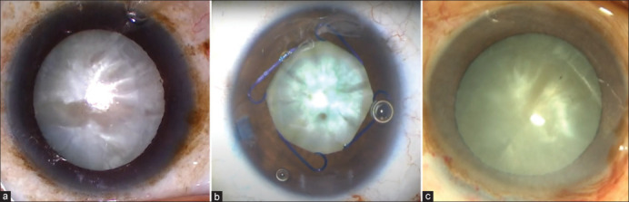
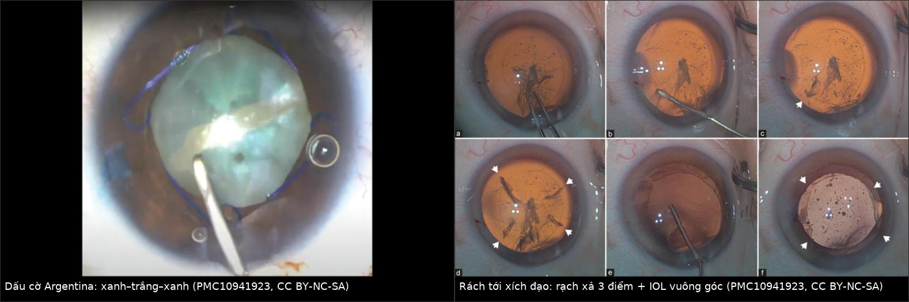
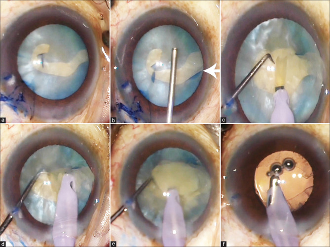
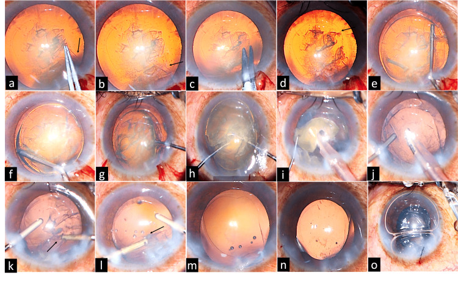
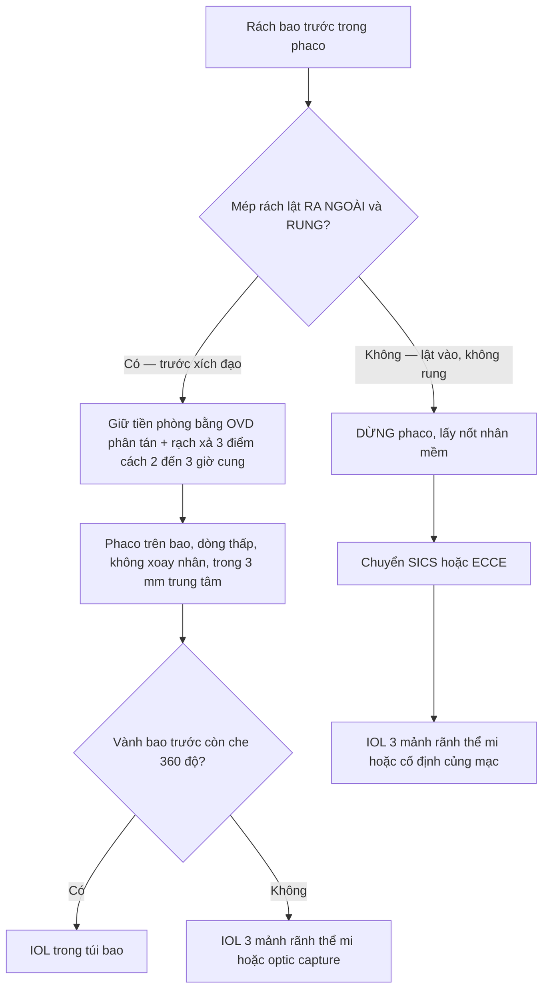
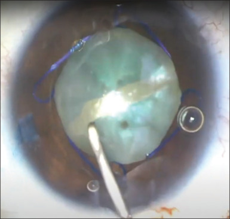
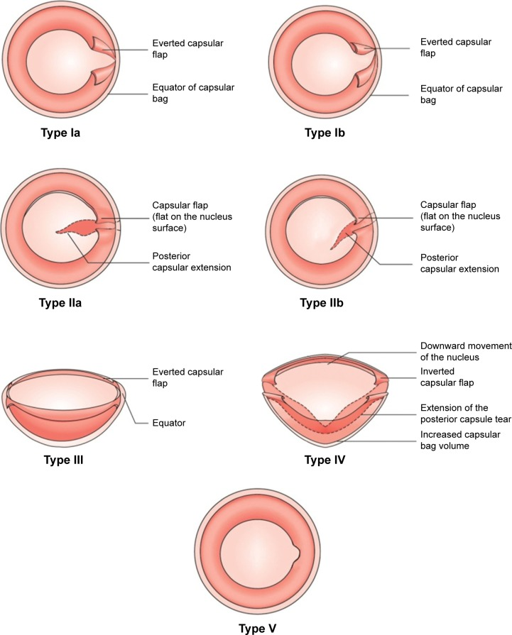
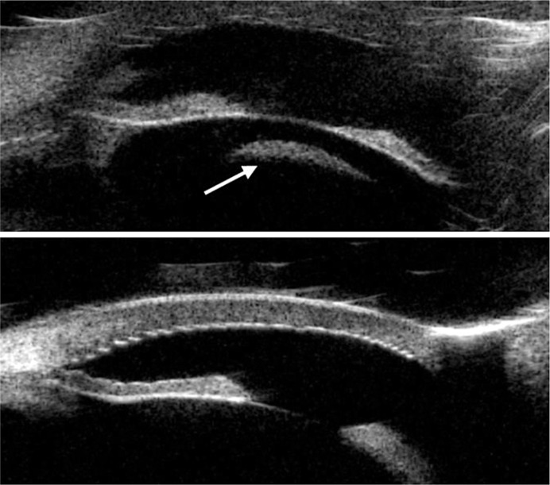

# 3273 — Rách bao trước trong phaco (anterior capsular tear): khi nào tiếp tục, khi nào mở rộng đường rách, khi nào chuyển ECCE

**Tags:** `pattern:rach-bao-truoc` `pattern:argentinian-flag` `pattern:rach-lan-xich-dao` `pattern:vo-bao-sau` `pattern:mat-mot-ben` `pattern:manh-nhan-roi` `pattern:iol-nghieng` `pattern:phu-giac-mac-sau-mo` `vung:mat` `vung:the-thuy-tinh` `vung:bao-truoc` `vung:xich-dao` `vung:tien-phong` `vung:bao-sau` `vung:ranh-the-mi` `protocol:den-khe` `protocol:AS-OCT` `protocol:iOCT` `protocol:UBM` `protocol:phaco` `score:khong-co` `incidentaloma:khong`

**Mức chắc chắn (certainty):** tổng hợp y văn (literature synthesis) — dựng từ: đoàn hệ **21.678 mắt** phaco với **121 rách bao trước** và **dấu rung mép bao** (Indian J Ophthalmol 2023, PMC10538828, CC BY-NC-SA); loạt **4.331 mắt / 26 rách** phân 5 type + dấu rung (Clin Ophthalmol 2017, PMC5558569, CC BY-NC); tổng quan **10 hình** về dấu cờ Argentina và xử trí rách bao trước (Indian J Ophthalmol 2024, PMC10941923, CC BY-NC-SA); **1.042 mắt vỡ bao sau** so sánh có/không rách bao trước (Eye 2025, PMC12446471, CC BY); ca dùng **kỹ thuật Two-Y crushing** khi đã rách (Cureus 2026, PMC13052674, CC BY); ca **dấu lưỡi liềm trên UBM** (Case Rep Ophthalmol 2026, PMC13363134, CC BY-NC); **21 mắt rách bao trước / 2.646 ca** theo dõi dọc toàn bộ diễn biến (J Cataract Refract Surg 2006, PMID 17010860); **51 mắt rạch xả mép mở bao** (Can J Ophthalmol 2018, PMID 30340724); **1.121 mắt do cư dân mổ** (J Ophthalmic Vis Res 2025, PMC12284607, CC BY); **40 mắt đục trắng giảm áp thể thủy tinh** (Indian J Ophthalmol 2017, PMC5742978, CC BY-NC-SA). Nhóm **không có bệnh nhân của mình**; chỗ chưa đủ chắc ghi **"chưa rõ"**. **Không ghi tên tác giả** — attribution = **tạp chí + năm + PMCID/DOI**.

> **Câu chốt:** rách bao trước **không phải một vết xước mà là một vết nứt tự lan** — nên câu hỏi không phải "có rách hay không" mà là **"mép rách đang ở đâu so với xích đạo"**. Ba số phải nhớ: rách bao trước gặp **0,56–1,2%** ca phaco (**1,9%** khi cư dân mổ), **84%** xảy ra ngay ở thì mở bao; **mép lật ra ngoài + rung = trước xích đạo → 0% vỡ bao sau (102/102)**, còn **mép lật vào + không rung = sau xích đạo → 100% vỡ bao sau (19/19)**. Và khi đã vỡ bao sau, **15% (155/1.042) có kèm rách bao trước**, với hậu quả nặng hơn hẳn: IOL trong túi chỉ **4,5% so với 12,4%**, aphakia **19,4% so với 6,4%**.

## 1. Tổng quan bệnh học – cơ chế hình ảnh (TẠI SAO)

### 1.1 Bao trước là gì và vì sao mép mở bao là điểm yếu cấu trúc

- **Bao trước** là **màng collagen (chủ yếu collagen IV) không có mạch**, do **biểu mô thể thủy tinh** tiết ra; nó **dày hơn bao sau** và **dày lên ở vùng giữa ngoại vi (mid-periphery)** — đúng vùng mà đường rách hay "dừng lại" trước khi tới xích đạo (PMC5558569).
- **Mở bao liên tục – tròn – ly tâm (continuous curvilinear capsulorhexis, CCC)** tạo một **mép tự do liên tục**: lực căng của bao được chia đều **vòng quanh** mép, không có điểm tập trung. Đó là toàn bộ lý do CCC thay thế kỹ thuật "mở bao kiểu mở nắp hộp" (can-opener): mép **răng cưa** của can-opener có hàng chục đỉnh nứt, mỗi đỉnh là một điểm khởi phát đường rách.
- **TẠI SAO một khía nhỏ lại nguy hiểm:** trong vật liệu đàn hồi, ứng suất ở **đỉnh đường nứt** lớn hơn ứng suất danh nghĩa nhiều lần (tập trung ứng suất — stress concentration). Bao thể thủy tinh là **vật liệu nhớt–đàn hồi**, nên khi lực kéo vượt độ bền tại đỉnh, đường rách **chạy tiếp theo hướng vuông góc với lực căng vòng** — tức **hướng tâm ra xích đạo (radial)**. Vì vậy hình thái điển hình là **một notch hình chữ V ở mép mở bao + một lưỡi bao tự do**, không phải một vết rách lan tỏa.
- **Hệ quả thực hành:** rách bao trước **không tự lành và không tự dừng**; mọi thao tác sau đó (bơm dịch, xoay nhân, hút vỏ, đặt IOL) đều có thể **đẩy đỉnh đường rách đi xa hơn**. Đây là khác biệt cốt lõi với **rách bao sau** — vỡ bao sau là một lỗ **khu trú, tròn/bầu dục** ở mặt phẳng yếu, còn rách bao trước là **một đường đang chạy**.

### 1.2 Hai nguồn lực làm đường rách lan: áp lực trong thể thủy tinh và lực kéo cơ học

- **Áp lực nội tại thể thủy tinh (intralenticular pressure):** ở **đục thể thủy tinh trương phồng (intumescent cataract)**, vỏ thể thủy tinh **hóa lỏng** và dịch tích tụ ở **khoang dưới bao trước và sau**, làm áp lực trong thể thủy tinh tăng. Khi **chọc thủng bao trước**, khoang trước **mất áp đột ngột**, còn khoang sau vẫn tăng áp → **nhân bị đẩy ra trước**, căng bao trước và **đường rách tự lan** — đó là cơ chế của **dấu cờ Argentina (Argentinian flag sign, AFS)** (PMC10941923).
- **Vì sao dấu cờ Argentina lại có ba màu:** bao được nhuộm **xanh trypan**, nhân/vỏ **trắng đục**, và hai **mép rách đang tách** để lộ **dải xanh ở giữa** → **xanh–trắng–xanh**, giống quốc kỳ Argentina. Đây là **một dấu hiệu hình thái, không phải một chẩn đoán riêng** — nó nói rằng **đường rách đã lan ít nhất một phần tư vòng và đang chịu áp lực dương**.
- **Ngoại lệ có cơ sở vật lý:** ở **đục Morgagnian** (toàn bộ nhân hóa lỏng), chỉ còn **một khoang tăng áp** thay vì hai → **tỷ lệ rách bao thấp hơn** (PMC10941923). Nghĩa là "đục trắng" không đồng nghĩa "luôn nguy hiểm như nhau": phải phân biệt **trương phồng có vỏ đặc** với **Morgagnian hóa lỏng**.
- **Lực kéo cơ học** (nguồn thứ hai, và là nguồn **kiểm soát được**):
  1. **Hydrodissection quá mạnh** — bơm dịch sau nhân làm **áp lực thủy tĩnh** tăng đột ngột; đây là thì **hay làm rách lan nhất trong nhóm rách bao trước**: **8,4% so với 3,0%** ca vỡ bao sau không có rách bao trước (PMC12446471).
  2. **Xoay nhân (nuclear rotation)** khi đường rách đã tới gần xích đạo — mỗi lần xoay là một lần **kéo tiếp tuyến** lên lưỡi bao.
  3. **Đầu hút I/A** kéo vỏ **hướng ra khỏi** đường rách.
  4. **Đặt IOL/haptic** tì vào mép bao — trong loạt 21 mắt, **6/10 ca lan tới bao sau xảy ra ở thì đặt IOL** (PMID 17010860).
  5. **Tăng áp lực ra sau (posterior pressure)**: ho, Valsalva, bệnh phổi mạn, tiền phòng nông **< 2 mm**, bệnh nhân không thoải mái (PMC10941923).

### 1.3 Vì sao rách bao trước dẫn tới vỡ bao sau — chuỗi ba bước

| Bước | Chuyện gì xảy ra | Dấu hiệu trên bàn mổ |
|---|---|---|
| **1. Rách hướng tâm** | Đỉnh đường rách chạy **vuông góc với lực căng vòng**, ra phía xích đạo | Notch chữ V ở mép mở bao; **lưỡi bao lật RA NGOÀI, rung theo dòng chảy** |
| **2. Tới xích đạo** | Bao **dày lên ở giữa ngoại vi** + **dây chằng Zinn bám** tạo "phanh" tạm; rách có thể **dừng** hoặc **vượt** tuỳ lực còn lại | Lưỡi bao **duỗi dài, mất độ rung**, mép bắt đầu **lật vào trong** |
| **3. Qua xích đạo → bao sau** | Lưỡi rách **lật vào, nằm trên nhân**; đường rách nằm ngay trên **bao sau mỏng nhất**; áp lực/dòng chảy làm thủng bao sau | **Không còn thấy mép tự do**; đồng tử co đột ngột, tiền phòng sâu ra, "màn the" dịch kính, mảnh nhân rơi |

- **Bằng chứng cho chuỗi này (số cứng):** trong **121** rách bao trước, **102 (84,3%)** ở **trước xích đạo** → **0% vỡ bao sau**; **19 (15,7%)** ở **sau xích đạo** → **100% vỡ bao sau**; không ca nào rơi nhân; IOL đặt **trong túi** cho nhóm trước xích đạo và **cố định củng mạc** cho nhóm sau xích đạo (PMC10538828).
- Loạt độc lập **26 rách/4.331 mắt**: **21** mắt mép **lật ra + rung** → **0 vỡ bao sau**; **4** mắt mép **lật vào + không rung** → **4/4 vỡ bao sau** (p < 0,05); 1 ca **mini punch** (type V) bị loại khỏi phân tích vì không lan (PMC5558569).
- **Vì sao "mép lật vào" lại là dấu hiệu muộn, không phải dấu hiệu nặng:** mép chỉ **lật vào** khi nó đã **đi qua xích đạo và mất lực nâng từ tiền phòng**; lúc đó **không còn cách nào nhìn thấy mép tự do để "cứu"** bằng cách kéo lại. Đây là lý do dấu hiệu này **đổi hẳn quyết định phẫu thuật**, không chỉ là mô tả.

### 1.4 Dịch tễ và thời điểm xảy ra (số liệu thật)

| Bối cảnh | Tỷ lệ rách bao trước | Nguồn |
|---|---|---|
| Một phẫu thuật viên, **21.678 mắt**, 3 năm | **0,56% (121 mắt)** | PMC10538828 |
| Thực hành tư, **4.331 mắt** | **0,6% (26 mắt)** | PMC5558569 |
| Trung tâm ngoại trú, **2.646 ca**, 5 năm | **0,79% (21 mắt)** | PMID 17010860 |
| Một phẫu thuật viên có **quy trình rạch xả**, **4.301 ca** | **1,2% (51 mắt)** | PMID 30340724 |
| **Cư dân** mổ, **1.121 mắt** (2020–2021) | **1,9% (21 mắt)**; vỡ bao sau + thoát dịch kính **2,6%** | PMC12284607 |
| Cư dân mổ, 296 mắt (2006, gây tê nhỏ giọt / hậu nhãn cầu) | **4,7% / 5,3%** | PMID 16863976 |

- **Thời điểm:** **84%** rách bao trước được ghi nhận **ngay ở thì mở bao** (PMC10538828; PMC5558569). Trong 21 ca theo dõi video, **13/21 ở thì mở bao**, 3 ở phaco, 2 ở hydrodissection, 1 ở I/A, 1 khi đặt thiết bị mống mắt nhân tạo, 1 khi bơm viscoelastic (PMID 17010860).
- **Diễn biến sau khi rách:** **14/21 (67%)** lan vào **dây chằng Zinn**, **10/21 (48%)** xuyên **qua xích đạo vào bao sau**; **4** mắt cần **cắt dịch kính trước**; **18/21** vẫn đặt được **IOL một mảnh trong túi**, **3** phải dùng **IOL ba mảnh ở rãnh thể mi** (PMID 17010860).
- **Với dấu cờ Argentina:** đường rách lan tới **xích đạo 67%** và tới **bao sau 48%**; **19%** các ca rách bao trước có **thoát dịch kính phải cắt dịch kính** (PMC10941923 dẫn lại). Tỷ lệ AFS ở đục trắng trương phồng **3,85–28,3%** tùy loạt.

### 1.5 Vì sao "chỉ là rách bao trước" lại làm ca mổ khó hơn hẳn — số liệu 1.042 mắt vỡ bao sau

Trong **1.042 mắt vỡ bao sau**, **155 (15%)** có **kèm rách bao trước**. So sánh trực tiếp hai nhóm (có / không rách bao trước):

| Biến số | Có rách bao trước (155 mắt) | Không rách (887 mắt) |
|---|---|---|
| Vỡ ở thì **hydrodissection** | **8,4%** | **3,0%** |
| Vỡ ở thì **phaco** | **71,0%** | **57,5%** |
| Vỡ ở thì **hút–rửa (I/A)** | **16,1%** | **25,3%** |
| Vỡ ở thì **đặt IOL** | **3,2%** | **9,2%** |
| IOL **trong túi bao** | **4,5%** | **12,4%** |
| IOL **rãnh thể mi** | **68,4%** | **58,4%** |
| **Optic capture** | **3,9%** | **20,7%** |
| IOL **tiền phòng** | **3,9%** | **2,0%** |
| **Aphakia (không đặt IOL)** | **19,4%** | **6,4%** |

- Nguồn: **Eye 2025 (PMC12446471)**, khác biệt **p < 0,01** cho cả thì vỡ và vị trí IOL.
- **Đọc bảng này đúng cách:** rách bao trước **dịch chuyển thời điểm vỡ về sớm** (hydrodissection + phaco), **lấy mất khả năng đặt IOL trong túi** (4,5% so với 12,4%) và **tăng aphakia gấp ba** (19,4% so với 6,4%). Đây là lý do phải xử trí **ngay ở thì mở bao**, không phải "xử lý sau".

## 2. Mẫu hình + chẩn đoán phân biệt theo vị trí (Gamut)

### 2.1 Mẫu hình cơ bản: một mép mở bao KHÔNG còn liên tục

- **Mẫu hình 1 — notch hướng tâm (radial tear):** mép mở bao có **một góc nhọn chữ V**, từ đó một **lưỡi bao** chạy ra ngoại vi. Lưỡi **lật ra ngoài** (everted) và **rung theo dòng tưới/hút**.
- **Mẫu hình 2 — dấu cờ Argentina (AFS):** hai mép rách tách xa, **xanh–trắng–xanh**, thường ở **đục trắng trương phồng**, xuất hiện **ngay khi bắt đầu xé bao**.
- **Mẫu hình 3 — runout dưới vết mổ (subincisional runout):** đường rách chạy **về phía vết mổ chính**, nơi **không nhìn thấy mép** vì bị nắp giác mạc che; đây là biến thể **khó đánh giá nhất** và là nơi các **rạch xả (relaxing incisions)** có giá trị nhất (PMC10941923, Fig. 10).
- **Mẫu hình 4 — mini punch (type V):** một **lỗ nhỏ** ở mép do đầu phaco chạm vào, **không lan**; khác hẳn rách hướng tâm và **không cần đổi chiến lược** (3,85% trong loạt 26 ca).

### 2.2 Phân loại 5 type theo hình dạng – mức lan – góc (dùng để quyết định)

| Type | Mô tả | Tần suất (26 ca) | Ý nghĩa |
|---|---|---|---|
| **Ia** | Rách hướng tâm **trước xích đạo, góc vuông** | **11,54%** | Còn an toàn để tiếp tục, nếu mép lật ra + rung |
| **Ib** | Rách hướng tâm **trước xích đạo, góc nhọn** | **15,38%** | Góc nhọn hay gặp khi **Zinn yếu/PXF** — dễ lan hơn |
| **IIa** | Rách **sau xích đạo, góc vuông** | **3,85%** | **Đã qua xích đạo** → nguy cơ vỡ bao sau rất cao |
| **IIb** | Rách sau xích đạo, góc nhọn | **0%** | Nhóm lý thuyết, hiếm |
| **III** | **AFS trước xích đạo** | **57,69%** | Phổ biến nhất; xử trí bằng giảm áp + rạch xả |
| **IV** | **AFS sau xích đạo** | **7,69%** | Nặng nhất; thường phải đổi kế hoạch |
| **V** | **Mini punch** | **3,85%** | Không lan; loại khỏi phân tích |

- Nguồn: **Clin Ophthalmol 2017 (PMC5558569)**. Type I/III = **trước xích đạo**; type II/IV = **sau xích đạo**.

### 2.3 Gamut theo vị trí mép rách — câu hỏi duy nhất cần trả lời trong 30 giây

| Vị trí mép rách | Dấu hiệu chốt | Hệ quả |
|---|---|---|
| **Trước xích đạo** | Mép **lật ra ngoài**, **rung**, thấy rõ mép tự do; notch không tới vùng xích đạo | **Tiếp tục phaco** được: giảm áp lực tưới, không xoay nhân, phaco **trên bao (supracapsular)** trong **3 mm trung tâm**; IOL **trong túi** nếu vành bao còn che |
| **Sau xích đạo** | Mép **lật vào trong**, **không rung**, mất mép tự do; lưỡi nằm **trên mặt nhân** | **Dừng phaco**, lấy nốt nhân mềm, **chuyển SICS/ECCE**; IOL **rãnh thể mi ba mảnh** hoặc **cố định củng mạc** |

### 2.4 Gamut theo nguyên nhân (vì sao rách — quyết định cách phòng)

| Nhóm nguyên nhân | Dấu hiệu nhận biết trước/trong mổ | Vì sao dễ rách |
|---|---|---|
| **Đục trắng trương phồng** | Vỏ trước căng, **vân dạng múi (sectoral markings)**, "nảy như trampoline" khi ấn cannula; AS-OCT thấy **dịch dưới bao** | Áp lực nội tại thể thủy tinh cao; AFS **3,85–28,3%** |
| **Zinn yếu / PXF** | Rung mống mắt, vòng sắc tố, **góc nhọn** của đường rách | Bao–dây chằng mất đối trọng; rách **góc nhọn (type Ib)** |
| **Trẻ em** | Bao **đàn hồi cao**, khó xé đứt | Mép không "giữ" được hình tròn |
| **Tiền phòng nông / tăng áp sau** | **ACD < 2 mm**, bệnh phổi mạn, ho, bệnh nhân không thoải mái | Áp lực đẩy **irido–lens diaphragm** ra trước |
| **Femtosecond (FLACS)** | **Capsular tag**, capsulotomy không hoàn chỉnh; **9%** trong loạt 132 mắt | Mép có sẵn điểm gián đoạn; phải **kiểm tra bằng trypan** rồi xé nốt |
| **Người mổ ít kinh nghiệm** | — | **1,9%** (cư dân) so với **0,56–1,2%** (chuyên khoa) |

*(a–c) Đục thể thủy tinh trương phồng: vỏ trước căng, **vân dạng múi (sectoral markings)** trong vỏ trước — dấu hiệu lâm sàng của **áp lực nội tại thể thủy tinh cao**, là mắt nguy cơ AFS. Nguồn: Indian J Ophthalmol 2024 (PMC10941923), Fig. 2, CC BY-NC-SA.*

*Trái: bao trước nhuộm xanh, hai mép rách tách ra tạo dải xanh–trắng–xanh (dấu cờ Argentina). Phải (a–f): rách dưới vết mổ — xé nốt bằng cystotome, **rạch xả 3 điểm** (mũi tên), bơm viscoelastic giữ tiền phòng, đặt **IOL vuông góc với đường rách**. Nguồn: Indian J Ophthalmol 2024 (PMC10941923), CC BY-NC-SA; ảnh ghép letterbox, không crop.*

## 3. Bảng so sánh phân biệt (ma trận đối chiếu)

| Thực thể (entity) | Hình ảnh điển hình (đèn khe / trong mổ) | Chốt vào (rule-in) | Chốt loại (rule-out) | Gợi ý xác nhận |
|---|---|---|---|---|
| **Rách bao trước trước xích đạo (type I/III)** | Notch chữ V ở mép mở bao; **lưỡi bao lật ra, rung**; mép tự do thấy rõ | **Mép lật ra + rung** → **0% vỡ bao sau (102/102)** | Mép lật vào, không rung → đã qua xích đạo, **không** phải nhóm này | Tiếp tục phaco với **dòng thấp, không xoay nhân**; kiểm tra lại sau mỗi bước |
| **Rách bao trước sau xích đạo (type II/IV)** | Mép **lật vào**, mất rung, lưỡi **nằm trên nhân**; có thể đã thấy **màn the dịch kính** | **Mép lật vào + không rung** → **100% vỡ bao sau (19/19)** | Mép lật ra + rung → còn trước xích đạo | **Dừng phaco**, chuyển **SICS/ECCE**; đặt IOL rãnh thể mi ba mảnh/cố định củng mạc |
| **Dấu cờ Argentina (AFS)** | **Xanh–trắng–xanh** ở đục trắng; hai mép tách, đôi khi thấy **nhân bị đẩy ra trước** | **Đục trắng trương phồng + hai mép rách tách + trypan xanh** | Đục trắng **không** trương phồng (type 2/3) hoặc **Morgagnian** → ít nguy cơ hơn | Giảm áp thể thủy tinh **trước khi** xé bao; rạch xả; cân nhắc hai thì |
| **Rách góc nhọn do Zinn yếu/PXF** | Đường rách **góc nhọn**, hay kèm rung mống mắt, vòng sắc tố | **PXF + góc nhọn + tiền phòng nông** | Rách góc vuông ở mắt không PXF | Giảm lực xoay; cân nhắc **vòng căng bao (CTR)** — bằng chứng còn mỏng |
| **Mini punch (type V)** | **Lỗ nhỏ khoét** ở mép, bờ tròn, **không lan** | Lỗ khu trú, mép **không chạy** khi bơm dịch | Lưỡi dài chạy ra ngoại vi → không phải mini punch | Theo dõi; không cần đổi kế hoạch |
| **Rách bao trước do chấn thương, mờ giác mạc** | Không thấy bao vì **phù giác mạc/viêm tiền phòng**; **UBM: dải tăng hồi âm hình lưỡi liềm dưới bao trước** | **UBM lưỡi liềm** + tiền sử chấn thương + **mắt đối bên không có** | Đục thể thủy tinh đơn thuần (không có dải lưỡi liềm) | Siêu âm **35–50 MHz** qua phù giác mạc; đối chiếu mắt lành |
| **Mép bao gập giả (pseudotear)** | Mép **gập do viscoelastic/IOL** nhưng **không có đường rách**; bơm rửa/đổi góc nhìn thì mép trở lại liên tục | Mép **liền lại** khi đổi góc nhìn hoặc bơm viscoelastic | Đường rách **vẫn còn** sau khi làm phẳng bao | Đổi góc nhìn, giảm phản chiếu; nếu còn nghi → **AS-OCT/iOCT** |

### Dấu hiệu hình thái phân biệt nhanh (trong mổ)

- **Rung (flutter):** lưỡi bao **dao động theo nhịp tưới–hút**. Đây là dấu hiệu **động**, phải xem **liên tục vài giây**, không phải ảnh tĩnh.
- **Hướng lật:** **ra ngoài** = mép còn được tiền phòng "nâng"; **vào trong** = mép đã mất điểm tựa, nằm trên nhân.
- **Độ dài lưỡi so với xích đạo:** ước lượng bằng **đường kính mở bao** (thường **5–5,5 mm**) và vị trí **rìa đồng tử** — nếu lưỡi **vượt rìa đồng tử** thì gần như chắc chắn **đã qua xích đạo**.
- **Không có ngưỡng mm được chứng minh** cho "vành bao còn đủ để đặt IOL trong túi" — đây vẫn là **đánh giá định tính trong mổ** (xem mục 7).

*(a) Mép mở bao đã lan ra ngoại vi; (b) bơm viscoelastic, thấy **mép lật vào** (mũi tên); (c–e) phaco **trên bao, xoay nhân tối thiểu**, bẻ nhân bằng trực chốt; (f) IOL đặt trong túi với **mép bao phủ**. Nguồn: Indian J Ophthalmol 2023 (PMC10538828), CC BY-NC-SA.*

## 4. Protocol chụp/phẫu thuật + phân loại & ngưỡng

### 4.1 Trước mổ — nhận diện mắt nguy cơ (đây là bước quyết định)

- **Đèn khe:** đục trắng + **vân dạng múi ở vỏ trước** = dấu hiệu của thể trương phồng; đánh giá **độ sâu tiền phòng (ACD)** — **ACD < 2 mm** là yếu tố làm tăng áp lực ra sau.
- **Siêu âm (B-scan):** phân **3 type đục trắng** — **(1) trương phồng, vỏ hóa lỏng**, **(2) nhân to, ít vỏ đặc**, **(3) bao trước xơ, vỏ đặc**; **type 1** là nguy cơ AFS cao nhất (PMC10941923 dẫn lại).
- **AS-OCT tiền phòng:** phát hiện **dịch dưới bao trước (subcapsular fluid)** — dấu hiệu của thể trương phồng, giúp lên kế hoạch **trước khi vào phòng mổ** (PMC10941923 dẫn lại).
- **iOCT trong mổ:** phân **4 type** theo cấu trúc vỏ; **type 2 (dải tăng phản hồi + khe trong thể thủy tinh)** có **nguy cơ lan đường rách cao nhất** (PMC10941923 dẫn lại).
- **Nghiệm pháp "trampoline":** ấn nhẹ cannula lên bao trước — bao **nảy đàn hồi** = còn áp lực dương; đây là **dấu hiệu lâm sàng rẻ nhất** để quyết định giảm áp trước (PMC10941923).

### 4.2 Trong mổ — chuỗi thao tác chuẩn khi đã có rách

1. **Giữ tiền phòng:** bơm **viscoelastic phân tán (dispersive OVD)** che mép rách; **không để tiền phòng xẹp** (mỗi lần xẹp là một lần kéo mép).
2. **Rạch xả (relaxing incisions):** dùng **cystotome rạch 3 vết nhỏ trên mép mở bao, cách nhau 2–3 giờ cung** để **chia đều lực hướng tâm** (PMC10941923, Fig. 10). Trong loạt **51 mắt**, cách này **ngăn lan tới bao sau ở 94,1%**, chỉ **5,9% (3/51)** lan tới bao sau, IOL trong túi **92,2% so với 97,1%** nhóm chứng, thị lực và khúc xạ **tương đương** (PMID 30340724).
3. **Phaco:** **giảm áp lực tưới (infusion)**, **không xoay nhân**, phaco **trên bao (supracapsular)** trong **3 mm trung tâm**, giữ **đầu tip xa mép rách**. Kỹ thuật thay thế khi nhân cứng: **Two-Y crushing** — bóc nhân ra tiền phòng và **nghiền bằng hai Y-rotator** rồi phaco ở mặt phẳng mống mắt, tránh mọi lực lên bao (PMC13052674).
4. **Hút vỏ:** kéo **hướng về phía đường rách (tangential)**, **không kéo ra khỏi** đường rách; hút **vùng rách sau cùng**; nếu có đầu I/A "thân thiện bao" thì **bóc từ dưới lên (bottom-up peel)** (PMC10941923).
5. **Đặt IOL:** đặt **vuông góc với đường rách** để mép bao **phủ lên optic** thay vì bị haptic đẩy; **không hút viscoelastic sau IOL** quá mạnh.
6. **Quyết định vị trí IOL:** vành bao trước **còn liên tục quanh 360°** → **trong túi**; mất vành bao/vượt xích đạo → **rãnh thể mi với IOL ba mảnh**, hoặc **cố định củng mạc** khi cả rãnh không còn đủ đỡ (xem bài 3266).

*(a–c) Mép mở bao kéo hướng tâm ("runaway"); (d–e) tạo khía và xé nốt đường mở bao; (f–h) **hydrodelineation + viscodelineation** (không hydrodissection), bóc nhân ra tiền phòng bằng Y-rotator; (i–j) nghiền nhân và phaco ở mặt phẳng mống mắt, bơm viscoelastic trước khi rút tip; (k–l) hút vỏ **hướng về phía đường rách**; (m–o) IOL trong túi, cân giữa, mép bao phủ. Nguồn: Cureus 2026 (PMC13052674), Fig. 2, CC BY 4.0.*

### 4.3 Sơ đồ quyết định (flowchart)

### 4.4 Phân loại & ngưỡng định lượng

- **Không có hệ phân độ RADS** cho rách bao trước (`score:khong-co`); công cụ gần nhất là **phân loại 5 type theo hình dạng – mức lan – góc** (mục 2.2) và **dấu rung mép bao**.
- **Ngưỡng thời gian/kích thước đã biết:**
  - Mở bao chuẩn **5–5,5 mm** (đủ cho IOL 6 mm mà vẫn còn vành bao che).
  - **Rạch xả:** 3 vết, **cách 2–3 giờ cung**.
  - **Dòng thấp:** không có con số mmHg được chứng minh cho rách bao trước — dùng mức thấp nhất còn đủ phaco, và **giữ tiền phòng ổn định**.
- **Không có ngưỡng mm** cho "vành bao còn đủ" hay "kích thước lưỡi rách còn an toàn" — **ghi rõ là chưa có bằng chứng**, không bịa số.

### 4.5 Phòng ngừa ở mắt nguy cơ (đục trắng trương phồng)

| Kỹ thuật | n mắt | Rách bao | Nguồn |
|---|---|---|---|
| **Chọc hút dịch bằng kim 30 G** trước khi xé bao | 40 | **0%** (nhóm đối chứng **4/20 rách, 2/20 phải chuyển ECCE**) | PMC5742978 |
| **Hai thì mở bao (two-stage capsulorhexis)** | 24 | **0%** | PMC10941923 (bảng 1) |
| **Cải tiến hai thì** | 150 | **0%** | PMC10941923 (bảng 1) |
| **Cannula–vacuum capsulotomy** | 870 | **rách trước 0,91%, rách sau 0,22%** | PMC10941923 (bảng 1) |
| **Vacuum capsulorhexis** | 2.500 | **2,5%** | PMC10941923 (bảng 1) |
| **FLACS** | 132 | **capsulotomy không hoàn chỉnh 9%** | PMC10941923 (bảng 1) |
| **Phaco capsulotomy** | 80 | **rách trước 5%** | PMC10941923 (bảng 1) |

- **Đọc bảng này đúng:** các kỹ thuật đều **giảm rách trong loạt nhỏ của người đề xuất**, không có RCT so sánh trực tiếp; **không có kỹ thuật nào thay thế được việc nhận diện mắt nguy cơ**. FLACS **không miễn nhiễm** — còn **capsular tag** và phải kiểm tra bằng trypan.

## 5. Biến thể bình thường và cạm bẫy

- **"Vá rách bằng viscoelastic rồi đẩy phaco qua đường rách":** OVD chỉ **che mép tạm thời**, không phải sửa chữa. Khi bơm/hút tiếp, **áp lực dồn lại đúng đỉnh đường rách** và nó lan — đây là cạm bẫy hay gặp nhất và là lý do phải **giảm dòng + phaco trên bao**, không phải "bịt rồi mổ như thường".
- **Đặt IOL là thì nguy hiểm, không phải thì an toàn:** **6/10** ca lan tới bao sau xảy ra **ở thì đặt IOL** (PMID 17010860). Không được nới tay vì "đã hết phaco".
- **IOL một mảnh acrylic ở rãnh thể mi:** chống chỉ định — haptic dày, không gập góc, gây **cọ mống mắt, phân tán sắc tố, hội chứng UGH** (xem bài 3266).
- **Tưởng "trong túi" khi haptic đã ra ngoài:** sau khi rách, phải **nhìn 360°** xem **mép bao có phủ lên optic** không; haptic nằm ngoài túi mà optic "trông ổn" là **IOL rãnh thể mi trá hình**.
- **Hydrodissection sau khi đã rách:** bơm dịch có thể **đẩy nhân + lưỡi rách** ra trước và làm rách lan; nếu đã rách thì **bơm rất nhẹ, từng vùng**, hoặc bỏ hydrodissection.
- **Bỏ sót vỡ bao sau vì "chỉ thấy rách bao trước":** sau khi xử lý rách bao trước, phải **soi lại bao sau** (đồng tử co, tiền phòng sâu, màn the) và **khám đáy mắt ngày 1**; tỷ lệ vỡ bao sau trong nhóm sau xích đạo là **100%** trong loạt 121 mắt.
- **Mép bao gập giả do viscoelastic:** dễ đọc thành "rách thêm"; đổi góc nhìn/bơm rửa thấy mép **liền lại**. Ngược lại, **đừng** coi mép thật là giả khi đang có **phù giác mạc** — dùng **AS-OCT/UBM** khi không nhìn rõ.

## 6. Tự lượng giá — Blind Quiz ngay trên trang tĩnh

**Ca 1 — đục trắng ở người 78 tuổi**

- Gợi ý lâm sàng: đục thể thủy tinh trắng, vỏ trước căng; vừa mở bao bằng cystotome.
- Câu hỏi: Dấu hiệu này tên gì? Hai mép rách đang ở đâu so với xích đạo? Bước tiếp theo nên làm gì **trước khi** đưa đầu phaco vào?

<b>Bấm để hiện đáp án (findings + chẩn đoán)</b>

- Dấu hiệu: **dấu cờ Argentina (AFS)** — bao nhuộm xanh, nhân trắng, **hai mép rách tách ra** tạo dải **xanh–trắng–xanh**; đây là dấu hiệu của **áp lực nội tại thể thủy tinh cao** ở đục trương phồng.
- Chẩn đoán: **rách bao trước lan (anterior capsular tear)** trên nền **đục trương phồng** — đường rách lan tới **xích đạo 67%** và **bao sau 48%**; **19%** phải cắt dịch kính vì thoát dịch kính (PMC10941923).
- Bước tiếp: **giảm áp lực trong thể thủy tinh trước** (chọc hút dịch bằng kim 30 G / hai thì mở bao), bơm **OVD phân tán**, **rạch xả 3 điểm**, rồi mới phaco **trên bao với dòng thấp**. Không đưa tip qua đường rách.
- Nguồn ảnh: Indian J Ophthalmol 2024 (PMC10941923), Fig. 1, CC BY-NC-SA.

**Ca 2 — sơ đồ 5 kiểu rách, chọn kiểu nào phải đổi kế hoạch**

- Gợi ý lâm sàng: bạn đang xem lại sơ đồ phân loại để dạy lại cho học viên.
- Câu hỏi: Hai kiểu nào bắt buộc **dừng phaco**? Vì sao **hướng lật của mép** lại quan trọng hơn **độ dài đường rách**?

<b>Bấm để hiện đáp án (findings + chẩn đoán)</b>

- Dấu hiệu: **Type I/III** = rách/AFS **trước xích đạo**, mép **lật ra + rung**; **Type II/IV** = **sau xích đạo**, mép **lật vào + không rung**; **Type V** = **mini punch**, không lan.
- Chẩn đoán: trong **121** ca rách, **102 trước xích đạo → 0% vỡ bao sau**, **19 sau xích đạo → 100% vỡ bao sau** (PMC10538828); loạt 26 ca cho kết quả tương tự (**21 lật ra → 0 vỡ; 4 lật vào → 4/4 vỡ**, PMC5558569).
- Vì sao hướng lật quan trọng: mép chỉ **lật vào** khi đã **qua xích đạo và mất lực nâng từ tiền phòng**; lúc đó không còn mép tự do để "cứu". Vì vậy **hướng lật là dấu hiệu vị trí**, còn độ dài chỉ là ước lượng.
- Nguồn ảnh: Clin Ophthalmol 2017 (PMC5558569), Fig. 2, CC BY-NC.

**Ca 3 — chấn thương que nhọn, giác mạc phù không thấy thể thủy tinh**

- Gợi ý lâm sàng: nam 40 tuổi, **kim tiêm đâm vào mắt 4 ngày trước**, thị lực **đếm ngón tay**, **phù giác mạc + màng viêm tiền phòng**; nhãn áp ngày 3 tăng **37 mmHg**.
- Câu hỏi: Dấu hiệu trên UBM là gì? Vì sao **UBM** nhìn được trong khi đèn khe không? Dấu hiệu này đổi xử trí thế nào?

<b>Bấm để hiện đáp án (findings + chẩn đoán)</b>

- Dấu hiệu: **dải tăng hồi âm hình lưỡi liềm ở mặt sau bao trước (crescent sign)** — ảnh trên; **mắt đối bên không có** (ảnh dưới).
- Chẩn đoán: **rách/đứt bao trước do chấn thương xuyên thấu**, kèm **glôcôm do hạt thể thủy tinh (lens-particle glaucoma)**; UBM **35–50 MHz** dùng **sóng âm** nên **không bị phù giác mạc/viêm tiền phòng cản** như ánh sáng đèn khe.
- Đổi xử trí: dấu hiệu xuất hiện **trước khi** phương tiện trong suốt trở lại → nghi ngờ sớm **tổn thương bao**, tránh bỏ sót **glôcôm do hạt thể thủy tinh**; nhưng **không thay đổi xử trí cấp** (kháng sinh, kháng viêm, theo dõi) — đây là **bằng chứng hỗ trợ**, chưa có độ nhạy/độ đặc hiệu.
- Phản biện: đây là **một ca** (kèm 2 ca đã công bố trước), **không có ngưỡng mm** cho "lưỡi liềm", và bệnh nhân **mất theo dõi** nên không có kết cục thị lực — dùng như dấu hiệu gợi ý, không phải tiêu chuẩn chẩn đoán.
- Nguồn ảnh: Case Rep Ophthalmol 2026 (PMC13363134), Fig. 1, CC BY-NC.

## 7. Câu hỏi nghiên cứu & điểm chưa đồng thuận (tính đến 11/2026)

1. **[Tranh cãi] Ở mắt rách bao trước đã qua xích đạo, tiếp tục phaco với rạch xả + IOL trong túi có an toàn tương đương chuyển ECCE/SICS không?**
   - **Đã biết:** loạt **51 mắt** dùng **rạch xả mép mở bao** đạt **IOL trong túi 92,2%**, chỉ **5,9%** lan tới bao sau, thị lực/khúc xạ tương đương nhóm chứng (PMID 30340724); ngược lại, loạt **121 mắt** coi **mép lật vào/không rung** là chỉ định **chuyển SICS/ECCE** và đặt IOL cố định củng mạc (PMC10538828).
   - **Chưa rõ:** hai chiến lược **chưa được so sánh trực tiếp**; quần thể khác nhau (một phẫu thuật viên có quy trình riêng so với loạt quan sát), và **định nghĩa "đã qua xích đạo"** khác nhau (dấu rung so với ước lượng thị giác).
   - **Hướng nghiên cứu:** RCT hoặc đoàn hệ tiến cứu có **video xác nhận vị trí mép rách**, so **tỷ lệ vỡ bao sau, IOL trong túi, BCVA 6 tháng**.
   - **Nguồn:** PMID 30340724 (DOI 10.1016/j.jcjo.2017.11.014); PMC10538828 (2023).

2. **[Khoảng trống] Có ngưỡng định lượng nào (mm vành bao còn lại, số giờ cung, độ dày bao) để quyết định đặt IOL trong túi sau rách bao trước không?**
   - **Đã biết:** thực hành hiện tại dựa vào **đánh giá định tính** "vành bao còn che 360°" và dấu rung; các loạt báo **IOL trong túi 92,2%** (rạch xả) nhưng **không nêu tiêu chí đo** (PMID 30340724).
   - **Chưa rõ:** **không có nghiên cứu UBM/AS-OCT** đo **chiều dài vành bao còn lại** rồi đối chiếu với **độ vững của IOL** sau rách; UBM mới được dùng để **phát hiện** rách (PMC13363134), chưa dùng để **định lượng**.
   - **Hướng nghiên cứu:** nghiên cứu **diagnostic accuracy** dùng **UBM/AS-OCT sau mổ** đo vành bao và **độ nghiêng/di lệch IOL**, đối chiếu vị trí đặt.
   - **Nguồn:** PMC13363134 (2026); PMC12707385 (2025) — UBM đo nghiêng/di lệch IOL.

3. **[Khác biệt thực hành] Có nên giảm áp thể thủy tinh thường quy (kim 30 G/hai thì mở bao) cho mọi đục trắng, hay chỉ khi có dấu hiệu trương phồng?**
   - **Đã biết:** chọc hút dịch bằng kim **30 G** ở **40 mắt** đục trương phồng giảm rách từ **4/20 xuống 0/20** và chuyển ECCE từ **2/20 xuống 0/20** (PMC5742978); tổng quan liệt kê **7 kỹ thuật** giảm áp với **0% rách** trong các loạt nhỏ (PMC10941923).
   - **Chưa rõ:** **không có RCT** so sánh giảm áp thường quy với **chọn lọc theo dấu hiệu** (vân múi, AS-OCT dịch dưới bao, nghiệm pháp trampoline); các loạt đều nhỏ, một trung tâm, do người đề xuất kỹ thuật thực hiện.
   - **Hướng nghiên cứu:** RCT phân tầng theo **AS-OCT/iOCT type**, outcome **rách bao trước, chuyển ECCE, BCVA**.
   - **Nguồn:** PMC5742978 (2017); PMC10941923 (2024).

## Bài liên quan chéo

- [3266 – Vỡ bao sau thể thủy tinh trong phaco: IOL rãnh thể mi vs túi bao, mảnh nhân rơi](../3266-vo-bao-sau-phaco-iol-ranh-mi/lesson.md)
- [1442 – Mảnh thể thủy tinh sót trong tiền phòng](../1442-manh-the-thuy-tinh-con-sot/lesson.md)
- [3264 – Bong màng Descemet sau phaco](../3264-bong-mang-descemet-sau-phaco/lesson.md)
- [1492 – Đục bao sau thứ phát (PCO) và YAG](../1492-duc-bao-sau-iol-yag-sau-cat-dich-kinh/lesson.md)
- [3252 – Hội chứng bao chết (dead bag syndrome)](../3252-hoi-chung-bao-chet-dead-bag-syndrome/lesson.md)
- [1425 – Viêm nội nhãn sau tiêm nội nhãn](../1425-viem-noi-nhan-sau-tiem-noi-nhan/lesson.md)

## Ảnh

- Tên file: `3273_<mô tả>_<Modality>_<SourceID>.jpg`. Nguồn + giấy phép từng ảnh trong `images/CREDITS.md`.
- Ảnh ghép `images/composite_afs-vs-xu-tri.jpg` tạo bằng `tools/make_composite.py` (letterbox nền đen, **không crop/kéo giãn**), dải đen ghi chú thích + attribution.
- **CC BY-NC-SA 4.0** (PMC10941923, PMC10538828): tái bản phi thương mại, giữ nguyên nội dung ảnh; composite là **tác phẩm phái sinh** trong cùng điều kiện **BY-NC-SA**.
- **CC BY-NC 4.0** (PMC5558569, PMC13363134): tái bản phi thương mại, ghi công.
- **CC BY 4.0** (PMC13052674): tái bản kèm ghi công.
- Không dùng ảnh từ bài không rõ giấy phép hoặc paywall (AuntMinnie: chỉ dẫn link).

> Không dùng để chẩn đoán độc lập khi chưa có người hướng dẫn.
