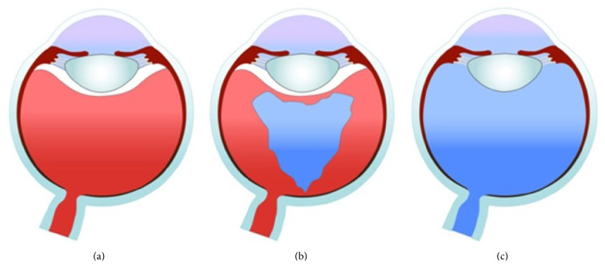
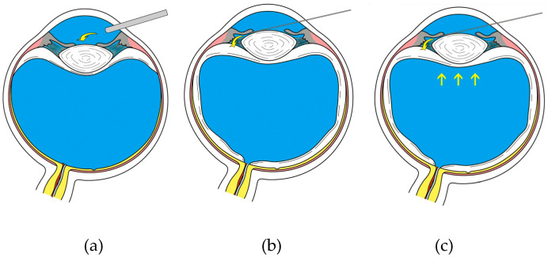
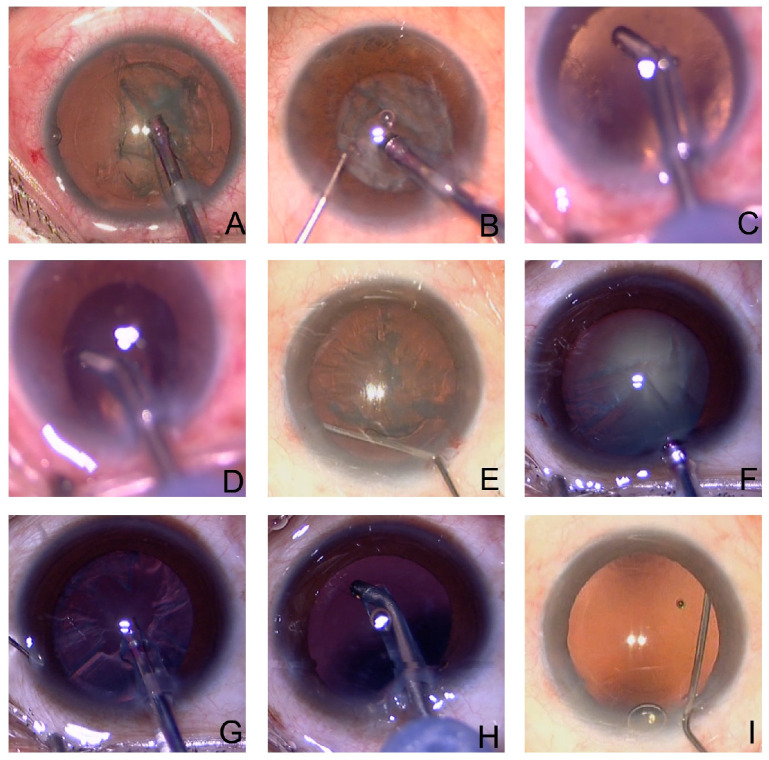
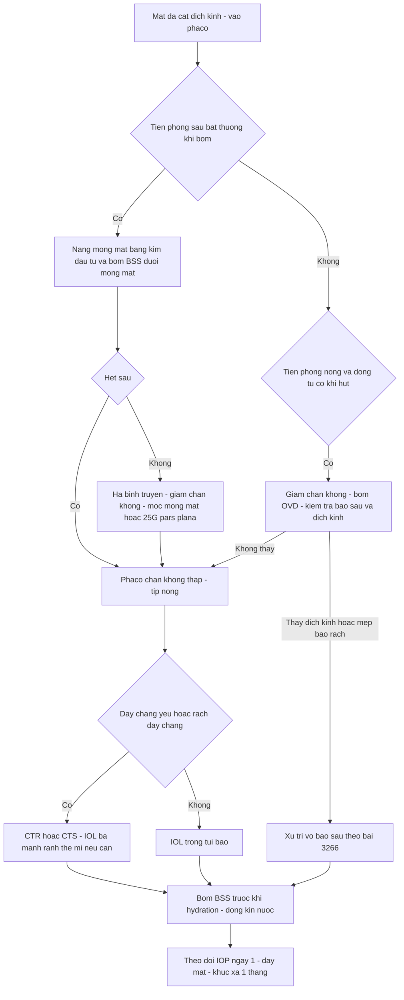
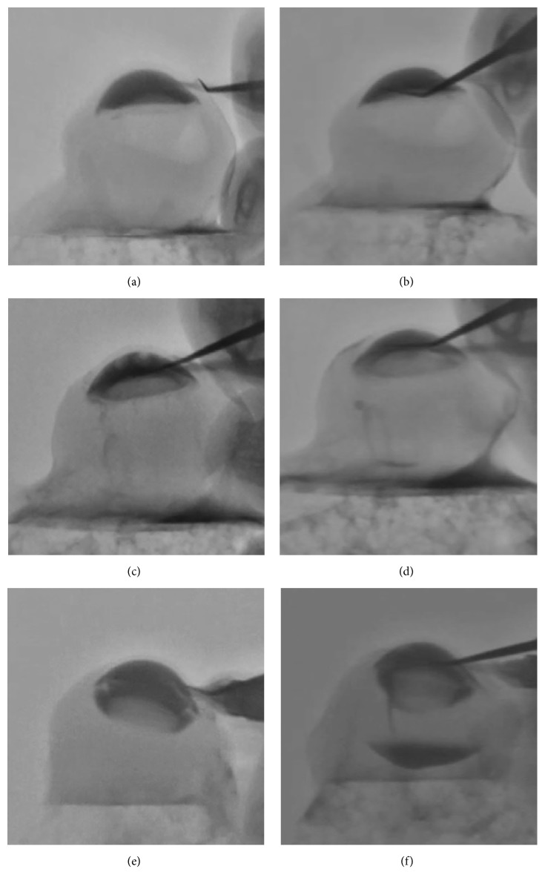

# 3274 — Phaco trên mắt đã cắt dịch kính: tiền phòng sâu bất thường khi bơm, nông + đồng tử co khi hút, và vì sao bao sau dễ vỡ

**Tags:** `pattern:tien-phong-sau-bat-thuong` `pattern:lidrs` `pattern:dao-dong-tien-phong` `pattern:dong-tu-co-khi-hut` `pattern:vo-bao-sau` `pattern:day-chang-yeu` `pattern:iol-di-lech` `vung:mat` `vung:the-thuy-tinh` `vung:tien-phong` `vung:dich-kinh` `vung:bao-sau` `protocol:phaco` `protocol:AS-OCT` `protocol:sieu-am-B` `protocol:sinh-trac` `score:khong-co` `incidentaloma:khong`

**Mức chắc chắn (certainty):** tổng hợp y văn (literature synthesis) — dựng từ: đoàn hệ **124 mắt** (31 mắt đã cắt dịch kính) về tần suất và yếu tố nguy cơ LIDRS (*Korean J Ophthalmol* 2017, **PMC5540986**); loạt **75 mắt** đã cắt dịch kính (*J Cataract Refract Surg* 2013, **PMID 24157253**); nghiên cứu tiến cứu **205 mắt** (*Eur J Ophthalmol* 2023, **PMID 36464664**); thử nghiệm kỹ thuật hồi cứu **53 mắt** đã cắt dịch kính (*J Pers Med* 2023, **PMC10058855**); **513 mắt** phaco sau cắt dịch kính (*Br J Ophthalmol* 2016, **PMID 26674780**); loạt **143 mắt** trong 10 năm (*Eur J Ophthalmol* 2007, **PMID 17671937**); hình ảnh huỳnh quang số trên **mắt heo** (*J Ophthalmol* 2016, **PMC4834173**); **357 mắt** phacovitrectomy (*Korean J Ophthalmol* 2023, **PMC10427902**); **140 mắt** về sai số vị trí IOL (*Ophthalmic Res* 2025, **PMC11844672**); **40 mắt** so sánh độ sâu tiền phòng hai mắt (*Diagnostics* 2025, **PMC12155253**); tổng quan **áp lực dịch kính dương** (*Clin Ophthalmol* 2026, **PMC13776881**); loạt **4 ca** nếp gấp bao sau (*Cureus* 2026, **PMC13489755**); **65 mắt** phaco có/không móc mống mắt (*Int J Ophthalmol* 2021, **PMC8569570**); **6 mắt** dòng dịch ngược ở mắt đã cắt dịch kính (*Am J Ophthalmol Case Rep* 2026, **PMC13572077**). Nhóm **không có bệnh nhân của mình**; chỗ suy luận ghi **[suy luận]**. **Không ghi tên tác giả** — attribution = **tạp chí + năm + PMCID/DOI**.

> **Ranh giới với bài đã có:** [3266](../3266-vo-bao-sau-phaco-iol-ranh-mi/lesson.md) trả lời **"bao sau đã vỡ thì làm gì"**; [3273](../3273-rach-bao-truoc-phaco/lesson.md) trả lời **"mép mở bao rách thì làm gì"**; [1492](../1492-duc-bao-sau-iol-yag-sau-cat-dich-kinh/lesson.md) trả lời **"PCO sau phacovitrectomy — YAG khi nào"**. Bài này trả lời câu hỏi **trước** cả ba: **"vì sao ở mắt đã cắt dịch kính, tiền phòng sâu ra rồi nông lại theo nhịp bơm–hút, đọc hiện tượng đó thế nào, và cài đặt – thao tác nào giữ được tiền phòng ổn định để không đi tới vỡ bao sau"**.

> **Câu chốt — bốn nhóm số phải thuộc:** **(1)** LIDRS gặp ở **41,9% (13/31)** mắt đã cắt dịch kính so với **11,8% (11/93)** mắt không cắt dịch kính — **OR 3,865** (1,201–12,436); cộng thêm **trục nhãn cầu dài** OR **1,709** và **vết mổ 3,0 so với 2,2 mm** OR **3,571** (**PMC5540986**); loạt mắt đã cắt dịch kính riêng cho **53,3% (40/75)** (**PMID 24157253**), và **5/6 mắt (83%)** có tiền sử cắt dịch kính **bị LIDRS** trong một nghiên cứu tiến cứu (**PMID 36464664**). **(2)** Trên huỳnh quang số mắt heo, sau khi bắt đầu bơm, **tiền phòng sâu 3,17 ± 0,11 mm** ở mắt cắt dịch kính TOÀN BỘ so với **2,25 ± 0,06 mm** ở mắt còn dịch kính; cột dịch tràn vào khoang sau **2,19 ± 0,35 mm** so với **0,00 ± 0,00 mm** (**PMC4834173**). **(3)** Phaco sau cắt dịch kính: **vỡ bao sau 5,5%**, **mảnh nhân rơi 3,3%**, **rách dây chằng 2,3%**, **PCO 33,3%** trong **513 mắt** (**PMID 26674780**) — so với **0,43–1,9%** vỡ bao sau của phaco nói chung (**PMC13738256**; **PMC13055850**). **(4)** Khúc xạ sau phacovitrectomy **cận thị hóa**: sai số trung bình **−0,50 đến −0,65 D**, ở **cận thị cao −1,01 đến −1,21 D** (**PMC10427902**); có bơm khí **−0,36 ± 0,74 D** so với phaco đơn thuần **+0,10 ± 0,55 D** (**PMC11844672**).

## 1. Tổng quan bệnh học – cơ chế hình ảnh (TẠI SAO)

### 1.1 Mắt đã cắt dịch kính khác mắt thường ở đâu — ba lớp đệm bị lấy đi

- **Dịch kính là một "điện trở" chứ không phải khoảng trống.** Ở mắt còn dịch kính, **dịch kính đặc + vòng dịch kính (vitreous base)** hạn chế dòng dịch đi từ tiền phòng ra sau; nhờ vậy **bơm vào tiền phòng làm tiền phòng sâu có kiểm soát**, và **hút ra thì tiền phòng nông có kiểm soát**. Cắt dịch kính lấy đi **cả hai**: (a) **thể tích đệm**, (b) **điện trở** — khoang sau trở thành **một khoang rộng, tuân thủ cao, thông với tiền phòng**.
- **Ba hệ quả cơ học:**
  1. **Màng chắn mống mắt–thể thủy tinh tự do di chuyển** theo chênh áp giữa tiền phòng và khoang sau — **bơm → màng chắn bị đẩy ra sau, tiền phòng sâu, đồng tử giãn, mống mắt lõm (concave iris)**; **hút → màng chắn bật ra trước, tiền phòng nông, đồng tử co**. Đây là **LIDRS** (lens–iris diaphragm retropulsion syndrome), còn gọi **infusion deviation syndrome (IDS)** (**PMC10058855**).
  2. **Dịch bơm đi thẳng vào khoang sau** qua khe dây chằng/yếu dây chằng — trên huỳnh quang số, cột dịch trong khoang sau ở mắt cắt dịch kính toàn bộ **2,19 ± 0,35 mm** so với **0,00 mm** ở mắt còn dịch kính (**PMC4834173**).
  3. **Dây chằng Zinn mất giá đỡ** do mất khung dịch kính, và có thể đã bị **kéo giãn bởi khí/dầu** hoặc tổn thương trong lần cắt dịch kính — nên **rách dây chằng 2,3%** và **mảnh nhân rơi 3,3%** trong 513 mắt (**PMID 26674780**).
- **TẠI SAO tiền phòng sâu lại là dấu hiệu XẤU, không phải dấu hiệu an toàn:** khi tiền phòng quá sâu, **đầu tip phải nghiêng nhiều hơn**, **nhân di động hơn**, **góc tiền phòng rộng nhưng mống mắt áp vào bao** — phẫu thuật viên mất **điểm tựa** để tì nhân; đồng thời **dòng tưới đi lệch vào khoang sau**. Trong loạt 53 mắt, nhóm phaco thường có **LIDRS 42,1%**, **đau 57,9%**, **vỡ bao sau 5,3%**, **tổn thương mống mắt 10,5%**, **khó làm kín vết mổ 36,8%**; nhóm có bơm BSS dưới mống mắt chỉ còn **5,9% / 0% / 0% / 0% / 11,8%** (p < 0,05 cho LIDRS, đau, khó hydration) (**PMC10058855**).
- **Vì sao nhân cứng hơn và thời gian phaco dài hơn:** sau cắt dịch kính, thể thủy tinh thường **đục nhân (nuclear sclerosis) là chủ yếu** (**PMC12980855**); nhân cứng → **thời gian phaco và năng lượng tích lũy tăng** → **nhiều dao động áp hơn**, đúng lúc tiền phòng đang mất đệm.

### 1.2 Vật lý của cột dịch và vì sao "hạ bình truyền" là can thiệp đầu tay

- Bình truyền **90 cm** nước tạo áp khoảng **90 × 0,735 = 66 mmHg** tại mắt [suy luận số học từ đơn vị cmH₂O → mmHg] — đây là cài đặt đã dùng trong loạt 53 mắt (**PMC10058855**). Bình **100–110 cm** tương ứng **74–81 mmHg**.
- Ở mắt còn dịch kính, **áp bơm cao một phần bị "đệm"** bởi dịch kính và **điện trở vòng dịch kính**; ở mắt đã cắt dịch kính, **cùng một cột áp dồn vào khoang sau rộng** → **cùng một thay đổi thể tích gây dịch chuyển màng chắn lớn hơn nhiều**. Đây là lý do **giảm bình truyền và giảm lưu lượng** là can thiệp **cơ học đúng**, không phải "mẹo" [suy luận từ cơ chế + số đo ACD].
- **Hệ quả lâm sàng:** LIDRS **không phải biến chứng của "tay nghề yếu"** mà là **hiện tượng tất yếu của giải phẫu**: **5/6 mắt (83%)** có tiền sử cắt dịch kính **bị LIDRS** trong nghiên cứu tiến cứu, và biến chứng (rách dây chằng, thể thủy tinh/IOL di lệch) **tập trung ở nhóm mắt đã cắt dịch kính** (**PMID 36464664**).

### 1.3 Vì sao bao sau "dễ vỡ hơn" — không phải vì bao mỏng hơn

- Bao sau **không mỏng đi** vì cắt dịch kính; nó **mất hai lớp bảo vệ động**: (a) **mất đệm dịch kính** nên **mọi chênh áp tức thời dồn vào bao**; (b) **mất giá đỡ dây chằng** nên bao **di động theo dòng chảy** thay vì căng đều. Thêm **mống mắt áp vào bao** khi tiền phòng sâu/nông thất thường → **tip dễ chạm** và **bao bị kéo bởi chính mống mắt**.
- **Bằng chứng gián tiếp:** trong 513 mắt, **vỡ bao sau 5,5%** và **mảnh nhân rơi 3,3%** (**PMID 26674780**); trong loạt 143 mắt, **vỡ bao sau 9%**, **mở bao không hoàn chỉnh 5%**, **tiền phòng sâu/dao động 93%** (**PMID 17671937**). Con số **0,43–1,9%** của phaco nói chung (**PMC13738256**; **PMC13055850**) cho thấy **nguy cơ tăng khoảng 3–10 lần**, không phải "khác biệt nhỏ".

*Ba mắt heo trước khi phaco: **(a)** còn dịch kính (đỏ), **(b)** cắt dịch kính lõi, **(c)** cắt dịch kính toàn bộ — khoang sau đã thành **một khoang dịch lớn thông với tiền phòng**. Đây là mô hình giải thích vì sao **cùng một cột áp bơm** gây **dịch chuyển màng chắn** rất khác nhau. Nguồn: J Ophthalmol 2016 (PMC4834173), Fig. 1, **CC BY 4.0**.*

## 2. Mẫu hình + chẩn đoán phân biệt theo cơ chế (Gamut)

### 2.1 Mẫu hình trong mổ — nhịp hai pha

- **Pha bơm (irrigation on):** tiền phòng **sâu lên rõ**, **đồng tử giãn rộng**, **mống mắt lõm ra sau**, **bệnh nhân đau** (đau **2–3/10** khi tip vào tiền phòng ở **57,9%** mắt nhóm chứng); nhân **di động**, đầu tip **phải nghiêng sâu** (**PMC10058855**).
- **Pha hút (aspiration/emulsification):** tiền phòng **nông nhanh**, **đồng tử co lại (miosis)**, có khi **mống mắt trượt vào vết mổ**; nếu kéo dài → **tip chạm bao**, **vỡ bao sau**, **rách dây chằng** (**PMC10058855**; **PMID 36464664**).
- **Dấu hiệu nhận biết sớm trên hình:** **mống mắt lõm + tiền phòng sâu bất thường khi vừa bơm** là **dấu chốt**; **nếp gấp bao sau** và **tiền phòng nông** là dấu của **áp lực dịch kính dương** (cơ chế **ngược lại**) (**PMC13489755**).
- **Gamut theo cơ chế — ba nhóm:**
  1. **Mất đệm/điện trở (LIDRS):** tiền phòng **sâu**, đồng tử **giãn**, **đau**, không tăng nhãn áp kèm.
  2. **Tăng thể tích khoang sau (áp lực dịch kính dương, xuất huyết/thẩm thấu hắc mạc, hội chứng lệch dòng dịch):** tiền phòng **nông**, đồng tử **co**, nhãn cầu **cứng**, có thể **đau dữ dội**.
  3. **Rò/thoát dịch (vết mổ hở, giảm áp):** tiền phòng **nông**, **Seidel (+)**, nhãn áp **thấp**, không đau.

*Sơ đồ dòng dịch trong mắt đã cắt dịch kính. **(a)** Tip bơm vào tiền phòng: **mống mắt bị đẩy ra sau**, áp vào thể thủy tinh → **block tương đối**, tiền phòng sâu. **(b)** **Nâng mống mắt** bằng kim đầu tù và **bơm BSS dưới mống mắt**: dịch có đường xuống khoang sau. **(c)** Áp hai khoang **cân bằng**, màng chắn trở về vị trí. Nguồn: J Pers Med 2023 (PMC10058855), Fig. 1, **CC BY 4.0**.*

### 2.2 Gamut "tiền phòng sâu bất thường" ở mắt đã cắt dịch kính

- **LIDRS/IDS** — sâu khi bơm, **nông khi hút**, có **đau** (**PMC10058855**).
- **Block ngược chiều mống mắt (reverse pupillary block)** — **sâu mạn**, mống mắt **lõm ra sau**, **nhãn áp bình thường hoặc thấp**, gặp ở **mắt cận thị cao đã cắt dịch kính có IOL cố định củng mạc**; dòng nước **từ tiền phòng ra khoang sau** qua khe mống mắt–IOL, do **bơm RPE** hút dịch về sau; **mở mống mắt ngoại vi (PI)** giải quyết (**PMC13572077**). **Không nhầm** với LIDRS trong mổ.
- **Mắt cận thị cao không cắt dịch kính** — cùng cơ chế **dây chằng giãn + tiền phòng sâu**, LIDRS **1,7–6,9 lần** theo **trục nhãn cầu** (OR 1,709; OR 3,26) (**PMC5540986**; **PMID 24157253**).
- **Sau chấn thương/mổ cũ** — rách dây chằng, **thể thủy tinh lệch**, **mống mắt rung (iridodonesis)**; đây là **biến thể giải phẫu**, không phải LIDRS, nhưng **cùng cách xử trí dây chằng**.
- **Không có dịch kính thật (khí/dầu)** — **đừng đo trục nhãn cầu trong môi trường khí/dầu**; xem [1490](../1490-sinh-trac-iol-mat-bom-khi/lesson.md) và [1477](../1477-sinh-trac-iol-mat-bom-dau-silicone/lesson.md).

## 3. Bảng so sánh phân biệt (ma trận đối chiếu)

| Thực thể (entity) | Hình ảnh điển hình | Chốt vào (rule-in) | Chốt loại (rule-out) | Gợi ý xác nhận |
|---|---|---|---|---|
| **LIDRS/IDS (mất đệm dịch kính)** | **Tiền phòng sâu khi bơm**, **mống mắt lõm ra sau**, **đồng tử giãn**, **đau**; khi hút **nông + miosis** | **Tiền sử cắt dịch kính/trục dài + sâu ngay khi bơm + đau**; hết khi **nâng mống mắt + BSS dưới mống mắt** | **Tiền phòng nông ngay từ đầu + nhãn cầu cứng** → áp lực dịch kính dương | **Quan sát ACD theo nhịp bơm–hút**; đáp ứng với hạ bình/nâng mống mắt (**PMC10058855**) |
| **Áp lực dịch kính dương (PVP)** | **Tiền phòng nông**, **mống mắt sa ra vết mổ**, **nếp gấp bao sau**, nhãn cầu **cứng** | **Trục NGẮN, tiền phòng nông, PXF, nhân nâu, béo phì** + **nếp gấp bao sau** | **Tiền phòng sâu + trục dài** → LIDRS | **Đóng vết mổ + mannitol/acetazolamide**; nhận sớm → thị lực **≥ 20/25** (**PMC13489755**; **PMC13776881**) |
| **Hội chứng lệch dòng dịch (fluid misdirection)** | **Tiền phòng nông + nhãn áp cao** sau mổ, **khoang sau căng**, **không có khối hắc mạc** | **Nông + IOP cao + tiền sử góc hẹp/cắt dịch kính** | **Sâu + IOP bình thường** → LIDRS | **Siêu âm B: khoang dịch kính căng**, không khối; **PI/laser + cắt dịch kính** |
| **Block ngược chiều mống mắt** | **Tiền phòng sâu mạn**, **mống mắt lõm ra sau**, IOL cố định củng mạc, **IOP bình thường/thấp** | **Mắt cận thị cao đã cắt dịch kính + IOL cố định củng mạc + mống mắt lõm** | **Sâu trong mổ, có đau, hết khi hạ bình** → LIDRS | **AS-OCT**: mống mắt cong ra sau, khe mống mắt–IOL; **PI** giải quyết (**PMC13572077**) |
| **Xuất huyết hắc mạc (suprachoroidal hemorrhage)** | **Đau dữ dội đột ngột**, **tiền phòng nông nhanh**, **nhãn cầu cứng**, **bóng sẫm đỏ** sau võng mạc | **Đau + nhãn cầu cứng + mất đỏ phản chiếu** | **Đau nhẹ + tiền phòng sâu** → LIDRS | **Siêu âm B tại bàn mổ**: khối hắc mạc lồi vào; **đóng vết mổ ngay** |
| **Rò vết mổ/giảm áp** | **Tiền phòng nông**, **Seidel (+)**, **nhãn áp thấp**, tiền phòng **dao động theo bơm** | **Seidel dương + IOP thấp** | **Tiền phòng sâu + không rò** → LIDRS | **Thử Seidel**, nhuộm fluorescein; **khâu/keo** nếu cần |
| **IFIS (floppy iris)** | **Mống mắt dâng sóng**, **co đồng tử**, **sa mống mắt** khi thao tác; **ACD không đổi theo bơm** | **Tiền sử tamsulosin + mống mắt dâng sóng** | **ACD thay đổi rõ theo bơm–hút** → LIDRS | **Hooks/vòng giãn đồng tử**, giảm flow |
| **Vỡ bao sau + thoát dịch kính** | **Tiền phòng đột ngột sâu rồi nông**, **miosis**, **"màn the" ở mép bao**, dịch kính trồi | **Thấy dịch kính/mép bao rách** | **ACD sâu đều, không có dịch kính** → LIDRS | **Triamcinolone**; xử trí theo [3266](../3266-vo-bao-sau-phaco-iol-ranh-mi/lesson.md) |
| **Rách dây chằng Zinn** | **Thể thủy tinh lắc**, **lệch trục**, **khe đen ở xích đạo**, **nhân di động** | **Thấy khe dây chằng + lệch thể thủy tinh** | **Bao–dây chằng liên tục** → chỉ LIDRS | **Đèn khe trước mổ**, **móc mống mắt**, **CTR** khi có rách |

*Ảnh mổ cùng một mắt đã cắt dịch kính. **Hàng trên – nhóm chứng:** **(A)** vừa đưa tip vào, **tiền phòng sâu, đồng tử giãn rộng**; **(B)** ngay sau đó khi phaco, **tiền phòng nông + đồng tử co**; **(C, D)** hiện tượng lặp lại khi hút vỏ. **Hàng dưới – nhóm can thiệp:** **(E)** bơm BSS **dưới mống mắt** trước phaco; **(F, G, H)** tiền phòng **giữ ổn định** trong phaco và hút vỏ; **(I)** bơm BSS trước khi đặt IOL. Nguồn: J Pers Med 2023 (PMC10058855), Fig. 2, **CC BY 4.0**.*

### 3.1 Đọc đúng nhịp hai pha — đừng nhầm với "tiền phòng sâu là tốt"

- **Sâu khi bơm không phải là "đủ dịch"** mà là **dịch đang bị giữ sai chỗ**: mống mắt áp vào bao tạo **block tương đối**, tiền phòng phồng lên; khi **hút** mở ra, màng chắn **bật về trước** và **đồng tử co** — đó là lúc **tip ở gần bao nhất**.
- **Dấu hiệu vàng:** **đồng tử giãn ra ngay khi bơm rồi co lại khi hút** ở mắt có **tiền sử cắt dịch kính** = LIDRS cho tới khi chứng minh ngược lại.
- **Đừng chờ "thấy bao rách" mới xử lý:** trong 53 mắt, nhóm chứng có **1 vỡ bao sau (5,3%)** và **2 tổn thương mống mắt (10,5%)**; nhóm can thiệp **0** — khác biệt **không có ý nghĩa thống kê về vỡ bao** (p = 0,177) nhưng **có ý nghĩa về LIDRS/đau/khó hydration**, nghĩa là **can thiệp nhắm vào cơ chế, không phải cam kết giảm vỡ bao** (**PMC10058855**).

## 4. Protocol mổ + ngưỡng quyết định

### 4.1 Trước mổ — 5 việc bắt buộc

| Việc | Ngưỡng/cách làm | Vì sao |
|---|---|---|
| **Đo trục nhãn cầu (AL)** | **Sinh trắc quang (PCI/SS-OCT)** trước mọi lần bơm **khí/dầu**; **không đo A-scan qua khí** (vận tốc khí **≈ 343 m/s** so với **1.532 m/s** quy ước) | Đo trong khí đọc **ngắn ~25%** → công suất IOL sai; xem [1490](../1490-sinh-trac-iol-mat-bom-khi/lesson.md) |
| **Khám dây chằng – bao** | **Phacodonesis, iridodonesis, lệch thể thủy tinh, khe xích đạo**, dấu **PXF** | Quyết định **CTR/CTS** và kịch bản **IOL rãnh**; **PXF** làm vỡ bao sau **OR 2,38** (**PMC13055850**, dẫn trong 3266) |
| **Đánh giá đáy mắt** | **OCT hoàng điểm** nếu nhìn được; **B-scan** nếu môi trường đục | Phát hiện **ERM/lỗ hoàng điểm/bong võng mạc** — ảnh hưởng thời điểm và tiên lượng |
| **Chọn mục tiêu khúc xạ** | Trừ **0,5 D** thiên cận ở mắt thường; **1,0–1,5 D** ở **cận thị cao**; **nhiều hơn nếu có bơm khí** | Cận thị hóa **−0,5 đến −0,65 D**, cận thị cao **−1,0 đến −1,2 D**; khí **−0,36 D** (**PMC10427902**; **PMC11844672**) |
| **Kế hoạch dự phòng** | Chuẩn bị **móc mống mắt/vòng giãn đồng tử**, **CTR**, **IOL ba mảnh**, **đầu cắt dịch kính trước** | Không phải "nếu cần" — ở mắt đã cắt dịch kính **LIDRS gặp 41,9–53,3%** (**PMC5540986**; **PMID 24157253**) |

### 4.2 Cài đặt máy — bảng số

| Thông số | Đề xuất | Cơ sở |
|---|---|---|
| **Bình truyền** | Khởi đầu **90 cm** (≈ **66 mmHg**); **hạ 10–20 cm** ngay khi thấy LIDRS | 90 cm là cài đặt của loạt 53 mắt (**PMC10058855**); hạ bình làm giảm chênh áp [suy luận cơ học] |
| **Chân không** | **≤ 350 mmHg** | Loạt 53 mắt dùng giới hạn **350 mmHg** (**PMC10058855**) |
| **Lưu lượng hút** | **Thấp**, tăng dần; tránh **occlusion đột ngột** | Giảm **surge** — nguyên nhân làm màng chắn bật ra trước (**PMC10058855**) |
| **Công suất phaco** | **0–50%** theo độ nhân; **phaco-chop/stop-and-chop** | Loạt 53 mắt dùng **0–50%** (**PMC10058855**) |
| **Vết mổ** | **2,2 mm** nếu có thể; tránh **3,0 mm** | **3,0 so với 2,2 mm**: **OR 3,571** cho LIDRS (**PMC5540986**) |
| **Vật liệu đệm** | **OVD phân tán (dispersive)** giữ tiền phòng; **không bơm quá mạnh** | Bơm quá mạnh gây **IOL di lệch 2,9%** trong loạt can thiệp (**PMC10058855**) |
| **Hệ fluidics** | Cân nhắc **van điều áp/hệ thống fluidics chủ động** thay cột áp trọng lực | Nguyên lý: giữ **áp đích** thay vì áp trọng lực; **chưa có RCT trên mắt đã cắt dịch kính** — xem mục 7 |

### 4.3 Bốn thời điểm bơm BSS dưới mống mắt (kỹ thuật "cân bằng hai khoang")

| Thời điểm | Việc làm | Vì sao |
|---|---|---|
| **1. Trước khi đưa tip phaco** | **Nâng nhẹ mống mắt bằng kim đầu tù cong**, bơm **BSS dưới mống mắt vài giây** | Cho dịch vào khoang sau → **cân bằng áp** trước khi tip vào (**PMC10058855**) |
| **2. Trước khi đưa tip hút–rửa (I/A)** | Lặp lại | Ngăn **tiền phòng nông + miosis** khi hút vỏ |
| **3. Trước khi đặt IOL** | Lặp lại | Giữ tiền phòng ổn định khi mở túi |
| **4. Trước khi hydration vết mổ** | Lặp lại | **Khó làm kín vết mổ 36,8% → 11,8%** (**PMC10058855**) |
| **Khi LIDRS đã xảy ra** | **Nâng mống mắt + bơm BSS dưới mống mắt**, **hạ bình**, **giảm chân không**; nếu không hết → **móc mống mắt** hoặc **25G pars plana irrigation** | Thao tác tách mống mắt khỏi bao giải quyết **gần như toàn bộ** LIDRS trong nghiên cứu tiến cứu (**PMID 36464664**) |

### 4.4 Khi nào thêm "dụng cụ giữ tiền phòng"

- **Móc mống mắt (iris hooks)**: **65 mắt** cắt dịch kính toàn bộ, **ECD giảm 0,07 ± 0,03** ở nhóm có móc so với **0,09 ± 0,03** (25G pars plana) và **0,10 ± 0,03** (không dụng cụ) — **không kéo dài thời gian mổ** (**PMC8569570**).
- **25G pars plana irrigation/AC maintainer**: giữ tiền phòng **chủ động**, nhưng **thêm một đường vào** và **nguy cơ truyền áp trực tiếp vào khoang sau** — dùng khi **LIDRS nặng/tái diễn** hoặc **cần thao tác lâu** [suy luận].
- **CTR/CTS**: **chỉ khi có rách dây chằng/phacodonesis thực sự**, không đặt "dự phòng" cho mọi mắt đã cắt dịch kính — **chưa có dữ liệu** (xem mục 7).
- **IOL**: **trong túi** nếu vành bao còn; **rãnh thể mi + IOL ba mảnh** nếu dây chằng yếu/mất vành; xem bảng quyết định ở [3266](../3266-vo-bao-sau-phaco-iol-ranh-mi/lesson.md).

### 4.5 Sơ đồ quyết định trong mổ

### 4.6 Sau mổ — theo dõi có số

| Thời điểm | Việc làm | Ngưỡng hành động |
|---|---|---|
| **Ngày 1** | **IOP**, **Seidel**, **tiền phòng**, **IOL**, **đáy mắt** | **IOP thấp + hắc mạc dày** → nghi **giảm áp/thẩm thấu**; **IOP > 25** → tìm **mảnh sót/viêm** |
| **Tuần 1–2** | Đáy mắt giãn đồng tử, **OCT hoàng điểm** nếu nghi | **Bong võng mạc sớm 1,2–6%** ở mắt đã cắt dịch kính (**dẫn trong PMC10058855**) |
| **Tháng 1** | **Khúc xạ**, **AS-OCT/UBM** nếu nghi IOL nghiêng | **Cận thị hóa** trong khoảng dự kiến; lệch nhiều → kiểm tra công suất/trục |
| **Tháng 3–6** | **PCO**, **YAG** | PCO cần YAG **26,5%** ở tuần 24 (**PMC10058855**); PCO xuất hiện **sớm hơn**: **29,1 so với 36,3 tháng** (**PMC4020170**) — xem [1492](../1492-duc-bao-sau-iol-yag-sau-cat-dich-kinh/lesson.md) |
| **Dài hạn** | **IOL di lệch**, **bao chết**, **glôcôm** | IOL di lệch **2,9%** trong loạt can thiệp (**PMC10058855**) |

*Huỳnh quang số, cột dịch cản quang. **(a, b)** mắt còn dịch kính; **(c, d)** cắt dịch kính lõi; **(e, f)** cắt dịch kính toàn bộ. **(e)** trước khi nâng mống mắt: **tiền phòng rất sâu**, dịch cản quang **ứ phía trước**; **(f)** sau khi nâng mống mắt: dịch **tràn xuống khoang sau**, tiền phòng **trở về bình thường**. Đây là bằng chứng hình ảnh trực tiếp cho thao tác ở mục 4.3: **mở đường cho dịch đi ra sau**. Nguồn: J Ophthalmol 2016 (PMC4834173), Fig. 3, **CC BY 4.0**.*

## 5. Biến thể bình thường và cạm bẫy

1. **"Tiền phòng sâu = an toàn"** — sai. Sâu bất thường khi bơm là **dấu hiệu của mất cân bằng hai khoang**; nó **che mất** việc mống mắt đang áp vào bao, và **hút ngay sau đó** là lúc **tip gần bao nhất** (**PMC10058855**).
2. **Nhầm LIDRS với IFIS** — IFIS **không làm ACD thay đổi theo nhịp bơm–hút**; LIDRS **có**. Xử trí IFIS bằng **hooks/giãn đồng tử**, LIDRS bằng **cân bằng áp**.
3. **Nhầm LIDRS với áp lực dịch kính dương** — hai hội chứng **ngược nhau**: LIDRS **trục dài, tiền phòng sâu, đồng tử giãn**; PVP **trục ngắn, tiền phòng nông, đồng tử co, nếp gấp bao sau** (**PMC13776881**; **PMC13489755**). Dùng sai hướng điều trị (truyền dịch vs mannitol) làm bệnh nặng hơn.
4. **Bơm BSS dưới mống mắt quá mạnh** — có thể **đẩy IOL văng khỏi túi** (1/34 mắt, **2,9%**) và **gây đau**; bơm **vài giây, lực nhẹ** (**PMC10058855**).
5. **Hydration vết mổ ở mắt giảm áp** — **36,8%** mắt nhóm chứng **khó làm kín**; làm ẩm **từ từ, đủ lớp**, kiểm tra **Seidel** trước khi kết thúc (**PMC10058855**).
6. **Đo trục nhãn cầu khi còn khí/dầu** — đọc **ngắn ~25%** với khí, **dài** với dầu silicone; luôn dùng **AL đo trước** hoặc **chờ tan** ([1490](../1490-sinh-trac-iol-mat-bom-khi/lesson.md); [1477](../1477-sinh-trac-iol-mat-bom-dau-silicone/lesson.md)).
7. **"Đã cắt dịch kính thì không cần CTR"** — nếu **không có rách dây chằng**, đúng; nhưng nếu **có phacodonesis/khe xích đạo**, **bỏ qua CTR** dẫn tới **IOL nghiêng, di lệch muộn** [suy luận từ cơ chế + **PMID 26674780**].
8. **Quên rằng PCO đến sớm hơn** — **26,5%** cần YAG trong 6 tháng ở loạt 53 mắt (**PMC10058855**) và **29,1 so với 36,3 tháng** so với phaco đơn thuần (**PMC4020170**); đừng hẹn bệnh nhân "12 tháng mới kiểm tra trục quang".
9. **Tưởng "mắt đã cắt dịch kính thì không bong võng mạc nữa"** — bong võng mạc sớm sau phaco **1,2–6%** (dẫn trong **PMC10058855**), và **6%** trong loạt 143 mắt (**PMID 17671937**). Khám đáy mắt **tuần 1–2**, không chỉ tháng 1.
10. **Dùng kết quả khúc xạ của mắt này để tính mắt kia** — cận thị hóa **phụ thuộc có/không bơm khí** (**−0,36 so với −0,12 D**) và **mức cận thị nền**; mỗi mắt cần **công thức và mục tiêu riêng** (**PMC11844672**; **PMC10427902**).

## 6. Tự lượng giá — Blind Quiz

**Ca 1 — Nam 68 tuổi, đã cắt dịch kính 23G vì bong võng mạc 14 tháng trước, nay phaco mắt đó. Vừa đưa tip phaco vào tiền phòng: tiền phòng sâu lên rõ, đồng tử giãn rộng, bệnh nhân đau. Ngay sau đó khi đạp bàn đạp phaco, tiền phòng nông nhanh và đồng tử co lại.**

- Gợi ý: chú ý **hai pha trái ngược** trong cùng một mắt.
- Câu hỏi: (1) Hiện tượng gì, cơ chế? (2) Làm gì **ngay** và **theo thứ tự**? (3) Cài đặt nào phải đổi? (4) Dấu hiệu nào bắt buộc nghĩ tới **vỡ bao sau**?

<b>Bấm để hiện đáp án</b>

- **Chẩn đoán:** **LIDRS/IDS** — mất đệm dịch kính + dây chằng giãn → màng chắn mống mắt–thể thủy tinh di chuyển theo chênh áp: **bơm → sâu + giãn đồng tử + đau**; **hút → nông + miosis** (**PMC10058855**; **PMC5540986**).
- **Thứ tự xử trí:** (1) **giảm/ngắt chân không**, (2) **hạ bình truyền 10–20 cm**, (3) **nâng mống mắt bằng kim đầu tù + bơm BSS dưới mống mắt**, (4) nếu không hết → **móc mống mắt** hoặc **25G pars plana irrigation** (**PMC10058855**; **PMID 36464664**; **PMC8569570**).
- **Cài đặt:** bình **90 cm** khởi đầu, chân không **≤ 350 mmHg**, vết mổ **2,2 mm**, phaco **0–50%** (**PMC10058855**; **PMC5540986**).
- **Nghĩ tới vỡ bao sau khi:** tiền phòng **sâu rồi nông đột ngột**, **miosis không hồi phục**, **"màn the"/mép bao rách**, **dịch kính trồi** → xử trí theo [3266](../3266-vo-bao-sau-phaco-iol-ranh-mi/lesson.md).
- **Số liệu để nhớ:** nhóm chứng **LIDRS 42,1%**, **đau 57,9%**, **vỡ bao sau 5,3%**; nhóm can thiệp **5,9% / 0% / 0%** (**PMC10058855**).
- **Nguồn ảnh:** J Pers Med 2023 (PMC10058855), Fig. 2, **CC BY 4.0**.

**Ca 2 — Mắt heo cắt dịch kính toàn bộ, đang bơm dịch cản quang qua hệ phaco. Ảnh (e) chụp trước khi nâng mống mắt, ảnh (f) sau khi nâng mống mắt. Trên lâm sàng, tương đương thao tác nào?**

- Gợi ý: nhìn **cột dịch sẫm màu** nằm ở đâu trước và sau khi nâng mống mắt.
- Câu hỏi: (1) Vì sao tiền phòng ở (e) sâu hơn nhiều? (2) Nâng mống mắt làm gì về mặt cơ học? (3) Số đo ACD tương ứng?

<b>Bấm để hiện đáp án</b>

- **(e) trước khi nâng mống mắt:** dịch bơm **bị giữ ở tiền phòng**, mống mắt áp vào bao → **block tương đối**, **tiền phòng sâu**, cột dịch cản quang **chưa xuống khoang sau**.
- **(f) sau khi nâng mống mắt:** tạo **đường thông**, dịch **tràn xuống khoang sau**, **tiền phòng trở về bình thường** — đúng nguyên lý **bơm BSS dưới mống mắt** ở mục 4.3.
- **Số đo:** ACD sau khi bắt đầu bơm **3,17 ± 0,11 mm** (cắt dịch kính toàn bộ) so với **2,25 ± 0,06 mm** (còn dịch kính); cột dịch khoang sau **2,19 ± 0,35 mm** so với **0,00 ± 0,00 mm** (**PMC4834173**).
- **Giới hạn:** đây là **mắt heo đã chết**, mô hình cơ học — **không phải** bằng chứng kết cục lâm sàng; dùng để **hiểu cơ chế**, không để khuyến cáo liều.
- **Nguồn ảnh:** J Ophthalmol 2016 (PMC4834173), Fig. 3, **CC BY 4.0**.

## 7. Câu hỏi nghiên cứu & điểm chưa đồng thuận (tính đến 11/2026)

1. **[Tranh cãi] Ở mắt phacovitrectomy, cận thị hóa sau mổ là do thay đổi vị trí IOL hiệu dụng (ELP), do trục nhãn cầu dài ra, hay do khí tamponade?**
   - **Đã biết:** sai số khúc xạ trung bình **−0,50 đến −0,65 D**, cận thị cao **−1,01 đến −1,21 D** (**PMC10427902**); có khí **−0,36 ± 0,74 D** so với phaco đơn thuần **+0,10 ± 0,55 D** (**PMC11844672**); nhưng **độ sâu tiền phòng sau mổ tăng như nhau** ở mắt cắt dịch kính và mắt bạn (**+1,51 so với +1,42 mm**, p = 0,33) (**PMC12155253**).
   - **Chưa rõ:** chưa tách được **dịch chuyển IOL ra trước** với **trục nhãn cầu dài ra** và **chiết suất dịch kính thay đổi**; chưa có **công thức riêng cho phacovitrectomy**.
   - **Hướng nghiên cứu:** đoàn hệ tiến cứu **AS-OCT ELP + AL hậu phẫu**, phân tầng **khí/không khí/cận thị cao**, outcome **dự đoán khúc xạ trong ±0,5 D**.
   - **Nguồn:** PMC10427902 (2023); PMC11844672 (2025); PMC12155253 (2025).

2. **[Khác biệt thực hành] Dự phòng LIDRS bằng bơm BSS dưới mống mắt, móc mống mắt, hay 25G pars plana irrigation — cách nào tốt nhất cho mắt đã cắt dịch kính?**
   - **Đã biết:** bơm BSS dưới mống mắt giảm LIDRS **42,1% → 5,9%**, đau **57,9% → 0%**, khó hydration **36,8% → 11,8%** trong **53 mắt hồi cứu** (**PMC10058855**); móc mống mắt cho **ECD giảm 0,07 so với 0,09–0,10** ở **65 mắt** (**PMC8569570**); mô hình heo cho thấy nâng mống mắt **đưa dịch xuống khoang sau** (**PMC4834173**).
   - **Chưa rõ:** **không có RCT** so sánh trực tiếp các cách; các loạt **nhỏ, hồi cứu/khác phẫu thuật viên**; **chưa rõ** cách nào giảm **vỡ bao sau** thật sự (khác biệt trong loạt 53 mắt **không có ý nghĩa**, p = 0,177).
   - **Hướng nghiên cứu:** RCT đa trung tâm, phân tầng **LIDRS độ nặng**, outcome **tổng thời gian phaco, ECD, vỡ bao sau, đau, khúc xạ**.
   - **Nguồn:** PMC10058855 (2023); PMC8569570 (2021); PMC4834173 (2016).

3. **[Khoảng trống] Có nên đặt vòng căng bao (CTR) dự phòng ở mọi mắt đã cắt dịch kính, hay chỉ khi thấy rách dây chằng/phacodonesis?**
   - **Đã biết:** **rách dây chằng 2,3%** và **mảnh nhân rơi 3,3%** trong **513 mắt** phaco sau cắt dịch kính (**DOI 10.1136/bjophthalmol-2015-307001**); tiền sử **phẫu thuật mắt** là yếu tố nguy cơ **yếu dây chằng**, tần suất chung **0,46–2,6%** (**PMC12685262**).
   - **Chưa rõ:** **không có dữ liệu** về lợi ích của CTR **khi không có rách dây chằng thấy được**; chưa rõ **nguy cơ co bao/phimosis** và **giá thành** có cân xứng.
   - **Hướng nghiên cứu:** registry so **CTR dự phòng vs chọn lọc**, outcome **IOL nghiêng/di lệch, PCO, thời gian mổ, biến chứng**.
   - **Nguồn:** DOI 10.1136/bjophthalmol-2015-307001 (2016); PMC12685262 (2025).

## Bài liên quan chéo

- [3266 – Vỡ bao sau trong phaco](../3266-vo-bao-sau-phaco-iol-ranh-mi/lesson.md) (bao sau đã vỡ: hyaloid, rãnh thể mi, mảnh nhân rơi)
- [3273 – Rách bao trước trong phaco](../3273-rach-bao-truoc-phaco/lesson.md) (mép mở bao rách: tiếp tục hay mở rộng)
- [1492 – PCO sau phacovitrectomy và YAG](../1492-duc-bao-sau-iol-yag-sau-cat-dich-kinh/lesson.md) (PCO đến sớm hơn, ngưỡng YAG)
- [1490 – Sinh trắc và công suất IOL khi mắt còn bóng khí](../1490-sinh-trac-iol-mat-bom-khi/lesson.md) (không đo AL trong khí)
- [1477 – Sinh trắc IOL ở mắt bơm dầu silicone](../1477-sinh-trac-iol-mat-bom-dau-silicone/lesson.md) (dầu làm AL đọc dài)
- [1863 – Đục thể thủy tinh ở mắt bơm dầu silicone](../1863-duc-the-thuy-tinh-mat-bom-dau-silicone/lesson.md) (một thì hay hai thì)
- [1480 – Đục thể thủy tinh sau bóc màng ERM](../1480-duc-the-thuy-tinh-sau-boc-mang-erm/lesson.md) (mổ phối hợp hay hai thì)
- [400 – Tổng quan Mắt & thị giác](../400-tong-quan-mat-thi-giac/lesson.md)

## Ảnh

- `images/3274_mat-da-cat-dich-kinh_So-do_PMC4834173-Fig1.jpg` — J Ophthalmol 2016 (PMC4834173), Fig. 1, **CC BY 4.0**.
- `images/3274_lidrs-bom-va-hut_Mo-phaco_PMC10058855-Fig2.jpg` — J Pers Med 2023 (PMC10058855), Fig. 2, **CC BY 4.0**.
- `images/3274_lidrs-co-che_So-do_PMC10058855-Fig1.jpg` — J Pers Med 2023 (PMC10058855), Fig. 1, **CC BY 4.0**.
- `images/3274_nang-mong-mat-nuoc_Phuong-chieu_PMC4834173-Fig3.jpg` — J Ophthalmol 2016 (PMC4834173), Fig. 3, **CC BY 4.0**.

> Không dùng để chẩn đoán độc lập khi chưa có người hướng dẫn.
