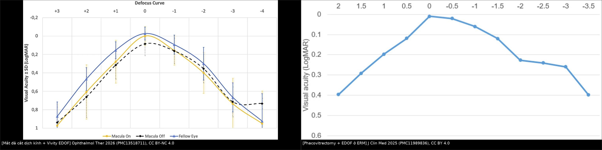
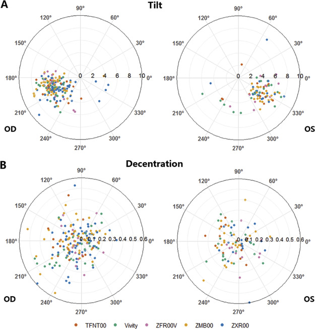
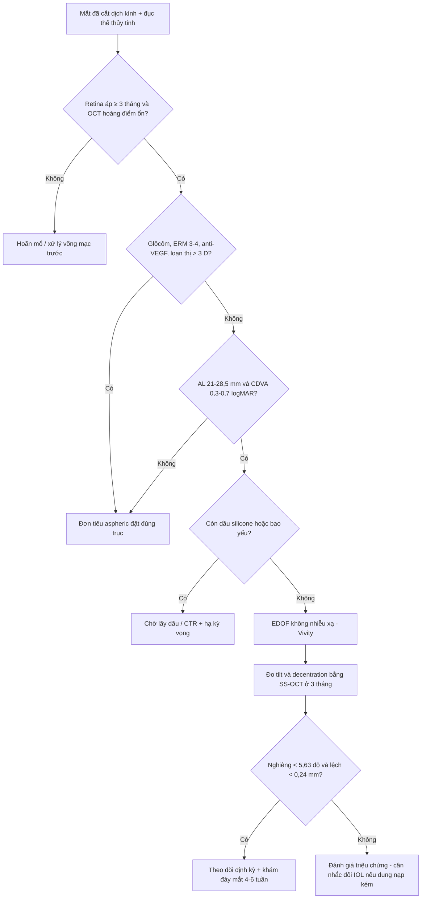
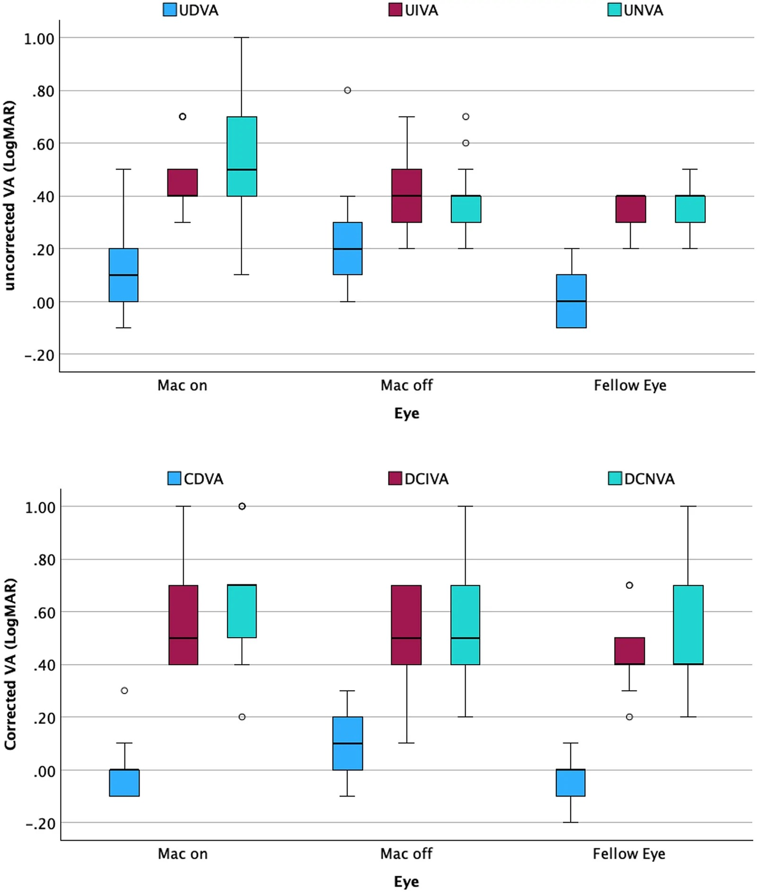
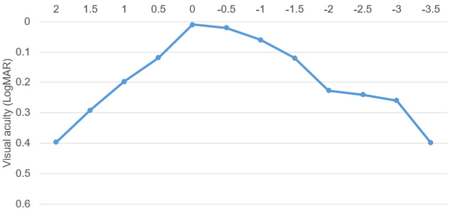

# 3275 — IOL cao cấp ở mắt đã cắt dịch kính: EDOF thay đa tiêu, tiêu chuẩn chọn và ngưỡng nghiêng/lệch — Premium IOL in the vitrectomized eye

**Tags:** `pattern:iol-cao-cap` `pattern:defocus-edof` `pattern:iol-nghieng-lech` `pattern:mat-da-cat-dich-kinh` `pattern:giam-tuong-phan` `vung:mat` `vung:the-thuy-tinh` `vung:tien-phong` `vung:dich-kinh` `vung:hoang-diem` `protocol:sinh-trac` `protocol:AS-OCT` `protocol:SS-OCT` `protocol:OCT-hoang-diem` `score:khong-co` `incidentaloma:khong`

**Mức chắc chắn (certainty):** tổng hợp y văn (literature synthesis) — dựng từ: thử nghiệm tiến cứu **27 bệnh nhân / 43 mắt** đặt **Vivity EDOF** sau cắt dịch kính vì bong võng mạc (*Ophthalmol Ther* 2026, **PMC13518711**, CC BY-NC); khảo sát **89 bệnh nhân** hài lòng sau EDOF ở mắt đã cắt dịch kính (*Graefes Arch Clin Exp Ophthalmol* 2023, **PMID 37584791**); **30 mắt hồi cứu + 106 mắt tiến cứu** EDOF ở người "không phải ứng viên đa tiêu" (*J Ophthalmol* 2023, **PMC10289873**, CC BY); **33 mắt bệnh võng mạc so với 100 mắt lành** (*Ophthalmologica* 2024, **PMC11446292**, CC BY-NC); **16 mắt** phacovitrectomy + EDOF bóc màng trước võng mạc (*J Clin Med* 2025, **PMC11989836**, CC BY); **104 so với 104 mắt** đo nghiêng/lệch bằng SS-OCT (*Transl Vis Sci Technol* 2021, **PMC7995916**, CC BY-NC-ND); **260 mắt** so dung sai nghiêng/lệch của 5 IOL (*J Cataract Refract Surg* 2026, **PMC13200907**, CC BY-NC-ND); **52 mắt** đa tiêu so với đơn tiêu sau mổ bong võng mạc (*J Cataract Refract Surg* 2021, **PMID 33974368**); **67 so với 134 mắt** sửa bong võng mạc trên mắt đa tiêu/đơn tiêu (*J Vitreoretin Dis* 2024, **PMC11561943**); **20 mắt** IOL cao cấp + cắt dịch kính (*Int Ophthalmol* 2020, **PMID 32613459**); **43 mắt** đo tương phản với PVD (*Graefes Arch Clin Exp Ophthalmol* 2020, **PMID 32318806**); **10 RCT / 431 so với 443 mắt** đa tiêu ba tiêu so với EDOF (*BMC Ophthalmol* 2026, **PMC13746750**, CC BY-NC-ND); PCO sau phacovitrectomy (**PMC12979282**, CC BY; **PMC4020170**, CC BY 3.0) và loạt **4 mắt** đổi IOL muộn (**PMC8988965**, CC BY-NC-SA). Nhóm **không có bệnh nhân của mình**; chỗ suy luận ghi **[suy luận]**. **Không ghi tên tác giả** — attribution = **tạp chí + năm + PMCID/DOI**.

> **Ranh giới với bài đã có:** [3274](../3274-phaco-mat-da-cat-dich-kinh/lesson.md) trả lời **"phaco ở mắt đã cắt dịch kính khó thế nào"** (LIDRS, tiền phòng sâu/nông, vỡ bao sau); [1492](../1492-duc-bao-sau-iol-yag-sau-cat-dich-kinh/lesson.md) trả lời **"PCO và YAG lúc nào, năng lượng bao nhiêu"**; [3272](../3272-dau-silicone-tre-em/lesson.md) và [1863](../1863-duc-the-thuy-tinh-mat-bom-dau-silicone/lesson.md) trả lời **"mắt bơm dầu"**; [1490](../1490-sinh-trac-iol-mat-bom-khi/lesson.md) và [1477](../1477-sinh-trac-iol-mat-bom-dau-silicone/lesson.md) trả lời **"sinh trắc trong khí/dầu"**. Bài này trả lời câu hỏi **sau khi đã mổ xong, trước khi chọn IOL**: **"mắt đã cắt dịch kính có được đặt IOL cao cấp không, chọn EDOF hay đa tiêu, ai không nên, và đo gì để biết IOL sẽ nằm đúng trục"**.

> **Câu chốt — bốn nhóm số phải thuộc:** **(1)** Ở mắt đã cắt dịch kính vì bong võng mạc, **Vivity EDOF** cho **CDVA 0,35 ± 0,16 → 0,03 ± 0,12** và **UDVA 1,01 ± 0,34 → 0,16 ± 0,19 logMAR**; **UIVA 0,44 ± 0,15**, **UNVA 0,47 ± 0,23**; hai mắt (**2 bệnh nhân**, đều **macula-off**) báo quầng (halo) — **không phải "cấm", nhưng gần là kính đọc** (**PMC13518711**). **(2)** Mắt đã cắt dịch kính **nghiêng IOL 5,36 ± 2,50° so với 4,54 ± 1,46°** và **lệch 0,27 ± 0,17 so với 0,19 ± 0,12 mm** (p = 0,005 và p < 0,001); **dầu silicone OR 5,659**, **IOL ưa nước OR 5,309**, **đái tháo đường OR 5,544** (**PMC7995916**). **(3)** **EDOF chịu nghiêng/lệch tốt hơn hẳn đa tiêu ba tiêu**: ở **260 mắt**, ngưỡng Q3 là **5,63°** và **0,24 mm**, nhóm trên ngưỡng của **Vivity/ZXR00 không khác biệt**, còn **TFNT00 giảm hài lòng 3,25 so với 3,83** và **ZFR00V giảm tương phản cả thị giác sáng và tối có chói** (**PMC13200907**). **(4)** Hệ quả dài hạn: **PCO sớm hơn 29,1 ± 23,1 so với 36,3 ± 26,4 tháng** (P = 0,006; **HR 1,337**) và **27,41% (54/197) mắt phải YAG trong 6 năm** — nên **EDOF ở mắt đã cắt dịch kính là bài toán "chọn người + theo dõi bao sau"**, không phải bài toán "mua IOL đắt" (**PMC4020170**; **PMC12979282**).

## 1. Tổng quan bệnh học – cơ chế hình ảnh (TẠI SAO)

### 1.1 EDOF khác đa tiêu ở đâu — chia sáng hay kéo dài tiêu điểm

- **Đa tiêu nhiễu xạ (diffractive multifocal, full range of field):** mặt quang học có **bậc nhiễu xạ** chia năng lượng sáng thành **nhiều tiêu điểm rời** (xa – trung gian – gần). Hệ quả vật lý: mỗi tiêu điểm chỉ nhận **một phần ánh sáng**, và **ánh sáng lạc (stray light)** giữa các bậc tạo **quầng – chói (halo/glare)**; tương phản giảm vì **tỉ lệ tương phản = (sáng − tối)/(sáng + tối)** bị "san phẳng" bởi ánh sáng lạc.
- **EDOF (extended depth of focus):** không chia thành nhiều tiêu điểm rời mà **làm dài một vùng tiêu** bằng **biến đổi mặt sóng** — hoặc **nhiễu xạ một bậc mở rộng** (Tecnis Symfony/ZXR00, cộng **+1,75 D** trung gian), hoặc **khúc xạ không nhiễu xạ** (Vivity với **vùng quang học trung tâm 2,2 mm** và **2 phần tử chuyển tiếp X-Wave**; MiniWell với **3 vùng đồng tử phụ thuộc**; Lucidis; Isopure "isofocal"). Vì **không có nhiều bậc rời**, ánh sáng lạc ít hơn → **ít quầng hơn và tương phản tốt hơn** so với ba tiêu, đổi lại **UNVA kém hơn** (gần chỉ "chức năng").
- **Phân loại chức năng (functional classification):** các IOL "EDOF" cũ nay được xếp lại thành **PRoF (partial range of focus)** và **PRoF-Ex**; **full-RoF** gồm ba tiêu như PanOptix (TFNT00), ZMB00, ZFR00V Synergy. Điều này quan trọng vì **dung sai nghiêng/lệch khác nhau theo lớp quang học**, không theo tên thương mại (**PMC11989836**; **PMC13200907**).
- **Hệ quả lâm sàng [suy luận từ quang học]:** với cùng một **độ nghiêng 6°**, IOL nhiều bậc rời mất **pha** ở nhiều tiêu điểm cùng lúc, còn IOL một vùng tiêu dài chỉ **dịch và méo một vùng** — đây là lý do sinh học cho việc **EDOF "tha" nghiêng/lệch hơn ba tiêu**, đúng như đo trên 260 mắt.

### 1.2 Vì sao mắt đã cắt dịch kính là mắt "tương phản thấp" — mất đệm quang học chứ không chỉ mất dịch kính

- **Dịch kính là môi trường trong suốt có chiết suất thấp hơn thủy tinh thể**, hấp thụ một phần **tử ngoại** và là **kho chống oxy hóa**; cắt dịch kính lấy đi **cả môi trường quang học lẫn hàng rào sinh hóa** → **ánh sáng tán xạ nhiều hơn** (tế bào, mảnh collagen, phản ứng viêm nhẹ) và **hàng rào máu–võng mạc** thay đổi.
- **Bằng chứng định lượng:** ở **43 mắt** đặt IOL đa tiêu, **diện tích dưới đường cong log tương phản (AULCSF)** là **1,5 ± 0,1 ở mắt có PVD** so với **1,7 ± 0,1 ở mắt không PVD** (p < 0,0001); nhóm **PVD có triệu chứng** chỉ **1,4 ± 0,1**, và **sau cắt dịch kính tăng lại 1,7** (p = 0,002) (**PMID 32318806**). Nghĩa là **mất dịch kính/PVD làm giảm tương phản đo được**, và **đục dịch kính/floaters** là nguyên nhân **chữa được**.
- **Hệ quả:** mọi IOL "chia sáng" đều **khuếch đại** khoản lỗ tương phản này. Vì vậy **EDOF (một vùng tiêu) là lớp IOL cao cấp hợp lý nhất** cho mắt đã cắt dịch kính, còn **ba tiêu chỉ nên xét khi mắt nền gần hoàn hảo**.
- **Màng trước võng mạc (ERM) và hoàng điểm:** ERM làm **dày võng mạc và méo ảnh**; EDOF vẫn cho kết quả tốt ở **16 mắt ERM độ thấp** (đường cong đạt **0,12 logMAR hoặc tốt hơn từ +0,50 đến −1,50 D**, không ca nào báo chói) (**PMC11989836**), nhưng **ERM độ 3–4 theo Govetto bị loại** khỏi thử nghiệm EDOF sau bong võng mạc (**PMC13518711**).

### 1.3 Vì sao nghiêng/lệch là biến số quyết định — và vì sao mắt đã cắt dịch kính nghiêng nhiều hơn

- **Vật lý:** IOL nghiêng **θ** tạo **quang sai bậc cao** tỉ lệ với **θ** và **đường kính vùng quang học**, đồng thời **dịch tiêu điểm** theo **δ ≈ d × tanθ**; lệch **d** làm **lệch trục quang** và sinh **coma**. Với IOL đa tiêu/EDOF, các vùng pha được thiết kế cho **trục chuẩn**, nên **càng nhiều vùng pha, càng nhạy** với lệch trục.
- **Số đo trên mắt đã cắt dịch kính (SS-OCT CASIA2, 3 tháng sau mổ):** **104 mắt có PPV** so với **104 mắt không PPV** — nghiêng **5,36 ± 2,50° so với 4,54 ± 1,46°** (p = 0,005), lệch **0,27 ± 0,17 so với 0,19 ± 0,12 mm** (p < 0,001); **quang sai bậc cao, coma, trefoil** đều cao hơn và **tương quan với độ nghiêng** (p < 0,05) (**PMC7995916**).
- **Yếu tố nguy cơ đo được:** **dầu silicone OR 5,659** (p = 0,021) và **IOL ưa nước OR 5,309** (p = 0,022) cho **nghiêng > 7°**; **đái tháo đường OR 5,544** (p = 0,033) cho **lệch > 0,4 mm**; **thời gian bơm dầu** tương quan thuận với cả hai (p = 0,014 và p < 0,001). Ngưỡng **> 0,4 mm** và **> 7°** là mốc mà **chất lượng quang học của IOL aspheric giảm xuống dưới IOL cầu thường** (trích trong **PMC7995916**).
- **Dung sai theo lớp IOL (260 mắt, 3 tháng):** ngưỡng **Q3 = 5,63°** và **0,24 mm**. **Vivity và ZXR00**: không khác biệt giữa nhóm trên/dưới ngưỡng. **TFNT00 (ba tiêu)**: nhóm nghiêng ≥ 5,63° tăng quang sai/coma, giảm tương phản; nhóm lệch ≥ 0,24 mm còn **giảm hài lòng 3,25 ± 0,46 so với 3,83 ± 0,38** (p = 0,008). **ZFR00V**: giảm tương phản **cả thị giác sáng và tối có chói**. **ZMB00**: giảm MTF (**PMC13200907**).
- **Đọc cho đúng:** "EDOF chịu lệch tốt" **không** có nghĩa "đặt là được" — nó có nghĩa **EDOF là lớp IOL duy nhất còn chấp nhận được khi bạn không kiểm soát hoàn toàn được trục IOL** (mắt đã PPV, dầu, đái tháo đường, bao yếu). Vẫn phải **đo và ghi lại** để theo dõi.

### 1.4 Khúc xạ mục tiêu — vì sao mắt đã cắt dịch kính dễ "cận thị hóa"

- **Sai số dự báo:** phacovitrectomy **cận thị hóa −0,50 đến −0,65 D**, cận thị cao **−1,01 đến −1,21 D** (**PMC10427902**); có bơm khí **−0,36 ± 0,74 D** so với phaco đơn thuần **+0,10 ± 0,55 D** (**PMC11844672**) — chi tiết ở [3274](../3274-phaco-mat-da-cat-dich-kinh/lesson.md).
- **Trong thử nghiệm EDOF sau bong võng mạc:** **mục tiêu chính thị (emmetropia) ở mọi ca**, và **trôi khúc xạ chỉ 0,04 D ở mắt đã PPV, 0,11 D ở mắt bạn** từ 1 tuần đến 6 tháng (**PMC13518711**). Đây là điểm **phản biện** với thói quen "chừa hyperopia cho EDOF": với **retina đã áp và sinh trắc tốt**, **chính thị** là mục tiêu đã được kiểm chứng; "chừa" chỉ nên là **quyết định cá nhân hóa** khi có **sai số dự báo lớn** (dầu, khí, trục dài).
- **Near vision không miễn phí:** **UNVA 0,47 ± 0,23 logMAR** một mắt (≈ 20/60) và **0,26 ± 0,13** khi hai mắt; **DCIVA 0,53 ± 0,21**. Nghĩa là **EDOF mua được "trung gian", không mua được "đọc sách"** — phải nói rõ trước mổ (**PMC13518711**).

*Trái: **Vivity EDOF** sau cắt dịch kính vì bong võng mạc — **macula-on**, **macula-off** và **mắt bạn** gần như trùng nhau, đỉnh ở **0 D**, còn **0,2 logMAR ở −1 D** và **0,5 logMAR ở −2 D** (đọc: trung gian tốt, gần kém). Phải: **EDOF + phacovitrectomy bóc ERM** — **0,12 logMAR hoặc tốt hơn từ +0,50 đến −1,50 D**. Hai hình cho thấy **cùng một lớp IOL, hai mắt nền khác nhau, cùng một dạng "đường cong phẳng"**. Nguồn: *Ophthalmol Ther* 2026 (PMC13518711) Fig. 3, **CC BY-NC 4.0**; *J Clin Med* 2025 (PMC11989836) Fig. 2, **CC BY 4.0**. Ảnh ghép letterbox, không crop.*

## 2. Mẫu hình + chẩn đoán phân biệt theo mắt nền và theo lớp IOL (Gamut)

### 2.1 Mẫu hình cần nhận ra trước mổ — "ba đường cong, ba lời hứa"

- **Đường cong dốc đứng, đỉnh nhọn (monofocal):** xa rất tốt, **tụt nhanh sau −1 D**; hứa "nhìn xa", không hứa trung gian.
- **Đường cong phẳng vừa, vai rộng (EDOF/PRoF):** **0,1–0,2 logMAR** kéo dài từ **+0,5 đến −1,5 D**; hứa "máy tính – táp-lô", **không hứa đọc sách nhỏ**.
- **Đường cong nhiều đỉnh (ba tiêu):** gần tốt hơn nhưng **quầng/chói và mất tương phản**; chỉ hợp mắt nền **hoàng điểm – giác mạc – tương phản** đều tốt.
- **Mắt đã cắt dịch kính:** luôn **dời toàn bộ đường cong xuống** (tương phản thấp, PVD/floaters) và **có thể nghiêng ngang** nếu IOL lệch — vì vậy **đo được đường cong sau mổ quan trọng hơn chọn "thương hiệu"**.

### 2.2 Gamut theo mức phù hợp của mắt nền (quyết định trước mổ)

- **Nhóm A — đủ tiêu chuẩn EDOF (bằng chứng trực tiếp):** **retina áp ≥ 3 tháng** sau cắt dịch kính, **CDVA 0,3–0,7 logMAR**, **AL 21–28,5 mm**, **loạn thị giác mạc ≤ 3 D**, **không glôcôm**, **ERM ≤ độ 2 Govetto**, **không tiền sử anti-VEGF**, tổn thương **hoàng điểm do bong võng mạc ≤ 3 ngày** (**PMC13518711**).
- **Nhóm B — cân nhắc, có bằng chứng nhưng mẫu nhỏ:** **macula-off** đã mổ (13 mắt trong thử nghiệm vẫn đạt **CDVA 0,03** và đường cong tương đương macula-on); **ERM độ thấp + phacovitrectomy** (16 mắt, **PMC11989836**); **bệnh võng mạc nhẹ – không tiến triển** (33 mắt, UDVA **0,10 so với 0,05**, hài lòng **73% chọn lại**, **PMC11446292**); **mắt bạn đơn tiêu** (vẫn hài lòng nhưng **phụ thuộc kính 40% so với 10,6%** khi hai mắt, **PMID 37584791**).
- **Nhóm C — không nên / phải rất thận trọng:** **ERM độ 3–4**, **glôcôm**, **bệnh hoàng điểm tiến triển/anti-VEGF**, **loạn thị không đều > 3 D**, **dầu silicone** (nghiêng **OR 5,659**) hoặc **IOL ưa nước** (**OR 5,309**), **cố định củng mạc/rãnh thể mi** (không nằm trong bao → lệch nhiều), **nhược thị** và **trẻ nhỏ** (bị loại khỏi thử nghiệm). Với các mắt này, **đơn tiêu aspheric đặt đúng trục** là lựa chọn trung thực hơn "IOL cao cấp".
- **Nhóm D — "cắt dịch kính vì floaters" là nhóm riêng:** trong **89 bệnh nhân**, chỉ số hài lòng chung tốt (**Catquest 3,44/4**; trung gian **3,55/4**; gần **2,75/4**) nhưng **nhóm mổ vì floaters hài lòng thấp hơn** — bệnh nhân này thường **trẻ, kỳ vọng cao, tương phản nhạy cảm**, nên tư vấn **kỹ hơn** (**PMID 37584791**).

**Mnemonic — R-E-T-I-N-A:** **R**etina áp ≥ 3 tháng; **E**ndpoint CDVA 0,3–0,7; **T**ilt risk (AL 21–28,5 mm, dầu, đái tháo đường); **I**nformed consent + mô phỏng quầng; **N**o glaucoma/macular disease tiến triển; **A**stigmatism ≤ 3 D.

### 2.3 Gamut theo lớp IOL (cùng một mắt, chọn gì)

- **Non-diffractive EDOF (Vivity, MiniWell, Lucidis):** ít ánh sáng lạc nhất, **dung sai nghiêng/lệch cao**, phụ thuộc **đồng tử** (MiniWell 3 vùng) → hợp mắt đã PPV, ERM nhẹ, mắt bạn đơn tiêu.
- **Diffractive EDOF (ZXR00/Symfony):** trung gian tốt hơn, **UNVA khá hơn** một chút, nhưng **nhạy hơn với lệch trục** so với non-diffractive [suy luận từ thiết kế + PMC13200907].
- **Enhanced monofocal (Eyhance, Isopure):** "bắc cầu" an toàn khi **không dám EDOF**; ở **23 mắt phacovitrectomy do ERM**, nhóm Eyhance có **thị lực trung gian không chỉnh kính tốt hơn** đơn tiêu chuẩn (p < 0,001) (**PMC10420151**, CC BY).
- **Full-RoF ba tiêu (PanOptix/ZFR00V/ZMB00):** chỉ khi **hoàng điểm – giác mạc – tương phản** đều tốt và **chấp nhận quầng**; ở mắt đã PPV, **không phải lựa chọn đầu tay** (**PMC13200907**).

## 3. Bảng so sánh phân biệt (ma trận đối chiếu)

| Thực thể (entity) | Hình ảnh / đường cong điển hình | Chốt vào (rule-in) | Chốt loại (rule-out) | Gợi ý xác nhận |
|---|---|---|---|---|
| **EDOF không nhiễu xạ (Vivity)** | Đường cong phẳng, **0,1–0,2 logMAR từ +0,5 đến −1,5 D**, đỉnh tại 0 D | **Mắt đã PPV + retina áp + CDVA 0,3–0,7 + AL 21–28,5 mm**; **nghiêng ≥ 5,63°/lệch ≥ 0,24 mm vẫn không khác biệt** (**PMC13518711**; **PMC13200907**) | **ERM 3–4, glôcôm, loạn thị > 3 D, anti-VEGF** → loại theo tiêu chuẩn thử nghiệm | Sinh trắc **IOLMaster 700**, **OCT hoàng điểm**, **CASIA2 3 tháng** |
| **EDOF nhiễu xạ (ZXR00/Symfony)** | Đường cong phẳng hơn EDOF khúc xạ ở **−1,5…−2 D**, có **quầng nhẹ** | **Cần trung gian + gần chức năng hơn**, mắt nền sạch, **không dầu** | **Nghiêng/lệch trên Q3** hoặc **dầu silicone** → chọn non-diffractive/đơn tiêu | Defocus curve, mô phỏng quầng, SS-OCT |
| **Enhanced monofocal (Eyhance/Isopure)** | Đường cong **một đỉnh rộng nhẹ**, tụt sau **−1 D** | **Không đủ tiêu chuẩn EDOF** nhưng **muốn hơn đơn tiêu ở trung gian** (**PMC10420151**) | **Kỳ vọng đọc sách không kính** → không đáp ứng | Defocus, tư vấn kỳ vọng |
| **Ba tiêu full-RoF (TFNT00/ZFR00V/ZMB00)** | **Nhiều đỉnh**, UNVA tốt nhất, **quầng rõ** | **Hoàng điểm – giác mạc – tương phản đều tốt**, bệnh nhân chấp nhận quầng, **không PPV/dầu** | **PPV + nghiêng ≥ 5,63°**: **TFNT00 giảm hài lòng 3,25 so với 3,83**; **ZFR00V giảm tương phản có chói** (**PMC13200907**) | SS-OCT + questionnaire + mô phỏng |
| **Đơn tiêu aspheric** | Đường cong dốc, xa tốt | **Mắt nền xấu, dầu, glôcôm, ERM nặng, loạn thị không đều** | **Đòi bỏ kính hoàn toàn** → giải thích giới hạn | Sinh trắc + khúc xạ sau mổ |
| **Mắt đã PPV + dầu silicone** | Nghiêng **5,36 ± 2,50°**, lệch **0,27 ± 0,17 mm**; **OR nghiêng 5,659** | **Dầu còn → chờ lấy dầu** hoặc **chọn đơn tiêu**; **IOL kỵ nước** (tránh ưa nước **OR 5,309**) | **Đặt EDOF/ba tiêu khi dầu còn** → nguy cơ lệch trục + khúc xạ sai | **Siêu âm B**, sinh trắc hiệu chỉnh dầu ([1477](../1477-sinh-trac-iol-mat-bom-dau-silicone/lesson.md)) |
| **Mắt đã PPV + PVD/floaters tồn tại** | **AULCSF 1,5 so với 1,7**; có triệu chứng **1,4** | **Đo tương phản + hỏi triệu chứng**; **PPV cải thiện 1,4 → 1,7** (**PMID 32318806**) | **Quy hết mờ cho "IOL cao cấp"** → bỏ sót floaters/PVD | Đo CSF, soi đáy mắt, OCT |
| **Mắt đã PPV + đái tháo đường** | Lệch **> 0,4 mm OR 5,544** (**PMC7995916**) | **Kiểm soát đường huyết, OCT hoàng điểm, chọn IOL ít nhạy lệch** | **Hứa "không kính"** khi võng mạc chưa ổn định | OCT + theo dõi 3–6 tháng |

*Biểu đồ cực (polar plot) **260 mắt**: **(A)** nghiêng (độ) và **(B)** lệch (mm) của **TFNT00, Vivity, ZFR00V, ZMB00, ZXR00**, mắt phải (OD) và trái (OS). Đa số cụm dưới **6°** và **0,3 mm**, nhưng có **đuôi** tới **> 8°** và **> 0,5 mm** — chính là nhóm mà **ba tiêu mất hài lòng/tương phản**, còn **EDOF không khác biệt**. Nguồn: *J Cataract Refract Surg* 2026 (PMC13200907) Fig. 1, **CC BY-NC-ND 4.0** — **nguyên bản, không crop/ghép**.*

### 3.1 Ba câu hỏi đọc ma trận

- **"Có được đặt IOL cao cấp không?"** → xem **nhóm A/B/C** ở mục 2.2; **tiêu chuẩn định lượng** quan trọng hơn nhãn "cao cấp".
- **"EDOF hay đa tiêu?"** → nếu mắt **đã PPV**, mặc định **EDOF**; **ba tiêu** chỉ khi **tilt/decentration dự kiến thấp** và **tương phản tốt**.
- **"Có cần đổi IOL sau này không?"** → có: **4 mắt** đổi IOL muộn vì **giảm thị lực + chói**, trung bình **15,8 ± 10,63 tháng**, CDVA **0,33 → 0,11** sau đổi — nghĩa là **đổi được nhưng là mổ lại**, phải nằm trong tư vấn (**PMC8988965**).

## 4. Protocol + ngưỡng định lượng

### 4.1 Trước mổ — 7 bước bắt buộc

1. **Mốc thời gian:** chờ **≥ 3 tháng** sau cắt dịch kính (thử nghiệm dùng **6 ± 3 tháng**), xác nhận **retina áp** trên soi đáy mắt + **OCT hoàng điểm** (**PMC13518711**).
2. **Thị lực – khúc xạ:** **CDVA 0,3–0,7 logMAR** là cửa vào của thử nghiệm; ngoài khoảng này vẫn có thể mổ nhưng **bằng chứng EDOF yếu hơn**.
3. **Sinh trắc:** **IOLMaster 700** (hoặc tương đương), **AL 21–28,5 mm**; **không đo trong khí/dầu** ([1490](../1490-sinh-trac-iol-mat-bom-khi/lesson.md), [1477](../1477-sinh-trac-iol-mat-bom-dau-silicone/lesson.md)); ghi **công thức + ELP** dự kiến.
4. **Giác mạc:** topography, **loạn thị ≤ 3 D**, loại **loạn thị không đều**; nếu toric, dùng **hướng dẫn ảnh không dấu (Callisto)** như thử nghiệm.
5. **Hoàng điểm:** **OCT** phân độ **ERM theo Govetto** (loại **3–4**), tìm **phù/anti-VEGF**, đánh giá **hoàng điểm do bong võng mạc** (chấp nhận nếu **≤ 3 ngày**).
6. **Đồng tử – bề mặt nhãn cầu:** đo **đồng tử trong điều kiện sáng/tối** (IOL phụ thuộc đồng tử), khám **khô mắt/viêm bờ mi** — bề mặt nhãn cầu kém làm **sinh trắc và tương phản** sai (**PMC9022154**).
7. **Tư vấn có mô phỏng:** cho bệnh nhân **xem mô phỏng quầng/chói** trong điều kiện **ánh sáng tối**, giải thích **UNVA kém** và **khả năng phải đeo kính đọc**; ghi **đồng thuận**.

### 4.2 Trong mổ và sau mổ — bảo vệ trục IOL

- **Đặt trong bao (in-the-bag)**, mở bao **liên tục 5,0–5,5 mm**, **không đặt rãnh** với EDOF; nếu **dây chằng yếu** → **vòng căng bao (CTR)** và **hạ kỳ vọng** (đổi sang đơn tiêu nếu bao không ổn định) [suy luận từ cơ chế lệch trục + **PMC7995916**].
- **Chọn vật liệu:** **kỵ nước** ở mắt đã PPV (tránh **IOL ưa nước OR 5,309** với nghiêng > 7°); **tránh EDOF khi còn dầu silicone**.
- **Theo dõi:** **1–2 ngày, 7–14 ngày, 1–2 tháng, 4–6 tháng**; **đo tilt/decentration bằng SS-OCT (CASIA2)** ở **3 tháng** và ghi **độ/ mm**; **OCT hoàng điểm** nếu thị lực không như kỳ vọng.
- **Biến cố đã gặp trong thử nghiệm:** **3 bệnh nhân rách võng mạc mới ở mắt bạn 4–6 tuần sau mổ** (2 laser, 1 bong võng mạc phải PPV), **1 phù hoàng điểm dạng nang ở mắt mổ 4 tuần** (**PMC13518711**) → **khám đáy mắt ở mốc 4–6 tuần là bắt buộc**, không chỉ đo thị lực.
- **Bao sau:** PCO đến **sớm hơn** (**29,1 ± 23,1 so với 36,3 ± 26,4 tháng**, P = 0,006; **HR 1,337**) và **27,41% (54/197)** phải **YAG trong 6 năm**; YAG **màng xơ cần 14,20 mJ/mm²** so với **ngọc trai 5,75 mJ/mm²** — chi tiết ở [1492](../1492-duc-bao-sau-iol-yag-sau-cat-dich-kinh/lesson.md) (**PMC4020170**; **PMC12979282**).

### 4.3 Sơ đồ chọn IOL ở mắt đã cắt dịch kính

### 4.4 Bảng ngưỡng định lượng dùng trong bài

| Biến số | Ngưỡng / giá trị | Ý nghĩa thực hành | Nguồn |
|---|---|---|---|
| Thời gian chờ sau PPV | **≥ 3 tháng** (thử nghiệm **6 ± 3**) | Tránh bong võng mạc muộn | PMC13518711 |
| CDVA trước mổ | **0,3–0,7 logMAR** | Cửa vào của bằng chứng EDOF | PMC13518711 |
| AL | **21–28,5 mm** | Ngoài khoảng: nguy cơ sai số/lệch cao | PMC13518711 |
| Loạn thị giác mạc | **≤ 3 D** | Trên ngưỡng: cần toric/đơn tiêu | PMC13518711 |
| Nghiêng IOL (Q3) | **5,63°** | Trên ngưỡng: ba tiêu mất chất lượng, EDOF còn dung nạp | PMC13200907 |
| Lệch IOL (Q3) | **0,24 mm** | Trên ngưỡng: nguy cơ giảm tương phản/hài lòng | PMC13200907 |
| Nghiêng/lệch "xấu" cổ điển | **> 7° / > 0,4 mm** | IOL aspheric mất lợi thế so với IOL cầu | PMC7995916 |
| Nghiêng ở mắt PPV | **5,36 ± 2,50°** so với **4,54 ± 1,46°** | Mắt PPV nghiêng nhiều hơn | PMC7995916 |
| Lệch ở mắt PPV | **0,27 ± 0,17** so với **0,19 ± 0,12 mm** | Mắt PPV lệch nhiều hơn | PMC7995916 |
| Dầu silicone | **OR 5,659** cho nghiêng > 7° | Tránh EDOF khi còn dầu | PMC7995916 |
| IOL ưa nước | **OR 5,309** cho nghiêng > 7° | Chọn kỵ nước | PMC7995916 |
| Đái tháo đường | **OR 5,544** cho lệch > 0,4 mm | Kiểm soát + theo dõi | PMC7995916 |
| AULCSF có PVD | **1,5 ± 0,1** so với **1,7 ± 0,1** | PVD làm giảm tương phản | PMID 32318806 |
| PCO → YAG | **29,1 ± 23,1** so với **36,3 ± 26,4 tháng** | Hẹn YAG sớm hơn ở mắt PPV | PMC4020170 |
| Tỷ lệ YAG sau phacovitrectomy | **27,41% (54/197) trong 6 năm** | Tư vấn trước mổ | PMC12979282 |

## 5. Biến thể bình thường và cạm bẫy

- **"Mắt đã cắt dịch kính = mắt bệnh" — không đúng:** nếu **retina áp, hoàng điểm ổn, AL trong khoảng**, đây là **mắt nền tốt** để EDOF; thử nghiệm **43 mắt** cho **CDVA 0,03** và đường cong **tương đương mắt bạn** (**PMC13518711**).
- **Cạm bẫy 1 — đo trục nhãn cầu trong khí/dầu:** khí làm **AL đọc sai**, dầu silicone làm **AL đọc dài** → **chọn công suất sai**; xem [1490](../1490-sinh-trac-iol-mat-bom-khi/lesson.md) và [1477](../1477-sinh-trac-iol-mat-bom-dau-silicone/lesson.md). **Không** suy ra "EDOF thất bại" từ một ca lệch khúc xạ do sinh trắc.
- **Cạm bẫy 2 — đổ mờ cho IOL, bỏ sót PVD/floaters:** **AULCSF 1,5 so với 1,7**; nhóm **PVD có triệu chứng** chỉ **1,4** và **tăng lên 1,7 sau PPV** (**PMID 32318806**). Trước khi kết luận "IOL không hợp", **đo tương phản + soi đáy mắt**.
- **Cạm bẫy 3 — hứa "không cần kính đọc":** **UNVA 0,47 ± 0,23** một mắt; **hai mắt 0,26 ± 0,13**; phụ thuộc kính **40% (một mắt) so với 10,6% (hai mắt)** (**PMC13518711**; **PMID 37584791**). Tư vấn đúng là **"bỏ kính xa – trung gian, kính đọc mỏng khi cần"**.
- **Cạm bẫy 4 — quên PCO:** mắt đã PPV **PCO sớm hơn ~7 tháng** và **hơn 1/4 phải YAG trong 6 năm**; PCO làm **giảm tương phản đúng lúc bệnh nhân đang "thử thách" IOL EDOF** → **khám bao sau mỗi lần tái khám**, đừng chờ bệnh nhân than mờ.
- **Cạm bẫy 5 — đồng tử nhỏ + IOL phụ thuộc đồng tử:** MiniWell và một số EDOF khúc xạ **chia vùng theo đường kính đồng tử**; **đồng tử nhỏ (< 2,5 mm)** hoặc **thuốc co đồng tử** làm mất tác dụng vùng ngoài. Thử nghiệm loại **glôcôm** và **> 75 tuổi** khỏi nhóm dùng MiniWell vì lý do này (**PMC10289873**).
- **Cạm bẫy 6 — "ba tiêu cũng được vì đã có nghiên cứu trên mắt bong võng mạc":** nghiên cứu **52 mắt** cho thấy **đa tiêu vẫn đạt CDVA 0,20 và không ai muốn đổi** (**PMID 33974368**), nhưng đó là **hồi cứu, mắt chọn lọc**, và **không đo tilt/decentration**. Không được dùng nó để **bỏ qua ngưỡng 5,63°/0,24 mm** (**PMC13200907**).
- **Biến thể bình thường:** **đường cong defocus "lệch nhẹ về cận"** sau phacovitrectomy là **hiện tượng dự báo được** (cận thị hóa **−0,5…−0,65 D**, **PMC10427902**), không phải bằng chứng IOL hỏng; **mống mắt lõm/tiền phòng dao động** trong mổ là **LIDRS**, không phải lỗi IOL ([3274](../3274-phaco-mat-da-cat-dich-kinh/lesson.md)).

## 6. Tự lượng giá — Blind Quiz

**Ca 1 — Nam 54 tuổi, đã cắt dịch kính vì bong võng mạc 6 tháng, retina áp, CDVA 0,4; xin "bỏ kính hoàn toàn". Chọn IOL gì và nói gì?**

- Hỏi: mắt này nằm trong nhóm nào? Kỳ vọng thị lực xa/trung gian/gần? Có nên hứa bỏ kính đọc?

<b>Bấm để hiện đáp án</b>

- **Nhóm A/B:** retina áp ≥ 3 tháng, CDVA 0,3–0,7 → **đủ tiêu chuẩn EDOF**; nếu **macula-off ≤ 3 ngày** vẫn trong bằng chứng.
- **Kỳ vọng thực tế:** **UDVA 0,16 ± 0,19**, **UIVA 0,44 ± 0,15**, **UNVA 0,47 ± 0,23** logMAR; hai mắt thì **UNVA 0,26 ± 0,13**.
- **Tư vấn:** **EDOF không nhiễu xạ (Vivity)**, mục tiêu **chính thị**; **không hứa** đọc sách không kính; nêu **quầng 2 ca/27 bệnh nhân**, **PCO/YAG sớm hơn**.
- Nguồn: *Ophthalmol Ther* 2026 (PMC13518711), Fig. 2, **CC BY-NC 4.0**.

**Ca 2 — Nữ 62 tuổi, ERM + đục thể thủy tinh, muốn mổ phối hợp và hỏi "có đặt được IOL cao cấp không?". Đọc đường cong để trả lời.**

- Hỏi: vùng thị lực tốt kéo dài bao nhiêu D? Có phải loại ERM nào cũng được? Cần theo dõi gì?

<b>Bấm để hiện đáp án</b>

- **Đường cong:** **0,12 logMAR hoặc tốt hơn từ +0,50 đến −1,50 D**; **0,4 logMAR hoặc tốt hơn ở mọi độ**; **16 mắt**, **không ca nào báo chói**.
- **Điều kiện:** ERM **độ thấp**; **ERM 3–4 Govetto bị loại** khỏi bằng chứng EDOF sau bong võng mạc — nếu ERM dày/dính trung tâm, **hạ kỳ vọng hoặc chọn đơn tiêu**.
- **Theo dõi:** OCT hoàng điểm (phù dạng nang), **đáy mắt 4–6 tuần** (rách võng mạc mới), **bao sau/PCO**.
- Nguồn: *J Clin Med* 2025 (PMC11989836), Fig. 2, **CC BY 4.0**.

**Ca 3 — Bệnh nhân đã PPV 2 năm, sau phaco EDOF 3 tháng, SS-OCT: nghiêng 6,1°, lệch 0,31 mm; than "nhìn đèn bị quầng". Xử trí?**

- Hỏi: các số đo nằm ở nhóm nào? Có phải "EDOF hỏng"? Kiểm tra gì trước khi nghĩ tới đổi IOL?

<b>Bấm để hiện đáp án</b>

- **6,1° và 0,31 mm** đều **trên Q3** (**5,63° / 0,24 mm**) nhưng **EDOF (Vivity/ZXR00) không khác biệt** giữa nhóm trên/dưới ngưỡng; ngược lại **ba tiêu** mới mất hài lòng/tương phản ở nhóm này.
- **Trước khi đổi IOL:** khám **bao sau (PCO)**, **PVD/floaters**, **khô mắt**, **khúc xạ tồn dư**, **OCT hoàng điểm**; **quầng nhẹ sau EDOF** thường **dung nạp được** — đổi IOL muộn trung bình **15,8 tháng** và là **mổ lại** (4 mắt, **PMC8988965**).
- **Nếu dung nạp kém kéo dài + PCO:** **YAG** trước, đánh giá lại; chỉ **đổi IOL** khi triệu chứng **không giải thích được** bằng các nguyên nhân trên.
- Nguồn: *J Cataract Refract Surg* 2026 (PMC13200907), Fig. 1, **CC BY-NC-ND 4.0** (nguyên bản).

## 7. Câu hỏi nghiên cứu & điểm chưa đồng thuận (tính đến 11/2026)

1. **[Tranh cãi] Ở mắt đã cắt dịch kính vì bong võng mạc, EDOF có thực sự an toàn và hiệu quả hơn đa tiêu ba tiêu, hay chỉ khác nhau vì quần thể được chọn?**
   - **Đã biết:** EDOF cho **UDVA 0,16 ± 0,19**, **UNVA 0,47 ± 0,23** ở **43 mắt** (**PMC13518711**); đa tiêu ở **24 mắt** cho **UNVA 0,23 ± 0,32** và không ai muốn đổi (**PMID 33974368**); gộp **10 RCT** cho thấy **ba tiêu gần tốt hơn**, còn **hiện tượng chói không khác rõ** (**PMC13746750**).
   - **Chưa rõ:** **không có RCT** so trực tiếp EDOF với ba tiêu **trong quần thể đã PPV**; các loạt khác **cỡ mẫu, thời điểm, tiêu chí chọn** và **không đo tilt/decentration**.
   - **Hướng nghiên cứu:** RCT/đoàn hệ tiến cứu phân tầng **macula-on/off**, **dầu/không dầu**, outcome **defocus, CSF, tilt/decentration, tỷ lệ đổi IOL**.
   - **Nguồn:** PMC13518711 (2026); PMID 33974368 (2021); PMC13746750 (2026).

2. **[Khoảng trống] Kết cục ≥ 5 năm của EDOF ở mắt đã cắt dịch kính: PCO/YAG, tiến triển nghiêng/lệch và bong võng mạc tái phát — chưa có dữ liệu.**
   - **Đã biết:** thử nghiệm EDOF chỉ theo dõi **6 tháng** (**PMC13518711**); PCO ở mắt PPV đến **29,1 ± 23,1 tháng** và **27,41%** phải YAG trong **6 năm** (**PMC4020170**; **PMC12979282**); nghiêng/lệch đo ở **3 tháng** (**PMC7995916**; **PMC13200907**).
   - **Chưa rõ:** **tilt/decentration có tiến triển** sau 3 tháng không; **YAG ảnh hưởng đường cong EDOF** thế nào; **tỷ lệ đổi IOL** dài hạn.
   - **Hướng nghiên cứu:** registry theo dõi **5–10 năm**, chụp SS-OCT lặp lại, outcome **YAG, đổi IOL, bong võng mạc, CSF**.
   - **Nguồn:** PMC13518711 (2026); PMC4020170 (2014); PMC12979282 (2026).

3. **[Khác biệt thực hành] Mục tiêu khúc xạ và cách chọn lớp EDOF ở mắt đã PPV: chính thị + non-diffractive, hay "mini-monovision" + diffractive?**
   - **Đã biết:** thử nghiệm đặt **mục tiêu chính thị** và **trôi 0,04 D** ở mắt PPV (**PMC13518711**); **non-diffractive EDOF** dung nạp nghiêng/lệch tốt hơn **full-RoF** (**PMC13200907**); **mini-monovision** được nhắc trong bàn luận như hướng cải thiện UNVA nhưng **không phải thiết kế của thử nghiệm**.
   - **Chưa rõ:** **không có so sánh trực tiếp** chính thị so với mini-monovision ở mắt PPV; **ngưỡng UNVA chấp nhận** khác nhau giữa bệnh nhân **một mắt/hai mắt** và **nghề nghiệp**.
   - **Hướng nghiên cứu:** thử nghiệm **hai nhánh khúc xạ mục tiêu** trên mắt đã PPV, outcome **UNVA, hài lòng, phụ thuộc kính, quầng**.
   - **Nguồn:** PMC13518711 (2026); PMC13200907 (2026); PMID 37584791 (2023).

## Bài liên quan chéo

- [3274 – Phaco trên mắt đã cắt dịch kính](../3274-phaco-mat-da-cat-dich-kinh/lesson.md) (LIDRS, tiền phòng sâu/nông, vỡ bao sau, cận thị hóa)
- [1492 – PCO sau phacovitrectomy và YAG](../1492-duc-bao-sau-iol-yag-sau-cat-dich-kinh/lesson.md) (PCO sớm hơn, năng lượng YAG)
- [3272 – Dầu silicone ở trẻ em](../3272-dau-silicone-tre-em/lesson.md) (ba đồng hồ biến chứng)
- [1863 – Đục thể thủy tinh ở mắt bơm dầu silicone](../1863-duc-the-thuy-tinh-mat-bom-dau-silicone/lesson.md) (một thì hay hai thì)
- [1490 – Sinh trắc IOL khi mắt còn bóng khí](../1490-sinh-trac-iol-mat-bom-khi/lesson.md) (không đo AL trong khí)
- [1477 – Sinh trắc IOL ở mắt bơm dầu silicone](../1477-sinh-trac-iol-mat-bom-dau-silicone/lesson.md) (dầu làm AL đọc dài)
- [1480 – Đục thể thủy tinh sau bóc màng ERM](../1480-duc-the-thuy-tinh-sau-boc-mang-erm/lesson.md) (mổ phối hợp hay hai thì)
- [1467 – Màng trước võng mạc (ERM)](../1467-mang-truoc-vong-mac-erm/lesson.md) (phân độ Govetto)
- [400 – Tổng quan Mắt & thị giác](../400-tong-quan-mat-thi-giac/lesson.md)

## Ảnh

- `images/3275_iol-cao-cap_Do-thi-defocus_PMC13518711-Fig3.jpg` — *Ophthalmol Ther* 2026 (PMC13518711), Fig. 3, **CC BY-NC 4.0**.
- `images/3275_iol-cao-cap_Bieu-do-thi-luc_PMC13518711-Fig2.jpg` — *Ophthalmol Ther* 2026 (PMC13518711), Fig. 2, **CC BY-NC 4.0**.
- `images/3275_iol-cao-cap_Do-thi-defocus-ERM_PMC11989836-Fig2.jpg` — *J Clin Med* 2025 (PMC11989836), Fig. 2, **CC BY 4.0**.
- `images/3275_iol-cao-cap_Do-thi-tilt-decentration_PMC13200907-Fig1.jpg` — *J Cataract Refract Surg* 2026 (PMC13200907), Fig. 1, **CC BY-NC-ND 4.0** (nguyên bản, không crop/ghép).
- `images/composite_defocus-EDOF.jpg` — ảnh ghép từ 2 hình trên (PMC13518711 + PMC11989836), letterbox bằng `tools/make_composite.py`.

> Không dùng để chẩn đoán độc lập khi chưa có người hướng dẫn.
