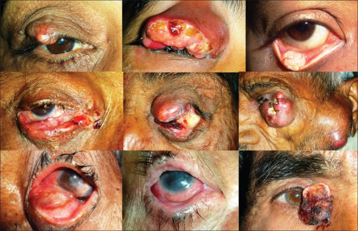
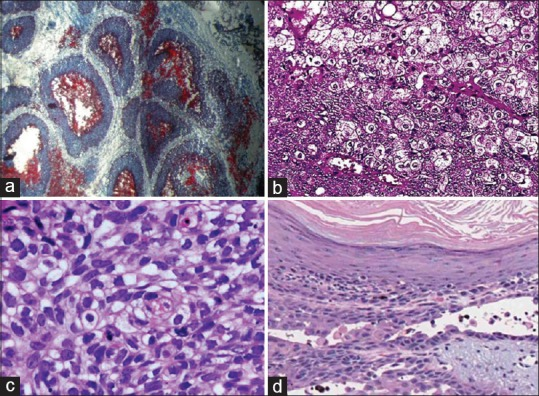
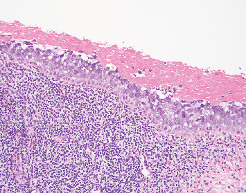
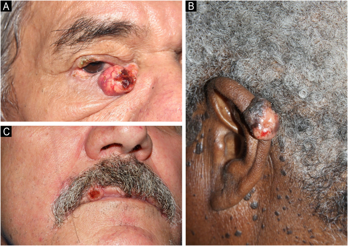
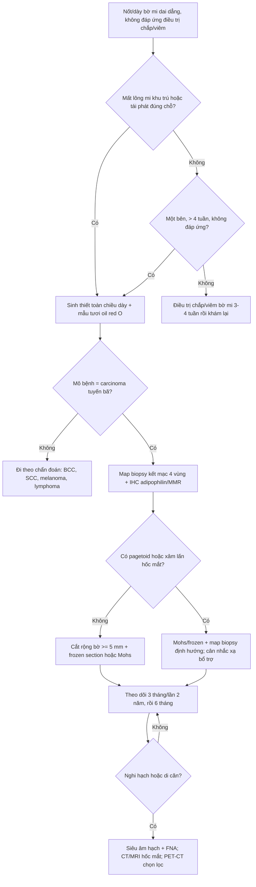
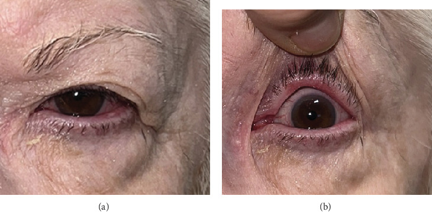

# 3276 — Carcinoma tuyến bã của mi (sebaceous carcinoma): "chắp" tái phát, mất lông mi và map biopsy

**Tags:** `pattern:u-bo-mi` `pattern:mat-long-mi` `pattern:cham-tai-phat` `pattern:day-bo-mi-lan-toa` `pattern:loat-bo-mi` `pattern:u-ket-mac` `pattern:gia-chap` `vung:mat` `vung:mi` `vung:ket-mac` `vung:giac-mac` `vung:hoc-mat` `protocol:den-khe` `protocol:sinh-thiet-day-du` `protocol:map-biopsy` `protocol:Mohs` `protocol:CT-hoc-mat` `protocol:MRI-hoc-mat` `protocol:sieu-am-hach` `protocol:SLNB` `score:AJCC8` `incidentaloma:khong`

**Mức chắc chắn (certainty):** tổng hợp y văn (literature synthesis) — dựng từ **đoàn hệ 418 ca tái phát u tuyến bã mi** (IOVS 2024, PMC11305426), **đoàn hệ 147 ca cắt bờ âm tính** (Indian J Ophthalmol 2026, PMC13614682), **phân tích gộp hạch vùng 2.371 ca** (Cancers 2026, PMC13162734), **tổng quan u tuyến bã có/không biệt hóa** (Cancers 2026, PMC13664556), **loạt 30 ca trình bày đa dạng** (Oman J Ophthalmol 2018, PMC5848342), **loạt 20 ca Brazil** (An Bras Dermatol 2025, PMC11962923), **tổng quan chẩn đoán–điều trị** (OncoTargets Ther 2018, PMC6027821), **đoàn hệ MTS Hàn Quốc 91 ca** (JAAD Int 2026, PMC13677230), **nghiên cứu đa trung tâm 129 u ác bờ mi** (Indian J Ophthalmol 2020, PMC7774165) và **ca "viêm kết mạc" thực chất là u trong biểu mô** (Case Rep Ophthalmol Med 2025, PMC12473728). Nhóm **không có bệnh nhân của mình**; chỗ chưa đủ chắc ghi **"chưa rõ"**. **Không ghi tên tác giả** — attribution = **tạp chí + năm + PMCID/DOI** (xem `images/CREDITS.md`).

> **Câu chốt:** u tuyến bã (sebaceous carcinoma, SC) của mi là **ung thư bờ mi nguy hiểm nhất nhưng lại "cư xử" như bệnh lành** — **38% (159/418) bị chẩn đoán sai ngay lần đầu**, trong đó **11% gọi là viêm bờ mi**, **4,8% gọi là chắp**, **10% gọi là SCC**, **6,2% gọi là BCC**, và trễ chẩn đoán trung vị **12 tháng** (PMC11305426). Ba câu hỏi quyết định của bài: **(1) "chắp" này có phải chắp không?** — **mất lông mi khu trú (madarosis)** và **tái phát đúng một chỗ** là hai dấu hiệu phá cách; **(2) bệnh có lan trong biểu mô không?** — **lan pagetoid** vào kết mạc/giác mạc làm bệnh giả **viêm kết mạc một bên**, gây **tái phát dù bờ cắt âm tính**, và là lý do phải **map biopsy**; **(3) đã cắt đúng chưa?** — **Mohs/frozen section** giảm tái phát (**HR 0,53**; **aHR 0,42**), còn **xâm lấn ổ mắt làm tái phát tăng gấp 4,47 lần** (PMC11305426; PMC13664556).

## 1. Tổng quan bệnh học – cơ chế hình ảnh (TẠI SAO)

### 1.1 Nguồn gốc giải phẫu — vì sao mi trên và vì sao "giả chắp"

- SC quanh mắt xuất phát từ **tuyến Meibomius** (nằm trong sụn mi, đổ ra bờ mi sau), **tuyến Zeis** (bám nang lông mi ở bờ mi trước), **caruncle** và da lông mày (PMC6027821). **Mi trên là vị trí hay nhất** vì mật độ tuyến Meibomius dày nhất; **1–6%** bệnh nhân có tổn thương **cả hai mi cùng lúc** (PMC6027821).
- Tuyến Meibomius nằm **trong sụn**, nên u khởi phát ở đó là **khối chắc, dính sụn, dưới da** — đúng mô tả của một **chắp (chalazion)**. Vì vậy **"chắp" không đau, không viêm, không đáp ứng nạo** ở người lớn tuổi phải bị coi là **u cho đến khi chứng minh ngược lại**.
- **TẠI SAO mất lông mi (madarosis) là dấu hiệu chốt:** chắp là **viêm tuyến dầu**, không phá nang lông; SC **xâm lấn sụn và nang lông mi** → nang bị phá hủy → **lông mi rụng khu trú và không mọc lại** (PMC6027821; cơ chế madarosis có sẹo: PMC3358936). Vì vậy **đếm lông mi ở bờ mi tổn thương** là thao tác có giá trị chẩn đoán cao nhất trong 10 giây khám.

*Chín bệnh nhân, cùng một bệnh: **nốt ở góc trong/giữa bờ mi**, **khối loét có vảy máu**, **dày bờ mi lan tỏa** làm mất ranh giới bờ mi, **khối kết mạc đỏ** dễ gọi là viêm kết mạc, và tổn thương **lan ra hốc mắt**. Điểm chung: tổn thương **dai dẳng, không đáp ứng điều trị "chắp/viêm bờ mi"**. Nguồn: Oman J Ophthalmol 2018 (PMC5848342), Fig. 1, CC BY-NC-SA 3.0.*

### 1.2 TẠI SAO mô bệnh học trông "bọt" — vật lý của lipid và oil red O

- Tế bào tuyến bã chứa **giọt lipid nội bào**; khi cố định bằng **formalin** rồi cắt nhuộm H&E, lipid **bị hòa tan và rửa trôi** → để lại **bào tương bọt, sáng, nhiều lỗ nhỏ (foamy/vacuolated)**. Đó không phải "hoại tử" mà là **dấu ấn biệt hóa tuyến bã** — cơ sở để phân biệt với SCC/BCC (PMC5848342).
- Vì lipid mất khi xử lý thường quy, **oil red O** chỉ dương tính trên **mô tươi/lạnh (frozen section)**; đây là lý do **phải gửi mẫu tươi** khi nghi SC, và **oil red O âm trên mô đã cố định không loại trừ** SC (PMC5848342).
- Trên hóa mô miễn dịch, **adipophilin** dương mạnh trong tế bào u có bọt lipid (ca "viêm kết mạc" 80 tuổi: adipophilin dương mạnh, Factor XIIIa dương yếu) — giúp chốt **biệt hóa tuyến bã** khi H&E không điển hình (PMC12473728).

**Đọc ảnh:** **(a)** nhuộm **oil red O** — lipid trong bào tương u bắt màu đỏ; **(b)** thể **biệt hóa tốt** — tế bào đa dạng, bào tương **bọt mịn, nhiều không bào**, bờ tế bào rõ; **(c)** thể **kém biệt hóa** — nhân đa dạng, hạt nhân rõ, ít không bào (dễ bị đọc thành SCC); **(d)** **lan pagetoid** — tế bào u nằm rải rác **trong biểu mô** phía trên. Nguồn: Oman J Ophthalmol 2018 (PMC5848342), Fig. 3, CC BY-NC-SA 3.0.

### 1.3 TẠI SAO "lan pagetoid" giải thích cả bệnh cảnh viêm kết mạc và tái phát

- **Lan pagetoid (pagetoid spread)** = tế bào u lan **trong biểu mô kết mạc** (và có thể tới **giác mạc**) theo kiểu **nhảy cóc, không liên tục** — không tạo khối, chỉ làm **kết mạc dày, đỏ, nhú** (PMC6027821; PMC12473728).
- Hệ quả 1 — **chẩn đoán nhầm:** bệnh nhân được điều trị **"viêm kết mạc/viêm bờ mi một bên"** nhiều tháng; ca 80 tuổi chỉ được sinh thiết sau khi điều trị thất bại, và tổn thương **khu trú hoàn toàn trong biểu mô kết mạc mi trên** (PMC12473728). Tỉ lệ pagetoid trong các loạt lớn: **18,4%** (147 ca Nhật, PMC13614682) và **26–51%** theo tổng quan (PMC6027821).
- Hệ quả 2 — **tái phát dù bờ cắt âm tính:** vì tổn thương **nhảy cóc**, bờ cắt trên khối không đại diện cho **toàn bộ bề mặt kết mạc**. Trong 418 ca, **tái phát 40%**, trung vị **14 tháng**; pagetoid là yếu tố độc lập cho **tái phát** (p = 0,006) và **di căn** (p = 0,011) (PMC11305426; PMC13614682).

*Biểu mô kết mạc **bị thay gần toàn bộ** bởi tế bào u (pagetoid) + **dải thâm nhiễm lympho** ngay dưới biểu mô (H&E ×20). Đây là lý do **sinh thiết kết mạc**, không chỉ sinh thiết "khối", mới đủ chẩn đoán. Nguồn: Case Rep Ophthalmol Med 2025 (PMC12473728), Fig. 3, CC BY 4.0.*

### 1.4 TẠI SAO chẩn đoán muộn lại đắt — con số định lượng

| Đại lượng | Số liệu | Nguồn |
|---|---|---|
| Tỉ lệ SC trong u ác bờ mi (Ấn Độ, đa trung tâm) | **42,6% (55/129)** — cao nhất, trên BCC 36,4% | PMC7774165 (2020) |
| Chẩn đoán sai lần đầu (418 ca) | **38% (159/418)**; viêm bờ mi **11%**, SCC **10%**, BCC **6,2%**, **chắp 4,8%** | PMC11305426 (2024) |
| Trễ chẩn đoán trung vị | **12 tháng (IQR 6–30)**; SC trước đó ở nơi khác **47% (195/418)** | PMC11305426 (2024) |
| Thời gian triệu chứng (loạt 30 ca) | **6–24 tháng**, trung bình **10,26 tháng** | PMC5848342 (2018) |
| Tái phát tại chỗ sau mổ đầu | **40%**, trung vị **14 tháng**, tích lũy **1 năm 18%** | PMC11305426 (2024) |
| Xâm lấn ổ mắt lúc chẩn đoán | **14% (58/418)**; **HR tái phát 4,47 (3,04–6,58)** | PMC11305426 (2024) |
| Pagetoid spread | **18,4% (27/147)** (Nhật); **26–51%** theo tổng quan | PMC13614682 (2026); PMC6027821 (2018) |
| Sống không tái phát / không di căn 5 năm (bờ âm) | **93,5% (86,9–96,9)** / **89,6% (82,0–94,2)** | PMC13614682 (2026) |
| Di căn hạch vùng (gộp 38 nghiên cứu, 2.371 ca) | **16% (13–18%)**, trong đó **hạch ẩn 7% (4–9%)** | PMC13162734 (2026) |
| Sống 5 năm | **~78%** (khu trú/vùng) và **~50%** (di căn) | PMC13664556 (2026) |
| Mohs so với cắt rộng | tái phát **15,7% vs 39,6%**, **aHR 0,42 (0,24–0,73)**; trong 418 ca **HR 0,53 (0,35–0,80)** | PMC13664556 (2026); PMC11305426 (2024) |
| Hội chứng Muir–Torre trong SC (Hàn Quốc) | **13,2% (12/91)** thỏa tiêu chuẩn MTS | PMC13677230 (2026) |

## 2. Mẫu hình + chẩn đoán phân biệt theo vị trí (gamut)

**Mẫu hình A — nốt chắc ở bờ mi/sụn mi, "như chắp" nhưng dai dẳng:** *người > 50 tuổi, mi trên nhiều hơn, không đau, không viêm, không nhỏ đi sau 3–4 tuần; đếm lông mi thấy **mất khu trú**.* Gamut: **SC (Meibomius/Zeis)**, **chắp xơ hóa**, **BCC dạng nốt**, **SCC**, **u tuyến bã lành (sebaceous adenoma/sebaceoma)**, **melanoma không sắc tố**.

**Mẫu hình B — dày bờ mi lan tỏa + "viêm kết mạc" một bên:** *mi dày, bờ mi mất ranh giới, kết mạc sụn mi nhú đỏ, chảy nước mắt; điều trị viêm kết mạc/viêm bờ mi thất bại.* Gamut: **SC có lan pagetoid** (quan trọng nhất), **viêm bờ mi–kết mạc mạn**, **u lympho kết mạc**, **SCC tại chỗ (CIS)**, **bệnh kết mạc dính (MMP)**.

**Mẫu hình C — sẩn vàng/ngọc ở bờ mi hoặc caruncle:** *sẩn nhỏ, vàng nhạt, có telangiectasia, dễ vỡ.* Gamut: **SC thể sẩn (tuyến Zeis)**, **BCC thể nốt**, **tăng sản tuyến bã**, **sebaceous adenoma**, **u nhú**.

**Mẫu hình D — khối xâm lấn hốc mắt/góc trong:** *lồi mắt, hạn chế vận nhãn, khối lan qua sụn vào hốc mắt.* Gamut: **SC xâm lấn ổ mắt (14%)**, **SCC**, **u lympho**, **di căn**, **viêm mô tế bào hốc mắt**.

- **Mnemonic "KHÔNG phải chắp"** (5 dấu hiệu): **K**hông đau nhưng **> 50 tuổi**; **H**ay ở **mi trên**; **Ô** (ô) **mất lông mi khu trú**; **N**ạo/chích **không khỏi, tái phát đúng chỗ**; **G**óc trong/caruncle hoặc **dày bờ mi** lan tỏa. Có ≥ 2 dấu → **sinh thiết toàn chiều dày, không nạo lại**.

## 3. Bảng so sánh phân biệt (ma trận đối chiếu)

| Thực thể (entity) | Hình ảnh điển hình (đèn khe/soi bờ mi) | Chốt vào (rule-in) | Chốt loại (rule-out) | Gợi ý xác nhận |
|---|---|---|---|---|
| **Carcinoma tuyến bã (SC)** | Nốt chắc dính sụn, **vàng/ngọc**, telangiectasia, loét đóng vảy; hoặc **dày bờ mi lan tỏa**; **mất lông mi khu trú** | **Mất lông mi khu trú + khối/tái phát đúng chỗ**; **"viêm kết mạc" một bên > 4 tuần không khỏi** | Chắp đơn thuần **không làm mất lông mi**, đáp ứng nạo/chích; viêm bờ mi **hai bên**, đáp ứng vệ sinh bờ mi | **Sinh thiết toàn chiều dày + mẫu tươi (oil red O)**; **adipophilin/EMA**; **map biopsy** nếu nghi pagetoid |
| **Chắp (chalazion)** | Nốt tròn, **đau khi ấn**, viêm bờ mi kèm theo, có thể tự vỡ | **Đau + khởi phát nhanh + đáp ứng nạo/chích trong 3–4 tuần** | **Không đau, dai dẳng > 1 tháng, mất lông mi, tái phát cùng chỗ** → phải sinh thiết | Nạo/chích **một lần** + xét nghiệm mô nếu tái phát; **không nạo lặp 6–12 tháng** |
| **BCC bờ mi** | Nốt **bờ ngọc, giãn mạch**, loét trung tâm ("loét gặm nhấm"), hay ở **mi dưới/góc trong** | **Bờ cuộn ngọc + telangiectasia**; chậm lớn nhiều năm | Mất lông mi **khu trú** + khối dính sụn + tái phát nhanh → nghĩ SC | Sinh thiết; **Ber-EP4 dương, adipophilin âm** |
| **SCC bờ mi** | Sùi sừng, loét, bờ cứng, có thể đau | **Sừng hóa/tăng sừng rõ**, bờ cứng | Tế bào **bọt lipid**, oil red O dương → SC | Sinh thiết; **p63/p40 dương**, adipophilin âm |
| **Melanoma bờ mi** | Sắc tố **không đều**, bờ nham nhở, có thể **không sắc tố** (amelanotic) | **Sắc tố loang lổ + lan qua bờ mi** | Không sắc tố, bào tương bọt → SC | Sinh thiết; **Melan-A/HMB-45/SOX10** |
| **U lympho kết mạc/bờ mi** | **Mảng thịt cá hồi** ở kết mạc, mềm, không loét, hai bên có thể | **Mảng thịt cá hồi + hạch/kéo dài**; tế bào lympho đơn dòng | Biểu mô bị thay bởi tế bào bọt → SC | Sinh thiết + **hóa mô miễn dịch clonality** |
| **Sebaceous adenoma/sebaceoma** | Sẩn vàng nhỏ, bờ rõ, **không xâm lấn sụn** | **Nhỏ, bờ rõ, không mất lông mi**; mô bệnh không xâm lấn | **Xâm lấn sụn/nang lông, mất lông mi** → SC | Cắt trọn + mô bệnh; **tầm soát MTS nếu nhiều tổn thương** |
| **SCC tại chỗ (CIS)/bệnh bề mặt** | Mảng đỏ, khô, ranh giới rõ ở kết mạc/giác mạc | **Bờ rõ, không khối**, tế bào biểu mô loạn sản toàn chiều dày | Tế bào **bọt lipid** trong biểu mô → SC pagetoid | Sinh thiết bề mặt + adipophilin |
| **Viêm bờ mi/viêm kết mạc mạn** | Bờ mi đỏ, vảy, **hai bên**, đáp ứng vệ sinh bờ mi | **Hai bên, đối xứng, đáp ứng điều trị** | **Một bên, khu trú, không đáp ứng 4 tuần** → sinh thiết | Điều trị thử 4 tuần + **sinh thiết nếu thất bại** |

*Ba vị trí của cùng bệnh trong một loạt: **(A)** u ở **mi dưới/góc trong**; **(B)** u **vành tai**; **(C)** u **môi trên** ở bệnh nhân **hội chứng Muir–Torre** (nhiều tổn tăng sắc tố ở da). Bài học: SC **không chỉ ở mi** — khi thấy **u tuyến bã ngoài mi + nhiều u da**, phải nghĩ **MTS/Lynch**. Nguồn: An Bras Dermatol 2025 (PMC11962923), Fig. 1, CC BY 4.0.*

## 4. Protocol chẩn đoán – điều trị + phân giai đoạn

### 4.1 Trình tự khám và lấy mẫu (7 bước)

1. **Đếm lông mi và so hai bên:** ghi **số lông mi mất** ở bờ mi tổn thương; **mất lông mi khu trú** là dấu hiệu có giá trị nhất để tách SC khỏi chắp (PMC6027821).
2. **Lộn mi (eversion) + đèn khe:** tìm **nhú kết mạc sụn mi**, mảng dày, **nhú khổng lồ**, tổn thương **caruncle**; **nhuộm fluorescein** tìm tổn thương giác mạc do pagetoid.
3. **Sờ và đo khối:** đo **kích thước (mm)** theo 2 chiều, ghi **dính sụn hay di động**, **loét hay không** — kích thước trung bình trong đoàn hệ cắt bờ âm là **10,0 ± 6,7 mm** (PMC13614682).
4. **Sinh thiết toàn chiều dày (full-thickness), không sinh thiết nông:** lấy **trọn bề dày bờ mi** gồm da–cơ–sụn–kết mạc; sinh thiết nông dễ **âm tính giả** vì u nằm trong sụn. Gửi **một phần mẫu tươi** để **oil red O** (PMC5848342).
5. **Map biopsy kết mạc** khi nghi lan pagetoid: **4 vùng kết mạc** (trên, dưới, góc trong, góc ngoài) ± **giác mạc** nếu có tổn thương bề mặt; lấy **tại thời điểm cắt rộng**, đọc **cắt thường (permanent section)** thay vì frozen (PMC6027821).
6. **Hóa mô miễn dịch:** **adipophilin** (biệt hóa tuyến bã), **EMA**, **Ber-EP4** (phân biệt BCC), **p63/p40** (SCC), **Melan-A/SOX10** (melanoma); **MMR (MLH1/MSH2/MSH6/PMS2)** khi bệnh nhân trẻ, nhiều u tuyến bã, hoặc có tiền sử gia đình (PMC12473728; PMC13677230).
7. **Đánh giá hạch và di căn xa:** khám + **siêu âm hạch trước tai, dưới hàm, cổ**; **FNA** hạch nghi; **CT/MRI hốc mắt** khi nghi xâm lấn; **X-quang/CT ngực** khi nguy cơ di căn; **PET-CT** chọn lọc (PMC6027821).

### 4.2 Phẫu thuật — bờ cắt và kỹ thuật

- **Cắt rộng (wide local excision, WLE):** bờ **≥ 5 mm** mô lành nếu không có kiểm soát bờ bằng frozen section (PMC6027821). Trong đoàn hệ Nhật, mọi ca có **bờ lâm sàng ≥ 3 mm** và vẫn tái phát **6,5%** sau 5 năm — nghĩa là **bờ lâm sàng không thay thế được kiểm soát vi mô** (PMC13614682).
- **Mohs/frozen section:** giảm tái phát có ý nghĩa (**aHR 0,42; 0,24–0,73** ở 360 u mi; **HR 0,53; 0,35–0,80** ở 418 ca) nhưng **không** cải thiện di căn/tử vong (PMC13664556; PMC11305426).
- **Cắt toàn bộ ổ mắt (exenteration):** khi **xâm lấn ổ mắt** hoặc **pagetoid lan rộng không kiểm soát được** (PMC6027821).
- **Xạ bổ trợ:** cân nhắc khi **≥ T3a**, **pagetoid**, **bờ dương**, **di căn hạch**; biến chứng gồm **khô mắt mạn, sừng hóa kết mạc, trichiasis, đục thể thủy tinh, bệnh thần kinh thị, bệnh võng mạc** (PMC6027821).
- **Hạch:** tỉ lệ di căn hạch gộp **16%**, **hạch ẩn 7%** → khám + chụp + **cân nhắc SLNB** ở ca nguy cơ cao (T lớn, pagetoid, mi dưới) (PMC13162734; PMC13614682).

### 4.3 Phân giai đoạn AJCC 8th và sơ đồ xử trí

- Dùng **AJCC 8th edition** cho carcinoma bờ mi; trong đoàn hệ Nhật, **T ≥ T1c** liên quan **di căn** (p = 0,041) (PMC13614682).
- Hạn chế của AJCC: **không tính pagetoid, độ biệt hóa, Ki67, phương pháp mổ** — vì vậy các nhóm đề xuất **nomogram** (C-index **0,80–0,83**) tốt hơn TNM (PMC11305426).

## 5. Biến thể bình thường và cạm bẫy

- **"Chắp" ở người > 50 tuổi không phải chắp cho đến khi có mô bệnh:** **4,8%** ca SC từng được gọi là chắp, **11%** gọi là viêm bờ mi; nạo/chích lặp lại **không chẩn đoán** mà chỉ **làm chậm** (PMC11305426).
- **Da mi nhão ở người già che mất khối:** khối dính sụn bị nếp da trùm lên, bệnh nhân chỉ thấy "sưng nhẹ"; **phải kéo căng bờ mi và sờ sụn** (PMC6027821).
- **Sinh thiết nông/không đủ chiều dày = âm tính giả:** u nằm **trong sụn**, mảnh sinh thiết chỉ lấy niêm mạc/da sẽ **bỏ sót**; luôn lấy **toàn chiều dày**, và **một mảnh tươi** cho oil red O (PMC5848342).
- **Pagetoid "nhảy cóc":** một map biopsy âm **không loại trừ** lan rộng; nếu lâm sàng nghi, **lấy nhiều vùng** và **đọc cắt thường** (PMC6027821).
- **BCC/SCC trên mảnh nhỏ:** SC kém biệt hóa dễ bị đọc thành SCC, SC thể nốt dễ thành BCC; **adipophilin + Ber-EP4 + p63** giải quyết; **không** chẩn đoán SC chỉ bằng H&E trên mảnh nhỏ (PMC13664556).
- **Oil red O âm không loại trừ:** mẫu **đã cố định formalin** mất lipid; thiếu mẫu tươi là **lỗi quy trình**, không phải bằng chứng lành (PMC5848342).
- **"Viêm kết mạc một bên" là red flag:** ca 80 tuổi điều trị nhiều tháng mới sinh thiết; tổn thương **chỉ trong biểu mô**, không có khối — nếu không **lộn mi và sinh thiết kết mạc**, sẽ tiếp tục điều trị sai (PMC12473728).
- **Bỏ sót hội chứng Muir–Torre:** **13,2%** bệnh nhân SC thỏa tiêu chuẩn MTS; u **ngoài mắt** gặp nhiều hơn (58,3% vs 22,8%) — cần hỏi **tiền sử ung thư đại tràng/nội mạc tử cung** và **gia đình** (PMC13677230).
- **Đừng quên di căn hạch ẩn:** **7%** hạch ẩn trong phân tích gộp; khám hạch bình thường **không loại trừ** (PMC13162734).

## 6. Tự lượng giá — Blind Quiz ngay trên trang tĩnh

**Ca 1 — "chắp" ở người 62 tuổi, nạo hai lần vẫn còn**

- Gợi ý lâm sàng (clinical context): nốt ở bờ mi **không đau**, đã **nạo chắp 2 lần** trong 8 tháng, lần này **lông mi vùng đó thưa hẳn**; không sốt, không đau.
- Câu hỏi: Nhìn 9 ô ảnh, **ô nào là "giả chắp" điển hình**? Dấu hiệu nào **loại chắp**? Bước tiếp theo **không được** làm là gì?

<b>Bấm để hiện đáp án (findings + chẩn đoán)</b>

- Dấu hiệu (findings): các ô cho thấy **nốt chắc ở bờ mi/góc trong**, **khối loét đóng vảy**, **dày bờ mi lan tỏa**, **khối kết mạc đỏ** và tổn thương **lan hốc mắt** — tất cả **dai dẳng, không đáp ứng điều trị lành tính**.
- Chẩn đoán (diagnosis): **carcinoma tuyến bã**. Chốt: **mất lông mi khu trú** (nang lông bị u phá) + **tái phát đúng một vị trí** sau nạo. **Không** nạo/chích lần thứ ba: phải **sinh thiết toàn chiều dày + mẫu tươi**.
- Vì sao: chắp là viêm tuyến dầu, **không phá nang lông**; SC xâm lấn sụn/nang → lông mi **không mọc lại** (PMC6027821; PMC3358936).
- Nguồn ảnh: Oman J Ophthalmol 2018 (PMC5848342), Fig. 1, CC BY-NC-SA 3.0.

**Ca 2 — "viêm kết mạc" một bên 4 tháng, nhỏ thuốc không khỏi**

- Gợi ý lâm sàng: nữ **80 tuổi**, "nang" dưới mi trên trái + nhìn mờ; khám: **kết mạc sụn mi trên nhú đỏ 3+**, kết mạc cùng đồ dưới dày; **không có khối bờ mi rõ**.
- Câu hỏi: Vì sao **không thấy khối** mà vẫn là ung thư? Cần **sinh thiết ở đâu**? Kết quả mô bệnh dự kiến?

<b>Bấm để hiện đáp án (findings + chẩn đoán)</b>

- Dấu hiệu (findings): đỏ, tiêm xung huyết kết mạc **một bên**, nhú sụn mi; **không khối** vì u **lan trong biểu mô (pagetoid)**, không tạo khối.
- Chẩn đoán (diagnosis): **carcinoma tuyến bã trong biểu mô kết mạc**. Sinh thiết **kết mạc sụn mi trên** (không phải "nang" mi dưới): biểu mô **bị thay gần toàn bộ** bởi tế bào u, **adipophilin dương mạnh**.
- Vì sao quan trọng: pagetoid **nhảy cóc** → phải **map biopsy nhiều vùng**, và bệnh **tái phát dù bờ cắt khối âm** (PMC12473728; PMC6027821).
- Nguồn ảnh: Case Rep Ophthalmol Med 2025 (PMC12473728), Fig. 1, CC BY 4.0; mô bệnh cùng bài, Fig. 3.

**Ca 3 — u mi dưới + nhiều tổn thương da ở người 70 tuổi**

- Gợi ý lâm sàng: nam **70 tuổi**, u **mi dưới/góc trong** 1 năm; khám da thấy **nhiều sẩn sắc tố** ở mặt, **u vành tai** và **u môi**; tiền sử **cắt đại tràng** vì ung thư 5 năm trước.
- Câu hỏi: Cần hỏi thêm gì? Xét nghiệm nào trên mẫu u? Nguy cơ **di truyền** là gì?

<b>Bấm để hiện đáp án (findings + chẩn đoán)</b>

- Dấu hiệu (findings): nhiều **u tuyến bã ở nhiều vị trí** (mi, vành tai, môi) + tiền sử **ung thư đại tràng** → nghi **hội chứng Muir–Torre (MTS)/Lynch**.
- Xét nghiệm: **MMR (MLH1/MSH2/MSH6/PMS2)** trên mô u; nếu mất biểu hiện → **tư vấn di truyền, xét gen mầm, tầm soát đại tràng/nội mạc tử cung**.
- Số liệu: **13,2% (12/91)** bệnh nhân SC thỏa tiêu chuẩn MTS; **91,7%** trong nhóm MTS có ≥ 1 ung thư nội tạng; u **ngoài mắt** gặp nhiều hơn ở MTS (**58,3% vs 22,8%**) (PMC13677230).
- Nguồn ảnh: An Bras Dermatol 2025 (PMC11962923), Fig. 1, CC BY 4.0.

## 7. Câu hỏi nghiên cứu & điểm chưa đồng thuận (tính đến 11/2026)

1. **[Tranh cãi] Có nên map biopsy kết mạc thường quy 4 vùng ở mọi u tuyến bã mi, hay chỉ sinh thiết vùng nghi?**
   - **Đã biết:** tổng quan 2026 ghi rõ **vai trò map biopsy còn chưa thống nhất**: một số nhóm làm **4 vùng thường quy** để phát hiện pagetoid, số khác **không thấy lợi ích rõ** và chỉ sinh thiết vùng nghi (PMC13664556). Pagetoid gặp **18,4%** trong đoàn hệ 147 ca và **26–51%** theo tổng quan, và là yếu tố độc lập của **tái phát + di căn** (PMC13614682; PMC6027821).
   - **Chưa rõ:** map biopsy thường quy có **giảm tái phát** hay chỉ **tăng chi phí/làm chậm mổ**, và **có đổi được quyết định** (mở rộng bờ, xạ bổ trợ) hay không.
   - **Hướng nghiên cứu:** RCT/đoàn hệ tiến cứu phân tầng theo **pagetoid trên sinh thiết ban đầu**, outcome **tái phát 5 năm**, có tính **tỉ lệ dương tính giả và biến chứng kết mạc**.
   - **Nguồn:** PMC13664556 (2026); PMC13614682 (2026); PMC6027821 (2018).

2. **[Khác biệt thực hành] Mohs hay cắt rộng + frozen section là chuẩn cho u tuyến bã mi?**
   - **Đã biết:** Mohs giảm tái phát (**15,7% vs 39,6%, aHR 0,42**) nhưng **không** cải thiện di căn/tử vong (PMC13664556); trong 418 ca, **Mohs HR 0,53** cho tái phát (PMC11305426); nhiều trung tâm **không có Mohs** cho mi và dùng cắt rộng **≥ 5 mm** + frozen (PMC6027821).
   - **Chưa rõ:** lợi ích có giữ nguyên khi **so cùng bờ vi mô** (cùng kiểm soát bờ) hay chỉ phản ánh **chọn bệnh**; **chi phí–thời gian** và **kết quả thẩm mỹ** ở u mi lớn.
   - **Hướng nghiên cứu:** so sánh **Mohs vs WLE + frozen** với **cùng tiêu chuẩn bờ** và **cùng phân tầng pagetoid/T**, outcome **tái phát + chức năng mi + chi phí**.
   - **Nguồn:** PMC13664556 (2026); PMC11305426 (2024); PMC6027821 (2018).

3. **[Khoảng trống] Chỉ định sinh thiết hạch gửi (SLNB) và lịch chụp theo dõi ở u tuyến bã mi nguy cơ cao chưa được xác định.**
   - **Đã biết:** di căn hạch vùng gộp **16%**, **hạch ẩn 7%**, tăng theo **T** (PMC13162734); yếu tố nguy cơ gồm **T ≥ T1c, mi dưới, pagetoid** (PMC13614682); hướng dẫn hiện chỉ nói **cân nhắc SLNB**, chụp **theo triệu chứng** (PMC6027821).
   - **Chưa rõ:** **ai** đủ nguy cơ để SLNB, **siêu âm hạch bao lâu/lần**, và **PET-CT** có đổi kết cục hay không.
   - **Hướng nghiên cứu:** đoàn hệ tiến cứu **phân tầng nguy cơ** (T, pagetoid, vị trí) so **SLNB vs theo dõi siêu âm**, outcome **di căn hạch + sống 5 năm**.
   - **Nguồn:** PMC13162734 (2026); PMC13614682 (2026); PMC6027821 (2018).

## Bài liên quan chéo
- [3270 – Rụng lông mi (madarosis) & lông mi mọc lệch: **"chắp tái phát + mất lông mi = sinh thiết carcinoma tuyến bã"**](../3270-rung-long-mi-madarosis-trichiasis/lesson.md)
- [3269 – Viêm bờ mi do Demodex: **nguyên nhân lành tính hay bị nhầm với u bờ mi**](../3269-vien-bo-mi-demodex/lesson.md)
- [3268 – Viêm kết mạc do thuốc nhỏ mắt: **"đỏ mắt dai dẳng" — đừng bỏ qua u khi một bên**](../3268-vien-ket-mac-do-thuoc-nho-mat/lesson.md)
- [6132 – Viêm giác mạc nhiễm khuẩn liên quan kính tiếp xúc](../6132-viem-giac-mac-kinh-tiep-xuc/lesson.md)
- [400 – Tổng quan Mắt & thị giác](../400-tong-quan-mat-thi-giac/lesson.md)

## Ảnh
- **4 ảnh nguồn**, tải từ **PubMed Central** (open access), **nguyên bản — không crop/ghép**: **CC BY-NC-SA 3.0** (PMC5848342), **CC BY 4.0** (PMC11962923, PMC12473728). Chi tiết trong `images/CREDITS.md`.
- Tên file: `3276_carcinoma-tuyen-ba_<chủ đề>_<Modality>_<PMCID>-Fig<N>.jpg`.
- Không dùng ảnh từ nguồn không rõ giấy phép hoặc trang có bản quyền.

> Không dùng để chẩn đoán độc lập khi chưa có người hướng dẫn.
