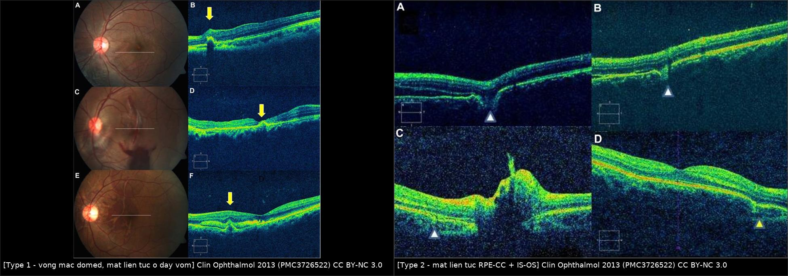
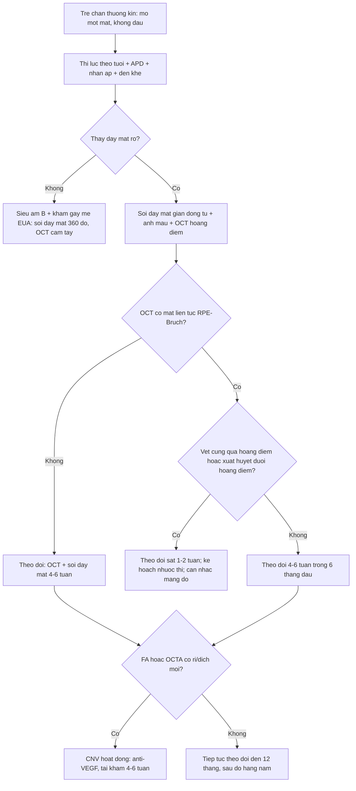
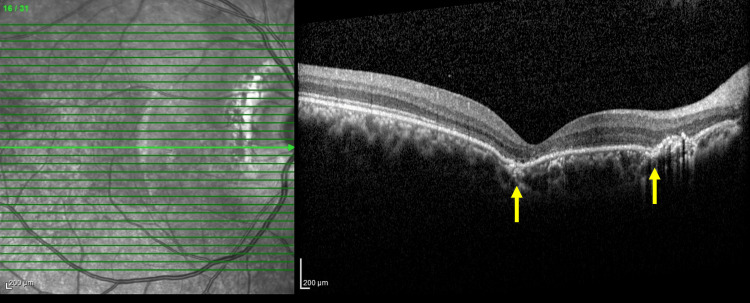
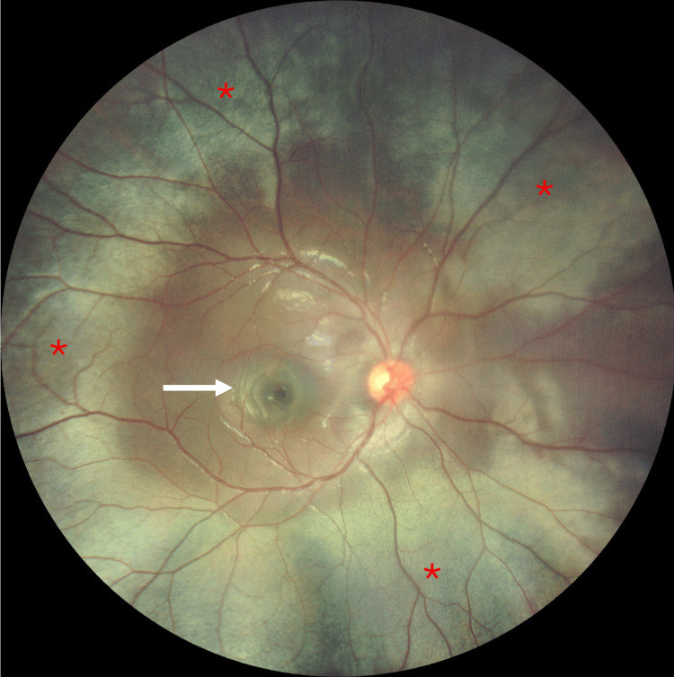
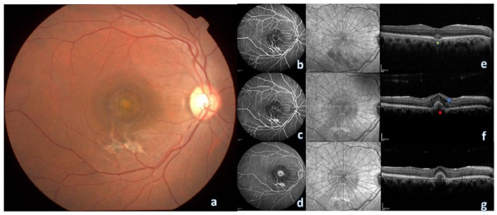
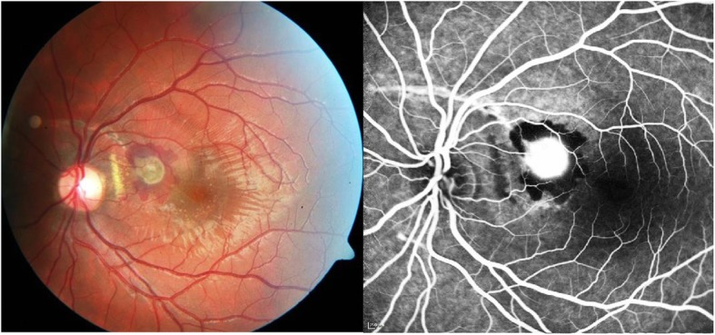
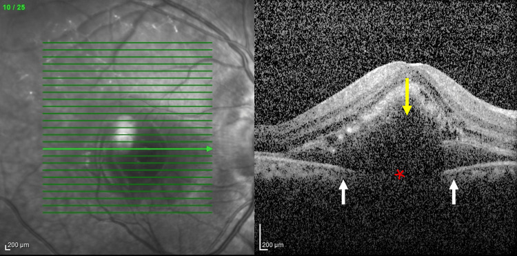

# 3277 — Rách hắc mạc do chấn thương ở trẻ: vì sao vị trí so với hoàng điểm quyết định tiên lượng — và khi nào nghĩ tới CNV thứ phát / Pediatric traumatic choroidal rupture

**Tags:** `pattern:rach-hac-mac` `pattern:vet-cung-duoi-vong-mac` `pattern:xuat-huyet-duoi-vong-mac` `pattern:commotio-retinae` `pattern:mat-mot-ben` `pattern:chan-thuong-dung-dap` `pattern:cnv-thu-phat` `pattern:seo-tang-sac-to` `pattern:hoang-diem-ton-thuong` `pattern:teo-lop-ngoai` `vung:mat` `vung:hac-mac` `vung:hoang-diem` `vung:vong-mac` `vung:dia-thi` `protocol:soi-day-mat-gian-dong-tu` `protocol:OCT-hoang-diem` `protocol:FA` `protocol:ICGA` `protocol:OCTA` `protocol:AF` `protocol:sieu-am-B` `protocol:kham-gay-me` `protocol:theo-doi-CNV`

**Mức chắc chắn (certainty):** tổng hợp y văn (literature synthesis) — phần **cơ chế – hình ảnh – tiên lượng** dựng từ các đoàn hệ có số liệu (**111 mắt** rách hắc mạc, PMID 16832018; **32 mắt**, PMID 15180143; **27 mắt** gần đây, PMID 42765884; **33/37 mắt** có tổn thương hoàng điểm, PMC6537082; **18 mắt** phân tích SD-OCT, PMC3726522; **54 mắt** rách hắc mạc với 11 ca CNV, PMC6878647). Phần **riêng cho trẻ** mỏng hơn nhiều: **ba ca lâm sàng** (PMC13440916; PMID 22927278 trong phần thảo luận; ca 15 tuổi, PMC3764958), **6 trẻ < 15 tuổi** trong loạt 32 mắt (PMID 15180143), và dữ liệu **nhược thị/CNV nhi** dùng thay thế từ các bệnh cảnh lân cận (PMID 29502623; PMID 34091079). **Không có thử nghiệm ngẫu nhiên riêng cho trẻ** — mọi ngưỡng "theo dõi bao lâu, khi nào tiêm" là **thực hành đồng thuận + suy luận**, ghi rõ tại chỗ. **Không ghi tên tác giả** — attribution = **tạp chí + năm + PMCID/PMID**.

> **Câu chốt:** Rách hắc mạc không đỏ mắt, không đau, không mủ — nó chỉ **mờ**, và **vị trí đường rách** chứ không phải độ dài mới là thứ quyết định thị lực: **34%** mắt đạt ≥ 20/40, nhưng **59%** khi rách ngoại vi so với **22%** khi rách trong hoàng điểm (PMID 16832018). Bốn con số phải thuộc: **(1)** khoảng **5–10%** chấn thương kín có rách hắc mạc, và rách **trong hoàng điểm** là yếu tố tiên lượng xấu mạnh nhất (PMC3726522 dẫn y văn; PMID 16832018); **(2)** CNV thứ phát xuất hiện ở **~12%** mắt có rách hắc mạc, trung vị **62 ngày** trong loạt 27 mắt, **phần lớn trong 1 năm** (PMC6537082; PMID 42765884; PMC6878647: trung bình **5,7 ± 4,75 tháng**); **(3)** ở trẻ, thứ **lấy đi thị lực lâu dài** không phải cái vệt vàng mà là **nhược thị** — trong đục thể thủy tinh chấn thương ở trẻ, nhược thị làm kết cục xấu hơn **OR 2,4** (PMID 29502623); **(4)** thị lực có thể **xấu đi trong 2–3 tuần đầu** dù ban đầu còn khá (trẻ 15 tuổi: **16/20 → đếm ngón tay 30 cm** lúc 3 tuần, PMC3764958) — nên **không hứa "sẽ khá lên"** ở lần khám đầu.

## 1. Tổng quan bệnh học – cơ chế hình ảnh (TẠI SAO)

### 1.1 Vì sao màng Bruch vỡ, còn củng mạc và võng mạc thì không

- Nhãn cầu bị ép theo trục trước–sau trong vài mili giây: **xích đạo giãn ra**, rồi bật lại. **Củng mạc** dai và **võng mạc** đàn hồi nên chịu được; **màng Bruch** là lớp **giòn, ít đàn hồi** nằm giữa biểu mô sắc tố (RPE) và hắc mạc — nó **vỡ trước** (PMC3726522; doi 10.1016/j.mehy.2019.02.010).
- Vì Bruch vỡ cùng lúc với **mao mạch hắc mạc (choriocapillaris)**, máu thoát vào **khoang dưới võng mạc hoặc dưới RPE**, trong khi **mạch hắc mạc sâu** thường còn nguyên → xuất huyết **khu trú, không ồ ạt** như vỡ mạch lớn (PMC3726522).
- Giả thuyết cơ học được nhắc nhiều nhất: lực nén dọc trục tạo **vòng ứng suất lệch tâm** quanh **dây thị giác** (điểm cố định); vì nhãn cầu bị đẩy ra ngoài và xoay, **bán kính cong phía thái dương dài hơn** → đường vỡ chạy **hình cung đồng tâm quanh đĩa thị**, thường **thái dương hoàng điểm** (doi 10.1016/j.mehy.2019.02.010). Thực tế hình ảnh khớp: rách **hình cung** chiếm **52%** trong loạt 27 mắt, **dưới hoàng điểm 55%** (PMID 42765884).
- **Rách trực tiếp** (hiếm): vỡ đúng nơi vật đập vào, thường kèm tổn thương củng mạc/mống mắt cùng chỗ; **rách gián tiếp** mới là thể điển hình sau chấn thương kín và là chủ đề bài này (PMID 15180143: 31/32 mắt là gián tiếp).

### 1.2 Vì sao "vị trí" là biến số tiên lượng mạnh nhất

- **111 mắt** rách hắc mạc: **38 (34%)** đạt thị lực ≥ 20/40; **rách ngoại vi 59% (20/34)** so với **rách trong hoàng điểm 22% (17/73)**; **không CNV 38%** so với **có CNV 8% (1/12)**; **không bong võng mạc 40%** so với **có bong võng mạc 7% (1/15)**. Rách **qua hoàng điểm**, **nhiều đường rách** và **thị lực vào kém** đều gắn với không hồi phục (PMID 16832018).
- **32 mắt**: thị lực cuối trung bình **hoàng điểm 20/68**, **cạnh hoàng điểm 20/35**, **ngoài hoàng điểm 20/60**; **6 bệnh nhân < 15 tuổi đạt 20/34** — tức trẻ **không hề vô vọng**, nhưng mẫu quá nhỏ để kết luận (PMID 15180143).
- Vì sao rách qua hoàng điểm nặng: vùng hoàng điểm **không có mạch máu võng mạc**, sống hoàn toàn nhờ **choriocapillaris**; khi Bruch + choriocapillaris đứt, **lớp sợi trục tế bào hạch – tế bào quang thụ** mất nguồn nuôi và mất **đường dẫn tín hiệu** (EZ/ngoại đoạn) → teo lớp ngoài, thị lực trung tâm không hồi phục dù máu tan hết (PMC13440916 Fig. 6: teo lớp ngoài + lõm hắc mạc tại chỗ rách cũ lúc 6 tháng).

### 1.3 Vì sao mắt "không đỏ, không đau" mà vẫn mờ — và tại sao OCT là chìa khóa

- Tổn thương nằm **sau**, không gây viêm tiền phòng; trẻ chỉ **mờ**, đôi khi kèm **commotio retinae** (vẩn đục trắng võng mạc) và **xuất huyết dưới võng mạc** che mất đường rách. Trong loạt 27 mắt: **xuất huyết dưới võng mạc 74%**, **commotio 63%** (PMID 42765884) — nghĩa là **đường rách bị che ở lần khám đầu**.
- Trên OCT, **RPE–Bruch là dải tăng hồi âm mảnh** ngay trên hắc mạc. Ba dấu hiệu của rách:
  1. **Mất liên tục dải RPE–Bruch** (focal discontinuity) — dấu chốt;
  2. **Bờ hắc mạc biến dạng ra ngoài** (outward deformation) hoặc **lõm/hình vòm** tại chỗ đứt;
  3. **Vật liệu tăng hồi âm dưới võng mạc** = máu/fibrin, có thể **nâng vòm** màng Bruch (PMC13440916 Fig. 3; PMC3726522).
- Vì sao **OCT quan trọng hơn ảnh màu**: đường rách **hình cung mảnh** có thể chỉ là một vệt vàng nhạt; OCT xác định **đứt RPE–Bruch thật** so với **xuất huyết đơn thuần** hay **commotio**, và cho biết **EZ/ELM còn hay mất** — yếu tố quyết định thị lực lâu dài (PMC3726522 Fig. 3).

### 1.4 Hai kiểu hình thái OCT — và vì sao kiểu 2 đáng lo hơn

- **Type 1:** màng Bruch **vẫn liên tục trên đỉnh vòm**, mất liên tục chỉ ở **đáy vòm**; hắc mạc **phồng lên hình vòm** do máu dưới RPE; thường gặp khi vật **to hơn ổ mắt** (banh, mặt, nắm đấm) (PMC3726522).
- **Type 2:** **mất liên tục thật** của **RPE–choriocapillaris + IS/OS (EZ) ± ELM**, các lớp võng mạc **trượt xuống** theo chỗ đứt; gặp khi vật **nhỏ hơn ổ mắt** (bóng, đũa, đạn) — và **gần hoàng điểm/trong cung mạch** nhiều hơn có ý nghĩa (PMC3726522).
- Hệ quả thực hành: **type 2 + trong cung mạch** là nhóm **phải theo dõi sát CNV**; **type 1 ngoại vi** có thể chỉ theo dõi thưa. Đây là **phân loại mô tả, chưa được xác nhận độc lập trên đoàn hệ lớn** — dùng để trao đổi với đồng nghiệp, không dùng để tiên lượng tuyệt đối.

### 1.5 Vì sao CNV xuất hiện — và vì sao nó "đến muộn"

- Chỗ Bruch vỡ là **cửa mở** cho mạch hắc mạc xuyên lên; đồng thời RPE mất tính ức chế quanh hoàng điểm → **CNV type 2** (dưới võng mạc, trên RPE) là thể điển hình ở người trẻ. Trong **72 trẻ** có CNV, **toàn bộ 58 mắt có OCT đầy đủ đều là type 2**, và **56,3%** nằm dưới hoàng điểm (BMC Ophthalmol 2025, PMC12036225).
- Tần suất: **~12%** mắt có rách hắc mạc (PMC6537082, ước tính từ 6/37 mắt có tổn thương hoàng điểm); **20% (11/54)** trong loạt 2019 (PMC6878647); **41% (11/27)** trong loạt 2026 (PMID 42765884). Sự khác biệt lớn này phản ánh **chọn bệnh + thời gian theo dõi + định nghĩa CNV hoạt động**, và chính là một khoảng trống (mục 7).
- Thời điểm: **trung vị 62 ngày** (PMID 42765884), **trung bình 5,7 ± 4,75 tháng (2–12)** (PMC6878647), **phần lớn trong 1 năm** (PMC6537082) — nên **"khám 1 tháng thấy ổn" không phải điểm kết thúc**.
- Yếu tố nguy cơ CNV: rách **trong cung mạch/hoàng điểm**, **đường rách dài**, **gần tâm hoàng điểm**, **tuổi lớn hơn** (PMID 16832018: trong cung mạch p = 0,03; tuổi p = 0,04; PMC3726522 tổng hợp).

### 1.6 Vì sao thị lực có thể xấu đi trong 2–6 tuần đầu

- **Rách có thể LAN RỘNG**: trẻ **15 tuổi** bị cùi chỏ vào mắt, ban đầu **16/20**, tuần 3 còn **đếm ngón tay 30 cm**, hình ảnh cho thấy **đường rách mở rộng** và **thay đổi lớp ngoài vùng lân cận** (PMC3764958). Vì vậy **thị lực tốt lúc đầu không phải bằng chứng an toàn**.
- Máu dưới hoàng điểm đang **tổ chức/co kéo**, rồi **CNV** xuất hiện đúng lúc máu tan — trẻ **12 tuổi** bị đũa đâm: vào **6/60**, điều trị bảo tồn, **6 tháng sau chỉ 6/36** vì teo lớp ngoài tại chỗ rách (PMC13440916).
- Hệ quả truyền đạt: hẹn **cụ thể theo tuần**, không nói "vài tháng khám lại"; giải thích rằng **mục tiêu của lần khám sau là bắt CNV sớm**, không phải "chờ máu tan".

### 1.7 Trẻ khác người lớn ở bốn điểm

1. **Nhược thị:** mắt một bên mờ trong **thời kỳ nhạy cảm** (đến ~7–8 tuổi, một phần đến 10 tuổi) → vỏ não thị giác "học" hình ảnh mờ. Trong **106 trẻ** mổ đục thể thủy tinh chấn thương, **nhược thị làm kết cục thị lực xấu hơn OR 2,4 (p = 0,04)** và khúc xạ xấu hơn **OR 3,8** (PMID 29502623). Đây là lý do **rách hắc mạc ở trẻ phải kèm kế hoạch nhược thị**, không chỉ kế hoạch chụp.
2. **Không mô tả được triệu chứng:** trẻ **không than chói/mờ trung tâm**; dấu hiệu thay thế là **nheo mắt, nghiêng đầu, kết quả học giảm, che một mắt khi đọc**.
3. **Cơ chế "vô hại":** bóng xốp "an toàn cho trẻ", **gậy bóng chày đồ chơi** (trẻ **9 tuổi**: rách hắc mạc + bệnh thần kinh thị, **6/60 → 6/12** sau 1 tháng) và **đũa ăn** (trẻ **12 tuổi**) đều đã gây rách hắc mạc — **không có vật nào là "quá mềm"** để bỏ qua soi đáy mắt giãn đồng tử.
4. **Gây mê/khám gây mê (EUA):** trẻ < 5–6 tuổi thường chỉ khám đầy đủ dưới mê; **OCT cầm tay** hoặc **chụp ảnh đáy mắt** trong cùng lần mê để tránh nhiều lần gây mê.

## 2. Mẫu hình + chẩn đoán phân biệt theo vị trí (gamut)

- **Mẫu hình chính:** trẻ/thiếu niên, **một mắt**, sau **chấn thương kín** (bóng, vợt, cùi chỏ, đũa, đồ chơi); **mờ không đau, không đỏ**; đáy mắt có **vệt cung vàng–trắng đồng tâm quanh đĩa thị** (thường thái dương), **± xuất huyết dưới võng mạc**, **± commotio retinae**; vài tuần sau vệt chuyển thành **sẹo tăng sắc tố** kèm **teo lớp ngoài** trên OCT.
- **Theo vị trí đường rách (quyết định tiên lượng và lịch theo dõi):**
  - **Ngoại vi (ngoài cung mạch)** → tiên lượng tốt nhất (**59%** đạt ≥ 20/40, PMID 16832018); theo dõi thưa, **không cần can thiệp**.
  - **Trong cung mạch / cạnh hoàng điểm** → nguy cơ CNV cao nhất; theo dõi **4–6 tuần** trong 6 tháng đầu.
  - **Qua hoàng điểm** → **22%** đạt ≥ 20/40; **nhược thị + teo lớp ngoài**; khám **theo tuần** giai đoạn đầu.
  - **Quanh đĩa thị (peripapillary)** → hay gặp sau **đấm/banh**; nguy cơ **CNV quanh đĩa** và **bệnh thần kinh thị kèm** (kiểm **APD**).
  - **Nhiều đường rách** → tiên lượng xấu hơn về thị lực nhưng **không đồng nghĩa mù** (PMID 15180143: 8 mắt nhiều đường rách, thị lực cuối **20/31**).
- **Theo thời gian (quyết định "nhìn gì" ở mỗi lần khám):**
  - **Cấp < 1 tuần:** máu/commotio che đường rách; OCT tìm **mất liên tục RPE–Bruch**; **không kết luận "chỉ commotio"**.
  - **Bán cấp 2–6 tuần:** máu tan, đường rách rõ; **CNV bắt đầu** (trung vị 62 ngày).
  - **Mạn > 3 tháng:** **sẹo tăng sắc tố** + **teo lớp ngoài/lõm hắc mạc**; nếu có **dịch/dày** → CNV hoạt động.
- **Red flag trong 24 giờ đầu:** **APD** (kèm bệnh thần kinh thị), **xuất huyết dưới võng mạc che hoàng điểm**, **giảm thị lực ≤ 6/60**, **không thấy đáy mắt** (cần **siêu âm B**), **lỗ hoàng điểm/bong võng mạc**, **trẻ < 8 tuổi** (nhược thị), **cơ chế không khớp tổn thương** (nghĩ bạo hành).

## 3. Bảng so sánh phân biệt (ma trận đối chiếu)

| Thực thể (entity) | Hình ảnh điển hình (ảnh màu / OCT / FA) | Chốt vào (rule-in) | Chốt loại (rule-out) | Gợi ý xác nhận |
|---|---|---|---|---|
| **Rách hắc mạc gián tiếp (bài này)** | **Vệt cung vàng–trắng đồng tâm quanh đĩa thị**, thường thái dương; OCT: **mất liên tục RPE–Bruch + bờ hắc mạc biến dạng**; muộn: **sẹo tăng sắc tố** | **Vệt cung + tiền sử chấn thương kín + OCT thấy đứt RPE–Bruch** | **RPE–Bruch liên tục**, không có vệt cung | Soi đáy mắt giãn đồng tử + **OCT qua toàn bộ chiều dài vệt** |
| **Rách hắc mạc trực tiếp** | Đứt tại **đúng điểm va đập**, thường kèm **rách củng mạc/mống mắt**, xuất huyết tại chỗ | **Tổn thương đúng vị trí vật đập + tổn thương thành nhãn cầu cùng chỗ** | Vệt cung **đồng tâm quanh đĩa thị** xa điểm va đập | Đèn khe/soi góc; **CT** khi nghi xuyên thấu |
| **Commotio retinae** | **Vẩn đục trắng sữa** võng mạc, bờ mờ, **không có đường đứt**; OCT: **tăng hồi âm lớp ngoài**, EZ có thể gián đoạn tạm thời | **Vẩn đục trắng + không thấy đứt RPE–Bruch** | **Có vệt cung rõ + đứt RPE–Bruch** | OCT (theo dõi 2–4 tuần, commotio tan dần) |
| **Xuất huyết dưới võng mạc đơn thuần** | **Đám đỏ sẫm**, che chi tiết; OCT: **khối tăng hồi âm dưới võng mạc**, RPE–Bruch **còn liên tục** | **Đám máu + RPE–Bruch liên tục** | **Đứt RPE–Bruch dưới đám máu** (phải chụp lại sau khi máu bớt) | OCT lặp lại 2–4 tuần; FA nếu nghi CNV |
| **CNV thứ phát** | **Màng xám–xanh dưới võng mạc**, dịch/dày trên OCT, **FA rỉ mạnh thì muộn**, **OCTA thấy mạng mạch** | **Dịch dưới võng mạc + FA rỉ + OCTA có mạng CNV** | **Sẹo phẳng, không dịch, FA không rỉ** | FA + OCTA; theo dõi 4–6 tuần/lần khi nghi |
| **Sẹo hắc mạc cũ / sẹo tăng sắc tố** | **Đám tăng sắc tố phẳng**, bờ rõ, **không dịch**; OCT: **teo lớp ngoài + lõm hắc mạc**, không có khối | **Tăng sắc tố phẳng + teo lớp ngoài tại chỗ rách cũ** | **Dày/dịch mới, FA rỉ** (đó là CNV) | OCT + FA; so ảnh cũ |
| **Vết rách RPE (RPE tear)** | **Vùng RPE mất đột ngột** cạnh **nếp RPE cuộn**, thường trên **bệnh nền (bong RPE do AMD)**; người trẻ hiếm | **Ranh giới RPE gấp cuộn + bệnh nền** | **Tiền sử chấn thương + vệt cung** | OCT/AF: vùng **giảm huỳnh quang tuyệt đối** |
| **Vệt angioid (angioid streaks)** | **Nhiều vệt hướng tâm quanh đĩa, HAI BÊN**, không tiền sử chấn thương; hay kèm **bệnh da/huyết sắc tố** | **Hai bên + nhiều vệt + bệnh hệ thống** | **Một bên + một vệt cung + chấn thương** | Khám mắt bên kia; OCT/FA; tầm soát bệnh nền |
| **Lỗ hoàng điểm chấn thương** | **Lỗ tròn đỏ** giữa hoàng điểm; OCT: **khuyết toàn bộ võng mạc** tại trung tâm | **Lỗ tròn + OCT khuyết võng mạc** | **Chỉ đứt RPE–Bruch, võng mạc còn liền** | OCT; theo dõi (lỗ nhỏ có thể tự đóng) |
| **Melanoma hắc mạc** | **Khối sắc tố gồ lên**, có **mạch máu trên u**, **dịch dưới võng mạc**, siêu âm **nội phản hồi thấp–trung bình** | **Khối gồ + siêu âm khối đặc + không tiền sử chấn thương** | **Phẳng, tăng sắc tố đều sau chấn thương** | Siêu âm B/UBM; AF/FA; **chụp lại 3 tháng** |
| **Bong võng mạc thanh dịch** | **Dịch võm, không lỗ**, OCT **không thấy lỗ rách**; thường trong **bệnh hệ thống/viêm** | **Dịch võm + không lỗ + không tiền sử chấn thương** | **Có đường rách hắc mạc + máu** | OCT hoàng điểm + soi đáy mắt 360° |

*Ảnh ghép: bên trái — **type 1**: màng Bruch còn liên tục trên đỉnh vòm, mất liên tục ở **đáy vòm**, hắc mạc phồng hình vòm (vật to hơn ổ mắt); bên phải — **type 2**: **mất liên tục thật** của RPE–choriocapillaris và IS/OS ± ELM, các lớp võng mạc trượt xuống, hay gặp với vật nhỏ và **gần hoàng điểm**. Tạo bằng `tools/make_composite.py` (letterbox, không crop). Nguồn: Clin Ophthalmol 2013 (PMC3726522, Fig. 1 và Fig. 3), CC BY-NC 3.0.*

## 4. Protocol khám + ngưỡng quyết định + lịch theo dõi

### 4.1 Trình tự khám trẻ nghi rách hắc mạc

### 4.2 Ngưỡng định lượng phải nhớ

| Thông số | Ngưỡng / giá trị | Ý nghĩa | Nguồn |
|---|---|---|---|
| Rách hắc mạc sau chấn thương kín | **~5–10%** bệnh nhân | Chủ động tìm vệt cung ở **mọi** chấn thương kín | PMC3726522 (dẫn y văn) |
| Rách hắc mạc trong nhóm có tổn thương hoàng điểm | **33/37 (89%)** | Tổn thương hoàng điểm sau chấn thương gần như đồng nghĩa rách hắc mạc | PMC6537082 |
| Tần suất trong chấn thương kín (58 mắt) | **6,9% (4/58)**; commotio **46,55%** | Số thực tế tại tuyến; **75,86%** hồi phục hoàn toàn sau 6 tháng | PMC12827808 |
| Hình thái | **hình cung 52%**, **dưới hoàng điểm 55%** | Hai mô tả hay gặp nhất | PMID 42765884 |
| Kèm theo | **xuất huyết dưới võng mạc 74%**, **commotio 63%** | Đường rách dễ bị che ở lần khám đầu | PMID 42765884 |
| Thị lực cuối ≥ 20/40 | **34% (38/111)**; **ngoại vi 59%** vs **hoàng điểm 22%** | Vị trí quyết định tiên lượng | PMID 16832018 |
| Rách qua hoàng điểm | **7/18 mắt**; **nhiều đường rách 5/18** | Nhóm nguy cơ cao cần theo dõi sát | PMC3726522 |
| Trẻ < 15 tuổi | **6 ca**, thị lực cuối trung bình **20/34** | Trẻ có thể hồi phục tốt — nhưng mẫu nhỏ | PMID 15180143 |
| CNV sau rách hắc mạc | **~12%** (ước tính); **20% (11/54)**; **41% (11/27)** | Dao động lớn do chọn bệnh/định nghĩa | PMC6537082; PMC6878647; PMID 42765884 |
| Thời điểm CNV | trung vị **62 ngày**; trung bình **5,7 ± 4,75 tháng (2–12)**; **phần lớn < 1 năm** | Lịch theo dõi phải phủ **≥ 12 tháng** | PMID 42765884; PMC6878647; PMC6537082 |
| Mất thị lực do CNV | **~5%** các rách (y văn) | CNV không phải "chuyện hiếm gặp" | PMC3726522 (dẫn y văn) |
| Anti-VEGF | **4,2 ± 3,2 mũi (1–8)**; **68,4% ≤ 3 mũi**; trẻ **2,12 ± 0,80 mũi** | Ít mũi hơn AMD; theo dõi T&E | PMC6878647; PMID 34091079; PMC12036225 |
| CNV ở trẻ — nguyên nhân rách hắc mạc | **3,5%** của **2.353 mắt** CNV nhi | Rách hắc mạc là nguyên nhân **hiếm nhưng có thật** ở trẻ | PMID 34091079 |
| Lỗ hoàng điểm / màng trước võng mạc kèm theo | **19% / 15%** | Phải soi đáy mắt + OCT, không chỉ nhìn vệt rách | PMID 42765884 |
| Nhược thị ở trẻ (đục thể thủy tinh chấn thương) | **OR 2,4** thị lực xấu hơn (p = 0,04); khúc xạ **OR 3,8** | Kế hoạch nhược thị là phần bắt buộc | PMID 29502623 |
| Thời gian theo dõi tối thiểu | **12 tháng** (4–6 tuần/lần trong 6 tháng đầu) | Suy luận từ phân bố thời điểm CNV | PMC6537082; PMC6878647 |

### 4.3 Quyết định điều trị — khung thực hành

1. **Không có CNV hoạt động → quan sát.** Không có bằng chứng rằng corticoid, thuốc "tan máu" hay laser dự phòng cải thiện kết cục; cái cần là **lịch khám** và **điều trị nhược thị** (suy luận từ các loạt quan sát, PMID 16832018; PMC6878647).
2. **CNV hoạt động (dịch/dày mới + FA rỉ ± OCTA thấy mạng) → anti-VEGF.** Loạt 5 mắt: **4/5 cải thiện, 1/5 ổn định**, CNV thoái triển ở **tất cả**, trung bình **4,2 mũi** (PMC6878647). Ở trẻ, đáp ứng tốt: **0,75 → 0,63 logMAR** (p = 0,021), **38,5%** tăng ≥ 2 dòng, trung bình **2,12 mũi** (PMC12036225); registry nhi: **68,4% ≤ 3 mũi**, thị lực **0,62 → 0,39 logMAR** sau 1 năm (PMID 34091079).
3. **Xuất huyết dưới hoàng điểm lượng lớn ở trẻ:** **không có chuẩn**. Ca trẻ 12 tuổi được **điều trị bảo tồn** và chỉ đạt **6/36** (PMC13440916); kỹ thuật **tPA dưới võng mạc ± bơm khí** có báo cáo ở người lớn/thiếu niên nhưng **chưa có so sánh** — nêu như lựa chọn **chọn lọc, có tư vấn rõ** (mục 7).
4. **Nhược thị:** đo **khúc xạ lý liệt** ở mọi trẻ; nếu đường rách qua hoàng điểm hoặc xuất huyết kéo dài → **bịt mắt/atropine theo tuổi** ngay khi trục quang cho phép, phối hợp **kính đúng số**. Bằng chứng nhược thị ở bệnh cảnh khác cho thấy **bịt mắt + kính** hiệu quả hơn không điều trị (xem bài 3271).
5. **Không bỏ qua bệnh thần kinh thị:** **APD** + đĩa thị phù sau chấn thương = có thể kèm **tổn thương thần kinh thị** (trẻ 9 tuổi bị gậy xốp: **6/60 → 6/12** sau 1 tháng, còn **hai sẹo cung**) (PMID 22927278).

### 4.4 Lịch theo dõi đề xuất (suy luận từ dữ liệu trên)

| Thời điểm | Việc phải làm | Vì sao |
|---|---|---|
| **Ngày 1–3** | Thị lực, APD, nhãn áp, soi đáy mắt giãn đồng tử, **OCT + ảnh màu** | Chốt vị trí rách, phát hiện máu/lỗ/bong; **EUA** nếu không hợp tác |
| **Tuần 1–2** | Lặp OCT nếu máu che; đo khúc xạ lý liệt | **Rách có thể lan rộng** (PMC3764958); bắt đầu kế hoạch nhược thị |
| **Tuần 4–6** | OCT + **FA/OCTA** nếu nghi | CNV trung vị **62 ngày**; giai đoạn dễ bỏ sót nhất |
| **Tháng 3, 6, 9, 12** | OCT mỗi lần; FA/OCTA khi có dịch/dày mới | Phần lớn CNV xuất hiện **< 1 năm** |
| **Hằng năm (ít nhất 3–5 năm)** | Thị lực, khúc xạ, OCT; khám mắt bên kia | CNV muộn + sẹo/teo tiến triển; trẻ còn lớn |
| **Mỗi 3–6 tháng đến 8 tuổi** | Đánh giá **nhược thị** (thị lực hai mắt, phối hợp) | Thời kỳ nhạy cảm; **OR 2,4** nếu bỏ qua |

### 4.5 Khi nào chuyển tuyến / hội chẩn

- **Xuất huyết dưới hoàng điểm lớn** hoặc **lỗ hoàng điểm** → hội chẩn **võng mạc nhi** sớm.
- **Nghi bạo hành** (cơ chế không khớp, tổn thương hai bên, trẻ nhỏ) → quy trình bảo vệ trẻ, không chỉ xử lý mắt.
- **Nghi CNV quanh đĩa thị** → FA/OCTA + hội chẩn võng mạc vì anti-VEGF quanh đĩa có nguy cơ đặc thù.

*Sáu tháng sau chấn thương: **teo lớp ngoài + mỏng hoàng điểm + lõm hắc mạc** đúng chỗ rách cũ — tương ứng với thị lực chỉ **6/36** dù máu đã tan hết. Đây là lý do "chờ máu tan" không phải là điều trị. Nguồn: Cureus 2026 (PMC13440916, Fig. 6), CC BY 4.0.*

## 5. Biến thể bình thường và cạm bẫy

- **"Chỉ là commotio"** — sai lầm hay gặp nhất: vẩn đục trắng có thể **che một vệt cung mảnh**; luôn **OCT qua toàn bộ vùng nghi** và **khám lại sau 2–4 tuần** (commotio tan, đường rách lộ ra).
- **"Đồ chơi an toàn"**: gậy xốp, đũa ăn, bóng tennis đều đã gây rách hắc mạc ± bệnh thần kinh thị (PMID 22927278; PMC13440916). **Cơ chế không quyết định mức độ tổn thương**.
- **Trẻ không khai chấn thương**: người lớn không chứng kiến, trẻ sợ bị mắng → **một mắt mờ "tự nhiên"** vẫn phải hỏi kỹ và **soi đáy mắt giãn đồng tử**.
- **Sẹo tăng sắc tố bị gọi là melanoma**: sẹo rách hắc mạc **phẳng, không mạch máu trên u, không dịch**; melanoma **gồ lên, có mạch, siêu âm khối đặc** → **siêu âm B/UBM + chụp lại 3 tháng**, không sinh thiết mù.
- **Angioid streaks bị gọi là "rách do chấn thương"**: vệt **hai bên, nhiều đường, hướng tâm** quanh đĩa thị, không tiền sử chấn thương, hay kèm bệnh hệ thống → **khám mắt bên kia là bước rẻ nhất**.
- **CNV bị gọi là "máu còn sót"**: máu **đậm dần lên và tan dần**, còn CNV **gây dịch/dày mới** sau khi máu đã bớt; nếu **thị lực giảm lại sau 3–8 tuần** → **FA/OCTA ngay**, đừng hẹn 3 tháng.
- **Hứa "sẽ khá lên"**: **16/20 → đếm ngón tay 30 cm** trong 3 tuần là kịch bản có thật (PMC3764958); hãy nói rõ **mốc khám** và **dấu hiệu cần quay lại ngay** (mờ tăng, nhìn vật cong, một đám xám mới).
- **Bỏ sót mắt bên kia và bỏ sót APD**: chấn thương kín có thể gây **bệnh thần kinh thị** cùng lúc; **APD** là dấu hiệu rẻ và quyết định.
- **Chỉ chụp OCT hoàng điểm**: đường rách **ngoại vi/quanh đĩa** sẽ bị bỏ sót; OCT phải **đi theo chiều dài vệt** (cube/raster qua toàn bộ tổn thương).
- **Quên nhược thị**: rách ngoại vi ở trẻ **vẫn có thể gây nhược thị do lệch khúc xạ**; đo khúc xạ lý liệt và phối hợp hai mắt ở **mọi** lần khám.

## 6. Tự lượng giá — Blind Quiz

**Ca 1 — Bé trai 12 tuổi, mắt phải mờ sau khi chơi đũa ở trường**

- Gợi ý lâm sàng: đau và chảy nước mắt ngay sau va chạm; thị lực **6/60**; không có APD; đồng tử giãn thuốc, thấy **đục hình hoa thị** ở thể thủy tinh.
- Câu hỏi: (a) Hai tổn thương ở hậu đoạn trong ảnh? (b) Vì sao **không được** kết luận "chỉ là commotio"? (c) Hai việc phải làm trong cùng buổi khám?

<b>Bấm để hiện đáp án (findings + chẩn đoán)</b>

- **Dấu hiệu:** **commotio retinae 360° ở ngoại vi** (dấu hoa thị đỏ) + **xuất huyết dưới hoàng điểm lớn lan tới tâm hoàng điểm** (mũi tên trắng).
- **Chẩn đoán:** **chấn thương kín + xuất huyết dưới võng mạc hoàng điểm + rách hắc mạc** (OCT cùng ca: **mất liên tục RPE–Bruch + bờ hắc mạc lõm ra ngoài**, cạnh đĩa thị và ở hoàng điểm).
- **Vì sao không "chỉ commotio":** commotio là **vẩn đục tạm thời**, còn đám máu + OCT đứt RPE–Bruch là **tổn thương cấu trúc**; bỏ qua dẫn tới **không theo dõi CNV** và **không điều trị nhược thị**.
- **Phải làm:** **APD + nhãn áp + soi đáy mắt 360°**, **OCT qua vùng hoàng điểm và quanh đĩa thị**, **đo khúc xạ lý liệt**, hẹn **1–2 tuần** và giải thích nguy cơ **CNV** (trung vị ~62 ngày) cùng **nhược thị**.
- **Diễn biến của ca này:** điều trị bảo tồn, thị lực chỉ **6/36** sau 6 tháng vì **teo lớp ngoài** tại chỗ rách — không phải vì "máu chưa tan".
- **Nguồn ảnh:** Cureus 2026 — **PMC13440916** — Fig. 2 — CC BY 4.0.

**Ca 2 — Nam 23 tuổi, mắt phải mờ dần 9 tháng sau khi bị bóng cricket đập**

- Gợi ý lâm sàng: ban đầu chỉ "hơi mờ", nay **nhìn vật cong** và **mờ trung tâm**; không đau, không đỏ.
- Câu hỏi: (a) Bất thường cấu trúc trên OCT (e)? (b) Trên OCT (f) có gì mới so với (e)? (c) Vì sao **thị lực giảm lại sau nhiều tháng** lại là dấu hiệu cần chụp mạch ngay?

<b>Bấm để hiện đáp án (findings + chẩn đoán)</b>

- **Dấu hiệu:** ảnh màu có **đường rách hắc mạc dưới hoàng điểm** kèm **tổn thương RPE**; FA (b–d) có **ổ tăng huỳnh quang lan rộng dần** ở thì muộn = **rỉ dịch**; OCT (e) **đứt RPE–Bruch dưới hoàng điểm** + máu dưới võng mạc; OCT (f) xuất hiện **màng CNV type 2 dưới hoàng điểm** + **khoang dịch trong võng mạc**; (g) sau **3 mũi bevacizumab** → **sẹo hóa, hết dịch**.
- **Chẩn đoán:** **CNV thứ phát sau rách hắc mạc do chấn thương** (thể type 2, dưới hoàng điểm).
- **Vì sao phải chụp ngay:** CNV tiến triển **âm thầm**; chờ thêm vài tháng → **sẹo disciform** và mất thị lực trung tâm vĩnh viễn. Đây là lý do lịch khám phải phủ **≥ 12 tháng** (phần lớn CNV xuất hiện **< 1 năm**, trung bình **5,7 tháng**).
- **Nguồn ảnh:** Ther Adv Ophthalmol 2019 — **PMC6537082** — Fig. 2 — CC BY-NC 4.0.

**Ca 3 — Nam 19 tuổi, mắt trái mờ sau chấn thương, nay thấy "đám xám" cạnh đĩa thị**

- Gợi ý lâm sàng: chấn thương kín nhiều tháng trước; nay có **đám xám** ở vùng hoàng điểm–đĩa thị, **nhìn mờ tăng dần**.
- Câu hỏi: (a) Mô tả đường rách trên ảnh màu (vị trí so với đĩa thị và hoàng điểm)? (b) Vì sao vùng xám **rỉ mạnh trên FA** lại đổi chẩn đoán? (c) Nêu hai nguy cơ cần theo dõi tiếp.

<b>Bấm để hiện đáp án (findings + chẩn đoán)</b>

- **Dấu hiệu:** **đường rách hắc mạc hình cung** chạy **dưới mạch máu phía trên đĩa thị**, băng qua vùng hoàng điểm–đĩa thị; **đám xám (CNV) + máu dưới võng mạc** trong vùng hoàng điểm–nhú; FFA: **rỉ mạnh** đúng vùng đó.
- **Chẩn đoán:** **rách hắc mạc hình cung + CNV thứ phát** (CNV ở vùng hoàng điểm–nhú).
- **Vì sao FA đổi chẩn đoán:** đám xám **không phải sẹo** — sẹo không rỉ; **rỉ ở thì muộn = mạch đang hoạt động** → chỉ định **anti-VEGF**, trong khi sẹo chỉ theo dõi.
- **Hai nguy cơ:** **CNV tái hoạt** (cần OCT/FA lặp lại) và **sẹo hóa/teo lớp ngoài** tại chỗ rách nếu điều trị muộn; thêm **màng trước võng mạc (15%)** và **lỗ hoàng điểm (19%)** trong các loạt lớn.
- **Nguồn ảnh:** BMC Ophthalmol 2019 — **PMC6878647** — Fig. 1 — CC BY 4.0.

**Ca 4 (OCT cấp) — Bé gái 14 tuổi, mắt trái mờ 3 ngày sau khi bị bóng rổ đập**

- Gợi ý lâm sàng: thị lực **6/24**; đáy mắt có **đám sẫm màu** ở hoàng điểm, không thấy rõ bờ.
- Câu hỏi: (a) Lớp nào bị đứt (mũi tên vàng, dấu hoa thị đỏ)? (b) Vì sao **bờ hắc mạc lõm ra ngoài** (mũi tên trắng)? (c) Kế hoạch 3 bước tiếp theo?

<b>Bấm để hiện đáp án (findings + chẩn đoán)</b>

- **Dấu hiệu:** **khối tăng hồi âm lớn dưới võng mạc** (máu — mũi tên vàng) làm **vòm hóa**; **dấu hoa thị đỏ** đánh dấu **mất liên tục dải RPE–Bruch**; **bờ hắc mạc biến dạng/lõm ra ngoài** (mũi tên trắng) tại chỗ đứt.
- **Chẩn đoán:** **rách hắc mạc cấp + xuất huyết dưới võng mạc** sau chấn thương kín.
- **Vì sao lõm ra ngoài:** màng Bruch mất liên tục → **áp lực hắc mạc** và co kéo của sợi collagen làm bờ đứt **lõm vào trong hắc mạc** (outward deformation); đây là dấu phân biệt với **xuất huyết đơn thuần** (bờ hắc mạc liên tục, phẳng).
- **3 bước:** (1) **soi đáy mắt 360° + APD + nhãn áp**; (2) **đo khúc xạ lý liệt + kế hoạch nhược thị**; (3) hẹn **1–2 tuần**, dặn quay lại ngay nếu **mờ tăng hoặc nhìn cong**, và giải thích **CNV có thể xuất hiện sau 2–3 tháng**.
- **Nguồn ảnh:** Cureus 2026 — **PMC13440916** — Fig. 3 — CC BY 4.0.

## 7. Câu hỏi nghiên cứu & điểm chưa đồng thuận (tính đến 11/2026)

1. **[Tranh cãi] Ở trẻ có rách hắc mạc qua hoàng điểm kèm xuất huyết dưới hoàng điểm, can thiệp sớm (anti-VEGF dự phòng hoặc đẩy máu bằng tPA/khí) có cải thiện thị lực cuối so với theo dõi không?**
   - **Đã biết:** CNV xuất hiện ở **41% (11/27 mắt)**, trung vị **62 ngày** (PMID 42765884); anti-VEGF kiểm soát tốt khi CNV **đã hoạt động** (**4/5 cải thiện**, PMC6878647), và ở trẻ cần ít mũi (**68,4% ≤ 3 mũi**, PMID 34091079).
   - **Chưa rõ:** chưa có thử nghiệm so sánh **dự phòng** với **điều trị khi CNV xuất hiện**; kỹ thuật **tPA dưới võng mạc + bơm khí** chỉ có loạt ca người lớn/thiếu niên, chưa có ngưỡng lượng máu hay thời điểm.
   - **Hướng nghiên cứu:** đoàn hệ tiến cứu ở trẻ ghi **diện tích xuất huyết, độ dày OCT, thời điểm can thiệp, thị lực 12 tháng**, có nhánh đối chứng theo dõi.
   - **Nguồn:** PMID 42765884; PMC6878647; PMID 34091079; PMC13440916.

2. **[Khoảng trống] Lịch theo dõi CNV tối ưu ở trẻ sau rách hắc mạc là gì — OCT mỗi 4 tuần trong 6 tháng, hay FA/OCTA theo triệu chứng?**
   - **Đã biết:** CNV tập trung **2–12 tháng** (trung bình **5,7 tháng**, PMC6878647), **phần lớn < 1 năm** (PMC6537082); rách hắc mạc chỉ chiếm **3,5%** nguyên nhân CNV ở **2.353 mắt** trẻ (PMID 34091079), nên **số ca mỗi trung tâm quá nhỏ** để so sánh lịch.
   - **Chưa rõ:** lợi ích của **OCTA định kỳ không tiêm** so với **chụp theo triệu chứng**, và chi phí/gây mê của mỗi lần khám ở trẻ nhỏ.
   - **Hướng nghiên cứu:** nghiên cứu **diagnostic yield** theo lịch (OCT/OCTA mỗi 4–6 tuần) với kết cục **thị lực 12–24 tháng** và **số lần gây mê**.
   - **Nguồn:** PMC6878647; PMC6537082; PMID 34091079.

3. **[Khác biệt thực hành] Sau khi trục quang đã trong, có nên điều trị nhược thị song song ngay cả khi đường rách qua hoàng điểm — và bịt bao nhiêu giờ/ngày?**
   - **Đã biết:** nhược thị làm kết cục xấu hơn **OR 2,4** ở trẻ sau chấn thương (PMID 29502623); ca trẻ **12 tuổi** được điều trị bảo tồn và chỉ đạt **6/36**, tức **không có "pha hồi phục" tự nhiên** để chờ (PMC13440916).
   - **Chưa rõ:** thực hành dao động từ **theo dõi đơn thuần** tới **bịt mắt 2–6 giờ/ngày**; chưa có dữ liệu riêng cho **rách hắc mạc** (đa số bằng chứng nhược thị đến từ đục thể thủy tinh/khúc xạ).
   - **Hướng nghiên cứu:** registry ghi **thời điểm bắt đầu bịt, số giờ, thị lực hai mắt, OCT hoàng điểm**, so sánh với nhóm chỉ đeo kính.
   - **Nguồn:** PMID 29502623; PMC13440916; PMC3764958.

## Bài liên quan chéo

- [3271 – Iridodialysis ở trẻ em: khi nào khâu, khi nào chờ](../3271-iridodialysis-tre-em-khi-nao-khau/lesson.md)
- [6213 – Đục thể thủy tinh do chấn thương ở trẻ](../6213-duc-thuy-tinh-chan-thuong-tre/lesson.md)
- [1518 – Tách lớp võng mạc ngoại vi so với bong võng mạc](../1518-tach-lop-vong-mac-ngoai-vi/lesson.md)
- [1444 – Viêm màng bồ đào sau chấn thương](../1444-viem-mang-bo-dao-sau-chan-thuong/lesson.md)
- [441 – OCT hoàng điểm: đọc lớp và bẫy](../441-OCT-hoang-diem/lesson.md)
- [400 – Tổng quan Mắt & thị giác](../400-tong-quan-mat-thi-giac/lesson.md)

## Ảnh

- Tên file: `3277_rach-hac-mac_Fundus-AcuteCommotioSubmacular_PMC13440916-Fig2.jpg`, `3277_rach-hac-mac_OCT-AcuteRPE-Bruch_PMC13440916-Fig3.jpg`, `3277_rach-hac-mac_OCT-6monthAtrophy_PMC13440916-Fig6.jpg`, `3277_rach-hac-mac_Fundus-FA-OCT_CNV_PMC6537082-Fig2.jpg`, `3277_rach-hac-mac_Fundus-FFA_ArcuateRupture_PMC6878647-Fig1.jpg`, `3277_rach-hac-mac_OCT_Type1_PMC3726522-Fig1.jpg`, `3277_rach-hac-mac_OCT_Type2_PMC3726522-Fig3.jpg`, `composite_rach-hac-mac_type1_vs_type2.jpg`. Nguồn + giấy phép từng ảnh: `images/CREDITS.md`.
- Ảnh đơn giữ **nguyên bản** (không crop); ảnh ghép tạo bằng `tools/make_composite.py` (letterbox nền đen, giữ tỷ lệ).

> Không dùng để chẩn đoán độc lập khi chưa có người hướng dẫn.
