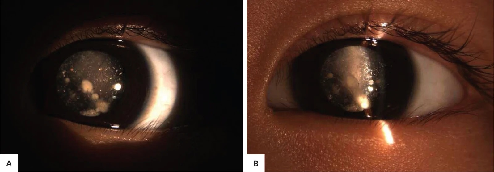
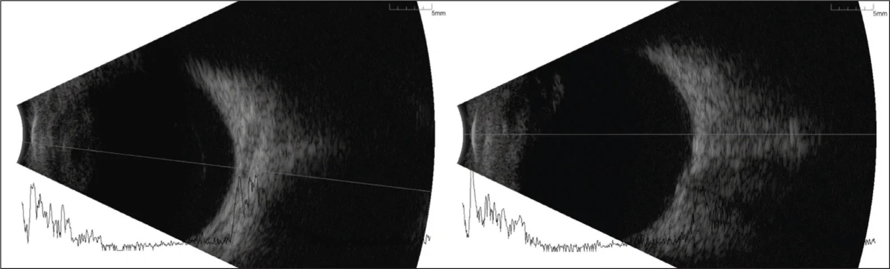
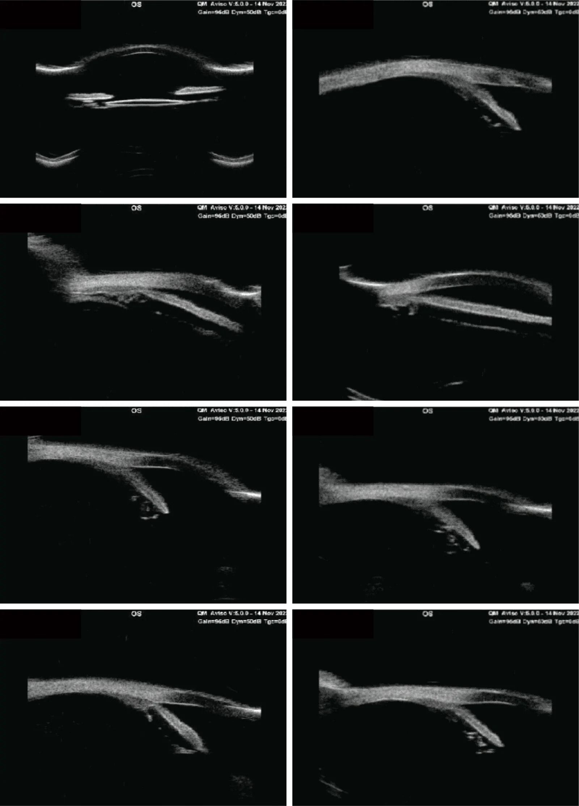
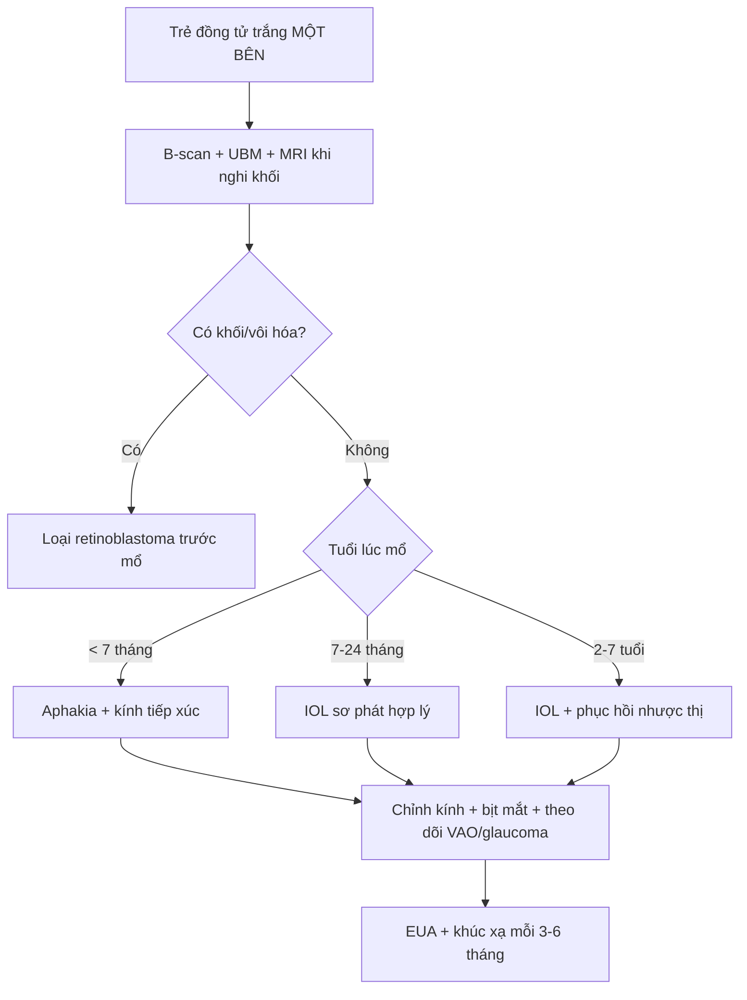
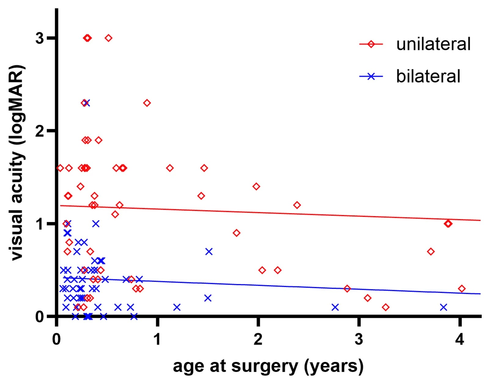

# 3278 — Đục thể thủy tinh bẩm sinh MỘT BÊN: đặt IOL cùng thì hay để không IOL + kính tiếp xúc / Unilateral congenital cataract: primary IOL versus aphakia with contact lens

**Tags:** `pattern:duc-the-thuy-tinh` `pattern:leukocoria` `pattern:nhược-thị` `pattern:duc-truc-quang` `pattern:loi-dia-thi` `pattern:mat-mot-ben` `vung:mat` `vung:the-thuy-tinh` `vung:nhi` `score:IATS-risk` `protocol:khuc-xa-ly-liet` `protocol:do-truc-nhan-cau` `protocol:sieu-am-B` `protocol:UBM` `protocol:AS-OCT` `protocol:kham-gay-me` `incidentaloma:khong`

**Mức chắc chắn (certainty):** tổng hợp y văn (literature synthesis) — dựng từ **RCT IATS 114 nhũ nhi đục thể thủy tinh một bên** (JAMA Ophthalmol 2014, **PMC4138810**; theo dõi 5 năm), **nhánh glaucoma 10,5 năm của chính IATS** (JAMA Ophthalmol 2021, **PMC7747044**), **tăng trưởng trục nhãn cầu 10,5 năm** (Am J Ophthalmol 2020, **PMC7593806**), **dịch chuyển khúc xạ sau IOL** (Ophthalmology 2017, **PMC5507620**) và **ở mắt aphakia** (Eye Contact Lens 2021, **PMC7786508**), **IOL thứ phát trong IATS** (J Cataract Refract Surg 2021, **PMC7936988**), **tuân thủ kính tiếp xúc** (JAMA Ophthalmol 2018, **PMC5862145**), **chi phí 5 năm** (Ophthalmology 2015, **PMID 25439604**), **bịt mắt** (JAMA Ophthalmol 2016, **PMC4982828**; Ophthalmology 2025, **PMC11930621**), **registry TAPS một bên 7–24 tháng** (Ophthalmology 2019, **PMID 30880109**), **so sánh 2–7 tuổi** (J AAPOS 2022, **PMID 35868624**), **PFV trong đoàn hệ IoLunder2** (Eye 2016, **PMC5023809**), **tổng quan hội đồng chuyên gia 2025** (Asia Pac J Ophthalmol 2025, **PMC12399275**), **đoàn hệ 173 mắt theo dõi ≥ 6 năm** (Vision 2026, **PMC13600075**), **hai phân tích gộp** (PLoS One 2019, **PMC6443152**; Int J Clin Pract 2021, **DOI 10.1111/ijcp.14143**), **báo cáo AAO 2019** (Ophthalmology 2019, **PMID 31230794**), **ca RB chẩn đoán nhầm là đục thể thủy tinh bẩm sinh** (Clin Optom 2026, **PMC12978154**), **ca PFV thể trước không điển hình** (Acta Med Philipp 2026, **PMC13713874**) và **RGPCL so với kính gọng** (BMC Ophthalmol 2019, **PMC6425554**). Nhóm **không có bệnh nhân của mình**; chỗ chưa đủ chắc ghi thẳng là **"chưa rõ"**. **Không ghi tên tác giả** — attribution dùng **tạp chí + năm + PMCID/PMID**.

> **Câu chốt:** Ở trẻ **dưới 7 tháng** bị đục thể thủy tinh **một bên**, đặt IOL cùng thì **không cho thị lực tốt hơn** để aphakia + kính tiếp xúc, nhưng **tăng biến cố và mổ lại**. Sáu con số phải thuộc: **(1)** IATS 114 nhũ nhi: thị lực trung vị **0,90 logMAR (20/159) ở CẢ HAI nhóm**, khoảng **50% mắt ≤ 20/200** lúc 4,5 tuổi; **(2)** biến cố bất kỳ **81% (IOL) vs 56% (kính tiếp xúc)**, mổ nội nhãn thêm **72% vs 21%**; **(3)** glaucoma/glaucoma suspect **28% vs 35%** ở 5 năm, và **22% glaucoma / 40% glaucoma + suspect** ở 10 năm — **không khác giữa hai nhóm**; **(4)** nhãn cầu vẫn lớn **4,7 mm** từ lúc mổ đến 10,5 tuổi (**70,2% trong 5 năm đầu**), nên IOL đặt lúc 1 tháng tuổi **cận thị hóa 8,97 D** đến 5 tuổi (6 tháng tuổi: **7,22 D**); **(5)** từ 7–24 tháng, IOL **hợp lý hơn**: TAPS một bên **92% đặt IOL**, biến cố **24%**, nghi glaucoma **4%**, mổ lại **14%**; **(6)** kết cục cuối cùng do **nhược thị và tuân thủ** quyết định: bịt mắt trung bình **3,73 giờ/ngày** năm đầu, bịt nhiều hơn tương quan với thị lực tốt hơn (**r = −0,32 đến −0,36**), còn tuổi mổ **một mình không dự báo** thị lực dài hạn trong đoàn hệ 173 mắt.

## 1. Tổng quan bệnh học – cơ chế hình ảnh (TẠI SAO)

### 1.1 Vì sao "một bên" là một bệnh cảnh khác "hai bên"

| Đặc điểm | Đục thể thủy tinh MỘT BÊN | Đục thể thủy tinh HAI BÊN |
|---|---|---|
| Nguyên nhân | Phần lớn **lẻ tẻ (sporadic)**; **PFV 46%** trong đoàn hệ phẫu thuật một bên (46/95) | Thường **di truyền** (> 100 gen: crystallin, connexin…) hoặc **bệnh hệ thống/chuyển hóa** |
| Đồng tử trắng | **Leukocoria một bên** — phải loại **retinoblastoma** trước mổ | Thường phát hiện qua sàng lọc, ít khi leukocoria đơn độc |
| Thị lực cuối | **1,0 logMAR (20/200)** trung bình sau 6 năm (173 mắt) | **0,4 logMAR (20/50)** |
| Cơ chế mất thị lực | **Nhược thị do che kín (deprivation amblyopia)** + lác + lệch khúc xạ | Nhược thị hai bên, thường đáp ứng tốt hơn với điều trị |
| Nguy cơ glaucoma sau mổ | **22% ở 10 năm** (IATS) | 6,7–16,7% tùy có IOL hay không (phân tích gộp) |

- **Tần suất:** đục thể thủy tinh bẩm sinh/nhi khoa **2,2–13,6/10.000 trẻ sinh sống**, khác nhau theo chương trình sàng lọc và di truyền quần thể (PMC12399275). Trong các đoàn hệ phẫu thuật, **39–48%** là một bên (IoLunder2: 95/246; Vision 2026: 56/116).
- **TẠI SAO một bên nặng hơn:** mắt lành vẫn cho ảnh nét, nên **hiện tượng "ức chế" (suppression)** làm não **bỏ qua ảnh mờ** của mắt bệnh; đồng thời trẻ **không than** vì vẫn nhìn được bằng mắt lành. Hệ quả: chẩn đoán muộn, **rung giật nhãn cầu** và **lác** xuất hiện, và **cửa sổ nhạy cảm** trôi qua trước khi có can thiệp.

### 1.2 TẠI SAO thể thủy tinh trông trắng — vật lý và mô bệnh

- **Mô bệnh:** sợi thủy tinh thể (lens fibers) bị **đứt, kết tụ protein (crystallin)** và **mất cân bằng nước**; các **protein kết tụ** tạo vô số giao diện có chiết suất khác nhau. Ánh sáng bị **tán xạ (scattering)** thay vì truyền qua → **đồng tử trắng** trên đèn khe, và **không nhìn thấy đáy mắt**.
- **Vì sao đục "trắng sữa" hay "trắng ngà":** đục **toàn bộ nhân/vỏ** tán xạ mạnh ánh sáng trắng; đục **thể giọt (cerulean)** hay **hạt** chỉ tán xạ một phần nên thấy **chấm trắng rải rác** — đúng kiểu ảnh đèn khe của ca minh họa (Hình 1A/B).
- **Siêu âm B-scan:** thể thủy tinh đục cho **echo dày trong vùng thể thủy tinh** (protein đặc), trong khi **dịch kính bình thường trống âm**. B-scan **không đo được độ đục** nhưng trả lời câu hỏi sống còn: **phía sau có khối, vôi hóa, dây xơ hay bong võng mạc không**.
- **CT:** thể thủy tinh tự nhiên **~74–79 HU ở 70 keV**; đục do tăng nước có thể **giảm đậm** (đã bàn ở bài 6213, dẫn PMC9689271). **CT không dùng để chẩn đoán đục** — chỉ dùng khi nghi **vôi hóa/dị vật/vỡ nhãn cầu**.
- **MRI:** thể thủy tinh **tối trên T2** vì protein đặc, giàu proton liên kết; MRI hốc mắt **T2 + T1 fat-sat sau tiêm** dùng để loại **retinoblastoma**, **dây xơ PFV**, **u/di căn** khi B-scan không kết luận.

### 1.3 Nhược thị: đích thật của cả cuộc điều trị

- **Ba yếu tố cùng lúc:** (1) **ảnh mờ do đục** trước mổ; (2) **lệch khúc xạ (anisometropia)** sau mổ nếu quang học không được chỉnh đủ; (3) **lác** làm ảnh lệch trục. Cả ba đều dẫn tới **ức chế trung tâm** ở vỏ thị giác đang phát triển.
- **Vì sao 50% mắt vẫn ≤ 20/200 dù mổ sớm:** IATS cho thấy **thị lực trung vị 0,90 logMAR** ở cả hai nhóm; nguyên nhân gồm **tuân thủ bịt mắt kém**, **đục trục quang tái phát**, **glaucoma**, và **dịch chuyển khúc xạ** không được chỉnh kịp.
- **Bằng chứng "liều – đáp ứng":** bịt mắt trung bình **3,73 ± 1,47 giờ/ngày** trong năm đầu và **3,43 ± 2,04 giờ/ngày** từ 12–48 tháng; số giờ bịt **tương quan nghịch** với logMAR lúc 4,5 tuổi (**r = −0,32** năm đầu; **−0,36** các năm sau) (PMC4982828). Nghĩa là **bịt mắt không phải thủ tục phụ** — nó là một nửa của điều trị.
- **Giới hạn của bịt mắt muộn:** ở 105 trẻ IATS, số giờ bịt **giữa 48 và 60 tháng** **không liên quan** thay đổi thị lực lúc 10,5 tuổi; thị lực đo lúc 4 tuổi **dự báo mạnh** thị lực 10,5 tuổi (r = 0,83) (PMC11930621). Thông điệp thực hành: **5 năm đầu là cửa sổ chính**, sau đó giảm dần cường độ.

### 1.4 TẠI SAO đặt IOL ở nhũ nhi lại khó — bốn bài toán vật lý

1. **Nhãn cầu lớn nhanh:** trục nhãn cầu tăng **4,7 mm** từ lúc mổ (1–7 tháng) đến 10,5 tuổi, **70,2%** trong 5 năm đầu (PMC7593806). IOL có công suất **cố định** trong khi **khoảng cách thể thủy tinh–võng mạc tăng** → **cận thị hóa**.
2. **Cận thị hóa có số:** đặt IOL lúc **1 tháng tuổi** → **+8,97 D** đến 5 tuổi; lúc **6 tháng** → **+7,22 D**; tốc độ **0,35 D/tháng** đến 1,5 tuổi rồi **0,97 D/năm** (PMC5507620). Vì vậy **phải undercorrect** (để lại viễn thị), nhưng **mức undercorrection tối ưu chưa có đồng thuận**.
3. **Công thức IOL kém chính xác ở mắt nhỏ:** ngay cả IOL thứ phát ở trẻ 5,4 tuổi, **sai số tuyệt đối trung bình 1,00 ± 0,70 D** (PMC7936988); ở nhũ nhi, sai số còn lớn hơn vì **đo sinh trắc khó và mắt thay đổi nhanh**.
4. **Bao thể thủy tinh không dính:** ở mắt **aphakia**, mép bao trước và sau **dính lại** thành vòng Sommerring, chặn tế bào biểu mô; ở mắt **có IOL**, IOL **ngăn sự dính** → tế bào biểu mô **tăng sinh vào trục quang**. Đây là lý do **tái sinh thể thủy tinh vào trục quang xuất hiện gấp 10 lần** ở nhóm IOL trong IATS, và **72%** nhóm IOL phải **mổ nội nhãn thêm** so với **21%** nhóm kính tiếp xúc (PMC4138810). Cơ chế và cách xử lý VAO đã có ở bài **6211**.

### 1.5 TẠI SAO kính tiếp xúc ở nhũ nhi cũng khó — nhưng khó theo cách khác

- **Công suất rất cao và thay đổi liên tục:** ngay sau mổ, khúc xạ mắt aphakia trung vị **19,01 D** (IQR 16,98–20,49); ở 10,5 tuổi còn **10,38 D** (IQR 7,50–14,00). Tốc độ giảm **−2,11 D/năm** đến 1,5 tuổi, **−0,68 D/năm** 1,5–5 tuổi, **−0,35 D/năm** 5–10,5 tuổi (PMC7786508).
- **Tuân thủ tốt hơn ta tưởng nếu được hỗ trợ:** trong IATS, trẻ đeo kính **95% giờ thức** năm 1 (IQR 84–100%) và **89%** năm 5 (IQR 71–97%); **không khác** theo giới, bảo hiểm hay tuổi mổ (PMC5862145). Nhưng đây là thử nghiệm có **đội ngũ theo dõi dày** — không đại diện cho mọi hoàn cảnh.
- **Chi phí:** tổng chi phí 5 năm **27.090 USD (IOL) vs 25.331 USD (kính tiếp xúc)** — IOL **đắt hơn ~7%**; nhưng **vật tư** cho kính tiếp xúc **7.728 USD vs 3.204 USD**, và **chi phí gia đình hơn gấp đôi** (PMID 25439604).
- **Rủi ro:** mất kính, rách, viêm giác mạc do đeo qua đêm/ngủ quên, thiếu oxy giác mạc, và **bỏ kính một thời gian = nhược thị tiến triển**. Vì vậy IATS khuyến cáo **chỉ đặt IOL khi kính tiếp xúc thực sự bất khả thi** (chi phí, đi lại, người chăm sóc).

### 1.6 Bảng kết cục 5 năm của IATS (114 nhũ nhi, mổ 1–6 tháng)

| Kết cục | Kính tiếp xúc (n = 57) | IOL sơ phát (n = 57) | Ý nghĩa |
|---|---|---|---|
| Thị lực trung vị lúc 4,5 tuổi | **0,90 logMAR (20/159)** | **0,90 logMAR (20/159)** | **Không khác** (p = 0,54) |
| Mắt ≤ 20/200 | **~50%** | **~50%** | Nhược thị là yếu tố chi phối |
| ≥ 1 biến cố sau mổ | **56%** | **81%** | p = 0,016 |
| ≥ 1 mổ nội nhãn thêm | **21%** | **72%** | p < 0,001 |
| Glaucoma hoặc suspect (5 năm) | **35%** | **28%** | p = 0,55 |
| Tái sinh vào trục quang | Thấp | **Gấp 10 lần** | Cơ chế: IOL ngăn bao dính |

## 2. Mẫu hình + chẩn đoán phân biệt theo vị trí (gamut)

### 2.1 Mẫu hình lâm sàng

- **Trẻ 0–24 tháng, đồng tử trắng MỘT BÊN, mắt kia bình thường**, không đỏ mắt, không đau.
- **Ba câu hỏi trước mọi can thiệp:** (1) **phía sau có gì** (B-scan/MRI)? (2) **đục có thật sự cản trục quang** và **có PFV/viêm/dính** không (UBM/AS-OCT)? (3) **tuổi mổ và khả năng tuân thủ quang học** cho phép chọn IOL hay aphakia?
- **Dấu hiệu "đục một bên kèm PFV":** nhãn cầu **nhỏ hơn mắt lành**, **tiền phòng nông**, **mống mắt co kéo**, **màng xơ sau bao**, **mỏm thể mi dài** trên UBM; phẫu thuật khó hơn vì **chảy máu, dính, và nguy cơ bong võng mạc** (bài 413).

### 2.2 Gamut nguyên nhân (theo tần suất thực hành)

| Nhóm | Gợi ý phân biệt | Điểm chốt |
|---|---|---|
| **Vô căn/lẻ tẻ** | Đục một bên, không PFV, không chấn thương | **Chẩn đoán loại trừ**; không cần xét nghiệm hệ thống |
| **PFV thể trước** | Đục + màng xơ sau bao + mỏm thể mi dài + nhãn cầu nhỏ | **46%** đục một bên có PFV (IoLunder2); UBM/B-scan |
| **PFV thể sau** | Dây xơ từ **đĩa thị** ra trước, nếp gấp võng mạc | B-scan thấy **dây neo đĩa thị**; MRI |
| **Chấn thương** | Tiền sử chấn thương, rách bao, đồng tử méo | Scheimpflug/AS-OCT; bài 6213 |
| **Thuốc/xạ trị** | Corticoid, xạ trị RB/u | Tiền sử dùng thuốc; đục **dưới bao sau (PSC)** |
| **Chuyển hóa/di truyền** | Galactosemia, rubella, hội chứng | Thường **hai bên** + toàn thân; một bên hiếm |
| **Bắt chước (masquerade)** | **Retinoblastoma**, Coats, ROP 5, toxocariasis | **B-scan/MRI trước khi mổ**; vôi hóa = RB |

### 2.3 Gamut theo tuổi mổ — chọn quang học

- **< 7 tháng:** IATS ủng hộ **aphakia + kính tiếp xúc**; IOL chỉ khi kính tiếp xúc bất khả thi.
- **7–24 tháng:** TAPS một bên: **92% đặt IOL**, biến cố **24%**, nghi glaucoma **4%**, mổ lại **14%**; thị lực ≥ 20/40 chỉ **11%**, ≤ 20/200 **44%** — IOL **tương đối an toàn** nhưng nhược thị vẫn nặng.
- **2–7 tuổi:** 68 trẻ: thị lực **> 20/40 ở 41%**, biến cố **7%**, mổ lại **6%**, **không ca glaucoma**; trung vị **20/44** — mổ càng muộn, rủi ro phẫu thuật càng thấp nhưng **cửa sổ nhược thị đã hẹp**.
- **> 7 tuổi/đục tiến triển:** IOL là chuẩn mực; vẫn phải phục hồi chức năng nhìn và theo dõi glaucoma.

## 3. Bảng so sánh phân biệt (ma trận đối chiếu)

| Thực thể (entity) | Hình ảnh/lâm sàng điển hình | Chốt vào (rule-in) | Chốt loại (rule-out) | Gợi ý xác nhận |
|---|---|---|---|---|
| **Aphakia + kính tiếp xúc (< 7 tháng)** | Đồng tử trắng một bên, mắt lành bình thường; sau mổ **không có IOL**, đeo kính tiếp xúc công suất cao | **Tuổi < 7 tháng + gia đình theo được lịch hẹn + không PFV phức tạp** | **Không có người chăm sóc đưa đi tái khám, mất kính liên tục** → cân nhắc IOL | IATS: thị lực tương đương, **ít mổ lại hơn** (21% vs 72%) |
| **IOL sơ phát (< 7 tháng)** | IOL trong bao, có thể **tái sinh vào trục quang**, màng đồng tử, corectopia | **Gia đình không thể duy trì kính tiếp xúc**; mắt đủ điều kiện bao/capsule | **PFV phức tạp, tiền phòng nông, bao yếu** → không đặt IOL | Theo dõi VAO; siêu âm sinh trắc; IATS: biến cố 81% |
| **IOL ở 7–24 tháng (TAPS)** | Đục một bên phát hiện muộn; IOL đặt cùng thì | **Tuổi 7–24 tháng + đục đặc + không PFV nặng** | **Nhãn cầu nhỏ, PFV thể phối hợp** → aphakia/lensectomy | TAPS: biến cố 24%, nghi glaucoma 4% |
| **Aphakia + kính gọng** | Kính dày, méo ảnh, chênh khúc xạ lớn | **Không có kính tiếp xúc, trẻ lớn hợp tác** | **Trẻ nhỏ cần thị lực nét để phá nhược thị** → kém hơn RGPCL | RGPCL cải thiện thị lực/lác/rung giật hơn kính gọng (PMC6425554) |
| **IOL thứ phát** | Mắt aphakia nhiều năm, đến tuổi học đường | **Aphakia không còn dung nạp kính tiếp xúc; nhãn cầu đã lớn** | **Glaucoma chưa kiểm soát, bong võng mạc, mắt teo** | IATS: **44%** đặt IOL thứ phát, trung vị **5,4 tuổi**, sai số **1,00 D** |
| **PFV + đục thể thủy tinh** | Nhãn cầu nhỏ, màng xơ sau bao, mỏm thể mi dài, có thể glaucoma | **Dây xơ/màng xơ + nhãn cầu nhỏ + một bên** | **Vôi hóa thô trong khối** → RB; **xuất tiết lipid** → Coats | UBM 35–50 MHz + B-scan + Doppler; bài 413 |
| **Retinoblastoma giả đục thể thủy tinh** | Leukocoria, có thể **đục thể thủy tinh thật kèm khối**; trẻ < 5 tuổi | **Khối đặc + vôi hóa thô (> 90%)**; **không có dấu PFV** | **Nhãn cầu nhỏ + dây xơ mảnh** → PFV | **MRI hốc mắt trước mổ**; **không sinh thiết nội nhãn** |

*Hai ảnh đèn khe (A, B) của cùng một bé trai 4 tuổi, mắt trái: thể thủy tinh đục với các ổ trắng không đều, **không thấy màng xơ–mạch rõ** phía sau thể thủy tinh trên khám trước mổ. Nguồn: *Acta Med Philipp* 2026, PMCID PMC13713874, **CC BY-NC-ND 4.0** — dùng nguyên bản, không crop/ghép.*

*B-scan 10 MHz hai bình diện: **thể thủy tinh còn nguyên**, **bong dịch kính sau (PVD)** và **condensations dịch kính**; **không có khối đặc, không vôi hóa, không dây xơ neo đĩa thị**. Đây là lý do B-scan **không loại trừ** PFV thể trước — nó chỉ loại trừ tổn thương hậu đoạn lớn. Nguồn: *Acta Med Philipp* 2026, PMC13713874, CC BY-NC-ND 4.0.*

## 4. Protocol chụp – phẫu thuật – theo dõi + hệ phân độ

### 4.1 Protocol hình ảnh trước mổ (bắt buộc với leukocoria một bên)

| Bước | Kỹ thuật | Trả lời câu hỏi gì | Ngưỡng/lưu ý |
|---|---|---|---|
| 1 | **Soi đèn khe/khám dưới mê (EUA)** | Đục có cản trục quang? Mống mắt, tiền phòng, nhãn áp | Trẻ nhỏ: **EUA** để đo IOP, AL, soi đáy mắt |
| 2 | **B-scan 10 MHz** | Khối, vôi hóa, bong võng mạc, dây xơ, dị vật | **Không đè mạnh** nếu nghi vỡ nhãn cầu; so sánh hai mắt |
| 3 | **UBM 35–50 MHz** | PFV thể trước: màng xơ, **mỏm thể mi dài**, dính bao, tiền phòng nông | Cần cho **quyết định IOL** và đường vào |
| 4 | **AS-OCT/Scheimpflug** (nếu hợp tác) | Rách bao sau, độ dày bao, màng trước IOL | Trẻ nhỏ thường cần gây mê |
| 5 | **MRI hốc mắt T2 + T1 fat-sat sau tiêm** | **Loại retinoblastoma**, dây xơ PFV, u/di căn, lan nội sọ | **Bắt buộc khi B-scan nghi khối/vôi hóa**; tránh CT nếu không cần |
| 6 | **Sinh trắc A-scan/IOLMaster** | Trục nhãn cầu, K, công suất IOL | Đo **hai mắt**; lặp lại khi trẻ lớn nếu chọn IOL thứ phát |

- **Không bao giờ** hút thể thủy tinh khi **chưa có hình ảnh hậu đoạn**: ca RB 8 tuổi bị chẩn đoán nhầm **đục thể thủy tinh bẩm sinh** ở tuyến cơ sở và chỉ được chẩn đoán đúng sau khi có khối + vôi hóa trên hình ảnh (PMC12978154).

*UBM 35–50 MHz (8 panel) của cùng mắt: **không thấy mỏm thể mi dài, không thấy mạch tân sinh từ thể mi** — tức **không có dấu PFV thể trước điển hình**, dù mổ về sau phát hiện màng xơ trong thể thủy tinh. Ảnh dùng để dạy **giới hạn của UBM**: bình thường không loại trừ PFV không điển hình. Nguồn: *Acta Med Philipp* 2026, PMCID PMC13713874, **CC BY-NC-ND 4.0** — dùng nguyên bản, không ghép.*

### 4.2 Protocol phẫu thuật

- **Kỹ thuật chuẩn (IATS):** rạch giác mạc nhỏ → **hút nhân/vỏ (lens aspiration)** → **mở bao sau nguyên phát (primary posterior capsulectomy)** → **cắt dịch kính trước** → nếu đặt IOL: **IOL trong bao** (hoặc rãnh khi bao yếu) → đóng kín.
- **Với PFV thể trước:** chuẩn bị **cầm máu**, có thể cần **cắt màng xơ/dịch kính**; **cân nhắc không đặt IOL** nếu tiền phòng nông, mỏm thể mi dài, bao không đủ.
- **Mục tiêu khúc xạ:** **undercorrection** ở trẻ nhỏ (để lại viễn thị) vì dự kiến **cận thị hóa 7–9 D** đến 5 tuổi; **mức cụ thể chưa có đồng thuận** — ghi rõ trong hồ sơ và hẹn chỉnh kính.
- **Sau mổ:** corticoid/kháng sinh tại chỗ, giãn đồng tử ngắn ngày; **khám ngày 1, tuần 1, tháng 1**, sau đó **3 tháng/lần đến 1 tuổi**, rồi **4–6 tháng/lần**.

### 4.3 Protocol quang học + nhược thị

- **Kính tiếp xúc:** chọn **silicone elastomer** (nhũ nhi) hoặc **RGP** (trẻ lớn hơn); **over-refraction mỗi 3 tháng** vì khúc xạ giảm **−2,11 D/năm** trong 18 tháng đầu.
- **Kính gọng dự phòng** khi mất kính; dạy phụ huynh **tháo – rửa – đeo** và dấu hiệu **đỏ mắt/đau** (viêm giác mạc).
- **Bịt mắt:** bắt đầu sớm sau mổ, **theo bậc thang**; IATS ghi nhận trung bình **3,7 giờ/ngày** năm đầu và **mối liên quan liều – đáp ứng**; **sau 4 tuổi**, giảm cường độ nếu thị lực ổn định (PMC11930621).
- **Theo dõi nhược thị:** thị lực theo tuổi (fixation, Teller, HOTV), **khúc xạ lý liệt**, **lác**, **rung giật**.

### 4.4 Hệ phân độ/điểm cần nhớ

- **VAO (đục trục quang):** hình thái **tăng sinh / xơ / hỗn hợp** quyết định **YAG hay mổ lại** (bài 6211).
- **Nguy cơ glaucoma sau mổ:** tuổi mổ **< 9 tháng** làm tăng nguy cơ **7,2 lần**; **tiền phòng nông** (ACD **2,76 vs 3,08 mm**, **OR 5,8**) (bài 1643).
- **Độ sâu nhược thị:** không có thang điểm quốc tế thống nhất; dùng **logMAR theo tuổi**, **chênh hai mắt**, và **hành vi cố định nhìn**.

## 5. Biến thể bình thường và cạm bẫy

- **"Đục thể thủy tinh" có thể là retinoblastoma:** leukocoria ở trẻ < 5 tuổi **không được mổ thể thủy tinh trước khi có hình ảnh hậu đoạn**. Ca 8 tuổi bị gọi nhầm là đục bẩm sinh ở tuyến cơ sở cho thấy **chẩn đoán muộn làm mất mắt** (PMC12978154).
- **PFV thể trước không điển hình:** màng xơ có thể **nằm trong thể thủy tinh**, **không có mỏm thể mi dài**, và **B-scan/UBM trước mổ bình thường**; chỉ phát hiện khi **hút vỏ** (ca 4 tuổi, PMC13713874). Vì vậy **luôn chuẩn bị** dụng cụ cắt màng/dịch kính và **không hứa trước** là "mổ đục đơn thuần".
- **Tuổi mổ không phải biến duy nhất:** đoàn hệ 173 mắt không thấy liên quan giữa tuổi mổ và thị lực dài hạn, trong khi **tuân thủ điều trị** và **tình trạng hai bên** lại liên quan (PMC13600075). Đừng dùng "mổ muộn" để giải thích mọi kết cục xấu — và cũng đừng vì thế mà trì hoãn.
- **Glaucoma "im lặng":** 22% glaucoma và 40% glaucoma + suspect ở 10 năm; **nhãn áp một lần dưới mê có thể bình thường**. Theo dõi **trục nhãn cầu** (mắt glaucoma lớn **7,3 mm** so với **4,7 mm**), **lõm đĩa thị**, **RNFL** (PMC7747044, PMC7593806).
- **Kính tiếp xúc "mất tích" = nhược thị cấp:** trẻ đeo kính không đủ giờ sẽ **mờ dần** dù mổ thành công; kiểm tra **over-refraction** và **thời gian đeo** mỗi lần khám, không chỉ nhìn "mắt sạch".
- **Kính gọng không thay thế được kính tiếp xúc ở nhũ nhi:** trong đoàn hệ 49 trẻ, nhóm RGPCL cải thiện thị lực/lác/rung giật, nhóm kính gọng **không** (PMC6425554); nhưng nhóm **PFV** cũng **không cải thiện** — tiên lượng do bệnh nền.
- **Đừng làm xét nghiệm di truyền/chuyển hóa tràn lan cho đục MỘT BÊN:** phần lớn là **lẻ tẻ**; khám **bố mẹ/anh chị** và tìm dấu toàn thân trước, tránh chi phí vô ích (PMC12399275).
- **Bỏ sót chấn thương:** trẻ lớn "đục một bên" có thể do **chấn thương kín** không khai; hỏi kỹ, soi **rìa bao/góc tiền phòng** (bài 6213).

## 6. Tự lượng giá — Blind Quiz

**Ca 1 — Bé trai 4 tuổi, mắt trái nhìn kém, mẹ thấy "đồng tử trắng" từ 3 tuổi, có lác trong.**

- Gợi ý: mắt phải bình thường; không đỏ, không đau.
- Câu hỏi: mô tả tổn thương? Ba chẩn đoán phân biệt? Cần làm gì **trước** khi hút thể thủy tinh?

<b>Bấm để hiện đáp án (findings + chẩn đoán)</b>

- **Dấu hiệu:** thể thủy tinh **đục không đều** với nhiều ổ trắng, **không thấy màng xơ–mạch rõ** phía sau; mống mắt và tiền phòng không nêu bất thường.
- **Chẩn đoán:** **đục thể thủy tinh một bên** — nhưng đây là **chẩn đoán mô tả**, chưa phải nguyên nhân. Phân biệt: **PFV thể trước**, **đục vô căn**, **đục sau chấn thương**, và **retinoblastoma bắt chước**.
- **Việc phải làm:** **B-scan + UBM**, và **MRI** nếu nghi khối/vôi hóa; đo **trục nhãn cầu** và **khúc xạ lý liệt**. Trong ca này B-scan/UBM **không** gợi PFV, nhưng **mổ mới thấy màng xơ trong thể thủy tinh** (PFV thể trước không điển hình).
- **Nguồn ảnh:** *Acta Med Philipp* 2026, PMCID PMC13713874, CC BY-NC-ND 4.0.

**Ca 2 — Cùng bệnh nhi, trước mổ: đọc B-scan.**

- Câu hỏi: B-scan trả lời được gì, và **không** trả lời được gì? Có cần MRI không?

<b>Bấm để hiện đáp án</b>

- **Thấy:** **thể thủy tinh còn nguyên**, **PVD**, **condensations dịch kính**; **không** khối đặc, **không** vôi hóa, **không** dây xơ neo đĩa thị, **không** bong võng mạc.
- **Không trả lời được:** **PFV thể trước** (màng xơ sát bao/mỏm thể mi dài) và **tổn thương rất nhỏ**; do đó **không loại trừ PFV** chỉ bằng B-scan bình thường.
- **MRI:** chỉ cần khi B-scan nghi khối/vôi hóa, hoặc khi không giải thích được mất thị lực sau mổ; **không thay** UBM cho thể trước.
- **Nguồn ảnh:** *Acta Med Philipp* 2026, PMCID PMC13713874, CC BY-NC-ND 4.0.

**Ca 3 — Đọc biểu đồ: tuổi mổ và thị lực dài hạn.**

- Câu hỏi: đường hồi quy nói gì? Vì sao "mổ sớm" chưa đủ để có thị lực tốt?

<b>Bấm để hiện đáp án</b>

- **Thấy:** nhóm **một bên (đỏ)** nằm cao hơn (thị lực kém hơn) gần như toàn dải; hai đường hồi quy **gần như phẳng** — trong đoàn hệ này **tuổi mổ một mình không dự báo** thị lực dài hạn.
- **Vì sao:** thị lực cuối phụ thuộc **nhược thị, tuân thủ bịt mắt/kính, PFV, glaucoma, đục trục quang** — những yếu tố **không nằm trên trục tuổi mổ**.
- **Cách đọc đúng:** đây là **quan hệ quần thể**, không phải "mổ muộn không sao"; các đoàn hệ khác (IoLunder2) vẫn cho thấy **mỗi tháng chậm trong 3 tháng đầu** làm kết cục xấu hơn.
- **Nguồn ảnh:** *Vision* 2026, PMCID PMC13600075, **CC BY 4.0**.

## 7. Câu hỏi nghiên cứu & điểm chưa đồng thuận (tính đến 11/2026)

1. **[Tranh cãi] Ở nhũ nhi < 7 tháng bị đục thể thủy tinh một bên, IOL sơ phát có cải thiện thị lực optotype so với aphakia + kính tiếp xúc không?**
   - **Đã biết:** IATS RCT 114 trẻ: thị lực trung vị **0,90 logMAR** ở **cả hai nhóm** lúc 4,5 tuổi, khoảng **50% ≤ 20/200**, nhưng IOL có **biến cố 81% vs 56%** và **mổ lại 72% vs 21%** (PMC4138810).
   - **Chưa rõ:** phân tích gộp 8 nghiên cứu (3 RCT) lại báo IOL **tốt hơn 0,14 logMAR** ở trẻ < 4,5 tuổi, với **VAO OR 9,22**; khác biệt có thể do **tuổi mổ, thế hệ IOL, tỷ lệ bịt mắt và cách chọn ca** (DOI 10.1111/ijcp.14143).
   - **Hướng nghiên cứu:** RCT/registry phân tầng theo **tuổi < 3 tháng**, **tuân thủ kính tiếp xúc**, **số giờ bịt mắt**, đo **optotype 5–10 năm** và báo cáo **biến cố/mổ lại** cùng lúc.
   - **Nguồn:** PMC4138810 (2014); DOI 10.1111/ijcp.14143 (2021).

2. **[Tranh cãi] IOL sơ phát có làm giảm nguy cơ glaucoma sau mổ đục thể thủy tinh ở trẻ không?**
   - **Đã biết:** IATS 10,5 năm: glaucoma **22%**, glaucoma + suspect **40%**, **không khác** giữa IOL và kính tiếp xúc (CL **25% + 25%**; IOL **22% + 15%**) (PMC7747044).
   - **Chưa rõ:** phân tích gộp 892 mắt báo glaucoma **9,5% (IOL) vs 15,1% (không IOL)**, **RR 0,63** (p = 0,06), hai bên **6,7% vs 16,7%**; khác biệt do **định nghĩa glaucoma, thời gian theo dõi và tuổi mổ** (PMC6443152).
   - **Hướng nghiên cứu:** phân tích gộp **dữ liệu cá nhân**, kiểm soát **tuổi mổ, ACD, trục nhãn cầu, thời gian theo dõi ≥ 10 năm**, tách rõ **glaucoma thật** và **suspect**.
   - **Nguồn:** PMC7747044 (2021); PMC6443152 (2019).

3. **[Khác biệt thực hành] Ở nơi không tiếp cận được kính tiếp xúc nhũ nhi, nên đặt IOL sơ phát hay dùng kính gọng?**
   - **Đã biết:** IATS khuyến cáo **aphakia + kính tiếp xúc** cho < 7 tháng nhưng thừa nhận **đặt IOL khi kính tiếp xúc quá khó**; một đoàn hệ 49 trẻ cho thấy **RGPCL tốt hơn kính gọng** về thị lực/lác/rung giật (PMC6425554); **chi phí vật tư** kính tiếp xúc **7.728 USD vs 3.204 USD** (PMID 25439604).
   - **Chưa rõ:** **không có RCT** so sánh IOL sơ phát với kính gọng/CL trong hoàn cảnh **thiếu nguồn lực**; tỷ lệ **bỏ kính**, **mất kính**, và ảnh hưởng lên **nhược thị** chưa được định lượng theo bối cảnh.
   - **Hướng nghiên cứu:** nghiên cứu **triển khai (implementation)** về cung ứng kính tiếp xúc, đào tạo phụ huynh, giá và tỷ lệ mất kính; so sánh với IOL sơ phát theo **hệ thống y tế**, không chỉ theo thị lực.
   - **Nguồn:** PMC4138810 (2014); PMC6425554 (2019); PMID 25439604 (2015).

## Bài liên quan chéo

- [400 – Tổng quan Mắt & thị giác](../400-tong-quan-mat-thi-giac/lesson.md)
- [413 – PFV/PHPV: dây xơ dịch kính + nhãn cầu nhỏ](../413-PFV-PHPV-day-xo-the-thuy-tinh/lesson.md)
- [414 – Glaucoma và nhãn cầu nhỏ ở PFV](../414-glaucoma-va-nhan-cau-nho-o-pfv/lesson.md)
- [6211 – Đục trục quang (VAO) sau mổ đục thể thủy tinh bẩm sinh](../6211-duc-truc-quang-vao-sau-mo-duc-thuy-tinh-bam-sinh/lesson.md)
- [6210 – Bong võng mạc sau mổ đục thể thủy tinh bẩm sinh](../6210-bong-vong-mac-sau-mo-duc-thuy-tinh-bam-sinh/lesson.md)
- [6213 – Đục thể thủy tinh do chấn thương ở trẻ](../6213-duc-thuy-tinh-chan-thuong-tre/lesson.md)
- [1643 – Glaucoma sau mổ đục thể thủy tinh bẩm sinh](../1643-glaucoma-sau-mo-duc-thuy-tinh-the-bam-sinh/lesson.md)
- [3272 – Bơm dầu silicon ở trẻ: ba đồng hồ nhược thị – nhãn cầu – biến chứng](../3272-dau-silicone-tre-em/lesson.md)
- [485 – Khúc xạ lý liệt & điều tiết ở trẻ mầm non](../485-khuc-xa-ly-liet-dieu-tiet-tre-mam-non/lesson.md)
- [483 – Sàng lọc thị lực trẻ mầm non](../483-sang-loc-thi-luc-tre-mam-non/lesson.md)
- [469 – Lác & nhược thị ở trẻ sinh non/ROP](../469-lac-nhuoc-thi-tre-sinh-non-rop/lesson.md)
- [411 – Siêu âm nhãn cầu](../411-sieu-am-nhan-cau/lesson.md)
- [429 – Đo trục nhãn cầu bằng MRI/CT](../429-do-truc-nhan-cau-bang-mri-ct/lesson.md)

## Ảnh

- `images/3278_duc-the-thuy-tinh-mot-ben_Slitlamp_PMC13713874-f1.jpg` — đèn khe, **CC BY-NC-ND 4.0**, nguyên bản.
- `images/3278_duc-the-thuy-tinh-mot-ben_Bscan_PMC13713874-f2.jpg` — B-scan, **CC BY-NC-ND 4.0**, nguyên bản.
- `images/3278_duc-the-thuy-tinh-mot-ben_UBM_PMC13713874-f7.jpg` — UBM 8 panel, **CC BY-NC-ND 4.0**, nguyên bản (dùng trong phần protocol, không ghép).
- `images/3278_duc-the-thuy-tinh-mot-ben_BieuDo_PMC13600075-f1.jpg` — biểu đồ, **CC BY 4.0**.
- Nguồn + giấy phép từng ảnh: `images/CREDITS.md`.

> Không dùng để chẩn đoán độc lập khi chưa có người hướng dẫn.
