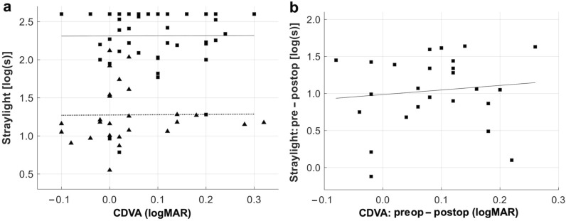
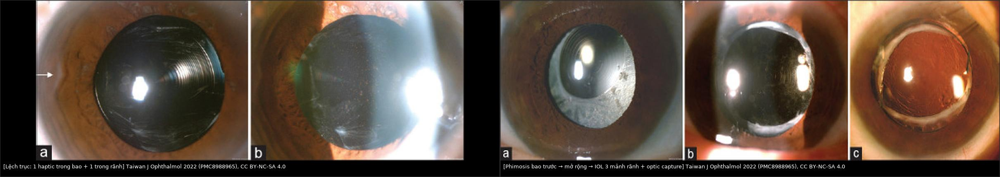
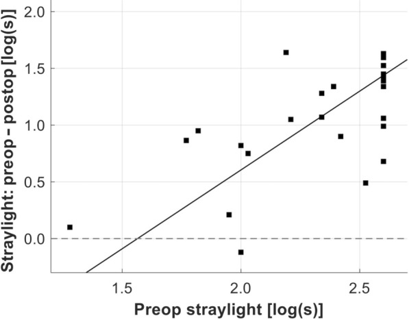
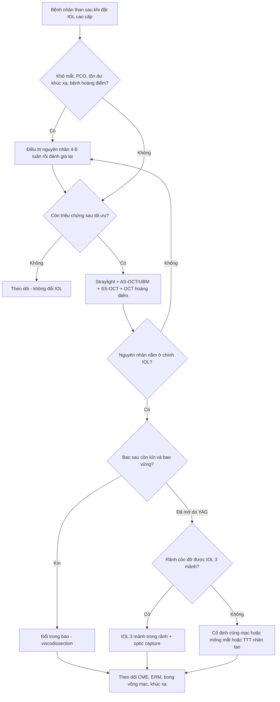
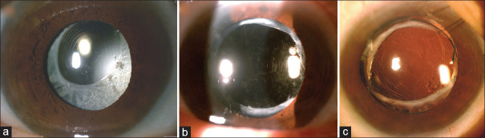
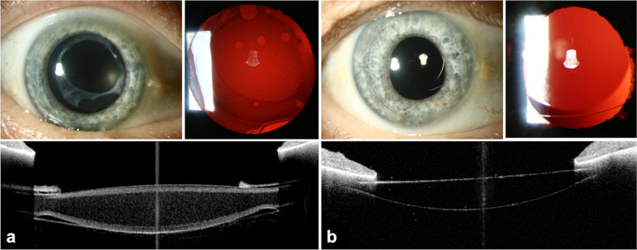
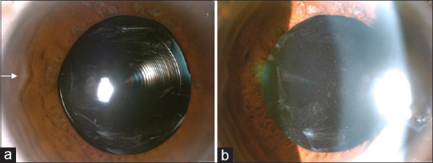

# 3279 — Đổi IOL cao cấp muộn do không dung nạp: khi nào kết luận thất bại, đổi trong bao hay rãnh, và vì sao "chờ thêm" thường sai — Late premium IOL exchange

**Tags:** `pattern:khong-dung-nap-iol` `pattern:dysphotopsia` `pattern:quang-sai` `pattern:iol-nghieng-lech` `pattern:duc-iol` `pattern:sai-khuc-xa` `pattern:mat-gia-the-thuy-tinh` `vung:mat` `vung:the-thuy-tinh` `vung:tien-phong` `vung:rang-the-mi` `vung:hoang-diem` `protocol:AS-OCT` `protocol:UBM` `protocol:SS-OCT` `protocol:OCT-hoang-diem` `protocol:sinh-trac` `score:khong-co` `incidentaloma:khong`

**Mức chắc chắn (certainty):** tổng hợp y văn (literature synthesis) — dựng từ: loạt **37 mắt** so sánh bao sau đóng/mở (*J Cataract Refract Surg* 2025, **PMC11980882**); nghiên cứu tiến cứu **53 mắt** đục IOL đồng nhất với ngưỡng straylight (*Eye Vis* 2024, **PMC11610101**, CC BY 4.0); loạt **511 mắt** đổi IOL theo kỹ thuật (*Clin Ophthalmol* 2023, **PMC10041992**, CC BY-NC 3.0); registry **46.063 thủ thuật** (*Ophthalmology* 2024, **PMID 37858872**); **35 mắt** đa tiêu (*J Cataract Refract Surg* 2017, **PMID 28732609**); **64 mắt** nhiễu xạ (*J Cataract Refract Surg* 2022, **PMID 34508030**); **64 mắt** MF→MF so với MF→đơn tiêu (*Acta Ophthalmol* 2024, **PMID 38780148**); **26 mắt** và **30 mắt** đổi hai bên (*Eye Vis* 2022, **PMC9623973**, **PMC8887122**, CC BY); **4 mắt** đổi muộn (*Taiwan J Ophthalmol* 2022, **PMC8988965**, CC BY-NC-SA 4.0); tổng quan dysphotopsia (*Taiwan J Ophthalmol* 2025, **PMC12782528**); phân tích gộp sai khúc xạ (*J Cataract Refract Surg* 2025, **PMID 40929562**); RCT mất nội mô (*J Cataract Refract Surg* 2020, **PMID 32304486**). Nhóm **không có bệnh nhân của mình**; chỗ suy luận ghi **[suy luận]**. **Không ghi tên tác giả** — attribution = **tạp chí + năm + PMCID/DOI**.

> **Ranh giới với bài đã có:** [3275](../3275-iol-cao-cap-mat-da-cat-dich-kinh/lesson.md) trả lời **"chọn IOL cao cấp nào trước mổ"**; [3253](../3253-iol-canxi-hoa-sau-phaco/lesson.md) trả lời **"IOL canxi hóa là bệnh gì, vì sao trắng, chất liệu nào"**; [3274](../3274-phaco-mat-da-cat-dich-kinh/lesson.md) trả lời **"phaco ở mắt đã cắt dịch kính khó thế nào"**; [1492](../1492-duc-bao-sau-iol-yag-sau-cat-dich-kinh/lesson.md) trả lời **"PCO và YAG lúc nào"**; [1442](../1442-manh-the-thuy-tinh-con-sot/lesson.md) trả lời **"mảnh thể thủy tinh sót"**; [3273](../3273-rach-bao-truoc-phaco/lesson.md) trả lời **"rách bao trước trong mổ"**. Bài này trả lời câu hỏi **sau khi đã đặt IOL**: **"bệnh nhân vẫn than — đây có phải IOL hỏng không, đổi được không, đổi bằng đường nào, và nếu chờ thì mất gì?"**

> **Câu chốt — năm nhóm số phải thuộc:** **(1) Chờ lâu + YAG trước = mổ khó hơn nhiều:** nhóm bao sau đã mở đổi IOL lúc **61,50 ± 62,00 tháng** so với **15,81 ± 15,03 tháng** khi bao còn kín; **sinh lý dịch kính trước 56% so với 24%**, **đặt lại trong bao 62% so với 100%**, **biến chứng hậu phẫu 43,7% so với 14,3%** (**PMC11980882**). **(2) Kết cục chung tốt nhưng không "như mới":** **511 mắt** UCVA **20/192 → 20/61**, **78,7% trong ±1,0 D**, **CME 7,6%** (**PMC10041992**); registry **46.063** thủ thuật **0,53 → 0,31 logMAR**, **60,5% ≥ 20/40**, **ERM 10,9%**, **trật IOL thay thế 7,1%** (**PMID 37858872**). **(3) Thị lực 20/20 không loại trừ mờ:** CDVA và **straylight** không tương quan; đổi IOL đục đưa straylight **2,32 → 1,23 log(s)**, **ngưỡng quyết định 1,56 log(s)** (**PMC11610101**). **(4) Đổi IOL không phải "nâng cấp":** MF→đơn tiêu cải thiện CDVA **20/26 → 20/23** nhưng **UNVA xấu đi 20/47 → 20/62** và **77% nói sẽ không đổi lại**; MF→MF khác kiểu quang học cho **80% chấp nhận đổi lại** (**PMC9623973**; **PMC8887122**). **(5) Đường vào quyết định biến chứng:** đặt trong bao có **CME 1,3%** so với **ACIOL 9,6%** và **4 điểm củng mạc 8,7%**; **iris-sutured trật 10,3%**, **Yamane nghiêng 11,8%**; **2,7% phải đổi lần ba** (**PMC10041992**).

## 1. Tổng quan bệnh học – cơ chế hình ảnh (TẠI SAO)

### 1.1 Vì sao IOL cao cấp "tha" lỗi kém hơn IOL đơn tiêu — chia sáng và dung sai hẹp

- **IOL đơn tiêu** dồn gần như toàn bộ năng lượng vào **một tiêu điểm**: một **sai khúc xạ 0,75 D** chỉ làm mờ đều, bệnh nhân vẫn chấp nhận và **đeo kính là xong**.
- **IOL nhiễu xạ (diffractive)** có **các bậc nhiễu xạ** chia năng lượng sáng thành **nhiều tiêu điểm**. Hệ quả vật lý: **(a)** mỗi tiêu điểm chỉ nhận một phần sáng → **tương phản nền giảm**; **(b)** ánh sáng lạc giữa các bậc tạo **quầng – chói – tia**; **(c)** pha được thiết kế cho **một trục chuẩn**, nên **lệch trục nhỏ cũng làm lệch pha ở nhiều tiêu điểm cùng lúc** [suy luận từ quang học nhiễu xạ, khớp với dữ liệu lệch trục ở **3275**].
- Vì vậy **cùng một sai số khúc xạ**, IOL cao cấp cho **triệu chứng nhiều hơn** và **dung sai tư vấn hẹp hơn**: đó là lý do **chỉ định đổi IOL ở nhóm này tập trung vào "không dung nạp" chứ không chỉ "thị lực kém"**.
- **Bằng chứng lâm sàng:** **64 mắt** đổi IOL nhiễu xạ vì **dysphotopsia nhiễu xạ 83%**, **giảm chất lượng thị giác 78%**, **triệu chứng ban đêm 19%** — trong đó **42% không có bệnh nền** và **19% đã phẫu thuật khúc xạ** (**PMID 34508030**). Nghĩa là **IOL "tốt" vẫn có thể không dung nạp được** dù mắt sạch.

### 1.2 Vì sao "thị lực tốt" không loại trừ chỉ định đổi IOL — dùng phép đo nào để quyết định

- **CDVA** đo **độ phân giải tương phản cao ở một vùng nhỏ**; **straylight** đo **ánh sáng tán xạ góc rộng** của cả nhãn cầu (vi vẩn, canxi, microvacuole). Hai đại lượng **độc lập**: trong loạt **53 mắt** đục IOL đồng nhất, **CDVA và straylight không tương quan**, **CDVA chỉ 0,16 logMAR** dù straylight **2,32 log(s)** (**PMC11610101**; cơ chế vật liệu chi tiết ở [3253](../3253-iol-canxi-hoa-sau-phaco/lesson.md)).

*Hình **(a)**: trục ngang CDVA (logMAR), trục dọc straylight (log(s)) — **không có tương quan**; nhiều mắt CDVA **0,0** vẫn có straylight **1,0–2,6**. Hình **(b)**: mức thay đổi straylight so với mức thay đổi CDVA sau đổi IOL. Nguồn: *Eye Vis* 2024 (PMC11610101), Fig. 4, **CC BY 4.0**.*

- **Vì sao đổi IOL chữa được:** lấy **vật liệu tán xạ** ra khỏi trục quang làm giảm nguồn tán xạ; sau đổi, **straylight 2,32 → 1,23 log(s)** trong khi **CDVA 0,16 → 0,05 logMAR** — mức cải thiện **chất lượng quang học lớn hơn** mức thay đổi thị lực, và **mức nhỏ nhất bệnh nhân cảm nhận được là 0,21 log(s)** (**PMC11610101**).
- **Hệ quả thực hành:** **đừng dùng "CDVA 20/20" để bác bỏ than phiền**; ngược lại, **đừng đổi IOL chỉ vì CDVA giảm 1 dòng** nếu không tìm được nguồn tán xạ/quang sai tương ứng — đây là lý do mục (4.1) bắt buộc **đo chức năng khách quan**, không chỉ đo thị lực.

### 1.3 Bao xơ theo thời gian và cái bẫy YAG — vì sao "chờ thêm" làm mổ khó hơn

- **Sinh học bao thể thủy tinh:** tế bào biểu mô thể thủy tinh còn lại **tăng sinh, di chuyển, biệt hóa thành sợi** → **PCO** và **xơ bao trước (phimosis)**. Theo thời gian, bao **dính chặt vào haptic và mặt quang học**; đồng thời **vòng xơ co** làm **mở bao nhỏ lại**, khó tiếp cận IOL.
- **Dữ liệu quyết định:** loạt **37 mắt** (một phẫu thuật viên, loại trừ trật IOL) cho thấy nhóm **bao sau đã mở (OPC)** đổi IOL lúc **61,50 ± 62,00 tháng**, còn nhóm **bao sau kín (CPC)** chỉ **15,81 ± 15,03 tháng**; ở OPC: **sinh lý dịch kính trước 9/16 (56%)** so với **5/21 (24%)**, **đặt lại trong bao 10/16 (62%)** so với **100%**, **biến chứng hậu phẫu 7/16 (43,7%)** so với **3/21 (14,3%)** (P = 0,012) (**PMC11980882**).
- **Vì sao YAG là bước ngoặt:** **YAG bao sau** mở **màng giới hạn trước của dịch kính**, làm **dịch kính sa ra trước**; khi đó muốn lấy IOL **trong bao** phải **cắt dịch kính trước** và **nguy cơ rách bao/tụt IOL vào dịch kính** tăng. Tổng quan y văn trong cùng bài: **sinh lý dịch kính trước 71,9% ở OPC** so với **7,9% ở CPC** (**PMC11980882**).
- **Khuyến cáo rút ra (nguyên văn tinh thần bài gốc):** **chỉ làm YAG khi khó có khả năng phải đổi IOL**; nếu bệnh nhân đang được theo dõi ở tuyến ngoài, **chuyển tới phẫu thuật viên có kinh nghiệm đổi IOL TRƯỚC khi YAG** (**PMC11980882**). Đây là điểm **quyết định nhất** của cả bài.

### 1.4 Neuroadaptation — vì sao chờ 3–6 tháng là đúng, chờ 3 năm là sai

- **Neuroadaptation** là quá trình vỏ não **tái cân bằng trọng số** giữa ảnh nét và ảnh mờ do quang sai; nhiều triệu chứng **giảm dần trong vài tháng** mà không cần can thiệp. Vì vậy **không được mổ lại ngay tuần đầu**.
- **Nhưng trần cải thiện có thật:** **negative dysphotopsia** gặp **15–26% ở tuần 1**, chỉ còn **0,13–3,2% ở 1 năm** và **1,5% ở 5 năm** (**PMC12782528**) — nghĩa là **đa số tự hết trong năm đầu**, phần còn lại là **nhóm cần can thiệp**.
- **Thực tế các loạt đổi IOL cao cấp:** **11,8 tháng** (MF→MF), **15 tháng** (MF→đơn tiêu), **15,8 ± 10,63 tháng** (4 mắt) (**PMC8887122**; **PMC9623973**; **PMC8988965**). Đây là **cửa sổ "đã tối ưu mà vẫn không dung nạp"**, không phải "mới mổ xong đã đổi".
- **Sai lầm kép cần tránh:** **(a)** đổi IOL quá sớm khi chưa loại trừ **khô mắt, PCO, tồn dư khúc xạ**; **(b)** chờ **nhiều năm** trong khi triệu chứng **không cải thiện**, để bao xơ hóa và YAG biến ca dễ thành ca khó (**PMC11980882**).

## 2. Mẫu hình + chẩn đoán phân biệt theo thời điểm và theo cơ chế (Gamut)

### 2.1 Ba cửa sổ thời gian — cùng "mờ" nhưng khác bệnh

- **< 1 tháng:** nghĩ **TASS, sót mảnh thể thủy tinh/nhân, sai khúc xạ lớn do sinh trắc, phù giác mạc do mổ** — **không phải "không dung nạp IOL cao cấp"**; xem [1442](../1442-manh-the-thuy-tinh-con-sot/lesson.md), [3264](../3264-bong-mang-descemet-sau-phaco/lesson.md).
- **1–6 tháng:** nghĩ **PCO sớm, khô mắt/bề mặt nhãn cầu, tồn dư khúc xạ, ERM/phù hoàng điểm, neuroadaptation chưa ổn định** — đây là **cửa sổ điều trị không mổ**.
- **> 6 tháng:** nghĩ **xơ bao/phimosis, đục–canxi hóa vật liệu IOL, lệch trục tiến triển, bệnh võng mạc nền** — đây là **cửa sổ cân nhắc đổi IOL**, và cũng là lúc **bao đã dính** (**PMC11980882**).

### 2.2 Năm cơ chế — mnemonic **P-O-I-N-T**

| Chữ | Cơ chế | Câu hỏi chốt |
|---|---|---|
| **P** | **Position** — nghiêng/lệch, một haptic trong bao một haptic trong rãnh, phimosis | Đo **tilt/decentration** trên **SS-OCT/AS-OCT**; soi **haptic** qua đồng tử giãn |
| **O** | **Optics** — quang sai nhiễu xạ, dysphotopsia dương/âm | Triệu chứng **theo ánh sáng/tư thế**, mô phỏng quầng, đối chiếu **loại IOL đã đặt** |
| **I** | **Implant material** — đục, canxi hóa, microvacuole/glistening | **Hồi chiếu + đèn khe**, **straylight**, so **nhãn/hộp IOL** |
| **N** | **Neuroadaptation** — không dung nạp thần kinh | **Chẩn đoán loại trừ** sau khi loại P/O/I/T |
| **T** | **Tear film & Target** — khô mắt, khúc xạ đích sai | **TBUT/OSDI**, khúc xạ lặp lại, **sinh trắc lại** |

### 2.3 Gamut theo triệu chứng chính

- **Quầng – chói – tia, nhìn đèn ban đêm kém:** quang sai nhiễu xạ; **lệch trục**; **PCO**; **khô mắt** làm tán xạ bề mặt.
- **Mờ thường xuyên, "như có màng":** **đục/ canxi hóa IOL** (straylight cao), **PCO**, **ERM**, **phù hoàng điểm**.
- **Mất thị lực gần dù xa tốt:** **IOL đa tiêu bị đảo ngược kỳ vọng** hoặc **không dung nạp thần kinh**; cần tư vấn trước khi đổi vì **đổi sang đơn tiêu sẽ mất gần** (**PMC9623973**).
- **Chói + đau + viêm nhẹ, sắc tố mống mắt:** **haptic cọ mống mắt** (iris chafing), **hội chứng UGH** — tìm **haptic sai vị trí** (**PMC8988965**).
- **Nhìn một mắt lệch, hai mắt khó chịu (aniseikonia):** **sai khúc xạ tồn dư một bên**, **lệch trục**, hoặc **khác biệt lớp IOL hai mắt** — hỏi **thị giác hai mắt**, không chỉ đo từng mắt.

## 3. Bảng so sánh phân biệt (ma trận đối chiếu)

| Thực thể (entity) | Hình ảnh / phép đo điển hình | Chốt vào (rule-in) | Chốt loại (rule-out) | Gợi ý xác nhận |
|---|---|---|---|---|
| **Không dung nạp quang học nhiễu xạ** | Đèn khe: IOL trong, đúng trục; **đường cong defocus tốt nhưng bệnh nhân vẫn quầng** | **Triệu chứng xuất hiện khi gặp nguồn sáng điểm**, đúng loại IOL nhiễu xạ; **đã loại PCO/khô mắt/khúc xạ** (**PMID 34508030**) | **PCO nặng, khô mắt, sai khúc xạ ≥ 0,75 D** chưa xử lý → chưa được kết luận | Mô phỏng quầng, QoV, tư vấn 3–6 tháng |
| **Sai khúc xạ tồn dư** | Khúc xạ lặp lại ổn định; **sinh trắc + công thức**; **AS-OCT vị trí IOL** | **Sai số hệ thống một mắt**, IOL đúng loại; **ELP lệch dự kiến** (**PMID 43023254**) | **IOL sai nhãn/công suất** → kiểm **hộp/nhãn/số lô** (**PMC11192593**) | Khúc xạ chủ quan + tự khúc xạ, topography, sinh trắc lại |
| **IOL nghiêng/lệch** | **AS-OCT/UBM**: một haptic trong rãnh, một trong bao; **SS-OCT: tilt/decentration**; sắc tố mống mắt | **Tilt > 5,63° hoặc lệch > 0,24 mm** (Q3 của 260 mắt) và triệu chứng tương ứng (**PMC13200907**) | **Tilt < 5° + không sắc tố + khúc xạ ổn** → theo dõi | SS-OCT, ảnh đèn khe giãn đồng tử |
| **Đục/canxi hóa IOL** | Đèn khe: **đục trắng/xám toàn mặt quang**; hồi chiếu **không đỏ đều**; AS-OCT dày/không đồng nhất | **Straylight > 1,56 log(s)** + đục thấy được; **CDVA có thể còn tốt** (**PMC11610101**) | **Straylight thấp + đục nhẹ ngoại vi** → theo dõi | C-Quant straylight, độ nhạy tương phản, chụp hồi chiếu |
| **PCO (không phải đổi IOL)** | Bao sau **trắng đục**, hồi chiếu mờ; **YAG mở được** | **Mờ tăng dần theo tháng**, **PCO thấy rõ**, **YAG cải thiện** (**1492**) | **Mờ không đổi sau YAG** → nghĩ nguyên nhân khác | Đèn khe, chụp sau YAG 4–6 tuần |
| **Bệnh hoàng điểm / ERM / CME** | **OCT hoàng điểm**: ERM, phù dạng nang, mất liên tục lớp ngoài | **ERM/CME giải thích mờ**, **metamorphopsia** | **OCT bình thường + không méo hình** → loại | OCT hoàng điểm, Amsler |
| **Khô mắt / bệnh bề mặt nhãn cầu** | **TBUT ngắn**, nhuộm fluorescein, OSDI cao; **khúc xạ dao động** | **Khúc xạ thay đổi giữa các lần đo**, **triệu chứng nặng lên cuối ngày** | **TBUT > 10 giây, OSDI thấp, khúc xạ ổn** | TBUT, osmolarity, điều trị thử 4 tuần |
| **Không dung nạp thần kinh** | **Tất cả phép đo bình thường**: IOL đúng trục, PCO nhẹ, OCT sạch, khúc xạ đúng | **Triệu chứng kéo dài > 6 tháng**, **không giải thích được**, **QoV kém** dù khách quan tốt (**PMID 38780148**) | **Có bất thường khách quan chưa xử lý** → chưa được gọi "thần kinh" | Chẩn đoán loại trừ + QoV/VF-14 |

*Trái: **IOL đa tiêu lệch trục**, **một haptic trong bao + một haptic trong rãnh**, mống mắt thái dương bị đẩy ra trước (mũi tên), kèm **sắc tố mống mắt** trên IOL. Phải: **phimosis bao trước** (a) → **mở rộng bao bằng kéo vi phẫu** (b) → **IOL 3 mảnh trong rãnh + optic capture** (c). Nguồn: *Taiwan J Ophthalmol* 2022 (PMC8988965), Fig. 1 + Fig. 2, **CC BY-NC-SA 4.0**; ảnh ghép letterbox, **không crop**.*

### 3.1 Ba câu hỏi đọc ma trận

- **"Có phải IOL hỏng không?"** → chỉ **sau khi** loại **PCO, khô mắt, khúc xạ, hoàng điểm**; nếu các nguyên nhân này còn, **đổi IOL sẽ không giải quyết** (và làm tăng nguy cơ).
- **"Đổi trong bao hay rãnh?"** → **bao sau còn kín + bao đủ vững → trong bao**; **bao sau đã mở do YAG hoặc bao yếu → rãnh 3 mảnh ± optic capture**, hoặc cố định củng mạc/mống mắt/TTT nhân tạo nếu không đủ đỡ (**PMC11980882**; **PMID 43023254**).
- **"Chờ thêm có lợi không?"** → chỉ khi **còn nguyên nhân chữa được** (khô mắt, PCO, khúc xạ) hoặc **còn trong 3–6 tháng đầu**; ngoài ra **chờ làm bao dính + dễ phải YAG**, tức là **làm ca sau khó hơn** (**PMC11980882**).

## 4. Protocol + ngưỡng định lượng

### 4.1 Trước khi kết luận "IOL hỏng" — 8 bước bắt buộc

1. **Mốc thời gian – sự kiện:** ngày mổ, **loại IOL + công suất + nhãn/hộp**, **có YAG chưa, lúc nào**, **khúc xạ đích**, bệnh nền (đái tháo đường, khô mắt, glaucoma, bệnh võng mạc).
2. **Khúc xạ:** **chủ quan + tự khúc xạ lặp 2 lần**, ghi **SE và loạn thị**; khúc xạ **dao động** → nghĩ **bề mặt nhãn cầu** trước.
3. **Đèn khe giãn đồng tử + hồi chiếu:** vị trí **haptic** (bao/rãnh), **phimosis**, **PCO**, **sắc tố mống mắt**, **đục mặt quang**.
4. **AS-OCT / UBM:** **vị trí IOL** (trong bao/rãnh/trước mống mắt), **khoảng cách IOL–mống mắt**, **tình trạng bao trước/sau**, **độ dày mặt quang**.
5. **SS-OCT (nếu có):** đo **tilt (độ)** và **decentration (mm)** — ngưỡng tham chiếu **Q3 5,63° / 0,24 mm**, mức **> 7° / > 0,4 mm** làm IOL aspheric mất lợi thế (**3275**; **PMC13200907**).
6. **OCT hoàng điểm:** **ERM (phân độ Govetto)**, **phù dạng nang**, bệnh võng mạc nền — vì **ERM là biến chứng thường gặp nhất sau đổi IOL (10,9%)** (**PMID 37858872**).
7. **Bề mặt nhãn cầu:** **TBUT, nhuộm fluorescein, OSDI**; **điều trị thử 4 tuần** trước khi quyết định mổ.
8. **Đo chức năng khách quan:** **straylight (C-Quant)** và **độ nhạy tương phản có/không chói**; ghi **CDVA** nhưng **không dùng CDVA làm tiêu chí duy nhất** (**PMC11610101**).

### 4.2 Ngưỡng định lượng dùng trong bài

| Biến số | Ngưỡng / giá trị | Ý nghĩa thực hành | Nguồn |
|---|---|---|---|
| **Straylight** (đục IOL đồng nhất) | **> 1,56 log(s)** | Điểm hòa vốn: trên ngưỡng, **50% khả năng cải thiện** sau đổi; dưới ngưỡng **không nên đổi chỉ vì đục nhẹ** | PMC11610101 |
| Mức cải thiện straylight bệnh nhân cảm nhận | **≥ 0,21 log(s)** | Ngưỡng "đáng làm" về triệu chứng | PMC11610101 |
| Tilt IOL (Q3) | **5,63°** | Trên ngưỡng: IOL cao cấp mất ưu thế, cân nhắc can thiệp | PMC13200907 (qua 3275) |
| Decentration (Q3) | **0,24 mm** | Trên ngưỡng: nguy cơ giảm tương phản/hài lòng | PMC13200907 (qua 3275) |
| Tilt/decentration "xấu" cổ điển | **> 7° / > 0,4 mm** | Mất lợi thế IOL aspheric; chỉnh/đổi | PMC7995916 (qua 3275) |
| Thời gian đổi IOL cao cấp điển hình | **11,8–15,8 tháng** | Cửa sổ "đã tối ưu mà vẫn không dung nạp" | PMC8887122; PMC9623973; PMC8988965 |
| Khoảng cách mổ khi bao sau **kín** | **15,81 ± 15,03 tháng** | Còn **100% đặt lại trong bao** | PMC11980882 |
| Khoảng cách mổ khi bao sau **đã mở** | **61,50 ± 62,00 tháng** | Chỉ **62%** đặt lại trong bao; **sinh lý dịch kính 56%** | PMC11980882 |
| Nguy cơ biến chứng hậu phẫu | **43,7% (OPC) vs 14,3% (CPC)** | Tư vấn trước mổ + tránh YAG sớm | PMC11980882 |
| Tỷ lệ đổi IOL chung | **0,2–1,5%**; **tới 7%** ở nhóm đa tiêu | Khung tư vấn trước khi đặt IOL cao cấp | PMC11980882 |
| Kết cục khúc xạ sau đổi | **78,7% trong ± 1,0 D** | Kỳ vọng thực tế, không hứa "chính thị tuyệt đối" | PMC10041992 |
| CME sau đổi | **7,6%** chung; **1,3%** trong bao vs **9,6%** ACIOL | Chọn đường vào ít CME | PMC10041992 |
| Phải đổi lần ba | **2,7%** | Tư vấn nguy cơ mổ lại | PMC10041992 |
| Mất nội mô 2 năm | **17,5% (đổi) vs 15,3% (cố định lại)** | Không khác biệt có ý nghĩa (P = 0,15) | PMID 32304486 |

*Trục ngang: straylight trước mổ (log(s)); trục dọc: mức cải thiện sau đổi IOL. **Điểm hòa vốn 1,56 log(s)**: trên ngưỡng này, xác suất cải thiện sau mổ **> 50%**; dưới ngưỡng, lợi ích không chắc — đây là căn cứ để **không đổi IOL chỉ vì "thấy đục"**. Nguồn: *Eye Vis* 2024 (PMC11610101), Fig. 2, **CC BY 4.0**.*

### 4.3 Sơ đồ quyết định

### 4.4 Chọn đường vào theo tình trạng bao — và vì sao đường vào quyết định biến chứng

- **Bao sau kín + bao vững → đổi trong bao (bag-to-bag):** **100% (21/21)** mắt CPC trong loạt 37 mắt đặt lại được trong bao; kỹ thuật gồm **viscodissection** tách bao khỏi haptic/mặt quang, **cắt IOL trong mắt** nếu cần (**32/37 IOL được cắt trong mắt**), rồi đặt IOL mới. Đây là đường **ít CME nhất**: **1,3%** so với **9,6%** ACIOL và **8,7%** 4 điểm củng mạc (**PMC11980882**; **PMC10041992**).
- **Bao sau đã mở (sau YAG) → rãnh 3 mảnh ± optic capture:** chỉ **62% (10/16)** đặt lại được trong bao; **sinh lý dịch kính trước 56%**; nếu **mở bao trước còn tròn** → **optic capture** để tăng vững. Trong ca minh họa, **haptic dính quá chắc** nên **để lại phần haptic trong bao**, **viscoelastic tamponade** chống sa dịch kính, đặt **IOL 3 mảnh vào rãnh không cần cắt dịch kính trước** (**PMC8988965**).
- **Không đủ đỡ bao/rãnh → cố định củng mạc (Yamane/4 điểm/2 điểm), iris-sutured, hoặc TTT nhân tạo:** đây là nhóm **biến chứng cao hơn**: **Yamane nghiêng 11,8%**, **iris-sutured trật 10,3%**, **ACIOL CME 9,6%** (**PMC10041992**). Chọn theo **mô bao – dây chằng – nội mô – tuổi – khả năng theo dõi**, không theo "quen tay".
- **Phimosis bao trước:** **mở rộng bao bằng kéo vi phẫu** trước; nếu **vẫn không cải thiện**, đó là dấu hiệu **nguyên nhân không nằm ở bao** — trong ca minh họa, mở bao **không cải thiện**, **YAG chỉ lên 0,4 và còn chói**, cuối cùng **đổi IOL lúc 2,5 năm → 0,8** (**PMC8988965**). Bài học: **đừng "leo thang thủ thuật" vô hạn**.

*(a) Phimosis bao trước với lỗ bao xơ nhỏ; (b) mở rộng bằng kéo vi phẫu; (c) IOL 3 mảnh trong rãnh + optic capture. Nguồn: *Taiwan J Ophthalmol* 2022 (PMC8988965), Fig. 2, **CC BY-NC-SA 4.0**.*

### 4.5 Tư vấn kết cục — nói đúng để bệnh nhân không thất vọng lần hai

- **Kỳ vọng thị lực:** **511 mắt** UCVA **20/192 → 20/61**, nhưng **chỉ 78,7% đạt ±1,0 D**; registry **46.063** thủ thuật đạt **60,5% ≥ 20/40** sau 1 năm (**PMC10041992**; **PMID 37858872**) — nghĩa là **"tốt hơn" chứ không phải "hoàn hảo"**.
- **Đổi sang đơn tiêu sẽ mất gần:** **CDVA 20/26 → 20/23** nhưng **UNVA 20/47 → 20/62**, **độc lập kính gần mất hoàn toàn/một phần ở tất cả**, và **77% nói sẽ không đổi lại** (**PMC9623973**). Phải nói **trước** khi mổ.
- **Đổi sang IOL đa tiêu khác kiểu quang học:** **80% chấp nhận đổi lại**, **UDVA 0,24 → 0,12**, **CDVA 0,15 → 0,04**; so sánh trực tiếp **64 mắt** cho thấy **MF→MF tốt hơn MF→đơn tiêu ở VF-14 trung gian/gần và VF-8R** (**PMC8887122**; **PMID 38780148**).
- **Nguy cơ phải nói rõ:** **CME 7,6%**, **ERM 10,9%**, **trật IOL thay thế 7,1%**, **đổi lần ba 2,7%**, **mất nội mô ~17,5% sau 2 năm** (không khác cố định lại) (**PMC10041992**; **PMID 37858872**; **PMID 32304486**).

## 5. Biến thể bình thường và cạm bẫy

- **Cạm bẫy 1 — YAG trước, quyết định sau:** **YAG bao sau** biến **CPC thành OPC**; khi đó **sinh lý dịch kính trước 56% vs 24%**, **đặt trong bao 62% vs 100%**, **biến chứng 43,7% vs 14,3%** (**PMC11980882**). Nếu **đang cân nhắc đổi IOL**, **chuyển chuyên gia trước khi YAG**.
- **Cạm bẫy 2 — gọi "không dung nạp thần kinh" khi chưa loại trừ:** **khô mắt, PCO, tồn dư khúc xạ, ERM** đều gây **mờ/quầng**; **77%** bệnh nhân đổi MF→đơn tiêu vẫn **không muốn lặp lại** — phần lớn thất vọng đến từ **kỳ vọng và nguyên nhân chưa xử lý**, không chỉ từ IOL.
- **Cạm bẫy 3 — đổi IOL để chữa PCO:** PCO **đáp ứng YAG**, không cần đổi IOL; **YAG có thể cải thiện một phần** nhưng nếu **vẫn chói** thì mới nghĩ tới IOL (**PMC8988965**). Ngược lại, **đừng YAG "thử"** khi chưa loại trừ nhu cầu đổi IOL.
- **Cạm bẫy 4 — bỏ sót "một haptic trong bao, một trong rãnh":** đây là **biến chứng cơ học** dễ thấy khi **giãn đồng tử** nhưng dễ bỏ qua khi khám nhanh; kèm **sắc tố mống mắt** và **lệch trục** (**PMC8988965**). Luôn **soi haptic 360°**.
- **Cạm bẫy 5 — không kiểm nhãn/hộp IOL:** ca **dán nhãn sai công suất** gây **sai khúc xạ "không giải thích được"**; kiểm **nhãn, hộp, số lô** trước khi quy lỗi cho sinh trắc (**PMC11192593**).
- **Cạm bẫy 6 — hứa "đổi là hết":** **đổi IOL là mổ lại**, có **CME/ERM/trật/bong võng mạc**; **chỉ 78,7% đạt ±1,0 D**, **2,7% phải đổi lần ba** (**PMC10041992**). Tư vấn **kết cục trung bình**, không hứa ca tốt nhất.
- **Biến thể bình thường:** **đục nhẹ mặt quang ngoại vi**, **glistening nhẹ**, **quầng nhẹ sau IOL nhiễu xạ** có thể **dung nạp**; **đừng đổi IOL** khi **straylight thấp, khúc xạ đúng, OCT sạch** và triệu chứng **giảm dần** (**PMC11610101**; **PMC12782528**).
- **Cạm bẫy 7 — đổi hai mắt cùng lúc:** không có bằng chứng ủng hộ; **đổi hai bên** trong các loạt được làm **tuần tự** và theo dõi từng mắt (**PMC9623973**; **PMC8887122**) — **[suy luận]** tránh mất thị lực hai mắt do biến chứng hiếm.

## 6. Tự lượng giá — Blind Quiz

**Ca 1 — Nam 68 tuổi, 3 năm sau phaco đặt IOL acrylic ưa nước, đến vì "nhìn đèn làe chói, chữ vẫn đọc được". CDVA 0,9; đèn khe: mặt quang đục trắng; hồi chiếu không đỏ đều.**

- Gợi ý: bệnh nhân **không** than mờ chữ; **chói** là triệu chứng chính.
- Câu hỏi: Tại sao **CDVA 0,9** mà vẫn có triệu chứng nặng? Đo gì để **khách quan hóa**? Ngưỡng nào đủ để **đổi IOL**? Sau đổi, chỉ số nào cải thiện nhiều nhất?

<b>Bấm để hiện đáp án (findings + chẩn đoán)</b>

- **Findings:** **(a)** IOL **đục đồng nhất toàn mặt quang** trên đèn khe + hồi chiếu; **AS-OCT** thấy mặt quang dày, mất đồng nhất. **(b)** sau đổi: **IOL iris-claw trong**, **AS-OCT** thấy IOL **trước mống mắt**.
- **Chẩn đoán:** **đục/canxi hóa vật liệu IOL** — **straylight** là chỉ số phản ánh triệu chứng, **không phải CDVA**; trong loạt 53 mắt, **CDVA và straylight không tương quan** (**PMC11610101**).
- **Ngưỡng:** **straylight > 1,56 log(s)** là điểm hòa vốn để cân nhắc đổi; mức cải thiện **≥ 0,21 log(s)** là ngưỡng bệnh nhân cảm nhận. Trong loạt: **2,32 → 1,23 log(s)**, **CDVA 0,16 → 0,05**.
- **Sau đổi:** **straylight và halo/glare cải thiện rõ hơn CDVA**; đây là lý do phải **đo straylight trước mổ** để tư vấn đúng.
- Nguồn: *Eye Vis* 2024 (PMC11610101), Fig. 1 + Fig. 4, **CC BY 4.0**.

**Ca 2 — Nữ 64 tuổi, đái tháo đường không tăng sinh, 16 tháng sau đặt IOL đa tiêu; BCVA 0,5, khúc xạ +0,25 −1,25 × 85°; than chói và "nhìn lệch". Đồng tử giãn: mặt quang lệch, có sắc tố trên IOL.**

- Câu hỏi: Mô tả **vị trí haptic** và **dấu hiệu đi kèm**? Vì sao **không nên chỉ tăng công suất kính**? Kế hoạch mổ?

<b>Bấm để hiện đáp án (findings + chẩn đoán)</b>

- **Findings:** **(a)** IOL đa tiêu **lệch/nghiêng**, **một haptic trong bao, một haptic trong rãnh**, mống mắt thái dương **bị đẩy ra trước** (mũi tên); **(b)** **nhiều sắc tố mống mắt** trên mặt IOL — dấu **iris chafing**.
- **Chẩn đoán:** **IOL lệch trục + haptic sai vị trí**; đây là **nguyên nhân cơ học**, không phải "không dung nạp thần kinh". Đổi kính chỉ chỉnh **một phần khúc xạ**, không sửa **quang sai do lệch trục** và **sắc tố/viêm**.
- **Kế hoạch (theo ca gốc):** **haptic dính quá chắc** → **để lại phần haptic trong bao**, **viscoelastic tamponade** từ vết mổ thái dương xuống **lỗ bao sau** chống sa dịch kính, đặt **IOL 3 mảnh vào rãnh**, **không cần cắt dịch kính trước**; BCVA **0,5 → 0,8**.
- **Nguồn:** *Taiwan J Ophthalmol* 2022 (PMC8988965), Fig. 1 và ca 2, **CC BY-NC-SA 4.0**.

**Ca 3 — Nữ 63 tuổi, 1 năm sau IOL đa tiêu, IOL **đúng trục**, nhưng **lỗ bao trước xơ co nhỏ**; BCVA 0,3, chói dai dẳng, khô mắt nhẹ đã điều trị.**

- Câu hỏi: **Mở rộng bao** có chữa được triệu chứng không? **YAG** có phải bước tiếp theo đúng? Khi nào **đổi IOL**?

<b>Bấm để hiện đáp án (findings + chẩn đoán)</b>

- **Findings:** **(a)** **phimosis bao trước** với lỗ bao xơ nhỏ, IOL **đúng trục**; **(b)** **mở rộng bao bằng kéo vi phẫu**; **(c)** sau đó **IOL 3 mảnh trong rãnh + optic capture**.
- **Diễn tiến ca gốc:** **mở bao không cải thiện**; **YAG** vì PCO chỉ lên **0,4** và **chói vẫn còn**; **2,5 năm** sau mới **đổi IOL → 0,8**, hết dysphotopsia.
- **Bài học:** **phimosis/PCO là nguyên nhân "nhìn thấy được" nhưng không phải lúc nào cũng là nguyên nhân chính**; nếu **mở bao + YAG không giải quyết**, đừng tiếp tục "leo thang" — **đánh giá lại IOL/quang sai** và **cân nhắc đổi**.
- Nguồn: *Taiwan J Ophthalmol* 2022 (PMC8988965), Fig. 2 và ca 3, **CC BY-NC-SA 4.0**.

## 7. Câu hỏi nghiên cứu & điểm chưa đồng thuận (tính đến 11/2026)

1. **[Tranh cãi] Ở bệnh nhân không dung nạp IOL cao cấp, đổi IOL sớm (trước YAG, trong 12 tháng đầu) có giảm biến chứng và tăng tỷ lệ đặt lại trong bao so với tối ưu nội khoa kéo dài?**
   - **Đã biết:** bao sau đã mở làm **sinh lý dịch kính trước 56% vs 24%**, **đặt trong bao 62% vs 100%**, **biến chứng 43,7% vs 14,3%** (**PMC11980882**); các loạt đổi IOL cao cấp thường mổ ở **11,8–15,8 tháng** (**PMC8887122**; **PMC9623973**; **PMC8988965**).
   - **Chưa rõ:** **không có RCT** so **thời điểm** đổi; các loạt hồi cứu **chọn bệnh nhân khác nhau**, không tách **thời gian chờ** khỏi **tình trạng bao**.
   - **Hướng nghiên cứu:** RCT/đoàn hệ tiến cứu phân tầng **< 12 tháng vs ≥ 12 tháng**, outcome **đặt trong bao, sinh lý dịch kính, CME, CDVA, tỷ lệ đổi lần ba**.
   - **Nguồn:** PMC11980882 (2025); PMC9623973 (2022); PMC8988965 (2022).

2. **[Khoảng trống] Kết cục ≥ 5 năm sau đổi IOL cao cấp: độ bền khúc xạ, PCO/YAG, lệch trục tiến triển và bong võng mạc — chưa có dữ liệu.**
   - **Đã biết:** registry **46.063** thủ thuật chỉ báo cáo **1 năm** (**PMID 37858872**); loạt **511 mắt** theo dõi **18,6 ± 14,7 tháng** (**PMC10041992**); loạt **4 mắt** theo dõi ngắn (**PMC8988965**).
   - **Chưa rõ:** **tilt/decentration có tiến triển** sau đổi không; **tỷ lệ YAG** sau đổi IOL cao cấp; **bong võng mạc muộn** ở mắt đã cắt dịch kính trước đó.
   - **Hướng nghiên cứu:** registry **5–10 năm** với **SS-OCT lặp lại**, outcome **khúc xạ, YAG, đổi lần ba, bong võng mạc**.
   - **Nguồn:** PMID 37858872 (2024); PMC10041992 (2023); PMC8988965 (2022).

3. **[Khác biệt thực hành] Khi thất bại thích nghi thần kinh, nên đổi sang IOL đa tiêu khác kiểu quang học hay sang đơn tiêu?**
   - **Đã biết:** **MF→MF** tốt hơn **MF→đơn tiêu** ở **VF-14 trung gian/gần** và **VF-8R** (**PMID 38780148**); **80%** nhóm MF→MF chấp nhận đổi lại (**PMC8887122**), nhưng **77%** nhóm MF→đơn tiêu **không muốn lặp lại** (**PMC9623973**).
   - **Chưa rõ:** **không có tiêu chí chọn trước mổ** (loại quang sai, tuổi, nhu cầu gần, tính cách); các loạt **cỡ nhỏ, hồi cứu**, **không mù**.
   - **Hướng nghiên cứu:** thử nghiệm so **hai chiến lược** với **QoV/VF-14 làm outcome chính**, phân tầng **nhu cầu gần** và **loại dysphotopsia**.
   - **Nguồn:** PMID 38780148 (2024); PMC8887122 (2022); PMC9623973 (2022).

## Bài liên quan chéo

- [3275 – IOL cao cấp ở mắt đã cắt dịch kính](../3275-iol-cao-cap-mat-da-cat-dich-kinh/lesson.md) (chọn EDOF/đa tiêu, ngưỡng nghiêng/lệch 5,63°/0,24 mm)
- [3253 – IOL canxi hóa sau phaco](../3253-iol-canxi-hoa-sau-phaco/lesson.md) (chất liệu, cơ chế trắng đục, straylight, chỉ định thay)
- [3274 – Phaco trên mắt đã cắt dịch kính](../3274-phaco-mat-da-cat-dich-kinh/lesson.md) (LIDRS, bao sau dễ vỡ)
- [1492 – PCO sau phacovitrectomy và YAG](../1492-duc-bao-sau-iol-yag-sau-cat-dich-kinh/lesson.md) (khi nào YAG, năng lượng)
- [1442 – Mảnh thể thủy tinh còn sót](../1442-manh-the-thuy-tinh-con-sot/lesson.md) (phù khu trú, không đáp ứng corticoid)
- [3273 – Rách bao trước trong phaco](../3273-rach-bao-truoc-phaco/lesson.md) (khi nào mở rộng, khi nào chuyển ECCE)
- [3278 – Đục thể thủy tinh bẩm sinh một bên](../3278-duc-the-thuy-tinh-bam-sinh-mot-ben-iol-hay-aphakia/lesson.md) (IOL hay aphakia ở trẻ)
- [1447 – Rách thể mi sau MIGS/Yamane](../1447-rach-the-mi-sau-migs-va-yamane/lesson.md) (biến chứng của cố định củng mạc)
- [400 – Tổng quan Mắt & thị giác](../400-tong-quan-mat-thi-giac/lesson.md)

## Ảnh

- `images/3279_doi-iol-cao-cap_Anh-sang_IOL-duc-truoc-sau_PMC11610101-Fig1.jpg` — *Eye Vis* 2024 (PMC11610101), Fig. 1, **CC BY 4.0**.
- `images/3279_doi-iol-cao-cap_Thi-luc-vs-straylight_PMC11610101-Fig4.jpg` — *Eye Vis* 2024 (PMC11610101), Fig. 4, **CC BY 4.0**.
- `images/3279_doi-iol-cao-cap_Straylight-nguong_PMC11610101-Fig2.jpg` — *Eye Vis* 2024 (PMC11610101), Fig. 2, **CC BY 4.0**.
- `images/3279_doi-iol-cao-cap_IOL-lech-haptic_PMC8988965-Fig1.jpg` — *Taiwan J Ophthalmol* 2022 (PMC8988965), Fig. 1, **CC BY-NC-SA 4.0**.
- `images/3279_doi-iol-cao-cap_Phimosis-optic-capture_PMC8988965-Fig2.jpg` — *Taiwan J Ophthalmol* 2022 (PMC8988965), Fig. 2, **CC BY-NC-SA 4.0**.
- `images/composite_hai-co-che-that-bai.jpg` — ảnh ghép từ Fig. 1 + Fig. 2 của **PMC8988965**, letterbox bằng `tools/make_composite.py`, **CC BY-NC-SA 4.0**.

> Không dùng để chẩn đoán độc lập khi chưa có người hướng dẫn.
