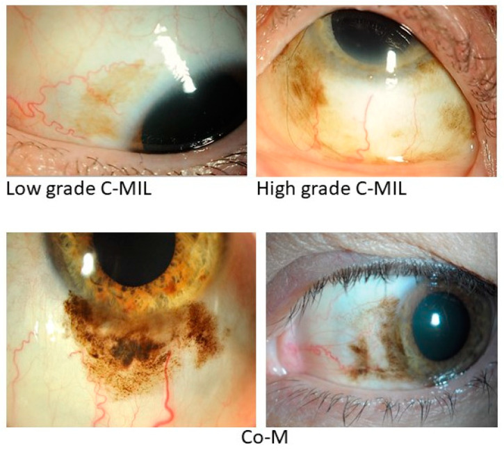
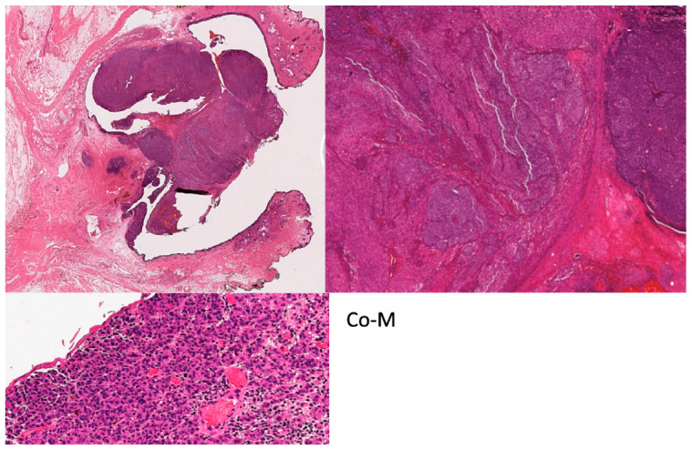
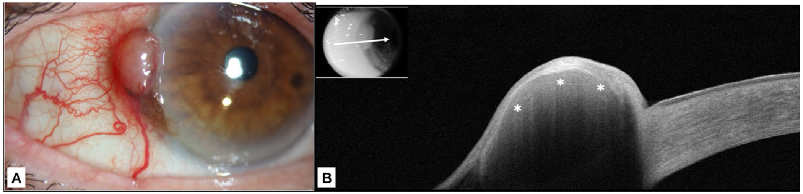
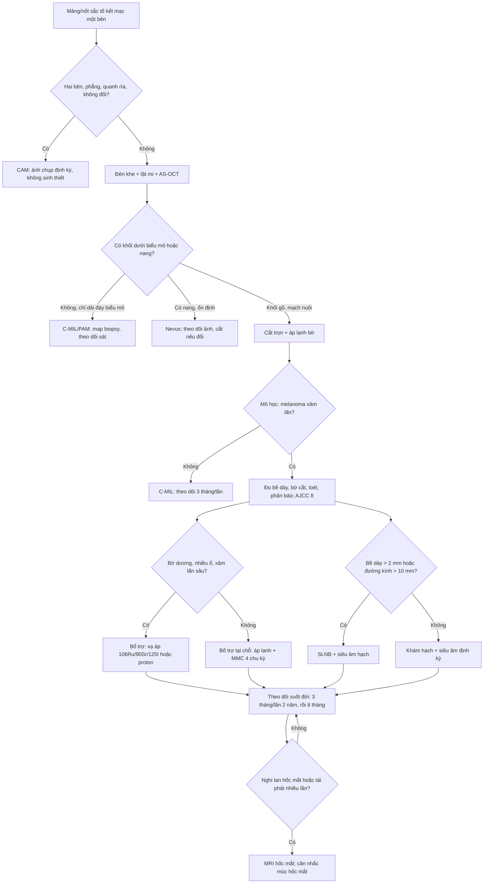
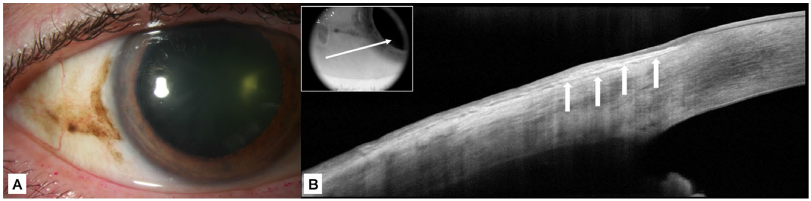
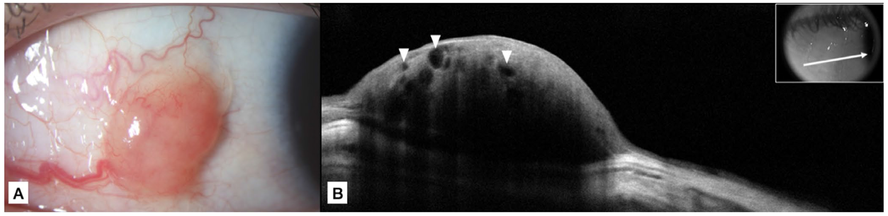

# 3280 — Melanoma kết mạc & melanoma bờ mi: mảng sắc tố một bên, dày lên, có mạch nuôi

**Tags:** `pattern:mang-sac-to-ket-mac` `pattern:not-sac-to` `pattern:mat-mot-ben` `pattern:mach-nuoi` `pattern:xuat-huyet-duoi-ket-mac` `pattern:lan-giac-mac` `pattern:u-ket-mac` `vung:mat` `vung:ket-mac` `vung:giac-mac` `vung:mi` `vung:hoc-mat` `protocol:den-khe` `protocol:lot-mi` `protocol:AS-OCT` `protocol:UBM` `protocol:sinh-thiet-cat-tron` `protocol:map-biopsy` `protocol:ap-lanh` `protocol:MRI-hoc-mat` `protocol:SLNB` `protocol:xa-ap` `score:AJCC8` `incidentaloma:khong`

**Mức chắc chắn (certainty):** tổng hợp y văn (literature synthesis) — dựng từ **tổng quan lâm sàng 2024** (Cancers, PMC11429624), **nghiên cứu đa trung tâm 288 ca di căn** (Br J Ophthalmol 2025, PMC12171484), **loạt 4 ca ảnh lâm sàng CAM–nevus–PAM–melanoma** (CMAJ 2025, PMC12448771), **tổng quan AS-OCT bề mặt nhãn cầu** (Clin Exp Ophthalmol 2026, PMC13408978), **loạt 29 ca Peru** (Clin Ophthalmol 2026, PMC13036359), **loạt xạ áp 106Ru** (J Contemp Brachytherapy 2026, PMC13389752), **kết cục sau múc hốc mắt** (Acta Ophthalmol 2025, PMC12803614) và **tổng quan chiến lược giữ mắt** (Cancers 2021, PMC8616295). Nhóm **không có bệnh nhân của mình**; chỗ chưa đủ chắc ghi **"chưa rõ"**. **Không ghi tên tác giả** — attribution = **tạp chí + năm + PMCID/DOI** (xem `images/CREDITS.md`).

> **Câu chốt:** melanoma kết mạc (conjunctival melanoma, Co-M) là ung thư bề mặt nhãn cầu **hiếm nhưng chết người**, và điều nguy hiểm nhất là nó **bắt đầu giống một vết sắc tố lành**: **~70% mọc trên nền C-MIL/PAM có loạn sản**, **< 10% trên nevus**, **15–25% xuất hiện de novo** (PMC12448771). Ba câu hỏi quyết định: **(1) một bên hay hai bên?** — **CAM (melanosis theo nếp da) thường hai bên, quanh rìa, không nguy cơ**; **PAM một bên, phẳng, đổi kích thước** mới là tổn thương có tiềm năng ác tính (PMC12448771). **(2) Còn trong biểu mô hay đã xuống dưới biểu mô?** — AS-OCT phân biệt **tổn thương biểu mô (PAM)** với **khối dưới biểu mô (melanoma/nevus)**, và **nang trong tổn thương = nevus** (PMC13408978). **(3) Dày bao nhiêu?** — mỗi **+1,0 mm** bề dày làm **tăng 16% nguy cơ di căn**, và **cT3 có nguy cơ cao nhất** (PMC12171484); đây là lý do **cắt trọn để có bề dày mô học**, không theo dõi mù.

## 1. Tổng quan bệnh học – cơ chế hình ảnh (TẠI SAO)

### 1.1 Nguồn gốc giải phẫu — vì sao melanoma kết mạc di căn HẠCH, không di căn gan như u hắc mạc

- Melanocyte bình thường nằm **một lớp ở đáy biểu mô kết mạc**. Khi tích lũy đột biến (chữ ký UV: **BRAF 29–46%**, **NRAS 11–26%**, **NF1 33–50%**, **TERT promoter tới 54%**) tế bào tăng sinh tại chỗ, rồi **phá màng đáy** để xâm lấn mô đệm (PMC11429624).
- **TẠI SAO đường di căn khác u hắc mạc:** kết mạc có **bạch mạch thật** (kết mạc cùng đồ và sụn mi dẫn lưu về hạch **trước tai, mang tai, dưới hàm, cổ**), trong khi hắc mạc **không có bạch mạch** nên u hắc mạc gần như chỉ đi đường máu về **gan**. Vì vậy Co-M di căn hạch vùng **25–52%** (PMC11429624), còn di căn xa vẫn có (gan, phổi, não **11–42%**). **Hệ quả thực hành:** khám hạch cổ/trước tai là phần bắt buộc của mỗi lần thăm khám, và **SLNB** chỉ có ý nghĩa ở Co-M (không dùng cho u hắc mạc).
- Vị trí hay gặp: **kết mạc nhãn cầu quanh rìa** (**93,1%** trong loạt 29 ca; **67,9%** lan ≥ 2 góc phần tư) — vùng phơi sáng UV nhiều nhất (PMC13036359).

### 1.2 TẠI SAO "dày lên" là dấu hiệu xâm lấn — vật lý của melanin và AS-OCT

- **PAM/C-MIL** chỉ nằm **trong biểu mô**: trên AS-OCT là **tăng hồi âm dải đáy biểu mô**, bề mặt phẳng, **không có khối dưới biểu mô** (ảnh Ca 2 bài này; PMC13408978 Fig. 6).
- **Melanoma xâm lấn** đã xuống **mô đệm dưới kết mạc** → **khối lồi (subepithelial mass)**, đẩy biểu mô lên; vì **melanin hấp thụ mạnh ánh sáng 1000–1300 nm**, khối dày–sẫm màu tạo **bóng lưng (posterior shadowing)** che mất **nửa sau tổn thương** — đúng như ảnh Ca 1 (PMC13408978).
- **TẠI SAO điều đó quan trọng:** AS-OCT **không thấy được bờ sâu** ở tổn thương dày/sẫm màu, nên **không thể loại trừ xâm lấn củng mạc** bằng AS-OCT; khi cần độ sâu phải dùng **UBM** (độ phân giải **25–50 µm**, xuyên sâu hơn) hoặc MRI hốc mắt (PMC13408978; PMC11429624).
- **Nang trong tổn thương = nevus:** nang là **tuyến kết mạc bị giam** trong nevus, thấy trên AS-OCT là **ổ giảm hồi âm tròn, bờ rõ** trong khối (ảnh Ca 3; PMC13408978 Fig. 7; PMC12448771). Melanoma **hiếm khi có nang**.

### 1.3 TẠI SAO bề dày quyết định tiên lượng — con số định lượng

- Trong **288 ca** theo dõi trung vị **4,2–4,6 năm**: **10% (29/288)** di căn xa; nguy cơ di căn tích lũy **9% trong 5 năm**; **mỗi +1,0 mm bề dày u làm tăng 16% nguy cơ di căn**; **cT3 có nguy cơ cao nhất** (cT1 **75,7%**, cT2 **11,8%**, cT3 **5,2%**); khi đã di căn, **không ca nào sống quá 21 tháng**, tử vong **10% ở 2 năm** và **42% ở 5 năm** (PMC12171484).
- Sống còn đặc hiệu bệnh chung: **82,9% ở 5 năm**, **69,3% ở 10 năm**; tử vong đặc hiệu bệnh **14–27% (5 năm)** và **25–35% (10 năm)** (PMC11429624). Nguồn khác ghi **nguy cơ tử vong ~30%** và **20–30% di căn** (PMC12448771).
- **Tái phát tại chỗ rất cao:** **33–45%** (PMC11429624), tới **33–61%** khi tính cả biến chứng và tái phát (PMC11429624); tích lũy **19–40% ở 5 năm** và **37–51% ở 10 năm** (PMC12803614). Vì vậy theo dõi **suốt đời**, không "xuất viện sau 5 năm".

| Đại lượng | Số liệu | Nguồn |
|---|---|---|
| Tần suất | **0,2–0,8/1 triệu/năm** (0,46/1 triệu; **5%** melanoma mắt, **0,25%** melanoma toàn bộ) | PMC12171484; PMC11429624 |
| Nguồn gốc | **~70%** từ C-MIL/PAM loạn sản; **< 10%** từ nevus; **15–25%** de novo | PMC12448771 |
| Vị trí | **93,1%** kết mạc nhãn cầu; **67,9%** ≥ 2 góc phần tư | PMC13036359 |
| Bề dày → di căn | **+1,0 mm = +16% nguy cơ** | PMC12171484 |
| Di căn hạch vùng | **25–52%** | PMC11429624 |
| Di căn xa | **10–16% / 5 năm**, **17–26% / 10 năm** | PMC12803614 |
| Sống còn đặc hiệu bệnh | **82,9% / 5 năm**, **69,3% / 10 năm** | PMC11429624 |
| Tái phát tại chỗ | **33–45%**; tích lũy **19–40% / 5 năm**, **37–51% / 10 năm** | PMC11429624; PMC12803614 |
| Sau múc hốc mắt | sống **52% / 5 năm** | PMC12803614 |

*Bốn mắt, một phổ bệnh: **C-MIL độ thấp** — mảng vàng–nâu phẳng, bờ mờ như "vết bẩn", mạch máu đi xuyên qua; **C-MIL độ cao** — dày hơn, sắc tố đậm hơn, bề mặt không đều; **Co-M** — khối nâu–đen **gồ cao**, bờ nham nhở, **mạch nuôi rõ**, một ca đã **lan qua rìa lên giác mạc**. Điểm mấu chốt: **độ dày và sắc tố tăng dần là dấu hiệu tiến triển**, nhưng chỉ **mô học** mới phân định C-MIL độ cao với melanoma xâm lấn. Nguồn: Cancers 2024 (PMC11429624), Fig. 1, CC BY 4.0.*

### 1.4 TẠI SAO mô học là chốt — melanin không phải "mực in"

- Trên H&E, tế bào u xâm lấn tạo **nang/đám trong mô đệm**, nhân không đều, hạt nhân rõ; **melanophage** (đại thực bào chứa melanin) nằm rải rác làm tổn thương trông "sẫm" hơn mức độ tế bào u thật (PMC11429624).
- **Di căn hạch liên quan số lần phân bào > 5,5/mm²**; **loét và bề dày lớn** liên quan tử vong — cùng nguyên lý với melanoma da (PMC11429624).
- Hóa mô miễn dịch: **Melan-A (MART1), S100, SOX10, HMB45** dương; **PRAME dương, cyclin D1 dương, mất p16** giúp tách Co-M khỏi nevus/C-MIL độ thấp (PRAME và cyclin D1 âm, p16 dương ở tổn thương lành) (PMC11429624).

*Ba mức phóng đại của cùng một khối: **trên cùng bên trái** — khối lớn chiếm toàn bộ kết mạc và xâm lấn mô đệm quanh nhãn cầu (bệnh phẩm **múc hốc mắt**); **trên bên phải** — đám tế bào u dày đặc phá ranh giới mô đệm; **dưới** — tế bào đa dạng, hạt nhân lớn, bào tương rõ, xen **melanophage**; đây là "vertical growth phase" — thứ duy nhất đặt được vào thang T. Nguồn: Cancers 2024 (PMC11429624), Fig. 2, CC BY 4.0.*

## 2. Mẫu hình + chẩn đoán phân biệt theo vị trí (gamut)

**Mẫu hình A — mảng phẳng sắc tố MỘT BÊN, quanh rìa, đổi dần theo tháng–năm:** *người trung niên–cao tuổi, da sáng, phơi nắng nhiều; không đau, không cộm.* Gamut: **C-MIL/PAM có loạn sản (tiền ung thư)** — quan trọng nhất, **nevus kết mạc**, **CAM (thường hai bên)**, **tăng sắc tố sau viêm**, **xăm kết mạc (tattoo)**, **melanosis do thuốc (bimatoprost)**.

**Mẫu hình B — nốt gồ lên, sắc tố không đều, có mạch nuôi:** *khối nâu–đen hoặc hồng (không sắc tố), bề mặt nhẵn hoặc loét, mạch nuôi đến từ cùng đồ.* Gamut: **melanoma kết mạc xâm lấn**, **nevus thể gồ (thường có nang)**, **OSSN sắc tố**, **u hắc tố di căn kết mạc**, **melanocytoma**, **u máu–lymphoma (nếu không sắc tố)**.

**Mẫu hình C — tổn thương ở kết mạc sụn mi, cùng đồ, góc trong/caruncle:** *khó thấy, hay bị bỏ qua khi khám không lật mi.* Gamut: **melanoma ở vị trí không phơi nắng (tiên lượng xấu hơn)**, **C-MIL lan tới cùng đồ**, **nevus sụn mi**, **melanoma bờ mi (3276)**, **nang kết mạc**.

**Mẫu hình D — đã lan giác mạc/rìa/hốc mắt:** *giảm thị lực, loạn dưỡng biểu mô, hạn chế vận nhãn, lồi mắt.* Gamut: **Co-M xâm lấn giác mạc/hốc mắt**, **OSSN xâm lấn**, **melanoma hắc mạc lan ngoài củng mạc**, **u lympho**, **viêm mô tế bào hốc mắt**.

- **Bộ ba câu hỏi tại đèn khe** (ghi vào hồ sơ từng lần khám): **một bên hay hai bên?** · **phẳng hay gồ, có nang không?** · **có mạch nuôi / xuất huyết / lan rìa không?** Ba câu này tách được **CAM – nevus – PAM – melanoma** ở mức lâm sàng trước khi sinh thiết (PMC12448771; PMC11429624).

## 3. Bảng so sánh phân biệt (ma trận đối chiếu)

| Thực thể (entity) | Hình ảnh điển hình (đèn khe / AS-OCT / UBM) | Chốt vào (rule-in) | Chốt loại (rule-out) | Gợi ý xác nhận |
|---|---|---|---|---|
| **Melanoma kết mạc (Co-M)** | Nốt gồ nâu–đen/hồng, bờ nham nhở, **mạch nuôi từ cùng đồ**, có thể loét; AS-OCT: **khối dưới biểu mô tăng hồi âm + bóng lưng** | **Một bên + gồ lên + mạch nuôi + đổi kích thước/sắc tố**; **bề dày > 2 mm** làm SLNB có ý nghĩa | Có **nang trong tổn thương** và **ổn định nhiều năm** → nghiêng nevus | **Sinh thiết cắt trọn**: bề dày, loét, số phân bào; IHC Melan-A/SOX10/PRAME |
| **C-MIL/PAM loạn sản (tiền ung thư)** | Mảng **phẳng**, vàng–nâu loang lổ, một bên; AS-OCT: **tăng hồi âm dải đáy biểu mô, không có khối dưới biểu mô** | **Một bên + phẳng + lớn dần**; **> 2 giờ cung**, **mạch nuôi**, **xuất huyết**, vị trí **cùng đồ/sụn mi** = nguy cơ cao | **Hai bên, đối xứng, quanh rìa, không đổi** → CAM | **Sinh thiết bề mặt (map biopsy)**; phân độ C-MIL (thấp/độ cao/in situ) |
| **Nevus kết mạc** | Nốt nhỏ, bờ rõ, **thường có nang**, hay ở kết mạc nhãn cầu; xuất hiện từ nhỏ | **Có nang (AS-OCT: ổ giảm hồi âm tròn)** + **ổn định** + bờ rõ | **Mất nang, lớn nhanh, mạch nuôi mới** → phải cắt | Theo dõi ảnh nếu điển hình; **cắt trọn nếu nghi** |
| **CAM (complexion-associated melanosis)** | Sắc tố **lan tỏa, hai bên**, đậm ở rìa, không bờ rõ | **Hai bên + da sẫm màu + không đổi nhiều năm** | **Một bên, khu trú, đậm dần** → không phải CAM | Ảnh chụp định kỳ; **AS-OCT không phân biệt được CAM với PAM** |
| **Melanoma hắc mạc lan ngoài củng mạc** | Khối **sẫm màu sau củng mạc**, đẩy kết mạc, kèm **bong võng mạc**, đồng tử/đáy mắt bất thường | **Thấy u trong nhãn cầu** + khối ngoài củng mạc cùng vị trí; siêu âm B: khối trong nhãn cầu | **Tổn thương chỉ ở kết mạc, nhãn cầu bình thường** → Co-M | Siêu âm B + MRI hốc mắt; khám đáy mắt giãn đồng tử |
| **OSSN sắc tố (pigmented ocular surface squamous neoplasia)** | Mảng/nốt **nhú, sùi, có mạch**, sắc tố không đều; hay ở rìa | **Bề mặt nhú sùi + sừng hóa**, sắc tố chỉ ở phần | **Sắc tố đậm toàn bộ, phẳng, không sùi** → nghi C-MIL/Co-M | Sinh thiết: **cytokeratin dương, Melan-A/SOX10 âm** |
| **U hắc tố di căn tới kết mạc** | Nhiều nốt sẫm màu **đột ngột**, thường có tiền sử melanoma da | **Tiền sử melanoma da + nhiều tổn thương + toàn thân** | **Tổn thương đơn độc, lớn dần nhiều năm** → nguyên phát | Hỏi tiền sử, khám da/toàn thân; mô học + so sánh với u nguyên phát |
| **Xuất huyết dưới kết mạc** | Mảng **đỏ tươi–sẫm, bờ theo hình múi**, tự nhạt trong 1–2 tuần | **Khởi phát đột ngột, đỏ đều, không gồ, tự tan** | **Sắc tố nâu–đen, không tan, gồ lên** → tổn thương hắc tố thật | Theo dõi 1–2 tuần; nếu còn → đèn khe + AS-OCT |

**Đọc ảnh (Ca 1):** **(A)** khối **hồng–nâu gồ**, mạch nuôi rất rõ hình "nan hoa" từ cùng đồ, **nằm trong một vùng PAM nâu phẳng** phía dưới; **(B)** AS-OCT cắt qua khối: **biểu mô phủ mỏng, bình thường**, bên dưới là **khối tăng hồi âm hình vòm** (dấu \*), và **nửa sâu bị bóng lưng che mất** — nên **không thể đo bề dày thật** trên AS-OCT. Nguồn: Clin Exp Ophthalmol 2026 (PMC13408978), Fig. 5, CC BY 4.0.

## 4. Protocol chẩn đoán – điều trị + phân giai đoạn

### 4.1 Trình tự khám (7 bước, mỗi lần tái khám đều làm lại)

1. **Thị lực + đồng tử + vận nhãn** hai mắt (phát hiện lan hốc mắt).
2. **Đèn khe có đo**: đo **kích thước (mm) theo 2 chiều**, **số giờ cung** (1 giờ cung = 30°), **độ gồ**, **bề mặt nhẵn/nhú/loét**.
3. **Lật mi (eversion) BẮT BUỘC** — kết mạc sụn mi/cùng đồ là nơi hay bị bỏ sót và có tiên lượng xấu hơn (PMC11429624).
4. **Ảnh màu chuẩn hóa** toàn bộ bề mặt, gồm cả sau khi lật mi — **chìa khóa để phát hiện "đổi"** qua các lần khám (PMC12448771; PMC11429624).
5. **Nhuộm fluorescein** tìm tổn thương biểu mô giác mạc đi kèm (lan rìa).
6. **Sờ và khám hạch**: **trước tai, mang tai, dưới hàm, cổ** hai bên (bạch mạch kết mạc).
7. **Chụp ảnh + đo lại** trước khi quyết định: **tổn thương phẳng < 2 giờ cung, không mạch nuôi, không đổi** có thể theo dõi ảnh; **bất kỳ yếu tố nào trong bộ ba "một bên–gồ–mạch nuôi"** → **sinh thiết**.

### 4.2 Hình ảnh: chọn đúng công cụ cho đúng câu hỏi

| Câu hỏi | Công cụ | Ngưỡng/đặc điểm cần ghi |
|---|---|---|
| Còn trong biểu mô hay đã xuống dưới? | **AS-OCT** (bước sóng **1000–1300 nm**, phân giải **5–7 µm**) | **Dải đáy biểu mô tăng hồi âm = PAM**; **khối dưới biểu mô = xâm lấn**; **nang = nevus** |
| Dày bao nhiêu, có vào củng mạc? | **UBM** (phân giải **25–50 µm**) | Đo bề dày **mm**; mất liên tục củng mạc = xâm lấn |
| Có lan hốc mắt/đường lệ? | **MRI hốc mắt: T1 fat-sat sau tiêm + T2 fat-sat ± DWI** | Lan mô mỡ hốc mắt, ống lệ, xoang |
| Có di căn hạch? | **Siêu âm hạch + FNA** | Hạch **tròn, mất rốn, vỏ dày** |

- **Giới hạn phải nói với bệnh nhân:** AS-OCT **không đánh giá được mức độ loạn sản tế bào** và **không phân biệt được CAM với PAM** — nên **không thay thế sinh thiết** (PMC13408978). Ở tổn thương **dày, sẫm màu**, bóng lưng làm mất bờ sâu (PMC13408978).
- **MRI không phải để "chẩn đoán melanoma"** mà để **loại trừ lan hốc mắt/đường lệ** trước khi chọn phẫu thuật (PMC11429624; PMC8616295).

### 4.3 Lấy mẫu & mô bệnh

- **Cắt trọn (excisional biopsy)** là cách lấy mẫu chuẩn cho tổn thương **khu trú**: vừa chẩn đoán vừa là bước điều trị đầu tay; **sinh thiết một phần** chỉ dành cho tổn thương **lan rộng không cắt trọn được** (PMC11429624; PMC8616295).
- **Map biopsy** các vùng kết mạc nghi khác khi tổn thương **nhiều ổ** hoặc có **PAM nền lan rộng**, vì **tái phát thường xuất phát từ vùng PAM còn lại**, không phải từ chỗ đã cắt (PMC11429624).
- **Áp lạnh (cryotherapy) bờ cắt** sau cắt rộng là bước bổ trợ phổ biến; với tổn thương lan giác mạc, kèm **bóc biểu mô giác mạc nông (superficial keratectomy)** (PMC12448771).
- **Hóa mô miễn dịch tối thiểu:** **Melan-A/SOX10/S100**, **HMB45** (chỉ lớp nông ở nevus), **PRAME–cyclin D1–p16** để tách lành/ác; **cytokeratin** nếu nghi OSSN sắc tố (PMC11429624).

### 4.4 Phân giai đoạn, hạch và điều trị bổ trợ

- **AJCC/UICC TNM 8th** đã được kiểm chứng cho **di căn và sống còn** của Co-M (PMC11429624); **cT3 là nhóm nguy cơ di căn cao nhất**, và **mỗi 1,0 mm bề dày = +16% nguy cơ** (PMC12171484).
- **SLNB:** có giá trị với Co-M **dày > 2 mm và/hoặc đường kính > 10 mm**; hiệu quả và độ nhạy **khác nhau giữa các trung tâm** (PMC11429624). Di căn hạch **25–52%** nên **không được bỏ khám hạch** dù SLNB âm.
- **Bổ trợ tại chỗ:** **mitomycin C** (ví dụ **4 chu kỳ: 4 lần/ngày × 1 tuần, nghỉ 3 tuần**), **5-FU**, **interferon α-2b**; đặt **nút lệ (punctal plug)** trước khi dùng MMC để giảm hẹp lệ quản (PMC12448771).
- **Xạ áp bề mặt:** **106Ru 100 Gy ở độ sâu 1 mm** cho **kiểm soát tại chỗ 75% (6/8, trong đó 3/4 ca Co-M)**; **90Sr** đạt **~90%** kiểm soát tại chỗ sau cắt; **125I** thường kê **~100 Gy ở 1,5–3 mm** (xuyên sâu hơn, liều mô lành cao hơn) (PMC13389752). **Proton beam** là lựa chọn giữ mắt cho tổn thương lan rộng (PMC8616295).
- **Múc hốc mắt (exenteration):** chỉ khi **xâm lấn hốc mắt/nhiều lần tái phát**; **không bảo đảm sống còn** — sống **52% ở 5 năm** (PMC12803614).
- **Toàn thân:** **ức chế điểm kiểm soát miễn dịch (anti-PD1/anti-CTLA4)** và **ức chế BRAF/MEK** cho bệnh **không mổ được/di căn**; dữ liệu còn **nhỏ, chủ yếu ca riêng lẻ** (PMC11429624; PMC8616295).

## 5. Biến thể bình thường và cạm bẫy

- **CAM bị gọi là melanoma:** CAM **hai bên, đối xứng, đậm ở rìa**, hay gặp ở người da sẫm màu, **không có nguy cơ ác tính** — nhưng **CAM và PAM có thể cùng tồn tại**, nên "hai bên" **không loại trừ** tổn thương nguy hiểm ở một bên (PMC12448771).
- **Nang = nevus, nhưng không phải "giấy miễn trừ":** nevus **4,5 mm** có nang được theo dõi ảnh nhiều năm mà không mổ (PMC12448771). Tuy nhiên **nevus < 10%** là nền của melanoma, nên **mất nang, lớn nhanh, mạch nuôi mới** là lý do cắt.
- **AS-OCT "âm tính" không loại trừ xâm lấn:** bóng lưng ở tổn thương sẫm màu che **nửa sâu** khối; **AS-OCT cũng không phân biệt CAM với PAM** và **không đọc được loạn sản tế bào** (PMC13408978).
- **Không lật mi = bỏ sót:** melanoma ở **kết mạc sụn mi/cùng đồ** không thấy nếu chỉ nhìn kết mạc nhãn cầu; vị trí **không phơi nắng** còn có tiên lượng xấu hơn (PMC11429624).
- **"Đốm máu" không tan:** xuất huyết dưới kết mạc **đỏ, bờ múi, tự nhạt 1–2 tuần**; tổn thương **nâu–đen, không tan, gồ** là hắc tố thật — đừng chờ thêm 6 tháng.
- **OSSN sắc tố và melanoma không sắc tố "đổi chỗ" cho nhau:** Co-M có thể **không sắc tố (hồng)**, dễ bị gọi là viêm kết mạc/pterygium; ngược lại OSSN có thể **có sắc tố**. Chỉ **mô học + IHC** phân định (PMC11429624).
- **Bỏ sót "vùng PAM nền":** cắt khối melanoma mà **không xử lý PAM xung quanh** là lý do tái phát **33–45%**; luôn **map biopsy** và áp lạnh/xử lý bờ (PMC11429624).
- **Hạch bình thường không loại trừ di căn:** **25–52%** di căn hạch vùng, và hạch có thể **không sờ thấy**; siêu âm + FNA khi nghi (PMC11429624).
- **Đừng "xuất viện" sau 5 năm:** tái phát tích lũy vẫn tăng tới **37–51% ở 10 năm** (PMC12803614) — theo dõi **suốt đời**.

## 6. Tự lượng giá — Blind Quiz ngay trên trang tĩnh

**Ca 1 — khối hồng–nâu gồ ở kết mạc nhãn cầu, nhiều mạch nuôi**

- Gợi ý lâm sàng: nam **74 tuổi**, phơi nắng nhiều, **khối gồ 8 giờ 30–9 giờ 30** ở mắt phải, nằm trong vùng **PAM từ 7 giờ 30–10 giờ**; không đau.
- Câu hỏi: Dấu hiệu nào trên ảnh A nói "không phải nevus"? Trên AS-OCT (B), **vì sao không đo được bề dày thật**? Bước tiếp theo?

<b>Bấm để hiện đáp án (findings + chẩn đoán)</b>

- Dấu hiệu (findings): **khối gồ, sắc tố không đều, mạch nuôi dày từ cùng đồ**, nằm trên **mảng phẳng sắc tố** (PAM nền); AS-OCT: **khối dưới biểu mô tăng hồi âm** với **bóng lưng che nửa sâu**.
- Chẩn đoán (diagnosis): **melanoma kết mạc xâm lấn** phát triển trên **PAM** — đã được xác nhận mô học trong bài gốc; bệnh nhân được **cắt rộng + áp lạnh bờ + ghép màng ối**, và **xạ áp** vì **bờ sâu dương**.
- Vì sao: mạch nuôi + gồ + mất nang = hướng xâm lấn; **melanin hấp thụ ánh sáng AS-OCT** nên bóng lưng che bờ sâu → **cần UBM/MRI** nếu cần độ sâu.
- Nguồn ảnh: Clin Exp Ophthalmol 2026 (PMC13408978), Fig. 5, CC BY 4.0.

**Ca 2 — mảng phẳng sắc tố một bên, KHÔNG gồ**

- Gợi ý lâm sàng: nam **76 tuổi**, mảng sắc tố **mới** ở kết mạc nhãn cầu phải, **phẳng**, không mạch nuôi rõ.
- Câu hỏi: AS-OCT (B) cho thấy tổn thương ở **lớp nào**? Vì sao vẫn **phải sinh thiết** dù không có khối?

<b>Bấm để hiện đáp án (findings + chẩn đoán)</b>

- Dấu hiệu (findings): **tăng hồi âm dải đáy biểu mô** (mũi tên), **không có khối dưới biểu mô**, biểu mô dày bình thường.
- Chẩn đoán (diagnosis): **melanosis kết mạc có loạn sản trung bình (PAM/C-MIL)** — mô học xác nhận; đã **cắt rộng + áp lạnh bờ**.
- Vì sao: AS-OCT **không đọc được mức loạn sản tế bào** và **không phân biệt CAM với PAM**; "phẳng" chỉ cho biết **chưa xâm lấn**, không cho biết **có ác tính tại chỗ hay không**.
- Nguồn ảnh: Clin Exp Ophthalmol 2026 (PMC13408978), Fig. 6, CC BY 4.0.

**Ca 3 — "cái nang" ở kết mạc của trẻ, tồn tại nhiều năm**

- Gợi ý lâm sàng: bé gái **9 tuổi**, khối **hồng nhạt, gồ, di động**, có **mạch nuôi thái dương**, không đau; tổn thương **không đổi** qua nhiều lần khám.
- Câu hỏi: Dấu hiệu nào trên AS-OCT giúp **loại melanoma**? Khi nào mới phải cắt?

<b>Bấm để hiện đáp án (findings + chẩn đoán)</b>

- Dấu hiệu (findings): khối **dưới biểu mô đồng nhất**, bờ rõ, **các ổ giảm hồi âm tròn (nang)** — dấu hiệu của **nevus kết mạc**.
- Chẩn đoán (diagnosis): **nevus kết mạc thể nang (compound cystic nevus)** — theo dõi ảnh hằng năm; **6 năm sau mới cắt vì lý do thẩm mỹ**, mô học xác nhận nevus.
- Vì sao: nang = tuyến kết mạc bị giam trong nevus, **không gặp ở melanoma/PAM**; nhưng nếu **mất nang, lớn nhanh, mạch nuôi mới** → cắt trọn.
- Nguồn ảnh: Clin Exp Ophthalmol 2026 (PMC13408978), Fig. 7, CC BY 4.0.

**Ca 4 — bốn mắt trong một ảnh: gọi tên từng tổn thương**

- Gợi ý lâm sàng: bốn bệnh nhân, cùng một phổ bệnh hắc tố kết mạc; **ô dưới bên phải** đã lan qua rìa.
- Câu hỏi: Ô nào **chắc chắn phải cắt trọn**? Vì sao **không thể** khẳng định "ác tính" chỉ bằng mắt?

<b>Bấm để hiện đáp án (findings + chẩn đoán)</b>

- Dấu hiệu (findings): **trên trái** = C-MIL độ thấp (phẳng, vàng–nâu, bờ mờ); **trên phải** = C-MIL độ cao (dày, đậm, bề mặt không đều); **dưới** = Co-M (khối nâu–đen, bờ nham nhở, có ca **lan giác mạc**).
- Chẩn đoán (diagnosis): cả ba là **cùng một phổ tiến triển**; **khối gồ + lan rìa** bắt buộc **cắt trọn**, còn **C-MIL độ cao** cũng cần **sinh thiết/map biopsy** vì nguy cơ tiến triển.
- Vì sao: độ dày và sắc tố là **dấu hiệu gợi ý**, nhưng **mức loạn sản và xâm lấn chỉ có trên mô học**; đây là lý do không "theo dõi mãi" một tổn thương đang dày lên.
- Nguồn ảnh: Cancers 2024 (PMC11429624), Fig. 1, CC BY 4.0.

## 7. Câu hỏi nghiên cứu & điểm chưa đồng thuận (tính đến 11/2026)

1. **[Tranh cãi] Ở bệnh nhân melanoma kết mạc dày > 2 mm, SLNB thường quy có cải thiện sống còn so với khám hạch + siêu âm định kỳ?**
   - **Đã biết:** SLNB được xem là có giá trị với u **> 2 mm bề dày và/hoặc > 10 mm đường kính**, nhưng "hiệu quả và độ nhạy **khác nhau** giữa các trung tâm" (PMC11429624); di căn hạch vùng **25–52%**, và **hạch có thể không sờ thấy** (PMC11429624; PMC12171484).
   - **Chưa rõ:** chưa có RCT chứng minh SLNB **kéo dài sống còn** (không chỉ phân tầng tiên lượng); ngưỡng **2 mm** lấy từ loạt hồi cứu, chưa được xác nhận tiến cứu.
   - **Hướng nghiên cứu:** đoàn hệ tiến cứu phân tầng theo **bề dày + vị trí (nhãn cầu vs sụn mi/cùng đồ)**, so **SLNB vs theo dõi siêu âm**, outcome **sống không di căn 5 năm**.
   - **Nguồn:** PMC11429624 (2024); PMC12171484 (2025).

2. **[Khác biệt thực hành] Sau cắt trọn melanoma kết mạc, chọn bổ trợ nào: áp lạnh + MMC tại chỗ, xạ áp (106Ru/90Sr/125I) hay proton?**
   - **Đã biết:** **không có chuẩn điều trị**, thực hành khác nhau rõ giữa các trung tâm (PMC11429624; PMC8616295); **106Ru 100 Gy/1 mm** đạt kiểm soát tại chỗ **75% (6/8)** (PMC13389752); **90Sr ~90%** và **125I ~100 Gy ở 1,5–3 mm** theo các loạt nhỏ được trích trong cùng bài (PMC13389752).
   - **Chưa rõ:** so sánh **trực tiếp** giữa các phương thức (không có RCT), và **ngưỡng bề dày/bờ cắt** nào thì **địa trị tại chỗ là đủ** thay vì xạ áp.
   - **Hướng nghiên cứu:** registry đa trung tâm phân tầng theo **bề dày, bờ cắt, nhiều ổ**, outcome **tái phát tại chỗ 5 năm + biến chứng bề mặt (khô mắt, LSCD, đục TTT)**.
   - **Nguồn:** PMC13389752 (2026); PMC11429624 (2024); PMC8616295 (2021).

3. **[Khoảng trống] Ức chế điểm kiểm soát miễn dịch bổ trợ ở melanoma kết mạc nguy cơ cao (cT3, dày, bờ dương) có giảm di căn so với theo dõi?**
   - **Đã biết:** anti-PD1/anti-CTLA4 và ức chế BRAF/MEK cho **bệnh không mổ được/di căn** đã có ca đáp ứng rõ (PMC8616295; PMC11461447), và **PD-L1** biểu hiện ở Co-M (PMC11429624); **cT3** là nhóm nguy cơ di căn cao nhất (PMC12171484).
   - **Chưa rõ:** **ai** trong nhóm nguy cơ cao nên nhận bổ trợ, **thời điểm và thời gian** điều trị, và liệu **đáp ứng mô học** có chuyển thành **giảm di căn** hay không — dữ liệu hiện chỉ là **ca riêng lẻ/loạt nhỏ**.
   - **Hướng nghiên cứu:** thử nghiệm pha II–III **bổ trợ sau cắt** ở Co-M **cT2–cT3/bờ dương**, outcome **sống không di căn**, có phân tầng **BRAF/NRAS/NF1**.
   - **Nguồn:** PMC12171484 (2025); PMC8616295 (2021); PMC11461447 (2024).

## Bài liên quan chéo
- [3276 – Carcinoma tuyến bã của mi: **"chắp" tái phát + mất lông mi** — mặt bờ mi của cùng câu hỏi "nốt sắc tố/u dai dẳng phải sinh thiết"](../3276-carcinoma-tuyen-ba-mi/lesson.md)
- [1515 – Theo dõi hốc mắt sau múc nhãn cầu vì melanoma hắc mạc: **tái phát ~3%, 18% nếu lan ngoài củng mạc**, tới **40 năm** sau mổ](../1515-theo-doi-hoc-mat-sau-muc-nhan-cau/lesson.md)
- [3239 – Nang kết mạc khổng lồ trong hốc mắt: **khối dịch trong hốc mắt đã múc** — phân biệt với tái phát u](../3239-nang-ket-mac-khong-lo-hoc-mat-sau-muc-nhan-cau/lesson.md)
- [6132 – Viêm giác mạc nhiễm khuẩn liên quan kính tiếp xúc: **"đỏ mắt một bên"** — bảng phân biệt với tổn thương bề mặt khác](../6132-viem-giac-mac-kinh-tiep-xuc/lesson.md)
- [400 – Tổng quan Mắt & thị giác](../400-tong-quan-mat-thi-giac/lesson.md)

## Ảnh
- **5 ảnh nguồn**, tải từ **PubMed Central** (open access), **nguyên bản — không crop, không ghép**: **CC BY 4.0** (PMC11429624 — Cancers/MDPI; PMC13408978 — Clin Exp Ophthalmol/Wiley OA). Chi tiết trong `images/CREDITS.md`.
- Tên file: `3280_melanoma-ket-mac_<chủ đề>_<Modality>_<PMCID>-Fig<N>.jpg`.
- Không dùng ảnh từ nguồn không rõ giấy phép, không tải ảnh từ trang có bản quyền.

> Không dùng để chẩn đoán độc lập khi chưa có người hướng dẫn.
