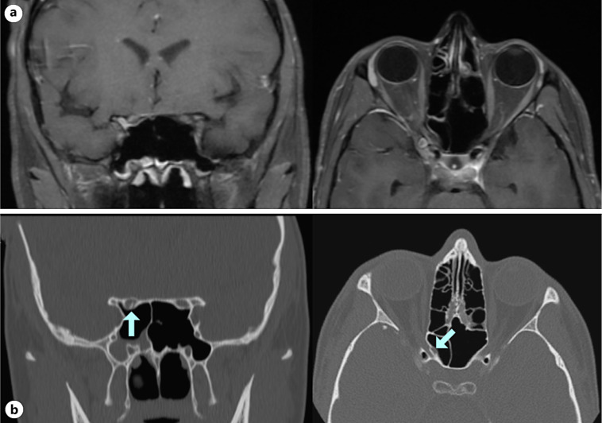
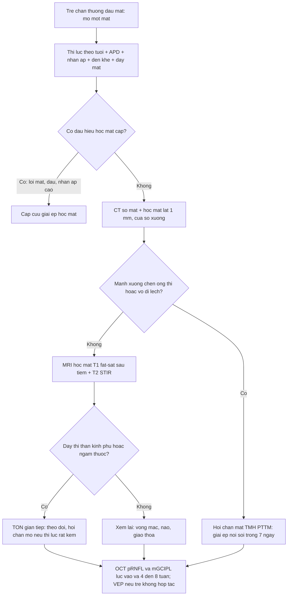
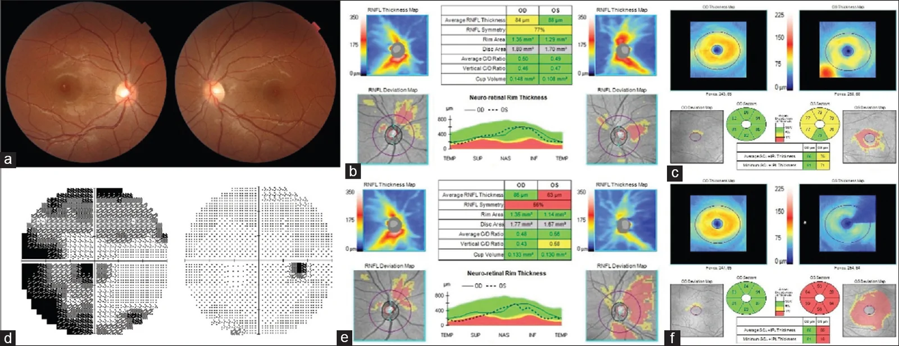
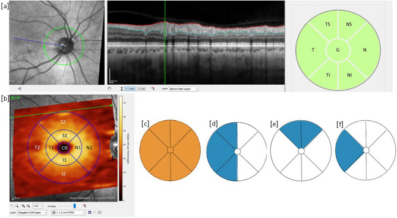

# 3281 — Bệnh thần kinh thị do chấn thương ở trẻ: vì sao APD là dấu chốt, CT ống thị đọc gì, và khi nào mổ giải ép / Pediatric traumatic optic neuropathy

**Tags:** `pattern:mat-mot-ben` `pattern:giam-thi-luc-dot-ngot` `pattern:APD` `pattern:dia-thi-binh-thuong` `pattern:gay-ong-thi` `pattern:ton-thuong-thi-thanh-kinh` `pattern:tre-em` `vung:mat` `vung:thi-thanh-kinh` `vung:hoc-mat` `vung:ong-thi` `vung:giao-thoa-thi` `protocol:CT-hoc-mat` `protocol:MRI-hoc-mat` `protocol:OCT-RNFL` `protocol:OCT-mGCIPL` `protocol:VEP`

**Mức chắc chắn (certainty):** tổng hợp y văn (literature synthesis) — phần **dịch tễ – cơ chế – hình ảnh** dựng từ các đoàn hệ và tổng quan hệ thống có số liệu: **133 bệnh nhân** trong International Optic Nerve Trauma Study (IONTS, PMID 10406604); **10.008 bệnh nhân** trong thử nghiệm CRASH (PMID 15474134); **23 nghiên cứu / 1.851 bệnh nhân** (PMC11635542); **34 nghiên cứu / 1.046 bệnh nhân** (PMID 41467484); **42 nghiên cứu / 2.859 ca** giải ép nội soi (PMID 42642526); **51 nghiên cứu** so sánh mổ với nội khoa (PMID 42636456). Phần **riêng cho trẻ** mỏng hơn: **40 trẻ / 43 mắt** (PMID 14970795), **47 trẻ** (PMID 36517427), **41 trẻ / 43 mắt** (PMID 21621861), **15 trẻ 1–6 tuổi** (PMID 39693625). **Không có thử nghiệm ngẫu nhiên nào riêng cho trẻ** — mọi ngưỡng "mổ trong bao lâu, corticoid hay không" là **thực hành đồng thuận + suy luận từ người lớn**, ghi rõ tại chỗ. **Không ghi tên tác giả** — attribution = **tạp chí + năm + PMCID/PMID**.

> **Câu chốt:** Bệnh thần kinh thị do chấn thương (traumatic optic neuropathy, TON) **không đỏ mắt, không đau, đĩa thị lúc đầu bình thường** — thứ duy nhất phát hiện được ở giường là **APD (relative afferent pupillary defect)** và **thị lực giảm một mắt**. Bốn con số phải thuộc: **(1)** TON gặp ở **0,5–8%** bệnh nhân chấn thương sọ não; trong **135 bệnh nhân** chấn thương sọ não, TON có triệu chứng chỉ **1,5%** nhưng **46,8%** số có OCT theo dõi có thay đổi **dưới lâm sàng** (PMC12041581); **(2)** IONTS (**133 bệnh nhân**) không thấy khác biệt: cải thiện **≥ 3 dòng** ở **32%** nhóm mổ, **57%** nhóm không điều trị, **52%** nhóm corticoid (**p = 0,22**) (PMID 10406604); **(3)** CRASH (**10.008 bệnh nhân** chấn thương sọ não) cho thấy methylprednisolone liều cao **làm tăng tử vong**: **21,1% vs 17,9%**, **RR 1,18 (95% CI 1,09–1,27)** (PMID 15474134); **(4)** ở trẻ, **còn thị lực lúc vào** và **mổ trong ≤ 7 ngày** là yếu tố bảo vệ: cải thiện **85,0% vs 40,7%** và **80,8% vs 33,3%** (PMID 36517427). **Không được hứa "vài tuần sẽ khá"**: **45%** trẻ trong loạt 43 mắt còn **không thấy ánh sáng** (no light perception, NLP) sau ≥ 1 tháng (PMID 14970795).

## 1. Tổng quan bệnh học – cơ chế hình ảnh (TẠI SAO)

### 1.1 Vì sao tổn thương lại rơi đúng vào ống thị

- Thị thần kinh đi từ nhãn cầu qua **hốc mắt**, vào **ống thị (optic canal)** trong xương bướm, rồi vào **khoang nội sọ** để tới **giao thoa thị (optic chiasm)**. Trong ống thị, dây thần kinh **bị màng não bọc sát và dính vào thành xương** — không có lớp mỡ đệm như trong hốc mắt.
- Khi lực chấn thương truyền qua xương trán–sọ–hốc mắt, **ống thị là đoạn chật nhất**: dây thần kinh không thể trượt, nên lực **cắt (shear)** và **chèn ép** dồn vào đây. Đó là lý do **chấn thương kín vùng trán–ổ mắt** gây mù dù **không có vết thương hở** (PMC11722660; PMC11306366).
- **Hai cơ chế chính:**
  - **Trực tiếp (direct):** mảnh xương ống thị di lệch **chèn vào dây**, hoặc vật xuyên rách dây. Trên hình ảnh là **đường vỡ ống thị + mảnh xương** (Hình 1b); ca điển hình có **mảnh xương 5 mm** đè lên thị thần kinh (PMC11722660), ca khác có **mảnh 4 × 5 mm** (PMC12021382).
  - **Gián tiếp (indirect):** không có mảnh xương chèn; lực truyền làm **phù, thiếu máu, gián đoạn vận chuyển sợi trục** trong ống thị. Đây là thể **thường gặp hơn** và là lý do **CT có thể bình thường** (PMC11306366; PMC12021382).
- **Vì sao thị lực mất ngay nhưng đĩa thị chưa đổi:** tổn thương nằm ở **sợi trục sau nhãn cầu**, không ở tế bào hạch tại võng mạc. **Thoái hóa ngược dòng (retrograde degeneration)** làm tế bào hạch chết dần; **lớp sợi trục quanh đĩa (peripapillary retinal nerve fibre layer, pRNFL)** chỉ mỏng đi **sau vài tuần đến vài tháng** (PMC12041581; PMC11306366).

### 1.2 Vì sao tổn thương có "hai thì" — và vì sao còn cửa sổ can thiệp

- **Thì 1 (cơ học, vài giây):** đứt sợi trục, dập dây, chèn ép trực tiếp. Phần này **không hồi phục**.
- **Thì 2 (sinh hóa, vài giờ–vài tuần):** phù nề, thiếu máu cục bộ, stress oxy hóa, viêm thần kinh đệm, chết tế bào hạch theo nhiều đường (apoptosis, pyroptosis, necroptosis, ferroptosis) (PMC12694625). Thì 2 là **mục tiêu của giải ép và điều trị nội khoa**, và giải thích vì sao **can thiệp sớm** có thể cứu phần sợi trục còn sống.
- **Vì sao "mổ sớm" được nhắc nhiều:** nếu ống thị đang là **khoang kín bị phù**, mở thành ống giúp giảm áp lực trong khoang, cải thiện tưới máu và vận chuyển sợi trục. Bằng chứng không đồng nhất: phân tích gộp **42 nghiên cứu / 2.859 ca** thấy tỷ lệ cải thiện chung **26%**, tốt nhất trong **cửa sổ 3–7 ngày** (SMD 0,45; p = 0,0179) (PMID 42642526); phân tích gộp khác (**34 nghiên cứu / 1.046 bệnh nhân**) thấy mổ **62% vs corticoid 37%** (OR 2,35; 95% CI 1,55–3,56), mổ **≤ 7 ngày** OR 2,91, và **bảo tồn được RNFL nhiều hơn +9,4 µm** (PMID 41467484). Ngược lại, IONTS **không thấy lợi ích** (PMID 10406604) và tổng quan hệ thống của Blanch **không thấy bằng chứng lợi ích của giải ép ống thị** (PMC11306366).
- **Kết luận thực hành:** không có "thuốc đặc hiệu"; quyết định dựa trên **cơ chế (có mảnh xương chèn hay không)**, **thị lực còn lại**, **thời gian ≤ 7 ngày**, và **ý kiến đa chuyên khoa**. Đây là **tranh cãi thật**, không phải "thiếu hiểu biết" (mục 7).

### 1.3 Vì sao MRI là cột thứ hai sau CT — và đọc gì

- **CT cửa sổ xương, lát ≤ 1 mm** là bước đầu để tìm **vỡ ống thị, mảnh xương di lệch, vỡ trần xoang bướm, vỡ thành hốc mắt**. Trong **15 trẻ** TON, **6 ca** có **vỡ ống thị hoặc phù thị thần kinh** trên hình ảnh (PMID 39693625) — nghĩa là **hơn nửa số trẻ không có bất thường xương rõ**.
- **MRI hốc mắt T1 fat-sat sau tiêm + T2/STIR** trả lời câu hỏi mà CT không trả lời được: **dây thần kinh có phù, có ngấm thuốc, có tổn thương giao thoa không**. Ca điển hình: **ngấm thuốc đoạn trong ống thị và trong sọ bên phải**, lan tới giao thoa trên **T1 sau tiêm**; **tăng tín hiệu trên STIR** (PMC11722660). Ca khác: **ngấm thuốc đoạn trong sọ và trong ống thị** dù **CT ban đầu chỉ thấy vỡ sàn hốc mắt bên đối diện** (PMC12021382).
- **TẠI SAO T1 fat-sat sau tiêm:** mỡ hốc mắt rất sáng trên T1, **fat-sat** làm mỡ tối để dây thần kinh **ngấm thuốc** nổi lên; **T2/STIR** làm **nước/phù** sáng. Không có fat-sat, mỡ quanh dây che mất phần ngấm thuốc mảnh.
- **Cạm bẫy lớn nhất:** **MRI/CT bình thường không loại trừ TON**, và **vỡ ống thị có thể bị bỏ sót ở lần đọc đầu**. Trong ca PMC12021382, **vỡ ống thị bên phải** chỉ được phát hiện khi **hội chẩn lại hình ảnh ở ngày 7**, sau khi bệnh nhân đã được chẩn đoán "TON gián tiếp" và điều trị corticoid; mảnh xương **4 × 5 mm** được lấy trong mổ giải ép (PMC12021382).

### 1.4 Vì sao OCT lại là "máy đo hậu quả" — và vì sao đo sớm dễ sai

- **pRNFL** là lớp sợi trục của tế bào hạch; **mGCIPL (macular ganglion cell–inner plexiform layer)** là thân tế bào hạch và lớp rối trong. Sau TON, **mGCIPL mỏng sớm hơn pRNFL** vì không bị phù quanh đĩa che lấp (PMC13668188).
- **Con số phải nhớ:** độ lặp lại của pRNFL toàn cầu là **± 4 µm**; ở bệnh nhân chấn thương sọ não, pRNFL toàn cầu giảm **1,74 µm/tháng** khi có **Marshall II** trên CT, so với **0,05 µm/tháng** khi Marshall I; **3,69 µm/tháng** sau chấn thương nặng so với **1,47 µm/tháng** sau chấn thương nhẹ (PMC12041581). Vì vậy **một lần đo trong 4 µm là "chưa thấy gì"**, không phải "không tổn thương".
- **OCT mạch máu (OCT-A):** ở **33 mắt** TON gián tiếp, **mật độ mạch vùng mao mạch quanh đĩa (radial peripapillary capillary, RPC)** giảm còn **48,5% ± 6,28** so với **57,88% ± 3,06** ở **34 mắt** chứng (p < 0,0001); vùng **dưới** liên quan với **khiếm khuyết thị trường** (p = 0,0253) và **thị lực** (p = 0,0369) (PMC11009324). Đây là **dấu hiệu bổ sung**, chưa thay thế pRNFL/mGCIPL trong thực hành.

### 1.5 Trẻ khác người lớn ở năm điểm

1. **Không mô tả được:** trẻ **1–6 tuổi** chỉ được phát hiện khi **nheo mắt, dụi mắt, không nhìn theo đồ chơi, hoặc người nhà thấy "mắt lệch"**; trong loạt **15 trẻ**, tuổi **1–6** và **2 ca tổn thương hai mắt** (PMID 39693625).
2. **Xương trẻ đàn hồi hơn:** lực truyền xa hơn, **có thể không có vỡ ống thị**; vì vậy **CT âm tính vẫn phải khám APD và thị lực**.
3. **Nhược thị (amblyopia):** mắt một bên mờ trong **thời kỳ nhạy cảm** làm vỏ não thị giác "học" hình ảnh mờ; đây là **tổn thương thứ hai** cần kế hoạch riêng, không chỉ chờ thần kinh hồi phục.
4. **Khúc xạ tiến triển khác:** ở **21 trẻ** TON một bên (3–15 tuổi), mắt tổn thương **tiến triển cận thị chậm hơn** mắt lành **0,250 D/năm** (95% CI 0,170–0,330; p < 0,001), và mắt **NLP** còn phẳng hơn **0,195 D/năm** (p = 0,044) — **mắt lành** mới là mắt cần theo dõi cận thị (PMC13274769).
5. **Tiên lượng không "mềm" hơn người lớn:** **40 trẻ** (43 mắt) có kết cục tương tự người lớn: **45% NLP**, **32% < 20/200**, **18% ≥ 20/80**; **không khác biệt giữa có và không điều trị** (PMID 14970795). Ngược lại, loạt **47 trẻ** có **59,6% cải thiện** sau mổ giải ép + corticoid, với **thị lực còn lại** và **≤ 7 ngày** là yếu tố bảo vệ (PMID 36517427) — hai loạt khác nhau về **chọn bệnh**, không phải mâu thuẫn đơn giản.

## 2. Mẫu hình + chẩn đoán phân biệt theo vị trí (gamut)

- **Mẫu hình chính:** trẻ/thiếu niên, **một mắt**, sau **chấn thương kín vùng trán–ổ mắt** (tai nạn giao thông, thể thao, ngã, vật đập); **mờ đột ngột, không đau, không đỏ**; **APD dương tính** ở mắt tổn thương; **đĩa thị bình thường** hoặc hơi phù; **thị trường** có khuyết (thường một phần tư hoặc toàn bộ); vài tuần sau **đĩa thị nhợt** và **pRNFL/mGCIPL mỏng**.
- **Theo vị trí tổn thương (quyết định hình ảnh và tiên lượng):**
  - **Đoạn trong ống thị (intracanalicular)** — thể kinh điển; **CT** tìm vỡ/mảnh xương; **MRI** thấy ngấm thuốc/phù; tiên lượng phụ thuộc **có mảnh chèn** và **thời gian mổ**.
  - **Đỉnh hốc mắt (orbital apex)** — kèm **hội chứng đỉnh hốc mắt**: đau, liệt vận nhãn, giảm cảm giác V1; phân biệt **viêm/khối** và **hội chứng xoang câm**.
  - **Giao thoa thị (chiasm)** — **bán manh hai thái dương (bitemporal hemianopia)**; gặp trong **hội chứng giao thoa do chấn thương**; **MRI** bắt buộc (PMC11722660).
  - **Nhãn cầu/võng mạc** — **rách hắc mạc, commotio, xuất huyết dịch kính** có thể **che** TON; khám đáy mắt giãn đồng tử và **siêu âm B** khi không thấy đáy mắt.
  - **Vỏ não chẩm** — **mù vỏ não (cortical blindness)**: hai mắt, **đồng tử phản xạ bình thường**, không APD; **MRI sọ** là chốt.
- **Theo cơ chế (quyết định điều trị):**
  - **Gián tiếp, không mảnh chèn** → theo dõi/điều trị nội khoa là lựa chọn hợp lý; mổ chỉ khi thị lực rất kém và trong cửa sổ sớm, sau hội chẩn.
  - **Trực tiếp, có mảnh xương chèn** → **giải ép cơ học** là can thiệp chính; corticoid chỉ là hỗ trợ, không thay thế lấy mảnh.
- **Dấu hiệu đỏ (red flag) trong 24 giờ đầu:** **NLP**, **APD**, **vỡ ống thị di lệch**, **lồi mắt + đau + nhãn áp cao** (hội chứng khoang hốc mắt), **bán manh hai thái dương**, **không thấy đáy mắt**, **vỡ nhãn cầu**, **chảy máu mũi nhiều** (nghi vỡ trần xoang bướm/động mạch), **tổn thương hai mắt**.

## 3. Bảng so sánh phân biệt (ma trận đối chiếu)

| Thực thể (entity) | Hình ảnh điển hình (CT / MRI / đáy mắt / OCT) | Chốt vào (rule-in) | Chốt loại (rule-out) | Gợi ý xác nhận |
|---|---|---|---|---|
| **TON gián tiếp (bài này)** | CT thường **không có mảnh xương chèn**, có thể vỡ thành hốc mắt; MRI **ngấm thuốc + T2/STIR sáng** đoạn trong ống thị; đáy mắt đầu bình thường, muộn **nhợt đĩa thị**; OCT **mGCIPL rồi pRNFL mỏng** | **APD + chấn thương kín + MRI thị thần kinh bất thường**, không mảnh chèn | **Đĩa thị phù đơn thuần do bệnh khác**, **không APD**, **MRI bình thường hoàn toàn** | Khám **APD hai mắt**, OCT pRNFL/mGCIPL lúc vào và **4–8 tuần**, VEP nếu trẻ không hợp tác |
| **TON trực tiếp (mảnh xương chèn)** | CT cửa sổ xương: **vỡ ống thị + mảnh xương đè dây**, có thể **vỡ trần xoang bướm**; MRI phù/ngấm thuốc khu trú | **Mảnh xương tiếp xúc thị thần kinh trên CT lát ≤ 1 mm** | **Không thấy mảnh xương** trên CT đủ lát mỏng + MRI | Hội chẩn **mắt–TMH–PTTM**, xem lại **đa bình diện**, không chỉ axial |
| **Rách/đứt thị thần kinh (avulsion)** | **Nhãn cầu lệch trục**, **dây thần kinh đứt** trên MRI; đáy mắt có thể thấy **đĩa thị trống/lõm**; **xuất huyết dịch kính** | **Mất liên tục dây thị thần kinh trên MRI** + thị lực **NLP** | Dây liên tục, chỉ phù/ngấm thuốc | MRI T2/T1 fat-sat; **không mổ "nối"** khi đã đứt hoàn toàn |
| **Hội chứng giao thoa chấn thương** | **Bán manh hai thái dương**; MRI **tăng tín hiệu/ngấm thuốc giao thoa**; có thể kèm **đái tháo nhạt**, rối loạn nội tiết | **Thị trường hai thái dương + tổn thương giao thoa trên MRI** | Thị trường một mắt, tổn thương chỉ một bên ống thị | **Thị trường Humphrey/ Goldmann**, MRI sọ hốc mắt, đánh giá tuyến yên |
| **Hội chứng khoang hốc mắt / máu tụ sau nhãn cầu** | **Lồi mắt, căng, đau**, nhãn áp cao, APD; CT **khối máu tụ sau nhãn cầu**, **căng cơ**, **xoang** | **Lồi mắt + nhãn áp cao + đau tăng** sau chấn thương, CT có máu tụ | Không lồi mắt, nhãn áp bình thường, CT không khối | **Cấp cứu**: mở góc mi/giải ép, không chờ MRI |
| **Viêm thị thần kinh (optic neuritis)** | MRI **ngấm thuốc dây**, tổn thương **dài ≥ 1/2 chiều dài** hoặc **giao thoa**; **không tiền sử chấn thương**; đau khi liếc | **Đau khi vận nhãn + ngấm thuốc dài + không chấn thương** | **Tiền sử chấn thương rõ + tổn thương khu trú ống thị** | MRI sọ–hốc mắt, kháng thể **AQP4/MOG** khi nghi, theo dõi |
| **Bệnh thị thần kinh thiếu máu (NAION/AION)** | **Phù đĩa thị**, khuyết thị trường **nửa trên/dưới**, **không đau**, không chấn thương; **bờ đĩa nhỏ** | **Khuyết thị trường theo chiều cao + đĩa phù + yếu tố mạch máu** | **Chấn thương rõ**, APD mạnh, MRI có tổn thương dây | Soi đáy mắt, thị trường, **CRP/ESR** nếu nghi GCA |
| **Tắc động mạch trung tâm võng mạc** | **Võng mạc trắng đục**, **đốm anh đào (cherry-red spot)**, **không đau**, mất thị lực đột ngột | **Đốm anh đào + trắng đục võng mạc** | **Đáy mắt bình thường hoặc chỉ nhợt đĩa** | Soi đáy mắt, **FA** (chậm đầy), **OCT** (dày nội bào) |
| **Commotio retinae / rách hắc mạc** | **Vẩn đục trắng võng mạc** hoặc **vệt cung vàng–trắng**; OCT **đứt RPE–Bruch** nếu rách hắc mạc | **Vệt cung/commotio + chấn thương kín** | **Không tổn thương võng mạc**, chỉ APD + MRI thị thần kinh | Soi đáy mắt giãn đồng tử + **OCT hoàng điểm**; xem bài 3277 |
| **Mù vỏ não (cortical blindness)** | **Hai mắt mù**, **đồng tử phản xạ bình thường**, **không APD**; MRI **nhồi máu/xuất huyết chẩm hai bên** | **Không APD + hai mắt + tổn thương chẩm trên MRI** | **APD một bên + tổn thương dây thị** | MRI sọ, khám thần kinh, thị trường |
| **Giảm thị lực chức năng (functional)** | **Không APD**, thị trường **hình ống** không đổi khoảng cách, **hành vi nhìn bình thường**, OCT/ MRI bình thường | **Không APD + không tổn thương cấu trúc + dấu hiệu không nhất quán** | **APD thật + tổn thương trên MRI/OCT** | **Trống tang (optokinetic drum)**, thị trường, OCT, theo dõi |

*Hình 1: bệnh nhân **19 tuổi**, mù hoàn toàn mắt phải sau khi bị chân biển quảng cáo đập vào **má trái**. Hàng trên — **MRI T1 sau tiêm, fat-sat**: **ngấm thuốc đoạn trong sọ và trong ống thị bên phải** (mũi tên), không tương ứng với vùng tăng tín hiệu T2. Hàng dưới — **CT cửa sổ xương**: **vỡ thành dưới–trong ống thị phải** và **vỡ trần xoang bướm phải** (mũi tên xanh), mảnh xương đè vào dây thần kinh. Đây là ví dụ **TON trực tiếp bên đối diện với ổ chấn thương** — cạm bẫy "chỉ khám bên bị đập". Nguồn: Case Rep Ophthalmol 2025 (**PMC12021382**, Fig. 1), **CC BY-NC 4.0**, ảnh nguyên bản.*

## 4. Protocol chụp + ngưỡng quyết định + lịch theo dõi

### 4.1 Trình tự xử trí trẻ nghi TON

### 4.2 Ngưỡng và bằng chứng định lượng

| Câu hỏi | Ngưỡng / số liệu | Ý nghĩa thực hành | Nguồn |
|---|---|---|---|
| Có nên dùng corticoid liều cao? | **CRASH**: tử vong **21,1% vs 17,9%**, **RR 1,18 (1,09–1,27)**; IONTS **không khác biệt**; 3 RCT nhỏ **không có lợi ích** | **Không dùng liều cao thường quy** ở TON, đặc biệt khi có chấn thương sọ não; nếu dùng, phải cân nhắc **từng ca** và ghi rõ | PMID 15474134; PMID 10406604; PMC11306366 |
| Mổ giải ép có lợi không? | Gộp **34 nghiên cứu / 1.046 bệnh nhân**: **62% vs 37%**, **OR 2,35 (1,55–3,56)**; gộp **42 nghiên cứu / 2.859 ca**: **26%** cải thiện chung | Có **tín hiệu lợi** nhưng chủ yếu **nghiên cứu quan sát**; không có RCT lớn | PMID 41467484; PMID 42642526 |
| Mổ trong bao lâu? | **≤ 7 ngày**: **80,8% vs 33,3%** ở trẻ (p = 0,001); tốt nhất **3–7 ngày** (SMD 0,45); **≤ 7 ngày** OR 2,91 | Nếu quyết định mổ, **đừng để quá 7 ngày**; sau 7 ngày vẫn có thể mổ nhưng **tiên lượng kém hơn** | PMID 36517427; PMID 42642526; PMID 41467484 |
| Thị lực lúc vào nói gì? | Trẻ **còn thị lực**: cải thiện **85,0%**; **NLP**: **40,7%** (p = 0,002); **45%** trẻ NLP vẫn NLP sau ≥ 1 tháng | **NLP không phải "vô vọng"**, nhưng **phải nói thật** với gia đình; **còn thị lực là dấu hiệu tốt** | PMID 36517427; PMID 14970795 |
| Vỡ ống thị di lệch nói gì? | Có vỡ di lệch: cải thiện **42,1%**; không vỡ: **71,4%** (p = 0,044) | Vỡ di lệch **xấu hơn**, nhưng **mảnh chèn còn lấy được** — không đồng nghĩa bỏ cuộc | PMID 36517427 |
| OCT theo dõi thế nào? | Độ lặp lại pRNFL **± 4 µm**; giảm **1,74 µm/tháng** (Marshall II); **3,69 µm/tháng** sau chấn thương nặng | Đo **lúc vào** (có thể bình thường) và **4–8 tuần**; đừng kết luận "không tổn thương" khi mới đo một lần | PMC12041581 |
| Hệ phân độ chuẩn hóa? | **Chưa có** hệ phân độ được xác nhận cho TON trẻ em | Dùng **cơ chế (trực tiếp/gián tiếp) + thị lực đầu + thời gian + hình ảnh** để trao đổi, không gọi "độ I–IV" | PMC11306366; PMID 42642526 |

### 4.3 Lịch theo dõi gợi ý (suy luận từ các đoàn hệ)

- **Ngày 0–3:** khám mắt đầy đủ, **APD**, thị trường (nếu hợp tác), **CT sọ–hốc mắt lát ≤ 1 mm**, **MRI** nếu CT âm tính mà nghi cao; **đo OCT pRNFL/mGCIPL làm mốc**.
- **Ngày 3–7:** **hội chẩn mắt–TMH–phẫu thuật thần kinh** nếu có mảnh chèn hoặc thị lực rất kém; quyết định **mổ nội soi** trong cửa sổ này.
- **Tuần 2–4:** khám lại thị lực, **APD**, đáy mắt; **OCT lặp**; đánh giá **nhược thị** và khúc xạ.
- **Tháng 3, 6, 12:** **OCT** theo dõi mỏng dần; khám **thị trường**, sắc giác; với trẻ nhỏ, **khám gây mê (EUA)** khi cần để tránh nhiều lần.
- **Lâu dài:** theo dõi **cận thị ở mắt lành** (mắt TON tiến triển chậm hơn **0,250 D/năm**, PMC13274769) và **nhược thị**.

*Hình 2: nữ trẻ TON **mắt trái**, khám **2 tuần** sau tai nạn giao thông. (a) **Đáy mắt hai bên trông bình thường**; (b) OCT **mỏng nhẹ pRNFL vùng trên–thái dương**; (c) **mGCIPL mỏng sớm**; (d) **khiếm khuyết thị trường mắt trái**. (e–f) Lúc **3 tháng**: **pRNFL và mGCIPL mỏng rõ** — bằng chứng "đáy mắt bình thường lúc đầu" không loại trừ TON. Nguồn: Taiwan J Ophthalmol 2026 (**PMC13668188**, Figure 4), **CC BY-NC-ND 4.0**, ảnh nguyên bản không chỉnh sửa.*

## 5. Biến thể bình thường và cạm bẫy

- **CT bình thường không loại trừ TON:** thể gián tiếp không có mảnh xương; **hơn nửa số trẻ** trong loạt 15 ca không thấy bất thường xương (PMID 39693625). Nếu nghi cao, **MRI + khám APD** quyết định, không dựa vào CT.
- **Bỏ sót vỡ ống thị ở lần đọc đầu:** ca PMC12021382 cho thấy **vỡ ống thị bên phải** chỉ được nhận ra khi **hội chẩn lại ngày 7**; đọc **đa bình diện (axial + coronal + sagittal)** và **cửa sổ xương** là bắt buộc.
- **Vỡ ống thị bên đối diện:** chấn thương **má trái** gây **mù mắt phải**; nếu chỉ khám/ chụp bên đập vào thì **bỏ tổn thương**. Luôn khám **hai mắt**, chụp **toàn bộ ống thị hai bên**.
- **APD bị "che" khi tổn thương hai bên:** TON hai bên hoặc bệnh thị thần kinh từ trước làm **APD nhỏ/âm**, dễ gọi là "giảm thị lực chức năng". So **hai mắt**, hỏi **tiền sử nhìn kém**, đo **thị trường từng mắt**.
- **Đĩa thị bình thường lúc đầu:** đừng loại trừ vì "đáy mắt đẹp"; **nhợt đĩa thị** xuất hiện **sau vài tuần**, và **pRNFL/mGCIPL** mới là mốc khách quan (Hình 2).
- **OCT trong 4 µm:** khác biệt nhỏ hơn **± 4 µm** là **dao động đo**, không phải tiến triển; đừng đổi điều trị vì một lần đo.
- **Corticoid "hiệu quả" do hồi phục tự nhiên:** IONTS có **57%** nhóm **không điều trị** cải thiện ≥ 3 dòng (PMID 10406604) — nếu cho corticoid rồi thấy khá, **không được kết luận corticoid có công**.
- **Bỏ sót tổn thương võng mạc/nhãn cầu:** **rách hắc mạc, commotio, xuất huyết dịch kính** có thể cùng tồn tại; **không thấy đáy mắt** thì **siêu âm B** và khám gây mê.
- **Hội chứng khoang hốc mắt bị gọi là "TON":** **lồi mắt + đau + nhãn áp cao** là **cấp cứu ngoại khoa**, không phải theo dõi corticoid; chậm mở góc mi = mất thị lực không hồi phục.

## 6. Tự lượng giá — Blind Quiz

**Ca 1 — nam 19 tuổi, mù hoàn toàn mắt phải sau khi bị vật đập vào má trái.**

- Gợi ý lâm sàng: thị lực **NLP mắt phải**, **APD độ 4**, mắt trái **20/20**; CT ban đầu chỉ thấy **vỡ sàn hốc mắt trái**.
- Câu hỏi: (1) Mô tả bất thường trên MRI và CT? (2) Vì sao tổn thương **bên phải** khi vật đập **má trái**? (3) Dấu hiệu nào quyết định **mổ** thay vì chỉ theo dõi?

<b>Bấm để hiện đáp án (findings + chẩn đoán)</b>

- **Dấu hiệu:** MRI T1 sau tiêm, fat-sat — **ngấm thuốc đoạn trong sọ và trong ống thị bên phải** (mũi tên), không có tăng tín hiệu T2 tương ứng. CT cửa sổ xương — **vỡ thành dưới–trong ống thị phải** và **vỡ trần xoang bướm phải**, **mảnh xương đè vào dây thần kinh** (mũi tên xanh).
- **Chẩn đoán:** **TON trực tiếp do mảnh xương ống thị**, bên **đối diện** với điểm va đập; lực truyền qua xương mặt sang ống thị bên kia.
- **Chốt can thiệp:** **mảnh xương tiếp xúc/chèn thị thần kinh** trên CT lát mỏng + thị lực **NLP** → **giải ép nội soi trong ≤ 7 ngày**; ca này lấy ra **mảnh xương 4 × 5 mm**, sau 1 tháng thị lực **hand motion** (PMC12021382).
- **Nguồn ảnh:** Case Rep Ophthalmol 2025 (**PMC12021382**, Fig. 1), **CC BY-NC 4.0**.

**Ca 2 — nữ trẻ, mờ mắt trái 2 tuần sau tai nạn giao thông; đáy mắt "bình thường".**

- Gợi ý lâm sàng: không đau, không đỏ; **APD mắt trái**; đáy mắt hai bên **không thấy bất thường rõ**.
- Câu hỏi: (1) Vì sao đáy mắt bình thường mà vẫn mờ? (2) OCT đo lớp nào và vì sao **mGCIPL mỏng trước pRNFL**? (3) Lúc 3 tháng, dấu hiệu nào chứng minh tổn thương **không hồi phục**?

<b>Bấm để hiện đáp án (findings + chẩn đoán)</b>

- **Dấu hiệu:** (a) đáy mắt hai bên **bình thường**; (b) **pRNFL mỏng nhẹ vùng trên–thái dương mắt trái**; (c) **mGCIPL mỏng sớm**; (d) **khuyết thị trường mắt trái**; (e–f) sau **3 tháng**, **pRNFL và mGCIPL mỏng rõ**.
- **Chẩn đoán:** **TON gián tiếp** — tổn thương sợi trục sau nhãn cầu, **thoái hóa ngược dòng** làm mỏng lớp tế bào hạch **sau nhiều tuần**; đĩa thị lúc đầu chưa nhợt.
- **Vì sao mGCIPL trước:** pRNFL quanh đĩa có thể còn **phù che** giai đoạn đầu; **mGCIPL** không bị phù quanh đĩa nên **mỏng sớm hơn** (PMC13668188).
- **Nguồn ảnh:** Taiwan J Ophthalmol 2026 (**PMC13668188**, Figure 4), **CC BY-NC-ND 4.0**, nguyên bản.

**Ca 3 — báo cáo OCT của một trẻ TON: "pRNFL toàn cầu 84 µm, mGCIPL 76 µm".**

- Gợi ý lâm sàng: trẻ **8 tuổi**, TON một bên, OCT làm **lúc vào** và **6 tuần**; lần đầu pRNFL **84 µm**.
- Câu hỏi: (1) Vì sao không được kết luận "bình thường" chỉ vì 84 µm? (2) Cần đo lại lúc nào và dung sai bao nhiêu? (3) Nếu pRNFL giảm **2 µm/tháng**, có ý nghĩa không?

<b>Bấm để hiện đáp án (findings + chẩn đoán)</b>

- **Dấu hiệu:** hình minh họa cách chia **6 vùng pRNFL** (N, T, NS, TS, NI, TI) và **lưới ETDRS của mGCIPL**; giá trị tuyệt đối **phụ thuộc tuổi, máy, chất lượng ảnh**.
- **Chẩn đoán/lý giải:** pRNFL **84 µm** có thể còn trong giới hạn; tổn thương TON biểu hiện bằng **mỏng dần theo thời gian**, không phải một con số tuyệt đối. **Dung sai lặp lại ± 4 µm**; tốc độ mỏng tham chiếu **1,74–3,69 µm/tháng** sau chấn thương sọ não (PMC12041581).
- **Kết luận:** đo **lúc vào + 4–8 tuần**, so **cùng máy, cùng vùng**, và **so mắt bên kia**; **2 µm/tháng** nằm trong dung sai một lần đo nhưng **có ý nghĩa nếu lặp lại**.
- **Nguồn ảnh:** Sci Rep 2025 (**PMC12041581**, Fig. 1), **CC BY 4.0**.

## 7. Câu hỏi nghiên cứu & điểm chưa đồng thuận (tính đến 11/2026)

1. **[Tranh cãi] Ở trẻ TON gián tiếp, giải ép ống thị nội soi trong ≤ 7 ngày có cải thiện thị lực so với theo dõi hoặc corticoid đơn thuần không?**
   - **Đã biết:** loạt **47 trẻ** cho cải thiện **59,6%**, và **≤ 7 ngày** đạt **80,8% vs 33,3%** (p = 0,001) (PMID 36517427); gộp **42 nghiên cứu / 2.859 ca** thấy **26%** cải thiện, tốt nhất **3–7 ngày** (PMID 42642526); gộp **34 nghiên cứu** thấy mổ **62% vs corticoid 37%** (OR 2,35) (PMID 41467484).
   - **Chưa rõ:** IONTS **133 bệnh nhân** không thấy khác biệt (PMID 10406604) và tổng quan của Blanch **không thấy bằng chứng lợi ích của giải ép** (PMC11306366); thiếu **RCT ở trẻ**, khác nhau về **chọn bệnh, định nghĩa cải thiện, thời điểm đo**.
   - **Hướng nghiên cứu:** RCT đa trung tâm ở trẻ TON gián tiếp, phân tầng **thị lực đầu (NLP vs còn thị lực)** và **thời gian ≤ 7 ngày**, kết cục **thị lực 6–12 tháng + OCT pRNFL**.
   - **Nguồn:** PMID 36517427; PMID 42642526; PMID 41467484; PMID 10406604; PMC11306366.

2. **[Khoảng trống] Ngưỡng OCT pRNFL/mGCIPL nào ở trẻ TON dự báo phục hồi — và đo ở thời điểm nào là tối ưu?**
   - **Đã biết:** pRNFL có độ lặp lại **± 4 µm** và mỏng **1,74–3,69 µm/tháng** tùy mức chấn thương (PMC12041581); **mGCIPL mỏng sớm hơn pRNFL** (PMC13668188); OCT-A giảm **RPC 48,5% vs 57,88%** (PMC11009324).
   - **Chưa rõ:** chưa có **ngưỡng riêng cho trẻ TON** liên kết với **thị lực cuối**; chưa rõ **thời điểm đo tối ưu** (2–4 tuần vs 6–8 tuần) và ảnh hưởng của **nhược thị** lên mGCIPL.
   - **Hướng nghiên cứu:** đoàn hệ tiến cứu trẻ TON, đo OCT **lúc vào, 4 tuần, 8 tuần, 6 tháng**, phân tích **ROC** cho thị lực ≥ 20/200 và **mô hình tiên lượng** có hiệu chỉnh tuổi/máy.
   - **Nguồn:** PMC12041581; PMC13668188; PMC11009324.

3. **[Khác biệt thực hành] Corticoid liều cao còn được dùng như "chuẩn" ở nhiều trung tâm — trong khi CRASH cho thấy tăng tử vong và tổng quan hệ thống khuyến cáo không dùng?**
   - **Đã biết:** CRASH **10.008 bệnh nhân** tăng tử vong **RR 1,18** (PMID 15474134); 3 RCT nhỏ (methylprednisolone, erythropoietin, levodopa–carbidopa) **không có lợi ích**, và tổng quan Blanch **khuyến cáo không dùng IVMP** (PMC11306366); nhưng gộp **51 nghiên cứu** vẫn thấy corticoid **tốt hơn theo dõi** (Peto OR 2,7; NNT 4) (PMID 42636456), và loạt trẻ **15 ca** vẫn dùng corticoid sau mổ (PMID 39693625).
   - **Chưa rõ:** sự khác biệt có thể do **quần thể** (chấn thương sọ não nặng vs TON đơn thuần), **liều/thời gian**, và **thiên lệch chọn bệnh** trong nghiên cứu quan sát; chưa có RCT **chỉ ở TON** đủ lớn.
   - **Hướng nghiên cứu:** registry quốc tế ghi **liều, thời điểm, có/không chấn thương sọ não, tử vong và thị lực**, kèm **phân tích theo nhóm**; RCT ở TON **không có chấn thương sọ não nặng** nếu đạo đức cho phép.
   - **Nguồn:** PMID 15474134; PMC11306366; PMID 42636456; PMID 39693625.

## Bài liên quan chéo

- [3277 – Rách hắc mạc do chấn thương ở trẻ](../3277-rach-hac-mac-chan-thuong-tre/lesson.md)
- [3263 – Bệnh thần kinh thị do dầu silicone](../3263-benh-than-kinh-thi-dau-silicone/lesson.md)
- [1458 – Bệnh thần kinh thị do xạ ở trẻ](../1458-benh-than-kinh-thi-do-xa-o-tre/lesson.md)
- [431 – U thần kinh thị](../431-u-than-kinh-thi/lesson.md)
- [434 – Teo thị thần kinh thị độc và LHON](../434-teo-thi-than-kinh-thi-doc-va-LHON/lesson.md)
- [441 – OCT hoàng điểm: đọc lớp và bẫy](../441-OCT-hoang-diem/lesson.md)
- [400 – Tổng quan Mắt & thị giác](../400-tong-quan-mat-thi-giac/lesson.md)

## Ảnh

- `images/3281_benh-than-kinh-thi-chan-thuong-tre_CT-MRI_PMC12021382-Fig1.jpg` — CT + MRI TON trực tiếp (PMC12021382, Fig. 1, CC BY-NC 4.0).
- `images/3281_benh-than-kinh-thi-chan-thuong-tre_Fundus-OCT-VF_PMC13668188-Fig4.webp` — đáy mắt + OCT + thị trường TON gián tiếp (PMC13668188, Figure 4, CC BY-NC-ND 4.0, nguyên bản).
- `images/3281_benh-than-kinh-thi-chan-thuong-tre_OCT-RNFL-GCL_PMC12041581-Fig1.jpg` — sơ đồ phân vùng pRNFL/mGCIPL (PMC12041581, Fig. 1, CC BY 4.0).
- Nguồn + giấy phép từng ảnh: `images/CREDITS.md`. Không tải được ảnh nào khác (paywall/bản quyền) → dẫn link trong `sources.md`.

> Không dùng để chẩn đoán độc lập khi chưa có người hướng dẫn.
