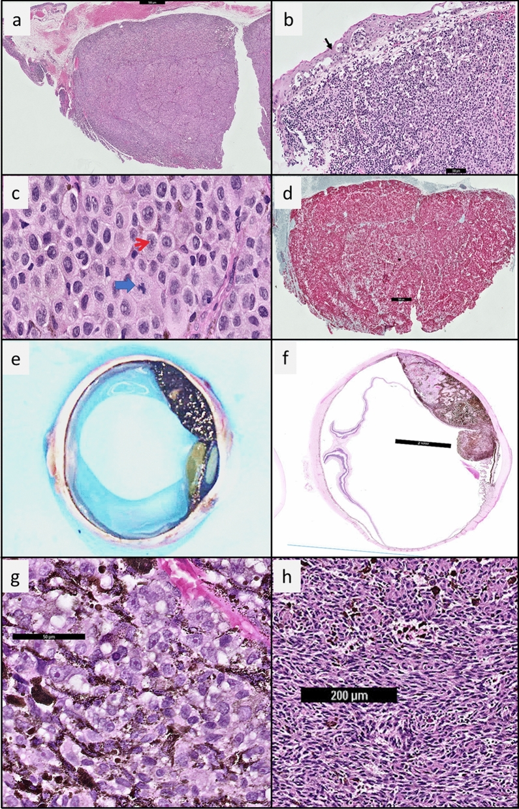
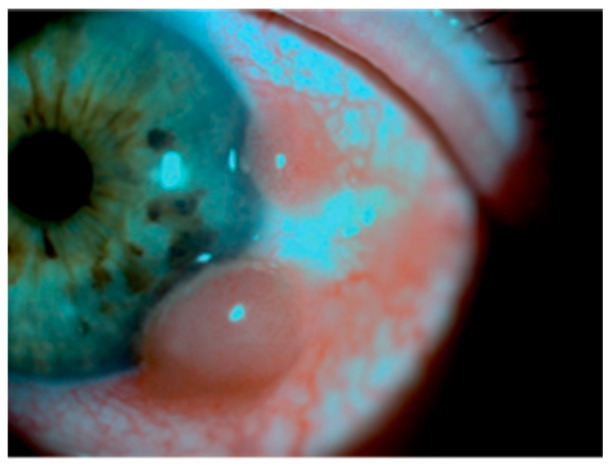
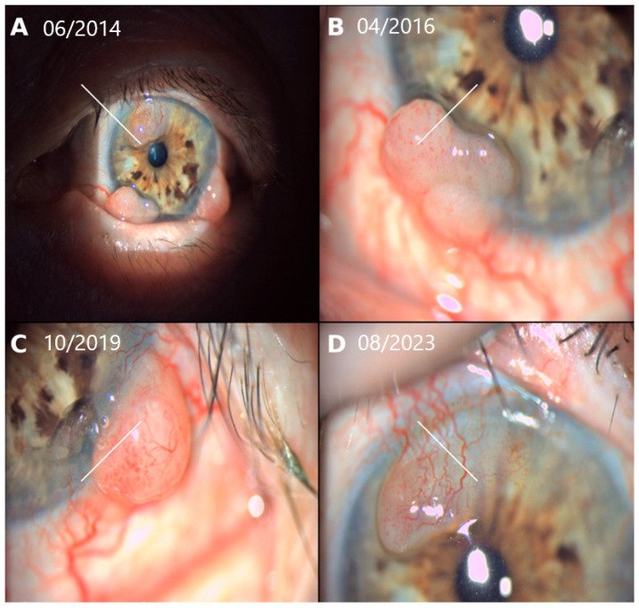
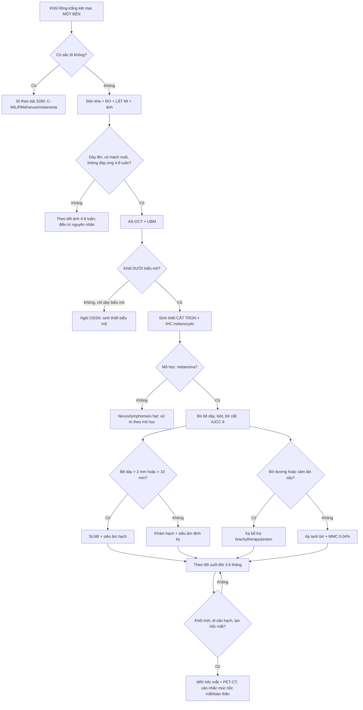
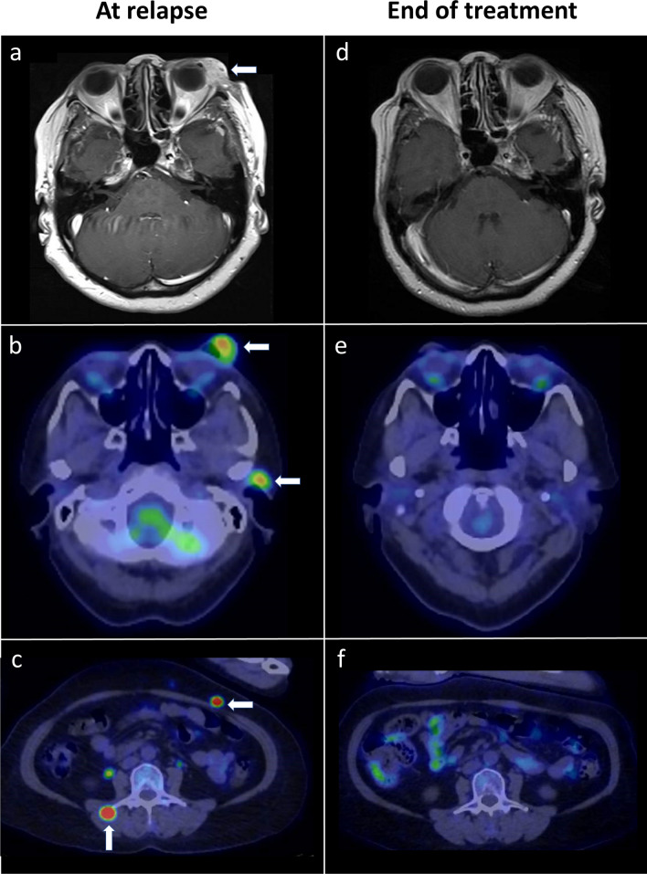
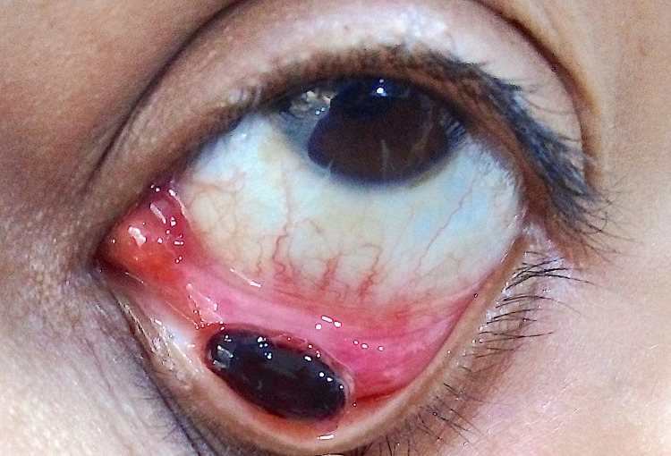
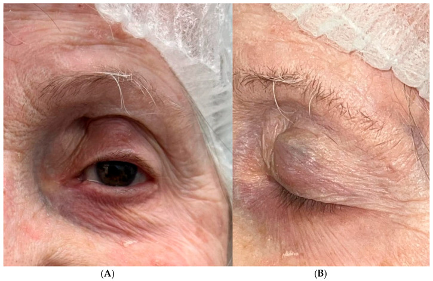
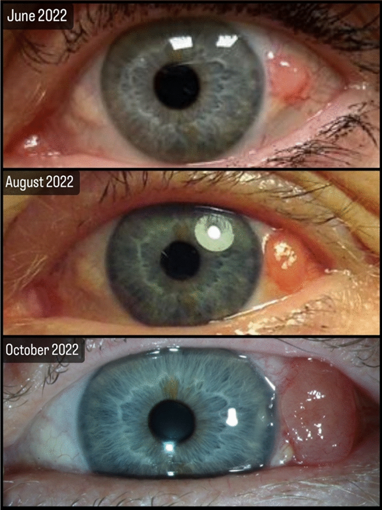
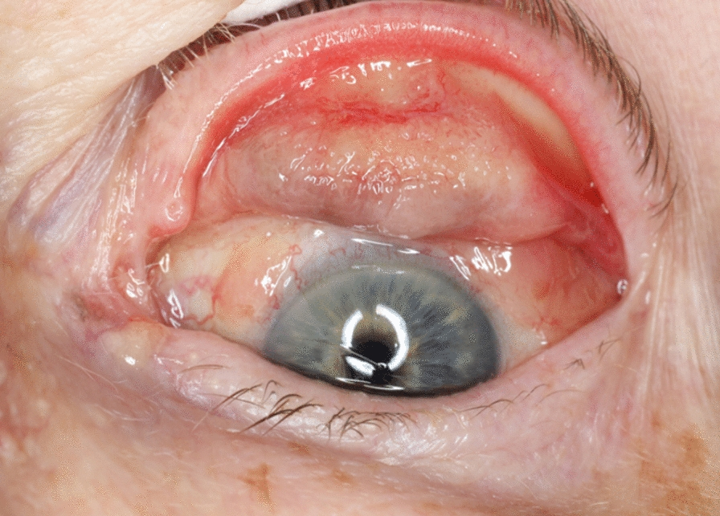

# 3282 — Melanoma kết mạc KHÔNG sắc tố: khối hồng–trắng một bên, lớn dần, không đáp ứng điều trị

**Tags:** `pattern:mat-mot-ben` `pattern:khong-sac-to` `pattern:mach-nuoi` `pattern:khong-lanh` `pattern:u-ket-mac` `pattern:giap-pterygium` `pattern:giap-viem-bo-mi` `vung:mat` `vung:ket-mac` `vung:giac-mac` `vung:mi` `vung:hoc-mat` `protocol:den-khe` `protocol:lot-mi` `protocol:AS-OCT` `protocol:UBM` `protocol:sinh-thiet-cat-tron` `protocol:map-biopsy` `protocol:ap-lanh` `protocol:MRI-hoc-mat` `protocol:PET-CT` `protocol:SLNB` `protocol:xa-ap` `score:AJCC8` `incidentaloma:khong`

**Mức chắc chắn (certainty):** tổng hợp y văn (literature synthesis) — dựng từ **2 ca amelanotic kết mạc** (J Med Case Rep 2024, PMC11370060), **ca tái phát 10 năm + di căn mi muộn** (J Clin Med 2026, PMC13163445), **ca amelanotic ở trẻ 7 tuổi** (Am J Ophthalmol Case Rep 2023, PMC9792290), **loạt 12 ca BRAF/NRAS** (Arq Bras Oftalmol 2023, PMC11826533), **đoàn hệ 39 u hắc tố mắt châu Á** (Sci Rep 2020, PMC7529790), **loạt 2.298 "pterygium" có mô bệnh** (Br J Ophthalmol 2026, PMC13539844), **AS-OCT 37 u kết mạc** (J Clin Pract Res 2026, PMC13267324), **tổng quan AS-OCT bề mặt nhãn cầu** (Clin Exp Ophthalmol 2026, PMC13408978), **tổng quan Co-M 2025** (Pathol Oncol Res, PMC12358323), **288 ca di căn** (Br J Ophthalmol 2025, PMC12171484) và **tổng quan Co-M 2024** (Cancers, PMC11429624). Nhóm **không có bệnh nhân của mình**; chỗ chưa đủ chắc ghi **"chưa rõ"**. **Không ghi tên tác giả** — attribution = **tạp chí + năm + PMCID/DOI** (xem `images/CREDITS.md`).

> **Câu chốt:** melanoma kết mạc không sắc tố (amelanotic conjunctival melanoma) là **cùng một bệnh ác tính** với melanoma kết mạc có sắc tố, chỉ **mất đi tín hiệu cảnh báo mà mọi người chờ đợi: màu nâu–đen**. Vì vậy nó thường bị điều trị như **"viêm bờ mi"**, **"pinguecula/pterygium"** hoặc **"viêm kết mạc"** trong nhiều tuần–nhiều tháng (PMC11370060). Bốn câu hỏi quyết định: **(1) Có phải tổn thương MỘT BÊN, mới xuất hiện, dày lên và có mạch nuôi không?** — nếu có, **không được theo dõi mù**. **(2) Nằm ở biểu mô hay dưới biểu mô?** — AS-OCT: **melanoma là khối DƯỚI biểu mô**, **OSSN là dày biểu mô**; **không sắc tố nên không có bóng lưng che bờ sâu** (PMC13408978). **(3) Đã có bằng chứng mô học chưa?** — **không có "màu sắc" nào thay thế sinh thiết**. **(4) Dày bao nhiêu?** — **< 0,8 mm rất ít di căn**, mỗi **+1,0 mm làm tăng 16% nguy cơ di căn** (PMC11826533; PMC12171484).

## 1. Tổng quan bệnh học – cơ chế hình ảnh (TẠI SAO)

### 1.1 "Không sắc tố" không có nghĩa "lành" — tế bào vẫn ác, chỉ ngừng sản xuất melanin

- Melanocyte kết mạc bình thường nằm **một lớp ở đáy biểu mô**. Khi chuyển dạng ác tính, tế bào vẫn xâm lấn mô đệm như melanoma có sắc tố, nhưng **một phần hoặc toàn bộ tế bào u không tích lũy đủ melanin** để nhìn thấy bằng mắt thường — mô học gọi là **"minimal or no pigmentation"** (PMC7529790).
- Tỷ lệ **không sắc tố** thay đổi theo định nghĩa và quần thể: **~10%** trong một loạt ca châu Âu (PMC11370060), **tới 15–19%** trong tổng quan 2023 (PMC11826533), nhưng **80% (14 ca) melanoma kết mạc** trong đoàn hệ châu Á chỉ có **rất ít hoặc không sắc tố** (PMC7529790). Vì vậy **"da sáng, mắt xanh" không phải điều kiện để nghĩ tới amelanotic**, và **màu sắc không dùng để phân tầng nguy cơ**.
- **TẠI SAO nguy hiểm:** mắt người khám được huấn luyện để **nhìn sắc tố**; khi không có sắc tố, tổn thương được ghi là "đỏ kết mạc", "pterygium", "viêm bờ mi". Trong 2 ca nguyên văn, **ca 1 (81 tuổi) được chẩn đoán ban đầu là viêm bờ mi**, sinh thiết 3 lần mới ra melanoma và phải **múc hốc mắt**; **ca 2 (50 tuổi) được chẩn đoán là pinguecula**, tổn thương từ **2 × 4,8 mm** lớn thành **4 × 5 mm**, cuối cùng là melanoma **6,8 mm đường kính, dày 3,2 mm** (PMC11370060).
- **Không phải bệnh hiếm gặp ở người trẻ:** ca **bé trai 7 tuổi**, tổn thương **8 mm đáy × 2,5 mm dày** ở kết mạc mũi, **hồng–đỏ, lớn nhanh**, không sắc tố; sau **cắt 4 mm bờ + áp lạnh**, theo dõi **73 tháng** không tái phát (PMC9792290).

### 1.2 TẠI SAO AS-OCT nhìn rõ hơn khi KHÔNG có melanin — vật lý hấp thụ ánh sáng

- AS-OCT bề mặt nhãn cầu dùng bước sóng **1000–1300 nm**, phân giải **5–7 µm** (siêu cao **< 3 µm**) (PMC13408978). **Melanin hấp thụ mạnh** ánh sáng trong dải này: tổn thương **càng sắc tố, càng tạo "bóng lưng" (posterior shadowing)** che mất bờ sâu và bề dày thật (PMC13408978; PMC11429624).
- **Amelanotic melanoma không có "vật liệu hấp thụ" đó** → AS-OCT thấy **khối dưới biểu mô tăng hồi âm, đồng nhất, bờ tương đối rõ**, và **đo được bề dày/bờ sâu tốt hơn** so với tổn thương sẫm màu. Đây là lý do nghịch lý: **tổn thương "khó thấy bằng mắt" lại dễ đo hơn trên AS-OCT** (PMC13408978).
- **Phân biệt bằng lớp tổn thương — chốt vật lý quan trọng nhất:**
  - **Melanoma kết mạc** = **khối DƯỚI biểu mô** tăng hồi âm; biểu mô phủ thường mỏng, bình thường (PMC13408978).
  - **OSSN** = **biểu mô dày, tăng hồi âm**, chuyển tiếp **90°** với biểu mô lành; khi dày có thể có bóng lưng dưới biểu mô (PMC13408978).
  - **Nevus** = khối dưới biểu mô **có nang trong tổn thương** (ổ giảm hồi âm tròn) — nang là dấu hiệu **mạn tính/lành tính** (PMC13408978).
- **Nhưng AS-OCT KHÔNG đọc được tế bào:** không phân biệt được **mức loạn sản**, không phân biệt **PAM với CAM**, và không thay thế sinh thiết (PMC13408978). Vì vậy "AS-OCT thấy rõ" **không** đồng nghĩa "lành".
- **Số liệu định lượng từ loạt AS-OCT 37 u kết mạc:** trong **16 u ác tính**, **93,75% (15/16) không sắc tố** so với **6,25% (1/16) có sắc tố** (p < 0,01); u ác có đường kính **12,7 ± 8,4 mm** so với u lành **6,4 ± 5,4 mm** (p = 0,09); **xâm lấn giác mạc 56,25% vs 4,76%** (p < 0,01); tổn thương **đồng nhất trên AS-OCT 54,5% vs 15,79%** (p = 0,02) (PMC13267324). Nghĩa là: **"không sắc tố" là một dấu hiệu ác tính trên lâm sàng, không phải dấu hiệu lành.**

### 1.3 TẠI SAO tái phát và di căn — bạch mạch thật + bề dày u

- Kết mạc có **bạch mạch thật** dẫn về hạch **trước tai, mang tai, dưới hàm, cổ**, nên melanoma kết mạc di căn **hạch vùng 25–52%**, rồi mới tới **gan, phổi, não** (PMC11429624). Trong loạt 288 ca, **gan và phổi cùng đứng đầu (44,8% mỗi nơi)** (PMC12171484).
- **Tái phát tại chỗ 30–60%** dù đã cắt + bổ trợ (PMC13163445; PMC11429624). Ca nguyên văn 78 tuổi có **10 lần cắt tái phát trong 10 năm**, mỗi lần kèm mitomycin C, và **di căn dưới da mi xuất hiện sau 11 năm** dù mắt vẫn được giữ (PMC13163445). Đây là lý do **không bao giờ "xuất viện" sau 5 năm**.
- **Bề dày là biến số tiên lượng mạnh nhất:**
  - **< 0,8 mm: di căn rất khó xảy ra** (PMC11826533).
  - **Mỗi +1,0 mm bề dày: +16% nguy cơ di căn** (HR 1,16; 95% CI 1,05–1,29; p = 0,003) — **288 ca** (PMC12171484).
  - **Mỗi +1 bậc cT: +89% nguy cơ di căn** (HR 1,89; p < 0,001); di căn xa **10% (29/288)**; nguy cơ tích lũy **8,6% / 5 năm** và **22,3% / 10 năm**; khi đã di căn, tử vong **42% / 5 năm** (PMC12171484).
- **Không sắc tố không làm bệnh nhẹ đi:** trong đoàn hệ châu Á, **14 ca melanoma kết mạc** (80% không sắc tố) có **sống không tái phát 5 năm 30,1%** và **sống toàn bộ 68,8%**, kém hơn **u hắc mạc (56,8% và 76,6%)** (PMC7529790). Tử vong chung của melanoma kết mạc **23–30% ở 10 năm** (PMC11826533).

### 1.4 TẠI SAO H&E một mình dễ sai — mô bệnh và hóa mô miễn dịch

- Trên H&E, melanoma không sắc tố là **đám tế bào biểu mô (epithelioid) hoặc thoi, nhân không đều, hạt nhân rõ, nhiều phân bào**, xâm lấn **mô đệm dưới biểu mô** và có thể lan **pagetoid** trong biểu mô (PMC7529790; PMC12358323). Không có melanin, hình ảnh này **chồng lấp với lymphoma, OSSN, carcinoma kém biệt hóa**.
- Vì vậy **bắt buộc hóa mô miễn dịch**: **S100, SOX10, Melan-A (MART1), HMB45** dương mới xác nhận dòng melanocyte; **cytokeratin âm** giúp loại OSSN; **CD45/LCA** loại lymphoma (PMC12358323; PMC7529790).
- Trong loạt 12 ca: **BRAF V600E 25%**, **NRAS Q61X 25%**; **tất cả ca có đột biến đều tái phát**, và **5/6 (83,33%) có lan hệ thống** — cỡ mẫu nhỏ, chỉ nêu như tín hiệu, không dùng để tiên lượng cá nhân (PMC11826533).

| Đại lượng | Số liệu | Nguồn |
|---|---|---|
| Tần suất melanoma kết mạc | **0,2–0,8/1 triệu/năm**; **5–7%** melanoma mắt; **0,25%** melanoma toàn bộ | PMC11826533; PMC9792290 |
| Tỷ lệ không sắc tố | **~10%** (châu Âu); **15–19%** (tổng quan); **80%** (đoàn hệ châu Á) | PMC11370060; PMC11826533; PMC7529790 |
| Tử vong 10 năm | **23–30%** | PMC11826533 |
| Bề dày → di căn | **+1,0 mm = +16%**; **< 0,8 mm rất ít di căn** | PMC12171484; PMC11826533 |
| Di căn xa | **10%**; **8,6% / 5 năm**; **22,3% / 10 năm** | PMC12171484 |
| Tái phát tại chỗ | **30–60%**; ca 10 lần / 10 năm | PMC13163445 |
| Sống không tái phát 5 năm (14 ca CM) | **30,1%** (u hắc mạc cùng loạt: **56,8%**) | PMC7529790 |

*Ảnh ghép mô bệnh của bài gốc: **a–d là melanoma kết mạc không sắc tố** — (a) khối tế bào lớn dưới biểu mô ở độ phóng đại thấp; (b) **lan pagetoid** trong biểu mô (mũi tên đen); (c) tế bào **epithelioid**, nhân không đều, hạt nhân rõ (mũi tên đỏ) và **phân bào** (mũi tên xanh); (d) **HMB45 dương** xác nhận dòng melanocyte. **e–h là u hắc mạc** dùng để so sánh: (e) đại thể u **có sắc tố đậm**, (f) u xâm lấn từ xích đạo tới thể mi, (g) thể **epithelioid**, (h) thể **thoi**. Đối lập rõ: u hắc mạc **đầy melanin**, còn mô kết mạc trong ca này **gần như không có melanin**. Nguồn: Sci Rep 2020 (PMC7529790), Fig. 1, CC BY 4.0.*

## 2. Mẫu hình + chẩn đoán phân biệt theo vị trí (gamut)

**Mẫu hình A — khối hồng–trắng, bờ rõ, ở kết mạc nhãn cầu/gần rìa, có mạch nuôi, lớn dần:** *người trung niên–cao tuổi; cộm, chảy nước mắt, đỏ một bên; không đau nhiều.* Gamut: **amelanotic melanoma**, **OSSN**, **pterygium/pinguecula**, **u hạt sinh mủ (pyogenic granuloma)**, **lymphoma**, **nhú kết mạc**, **di căn kết mạc**, **nevus không sắc tố**.

**Mẫu hình B — "viêm bờ mi/chắp" MỘT BÊN không đáp ứng, mi dày hoặc sụp mi:** *đỏ, cộm, chảy nước mắt; nhỏ corticoid–kháng sinh nhiều tuần không khỏi.* Gamut: **melanoma kết mạc sụn mi (ẩn sau mi)**, **carcinoma tuyến bã**, **chắp/viêm bờ mi thật**, **lymphoma**, **viêm mô tế bào trước vách**.

**Mẫu hình C — "pterygium/pinguecula" điển hình nhưng không đáp ứng, tái phát đúng chỗ, ở vị trí thái dương:** Gamut: **melanoma giả pterygium**, **OSSN**, **pterygium thật**, **u hạt sinh mủ**, **mộng thịt tái phát**.

**Mẫu hình D — đỏ mắt MỘT BÊN dai dẳng + nhú/mạch nuôi + không đáp ứng thuốc nhỏ:** Gamut: **amelanotic melanoma/C-MIL**, **lymphoma**, **viêm kết mạc mạn do thuốc**, **viêm kết mạc do vi khuẩn/Chlamydia**, **dị vật**.

**Mẫu hình E — tổn thương hỗn hợp sắc tố/không sắc tố, nhiều ổ, lan cùng đồ/sụn mi:** Gamut: **melanoma đa ổ trên nền PAM**, **C-MIL lan rộng**, **melanoma di căn**, **melanocytosis**.

- **Bộ ba "một bên – dày lên – mạch nuôi"** thay cho bộ ba sắc tố của bài 3280: **một bên**, **không đáp ứng điều trị**, **dày/lớn lên** → **sinh thiết**. Ghi vào hồ sơ mỗi lần khám: kích thước 2 chiều, số giờ cung, độ gồ, mạch nuôi, vị trí (nhãn cầu/sụn mi/cùng đồ).

## 3. Bảng so sánh phân biệt (ma trận đối chiếu)

| Thực thể (entity) | Hình ảnh điển hình (đèn khe / AS-OCT / mô học) | Chốt vào (rule-in) | Chốt loại (rule-out) | Gợi ý xác nhận |
|---|---|---|---|---|
| **Amelanotic melanoma kết mạc** | Khối **hồng–trắng/salmon**, bờ có thể rõ, **mạch nuôi từ cùng đồ**, lớn dần; AS-OCT: **khối dưới biểu mô tăng hồi âm, không bóng lưng** | **Một bên + dày lên + mạch nuôi + không đáp ứng 4–8 tuần**; **không sắc tố KHÔNG loại trừ** | Có **nang trong tổn thương** + ổn định nhiều năm → nghiêng nevus; **dải đáy biểu mô** → PAM | **Sinh thiết cắt trọn**: bề dày, loét, phân bào; **S100/SOX10/Melan-A/HMB45** |
| **OSSN (kể cả không sắc tố)** | Mảng/nốt **nhú, sùi, sừng hóa**, hay ở rìa; AS-OCT: **biểu mô dày tăng hồi âm**, chuyển tiếp **90°**, có thể bóng lưng | **Bề mặt nhú sùi + sừng hóa + chuyển tiếp 90° trên AS-OCT** | **Khối DƯỚI biểu mô, biểu mô phủ mỏng** → nghi melanoma | Sinh thiết: **cytokeratin dương, melanocytic markers âm** |
| **Pterygium / pinguecula** | Mộng thịt **tam giác**, từ kết mạc về rìa, **mạch thẳng**, không xâm lấn sâu; pinguecula là **nốt vàng nhỏ** khu trú | **Vị trí kinh điển + hình tam giác + mạch đều + ổn định** | **To nhanh, không đáp ứng, không điển hình, tái phát đúng chỗ** → phải mô học | **Gửi mô bệnh mọi mộng thịt đã cắt** — **0,30%** chứa tổn thương hắc tố ác |
| **U hạt sinh mủ (pyogenic granuloma)** | Nốt **đỏ–đen, bóng, dễ chảy máu**, lớn nhanh sau chấn thương/mổ; mô học: **khoang mạch + tế bào nội mô** | **Khởi phát nhanh sau chấn thương, bề mặt loét, mềm, dễ chảy máu** | **Khối đặc, không chảy máu tự nhiên, có mạch nuôi dài** → nghi melanoma | **Cắt trọn + mô học** (không dựa vào màu) |
| **Lymphoma kết mạc** | Mảng/nốt **hồng–cá hồi, nhẵn, "bánh mì",** hay ở cùng đồ; AS-OCT: khối dưới biểu mô **giảm hồi âm đồng nhất** | **Mềm, nhẵn, nhiều ổ, cùng đồ, người lớn tuổi**; tế bào lympho đơn dòng | **Khối đặc, tăng hồi âm, có mạch nuôi dày** → nghi melanoma | Sinh thiết + **CD20/CD3, dòng tế bào**; CT/MRI toàn thân |
| **Nevus kết mạc không sắc tố** | Nốt **hồng nhạt, bờ rõ, di động**, thường có từ nhỏ; AS-OCT: khối dưới biểu mô + **nang** | **Có nang + ổn định nhiều năm + trẻ** | **Mất nang, lớn nhanh, mạch nuôi mới** → cắt | Theo dõi ảnh nếu điển hình; **cắt khi thay đổi** |
| **C-MIL/PAM** | Mảng **phẳng**, sắc tố loang lổ; AS-OCT: **tăng hồi âm dải đáy biểu mô**, không khối dưới biểu mô | **Một bên + phẳng + lớn dần**; **> 2 giờ cung**, mạch nuôi | **Khối dưới biểu mô** → đã xâm lấn, không còn "in situ" | **Map biopsy**; phân độ C-MIL |
| **Melanoma kết mạc sụn mi ẩn sau mi** | Mi dày/sụp, **"viêm bờ mi" một bên**; lật mi thấy **khối hồng trên kết mạc sụn mi** | **Một bên + không đáp ứng + lật mi thấy khối** | **Hai bên, đối xứng, đáp ứng thuốc** → viêm bờ mi thật | **Lật mi BẮT BUỘC** + sinh thiết |
| **Carcinoma tuyến bã của mi** | Nốt bờ mi **vàng, giòn, mất lông mi khu trú**, "chắp" tái phát | **Mất lông mi khu trú + tái phát đúng chỗ** | **Khối kết mạc di động, không mất lông mi** | Sinh thiết đầy đủ + **map biopsy** (bài 3276) |
| **Di căn kết mạc** | Nốt **hồng/sẫm, nhiều ổ, đột ngột**, có tiền sử ung thư | **Tiền sử ung thư + nhiều tổn thương + toàn thân** | **Đơn độc, lớn dần nhiều năm** → nguyên phát | Hỏi tiền sử; mô học + IHC |

*Đèn khe: **nhân hồng–trắng, bờ rõ, bề mặt nhẵn**, nổi trên kết mạc nhãn cầu vùng rìa, **không có một chấm sắc tố nào**; mạch máu nuôi đi tới từ cùng đồ. Ca gốc có **hai nhân 5–6 mm và 3–4 mm**, đã được cắt trước đó ở nơi khác. Nguồn: J Clin Med 2026 (PMC13163445), Fig. 1, CC BY 4.0.*

*Bốn mốc của cùng một mắt: **06/2014, 04/2016, 10/2019, 08/2023** — mỗi lần là một **nhân hồng–trắng mới**, có **mạch nuôi rõ**, nằm đúng vùng đã mổ. Không có sắc tố, không có nang; mắt vẫn được giữ sau **10 lần cắt**. Đây là "bộ mặt mạn tính" của melanoma kết mạc: **tái phát nhiều đợt nhưng vẫn có thể giữ mắt** ở bệnh nhân chọn lọc (PMC13163445). Nguồn: J Clin Med 2026 (PMC13163445), Fig. 3, CC BY 4.0.*

## 4. Protocol chẩn đoán – điều trị + phân giai đoạn

### 4.1 Trình tự khám (7 bước, mỗi lần tái khám đều làm lại)

1. **Thị lực + đồng tử + vận nhãn** hai mắt (phát hiện lan hốc mắt).
2. **Đèn khe có đo**: kích thước **mm** theo 2 chiều, **số giờ cung** (1 giờ = 30°), độ gồ, bề mặt nhẵn/nhú/loét.
3. **Lật mi (eversion) BẮT BUỘC** — đây là bước phát hiện **melanoma kết mạc sụn mi** bị chẩn đoán nhầm "viêm bờ mi" (PMC11370060).
4. **Ảnh màu chuẩn hóa** toàn bộ bề mặt, gồm cả sau khi lật mi — chìa khóa phát hiện **"đổi"** qua các lần khám.
5. **Nhuộm fluorescein** tìm tổn thương biểu mô giác mạc/lan rìa.
6. **Sờ và khám hạch**: trước tai, mang tai, dưới hàm, cổ hai bên (bạch mạch kết mạc).
7. **Quyết định**: tổn thương **một bên, mới, dày lên, có mạch nuôi, không đáp ứng điều trị** → **sinh thiết cắt trọn**, không theo dõi mù.

### 4.2 Hình ảnh: chọn đúng công cụ cho đúng câu hỏi

| Câu hỏi | Công cụ | Ngưỡng/đặc điểm cần ghi |
|---|---|---|
| Tổn thương ở biểu mô hay dưới biểu mô? | **AS-OCT** (1000–1300 nm; 5–7 µm) | **Melanoma: khối DƯỚI biểu mô tăng hồi âm**; **OSSN: biểu mô dày tăng hồi âm, chuyển tiếp 90°**; **nang = nevus**; **không sắc tố → không bóng lưng** |
| Dày bao nhiêu, có vào củng mạc? | **UBM** (25–50 µm) | Đo bề dày **mm**; mất liên tục củng mạc = xâm lấn |
| Có lan hốc mắt/đường lệ? | **MRI hốc mắt T1 fat-sat sau tiêm + T2 fat-sat ± DWI** | Lan mô mỡ hốc mắt, cơ trực, ống lệ, xoang |
| Có di căn hạch? | **Siêu âm hạch + FNA** | Hạch **tròn, mất rốn, vỏ dày**; không sờ thấy không loại trừ |
| Có di căn xa? | **PET-CT hoặc CT ngực–bụng–não** khi u dày/lớn, có triệu chứng | Gan, phổi, não, xương |

- **Giới hạn phải nói với bệnh nhân:** AS-OCT **không đọc được mức loạn sản tế bào** và **không phân biệt PAM với CAM**; ở tổn thương **dày, sẫm màu**, bóng lưng che bờ sâu (PMC13408978). Vì vậy **không có "AS-OCT âm tính" nào thay thế sinh thiết**.
- **MRI không phải để "chẩn đoán melanoma"** mà để **loại trừ lan hốc mắt/đường lệ** trước khi chọn phẫu thuật (PMC12358323).

### 4.3 Khi nào bắt buộc sinh thiết — ngưỡng thực hành

- **Sinh thiết cắt trọn (excisional biopsy) là chuẩn** cho tổn thương khu trú: vừa chẩn đoán vừa là bước điều trị đầu tay. **Sinh thiết một phần (incisional) nên tránh** vì nguy cơ **gieo tế bào và tái phát tại chỗ**; chỉ dùng khi không thể cắt trọn (PMC12358323).
- **Ngưỡng thực hành (suy luận từ ca và loạt):** tổn thương **một bên** + **không đáp ứng điều trị sau 4–8 tuần** + **còn lớn lên** → **sinh thiết**, dù không có sắc tố. Ca nguyên văn cho thấy **trễ 2–3 tháng** đã đủ để u **6,8 mm, dày 3,2 mm**, và **tăng 2–3 lần trong 4 tháng** (PMC11370060). Ngưỡng này là **quy tắc an toàn**, chưa có RCT.
- **Map biopsy** các vùng kết mạc nghi khác khi tổn thương **nhiều ổ** hoặc có **PAM nền lan rộng**, vì tái phát thường xuất phát từ **vùng PAM còn lại** (PMC11429624).
- **Bờ cắt:** **2–3 mm** trong ca tái phát 10 năm (PMC13163445), **3,5 mm** trong ca 50 tuổi (PMC11370060), **4 mm** trong ca trẻ 7 tuổi (PMC9792290) — chưa có con số thống nhất; **bờ âm + áp lạnh bờ** là nguyên tắc.

### 4.4 Phân giai đoạn, điều trị và theo dõi

- **AJCC/UICC TNM 8th** cho melanoma kết mạc; **bề dày, loét, vị trí (sụn mi/cùng đồ), số ổ** là các yếu tố tiên lượng (PMC11429624; PMC12358323).
- **SLNB** có giá trị với u **> 2 mm bề dày và/hoặc > 10 mm đường kính**, đặc biệt khi **loét, xâm lấn củng mạc, vị trí ngoài kết mạc nhãn cầu** (PMC12358323; PMC11429624).
- **Cắt rộng "no-touch" + áp lạnh bờ + ghép kết mạc tự thân**; **mitomycin C 0,04%** nhỏ **4 lần/ngày × 1 tuần**, lặp chu kỳ sau khoảng nghỉ (PMC13163445; PMC12358323).
- **Xạ bổ trợ** (brachytherapy, proton) khi **bờ dương/không cắt trọn**; **múc hốc mắt** là phẫu thuật tàn phá, chỉ đặt ra khi **xâm lấn hốc mắt/nhiều lần tái phát** (PMC12358323; PMC13163445).
- **Toàn thân:** **ức chế điểm kiểm soát miễn dịch (anti-PD1/anti-CTLA4)** và **ức chế BRAF/MEK** cho bệnh **không mổ được/di căn**; đáp ứng có thể rất rõ — ca trong PMC7529790 đạt **đáp ứng hoàn toàn trên MRI/PET** với pembrolizumab (PMC7529790; PMC12358323).
- **Theo dõi suốt đời:** tái phát **33–45%** và có thể xuất hiện muộn sau nhiều năm, nên khám định kỳ đều đặn (**thường 3–6 tháng/lần trong những năm đầu**) và **không dừng ở 5 năm** (PMC11429624; PMC13163445).

*Cột trái "At relapse": (a) MRI T1 sau tiêm — **khối ngấm thuốc lớn ở hốc mắt trái/conjunctiva** (mũi tên trắng), (b) PET-CT — **tăng chuyển hóa mạnh** ở khối hốc mắt và hạch, (c) PET-CT bụng — **ổ tăng chuyển hóa ở gan/xương** (mũi tên). Cột phải "End of treatment": các ổ **biến mất** sau pembrolizumab. Đây là bằng chứng hình ảnh rằng melanoma kết mạc **đáp ứng với ức chế miễn dịch** khi đã lan, và **PET-CT là công cụ theo dõi toàn thân** — không phải để chẩn đoán u nguyên phát. Nguồn: Sci Rep 2020 (PMC7529790), Fig. 3, CC BY 4.0.*

## 5. Biến thể bình thường và cạm bẫy

- **"Không sắc tố = lành" — sai nguy hiểm nhất.** Amelanotic melanoma **không có melanin**, nhưng vẫn xâm lấn và di căn; **93,75% u ác trong loạt AS-OCT là không sắc tố** (PMC13267324). Đừng chờ "nó sẫm màu lên" mới sinh thiết.
- **Pterygium không phải "giấy miễn trừ":** trong **2.298** mộng thịt được cắt, **0,30%** chứa tổn thương hắc tố ác (4 melanoma xâm lấn, 3 C-MIL); **75% melanoma đó không sắc tố** và **75% ở vị trí thái dương không điển hình** (PMC13539844). **Gửi mô bệnh mọi mộng thịt đã cắt.**
- **U hạt sinh mủ có thể ĐEN và giả melanoma:** khối đen, bóng, dễ chảy máu ở cùng đồ (ảnh dưới) — mô học chỉ là **khoang mạch lành**. Ngược lại, melanoma có thể **hồng như u hạt**. **Màu không phân định được** — chỉ mô học (PMC8425498).
- **"Viêm bờ mi" một bên không đáp ứng = phải lật mi:** ca 81 tuổi được điều trị viêm bờ mi, chỉ phát hiện khối khi **lật mi**; hậu quả là **múc hốc mắt** (PMC11370060).
- **AS-OCT "thấy rõ" không loại trừ ác tính:** không đọc được loạn sản tế bào; khối dưới biểu mô **tăng hồi âm** có thể là nevus, lymphoma, melanoma (PMC13408978).
- **Nevus không sắc tố ở trẻ:** ổn định + **có nang** → theo dõi ảnh; **mất nang, lớn nhanh, mạch nuôi mới** → cắt. Ca trẻ 7 tuổi trong bài là **melanoma thật**, không phải nevus (PMC9792290).
- **Sinh thiết một phần có thể làm bệnh nặng hơn:** nguy cơ **gieo tế bào/tái phát**; ưu tiên **cắt trọn** (PMC12358323).
- **Satisfaction of search:** thấy pterygium **không** loại trừ melanoma ở cùng mắt; khám toàn bộ bề mặt, lật mi, và ghi ảnh từng vùng.
- **Không dừng theo dõi ở 5 năm:** tái phát **30–60%**, có thể nhiều đợt; ca nguyên văn tái phát **10 lần/10 năm** và di căn mi **sau 11 năm** (PMC13163445; PMC11429624).

*Khối **đen, bóng, nhẵn** ở kết mạc cùng đồ dưới — trông như melanoma sắc tố, nhưng mô học là **u hạt sinh mủ** (khoang mạch + tế bào nội mô). Bài gốc nhấn mạnh: **"đen" không đồng nghĩa "melanoma"**, và **"hồng" không đồng nghĩa "lành"**. Nguồn: Cureus 2021 (PMC8425498), Fig. 1, CC BY 4.0.*

*Sau **11 năm** giữ mắt và **10 lần cắt tái phát**, xuất hiện **khối dưới da mi trên, chắc, cố định** (A: nhìn thẳng; B: nhìn nghiêng) — mô học xác nhận **di căn vùng từ melanoma kết mạc**. Đây là lý do theo dõi phải **kéo dài suốt đời** và **khám cả mi/hạch**, không chỉ kết mạc. Nguồn: J Clin Med 2026 (PMC13163445), Fig. 6, CC BY 4.0.*

## 6. Tự lượng giá — Blind Quiz ngay trên trang tĩnh

**Ca 1 — hai nhân hồng–trắng ở kết mạc nhãn cầu, không một chấm sắc tố**

- Gợi ý lâm sàng: nữ **78 tuổi**, cộm–chảy nước mắt **2 tháng** ở mắt trái; **đã cắt một tổn thương tương tự ở nơi khác** trước đó; thị lực 0,6.
- Câu hỏi: Dấu hiệu nào trên ảnh khiến **không thể gọi là "viêm kết mạc"**? Vì sao **không sắc tố không loại trừ melanoma**? Bước tiếp theo?

<b>Bấm để hiện đáp án (findings + chẩn đoán)</b>

- Dấu hiệu (findings): **hai nhân hồng–trắng, bờ rõ, bề mặt nhẵn, mạch nuôi từ cùng đồ**, không nang, không sắc tố; vị trí kết mạc nhãn cầu thái dương (**5–6 mm và 3–4 mm**).
- Chẩn đoán (diagnosis): **melanoma kết mạc không sắc tố de novo** — mô học + **HMB-45/Melan-A dương**; điều trị **cắt rộng no-touch 2–3 mm + ghép kết mạc tự thân + MMC 0,04%**.
- Vì sao: **một bên + mới + dày + mạch nuôi** là bộ ba thay cho sắc tố; ca này tái phát **10 lần trong 10 năm** và di căn mi **sau 11 năm** — chứng minh "không sắc tố" không phải "lành".
- Nguồn ảnh: J Clin Med 2026 (PMC13163445), Fig. 1, CC BY 4.0.

**Ca 2 — "pinguecula" lớn gấp 2–3 lần trong 4 tháng**

- Gợi ý lâm sàng: nữ **50 tuổi**, cảm giác cộm **2–3 tháng**; bác sĩ gia đình chẩn đoán **pinguecula**; tổn thương **2 × 4,8 mm** → **4 × 5 mm**, không đau, không hạch, thị lực 1,0.
- Câu hỏi: Dấu hiệu nào trên chuỗi ảnh **buộc phải sinh thiết**? Nếu chỉ theo dõi thêm 6 tháng thì sao?

<b>Bấm để hiện đáp án (findings + chẩn đoán)</b>

- Dấu hiệu (findings): khối **hồng–trắng, bề mặt nhẵn, mạch nuôi**, **tăng kích thước 2–3 lần trong 4 tháng**, dính Tenon nhưng di động trên củng mạc; không sắc tố, không nang.
- Chẩn đoán (diagnosis): **melanoma kết mạc thể nốt không sắc tố**, mô học **6,8 mm đường kính × 3,2 mm sâu**; cắt **3,5 mm bờ + bóc biểu mô giác mạc bằng cồn**, sau đó **xạ áp + hóa trị tại chỗ**, giữ được mắt.
- Vì sao: **tốc độ lớn** là dấu hiệu ác tính mạnh hơn màu sắc; trì hoãn làm **bề dày tăng**, mà mỗi **+1,0 mm = +16% nguy cơ di căn**.
- Nguồn ảnh: J Med Case Rep 2024 (PMC11370060), Fig. 7, CC BY 4.0.

**Ca 3 — "viêm bờ mi" một bên không khỏi, lật mi mới thấy khối**

- Gợi ý lâm sàng: nữ **81 tuổi**, đỏ–cộm mắt trái, chẩn đoán **viêm bờ mi**, nhỏ corticoid–kháng sinh **2–3 tuần** không đỡ; mi trên dày và đỏ hơn bên kia.
- Câu hỏi: Vì sao **phải lật mi**? Khối nằm ở đâu và vì sao dễ bị bỏ sót?

<b>Bấm để hiện đáp án (findings + chẩn đoán)</b>

- Dấu hiệu (findings): **lật mi trên** thấy **khối hồng–trắng trên kết mạc sụn mi**, bề mặt nhẵn, không loét; sau đó thấy thêm **mảng sắc tố nhẹ ở kết mạc trên thái dương/mũi**.
- Chẩn đoán (diagnosis): **melanoma kết mạc không sắc tố lan tới mi/kết mạc sụn mi**; MRI nghi **lan cơ trực bên**; bệnh nhân phải **múc hốc mắt**.
- Vì sao: vị trí **sau mi** không thấy nếu chỉ nhìn kết mạc nhãn cầu; "viêm bờ mi một bên không đáp ứng" là **cờ đỏ** phải lật mi + sinh thiết.
- Nguồn ảnh: J Med Case Rep 2024 (PMC11370060), Fig. 2, CC BY 4.0.

**Ca 4 — khối ĐEN ở cùng đồ: melanoma hay không?**

- Gợi ý lâm sàng: khối **đen, bóng, nhẵn**, ở kết mạc cùng đồ dưới, **dễ chảy máu**; không đau nhiều.
- Câu hỏi: Vì sao **không được kết luận melanoma chỉ vì màu đen**? Cần làm gì để phân định?

<b>Bấm để hiện đáp án (findings + chẩn đoán)</b>

- Dấu hiệu (findings): khối **đen–nâu, bóng, cuống rộng**, bề mặt ướt, dễ chảy máu; không có mạch nuôi kiểu "nan hoa" dài từ cùng đồ.
- Chẩn đoán (diagnosis): **u hạt sinh mủ (pyogenic granuloma)** — mô học **khoang mạch + tế bào nội mô**, không có tế bào hắc tố ác; cắt trọn là điều trị.
- Vì sao: màu đen có thể do **máu đông/tăng sinh mạch**, không phải melanin; ngược lại melanoma có thể **hồng hoàn toàn**. **Chỉ mô học phân định**.
- Nguồn ảnh: Cureus 2021 (PMC8425498), Fig. 1, CC BY 4.0.

## 7. Câu hỏi nghiên cứu & điểm chưa đồng thuận (tính đến 11/2026)

1. **[Tranh cãi] Ở bệnh nhân melanoma kết mạc, tình trạng KHÔNG sắc tố có phải là yếu tố tiên lượng độc lập hay chỉ là dấu hiệu của chẩn đoán muộn/bề dày lớn?**
   - **Đã biết:** không sắc tố chiếm **~10–19%** (PMC11370060; PMC11826533) nhưng tới **80%** trong một đoàn hệ châu Á (PMC7529790); trong loạt AS-OCT, **93,75% u ác không sắc tố** (PMC13267324); nghiên cứu 288 ca di căn **không phân tích màu sắc như biến số độc lập** (PMC12171484).
   - **Chưa rõ:** chưa có đoàn hệ tiến cứu hiệu chỉnh đồng thời **bề dày, cT, vị trí, thời gian trễ** để tách tác động của "không sắc tố" khỏi "chẩn đoán muộn".
   - **Hướng nghiên cứu:** đoàn hệ đa trung tâm phân tầng theo **màu sắc + bề dày + thời gian từ triệu chứng đến mổ**, outcome **sống không di căn 5 năm**.
   - **Nguồn:** PMC11370060 (2024); PMC11826533 (2023); PMC7529790 (2020); PMC12171484 (2025).

2. **[Khác biệt thực hành] Có nên gửi mô bệnh TẤT CẢ mộng thịt/pinguecula đã cắt để tìm melanoma ẩn?**
   - **Đã biết:** **0,30% (7/2.298)** mộng thịt chứa tổn thương hắc tố ác, **75% melanoma không sắc tố/hypomelanotic**; tác giả khuyến nghị **mô bệnh thường quy** (PMC13539844). Ca "pinguecula" lớn nhanh cho thấy **trễ 2–3 tháng** đủ làm u dày **3,2 mm** (PMC11370060).
   - **Chưa rõ:** chi phí–hiệu quả của **mô bệnh toàn bộ** so với **chọn lọc theo hình ảnh/tốc độ lớn**; chưa có ngưỡng kích thước/tốc độ được validate.
   - **Hướng nghiên cứu:** nghiên cứu **cost-effectiveness** + diagnostic accuracy của quy trình "gửi tất cả" so với "gửi khi bất thường".
   - **Nguồn:** PMC13539844 (2026); PMC11370060 (2024).

3. **[Khoảng trống] AS-OCT có thể rút ngắn trễ chẩn đoán amelanotic melanoma ở mức nào, và ngưỡng nào đủ để chỉ định sinh thiết?**
   - **Đã biết:** AS-OCT phân biệt **khối dưới biểu mô (melanoma)** với **dày biểu mô (OSSN)**, và **không sắc tố → không bóng lưng** nên đo bờ sâu tốt hơn (PMC13408978); loạt 37 u cho thấy **đồng nhất (p = 0,02)** và **không sắc tố (p < 0,01)** liên quan ác tính (PMC13267324).
   - **Chưa rõ:** **độ nhạy/độ đặc hiệu** của AS-OCT cho amelanotic melanoma chưa được kiểm chứng tiến cứu với **chuẩn mô học**; ngưỡng bề dày/gồ **chưa thống nhất**.
   - **Hướng nghiên cứu:** nghiên cứu **diagnostic accuracy tiến cứu**, so AS-OCT ± UBM với mô học, outcome **thời gian từ khám đầu đến chẩn đoán** và **tỷ lệ bờ dương**.
   - **Nguồn:** PMC13408978 (2026); PMC13267324 (2026).

## Bài liên quan chéo
- [3280 – Melanoma kết mạc & melanoma bờ mi: **có sắc tố** — mảng/nốt MỘT BÊN + gồ + mạch nuôi = sinh thiết cắt trọn](../3280-melanoma-ket-mac-mi/lesson.md)
- [3276 – Carcinoma tuyến bã của mi: **"chắp" tái phát + mất lông mi** — mặt bờ mi của cùng câu hỏi "tổn thương dai dẳng phải sinh thiết"](../3276-carcinoma-tuyen-ba-mi/lesson.md)
- [3267 – Viêm kết mạc rìa trên (SLK): **đỏ + nhuộm dải 1/3 trên** — bảng phân biệt với OSSN và khối rìa](../3267-viem-ket-mac-ria-tren/lesson.md)
- [6132 – Viêm giác mạc nhiễm khuẩn liên quan kính tiếp xúc: **"đỏ mắt một bên"** — phân biệt tổn thương bề mặt](../6132-viem-giac-mac-kinh-tiep-xuc/lesson.md)
- [400 – Tổng quan Mắt & thị giác](../400-tong-quan-mat-thi-giac/lesson.md)

## Ảnh
- **9 ảnh nguồn**, tải từ **PubMed Central** (open access), **nguyên bản — không crop, không ghép, không đổi màu**: tất cả **CC BY 4.0** (PMC13163445 — J Clin Med/MDPI; PMC11370060 — J Med Case Rep/BMC; PMC11826533 — Arq Bras Oftalmol; PMC7529790 — Sci Rep; PMC8425498 — Cureus). Chi tiết trong `images/CREDITS.md`.
- Tên file: `3282_melanoma-ket-mac-khong-sac-to_<chủ đề>_<Modality>_<PMCID>-Fig<N>.jpg`.
- Không dùng ảnh từ nguồn không rõ giấy phép, không tải ảnh từ trang có bản quyền.

> Không dùng để chẩn đoán độc lập khi chưa có người hướng dẫn.
