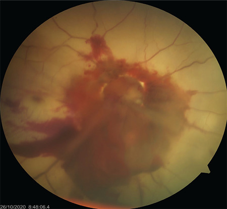
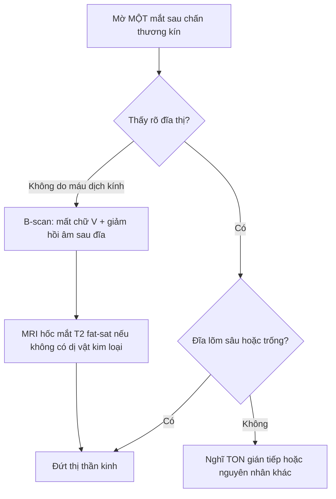
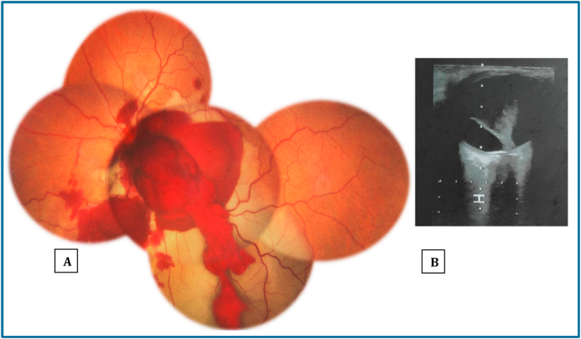
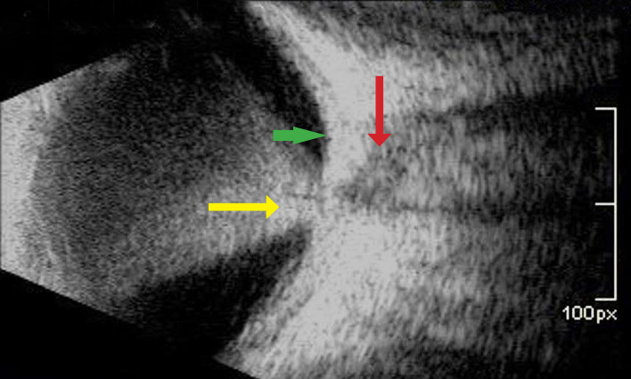
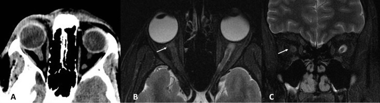
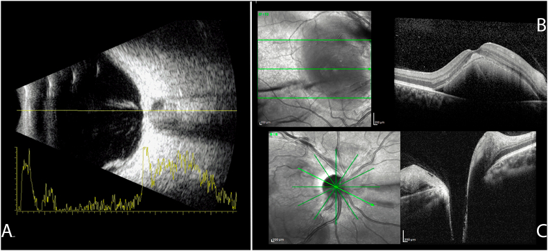
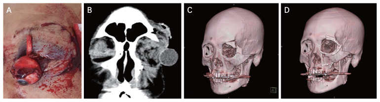
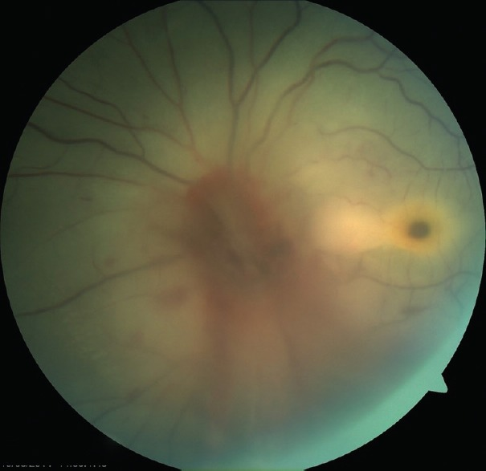

# 3283 — Đứt thị thần kinh do chấn thương: "đĩa thị trống" sau chấn thương kín, CT bình thường không loại trừ / Traumatic optic nerve avulsion

**Tags:** `pattern:mat-mot-ben` `pattern:giam-thi-luc-dot-ngot` `pattern:APD` `pattern:dia-thi-lom` `pattern:di-thi-thanh-kinh` `pattern:chan-thuong-dung-dap` `pattern:xuat-huyet-dich-kinh` `pattern:truyen-nhan-cau` `pattern:mat-cau-trat` `vung:mat` `vung:thi-thanh-kinh` `vung:dia-thi` `vung:hoc-mat` `vung:ong-thi` `protocol:CT-hoc-mat` `protocol:MRI-hoc-mat` `protocol:T2-fat-sat` `protocol:sie-uam-B-scan` `protocol:OCT-dia-thi` `protocol:OCT-macula` `protocol:FA`

**Mức chắc chắn (certainty):** tổng hợp y văn (literature synthesis) — dựng từ **đoàn hệ hồi cứu 44 mắt / 43 bệnh nhân** trong 8 năm tại một trung tâm mắt tuyến cuối (Clin Ophthalmol 2023, PMC10493133); **các ca nguyên văn** có hình ảnh: đứt hoàn toàn giữ nguyên bao thị (Turk J Ophthalmol 2022, PMC9249110), đứt một phần + xuất huyết dưới hoàng điểm (Am J Ophthalmol Case Rep 2024, PMC11152889), trật nhãn cầu + đứt hoàn toàn (Korean J Ophthalmol 2026, PMC13078930), đứt **trước bè sàng** ở trẻ 4 tuổi (Transl Pediatr 2026, PMC13739848), đá ngựa (Ann Med Surg 2021, PMC8278239), cầu lông (Am J Ophthalmol Case Rep 2022, PMC9234610), tắc động mạch trung tâm võng mạc kèm đứt một phần (J Ophthalmic Vis Res 2017, PMC5525509). Phần **dịch tễ – tiên lượng – xử trí** lấy từ các nguồn trên + tổng quan TON (Taiwan J Ophthalmol 2015, PMC4457437) và phân tích gộp TON (Arch Acad Emerg Med 2025, PMC11635542). **Không ghi tên tác giả** — attribution = **tạp chí + năm + PMCID/DOI**. Chỗ chưa có số liệu đủ chắc ghi **"chưa rõ"**.

> **Câu chốt:** Đứt thị thần kinh (optic nerve avulsion, ONA) là **sự tách các sợi trục thị thần kinh khỏi nhãn cầu tại bè sàng (lamina cribrosa)**, trong khi **bao thị (dural sheath) và củng mạc quanh đĩa thường VẪN LIỀN** (PMC10493133; PMC9249110). Vì bao thị đàn hồi hơn dây thần kinh, dây **co rút vào trong bao**, nên **CT có thể hoàn toàn bình thường** và **MRI là cột chẩn đoán thứ hai** khi lâm sàng không giải thích được mất thị lực. Bốn con số phải thuộc: **(1)** trong **44 mắt ONA**, **77,3% (34/44)** vào viện đã **NLP**, và **~79%** kết thúc **NLP** — cải thiện **không có ý nghĩa thống kê** (PMC10493133); **(2)** **18,2%** do **vật kim loại**, **16%** do **tai nạn giao thông**, **11,4%** do **tay nắm cửa** (PMC10493133); **(3)** đứt **một phần** có thể hồi phục một phần: **20/2400 → 20/150** sau 6 tháng (PMC11152889), **HM → 20/50** sau 2 tháng (PMC9234610); **(4)** **đứt hoàn toàn = mù không hồi phục**, không có phẫu thuật nối — điều trị chỉ còn **giảm đau, giữ thẩm mỹ, xử lý tổn thương kèm theo** (PMC10493133; PMC4457437).

## 1. Tổng quan bệnh học – cơ chế hình ảnh (TẠI SAO)

### 1.1 Giải phẫu: ba điểm yếu trên đường đi của thị thần kinh

- Thị thần kinh đi từ **đĩa thị** (nơi sợi trục không myelin xuyên qua **bè sàng**) → **hốc mắt** (được mỡ đệm) → **ống thị** (dính sát xương, không có mỡ đệm) → **đỉnh hốc mắt** → **giao thoa thị**. Ba vị trí dễ đứt/rách: **đĩa thị – bè sàng**, **đỉnh hốc mắt** và **giao thoa** (PMC11152889).
- Tại **bè sàng**, sợi trục **chưa có myelin**, mô đệm ít, và đây là **nơi yếu nhất** của chỗ bám thị thần kinh vào nhãn cầu. Lực xoay/cắt dồn vào đúng mặt phẳng này → **đứt tại đĩa**, không phải đứt giữa dây (PMC10493133; PMC9234610).
- Tuy vậy, lực cắt cũng có thể xảy ra **xa sau nhãn cầu hơn 25 mm** và tại **đỉnh hốc mắt**, nơi màng não của thị thần kinh bám chặt màng xương ống thị — vì vậy **đứt không phải lúc nào cũng "ngay tại đĩa"** (PMC10493133).
- **Hệ quả hình ảnh:** tổn thương có thể nằm **trước bè sàng** (hiếm, không thấy trên siêu âm/CT), **ngay bè sàng** (thể điển hình), hoặc **sau nhãn cầu/đỉnh hốc mắt** (thấy trên MRI/CT) — cùng một bệnh, ba kiểu hình ảnh khác nhau (PMC13739848; PMC10493133).

### 1.2 Cơ chế: vì sao mắt kín mà dây đứt

- **Xoay nhãn cầu cực mạnh + tăng nhãn áp đột ngột** là hai cơ chế chính. Vật tù đập vào giác mạc/củng mạc làm nhãn cầu **biến dạng, giãn xích đạo**, đồng thời **đẩy nhãn cầu ra sau–xoay**; dây thần kinh bị **kéo căng và cắt** tại điểm yếu (PMC10493133; PMC9234610).
- Mô hình máy tính của chấn thương mắt ghi nhận **nhãn áp tức thời có thể lên tới ~300 mmHg** khi bị vật tù đập trực tiếp — đủ để tạo lực đẩy dây ra khỏi ống củng mạc (số liệu mô hình được trích trong PMC11152889).
- **Vì sao bao thị thường còn nguyên:** bao thị **đàn hồi hơn** dây thần kinh, nên khi dây đứt và co rút, bao vẫn bám vào củng mạc. Đây là lý do **"đứt mà bao không rách"** — và cũng là lý do **CT dễ âm tính** (PMC10493133; PMC9249110).
- **Thể đứt hoàn toàn** thường kèm **rách các cơ vận nhãn** → **trật/lồi nhãn cầu (globe luxation/avulsion)**; **thể một phần** chỉ đứt một phần chu vi đĩa, phần còn lại vẫn dẫn truyền → thị lực giảm nhưng **có thể hồi phục một phần** (PMC10493133; PMC11152889).

### 1.3 Vì sao mù ngay nhưng đáy mắt lúc đầu "bình thường" — và vì sao hình ảnh lại khó

- Tổn thương ở **sợi trục sau đĩa**, không ở tế bào hạch tại võng mạc; **thoái hóa ngược dòng** làm tế bào hạch chết dần, nên **lớp sợi trục quanh đĩa (pRNFL)** chỉ mỏng đi **sau vài tuần–vài tháng**. Vì vậy khám sớm chỉ thấy **APD** và **giảm thị lực**, đĩa thị có thể **chưa lõm rõ** nếu máu chưa tan (PMC11152889; PMC8278239).
- Khi đĩa thấy rõ, dấu chốt là **lõm sâu/hang tại đĩa** (nơi dây đã thoát ra) ± **máu quanh đĩa**, ± **màng thần kinh đệm lấp dần** về sau. Ca đứt một phần: **OCT đĩa thị** cho thấy **lõm sâu**, và **6 tháng sau mô thần kinh đệm đã che gần kín** — đĩa trông "gần bình thường" trở lại (PMC11152889; PMC9234610).
- **TẠI SAO MRI nhìn được:** trên **T2 fat-sat**, dịch/máu trong bao thị và khoang dưới nhện quanh dây **tăng tín hiệu**, làm **dây "giãn rộng"** và **mất đường viền tối của bao thị** quanh đoạn gần; trên **CT**, dây co rút trong bao dịch **gần như đồng đậm với dịch** → **không thấy bất thường** (PMC10493133).
- **TẠI SAO siêu âm nhìn được:** đầu dò B-scan thấy **mất hình "chữ V"** bình thường của thị thần kinh, **ổ giảm hồi âm ngay sau đĩa**, **xuất huyết dịch kính hình phễu** từ đĩa ra trước, và **dày vùng quanh đĩa**; khi mô tả đầy đủ còn có **"step sign"** — bờ bậc thang giữa võng mạc phù và củng mạc trần (PMC10493133; PMC11152889; PMC9234610).

### 1.4 Vì sao đứt hoàn toàn là mù vĩnh viễn

- Sợi trục thần kinh trung ương **không tái sinh** qua ổ đứt; sau đứt, **tế bào hạch võng mạc chết theo chương trình** vì mất yếu tố dinh dưỡng và viêm thần kinh đệm. Mô thần kinh đệm chỉ **lấp chỗ trống**, không nối lại đường dẫn truyền (PMC11152889; PMC8278239).
- **Đứt một phần** để lại một phần sợi trục lành → có thể hồi phục **một phần thị lực và thị trường**, nhưng thường kèm **khuyết thị trường trung tâm** và **teo RNFL vùng tương ứng** (PMC9234610; PMC11152889).

## 2. Mẫu hình + chẩn đoán phân biệt theo vị trí (gamut)

### 2.1 Theo vị trí tổn thương

| Vị trí | Hình ảnh chốt | Thể lâm sàng | Nguồn |
|---|---|---|---|
| **Trước bè sàng (prelaminar)** | Siêu âm/CT **không thấy mất liên tục sau nhãn cầu**; trong mổ: **bè sàng trần**, không còn tổ chức thị trước bè | Trẻ 4 tuổi, **NLP**, kèm **bong võng mạc toàn bộ** | PMC13739848 |
| **Tại bè sàng – đĩa thị (điển hình)** | Đĩa **lõm sâu/trống**, máu quanh đĩa; **OCT: hang sâu**; B-scan: giảm hồi âm sau đĩa | Đứt một phần hoặc hoàn toàn; **bao thị còn** | PMC9249110; PMC11152889; PMC10493133 |
| **Sau nhãn cầu > 25 mm / đỉnh hốc mắt** | MRI/CT: **dây giãn rộng, mất liên tục, mất bao thị**; kèm gãy ống thị | Thường kèm chấn thương sọ–mặt nặng | PMC10493133 |
| **Trật nhãn cầu + đứt hoàn toàn** | Nhãn cầu ra ngoài hốc mắt; CT: gãy thành/trần hốc mắt, mảnh xương đẩy vào | Rách cơ vận nhãn, tổn thương mi/mô mềm | PMC13078930; PMC10900850 |

### 2.2 Gamut theo bệnh cảnh "mờ một mắt sau chấn thương"

- **Đứt thị thần kinh (ONA)** — đĩa lõm/trống, APD, có thể **CT bình thường**.
- **Bệnh thần kinh thị do chấn thương gián tiếp (TON)** — đĩa lúc đầu bình thường, **không có hang**; xem bài [3281](../3281-benh-than-kinh-thi-chan-thuong-tre/lesson.md).
- **Máu tụ trong bao thị / sau nhãn cầu** — đau, lồi nhãn cầu, **hội chứng khoang hốc mắt**; CT thấy khối tăng đậm độ.
- **Tắc động mạch trung tâm võng mạc (CRAO)** — võng mạc nhợt, **chấm anh đào**, **không có hang đĩa**; có thể **kèm** đứt một phần (PMC5525509).
- **Vỡ củng mạc sau / rách hắc mạc** — tiền phòng nông, nhãn áp thấp, **mất liên tục thành nhãn cầu**.
- **Bong võng mạc, xuất huyết dịch kính đơn thuần** — đĩa còn, không APD mạnh (trừ khi kèm tổn thương thị).
- **Mù vỏ não / nhồi máu chẩm** — **APD âm**, đáy mắt bình thường, khiếm khuyết thị trường **đối bên**.
- **Giảm thị lực chức năng** — **APD âm**, không tổn thương thực thể, đáp ứng với nghiệm pháp.

### 2.3 Mnemonic "AVULSION"

**A** – **A**PDefinite một mắt; **V** – **V**ision mất ngay, nặng (NLP ~77%); **U** – **U**ltrasound: mất chữ V, giảm hồi âm sau đĩa; **L** – **L**õm đĩa/hang (OCT); **S** – **S**heath còn nguyên → CT dễ âm; **I** – **I**njury do vật tù nhỏ/kim loại/tay nắm cửa; **O** – **O**CT theo dõi RNFL/GCL; **N** – **N**LP thường vĩnh viễn nếu đứt hoàn toàn.

## 3. Bảng so sánh phân biệt (ma trận đối chiếu)

| Thực thể (entity) | Hình ảnh điển hình | Chốt vào (rule-in) | Chốt loại (rule-out) | Gợi ý xác nhận |
|---|---|---|---|---|
| **Đứt một phần (partial ONA)** | Đĩa lõm **một phần chu vi** (thường trên–thái dương), máu quanh đĩa; OCT: hang sâu khu trú; RNFL mỏng vùng tương ứng | **Lõm khu trú + APD + chấn thương kín**; **thị lực có thể còn ST/ĐM** | Đĩa bình thường + APD âm → không phải đứt; đĩa lõm toàn bộ + NLP → nghĩ đứt hoàn toàn | OCT đĩa thị + RNFL; B-scan; theo dõi 1–6 tháng |
| **Đứt hoàn toàn, bao thị còn** | Đĩa **trống/hang sâu**, dịch kính máu; CT **có thể bình thường**; MRI T2 fat-sat: **dây giãn, mất bao** | **NLP + APD + đĩa trống**; MRI thấy dây co rút | CT bình thường **không loại trừ**; đĩa bình thường + còn thị lực → không phải thể hoàn toàn | MRI hốc mắt T2 fat-sat sau khi loại dị vật kim loại |
| **Trật nhãn cầu + đứt hoàn toàn** | Nhãn cầu ngoài hốc mắt; CT: gãy thành/trần hốc mắt; 3D thấy mảnh xương đẩy vào | **Nhãn cầu lồi hẳn ra ngoài + NLP** | Nhãn cầu còn trong hốc mắt → không phải trật | CT 3D trước mổ; khám cơ vận nhãn |
| **TON gián tiếp** | Đĩa **bình thường lúc đầu**; CT ± gãy ống thị; MRI: dây tăng tín hiệu/ngấm thuốc | **APD + chấn thương + không hang đĩa** | Có hang đĩa rõ → đứt, không chỉ TON | MRI ± VEP; xem bài 3281 |
| **CRAO** | Võng mạc nhợt trắng, **chấm anh đào**, mạch phân đoạn; FA: chậm đổ đầy | **Chấm anh đào + không hang đĩa** | Có hang đĩa/máu từ đĩa → nghĩ đứt kèm | FA; siêu âm Doppler; xem bài 276 |
| **Máu tụ bao thị / hội chứng khoang hốc mắt** | CT: khối tăng đậm độ quanh dây, **lồi nhãn cầu**, căng mi; đau nhiều | **Đau + lồi nhãn cầu + giảm thị lực tiến triển** | Không lồi, không đau, đĩa lõm → đứt đơn thuần | CT khẩn; đo nhãn áp; cân nhắc mở cân giải ép |
| **Vỡ củng mạc sau / rách hắc mạc** | Thành nhãn cầu **mất liên tục**; tiền phòng nông; nhãn áp thấp | **Nhãn áp thấp + tiền phòng nông sau chấn thương** | Nhãn cầu nguyên vẹn, nhãn áp bình thường → không phải vỡ | CT/siêu âm; thăm dò mổ |
| **Giảm thị lực chức năng** | Đáy mắt và OCT bình thường; **APD âm**; thị trường "ống nhòm" | **APD âm + không tổn thương cấu trúc** | Có APD hoặc hang đĩa → thực thể | OCT, VEP, nghiệm pháp |

*Đáy mắt sau chấn thương kín: **đĩa thị trống/lõm sâu** (thị thần kinh đã thoát khỏi củng mạc), **xuất huyết dịch kính** và võng mạc thiếu máu nhợt. Nguồn: Turk J Ophthalmol 2022 (PMC9249110), CC BY-NC-ND — ảnh nguyên bản, không chỉnh sửa.*

## 4. Protocol chụp + hệ phân độ/điểm chuẩn hóa

### 4.1 Thứ tự hình ảnh (quan trọng: CT trước, MRI sau)

1. **CT hốc mắt – sọ, lát ≤ 1 mm, cửa sổ xương + mô mềm, axial + coronal:** tìm **dị vật kim loại** (chống chỉ định MRI), **gãy ống thị/trần hốc mắt/thành hốc mắt**, **máu tụ sau nhãn cầu**, **tràn khí**, tổn thương nội sọ. **CT bình thường KHÔNG loại trừ đứt** vì bao thị còn nguyên (PMC10493133).
2. **Siêu âm B-scan** khi **không thấy đáy mắt** (máu dịch kính, đục giác mạc): tìm **mất hình chữ V**, **ổ giảm hồi âm ngay sau đĩa**, **phễu xuất huyết dịch kính**, **dày quanh đĩa**, **step sign** (PMC10493133; PMC11152889; PMC9234610).
3. **MRI hốc mắt** (chỉ khi **đã loại dị vật kim loại**): **T2 fat-sat** (dịch/máu trong bao, dây giãn, mất bao), **T1 fat-sat sau tiêm** (nếu nghi viêm/u), lát mỏng **≤ 2–3 mm** qua dây thị; cần **axial + coronal + sagittal** vì tổn thương nhỏ ở đỉnh hốc mắt dễ bị bỏ sót trên một bình diện (PMC10493133).
4. **Chụp đáy mắt + OCT đĩa thị/hoàng điểm** khi phương tiện trong: hang sâu, màng thần kinh đệm lấp dần, xuất huyết dưới hoàng điểm, RNFL/GCL mỏng dần (PMC11152889; PMC9234610).
5. **FA** khi nghi tắc mạch võng mạc kèm theo (ca CRAO + đứt một phần có **non-perfusion nhánh tĩnh mạch thái dương trên**) (PMC11152889; PMC5525509).

### 4.2 Phân loại dùng trong thực hành (không có hệ điểm chuẩn hóa)

- **Không có RADS hay thang điểm được validate cho ONA.** Cần mô tả 4 trục: **(1)** một phần hay hoàn toàn; **(2)** trước hay sau bè sàng/đỉnh hốc mắt; **(3)** bao thị còn hay rách; **(4)** tổn thương kèm theo (vỡ xương, máu tụ, bong võng mạc, CRAO, rách cơ) (PMC10493133; PMC13739848).
- **Tiên lượng thực hành:** **NLP lúc vào + đứt hoàn toàn** → gần như **không hồi phục**; **còn ST/ĐM + đứt một phần** → có thể hồi phục một phần, cần theo dõi **OCT/RNFL 1–3–6 tháng** (PMC10493133; PMC11152889; PMC9234610).

### 4.3 Xử trí cấp (không có "thuốc nối dây")

- **Đứt hoàn toàn:** **không có phẫu thuật nối thị thần kinh**; điều trị **triệu chứng**: giảm đau, xử lý **tổn thương kèm theo** (khâu rách mi/kết mạc, cố định xương, xử lý bong võng mạc), tư vấn **mù vĩnh viễn**, phục hồi chức năng/thẩm mỹ. **Cắt nhãn cầu/tạo hình** cân nhắc khi **đau kéo dài, viêm mạn hoặc nhãn cầu biến dạng** (PMC10493133; PMC10900850; PMC13078930).
- **Đứt một phần:** **quan sát** là chính; **kiểm soát nhãn áp** (ca cầu lông: IOP **40 mmHg** → **38 mmHg**, thị lực tụt còn **đếm ngón tay**, hồi phục **20/50** sau khi hạ nhãn áp + chống viêm), **chống viêm**, theo dõi OCT (PMC9234610).
- **Xuất huyết dưới hoàng điểm kèm theo:** có thể **đẩy máu bằng khí** (SF6 **0,6 mL** + rtPA **25 µg/0,1 mL**, nằm sấp 3 ngày) — ca 16 tuổi **20/2400 → 20/150** sau 6 tháng, không biến chứng (PMC11152889).
- **Corticoid/giải ép ống thị:** **không có bằng chứng lợi ích cho ONA**; với TON nói chung, IONTS (**133 bệnh nhân**) cho thấy **mổ 30%, corticoid 52%, quan sát 57%** cải thiện — **không khác biệt có ý nghĩa** (PMC10493133); tổng quan TON nhấn mạnh **bằng chứng yếu và nguy cơ của corticoid liều cao** (PMC4457437) — số liệu tử vong của CRASH xem bài [3281](../3281-benh-than-kinh-thi-chan-thuong-tre/lesson.md).
- **Chỉ giải ép khi có chèn ép cơ học rõ:** máu tụ trong bao thị, máu tụ hốc mắt, mảnh xương ống thị — **không giải ép "theo phản xạ"** khi chỉ có đứt dây (PMC10493133).

## 5. Biến thể bình thường và cạm bẫy

### 5.1 Biến thể bình thường / giả tổn thương

- **Lõm sinh lý của đĩa (physiologic cupping)** có thể sâu, nhưng **không có APD**, không máu quanh đĩa, không tiền sử chấn thương phù hợp — và **OCT không thấy mất mô thần kinh đệm tại bờ đĩa** như hang đứt (PMC11152889).
- **Màng thần kinh đệm lấp chỗ đứt** làm đĩa trông **gần bình thường** sau vài tháng; đừng kết luận "đã khỏi" — **RNFL/GCL vẫn mỏng** và thị lực không hồi phục tương ứng (PMC11152889).
- **Đứt trước bè sàng** không thấy trên siêu âm/CT: **hình ảnh bình thường + NLP + APD** vẫn phải nghĩ đứt (PMC13739848).

### 5.2 Cạm bẫy

- **"CT bình thường nên không đứt"** — sai: ca 21 tuổi trong đoàn hệ có **CT ban đầu bình thường**, chỉ **MRI T2 fat-sat sau 2 ngày** mới thấy dây giãn và mất bao (PMC10493133). Ca trẻ 4 tuổi: **siêu âm và CT đều không thấy mất liên tục**, chẩn đoán chỉ đặt được **trong mổ** (PMC13739848).
- **Máu dịch kính che đĩa** — đĩa không quan sát được là lý do hay bỏ sót; **B-scan** là bước tiếp theo, và **dày vùng quanh đĩa + phễu máu** là dấu gợi ý (PMC10493133; PMC8278239).
- **MRI chỉ một bình diện** — tổn thương nhỏ ở đỉnh hốc mắt/ống thị dễ bị bỏ qua; cần **coronal + sagittal** và **T2 fat-sat** (PMC10493133).
- **Dị vật kim loại** — **18,2%** ONA do vật kim loại; **MRI khi chưa loại dị vật là chống chỉ định tuyệt đối** (PMC10493133).
- **Nhãn áp tăng sau chấn thương** (máu tiền phòng, góc rẽ) làm thị lực xấu thêm và **bắt chước đứt nặng lên**; phải hạ nhãn áp trước khi kết luận tiên lượng (PMC9234610).
- **Tắc mạch võng mạc kèm theo** — chấm anh đào và võng mạc nhợt **che mất** dấu đứt; sau 1 tháng mới thấy **vệt liềm mũi ở đĩa** gợi ý đứt một phần (PMC5525509).
- **Bỏ sót mắt bên kia** — **2,3%** đứt hai bên trong đoàn hệ; trong chấn thương mắt hai bên, **38,7%** mù hai bên (PMC10493133; PMC13363028). Luôn khám và ghi **APD hai mắt**.
- **"Avulsion" ≠ "evulsion"** — avulsion = đứt tại chỗ bám; evulsion = nhổ bật toàn bộ nhãn cầu ra khỏi hốc mắt. Dùng đúng thuật ngữ để không hiểu sai mức độ tổn thương (PMC10493133).
- **Satisfaction of search:** đã thấy gãy xương hốc mắt to → dừng tìm dấu đứt thị thần kinh; ngược lại, đã thấy đứt → bỏ sót **bong võng mạc, rách cơ, dị vật** (PMC13078930; PMC11152889).

*Bên trái: **xuất huyết dịch kính và trước võng mạc dày đặc che hoàn toàn đĩa thị** — đĩa không đánh giá được. Bên phải: siêu âm cho thấy bong dịch kính sau. Đây là lý do **B-scan/MRI** phải làm khi không thấy đáy mắt. Nguồn: Ann Med Surg 2021 (PMC8278239), CC BY 4.0.*

## 6. Tự lượng giá — Blind Quiz ngay trên trang tĩnh

**Ca 1 — Nam 21 tuổi, mất thị lực mắt phải sau chấn thương bằng vật kim loại; đĩa thị không quan sát rõ. Nhìn 2 ảnh dưới, mô tả trước khi mở đáp án.**

- Gợi ý lâm sàng: **NLP**, APD dương tính, chấn thương kín do vật kim loại.
- Câu hỏi: (1) Trên B-scan, mũi tên đỏ/vàng/xanh chỉ gì? (2) CT ban đầu có bất thường không? (3) MRI T2 fat-sat thấy gì và vì sao CT âm tính? (4) Ba chẩn đoán phân biệt?

<b>Bấm để hiện đáp án (findings + chẩn đoán)</b>

- **B-scan:** mũi tên đỏ = **thị thần kinh giãn rộng**; mũi tên vàng = **xuất huyết dịch kính hình phễu** từ đĩa ra trước; mũi tên xanh = **dày vùng quanh đĩa**.
- **CT (A):** **bình thường**, không thấy rách bao thị — vì dây co rút **bên trong bao còn nguyên**.
- **MRI T2 fat-sat (B, C):** **dây giãn rộng** và **mất đường viền bao thị** quanh đoạn gần (mũi tên) sau 2 ngày.
- **Chẩn đoán:** **đứt thị thần kinh hoàn toàn, bao thị còn** — NLP, tiên lượng **không hồi phục**; phân biệt với **TON gián tiếp**, **máu tụ bao thị**, **CRAO**.
- Nguồn ảnh: Clin Ophthalmol 2023 (**PMC10493133**), CC BY-NC 3.0 — Hình 1 và Hình 3.

**Ca 2 — Bé trai 16 tuổi, chấn thương bằng ghi-đông xe đạp; thị lực 20/2400, có xuất huyết dưới hoàng điểm. Nhìn ảnh, dự đoán tổn thương và tiên lượng.**

- Gợi ý lâm sàng: chấn thương kín, **ST/ĐM**, APD, máu dưới hoàng điểm.
- Câu hỏi: (1) Ảnh C cho thấy gì tại đĩa thị? (2) Đứt một phần hay hoàn toàn? (3) Hai việc cần làm để cứu thị lực trung tâm? (4) Theo dõi bằng gì?

<b>Bấm để hiện đáp án (findings + chẩn đoán)</b>

- **A:** B-scan — xuất huyết dịch kính nhẹ + **ổ giảm hồi âm ngay sau đĩa** (vùng đứt).
- **B:** OCT hoàng điểm — **xuất huyết dưới hoàng điểm** lan tới hõm trung tâm.
- **C:** OCT đĩa thị — **lõm/hang sâu** tại vùng đứt một phần chu vi.
- **Chẩn đoán:** **đứt thị thần kinh MỘT PHẦN** + xuất huyết dưới hoàng điểm.
- **Xử trí:** **đẩy máu bằng khí** (SF6 0,6 mL + rtPA 25 µg/0,1 mL, nằm sấp 3 ngày) + theo dõi **OCT đĩa/hoàng điểm, RNFL**. Kết quả ca này: **20/2400 → 20/150** sau 6 tháng; mô thần kinh đệm lấp hang, hoàng điểm teo lớp ngoài.
- Nguồn ảnh: Am J Ophthalmol Case Rep 2024 (**PMC11152889**), CC BY-NC-ND 4.0 — ảnh nguyên bản.

**Ca 3 — Bệnh nhân chấn thương mặt nặng, nhãn cầu trái không còn trong hốc mắt. Nhìn ảnh, gọi tên tổn thương và nêu 2 việc phải làm trước mổ.**

- Gợi ý lâm sàng: chấn thương lực cao vùng mặt–hốc mắt, **NLP**.
- Câu hỏi: (1) Ảnh A gọi là gì? (2) Ảnh C cho thấy tổn thương xương nào và vì sao thể tích hốc mắt giảm? (3) Vì sao thị lực không thể cứu? (4) Cần loại trừ tổn thương nào trước khi mổ?

<b>Bấm để hiện đáp án (findings + chẩn đoán)</b>

- **A:** **trật nhãn cầu (globe luxation)** kèm **đứt hoàn toàn thị thần kinh** — chỉ còn cuống thần kinh.
- **C:** **gãy phức hợp gò má–hàm trên (ZMC) và gãy trần hốc mắt**, mảnh xương đẩy vào hốc mắt → **giảm thể tích hốc mắt**, đẩy nhãn cầu ra trước.
- **Vì sao mù:** đứt hoàn toàn tại/ sau bè sàng → **không có đường dẫn truyền**, không mổ nối được.
- **Trước mổ:** **CT đánh giá dị vật/tổn thương nội sọ + mạch máu**, khám **cơ vận nhãn và mi**, dự phòng uốn ván/kháng sinh, hội chẩn **mắt – hàm mặt – thần kinh**. Xử trí: cố định xương (ảnh D), cân nhắc **cắt nhãn cầu** nếu đau/biến dạng.
- Nguồn ảnh: Korean J Ophthalmol 2026 (**PMC13078930**), CC BY-NC 4.0 — Hình 1.

**Ca 4 — Bệnh nhân sau chấn thương kín, đáy mắt có "chấm anh đào" và máu phun từ đĩa. Đây là đứt thị thần kinh hay tắc mạch?**

- Gợi ý lâm sàng: mất thị lực đột ngột sau chấn thương kín; đáy mắt nhợt.
- Câu hỏi: (1) Dấu hiệu chính? (2) Chẩn đoán trước mắt? (3) Vì sao vẫn phải nghĩ đứt thị thần kinh? (4) Theo dõi thêm gì?

<b>Bấm để hiện đáp án (findings + chẩn đoán)</b>

- **Dấu hiệu:** **võng mạc nhợt trắng**, **phân đoạn cột máu trong mạch**, **chấm anh đào** ở hoàng điểm, và **máu "phun" từ đĩa thị** che chi tiết đĩa.
- **Chẩn đoán trước mắt:** **tắc động mạch trung tâm võng mạc (CRAO)** do chấn thương.
- **Vì sao vẫn nghĩ đứt:** máu từ đĩa + tổn thương lực cao; **1 tháng sau** thấy **vệt liềm ở phía mũi đĩa** — dấu của **đứt thị thần kinh MỘT PHẦN** kèm theo. Hai tổn thương có thể **cùng tồn tại**.
- **Theo dõi:** **OCT đĩa/RNFL**, thị trường, FA; không để CRAO che mất chẩn đoán đứt.
- Nguồn ảnh: J Ophthal Vis Res 2017 (**PMC5525509**), CC BY-NC-SA 3.0 — Hình 1.

## 7. Câu hỏi nghiên cứu & điểm chưa đồng thuận (tính đến 11/2026)

1. **[Tranh cãi] Ở bệnh nhân đứt thị thần kinh do chấn thương, corticoid liều cao hoặc giải ép ống thị có cải thiện thị lực so với quan sát không?**
   - **Đã biết:** IONTS (**133 bệnh nhân** TON, gồm cả tổn thương nặng) không thấy khác biệt: cải thiện **30%** ở nhóm mổ, **52%** nhóm corticoid, **57%** nhóm quan sát (PMC10493133; PMID 10406604). Phân tích gộp TON vẫn không chứng minh lợi ích rõ của corticoid, còn **CRASH** cho thấy corticoid liều cao **tăng tử vong** ở chấn thương sọ não (PMC11635542; PMC4457437).
   - **Chưa rõ:** **không có thử nghiệm ngẫu nhiên nào riêng cho ONA** — chẩn đoán ONA thường chỉ chắc khi đã thấy hang đĩa hoặc trong mổ; quần thể ONA trong các nghiên cứu TON bị trộn với TON gián tiếp, nên hiệu quả điều trị **không thể ngoại suy**.
   - **Hướng nghiên cứu:** registry đa trung tâm **chẩn đoán ONA bằng MRI/OCT** trước điều trị, so sánh **quan sát vs corticoid vs giải ép** với outcome **thị lực 3–6 tháng** và **biến chứng**.
   - **Nguồn:** PMC10493133; PMC11635542; PMC4457437.

2. **[Khác biệt thực hành] Sau trật nhãn cầu kèm đứt hoàn toàn, nên giữ nhãn cầu (tái tạo hốc mắt) hay cắt nhãn cầu ngay?**
   - **Đã biết:** Trong **268 bệnh nhân chấn thương mắt hai bên**, **cắt nhãn cầu 2,1%** và **múc nội nhãn 1,6%** — phần lớn nhãn cầu được giữ; mù hai bên gặp **38,7%** (PMC13363028). Ca trật nhãn cầu + đứt hoàn toàn khác được **cắt nhãn cầu + cố định xương** (PMC10900850), ca khác được **cố định xương** và giữ nhãn cầu (PMC13078930).
   - **Chưa rõ:** **ngưỡng đau/viêm** để chọn cắt bỏ, **nguy cơ viêm giao cảm** khi giữ nhãn cầu đã mất chức năng, và **ảnh hưởng tâm lý–thẩm mỹ** chưa được so sánh trong nghiên cứu tiến cứu.
   - **Hướng nghiên cứu:** đoàn hệ tiến cứu các ca **globe avulsion** ghi nhận **tỷ lệ giữ nhãn cầu, viêm giao cảm, chất lượng sống**, so sánh với cắt nhãn cầu sớm.
   - **Nguồn:** PMC13363028; PMC10900850; PMC13078930.

3. **[Khoảng trống] Tiêu chuẩn hình ảnh nào đủ để chẩn đoán đứt thị thần kinh khi CT bình thường và bao thị còn nguyên?**
   - **Đã biết:** MRI **T2 fat-sat** thấy **dây giãn rộng + mất đường viền bao thị** (PMC10493133); B-scan thấy **giảm hồi âm sau đĩa, mất chữ V** (PMC11152889; PMC9234610); OCT đĩa thấy **hang sâu** (PMC11152889). Nhưng **đứt trước bè sàng** có thể **không thấy trên siêu âm và CT**, chỉ xác nhận **trong mổ** (PMC13739848).
   - **Chưa rõ:** **độ nhạy/độ đặc hiệu** của từng dấu, **ngưỡng kích thước hang/dây giãn**, và giá trị của **DWI/DTI** chưa được kiểm chứng với chuẩn mổ/mô học; chưa có **hệ điểm chuẩn hóa**.
   - **Hướng nghiên cứu:** nghiên cứu **diagnostic accuracy tiến cứu** so MRI đa bình diện + B-scan + OCT với xác nhận trong mổ, outcome **thời gian đến chẩn đoán** và **tỷ lệ bỏ sót**.
   - **Nguồn:** PMC10493133; PMC13739848; PMC11152889; PMC9234610.

## Bài liên quan chéo
- [3281 – Bệnh thần kinh thị do chấn thương ở trẻ: **APD là dấu chốt, đĩa thị lúc đầu bình thường, CT âm tính không loại trừ**](../3281-benh-than-kinh-thi-chan-thuong-tre/lesson.md)
- [3277 – Rách hắc mạc do chấn thương ở trẻ: **vệt cung quanh đĩa thị, không đỏ mắt**](../3277-rach-hac-mac-chan-thuong-tre/lesson.md)
- [1510 – Hội chứng khoang hốc mắt: **lồi nhãn cầu + đau + giảm thị lực cấp**](../1510-hoi-chung-khoang-hoc-mat/lesson.md)
- [3263 – Bệnh thần kinh thị do dầu silicone: **APD và đĩa thị trên MRI**](../3263-benh-than-kinh-thi-dau-silicone/lesson.md)
- [276 – Tắc động mạch trung tâm võng mạc: **chấm anh đào**](../276-tac-dong-mach-trung-tam-vong-mac/lesson.md)
- [400 – Tổng quan Mắt & thị giác](../400-tong-quan-mat-thi-giac/lesson.md)

## Ảnh
- **7 ảnh**, tải từ **PubMed Central open access**, **nguyên bản — không crop, không ghép, không đổi màu**: Clin Ophthalmol 2023 (PMC10493133, CC BY-NC 3.0), Turk J Ophthalmol 2022 (PMC9249110, CC BY-NC-ND), Am J Ophthalmol Case Rep 2024 (PMC11152889, CC BY-NC-ND), Korean J Ophthalmol 2026 (PMC13078930, CC BY-NC 4.0), J Ophthalmic Vis Res 2017 (PMC5525509, CC BY-NC-SA 3.0), Ann Med Surg 2021 (PMC8278239, CC BY 4.0). Chi tiết trong `images/CREDITS.md`.
- Ảnh chưa tải (chỉ dẫn link): Transl Pediatr 2026 (PMC13739848), Am J Ophthalmol Case Rep 2022 (PMC9234610), Cureus 2024 (PMC10900850).
- Không dùng ảnh từ nguồn không rõ giấy phép, không tải ảnh từ trang có bản quyền.

> Không dùng để chẩn đoán độc lập khi chưa có người hướng dẫn.
