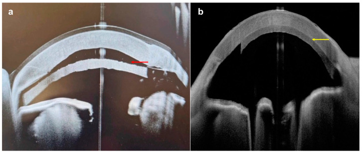
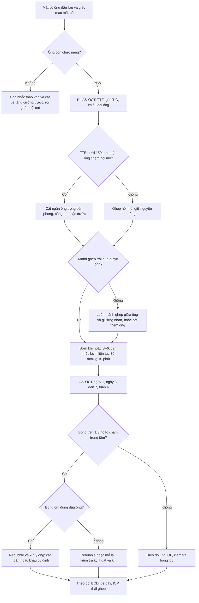
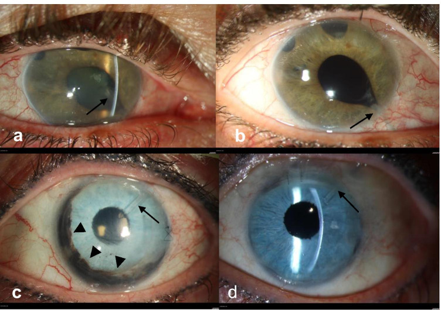
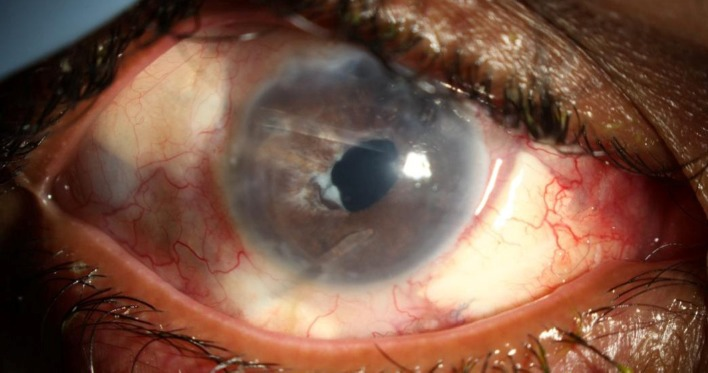

# 3284 — Ghép nội mô giác mạc ở mắt đã có ống dẫn lưu glôcôm: bong mảnh ghép quanh ống, vị trí đầu ống và khi nào cắt–rút ống / Endothelial keratoplasty in an eye with a glaucoma drainage device

**Tags:** `pattern:bong-manh-ghep` `pattern:phu-giac-mac` `pattern:ong-dan-luu-tien-phong` `pattern:tang-nhan-ap-sau-ghep` `pattern:thai-ghep` `pattern:mat-bong-kinh` `vung:mat` `vung:giac-mac` `vung:tien-phong` `vung:goc-tien-phong` `vung:cung-mac` `protocol:AS-OCT` `protocol:UBM` `protocol:den-khe` `protocol:sieu-am-B` `score:khong-co` `incidentaloma:khong`

**Mức chắc chắn (certainty):** tổng hợp y văn (literature synthesis) — dựng từ: **23 ca DMEK / 20 mắt** có ống dẫn lưu (GDD) (*Am J Ophthalmol* 2019, **PMID 30502334**, **DOI 10.1016/j.ajo.2018.11.014**); **27 mắt** DMEK sau mổ glôcôm (*Eur J Ophthalmol* 2021, **PMID 32605435**); **66 mắt** (27 GDD vs 39 cắt bè) (*Graefes Arch Clin Exp Ophthalmol* 2022, **PMC9007781**, CC BY 4.0); **90 ca / 87 mắt** DMEK có glôcôm (*Am J Ophthalmol* 2020, **PMID 32619607**); **51 mắt** so với **43 mắt** chứng, theo dõi 4 năm (*Am J Ophthalmol* 2020, **PMID 32446739**); **48 DMEK vs 41 DSAEK** 4 năm (*Cornea* 2021, **PMID 33332901**); **16 DMEK vs 80 DSAEK** (*J Clin Med* 2024, **PMC11508698**, CC BY 4.0); **11 DMEK vs 16 DSAEK** với van Ahmed (*PLoS One* 2026, **PMC12952605**, CC BY 4.0); **24 mắt ICE + GDD** (*Cornea* 2024, **PMID 39212530**); **424 mắt DSAEK** (*J Ophthalmic Vis Res* 2012, **PMC3520588**, CC BY-NC 3.0); **150 mắt** DMEK có glôcôm (*Graefes Arch Clin Exp Ophthalmol* 2023, **PMC9836965**, CC BY 4.0); **39 mắt** van Ahmed đo AS-OCT (*Cornea* 2015, **PMID 25393097**); **64 mắt** Baerveldt theo dõi 5 năm (*Ophthalmol Glaucoma* 2021, **PMID 32830103**); **75 mắt** cắt ngắn ống (*J Glaucoma* 2022, **PMID 34628423**); **24 vs 38 mắt** ống ở rãnh thể mi so với tiền phòng (*Sci Rep* 2021, **PMC8217260**, CC BY 4.0); **48 mắt** đo ống bằng AS-OCT 12 tháng (*Eye* 2012, **PMID 22744388**); **13 vs 6 mắt** bơm khí liên tục (*PLoS One* 2013, **PMC3745467**, CC BY 4.0); **11 mắt** quyết định giữ/tháo van theo AS-OCT (*Rom J Ophthalmol* 2026, **PMC13453119**, CC BY 4.0); **9 mắt** DMEK 3/4 với mảnh ghép lớn (**PMID 36573952**); **5 mắt** PreserFlo + DMEK (*Cornea* 2026, **PMID 42746749**). Nhóm **không có bệnh nhân của mình**; chỗ suy luận ghi **[suy luận]**. **Không ghi tên tác giả** — attribution = **tạp chí + năm + PMCID/DOI**.

> **Ranh giới với bài đã có:** [3291](../3291-doi-iol-sau-ghep-giac-mac/lesson.md) trả lời **"đổi IOL trên mắt đã ghép nội mô"**; [1996](../1996-tac-tut-ong-van-dan-luu-glaucoma/lesson.md) trả lời **"ống bị tắc/tụt"**; [1991](../1991-ro-bong-loc-muon-viem-noi-nhan/lesson.md) trả lời **"rò bọng lọc"**; [3224](../3224-lo-ong-van-dan-luu-glaucoma/lesson.md) trả lời **"lộ ống/bản van"**; [3213](../3213-bong-loc-sau-preserflo-microshunt/lesson.md) trả lời **"bọng dẹt sau PreserFlo"**; [3264](../3264-bong-mang-descemet-sau-phaco/lesson.md) trả lời **"bong màng Descemet sau phaco"**. Bài này trả lời câu hỏi khó hơn: **mắt đã có ống trong tiền phòng, nay phải ghép nội mô — mảnh ghép đặt ở đâu so với ống, vì sao nó bong đúng quanh ống, cắt ngắn/giữ/tháo ống lúc nào, và nhãn áp sau ghép đọc thế nào?**

> **Câu chốt — năm nhóm số phải thuộc:** **(1) Ống trong tiền phòng là "máy bào nội mô" đo được:** 5 năm sau Baerveldt, mật độ nội mô **trung tâm giảm 36,8%** nhưng **vùng quanh ống giảm 50,1%**; **cắt ngắn đầu ống** làm tốc độ mất nội mô từ **−12,2%/năm xuống −3,5%/năm** (**PMID 32830103**; **PMID 34628423**). **(2) Bong mảnh ghép quanh ống là biến cố thường gặp:** **18,5%** (27 mắt GDD), **22%** (23 ca), **24,1%** (27 mắt), **31,3%** (16 mắt DMEK) so với **22,5%** ở DSAEK; bơm khí **liên tục 30 mmHg × 10 phút** đưa bong từ **33,3% → 0%** và sống 1 năm từ **66,7% → 100%** (**PMC9007781**; **PMID 30502334**; **PMID 32605435**; **PMC11508698**; **PMC3745467**). **(3) Sống mảnh ghép ngắn hơn hẳn:** **75% / 60% / 43% / 27%** ở **1 / 2 / 3 / 4 năm** so với **88% đều** ở mắt không mổ glôcôm; **thất bại thứ phát 41,6%**; **re-DMEK 55,6%**, thời gian sống trung bình **25 ± 11 tháng** (**PMID 32446739**; **PMID 32619607**; **PMC9007781**). **(4) Nội mô mất 60–71% trong 1–2 năm:** **71%** ở 12 tháng (23 ca), **63,8%** ở nhóm đã mổ glôcôm so với **44,0%** không glôcôm, **71 ± 7%** ở 2 năm khi có GDD + ICE (**PMID 30502334**; **PMID 32619607**; **PMID 39212530**). **(5) Tăng nhãn áp sau ghép là quy luật, không phải ngoại lệ:** tích lũy **53,5%** tăng IOP và **36,3%** "glôcôm sau DMEK" ở **36 tháng**; có GDD làm **HR 6,273** cho thất bại mảnh ghép (**PMC9836965**).

## 1. Tổng quan bệnh học – cơ chế hình ảnh (TẠI SAO)

### 1.1 Vì sao một ống nhựa 1–2 mm lại quyết định số phận mảnh ghép 10–15 µm

- **Mảnh ghép DMEK** chỉ là **màng Descemet + một lớp nội mô**, dày **10–15 µm**, **không có mô đệm chịu lực** và **không tái sinh**; **DSAEK** dày **150–200 µm** (ultrathin **~80 µm**) nên có "tấm đỡ" nhất định. Cả hai sống nhờ **bơm nội mô** đẩy nước ra tiền phòng; khi mật độ tế bào nội mô (ECD) xuống dưới ngưỡng bù trừ (kinh điển **< 500 tế bào/mm²**), mô đệm ngậm nước → dày (**bình thường ~540 µm**, phù rõ khi **> 700 µm**), mờ, rồi xơ hóa.
- **Ống dẫn lưu (tube) là vật thể cứng xuyên qua góc tiền phòng**, thường nằm **sát nội mô** ở vùng hướng về đầu ống. Vì màng ghép **mỏng hơn sợi tóc**, nó không "trượt qua" ống như một mảnh DSAEK dày; **mọi điểm ống nhô lên đều là một gờ** mà mảnh ghép phải bắc qua.
- **Hệ quả định lượng:** trên **39 mắt** van Ahmed, **khoảng cách đầu ống–giác mạc** là yếu tố nguy cơ **duy nhất còn ý nghĩa** trong phân tích đa biến cho mất nội mô vùng quanh ống (**PMID 25393097**). Trên **64 mắt** Baerveldt theo dõi 5 năm, mất nội mô **trung tâm 36,8%** nhưng **quanh ống 50,1%**; kiểu đặt ống có **> 50% miệng ống ra trước đường Schwalbe** (TIP3) làm nội mô mất nhiều hơn (**β = −0,27** cho trung tâm, **−0,23** cho ngoại vi) và **ống ngắn** cũng làm mất nội mô ngoại vi nhiều hơn (**β = 0,26**) (**PMID 32830103**).
- **Bằng chứng can thiệp mạnh nhất:** **cắt ngắn phần ống trong tiền phòng** (qua đường rạch limbus nhỏ, trung bình **41 tháng** sau đặt van) đưa tốc độ mất nội mô từ **−12,2 ± 6,5%/năm xuống −3,5 ± 6,9%/năm** (p = 0,002), và giảm xác suất "thất bại giác mạc" định nghĩa bằng **giảm 15% ECD** (p = 0,038) (**PMID 34628423**). Đây là bằng chứng rằng **tổn thương nội mô do ống là cơ học và có thể giảm được**, không phải "bệnh nền không tránh khỏi".

### 1.2 Vì sao mảnh ghép bong ĐÚNG QUANH ỐNG — bốn cơ chế chồng lên nhau

1. **Khoảng chết (dead space) quanh ống:** mảnh ghép áp lên mô đệm nhận ở mọi nơi, trừ nơi có ống chống lên; viền quanh ống là nơi **dịch tiền phòng còn lại** giữa mảnh ghép và giường — đúng nguyên lý "dịch diện" (interface fluid) của [3264](../3264-bong-mang-descemet-sau-phaco/lesson.md). Trên AS-OCT, đây là **dải giảm hồi âm hình liềm/thấu kính** ôm lấy bóng ống [suy luận hình học, khớp ảnh AS-OCT của ca bong toàn bộ quanh ống — **PMC10814678** Fig. 13].
2. **Khí thoát qua lòng ống:** bong bóng khí/SF6 dùng để ép mảnh ghép là **khí**, còn ống là **đường thoát áp lực thấp** ra bọng lọc dưới kết mạc; khí có thể **thoát dần qua ống**, làm "tamponade" xẹp không đều, đặc biệt ở nửa tiền phòng phía ống. Đây là **suy luận cơ học**, nhưng được **ủng hộ bởi can thiệp**: duy trì **bơm khí liên tục 30 mmHg trong 10 phút** ở **13 mắt** có van Ahmed cho **bong 0%** so với **33,3%** ở **6 mắt** làm thường quy, và sống ghép 1 năm **100% vs 66,7%** (p = 0,029) (**PMC3745467**). Nếu nguyên nhân chỉ là "kỹ thuật trải mảnh ghép", bơm khí liên tục đã không tạo khác biệt lớn đến vậy.
3. **Ống như thanh chống (strut):** đầu ống bevelled có thể **hất mép mảnh ghép** hoặc nằm **giữa mảnh ghép và mống mắt**, tạo một "mái hiên" mà mảnh ghép không thể dán kín; **mảnh ghép mỏng có thể được luồn giữa ống và giường nhận** trong kỹ thuật "no-touch" cải biên — chứng minh bằng ca DMEK trên mắt ghép xuyên hỏng với **ống dài** vẫn giữ ống tại chỗ (**PMID 26418431**).
4. **Dòng thủy dịch và "tia" đầu ống:** dòng chảy liên tục qua đầu ống tạo **lực trượt cục bộ** và **rửa trôi fibrin/bọng khí** quanh ống; đồng thời đầu ống gần nội mô gây **mất tế bào khu trú** (mục 1.1). Vì vậy vùng quanh ống vừa **khó dính** vừa **dễ mất nội mô nhất**.

- **Vì sao ống còn "tự xấu đi" theo thời gian:** trên **48 mắt** van Ahmed đo AS-OCT lặp lại, chiều dài phần ống trong tiền phòng **ngắn đi 0,20 ± 0,17 mm** và **góc ống–mặt sau giác mạc (T–C angle) giảm 6,7 ± 5,6°** trong 12 tháng, rõ nhất ở glôcôm do viêm và sau ghép xuyên (**PMID 22744388**). Nghĩa là **đầu ống có xu hướng xoay về phía giác mạc** — một mảnh ghép "vừa đủ xa" hôm nay có thể bị chạm sau 1 năm [suy luận từ dữ liệu dịch chuyển].

### 1.3 Vì sao vẫn phải ghép — và cái giá phải nói trước

- **Ghép nội mô vẫn là lựa chọn đúng** khi ống còn chức năng và giác mạc mất bù: **23 ca** DMEK có GDD đạt **sống ghép 89% ở 1 năm**, **73%** tăng ≥ 2 dòng Snellen, **không ca nào tụt mảnh ghép vào dịch kính** (**PMID 30502334**); **27 mắt** DMEK sau mổ glôcôm cải thiện thị lực có ý nghĩa ở nhóm không có bệnh đồng mắc thị lực (**PMID 32605435**); DMEK còn cho **thị lực tốt hơn DSAEK** ở **6, 12, 24 tháng** (p < 0,001; 0,022; 0,047) trong so sánh **48 vs 41 mắt** (**PMID 33332901**).
- **Nhưng "giá" là mất dự trữ nội mô và tuổi thọ mảnh ghép:** **71%** ECD mất ở 12 tháng (**PMID 30502334**); **63,8%** ở nhóm đã mổ glôcôm so với **44,0%** không glôcôm và **41,6%** thất bại thứ phát so với **2,4%** (**PMID 32619607**); **re-DMEK 55,6%** với thời gian sống **25 ± 11 tháng** khi có GDD so với **35,9%** và **31,3 ± 8,6 tháng** sau cắt bè (p = 0,009) (**PMC9007781**).
- **Vì sao thất bại nhiều hơn mà không phải do "thải ghép":** tỷ lệ thải trong nhóm mổ glôcôm **19,6% vs 2,3%** (**PMID 32446739**) và **20,8% vs 19,5%** khi so DMEK–DSAEK (**PMID 33332901**) — tức **thất bại thứ phát do hết nội mô** là cơ chế chính, còn thải ghép chỉ là phần nhỏ [suy luận từ chênh lệch SGF ≫ thải].

### 1.4 Vì sao nhãn áp tăng sau ghép — bốn cơ chế và một bẫy

- **Tăng IOP do khí:** bong bóng khí quá đầy → **pupil block** hoặc đẩy mống mắt ra trước; trong loạt **23 ca** có **1 mắt** pupil block, xử lý bằng **hút bớt khí một phần** (**PMID 30502334**).
- **Tăng IOP do steroid:** mắt đã có glôcôm nhạy cảm hơn; phác đồ corticoid kéo dài làm **"steroid responder"** — một lý do DMEK được ưa chuộng vì **giảm nhu cầu corticoid liều cao** so với DSAEK (**PMID 30502334**; **PMID 37252169**).
- **Tổn thương góc và dính góc trước:** sau DMEK có GDD, **tăng IOP 29%** và **dính góc trước tiến triển 21%** trong **24 mắt** ICE (**PMID 39212530**).
- **Bít ống bởi mảnh ghép/mống mắt/fibrin:** cần phân biệt với **tắc ống** ([1996](../1996-tac-tut-ong-van-dan-luu-glaucoma/lesson.md)); đây là nguyên nhân **tăng IOP đột ngột sau ghép** dù ống "vẫn còn đó".
- **Con số tổng hợp:** **150 mắt** DMEK có glôcôm — tích lũy **53,5%** tăng IOP (IOP > 21 mmHg hoặc tăng ≥ 10 mmHg), **36,3%** cần can thiệp vì IOP ("glôcôm sau DMEK"), **9,2%** thải ghép, **16,6%** thất bại ở 36 tháng; **tiền sử đặt GDD** là yếu tố nguy cơ độc lập cho thất bại (**HR 6,273**, p = 0,014) (**PMC9836965**).

## 2. Mẫu hình + chẩn đoán phân biệt theo vị trí (Gamut)

### 2.1 Năm bệnh cảnh lâm sàng — cùng "mắt có ống + giác mạc mờ" nhưng khác quyết định

| Bệnh cảnh | Dấu hiệu chính | Câu hỏi quyết định |
|---|---|---|
| **A. Mất bù nội mô do ống, ống còn tốt** | Giác mạc phù, **đầu ống cách nội mô một khoảng**, bọng lọc còn, IOP kiểm soát | **Ghép nội mô**, có **cắt ngắn ống** cùng thì hay không? |
| **B. Bong mảnh ghép quanh ống sau ghép** | **Đường bong ôm đầu ống**, dịch diện trên AS-OCT, phù khu trú | **Rebubble** hay **mổ lại + xử lý ống**? Có cần **cắt ngắn ống**? |
| **C. Ống chạm nội mô/mảnh ghép, ống vẫn chức năng** | Đầu ống **sát mặt sau giác mạc**, ECD vùng ống thấp, phù khu trú | **Cắt ngắn ống** (giữ van) hay **tháo van**? |
| **D. Van không còn chức năng + giác mạc mất bù** | IOP vẫn cao dù van, **bọng xơ**, phù toàn bộ | **Tháo van + ghép** (một hay hai thì) hay **ghép trước**? |
| **E. Nhãn áp tăng sau ghép** | IOP tăng, **tiền phòng nông/khí còn**, mống mắt áp, phù mới | **Pupil block – steroid – bít ống – thải ghép**? |

### 2.2 Gamut theo vị trí tổn thương

- **Quanh đầu ống (tube-related):** **bong hình liềm ôm ống**, **dịch diện**, có thể **đục/mờ khu trú** đúng vùng ống; hay gặp nhất ở nửa trên–thái dương nếu ống đặt ở góc đó.
- **Rìa mảnh ghép (peripheral edge):** bong **< 1/3 diện tích**, thường tự khỏi hoặc chỉ cần theo dõi; **bong > 1/3 hoặc chạm trung tâm** mới đáng can thiệp (ngưỡng dùng trong [3291](../3291-doi-iol-sau-ghep-giac-mac/lesson.md), **PMC10397279**).
- **Trung tâm (central):** thường do **kỹ thuật trải mảnh ghép**, **khí không đủ**, hoặc **mảnh ghép lộn/không mở** — khác cơ chế với bong quanh ống.
- **Góc tiền phòng:** **dính góc trước** (PAS) do viêm/khí, **tắc ống bởi mống mắt**, **mảnh ghép trượt vào góc** — nhìn bằng **soi góc/AS-OCT**.
- **Củng mạc – đường vào ống:** **mỏng củng mạc quanh ống**, **lộ ống** ([3224](../3224-lo-ong-van-dan-luu-glaucoma/lesson.md)), **rò tiền phòng muộn** — ảnh hưởng chọn đường vào khi ghép.
- **Hậu đoạn:** **CME**, **bong võng mạc**, **màng trước võng mạc** — nguyên nhân "mờ" **không do giác mạc** (xem [3291](../3291-doi-iol-sau-ghep-giac-mac/lesson.md)).

### 2.3 Cửa sổ thời gian — cùng "mờ" nhưng khác chẩn đoán

- **Ngày 1–7:** **bong mảnh ghép** (kể cả bong quanh ống), **tăng IOP do khí**, **pupil block**, **viêm nội nhãn** (hiếm, cấp cứu).
- **Tuần 2–4:** **bong muộn**, **dịch diện**, **thải ghép sớm**, **phù còn lại**; đây là lúc **rebubble** hiệu quả nhất.
- **Tháng 1–3:** **mất nội mô nhanh nhất**, **bong muộn**, **CME**, **IOP do steroid**; **chưa nên kết luận "thất bại"** nếu giác mạc còn phù nhẹ nhưng mảnh ghép áp.
- **> 3 tháng:** **thất bại thứ phát**, **thải ghép muộn**, **mờ do ống chạm/ECD cạn**, **glôcôm tiến triển** — phân biệt **nguyên nhân giác mạc** với **nguyên nhân ống**.

## 3. Bảng so sánh phân biệt (ma trận đối chiếu)

| Thực thể (entity) | Hình ảnh / phép đo điển hình | Chốt vào (rule-in) | Chốt loại (rule-out) | Gợi ý xác nhận |
|---|---|---|---|---|
| **Bong mảnh ghép quanh ống (tube-related detachment)** | AS-OCT: **dải giảm hồi âm ôm đầu ống**, mảnh ghép **tách khỏi giường quanh ống** nhưng **áp ở nơi khác**; đèn khe: vùng phù khu trú đúng ống | **Đường bong bám theo ống** + **dịch diện** + **không có KP/tế bào** + **bong > 1/3 hoặc chạm trung tâm** (**PMC11508698**; **PMID 30502334**) | **Bong lan tỏa/trung tâm** không liên quan ống → nghĩ **kỹ thuật/khí**; **có KP + tế bào** → thải ghép | AS-OCT lặp ngày 1–3–7; so vị trí với ống; đo % diện tích bong |
| **Bong do kỹ thuật (không đủ khí, mảnh ghép không mở)** | Mảnh ghép **gấp/lộn**, bong **trung tâm hoặc toàn bộ**, không theo ống | **Bong ngay ngày 1**, **không liên quan vị trí ống**, **khí ít/đã thoát** | **Bong muộn 2–4 tuần, khu trú quanh ống** → cơ chế ống/dịch | AS-OCT; xem lại video mổ; đáp ứng rebubble |
| **Thải ghép (rejection)** | **Đường KP**, **tế bào tiền phòng**, phù **đột ngột**, mảnh ghép đục; **không mủ** | **KP + tế bào + phù mới** trên mắt có tiền sử ghép; đáp ứng corticoid (**PMID 32446739**: thải **19,6%**) | **Phù không KP, không tế bào** → mất bù/hết nội mô hoặc IOP cao | Đèn khe; AS-OCT; thử corticoid; phân biệt với tăng IOP |
| **Thất bại nguyên phát / mất bù nội mô** | Phù **không giảm từ tuần đầu**, mảnh ghép **áp nhưng mờ**, ECD **không đo được**, bề dày **> 700 µm** | **Giác mạc không trong sau 4–6 tuần** dù mảnh ghép áp; **ECD rất thấp** | **Có KP/tế bào** → thải ghép; **bong rõ** → bong | AS-OCT + bề dày; specular khi hết phù |
| **Ống chạm nội mô/mảnh ghép (tube–endothelium touch)** | AS-OCT: **khoảng cách đầu ống–mặt sau giác mạc rất nhỏ**, đo được theo µm; **ECD vùng ống thấp hơn trung tâm** | **Khoảng cách đầu ống–nội mô nhỏ** + **mất nội mô khu trú vùng ống** (5 năm: **50,1% vs 36,8%**) (**PMID 32830103**) | **Đầu ống cách xa, ECD đều** → không can thiệp ống | AS-OCT đo **TTE**, T–C angle, chiều dài ống; specular theo vùng |
| **Tắc/bít ống (tube occlusion)** | **IOP tăng đột ngột**, bọng lọc xẹp, **AS-OCT thấy đầu ống bị mống mắt/fibrin/mảnh ghép che**; UBM hỗ trợ | **IOP tăng + bọng xẹp + đầu ống bị che** | **IOP tăng nhưng ống thông, tiền phòng sâu** → steroid/pupil block/góc | AS-OCT/UBM; soi góc; so với [1996](../1996-tac-tut-ong-van-dan-luu-glaucoma/lesson.md) |
| **Tăng IOP do khí / pupil block** | **Tiền phòng nông**, **khí còn nhiều**, mống mắt áp, **giác mạc phù nhanh** | **IOP cao + khí đầy + tiền phòng nông**; **1 mắt** trong 23 ca (**PMID 30502334**) | **Tiền phòng sâu, khí ít** → loại | Đo IOP; đèn khe; **hút bớt khí** là điều trị và cũng là test |
| **Bong hắc mạc/xuất huyết thượng hắc mạc** | **Tiền phòng nông**, **khối đen–nâu hình vòm** ở ngoại vi, đau nhiều, thị lực giảm nhanh | **Tiền phòng nông + khối vòm ngoại vi + đau** sau mổ | **Tiền phòng sâu, không khối** → loại | Siêu âm B-scan; đèn khe; liên hệ [1484](../1484-bong-hac-mac-sau-mo-mat/lesson.md) |
| **Phù giác mạc do IOP cao đơn thuần** | Phù **lan**, **không có đường bong**, mảnh ghép áp, IOP cao | **IOP kiểm soát → giác mạc trong dần** | **Vẫn phù dù IOP bình thường** → mất bù thật | Đo IOP; theo dõi 1–2 tuần; AS-OCT |

*AS-OCT trên mắt **không còn thể thủy tinh** đã có **ống dẫn lưu glôcôm**: **(a)** mảnh ghép **bong toàn bộ** — dải giảm hồi âm giữa mảnh ghép và mô đệm (mũi tên đỏ), đầu ống thấy ở góc; **(b)** sau **rebubble + khâu cố định ống**, mảnh ghép **áp hoàn toàn** (mũi tên vàng). Đây là hình mẫu cho nguyên tắc: **khi bong liên quan ống, chỉ bơm khí thôi thường không đủ — phải xử lý ống**. Nguồn: *Diagnostics (Basel)* 2024;14(2):122 (**PMC10814678**), Fig. 13, **CC BY 4.0**.*

### 3.1 Ba câu hỏi đọc ma trận

- **"Bong này có thật sự do ống không?"** → nhìn **vị trí đường bong so với đầu ống** trên AS-OCT, và **diễn tiến sau rebubble**: bong tái phát đúng chỗ cũ quanh ống = cơ chế ống; bong đổi vị trí = kỹ thuật/khí.
- **"Ống còn chức năng không?"** → **bọng lọc**, **IOP**, **số thuốc**, **van còn bơm được**; van hỏng + giác mạc mất bù là bài toán **hai thì** (tháo van rồi ghép) chứ không phải "ghép rồi tính sau" [suy luận, khớp **PMC13453119** với 4 ca van không chức năng được tháo van + cắt bè tăng cường trước DSAEK].
- **"Có phải cắt ngắn ống?"** → nếu **đầu ống sát nội mô/mảnh ghép** hoặc **bong tái phát quanh ống**, cắt ngắn là can thiệp có bằng chứng (**−12,2 → −3,5%/năm**; **PMC3745467**; **PMID 34628423**; **PMID 42746749**); nếu ống **đã ở rãnh thể mi hoặc hậu phòng**, không cần chạm.

## 4. Protocol + ngưỡng định lượng

### 4.1 Trước khi quyết định — 9 bước bắt buộc

1. **Mốc sự kiện:** loại van (Ahmed/Baerveldt/PAUL/PreserFlo), **vị trí ống** (tiền phòng/rãnh thể mi/hậu phòng), **thời điểm đặt**, **số lần mổ glôcôm**, **bọng lọc**.
2. **Chức năng ống:** IOP, **số thuốc hạ nhãn áp**, có **cần can thiệp van** không; van hỏng → kế hoạch **tháo/thay** trước hay cùng thì.
3. **AS-OCT tiền phòng (bắt buộc):** đo **khoảng cách đầu ống–mặt sau giác mô (tube tip–endothelium, TTE)**, **góc ống–mặt sau giác mạc (T–C angle)**, **chiều dài phần ống trong tiền phòng**, và **vị trí ống so với mống mắt/góc** (**PMID 25393097**; **PMID 32830103**; **PMID 22744388**).
4. **Bề dày – ECD:** bề dày trung tâm (**~540 µm** bình thường; **> 700 µm** = phù rõ), ECD nếu đo được; **không đo được ECD khi còn phù** — ghi rõ.
5. **Đèn khe:** vị trí ống, **ống có chạm nội mô không**, **mống mắt–ống**, **dính góc**, **bọng lọc**, **tình trạng mảnh ghép cũ** (nếu ghép lại).
6. **Hậu đoạn:** **siêu âm B-scan** nếu không thấy đáy mắt (đục giác mạc); **OCT hoàng điểm** khi thấy được — loại CME.
7. **Khúc xạ/công suất IOL:** nếu phối hợp phaco, xem [1462](../1462-sinh-trac-iol-sau-ghep-giac-mac/lesson.md); mắt đã có ống không làm thay đổi nguyên lý sinh trắc nhưng **bề mặt giác mạc không đều** làm sai số tăng.
8. **Kế hoạch khí:** cân nhắc **SF6** thay khí thường khi nguy cơ bong cao (dữ liệu DMEK chung: **OR 0,20** cho bong — **PMC12297530**, dẫn qua [3291](../3291-doi-iol-sau-ghep-giac-mac/lesson.md)); ở mắt có ống, cân nhắc **bơm khí liên tục/duy trì áp lực** trong 10 phút (**PMC3745467**).
9. **Kế hoạch đường vào:** **xa ống và xa bọng lọc**, **tránh chạm mảnh ghép**, **sẵn sàng cắt ngắn ống** nếu ống cản trở trải mảnh ghép.

### 4.2 Ngưỡng định lượng dùng trong bài

| Biến số | Ngưỡng / giá trị | Ý nghĩa thực hành | Nguồn |
|---|---|---|---|
| **TTE (đầu ống–nội mô)** | **> 150 µm** | Nhóm **giữ van + ghép** trong loạt 11 mắt đều có **TTE > 150 µm**; **< 150 µm** hoặc van hỏng → cân nhắc **tháo/cắt ngắn** | PMC13453119 |
| **Khoảng cách đầu ống–giác mạc** | Càng gần càng mất nội mô | Yếu tố **duy nhất** còn ý nghĩa đa biến cho mất nội mô vùng ống | PMID 25393097 |
| **Vị trí miệng ống so với Schwalbe** | **> 50% miệng ống ra trước Schwalbe (TIP3)** | Mất nội mô **trung tâm β = −0,27**, **ngoại vi β = −0,23** ở 5 năm | PMID 32830103 |
| **Chiều dài ống trong tiền phòng** | **Ngắn** = nguy cơ | Ống ngắn làm mất nội mô ngoại vi nhiều hơn (**β = 0,26**) | PMID 32830103 |
| **Mất nội mô 5 năm sau Baerveldt** | **trung tâm 36,8%**, **quanh ống 50,1%** | Con số tư vấn trước khi đặt ống và trước khi ghép | PMID 32830103 |
| **Tốc độ mất nội mô trước/sau cắt ngắn ống** | **−12,2%/năm → −3,5%/năm** | Cắt ngắn ống là can thiệp **có lợi** rõ rệt (p = 0,002) | PMID 34628423 |
| **Ống ở rãnh thể mi vs tiền phòng** | **6,40 ± 7,69 vs 17,47 ± 11,50 tế bào/mm²/tháng** | Ưu tiên **rãnh thể mi** khi có lựa chọn; giảm mất nội mô **~2,7 lần** | PMC8217260 |
| **Dịch chuyển ống theo thời gian** | **−0,20 ± 0,17 mm** chiều dài; **−6,7 ± 5,6°** góc T–C trong 12 tháng | Đầu ống **tiến về phía giác mạc** — hẹn AS-OCT lặp | PMID 22744388 |
| **Bong mảnh ghép có GDD** | **18,5% / 22% / 24,1% / 31,3%** | Tư vấn trước mổ; theo dõi sát tuần đầu | PMC9007781; PMID 30502334; PMID 32605435; PMC11508698 |
| **Bong ở DSAEK có shunt** | **26,0%** (OR **4,6**); thất bại **26,0%** (OR **10,3**) so với **2,7% / 3,0%** không glôcôm | Ống là yếu tố nguy cơ **mạnh**, không phải "glôcôm nói chung" | PMC3520588 |
| **Sống ghép 1–4 năm có mổ glôcôm** | **75 / 60 / 43 / 27%** so với **88%** | Tư vấn **tiên lượng thật**, tránh hứa "ghép là khỏi" | PMID 32446739 |
| **Thất bại thứ phát có mổ glôcôm** | **41,6%** vs **2,4%** (không glôcôm) | Theo dõi ECD dài hạn, chuẩn bị **ghép lại** | PMID 32619607 |
| **Re-DMEK khi có GDD** | **55,6%**, sống trung bình **25 ± 11 tháng** | Nguy cơ ghép lại **rất cao**; giải thích trước | PMC9007781 |
| **Mất nội mô 1 năm có GDD** | **71%** (23 ca); **63,8%** (nhóm mổ glôcôm) | Mốc theo dõi 6 và 12 tháng | PMID 30502334; PMID 32619607 |
| **Tăng IOP sau DMEK có glôcôm** | **53,5%** tích lũy 36 tháng; **36,3%** cần can thiệp | Lên lịch đo IOP, dự phòng steroid | PMC9836965 |
| **HR thất bại khi có GDD** | **6,273** (95% CI 1,456–27,031) | Yếu tố nguy cơ **độc lập** — đưa vào tư vấn | PMC9836965 |
| **Bơm khí liên tục** | **30 mmHg × 10 phút** | Bong **0% vs 33,3%**; sống 1 năm **100% vs 66,7%** | PMC3745467 |
| **Bong cần rebubble (ngưỡng chung)** | **> 1/3 diện tích** hoặc **chạm trung tâm** | Không rebubble mù các bong nhỏ không tiến triển | PMC10397279 (dẫn qua 3291) |

### 4.3 Cây quyết định

### 4.4 Kỹ thuật: giữ ống — cắt ngắn ống — tháo van

| Chiến lược | Khi nào chọn | Ưu điểm | Giá phải trả / dữ liệu |
|---|---|---|---|
| **Giữ nguyên ống, ghép bình thường** | **TTE > 150 µm**, ống không cản trở, bọng lọc tốt | Ít xâm lấn nhất, không đụng van | Vẫn có **bong quanh ống 18,5–31,3%**; theo dõi AS-OCT sát |
| **Luồn mảnh ghép giữa ống và giường nhận** | **Ống dài** nhưng còn chức năng, mảnh ghép mỏng DMEK | Giữ van, **không cắt ống**; đã mô tả thành công trên mắt ghép xuyên hỏng (**PMID 26418431**) | Kỹ thuật khó, nguy cơ **rách/mất mảnh ghép**; cần người có kinh nghiệm [suy luận] |
| **Cắt ngắn ống trong tiền phòng** | **TTE < 150 µm**, ống chạm nội mô, bong tái phát quanh ống | Giảm mất nội mô (**−12,2 → −3,5%/năm**), giảm bong; áp dụng cả **PreserFlo** (**PMID 42746749**) | Có thể **chảy máu thoáng qua**, **hở van** nếu cắt quá nhiều; cần đo lại TTE ngay sau cắt |
| **Tháo van + cắt bè tăng cường** | **Van không chức năng**, bọng xơ, IOP vẫn cao | Giải quyết **cả nguyên nhân nội mô và IOP** | **Hai thì** hoặc một thì phức tạp; nguy cơ **hạ IOP quá mức**, **bong hắc mạc** [suy luận, khớp **PMC13453119**] |
| **Đặt ống ở rãnh thể mi/hậu phòng (khi chọn van mới)** | Mắt **chưa có van**, cần đặt van và dự kiến ghép sau | Mất nội mô **6,40 vs 17,47 tế bào/mm²/tháng** so với tiền phòng (**PMC8217260**) | Kỹ thuật đặt khó hơn, kiểm tra vị trí bằng **AS-OCT/UBM** |

*Hai bệnh nhân có **van Baerveldt 250** ở góc mũi–dưới: **(a)** trước **triple-DMEK** — giác mạc phù, **đầu ống trong tiền phòng** (mũi tên); **(b)** sau mổ — giác mạc trong, ống vẫn tại chỗ (mũi tên); **(c)** mắt thứ hai trước mổ với **nhiều cấu trúc trong tiền phòng** (đầu mũi tên); **(d)** sau mổ — giác mạc trong, ống quan sát rõ (mũi tên). Điểm cần nhớ: **ống được giữ lại có chủ đích**, không phải "sót dụng cụ". Nguồn: *Graefes Arch Clin Exp Ophthalmol* 2022;260(5):1573–1582 (**PMC9007781**), Fig. 4, **CC BY 4.0**.*

### 4.5 Theo dõi sau mổ

- **Ngày 1:** **IOP** (khí quá đầy → **hút bớt khí**), **AS-OCT** tìm **bong quanh ống**, **tiền phòng**, **bọng lọc**.
- **Ngày 3–7:** lặp **AS-OCT** — đây là cửa sổ phát hiện **bong muộn** và **dịch diện**; quyết định rebubble theo **> 1/3** hoặc **chạm trung tâm**.
- **Tuần 2–4:** **thải ghép**, **tăng IOP do steroid**, **CME**; đo **bề dày**, **ECD nếu đo được**.
- **Tháng 3–6:** **ECD**, bề dày, IOP, **vị trí ống lặp lại** (ống có thể **tiến gần giác mạc** — **PMID 22744388**).
- **Hằng năm:** **ECD**, **bề dày**, **bọng lọc**, **thị lực**, **đáy mắt**; cảnh báo bệnh nhân **mờ/chói mới** = thải ghép, **ống chạm**, hoặc **mất bù muộn**.

## 5. Biến thể bình thường và cạm bẫy

- **Cạm bẫy 1 — "bong quanh ống là do kỹ thuật của tôi":** cùng một kỹ thuật, **bong ở mắt có shunt 26%** so với **2,7%** ở mắt không glôcôm; **quy nguyên nhân cho kỹ thuật** dẫn tới **rebubble lặp vô ích** mà không xử lý ống (**PMC3520588**).
- **Cạm bẫy 2 — bơm khí nhiều lần mà không kiểm tra ống:** mỗi lần rebubble ở mắt DMEK **tăng OR 9,51** cho **đục IOL** và làm mảnh ghép xơ; nếu bong **tái phát đúng quanh ống**, phải **cắt ngắn/khống chế ống** chứ không chỉ bơm khí (**DOI 10.1097/ICO.0000000000003649**, dẫn qua [3291](../3291-doi-iol-sau-ghep-giac-mac/lesson.md)).
- **Cạm bẫy 3 — đo ECD khi còn phù:** specular **không đo được** khi mô đệm phù; ghi "không đo được" và dùng **bề dày/AS-OCT** thay vì suy ECD từ trị số cũ [suy luận].
- **Cạm bẫy 4 — gọi tăng IOP sau ghép là "thải ghép":** tăng IOP đơn thuần gây phù **lan**, **không KP**; thải ghép có **KP + tế bào**; **steroid responder** đáp ứng giảm liều (**PMC9836965**; **PMID 32446739**).
- **Cạm bẫy 5 — quên ống "tự đi về phía giác mạc":** chiều dài ống **−0,20 mm** và góc T–C **−6,7°** sau 12 tháng (**PMID 22744388**) — mắt "an toàn" hôm nay có thể **chạm mảnh ghép** sau 1 năm.
- **Cạm bẫy 6 — bỏ qua nhiều ống:** mắt có **3 ống** (ảnh dưới) tạo **nhiều vùng chống** và **nhiều đường thoát khí**; đừng chỉ đọc một vùng quanh "ống chính" (**PMC3520588**).
- **Cạm bẫy 7 — tưởng "giác mạc trong = mảnh ghép ổn":** mờ có thể do **IOL/PCO/CME** hoặc **thải ghép muộn**; soi **mặt quang IOL** và **OCT hoàng điểm** (xem [3291](../3291-doi-iol-sau-ghep-giac-mac/lesson.md)).
- **Cạm bẫy 8 — ấn/massage mắt sau ghép:** làm **tăng áp lực tiền phòng**, có thể **bật mảnh ghép** hoặc **làm khí thoát qua ống**; không massage, không ấn bọng lọc trong tuần đầu [suy luận].
- **Biến thể bình thường:** **đầu ống hơi nhô vào tiền phòng nhưng cách xa nội mô**, **bọng lọc dẹt nhưng IOP tốt**, **dịch diện mỏng không tiến triển** ở rìa — theo dõi, không can thiệp; **mảnh ghép hơi dày nhưng trong, áp, bề dày ổn định** không phải thất bại.

*Mắt glôcôm đã có **ba ống dẫn lưu** trong tiền phòng được **DSAEK**: hình cho thấy **nhiều ống cùng lúc** trong một tiền phòng nhỏ, mảnh ghép phải bắc qua **nhiều gờ** và **nhiều đường thoát khí** — bệnh cảnh giải thích vì sao nhóm shunt có **bong 26%** và **thất bại 26%** (OR **4,6** và **10,3**) (**PMC3520588**). Nguồn: *J Ophthalmic Vis Res* 2012;7(3):203–213 (**PMC3520588**), Figure 1, **CC BY-NC 3.0** (nguyên bản, không crop).*

## 6. Tự lượng giá — Blind Quiz

**Ca 1 — Nam 68 tuổi, mắt không còn thể thủy tinh, đã đặt van Ahmed vì glôcôm; 2 tuần sau DSAEK, giác mạc phù nhiều, thị lực 20/200, IOP 14 mmHg.**

- Gợi ý: **không có thể thủy tinh**, **có ống trong tiền phòng**, phù **không đỡ** dù IOP bình thường.
- Câu hỏi: Dấu hiệu chính trên AS-OCT? Ba chẩn đoán phân biệt? Vì sao **chỉ bơm khí** có thể thất bại?

<b>Bấm để hiện đáp án (findings + chẩn đoán)</b>

- **Findings:** **(a)** mảnh ghép **bong toàn bộ** — dải giảm hồi âm giữa mảnh ghép và mô đệm (mũi tên đỏ); **đầu ống** thấy ở góc tiền phòng; **(b)** sau **rebubble + khâu cố định ống**, mảnh ghép **áp hoàn toàn** (mũi tên vàng).
- **Chẩn đoán:** **bong mảnh ghép nội mô toàn bộ trên mắt có ống**, cơ chế **mất tamponade + ống chống** — không phải thải ghép (không KP/tế bào).
- **Vì sao chỉ bơm khí có thể thất bại:** khí **thoát qua lòng ống** và mảnh ghép **không thể áp qua gờ ống**; ca gốc cần **khâu cố định ống** cùng rebubble (**PMC10814678**). Bằng chứng gián tiếp: **bơm khí liên tục 30 mmHg × 10 phút** đưa bong từ **33,3% → 0%** (**PMC3745467**).
- Nguồn: *Diagnostics (Basel)* 2024;14(2):122 (**PMC10814678**), Fig. 13, **CC BY 4.0**.

**Ca 2 — Nữ 72 tuổi, glôcôm do viêm, đã đặt van Baerveldt 250 góc mũi–dưới; giác mạc phù, thị lực 20/400. Được mổ triple-DMEK, giữ nguyên van.**

- Gợi ý: **van vẫn còn**, **đầu ống trong tiền phòng**, phù trước mổ.
- Câu hỏi: Mô tả **(a) và (b)**; vì sao **giữ van** thay vì tháo? Tiên lượng sống mảnh ghép nói gì?

<b>Bấm để hiện đáp án (findings + chẩn đoán)</b>

- **Findings:** **(a)** trước mổ — **giác mạc phù**, **đầu ống trong tiền phòng** (mũi tên); **(b)** sau triple-DMEK — **giác mạc trong**, mảnh ghép áp, **ống vẫn tại chỗ** (mũi tên); **(c–d)** bệnh nhân thứ hai tương tự.
- **Chẩn đoán:** **mất bù nội mô trên mắt có van chức năng** — chỉ định **ghép nội mô + phaco + IOL** cùng thì, **giữ van**.
- **Vì sao giữ van:** tháo van ở mắt còn kiểm soát IOP làm mất kiểm soát glôcôm và tăng nguy cơ **bong hắc mạc/hạ IOP**; ghép nội mô cho phép **đặt mảnh ghép quanh ống** [suy luận, khớp **PMID 26418431**].
- **Tiên lượng:** trong **27 mắt GDD**, **re-DMEK 55,6%**, sống trung bình **25 ± 11 tháng**; ở loạt 4 năm, sống **75/60/43/27%** ở **1/2/3/4 năm** — phải nói trước với bệnh nhân (**PMC9007781**; **PMID 32446739**).
- Nguồn: *Graefes Arch Clin Exp Ophthalmol* 2022;260(5):1573–1582 (**PMC9007781**), Fig. 4, **CC BY 4.0**.

**Ca 3 — Nam 66 tuổi, glôcôm khó kiểm soát, đã đặt **ba ống dẫn lưu** qua nhiều lần mổ; nay giác mạc phù, được DSAEK.**

- Gợi ý: đếm số ống trong tiền phòng; để ý **vị trí các đầu ống** so với mảnh ghép.
- Câu hỏi: Vì sao nhóm **nhiều ống** có nguy cơ bong/thất bại cao? Cần đo gì trước và sau mổ?

<b>Bấm để hiện đáp án (findings + chẩn đoán)</b>

- **Findings:** **ba ống** nằm trong tiền phòng, thành ống thấy rõ; giác mạc phù trước mổ.
- **Chẩn đoán:** **mất bù nội mô do nhiều ống** — mỗi ống là một **gờ** và một **đường thoát khí**; nhóm có shunt trong **424 mắt DSAEK** có **bong 26,0%** (OR **4,6**) và **thất bại 26,0%** (OR **10,3**) so với **2,7% / 3,0%** (**PMC3520588**).
- **Cần đo:** **TTE** và **góc T–C** bằng AS-OCT trước mổ; **% diện tích bong** và **dịch diện** sau mổ; **ECD/bề dày** ở các mốc 3–6–12 tháng; **IOP** và **bọng lọc** mỗi lần khám.
- Nguồn: *J Ophthalmic Vis Res* 2012;7(3):203–213 (**PMC3520588**), Figure 1, **CC BY-NC 3.0**.

## 7. Câu hỏi nghiên cứu & điểm chưa đồng thuận (tính đến 11/2026)

1. **[Tranh cãi] Ở mắt có ống dẫn lưu glôcôm và mất bù nội mô, DMEK có thật sự tốt hơn DSAEK về thị lực mà không làm tăng thất bại mảnh ghép khi theo dõi ≥ 2 năm?**
   - **Đã biết:** DMEK cho thị lực tốt hơn ở **6, 12, 24 tháng** (p < 0,001; 0,022; 0,047) trong **48 vs 41 mắt**, nhưng sống ghép **28% vs 29%** ở 5 năm và thải **20,8% vs 19,5%** (**PMID 33332901**); loạt **11 DMEK vs 16 DSAEK** với van Ahmed cho sống 2 năm **74% vs 78%**, ECD thấp hơn ở DMEK nhưng **mất ý nghĩa sau hiệu chỉnh ECD người hiến** (**PMC12952605**).
   - **Chưa rõ:** các so sánh đều **hồi cứu, cỡ nhỏ**, khác **loại van, vị trí ống, số lần mổ**, và **không phân tầng theo TTE**; chưa có RCT.
   - **Hướng nghiên cứu:** đoàn hệ tiến cứu phân tầng **DMEK vs DSAEK × TTE**, outcome **sống ghép 2–5 năm, ECD, bong, IOP**.
   - **Nguồn:** PMID 33332901 (2021); PMC12952605 (2026); PMC11508698 (2024).

2. **[Khoảng trống] Cắt ngắn ống cùng thì với ghép nội mô có giảm bong mảnh ghép và kéo dài sống ghép so với chỉ ghép và giữ nguyên ống?**
   - **Đã biết:** cắt ngắn ống làm mất nội mô từ **−12,2%/năm xuống −3,5%/năm** (**PMID 34628423**); **5 mắt PreserFlo** được **cắt ngắn ống + DMEK** với kết quả sớm thuận lợi (**PMID 42746749**); **13 mắt** bơm khí liên tục có **bong 0%** so với **33,3%** (**PMC3745467**).
   - **Chưa rõ:** **không có nghiên cứu so sánh trực tiếp** "ghép + cắt ngắn ống" với "ghép + giữ ống"; chưa rõ **ngưỡng TTE** tối ưu (**150 µm** chỉ từ loạt 11 mắt, **PMC13453119**) và **thời điểm** cắt (cùng thì hay trước).
   - **Hướng nghiên cứu:** RCT/đoàn hệ với outcome **bong, rebubble, ECD 2 năm, sống ghép, biến chứng van**; phân tầng **TTE < 150 vs ≥ 150 µm**.
   - **Nguồn:** PMID 34628423 (2022); PMID 42746749 (2026); PMC13453119 (2026).

3. **[Khác biệt thực hành] Nên đặt ống ở tiền phòng, rãnh thể mi hay hậu phòng ở mắt sẽ cần ghép nội mô — và có nên chủ động chuyển ống sang hậu phòng khi thấy ECD giảm nhanh?**
   - **Đã biết:** ống ở rãnh thể mi mất nội mô **6,40 ± 7,69** so với **17,47 ± 11,50 tế bào/mm²/tháng** ở tiền phòng (**PMC8217260**); chuyển đầu ống từ tiền phòng sang dịch kính làm giảm tốc độ mất nội mô trong **11 bệnh nhân** (**PMID 36877315**); ống **ngắn** và **miệng ống ra trước Schwalbe** làm mất nội mô nhiều hơn (**PMID 32830103**).
   - **Chưa rõ:** thực hành giữa các trung tâm rất khác nhau; **chưa có ngưỡng ECD** để chỉ định chuyển ống, và **nguy cơ** của phẫu thuật chuyển ống (bong dịch kính, hạ IOP) chưa được cân đo trong RCT.
   - **Hướng nghiên cứu:** registry theo dõi **vị trí ống** và **ECD**, so sánh **giữ tại chỗ vs chuyển sang rãnh/hậu phòng** với outcome **ECD 2 năm, ghép nội mô, IOP**.
   - **Nguồn:** PMC8217260 (2021); PMID 36877315 (2023); PMID 32830103 (2021).

## Bài liên quan chéo

- [3291 – Đổi IOL ở mắt đã ghép giác mạc](../3291-doi-iol-sau-ghep-giac-mac/lesson.md) (nội mô hiến tặng, một thì/hai thì, ECL)
- [1996 – Tắc và tụt ống van dẫn lưu glôcôm](../1996-tac-tut-ong-van-dan-luu-glaucoma/lesson.md) (tắc ống, AS-OCT/UBM)
- [1991 – Rò bọng lọc muộn & viêm nội nhãn](../1991-ro-bong-loc-muon-viem-noi-nhan/lesson.md) (bọng lọc, nhiễm)
- [3224 – Lộ ống/bản van dẫn lưu glôcôm muộn](../3224-lo-ong-van-dan-luu-glaucoma/lesson.md) (lộ ống, nhiễm quanh mảnh ghép)
- [3213 – Bọng dẹt sau PreserFlo MicroShunt](../3213-bong-loc-sau-preserflo-microshunt/lesson.md) (MIGS, bọng lọc)
- [3264 – Bong màng Descemet sau phaco](../3264-bong-mang-descemet-sau-phaco/lesson.md) (dịch diện, AS-OCT)
- [1462 – Sinh trắc IOL sau ghép giác mạc](../1462-sinh-trac-iol-sau-ghep-giac-mac/lesson.md) (công suất IOL)
- [400 – Tổng quan Mắt & thị giác](../400-tong-quan-mat-thi-giac/lesson.md)

## Ảnh

- `images/3284_ghep-noi-mo-giac-mac-ong-dan-luu_AS-OCT_PMC10814678-Fig13.jpg` — *Diagnostics (Basel)* 2024;14(2):122 (**PMC10814678**), Fig. 13, **CC BY 4.0**.
- `images/3284_ghep-noi-mo-giac-mac-ong-dan-luu_Slit-lamp_PMC9007781-Fig4.jpg` — *Graefes Arch Clin Exp Ophthalmol* 2022;260(5):1573–1582 (**PMC9007781**), Fig. 4, **CC BY 4.0**.
- `images/3284_ghep-noi-mo-giac-mac-ong-dan-luu_Slit-lamp_PMC3520588-Fig1.jpg` — *J Ophthalmic Vis Res* 2012;7(3):203–213 (**PMC3520588**), Figure 1, **CC BY-NC 3.0** (nguyên bản, không crop).

> Không dùng để chẩn đoán độc lập khi chưa có người hướng dẫn.
